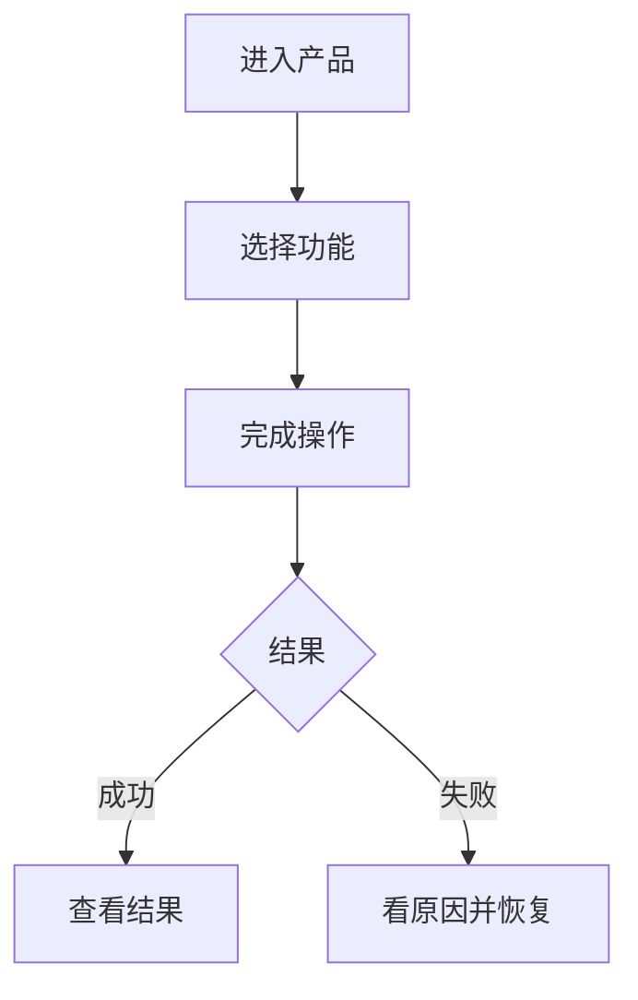

# {版本号} 产品评审版

> 给产品负责人理解本版需求及受影响的完整用户链路，逐页核对和拍板；不是开发需求正文或检测报告。以 5～10 分钟读懂主干为目标，不为篇幅省略页面。规则：工作台 `workflow/01-产品.md` 第 3 节。
> 本版产品需求：[requirements.md](requirements.md) · 全量基线：[当前产品文档]({基线入口}) · 状态：待评审 · 更新：{日期}
> 独立检测：[产品文档检测报告](detection-feedback.md)。检测通过与用户批准分别记录；同意结构不等于批准业务。
> 标记：材料有记载 ≠ 用户已确认；AI 补出的规则标 `⚠️ 推导，待确认`。

## 1. 一句话版本

（1～3 句话：这一版改了什么、用户能得到什么。）

## 2. 本期范围

| 做 | 不做 |
|---|---|
| | （容易被误以为包含的） |

## 3. 产品全景流程

（8～15 个用户能感知的节点；标出本版有变化的节点。）

## 4. 页面地图

本版涉及页面共 {N} 个，弹框 {D} 个；分别登记，Tab、步骤和状态不重复计数。本版涉及的所有页面各有一行，不能用“其余页面只换视觉”代替。

| 页面 | 用户来这里做什么 | 核心操作 | 去向 | 本版变化 |
|---|---|---|---|---|
| | | | | 只改视觉 / R-xx |

| 弹框 ID / 名称 | 何时出现 | 主要按钮及结果 | 本版变化 |
|---|---|---|---|
| | | | |

## 5. 逐页面功能 Checklist

（覆盖页面地图中的每个页面，可按模块分表；只改视觉也保留核心功能和操作结果，本版变化链接 requirements.md，未变规则链接当前基线，不重复长篇正文。）

### {页面 ID} {页面名}

| 检查项 | 当前需求 |
|---|---|
| □ {关键动作} | {何时允许 / 禁止、结果、成功去向、失败怎么恢复} |

## 6. 核心业务规则

### {业务领域}

| 规则 | 当前定义 |
|---|---|
| | （未定的就地标 ⚠️ 并关联决策 ID；冲突列双方依据并关联检测问题，不自行裁决） |

## 7. ⚠️ 必须人工确认的产品决策

| 决策 | 当前定义 | 为什么需要确认 |
|---|---|---|
| | | |

## 8. 异常与边界行为

| 场景 | 当前行为 | 是否需要确认 |
|---|---|---|
| | | 是（D-xx）/ 否（已确认 YYYY-MM-DD） |

## 9. 用真实场景反向 Review

| 场景 | 当前产品行为 | 请确认 |
|---|---|---|
| | | （能直接回答的问题） |

（5～15 个；优先失败、重复操作、历史数据、跨页面联动。）

## 10. 状态变化速查

| 对象 | 正常路径 | 失败或恢复路径 |
|---|---|---|
| | | |

## 11. 已确认 / 待确认

### 已确认

| 决策 | 最终定义 | 确认日期与依据 |
|---|---|---|
| 暂无逐项确认记录 | | |

### 待确认

| ID | 请直接回答 | 优先级 |
|---|---|---|
| | | 阻断 / 普通 |
