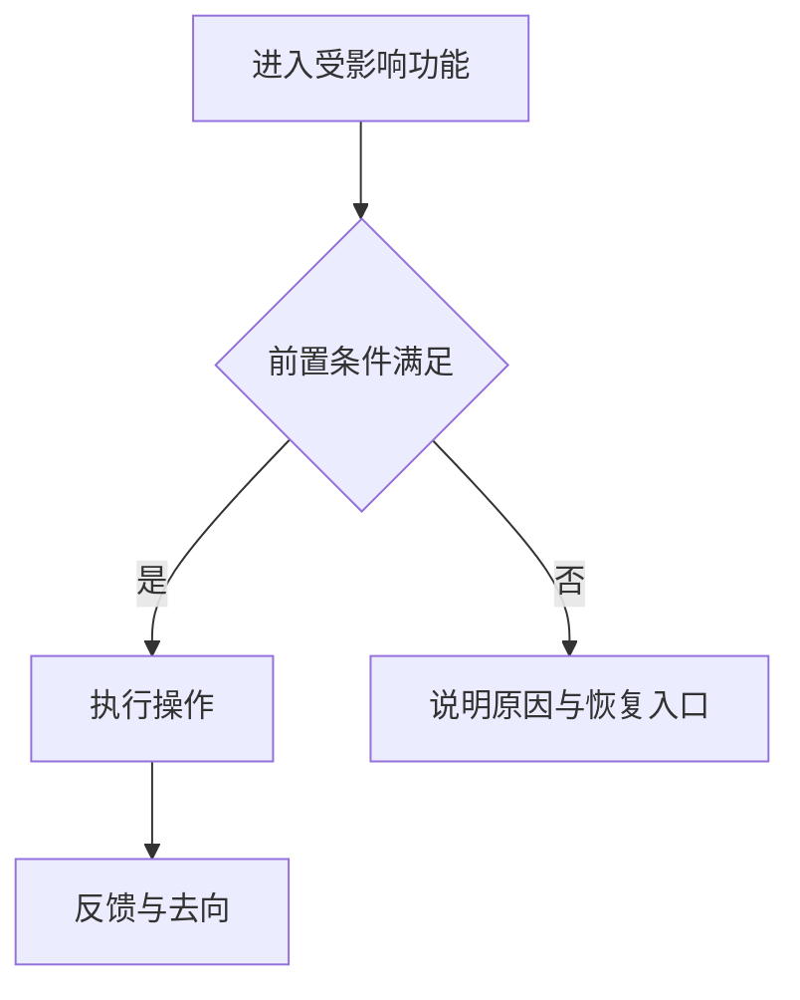

# {版本号} 产品需求

> 本文件只写本版增量，供设计、技术规划、开发和验收使用；不是用户评审版。
> 状态：待编写 / 待评审 · 更新：{日期}
> 全量基线：[当前产品文档]({基线入口})（{上一版本}）；参考版本：{来源版本}，不等于线上基线。
> 需求与验收：[requirements-list.md](requirements-list.md) · 用户评审：[requirements-review.md](requirements-review.md) · 检测：[detection-feedback.md](detection-feedback.md)

## 1. 目标与范围

本版解决什么、做 / 不做什么。未改功能沿用全量基线；首版没有基线时，所有功能按新增写在本文件，不拆为全量分册。

## 2. 改动总览

| R | 基线行为 | 本版目标 | 涉及页面 / 弹框 | 正文位置 |
|---|---|---|---|---|
| R-01 | | | | |

## 3. 本版完整用户链路

按业务模块在下文集中写变更后的完整流程，不要求开发者拼接多个补充文档。

## 4. 变化页面与功能

### R-01 {页面 ID / 名称}

- 页面定位：
- 参考素材：（有图直接引用；无图写暂无设计稿）
- 页面结构与区块（从上到下）：
- 主要功能：
- 交互流程图：（Mermaid，进入 → 操作 → 反馈 → 去向）
- 详细交互：（触发条件、操作、反馈和去向）
- 关键状态与异常：
- 验收引用：requirements-list.md 中 AC-01-1。

只改视觉的页面登记用途、核心操作、去向，业务细节链接当前基线。变化页面和弹框分别计数。

## 5. 业务规则与状态

集中定义本版变化的权限、数据归属、状态变化和重复操作等。价格、额度、时长写来源、刷新时机、失败行为，不能照抄示例值。

## 6. 异常与边界

失败、空、离线、无权限、取消、重复操作、历史数据、跨页面 / 设备等与本版有关的结果和恢复路径。

## 7. 验收与待确认

| R / AC | 对应正文 | 未决问题 / 检测编号 |
|---|---|---|
| | | |

推导和冲突就地标明，不能默认为批准。详细 AC 仅在 requirements-list.md 维护。归档时把已上线增量合入全量基线，不能用本文件覆盖整个当前产品文档目录。
