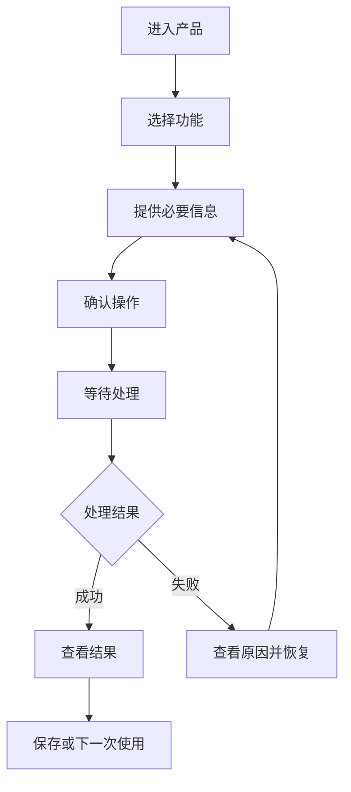

# {产品名} Product Review

> 文档版本：{与 PRD 一致} · 产品版本：{版本} · 更新：{日期}  
> 状态：waiting_review · 预计阅读：5～10 分钟  
> 完整需求真源：[requirements.md](requirements.md)  
> 标记：材料有记载 ≠ 用户已确认；冲突/缺口需决策；AI 补充使用 `⚠️ 推导规则，尚未明确确认`。

## 1. 一句话版本

{用 1～3 句话解释产品最终会变成什么样。}

## 2. 本期范围

| 做 | 不做 |
|----|------|
| {产品级能力} | {易误以为包含的能力} |

## 3. 产品全景流程

<!-- 按实际产品替换，优先 8～15 个用户可感知节点，不加入内部技术步骤。 -->

## 4. 页面地图

当前逻辑页面共 {N} 个；弹窗、Tab、步骤和状态不重复计数。{注明共用页、拆分依据和不确定处。}

| 页面 | 用户来这里做什么 | 核心操作 | 去向 |
|------|------------------|----------|------|
| P01 {名称} | {用途} | {关键动作} | {Pxx 或原页} |

## 5. 逐页面功能 Checklist

### P01 {名称}

| 检查项 | 当前需求 |
|--------|----------|
| □ {关键动作} | {何时允许/禁止、操作结果、成功去向或失败恢复} |

<!-- 每个页面 ID 都必须出现；不列颜色、间距等纯视觉细节，不复制技术实现。 -->

## 6. 核心业务规则

### {业务领域}

| 规则 | 当前定义 |
|------|----------|
| {规则} | {来源状态、定义；未定项就地标记并关联决策 ID} |

## 7. ⚠️ 必须人工确认的产品决策

| 决策 | 当前定义 | 为什么需要确认 |
|------|----------|----------------|
| {已有决策 ID + 标题} | {材料记载 / 冲突 / 缺口 / ⚠️ 推导规则，尚未明确确认} | {用户后果} |

## 8. 异常与边界行为

| 场景 | 当前行为 | 是否需要确认 |
|------|----------|----------------|
| {用户可遇到的异常} | {可感知结果或尚未定义} | {是 + 决策 ID / 否 + 明确确认依据} |

## 9. 用真实场景反向 Review

| 场景 | 当前产品行为 | 请确认 |
|------|--------------|--------|
| {具体用户情境} | {现有定义或待定，不偷偷补默认值} | {能直接回答的问题 + 决策 ID} |

<!-- 替换为 5～15 个真实有价值的场景，优先失败、退款、重复操作、历史规则与页面联动。 -->

## 10. 状态变化速查

| 核心对象 | 正常路径 | 失败或恢复路径 |
|----------|----------|----------------|
| {对象} | {产品语言描述} | {产品语言描述；未定分支关联决策 ID} |

## 11. 已确认 / 待确认

### 已确认

| 决策 | 最终定义 | 确认日期与依据 / 适用版本 |
|------|----------|--------------------------|
| 暂无逐项确认记录 | 不把生成文档或“下一步”视为业务批准 | 待用户明确答复 |

### 待确认

| ID | 请产品负责人直接回答 | 优先级 |
|----|----------------------|--------|
| {复用 PRD 决策 ID} | {可直接回答的问题，不写“请确认全部逻辑”} | {阻断/普通} |
