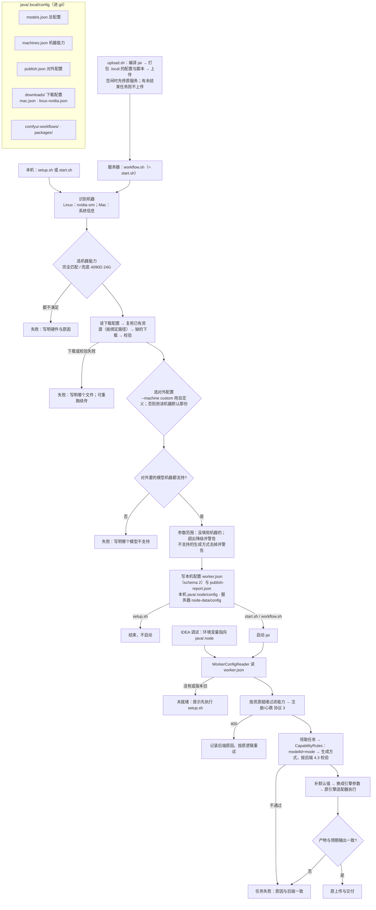

状态：执行中（W1～W5 完成，W6 待 Mac 验证后删除旧目录）

# Worker 能力改造 · Worker 开发计划

> 三份计划之一。能力格式、注册协议、匹配规则以同目录《Worker能力改造-后端》第 4.1～4.4 节为准，本计划只写 Worker 怎么产出和执行它。
> 按 `java/.cursor/rules/09-大功能先规划再编码.mdc` 的 0–8 节模板编写。写于 2026-11-13（洛杉矶时间）。本版取代此前“方案 A（两套安装流程并存）”的写法。

## 0. 执行前置条件

- **技术栈与版本**：JDK 21（toolchain）、Spring Boot 4.1.2、Gradle Wrapper 8.14.2、Jackson 3（`tools.jackson`）；流程脚本 Python 3.9+（只用标准库）。
- **工程与路由**：仓库 `/Users/soul/code/soul/ai-generation-worker`，Java 工作目录 `java/`（IDEA 打开这里）。公共能力，不属于单一 App；实际影响：所有通过后端 GPU 集群渠道调用的 App 与后台 Worker 调试页。流程文档路径：`/Users/soul/work/MakeCodePlanWord/projects/GPU集群/v1.0.0/04-开发计划/Worker能力改造-Worker.md`。
- **文件前提**（2026-11-13 已核对存在）：
  - 云端流程（本次的底）：`java/.local/deploy/` 下 `deploy.py`（打包清单 `PUBLIC`）、`upload.py`、`upload.sh`、`workflow.sh`、`remote_deploy.py`（两阶段）、`model_catalog.py`（`load`/`detect`/`select`/`resolve`）、`worker_config.py`、`server.py`、`download_common.py`、`xg_download.py`、`video_workflows.py`、`install-custom-h3.py`、`locked_exec.py`、`run-worker.sh`、`benchmarks/`、`tests/`；`java/.local/config/` 下 `models.json`、`gpu-machines.json`、`manual.example.json`、`workflows/`、`packages/`、`server.json`、`能力说明.md`、`镜像下载清单.md`。
  - Mac 流程（要并入后删除）：`runtime/`（`start.py`、`environment/detect.py`、`configuration/catalog.py`、`configure.py`、`resources.py`、`gguf_resources.py`、`download/downloads.py`、`sources.py`、`provision.py`、`bootstrap.py`、`service/launcher.py` 等，约 3700 行）、根目录 `config/`（`hardware-profiles/`、`presets/`、`software/`、`downloads.json`、`local/worker.json`、`local/resources.json`）、`workflows/`、`scripts/`、`models/`、`data/`。
  - Java：`core/node/infra/WorkerConfigReader.java`、`core/task/service/WorkerEngineCatalog.java`、`WorkerAgentService.java`、`core/task/infra/WorkerBackendClient.java`、`core/model/service/GenerationCapabilities.java`、`ConfiguredBenchmarks.java`、`ModelCatalogService.java`、`core/model/controller/ModelController.java`、`thirdparty/engine/DeploymentSelfTest.java`、`framework/config/WorkerPaths.java`。
- **规则前提**：`java/AGENTS.md`、`00`、`02`、`03`、`09`、`11`、`17`、`18`。
- **执行基线**：上一轮未提交的改动中，`ConfiguredBenchmarks.profiles`、`WorkerEngineCatalog` 追加实测档位、`logical_model_id` 属于本计划替换对象；`upload.py` 的“空闲时先停服务”逻辑保留。开工前把 `java/.local/config`、`java/.local/deploy` 备份到 `java/.local/backup-<日期>/`；根目录待删除的内容在 git 里有记录，不另备份（`data/`、`runtime/engines/` 是搬走不是删除）。
- **本次不改动范围**：任务日志、领取、进度、上传、交付；各引擎适配器构造命令的方式；节点锁与 `upload.py` 停服务逻辑；后端与后台工程；Windows 支持（用户定：暂时不用，不搬）；Mac 视频（用户定：模型已删，不提供，不重新下载；`H3EngineAdapter.java` 保留不动）。

### 已核对的现状

- 两套流程做同一件事：Mac 走 `runtime/` 写 `config/local/worker.json`；云端走 `java/.local/deploy` 写 `node-data` 下的 `worker.json`。用户定：只留一套，放进 `java/`，以 `java/.local/deploy` 为底。
- Mac 上已有资源：ComfyUI 在 `/Users/soul/data/comfyUI/ComfyUI/ComfyUI`，图片模型在 `/Users/soul/ComfyUI-Shared/models`，音乐引擎与模型在 `/Users/soul/work/ai-lab/minimax-music3/`，文本模型在 `/Users/soul/work/ai-lab/Ollama/blobs/`，llama.cpp 编译产物在仓库 `runtime/engines/llama-cpp-b12110/`。这些靠 `config/local/resources.json` 的“复用已有资源”绑定找到。
- `gpu-machines.json` 现有 4 种机器，每种都列了全部 5 个内部模型；`manual.example.json` 是整份配置的拷贝加一句“手动指定 4090D 24G”，不是独立配置。

## 1. 需求与假设

目标：一套流程、三层配置。打包 → 到本机或服务器 → 读下载配置 → 下载 → 校验 → 识别机器 → 按机器能力和对外配置生成本机配置 → 启动 jar。Mac 与云端只有下载配置和机器配置不同。IDEA 调试只读生成好的本机配置，不跑流程。

需求（用户 2026-11-13 确认）：

- R1 **目录**：配置、脚本、文档都在 `java/.local/`，进 git（私有文件除外）；生成的本机配置、任务数据、产物、日志在 `java/.node/`（不进 git）；`java/.test/` 只放临时测试产物；模型在工程外。
- R2 **模型位置**：ComfyUI 模型放 `~/ComfyUI-Shared`（Mac `/Users/soul/ComfyUI-Shared`，服务器 `/root/ComfyUI-Shared`）。文本、音乐模型已下载好的留在原目录，环境检查按绑定的原路径找；找不到需要重新下载时，下到 `ComfyUI-Shared` 下的独立子目录。
- R3 **三层配置**：
  - `models.json` 总配置（有哪些模型、生成方式、公共参数、默认用哪个内部模型和工作流）；
  - `machines.json` 机器能力（“我有什么”：每种机器实测能做什么、参数范围、需要时覆盖内部模型/工作流；实测记录与 `note` 只给人看）；
  - `publish.json` 对外配置（“我给什么”：注册给后端的内容，用户自己写）。
- R4 **6 份对外配置**：4090 24G、4090 48G、4090D 24G、4090D 48G（自动识别，对外给视频、音乐）；Mac（自动识别，对外给文本、图片、音乐）；自定义（不绑定机器，启动时 `--machine custom` 手动指定才用，对外给文本、图片、视频）。
- R5 **对外配置的处理规则**（6 份同一套）：
  1. 对外配置一般只写大类（视频、音乐……），参数范围没写就用机器能力里的范围；
  2. 对外配置要的模型（大类）这台机器不支持 → 报错，不启动，写明哪个模型；
  3. 填了参数范围但超出机器能力（含交集为空，如只填 1080p 而机器只到 720p）→ 不报错，降级为机器能力范围内的部分（交集为空时用机器的范围），给警告；
  4. 指定了机器不支持的生成方式 → 去掉该生成方式并警告，其余照常；
  5. 警告打印在屏幕上，并写入 `java/.node/config/publish-report.json`（哪一项填的是多少、实际降到多少）。
- R6 **机器能力**：4090D 24G 为实测值（视频 480p ≤15 秒、720p ≤10 秒，首帧/尾帧/首尾帧与 9:16 暂按文生视频范围并标 `note: 待实测`；参考图 720p ≤10 秒、1～9 张；图片边长 ≤4096；音乐 10～300 秒；文本上下文 9 档、最大输出 ≤2048）；其他 4090 机型匹配不上或没写时按兜底规则沿用 4090D 24G；Mac 写文本、图片、音乐（文本上下文 8192、图片 1024×1024、音乐未实测先写 10～60 秒并标 `note: 待实测`），不写视频。Mac 数值在 W2 填好后请用户确认。
- R7 **工作流**：`workflows/` 改名 `comfyui-workflows/`；总配置写每种生成方式默认用哪个内部模型和工作流，机器能力里可按机器覆盖。
- R8 **四个入口**：`setup.sh`（准备环境：识别 → 下载 → 校验 → 生成本机配置）、`start.sh`（准备环境后启动 jar；服务器上沿用 `workflow.sh` 这个名字作为别名）、`upload.sh`（编译 → 打包 → 上传，沿用现有）、IDEA 调试（环境变量指向 `java/.node`，Java 只读本机配置，不下载不校验模型；环境未就绪时报“未就绪”和原因）。
- R9 **上报与执行**：Java 读本机配置里的 `capabilities`，按资源就绪情况过滤后以协议 3 上报；按任务 `modelId` + `mode` 选内部模型与工作流，按后端 4.3 同一规则再校验、补默认值、把公共参数换成引擎参数；删除 Mac 写死分支、档位、自检证据决定可用性的逻辑。
- R10 **并入后删除**：根目录 `runtime/`、`config/`、`scripts/`、`workflows/`、`models/`；`data/` 与 `runtime/engines/` 搬到 `java/.node/`。

假设：

- A1 引擎换算需要的几何参数（各清晰度宽高、帧率）与引擎硬上限留在总配置的内部模型定义里，机器能力只写对外范围。若不成立则停止 W2 并询问。
- A2 步数、cfg、批量等内部参数不对外，固定在内部模型定义里。
- A3 `.gitignore` 改为放行 `java/.local/`，只忽略 `java/.local/config/server.json`、`java/.local/deploy/dist/`、`java/.local/backup-*/`、`java/.local/service/`、`java/.local/worker.pid`、`java/.node/`、`java/.test/`。`java/.local/config/` 里如发现其他含密钥或私有地址的文件，停下列出让用户定。
- A4 服务器上的数据目录保持 `node-data/`（与程序目录同级），本机为 `java/.node/`；两者内部结构相同。

## 2. 主流程图



## 3. 批次总览

| 批次 | 目标 | 涉及文件 | 前置 | 验收要点 |
|---|---|---|---|---|
| W1 | 目录归位：`.local` 进 git、`.node` 就位、工作流改名 | 修改 `.gitignore`；`java/.local/config/workflows/` → `comfyui-workflows/`（同步 `models.json` 路径、`deploy.py` 的 `PUBLIC`、`video_workflows.py`、`upload.py`）；`data/` → `java/.node/data/`、`runtime/engines/` → `java/.node/engines/`；`WorkerPaths.java` 默认根目录说明 | 无 | 现有云端流程与测试照常通过；git 能看到 `.local` 的配置和脚本，私有文件不在其中 |
| W2 | 三层配置与“算能力” | 修改 `java/.local/config/models.json`（新增逻辑模型一节，删 `logical_model_id`）；`gpu-machines.json` → `machines.json`；新增 `publish.json`；删除 `manual.example.json`；新增 `java/.local/deploy/capabilities.py`、`tests/test_capabilities.py` | W1 | 6 份对外配置在对应机器上算出的能力正确；报错、降级、警告各有用例 |
| W3 | 一套流程：Mac 并入、四个入口 | 新增 `java/.local/config/downloads/mac.json`、`linux-nvidia.json`（由 `models.json` 的 `files`/`software` 与根 `config/presets`、`config/software` 整理而来）、`java/.local/config/resources.example.json`；新增 `java/.local/deploy/detect.py`（并入 `runtime/environment/detect.py` 的 Mac/Linux 识别）、`resources.py`（并入复用已有资源绑定）、`sources.py`（并入多下载源切换）、`setup.sh`、`start.sh`；修改 `model_catalog.py`、`remote_deploy.py`、`worker_config.py`、`server.py`、`deploy.py`、`workflow.sh`；删除四个 `deploy-4090*.sh`；测试 | W2 | Mac 与云端用同一套脚本各产出 schema 2 的 `worker.json`，结构相同；Mac 不重复下载已有资源 |
| W4 | Java 读取与上报 | 修改 `WorkerConfigReader.java`、`WorkerEngineCatalog.java`（`capabilities`、`nodeCapabilities`）、`WorkerBackendClient.java`、`ModelController.java`/`ModelCatalogService.java`；测试 | W3 | 上报与本机配置一致、无内部字段；资源未就绪的生成方式不上报；IDEA 指向 `java/.node` 可直接启动 |
| W5 | Java 执行 | 新增 `core/model/service/CapabilityRules.java`；修改 `WorkerEngineCatalog.command`、`WorkerAgentService.java`、`DeploymentSelfTest.java`；测试 | W4 | 各生成方式从公共参数正确换算；拒绝原因与后端一致 |
| W6 | 删除旧流程与清理、文档 | 删除根目录 `runtime/`、`config/`、`scripts/`、`workflows/`、`models/`；删除 `ConfiguredBenchmarks.profiles`、`rejectProfile`、Mac 写死分支及对应测试；`benchmarks/*.py` 写实测改写到 `machines.json`；更新根 `README.md`、`AGENTS.md`、`java/README.md`、`java/docs/配置说明.md`、`java/.local/README.md`、`java/.local/config/能力说明.md`、`java/.cursor/rules/02-项目结构目录.mdc` | W5 | 无旧路径、旧档位引用残留；文档与目录一致 |

## 4. 数据结构 / 接口 / 状态约定

- **对后端的 HTTP 契约**：见后端计划 4.2（注册、心跳协议 3）与 4.5（领取请求含 `mode`）。Worker 不另定。
- **本机查询接口**：`ModelController` 路径不变，返回内容加本机能力（与上报相同）。
- **状态与并发**：不新增任务状态；节点锁沿用（`setup.sh`/`start.sh` 与运行中的服务互斥）。
- **外部副作用**：下载走配置里的下载源；生成测试耗时长，不自动重试。
- **数据库改动**：无（Worker 无数据库）。

### 4.1 目录

```
java/
├─ src/
├─ .local/                         进 git（A3 列出的私有文件除外）
│  ├─ config/
│  │  ├─ models.json               总配置
│  │  ├─ machines.json             机器能力（我有什么）
│  │  ├─ publish.json              对外配置（我给什么）
│  │  ├─ downloads/mac.json、linux-nvidia.json   下载配置
│  │  ├─ resources.example.json    复用已有资源的示例；实际绑定写在 .node/config/resources.json
│  │  ├─ comfyui-workflows/、packages/
│  │  └─ server.json               私有
│  ├─ deploy/                      流程脚本（一套）：setup.sh、start.sh、upload.sh、workflow.sh…
│  └─ README.md、能力说明等文档
├─ .node/                          不进 git；服务器上对应 node-data/
│  ├─ config/worker.json、publish-report.json、resources.json
│  ├─ engines/                     本机编译或安装的引擎
│  └─ data/                        inputs、outputs、state、logs、temp
└─ .test/                          临时测试产物
```

### 4.2 总配置 `models.json`

保留现有 `models`（内部模型：引擎、文件、内部参数、引擎几何与硬上限、工作流文件、计时基线）、`paths`、`software`；删除 `selection`、各内部模型的 `logical_model_id`；新增 `logical_models`：

```json
{ "model": "minimax-h3", "kind": "video", "label": "MiniMax H3",
  "parameters": [
    { "name": "resolution", "label": "清晰度", "type": "string", "options": ["320p","480p","720p","1080p"], "engine": { "name": "resolution" } },
    { "name": "aspectRatio", "label": "画面比例", "type": "string", "options": ["16:9","9:16"],
      "engine": { "name": "orientation", "values": { "16:9": "landscape", "9:16": "portrait" } } },
    { "name": "durationSeconds", "label": "时长", "type": "number", "unit": "秒", "minimum": 1, "maximum": 15, "engine": { "name": "duration_seconds" } },
    { "name": "audio", "label": "生成音轨", "type": "boolean", "default": true, "engine": { "name": "audio" } },
    { "name": "seed", "label": "随机种子", "type": "integer", "minimum": 0, "engine": { "name": "seed" } } ],
  "modes": [
    { "mode": "TEXT", "label": "文生视频", "operation": "VIDEO_GENERATION", "inputs": [],
      "texts": [ { "name": "prompt", "label": "生成描述", "required": true, "maxLength": 20000 } ],
      "implementation": "minimax-h3-fl2va-int8", "workflow": "t2v" },
    { "mode": "FIRST_FRAME", "…": "首帧 1 张；implementation minimax-h3-fl2va-int8，workflow i2v" },
    { "mode": "LAST_FRAME", "…": "尾帧 1 张；workflow l2v" },
    { "mode": "FIRST_LAST_FRAME", "…": "首帧 1、尾帧 1；workflow fl2v" },
    { "mode": "REFERENCE_IMAGES", "…": "参考图 1～9 张；implementation minimax-h3-ref2va-int8，workflow ref2v" } ] }
```

（`"…"` 处实际文件写全字段。）其余逻辑模型：`z-image-turbo`（`width`、`height`、`seed`；`TEXT`）、`ace-step-1.5-xl-sft`（`duration_seconds`、`instrumental`、`vocal_language`、`bpm`、`keyscale`、`timesignature`、`seed`；`TEXT` 带歌词条件、`REFERENCE_AUDIO`）、`huihui-qwen3.8-27b`（`max_tokens`、`temperature`、`top_p`、`context_size`、`seed`；`TEXT` 带 `systemPrompt`）。参数名以后端 4.4 为准。`implementation`、`workflow`、`engine` 只在本工程内用，不上报。

### 4.3 机器能力 `machines.json`

由 `gpu-machines.json` 改名：保留 `fallback_machine`、每种机器的 `label`、`match`、`runtime`、`tested`（实测记录）；新增 `models`（按逻辑模型 → 生成方式 → 参数范围与默认值，可带 `note`，可用 `implementations` 覆盖内部模型/工作流）；新增 `mac-apple-silicon`（`match`: `system: Darwin`、`architecture: arm64`）。

```json
"4090d-24g": { "models": {
  "minimax-h3": { "modes": {
    "TEXT": { "parameters": {
      "resolution": { "options": ["480p","720p"], "default": "480p" },
      "aspectRatio": { "options": ["16:9","9:16"], "default": "16:9", "note": "待实测：9:16 尚未实测，范围暂按横屏" },
      "durationSeconds": { "default": 5, "limitsBy": { "parameter": "resolution", "values": { "480p": { "maximum": 15 }, "720p": { "maximum": 10 } } } },
      "audio": { "options": [true] } } },
    "FIRST_FRAME": { "note": "待实测：范围暂按文生视频", "parameters": { "…逐项写全…": "" } },
    "LAST_FRAME": { "…": "" }, "FIRST_LAST_FRAME": { "…": "" },
    "REFERENCE_IMAGES": { "inputs": { "reference_image": { "maximum": 9 } },
      "parameters": { "resolution": { "options": ["720p"], "default": "720p" }, "durationSeconds": { "maximum": 10, "default": 10 }, "audio": { "options": [true] } } } } },
  "z-image-turbo": { "modes": { "TEXT": { "parameters": { "width": { "maximum": 4096, "default": 1024 }, "height": { "maximum": 4096, "default": 1024 } },
    "presets": [ { "label": "1K 方图", "parameters": { "width": 1024, "height": 1024 } }, { "label": "2K 方图", "…": "" }, { "label": "4K 方图", "…": "" } ] } } },
  "ace-step-1.5-xl-sft": { "modes": { "TEXT": { "parameters": { "duration_seconds": { "minimum": 10, "maximum": 300, "default": 60 } } } } },
  "huihui-qwen3.8-27b": { "modes": { "TEXT": { "parameters": {
    "context_size": { "options": [4096,8192,16384,32768,65536,98304,114688,122880,124928], "default": 4096 }, "max_tokens": { "maximum": 2048, "default": 128 } } } } } } }
```

规则：没写的模型或生成方式＝这种机器做不了；值只能收窄总配置（越界时 `setup.sh` 失败并写明哪一项——这是配置文件本身写错，不属于 R5 的降级）；`note` 与 `tested` 不进能力。

### 4.4 对外配置 `publish.json`

```json
{ "schema_version": 1,
  "defaults": { "4090-24g": "gpu-video-music", "4090-48g": "gpu-video-music", "4090d-24g": "gpu-video-music", "4090d-48g": "gpu-video-music", "mac-apple-silicon": "mac" },
  "publish": {
    "gpu-video-music": { "label": "GPU 默认：视频、音乐", "models": { "minimax-h3": {}, "ace-step-1.5-xl-sft": {} } },
    "mac":             { "label": "Mac：文本、图片、音乐", "models": { "huihui-qwen3.8-27b": {}, "z-image-turbo": {}, "ace-step-1.5-xl-sft": {} } },
    "custom":          { "label": "自定义：文本、图片、视频", "models": { "huihui-qwen3.8-27b": {}, "z-image-turbo": {}, "minimax-h3": {} } } } }
```

用户说的“6 种配置”= 4 种 GPU 机器（默认都指向 `gpu-video-music`，需要区别对待时在 `defaults` 里给某种机器换一份）+ `mac` + `custom`。每个模型的 `{}` 里可选写 `modes`（只给哪些生成方式）和 `parameters`（比机器更窄的范围，写法同 4.3）；不写就是机器能力的全部。处理规则见 R5。

### 4.5 本机配置 `worker.json`（schema_version 2）与 `publish-report.json`

`worker.json`：`run_id`、`machine`（选中的机器能力 id）、`publish`（选中的对外配置 id）、`engines`、`models`（内部模型与资源路径）、`paths`、`capabilities`（后端 4.1 格式；每个生成方式多内部字段 `implementation`、`workflow`，每个参数多 `engine`，上报前删除）。

`publish-report.json`：`{ "machine", "publish", "warnings": [ { "model", "mode", "parameter", "requested", "applied", "reason" } ] }`。

## 5. 分批详细计划

### 批次 W1：目录归位

- **范围**：只动位置、名字和 `.gitignore`，不改流程行为。
- **执行步骤**：
  1. 目标：`.local` 进 git。改动：`.gitignore` 按 A3 改写。前置检查：逐个查看 `java/.local/config/` 文件，确认除 `server.json` 外无密钥或私有地址；有则停下。验证：`git status` 中出现 `.local` 的配置与脚本，不出现 A3 列出的私有项。
  2. 目标：工作流改名。改动：目录改名，全仓库替换对 `config/workflows` 的引用（`models.json` 的工作流路径、`deploy.py` `PUBLIC`、`video_workflows.py`、`upload.py`、测试、文档）。验证：`cd java/.local/deploy && python3 -B -m unittest discover -s tests`。
  3. 目标：数据就位。改动：`data/` 内容移到 `java/.node/data/`，`runtime/engines/` 移到 `java/.node/engines/`；Mac 的 `config/local/worker.json`、`resources.json` 复制到 `java/.node/config/`（旧文件 W6 才删）。前置检查：Mac 上 Worker 未在运行。验证：目录存在、文件数一致。
- **验收清单**：
  - [ ] 云端流程测试通过；`./gradlew test` 受影响测试通过。
  - [ ] `git diff --check`；未跟踪文件单独检查。

### 批次 W2：三层配置与算能力

- **核心函数骨架**（`java/.local/deploy/capabilities.py`）：

```python
class CapabilityError(ValueError): ...

def load(config_dir) -> dict:
    """读 models.json、machines.json、publish.json；结构不对 → CapabilityError(文件、字段)。
       同时校验 machines 只收窄 models（越界 → CapabilityError，写明机器、模型、生成方式、参数）。"""

def machine_capabilities(catalog, machine_id) -> dict:
    """机器能力 = 总配置定义 × 机器范围；没写范围的机器按 fallback_machine。结果按 逻辑模型 → 生成方式。"""

def choose_publish(catalog, machine_id, requested=None) -> str:
    """requested（--machine custom 等）优先；否则 publish.defaults[machine_id]；都没有 → CapabilityError。"""

def build(catalog, machine_id, publish_id, implementations) -> tuple[list, list]:
    """返回 (capabilities, warnings)。
       1. 对外配置里的每个模型：机器能力里没有 → CapabilityError("对外配置 {publish} 需要模型 {model}，机器 {machine} 不支持")
       2. 生成方式：没指定 → 机器支持的全部；指定了机器没有的 → 去掉 + warning
       3. 参数：没写 → 机器范围；写了 → 与机器范围取交集；交集比所写窄或为空 → 用交集（为空用机器范围）+ warning
       4. 内部模型必须在 implementations（本机已就绪的内部模型）里，否则该生成方式去掉 + warning；
          一个模型的生成方式全被去掉 → CapabilityError
       5. 去掉 note；写入内部字段 implementation、workflow、engine"""
```

- **执行步骤**：
  1. 目标：三份配置文件。改动：按 4.2～4.4 写全；4090D 数值从现有 `limits`、`tested` 迁入；Mac 数值按 R6。前置检查：W1 完成。验证：JSON 可解析；Mac 数值请用户确认。
  2. 目标：算能力。改动：新增 `capabilities.py` 与测试。验证：`cd java/.local/deploy && python3 -B -m unittest tests.test_capabilities`。
- **验收清单**：
  - [ ] 4090D 24G + `gpu-video-music` → 只有视频、音乐，范围同机器能力，无警告。
  - [ ] 4090D 24G + `custom` → 文本、图片、视频。
  - [ ] Mac + `mac` → 文本、图片、音乐；Mac + `custom` → 报错“机器 mac-apple-silicon 不支持模型 minimax-h3”。
  - [ ] 对外配置写视频 720p/1080p、0～15 秒：48G 机器（能力含时）原样；24G 降为 720p、≤10 秒并有警告；只写 1080p → 用机器范围并警告。
  - [ ] 音乐写 600 秒 → 降为 300 秒并警告；`note` 不出现在能力里；机器能力越过总配置 → 加载即失败。

### 批次 W3：一套流程

- **范围**：`model_catalog.py` 的识别改用新 `detect.py`（Linux 沿用 `nvidia-smi`，新增 Darwin）；机器选择沿用“完全匹配 → 兜底”；下载清单改读 `downloads/<系统>.json`；并入复用已有资源与多下载源；生成本机配置时调用 `capabilities.build`；新增入口。
- **核心函数骨架**：

```python
# java/.local/deploy/remote_deploy.py（流程主体；本机与服务器同一份）
def prepare(args) -> Path:
    """setup.sh 与 start.sh 共用。
       1. hardware = detect.detect()；machine = model_catalog.select(...)（不满足 → 失败）
       2. downloads = 读 config/downloads/{mac|linux-nvidia}.json
       3. resources.bind(node/config/resources.json)：已有资源按绑定路径校验后复用
       4. 缺的文件：sources 选下载源 → download_common 续传 → SHA-256 校验（失败 → 报哪个文件）
          ComfyUI 模型下到 ComfyUI-Shared/models；文本、音乐模型缺失时下到 ComfyUI-Shared 下独立子目录
       5. implementations = 资源就绪的内部模型
       6. publish_id = capabilities.choose_publish(catalog, machine, args.machine)
       7. caps, warnings = capabilities.build(...)；打印警告
       8. worker_config.write(node/config/worker.json, schema 2)；写 publish-report.json；返回路径"""
def main():
    # --stage setup → prepare() 后结束；--stage workflow（默认）→ prepare() 后沿用现有启动与就绪等待
```

- `setup.sh`、`start.sh`：本机默认 `--root java/.node`；服务器上 `workflow.sh` 行为不变（多一个可选 `--machine`）。四个 `deploy-4090*.sh` 删除，`deploy.py` 的 `PUBLIC` 同步（加入三份配置、`downloads/`、`capabilities.py`、`detect.py`、`resources.py`、`sources.py`、`setup.sh`、`start.sh`；去掉 `gpu-machines.json`、`manual.example.json`、四个脚本）。
- `run-worker.sh`：数据目录默认值在本机为 `java/.node`、服务器为 `node-data`（按程序目录是否在 `java/.local` 下判断）。
- **执行步骤**：
  1. 目标：下载配置成形。改动：新增两份 `downloads/*.json`（Mac：llama.cpp Mac 版、PyTorch MPS、Z-Image 三个文件、文本与音乐模型条目；不含 H3 Metal 与视频模型）。前置检查：对照 Mac 现有 `worker.json` 的文件清单与校验值。验证：`setup.sh --plan`（只读预览）列出“已有/需下载”。
  2. 目标：流程打通。改动：上述脚本。验证：见验收。
- **验收清单**：
  - [ ] `cd java/.local/deploy && python3 -B -m unittest discover -s tests` 通过（`test_catalog`、`test_capability_preview`、`test_upload` 等按新结构更新，新增 Mac 识别与资源绑定用例）。
  - [ ] Mac 本机 `sh java/.local/deploy/setup.sh`：不重复下载已有的图片、文本、音乐资源，生成 `java/.node/config/worker.json`（schema 2，能力为文本、图片、音乐）。
  - [ ] `upload.sh --build-only` 成功；包内含三份配置、下载配置、`comfyui-workflows/`。
  - [ ] 服务器只读预览（`workflow.sh --plan`）显示选中的机器、对外配置与能力。

### 批次 W4：Java 读取与上报

- **核心函数骨架**：

```java
// core/node/infra/WorkerConfigReader.java
public WorkerSnapshot load(WorkerPaths paths) {
    // 1. 文件不存在或 schema_version != 2 → 未就绪：“本机配置不存在或版本过旧，请先执行 java/.local/deploy/setup.sh”
    // 2. 其余资源检查沿用（按 models 逐个内部模型）
}
// core/task/service/WorkerEngineCatalog.java
public ArrayNode capabilities() {
    // 1. 读 configuration.capabilities
    // 2. 生成方式的 implementation 不在资源就绪集合 → 去掉；没有剩余生成方式 → available=false
    // 3. 删除内部字段 implementation、workflow、engine；gpuId 沿用 gpuBinding
    // 删除：parameter_schema 分支、按引擎写死的分支、proof()、evidence、rejectedProfiles
}
// core/task/infra/WorkerBackendClient.java
public void register(UUID sessionId, JsonNode capabilities, JsonNode gpus, String nodeName) {
    // body：sessionId、protocolVersion=3、capabilities、gpus、nodeName；心跳字段同步改名
}
```

- IDEA 调试：在 `java/README.md` 写明运行配置（主类 `ServerApplication`，环境变量 `AI_WORKER_ROOT=<工程>/java/.node`、`AI_WORKER_CONFIG=<工程>/java/.node/config/worker.json`）；不提交 `.idea`。
- **验收清单**：
  - [ ] `cd java && ./gradlew test --tests 'com.soul.aigeneration.worker.core.node.*' --tests 'com.soul.aigeneration.worker.core.task.WorkerAgentHttpTests' --tests 'com.soul.aigeneration.worker.core.task.BackendConnectionTests'` 通过。
  - [ ] 新增测试：4090D 与 Mac 的 `worker.json` 样例，上报 JSON 符合后端 4.1、无内部字段；内部模型未就绪时对应生成方式不上报；没有本机配置时状态为未就绪且原因提示 `setup.sh`。

### 批次 W5：Java 执行

- **核心函数骨架**：

```java
// core/model/service/CapabilityRules.java（新增；规则与后端 4.3 相同，原因文案一致）
public final class CapabilityRules {
    public record Selection(JsonNode mode, ObjectNode parameters) {}
    /** 1. 按 modelId、mode 找生成方式（mode 缺失时按 operation+素材识别） 2. 参数、文本、素材校验 3. 补 default；不满足 → IllegalArgumentException(原因) */
    public static Selection select(JsonNode capability, JsonNode request) { ... }
    /** 按参数 engine 字段改名、换值；写入生成方式的 workflow 为 workflow_id。 */
    public static ObjectNode engineParameters(JsonNode mode, ObjectNode parameters) { ... }
}
// core/task/service/WorkerEngineCatalog.java
public EngineCommand command(JsonNode request, Map<String, Path> inputs, Path workspace) throws IOException {
    // 1. capability = capabilities 中 model == request.modelId；selection = CapabilityRules.select(...)
    // 2. implementation 未就绪 → “模型资源尚未就绪”
    // 3. engineRequest.parameters = engineParameters(...)；modelId 换成内部模型 id
    // 4. 内部模型带引擎上限定义 → GenerationCapabilities.prepare；否则原适配器直接执行
    // 5. GPU 绑定、generation-plan.json、环境变量沿用
}
```

- `WorkerAgentService`：产物核对改用本次 `GenerationPlan.output()`，删除 `rejectProfile` 调用。`DeploymentSelfTest`：按每个生成方式的默认值构造请求，不再写或读 `generation-profiles.json`。
- **验收清单**：
  - [ ] `cd java && ./gradlew test --tests 'com.soul.aigeneration.worker.core.model.*' --tests 'com.soul.aigeneration.worker.core.task.TaskPipelineTests'` 通过。
  - [ ] 新增用例：480p 5 秒、720p 10 秒换算正确；720p 15 秒、参考图 10 张、`context_size` 不在可选值、纯音乐带歌词各自拒绝且原因与后端一致；9:16 → `orientation=portrait`；参考图走 `minimax-h3-ref2va-int8`；Mac 的文本、图片、音乐走原适配器。

### 批次 W6：删除旧流程、清理、文档

- **执行步骤**：
  1. 目标：只剩一套流程。改动：删除根目录 `runtime/`、`config/`、`scripts/`、`workflows/`、`models/`。前置检查：W3 的 Mac `setup.sh` 与 W4 的 IDEA 启动都已验收；全仓库搜索对这些目录的引用为零（文档除外）。验证：Mac `setup.sh` 与 `start.sh` 仍可用。
  2. 目标：清掉旧档位代码。改动：见批次总览。验证：`cd java && ./gradlew test`。
  3. 目标：文档一致。改动：各 README、`02-项目结构目录.mdc`、根 `AGENTS.md`（“运行脚本为 runtime/”一句改为 `java/.local/deploy`）。
- **验收清单**：
  - [ ] 搜索 `runtime/`、`config/hardware-profiles`、`config/presets`、`gpu-machines`、`manual.example`、`logical_model_id`、`generation-profiles`、`profiles` 无残留读取（备份目录除外）。
  - [ ] `cd java && ./gradlew test`、`cd java/.local/deploy && python3 -B -m unittest discover -s tests` 通过；`git diff --check`；未跟踪文件单独检查。

## 6. 批次推进规则

W1 → W6 顺序推进，一次一批；当前批验收不过不进下一批；每批完成写“执行记录”。用户授权连续执行时验收通过即继续。W6 的删除在 W3、W4 验收通过前不得执行。

## 7. 总体验收

- [ ] R1～R10 逐条：需求 → 实现位置 → 验证结果。
- [ ] Java 受影响测试与流程脚本测试通过；`./gradlew build -x test` 与 `upload.sh --build-only` 成功。
- [ ] 联调（《Worker能力改造-后台》第 6 节）：4090D 执行 `upload.sh` 与 `workflow.sh` 后注册成功，对外为视频、音乐；用 `workflow.sh --machine custom` 时对外为文本、图片、视频；Mac `start.sh` 后注册成功，对外为文本、图片、音乐；IDEA 直接启动与 `start.sh` 启动上报内容一致。
- [ ] 标 `note: 待实测` 的组合在联调中的首次运行结果交用户，由用户决定是否改机器能力。
- [ ] `git diff --check` 通过；无范围外修改。

## 8. 失败处理约定

- 文件前提不成立、命令报错：保留现场，报告失败步骤、证据、已完成内容与下一步，不标完成。
- 范围内问题自己修；没有新证据不重复执行失败命令；耗时生成测试与下载不自动重试。
- 需要加依赖、改后端或后台、恢复 Windows 或 Mac 视频、发现 `.local` 里有不该进 git 的内容：停下等用户决定。
- 删除只按 W6 列出的目录执行；误删用 git 恢复，不做 `git reset`、`git clean`。
- 联调中同一问题最多修 3 次，修不好记入问题清单继续，最后统一报告。

## 执行记录

- 2026-11-13 W1 完成：`.gitignore` 放行 `java/.local`（只忽略 server.json、selected.json、dist、backup、service、worker.pid）与忽略 `java/.node/`；`workflows/` → `comfyui-workflows/` 并同步引用；`data/`、`runtime/engines/` 搬到 `java/.node/`；备份 `java/.local/backup-20261113-restructure/`。
- 2026-11-13 W2 完成：`models.json` v2（`logical_models` 四个逻辑模型；内部模型去掉 `logical_model_id`、加 `geometry`）、`machines.json`（4090D 24G 实测能力；其余三种 4090 `inherits` 4090D 24G；Mac 文本/图片/音乐）、`publish.json`（gpu-video-music、mac、custom）、`downloads/{linux-nvidia,mac}.json`；新增 `deploy/capabilities.py`（校验、机器能力、对外配置降级与警告、换算上限）与 `tests/test_capabilities.py`（21 例）。删除 `gpu-machines.json`、`manual.example.json`。
- 2026-11-13 W3 完成：`model_catalog.py` 改读三层配置（Darwin 识别、`--machine` 指定机器或对外配置）；新增 `resources.py`（节点目录 `config/local/resources.json` 复用已有引擎与模型，文件不全时回退下载）、`setup.sh`、`start.sh`；`remote_deploy.py` 增 `setup`/`start` 阶段、Mac 找 Java 21、Python 3.9；`server.py` 增 Mac 分支（ComfyUI/ACE-Step 只检查不安装，llama.cpp 下载官方 Mac 包）；`worker_config.py` 写 schema 2（`machine`、`publish`、`capabilities`）与 `publish-report.json`；`deploy.py` 拆出 `build_jar`、打包三层配置、不再生成 `selected.json`；删除四个 `deploy-4090*.sh`；`server.json` 的 `profile` 改名 `machine`。Mac 的 `java/.node/config/local/resources.json` 已按原绑定写好（ACE 目录只核对大小，Ollama 文本模型按自身 SHA-256）。验证：`python3 -B -m unittest discover -s tests` 200 例，仅 1 例因 VM 无权访问 /root/.cache/pip 报错（与本次无关）。与计划不同：识别放在 `model_catalog.py`（未单独建 detect.py）；本机配置路径沿用 Java 默认的 `config/local/worker.json`。
- 2026-11-13 W4/W5 完成：新增 `CapabilityRules`（与后端 4.3 同规则：生成方式、参数含 limitsBy、文本条件；换引擎参数；对外视图去掉本机字段）；`WorkerEngineCatalog` 上报 `capabilities`、按逻辑模型 + 生成方式执行，删除档位证据、`rejectProfile`、写死分支；协议 3；`WorkerConfigReader` 只认 schema 2；`DeploymentSelfTest` 按能力默认值自检；新增 `GET /api/v1/models/capabilities`；删除 `ConfiguredBenchmarks.profiles`、`MacCapabilitiesTests`。验证：容器内 javac 编译主代码与测试通过，纯单元测试通过；mock final 类的 4 个用例需在本机 `./gradlew test` 验证。
- 待用户在 Mac 执行：`sh java/.local/deploy/setup.sh`（确认不重复下载、生成 schema 2 配置）与 `./gradlew test`；通过后执行 W6 的根目录删除。
