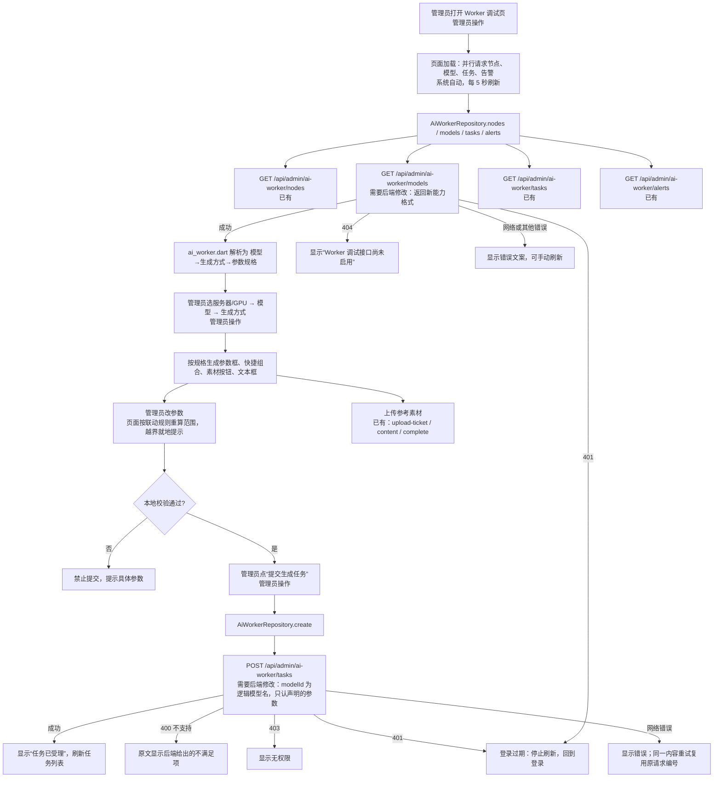

状态：执行中（A1～A4 完成，待本机 flutter analyze / flutter test 与三端联调）

# Worker 能力改造 · 后台开发计划

> 三份计划之一。能力格式与匹配规则以《Worker能力改造-开发计划-后端》第 4 节为准，本计划只写后台怎么解析、显示和提交。
> 写于 2026-11-13（洛杉矶时间）。第 0 节“执行前核对”必须先做，结果与计划不符时停下来报告。按 `.cursor/rules/06-开发计划.mdc`，本计划放在流程工作区 `/Users/soul/work/MakeCodePlanWord/projects/GPU集群/v1.0.0/04-开发计划/Worker能力改造-后台.md`（项目“GPU集群”）。

## 0. 前提

- 目标 App：所有 App 共用的后台。入口：左侧菜单“AI 与计费 → Worker 调试”（`admin.html`，页面 `lib/pages/common/ai_worker_page.dart`）。
- 工程：`/Users/soul/code/lxwx/lxwx_admin`；另一端：后端 `/Users/soul/code/lxwx/lxwx_service/lxwxservice`（本计划不改后端）。
- 本次要读的规则：`00-编码工作流程.mdc`（已读）、`06-开发计划.mdc`（已读）、`02-项目结构目录.mdc`、`03-编码规范.mdc`、`04-后台管理UI规则.mdc`、`05-接口与鉴权规则.mdc`（执行前读）。
- 开始时工作区里已有的改动（`git status` 中的大量 catdrama、规则文件、Worker 调试页新增文件）不是本次的，不回滚、不覆盖。
- 本次不改动范围：服务器与 GPU 表格、集群运行告警卡片、最近任务列表、任务详情、成品预览与下载、素材上传接口与流程、菜单入口与权限码、其他页面。

### 执行前核对（不改代码，结果写进“执行记录”）

1. 完整读 `ai_worker_page.dart`（约 1500 行）、`lib/models/ai_worker.dart`、`test/ai_worker_page_test.dart`、`test/ai_worker_http_test.dart`，列出所有使用 `profiles`、`defaults`、`constraints`、`operationParameters`、`maxShortSide`、`unavailableProfiles`、`parameterKeys`、`_primaryParameters` 的位置。
2. 读 `05-接口与鉴权规则.mdc` 中假数据的放置目录和开关规定。
3. 读后端管理接口 `GET /api/admin/ai-worker/models`、`POST /api/admin/ai-worker/tasks` 改造后的返回与请求对象（后端计划 4.1、4.5）。后端尚未做完时，按后端计划 4.1 的约定写假数据。

### 执行前核对结论（2026-11-13 已做的部分）

- `05-接口与鉴权规则.mdc` 对假数据的要求：只用接口文档里的样例（即后端计划 4.1），集中放在一个目录、通过一个开关接入，不写进页面和 Repository 的业务代码；联调通过后连同开关一起删除。目录按 `02-项目结构目录.mdc` 确定（执行 A1 前读 `02`）。
- `ai_worker_page.dart` 中使用 `profiles`、`defaults`、`constraints`、`operationParameters`、`maxShortSide`、`unavailableProfiles`、`parameterKeys`、`_primaryParameters`、`_profile` 的位置共 30 处，A2 开始前逐处列入执行记录。
- 后端管理接口：`admin/aiworker/controller/AdminAiWorkerController.java`，`GET /api/admin/ai-worker/models` 返回 `ApiResponse<JsonNode>`（来自 `AiWorkerNodeService.models`），`POST /api/admin/ai-worker/tasks` 请求体为 `CreateWorkerTaskRequest`。

## 1. 需求

目标：Worker 调试页只按节点上报的能力生成表单和提交请求，不分机器、不分类型；Mac 和云端同一套页面逻辑。

已确认（用户 2026-11-13）：

- R1 模型下拉按节点上报的逻辑模型显示（展示名 `label`），不再出现内部模型编号。
- R2 选定模型后显示“生成方式”下拉（如文生视频、首帧生视频、参考图生视频），只列该节点该模型上报的生成方式。
- R3 参数输入框按所选生成方式上报的参数规格生成：有可选值的用下拉，布尔用两项切换，数值用输入框并显示范围和单位；默认值预填。
- R4 参数范围随其他参数联动（例：清晰度选 720p 时，时长上限显示为 10 秒）；超出范围时就地提示并禁止提交，不自动改值。
- R5 有快捷组合（如图片 1K/2K/4K 方图）时显示为快捷按钮，点击填入对应参数，仍可手改。
- R6 参考素材按生成方式声明的角色、张数上限显示上传按钮（参考图可传多张，最多为上限）；文本字段（生成描述、系统提示词、歌词）按声明显示、限制长度，条件必填/禁止按参数判断。
- R7 提交只发生成方式里声明过的参数和素材；删除“原生参数调试”、档位下拉、视频短边提示。
- R8 参数框宽度和说明文字排版：说明（最小、最大、单位）不在词中间折行。

假设（不成立就停下来问）：

- A1 同一参数名在不同生成方式下的值，切换生成方式时重新按新生成方式的默认值预填，不保留旧值。
- A2 后端返回的不支持原因（后端计划 4.3）以原文显示在表单上方的错误区。

## 2. 流程图

改动前后调用关系不变（仍是 页面 → `AiWorkerRepository` → `ApiClient` → 后端），变化在数据的格式与页面的处理：

## 3. 界面与状态

| 页面 / 区域 | 状态 | 展示 | 依据 |
|---|---|---|---|
| Worker 调试页 | 首次加载 | 加载指示 | 沿用现有 `ai_worker_page.dart` |
| 同上 | 接口未启用（404） | “Worker 调试接口尚未启用…” | 沿用现有 |
| 同上 | 加载失败 | 错误文案 + 刷新按钮 | 沿用现有 |
| 同上 | 登录过期（401） | 停止自动刷新并回到登录 | 沿用现有 |
| 表单 | 没有可用模型 | “暂无可用模型…” | 沿用现有文案 |
| 表单 | 节点离线或不可提交 | 提交按钮禁用，显示原因 | 沿用现有 |
| 表单 | 选定模型与生成方式 | 生成方式下拉、参数框、快捷组合、素材按钮、文本框 | 新增；控件沿用本页现有 `DropdownButtonFormField`、`TextField`、`ChoiceChip`、`OutlinedButton` |
| 表单 | 参数越界 | 该参数框下方红字“720p 时长最长 10 秒”，提交禁用 | 待确认：沿用 `04` 规则的表单错误样式（执行前读 `04`） |
| 表单 | 上传中 | 进度条“上传并校验素材中…” | 沿用现有 |
| 表单 | 提交中 | 按钮显示“提交中” | 沿用现有 |
| 表单 | 提交成功 | 提示“任务已受理：编号” | 沿用现有 |
| 表单 | 提交失败 | 表单上方错误区显示后端原文 | 沿用现有错误区 |
| 表单 | 无权限（403） | 错误区显示无权限 | 待确认：`05` 规则对 403 的统一处理 |

## 4. 接口

- 用到的后端接口：后端计划 4.5 表格中的 `GET /api/admin/ai-worker/models`、`POST /api/admin/ai-worker/tasks`，以及已有的节点、任务、告警、素材上传接口。字段定义见后端计划 4.1、4.3，本计划不重新定义。
- **接口变化清单**：
  - `GET /api/admin/ai-worker/models` 返回格式变化：`WorkerModel` 的字段改为 `model`、`kind`、`label`、`gpuId`、`available`、`modes`，外加 `nodeId`、`online`；删除 `parameters`、`constraints`、`parameterKeys`、`profiles`、`unavailableProfiles`、`operationParameters`、`maxShortSide` 的解析。
  - `POST /api/admin/ai-worker/tasks` 请求体：`modelId` 填能力的 `model`；`parameters` 只含所选生成方式声明过的参数；`inputs` 同一角色可有多项；不再附加 `resolution`、`aspectRatio`、`durationSeconds` 档位条件。
  - Repository 与 ApiClient：方法名和参数不变（`models()`、`create()`），`models()` 返回的 `WorkerModel` 类字段按上面改变。
  - 菜单、权限码、公开页面地址：无变化。
- **需要后端配合**：后端计划 B1～B4（新能力格式、匹配规则、管理接口）。本计划不改后端。

## 5. 分批

| 批次 | 交付什么 | 涉及文件 | 前置 | 验收要点 |
|---|---|---|---|---|
| A0 | 执行前核对结果 | 只读 | 无 | 第 0 节三项有结论 |
| A1 | 新能力格式解析 + 假数据 | `lib/models/ai_worker.dart`；假数据文件（目录按 `05` 规定） | A0 | 4090D、Mac 两份假数据解析后的模型、生成方式、参数规格正确 |
| A2 | 按规格生成表单 | `lib/pages/common/ai_worker_page.dart` 表单部分 | A1 | R1～R6、R8 在页面上逐条可见 |
| A3 | 提交与本地校验 | `ai_worker_page.dart` 提交部分 | A2 | 请求体只含声明的参数；越界禁止提交 |
| A4 | 测试与清理 | `test/ai_worker_page_test.dart`、`test/ai_worker_http_test.dart`、`docs/功能定位.md` | A3 | 测试通过；删除旧档位、原生参数相关代码 |

### A1 解析与假数据

- 范围：`ai_worker.dart` 中 `WorkerModel` 改为能力结构，新增 `WorkerMode`、`WorkerParameterSpec`、`WorkerInputSpec`、`WorkerTextSpec`、`WorkerPreset`；`WorkerParameterSpec` 提供“按当前已填参数求有效范围”的方法（处理 `limitsBy`）与“校验一个值”的方法，返回中文错误文案。删除 `WorkerProfile`。
- 假数据：一份 4090D（四类模型，视频含文生和参考图两种生成方式、`limitsBy`）、一份 Mac（文本、图片、音乐），内容照后端计划 4.1 样例；按 `05` 规定的目录和开关接入，默认关闭。
- 不做：页面（A2）。
- 验证：`dart format`、`flutter analyze`；新增单元测试解析两份假数据，断言 720p 时长上限 10、480p 为 15、Mac 有文本/图片/音乐且无视频。

### A2 表单

- 范围：`_form`、`_parameterField`、`_selectModel` 及相关状态；新增 `_selectMode`；删除 `_selectProfile`、`_profile`、`_primaryParameters`、档位下拉、`maxShortSide` 提示、音乐“纯音乐/歌曲”专用切换（改由布尔参数通用控件显示，标签取规格里的 `label`）。
- 做法：
  1. 模型下拉项显示 `label`（离线追加“（离线）”），不再拼接类型和服务器名（当前服务器已在表单顶部显示）。
  2. 生成方式下拉列出 `modes`，切换时清空素材、按新生成方式默认值重填参数（A1）。
  3. 参数框：有 `options` 用下拉；`boolean` 用两项切换；数值用输入框；说明行显示有效范围与单位（随 `limitsBy` 联动）；框宽 220，说明 `helperMaxLines` 为 2，按“ · ”分段换行。
  4. 快捷组合：`presets` 显示为一排按钮，点击填入。
  5. 素材：按 `inputs` 每个角色一个上传按钮，已传数量/上限显示在按钮旁，可逐个移除；达到上限后按钮禁用。现有 `_inputs`（每角色一个）改为每角色一个列表。
  6. 文本框：按 `texts` 显示生成描述、系统提示词、歌词，`maxLength` 取声明值；条件必填/禁止按当前参数实时显示提示。
- 验证：`flutter analyze`；在真实运行的后台里开启假数据，逐个核对第 3 节各行状态与 R1～R6、R8。

### A3 提交与本地校验

- 范围：`_parameterValues`、`_submit`。
- 做法：只收集所选生成方式声明的参数（空值不发）；逐个用 A1 的校验方法检查，有错误时提交按钮禁用并在对应框下显示；请求体按第 4 节清单组装；后端返回 400 时原文显示在错误区（A2 假设）。重复提交沿用 `WorkerSubmission` 的请求编号规则。
- 验证：widget 测试断言 480p 5 秒请求体只含 `resolution`、`aspectRatio`、`durationSeconds`、`audio`（及已填的 `seed`）；720p 15 秒时提交按钮禁用；参考图第 10 张按钮禁用。

### A4 测试与清理

- 更新 `test/ai_worker_page_test.dart`、`test/ai_worker_http_test.dart` 的能力样例为新格式；删除旧档位、原生参数相关测试与代码；`docs/功能定位.md` 如位置有变则更新。
- 命令：`dart format lib test`、`flutter analyze`、`flutter test`、`git diff --check`。

## 6. 联调与总体验收

前置：Worker 计划、后端计划都已完成；4090D（执行 `upload.sh` 与 `workflow.sh`）和 Mac（执行 `java/.local/deploy/start.sh`）都连本地后端；关闭假数据。

| 编号 | 场景 | 预期 |
|---|---|---|
| J1 | 4090D 注册（默认对外配置） | 节点在线；模型下拉只有视频、音乐 |
| J1a | 4090D 用 `workflow.sh --machine custom` 重新启动 | 模型下拉为文本、图片、视频；J7、J8 在这个配置下做，做完切回默认 |
| J2 | Mac 注册 | 只有文本、图片、音乐，没有视频 |
| J3 | 视频 文生 480p 5 秒 | 任务成功，产物 480p、约 5 秒 |
| J4 | 视频 文生 720p 10 秒 | 成功 |
| J5 | 视频 720p 15 秒 | 表单禁止提交；直接调接口时后端拒绝并写明时长超出 |
| J6 | 视频 参考图 3 张 720p 10 秒 | 成功（页面看不到内部模型） |
| J6a | 视频 首帧 480p 5 秒、竖屏 9:16 文生 480p 5 秒 | 这两项在机型配置里标“待实测”，这次运行就是第一次实测；成功或失败都把结果和耗时记给用户，由用户决定是否改机型配置，不自动重试 |
| J7 | 图片 1K、2K 快捷组合，自定义 1536×1024 | 成功；4097 宽被拒绝 |
| J8 | 文本 上下文 4096、32768，带系统提示词 | 成功 |
| J9 | 音乐 歌曲 180 秒中文、纯音乐 180 秒 | 成功；纯音乐带歌词被拒绝 |
| J10 | Mac 上文本、图片、音乐各一次 | 成功，页面逻辑与 4090D 相同；音乐在 Mac 机型标“待实测”，结果交用户决定是否改范围 |
| J11 | 业务渠道：原业务入口提交 480p 5 秒视频 | 派到 4090D 成功；1080p 显示原业务的不可用提示 |
| J12 | 失败走向：节点离线时提交、登录过期、断网 | 分别按第 3 节显示 |
| J13 | Mac 用 IDEA 直接启动 Worker（不跑流程） | 上报内容与 `start.sh` 启动时一致 |

- 有积分或额度的业务任务（J11）只提交一次，失败不自动重试，记录原因后由用户决定是否另开任务。
- 出了问题先判断属于哪一端，不为联调通过两边一起改；同一问题最多修 3 次，修不好写进问题清单（现象、证据、三次各做了什么、原因、属于哪一端），继续后面的场景，最后统一报告。
- 联调通过后删除假数据、开关和相关代码，搜索确认无残留。
- 最后把 R1～R8 逐条对一遍：需求 → 实现位置 → 验证结果。

## 7. 失败处理

- 执行前核对与计划不符、计划写的文件或方法不存在：停下来报告，不自己换方案。
- 需要改计划外文件、新增依赖、改接口变化清单以外的东西、需要后端配合而计划没写：停下来说明，等用户决定。
- 语法、编译、测试这类范围内的问题自己定位、修复、重新验证；没有新线索不原样重复失败的命令。

## 执行记录

- 2026-11-13 A0：已读 `02`、`03`、`04`、`05`。旧字段（`profiles`、`defaults`、`constraints`、`operationParameters`、`maxShortSide`、`unavailableProfiles`、`parameterKeys`、`_primaryParameters`、`_profile`、`forOperation`、`effectiveOperations`）只在 `ai_worker.dart`、`ai_worker_page.dart` 与两份测试中使用，已全部替换。后端 B1～B5 已完成，`GET /api/admin/ai-worker/models` 每项为 4.1 能力加 `nodeId`、`online`、`capabilityVersion`；`POST /tasks` 无 `mode` 字段，后端按素材角色推断生成方式。
- 与计划不同：没有做页面假数据与开关。`05` 规定假数据只在“后端还没有接通时”使用，而后端已完成；改为测试样例 `test/ai_worker_samples.dart`（与后端两份夹具相同），只被测试引用，不接入页面，联调后无需删除。
- 2026-11-13 A1 完成：`WorkerModel` 改为能力结构（`model`、`label`、`kind`、`gpuId`、`available`、`nodeId`、`online`、`modes`），新增 `WorkerMode`、`WorkerParameterSpec`（`effective` 按 limitsBy 求有效范围，依赖参数未填时用默认值；`check` 返回与后端一致的文案）、`WorkerInputSpec`、`WorkerTextSpec`、`WorkerCondition`、`WorkerPreset`、`workerPlain`；删除 `WorkerProfile`、`workerRoleLabel`、`workerOperationLabel`（标签改取能力声明）。
- 2026-11-13 A2 完成：模型下拉显示 `label`（离线加“（离线）”）；新增“生成方式”下拉，切换时清空素材、按新生成方式默认值重填；参数框按规格生成（可选值→下拉，无默认值时可选“不指定”；布尔→是/否两项，`options` 外的项禁用；数值→输入框），宽 220，说明按“ · ”分段、段内不折行，`description` 单独一行；快捷组合显示为按钮；素材按角色显示“已传/上限”，达到上限禁用，可逐个移除；文本框按 `texts` 显示，条件必填/不使用实时提示。删除档位下拉、原生参数调试、短边提示、纯音乐专用切换、`_parameterLabel`。
- 2026-11-13 A3 完成：只提交所选生成方式声明的参数（空值不发）与文本；参数越界就地红字并禁用提交，不自动改值；素材数量、文本必填与条件、节点不可提交等原因显示在提交按钮下方；后端 400 原文显示在错误区；`WorkerSubmission` 请求编号规则不变。视频素材按 `mediaType=video` 选 mp4（后端素材接口已支持 `video/mp4`）。
- 2026-11-13 A4 完成：新增 `test/ai_worker_capability_test.dart`（4090D：720p 时长上限 10、480p 为 15、参考图 10 张报“参考图最多 9 张，本次 10 张”；Mac：有文本/图片/音乐无视频，纯音乐与歌词条件）；`ai_worker_page_test.dart` 按新格式重写（480p 5 秒请求体只含 `resolution`、`aspectRatio`、`durationSeconds`、`audio`；720p 15 秒禁用提交；切换生成方式；音乐布尔与歌词；文本系统提示词；图片快捷组合）；`ai_worker_http_test.dart` 样例改新格式；`docs/功能定位.md` 补测试文件。
- 验证：`git diff --check` 通过。本环境没有 Flutter/Dart，`dart format`、`flutter analyze`、`flutter test` 未运行，待用户本机执行。“第 10 张参考图按钮禁用”无法在 widget 测试里模拟文件选择，只在单元测试验证数量规则，联调时手动确认。
