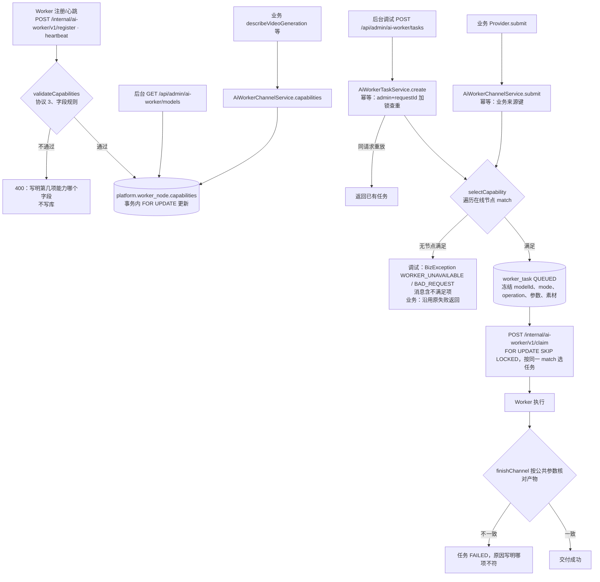

状态：执行中（B1～B5 完成，待本机 ./gradlew test 与三端联调）

# Worker 能力改造 · 后端开发计划

> 三份计划之一（Worker、后端、后台各一份），各自做完再一起联调。第 4.1～4.4 节是三端共用的唯一约定，Worker、后台计划都引用这里。
> 按 `.cursor/rules/09-大功能先规划再编码.mdc` 的 0–8 节模板编写。写于 2026-11-13（洛杉矶时间）。

## 0. 执行前置条件

- **技术栈与版本**：JDK 21（toolchain）、Spring Boot 3.3.0、Gradle Wrapper 8.8（`gradle/wrapper/gradle-wrapper.properties`）；PostgreSQL（测试用 `GpuClusterTestDatabase`）。
- **工程与路由**：工作目录 `/Users/soul/code/lxwx/lxwx_service/lxwxservice`。公共能力，不属于单一 App；实际影响：所有使用 GPU 集群渠道的 App（喵喵漫剧、喵喵带货、喵喵写歌）与后台 Worker 调试页。模块：`core/ai/worker`（节点、匹配、任务）、`admin/aiworker/controller`（管理接口）、`thirdparty/aimodel/{video,image,music,text}/channel/gpucluster`（业务渠道适配）。流程文档路径：`/Users/soul/work/MakeCodePlanWord/projects/GPU集群/v1.0.0/04-开发计划/Worker能力改造-后端.md`（项目“GPU集群”，2026-11-13 登记）。
- **文件前提**（已核对存在）：
  - `core/ai/worker/service/WorkerCapabilityMatcher.java`（`publicCapabilities`、`validateGpuBindings`、`validateInput`、`identity`、`normalize`、`selectors`、`conflicts`、`matchesStandard`、`supportsMode`、`inputMode`）
  - `core/ai/worker/service/AiWorkerNodeService.java`（`register`、`heartbeat`、`models`）
  - `core/ai/worker/service/AiWorkerTaskService.java`（`create`、领取循环、`selectCapability`）
  - `core/ai/worker/service/AiWorkerChannelService.java`（`capabilities`、`submit`）
  - `core/ai/worker/service/AiWorkerAlertService.java`（第 72、178 行使用档位与 `normalize`）
  - `core/ai/worker/service/AiWorkerResultService.java`（`finishChannel` 按 `profile` 核对产物）
  - `core/ai/worker/dto/WorkerRegistrationRequest.java`、`WorkerHeartbeatRequest.java`、`CreateWorkerTaskRequest.java`
  - `core/ai/worker/controller/InternalWorkerController.java`；`admin/aiworker/controller/AdminAiWorkerController.java`（`GET /api/admin/ai-worker/models` → `AiWorkerNodeService.models`）
  - `thirdparty/aimodel/video/channel/gpucluster/GpuClusterVideoProvider.java`、`image/.../GpuClusterImageProvider.java`、`music/.../GpuClusterMusicProvider.java`、`music/.../GpuClusterMusicOptions.java`、`text/.../GpuClusterTextProvider.java`
  - `thirdparty/aimodel/video/dto/VideoGenerationContract.java`、`DurationSpec.java`、`ReferenceImageSpec.java`、`VideoParameterCombination.java`
  - 拟新增：无新文件（规则写在 `WorkerCapabilityMatcher`）。
- **规则前提**：`00`、`02`、`03`、`04`、`09`、`17`、`18`、`19`。
- **执行基线**：上一轮“GPU 节点能力匹配”改动未提交，正是本计划要替换的对象（`normalize` 的档位逻辑、`blankTargetsAsNull`、测试夹具 `src/test/resources/ai-worker/gpu-4090d-24g-report.json`）；`blankTargetsAsNull` 保留。工作区其他改动不是本次的，不回滚。
- **本次不改动范围**：业务 App 调后端的接口与合约类型（`VideoGenerationContract` 等）、计费、任务状态机、上传与交付流程、数据库表结构、Worker 工程、后台工程。

### 执行前核对结论（2026-11-13 已做）

- 业务渠道传的参数：视频 `resolution`、`aspectRatio`、`durationSeconds`，另接受 `width`、`height`、`frames`、`steps`、`layers`、`reuse`、`seed`、`ssd_streaming` 这些引擎参数原样转发；图片 `width`、`height`、`steps`、`seed`；音乐 `duration_seconds`、`instrumental`、`vocal_language` 加 `GpuClusterMusicOptions.engineParameters` 原生参数通道；文本 `max_tokens`、`temperature`、`top_p`、`seed`。
- 业务渠道里有按模型写死的规则：视频拒绝参考图（“Mac H3 当前只支持首尾帧”）、不允许关闭音轨；`AiWorkerTaskService.create` 写死 H3 参考音频 2～15 秒、最多三条、音乐只能一条参考音频、首尾帧不能与参考素材混用。
- `WorkerCapabilityMatcher` 的公开方法只在 `core/ai/worker` 内使用；`AiWorkerChannelService.capabilities` 只被四个 GpuCluster Provider 调用。

## 1. 需求与假设

目标：后端只按“模型 + 生成方式 + 参数范围”判断一台节点能不能接任务；不认识节点内部模型文件和档位，也不写任何针对具体模型的规则。

需求（用户 2026-11-13 确认）：

- R1 节点注册能力改为第 4.1 节格式，协议 2 → 3，旧格式直接拒绝，不做兼容。
- R2 派单：模型名、生成方式（按素材角色和数量识别）一致，每个参数都在该生成方式声明的范围内；任一不满足不派；超出范围直接拒绝，不自动调整。
- R3 后端不补默认值、不保存节点内部实现；默认值由 Worker 补。
- R4 管理后台调试任务与业务渠道任务共用一套匹配规则和公共参数；取消原生参数调试与档位。
- R5 实测记录、`note` 之类给人看的字段不上报、不保存。
- R6 业务 App 调后端的接口与合约类型不变；四个 GpuCluster Provider 改为从新能力格式生成合约。
- R7 后端不写针对具体模型的规则（参考图、参考音频时长与条数、音轨开关、首尾帧与参考混用等）：全部按节点上报的能力判断；能力写错了改 Worker 配置，不在后端补规则。
- R8 公共参数名沿用业务渠道现在的名字（见 4.4）；引擎参数（`width` 等）只有在该模型公共参数里声明时才允许。

假设：

- A1 产物核对按公共参数：视频短边等于清晰度数字、宽高比与 `aspectRatio` 一致（误差 1%）、时长误差不超过 1 帧；图片宽高与请求一致；音乐、文本不核对尺寸。若不成立则停止 B3 并询问。
- A2 视频业务合约的时长按范围内整数秒给出（480p 1～15 秒 → 1、2…15），`VideoParameterCombination` 按“比例 × 清晰度 × 整数秒”展开。若不成立则停止 B4 并询问。
- A3 业务渠道开放参考图视频：有节点上报 `REFERENCE_IMAGES` 时，`ReferenceImageSpec` 按上报的张数上限声明支持（用户 2026-11-13：以 Worker 配置为准）。

兼容边界：Worker 与后端、后台同步升级，旧协议 Worker 注册返回 400。

## 2. 主流程图



事务边界沿用现有：注册/心跳、创建任务、领取各自在原事务内；外部调用（Worker 执行、OSS 上传）在事务外，不新增。

## 3. 批次总览

| 批次 | 目标 | 涉及文件 | 前置 | 验收要点 |
|---|---|---|---|---|
| B1 | 新能力格式校验与协议 3 注册/心跳 | 修改 `WorkerCapabilityMatcher.java`（新增 `validateCapabilities`，删除 `publicCapabilities`、`validateGpuBindings`）、`AiWorkerNodeService.java`、`dto/WorkerRegistrationRequest.java`、`dto/WorkerHeartbeatRequest.java`；测试 | 无 | 合法 4090D、Mac 报告入库；各类非法 400 且消息准确 |
| B2 | 新匹配规则替换档位匹配，删除后端写死的素材规则 | 修改 `WorkerCapabilityMatcher.java`（新增 `match`、`MatchResult`，删除 `normalize`、`selectors`、`conflicts`、`matchesStandard`、`supportsMode`、`inputMode`、`STANDARD`、`identity`）、`AiWorkerTaskService.java`、`AiWorkerAlertService.java`、`dto/CreateWorkerTaskRequest.java`（字段说明）；测试 | B1 | 4.3 每条规则有通过与不通过测试；写死规则全部删除 |
| B3 | 产物核对按公共参数 | 修改 `AiWorkerResultService.java`（`finishChannel`）；测试 | B2 | A1 各项核对 |
| B4 | 管理接口与业务渠道改用新格式 | 修改 `AiWorkerNodeService.models`、`AiWorkerChannelService.capabilities`、四个 Provider、`GpuClusterMusicOptions.java`；测试 | B2 | Provider 合约方法对 4090D 能力返回正确结果；Provider 不再含模型写死规则 |
| B5 | 测试夹具、文档 | `src/test/resources/ai-worker/` 夹具改新格式并新增 Mac 夹具；`README.md`“GPU 节点能力匹配”一节；重新生成 `docs/module-interfaces` | B4 | 受影响测试全部通过；文档与 4.1 一致 |

## 4. 数据结构 / 接口 / 状态约定

### 4.1 能力格式（三端唯一约定）

节点上报 `capabilities` 数组，每项是一个逻辑模型在本机的能力：

```json
{
  "model": "minimax-h3", "kind": "video", "label": "MiniMax H3",
  "gpuId": "GPU-7ec44bc2-04f8-634e-3cd7-7d3eee5e6f5a", "available": true,
  "modes": [
    { "mode": "TEXT", "label": "文生视频", "operation": "VIDEO_GENERATION", "inputs": [],
      "texts": [ { "name": "prompt", "label": "生成描述", "required": true, "maxLength": 20000 } ],
      "parameters": [
        { "name": "resolution", "label": "清晰度", "type": "string", "options": ["480p","720p"], "default": "480p" },
        { "name": "aspectRatio", "label": "画面比例", "type": "string", "options": ["16:9","9:16"], "default": "16:9" },
        { "name": "durationSeconds", "label": "时长", "type": "number", "unit": "秒", "minimum": 1, "maximum": 15, "default": 5,
          "limitsBy": { "parameter": "resolution", "values": { "480p": { "maximum": 15 }, "720p": { "maximum": 10 } } } },
        { "name": "audio", "label": "生成音轨", "type": "boolean", "options": [true], "default": true },
        { "name": "seed", "label": "随机种子", "type": "integer", "minimum": 0 } ],
      "presets": [] },
    { "mode": "REFERENCE_IMAGES", "label": "参考图生视频", "operation": "VIDEO_GENERATION",
      "inputs": [ { "role": "reference_image", "label": "参考图", "mediaType": "image", "minimum": 1, "maximum": 9 } ],
      "texts": [ { "name": "prompt", "label": "生成描述", "required": true, "maxLength": 20000 } ],
      "parameters": [
        { "name": "resolution", "label": "清晰度", "type": "string", "options": ["720p"], "default": "720p" },
        { "name": "durationSeconds", "label": "时长", "type": "number", "unit": "秒", "minimum": 1, "maximum": 10, "default": 10 } ] }
  ]
}
```

| 位置 | 字段 | 必填 | Java/JSON 类型 | 说明 |
|---|---|---|---|---|
| 能力 | `model` | 是 | string | 逻辑模型名，业务与后台按它调用；`[A-Za-z0-9._-]{1,128}` |
| 能力 | `kind` | 是 | string | `text`/`image`/`video`/`music` |
| 能力 | `label` | 是 | string | 展示名，≤128 字 |
| 能力 | `gpuId` | 否 | string | 必须在同一报告 `gpus` 中 |
| 能力 | `available` | 是 | boolean | `false` 时不派单 |
| 能力 | `modes` | 是 | array | ≥1 项，`mode` 不重复 |
| 生成方式 | `mode` | 是 | string | `[A-Z][A-Z0-9_]{0,63}`；当前用到 `TEXT`、`FIRST_FRAME`、`LAST_FRAME`、`FIRST_LAST_FRAME`、`REFERENCE_IMAGES`、`REFERENCE_AUDIO`、`LYRICS` |
| 生成方式 | `operation` | 是 | string | `TEXT_GENERATION`/`IMAGE_GENERATION`/`VIDEO_GENERATION`/`MUSIC_GENERATION`/`LYRICS_GENERATION` |
| 生成方式 | `inputs` | 是 | array | 每项 `role`（`first_frame`/`last_frame`/`reference_image`/`reference_audio`）、`label`、`mediaType`（`image`/`audio`/`video`）、`minimum`、`maximum`（整数，0≤min≤max≤32），可选 `itemDurationSeconds{minimum,maximum}`、`totalDurationSeconds{maximum}` |
| 生成方式 | `texts` | 是 | array | 每项 `name`（`prompt`/`systemPrompt`/`lyrics`）、`label`、`required`、`maxLength`（≤20000），可选 `requiredWhen`/`forbiddenWhen` = `{"parameter":名,"equals":值}` |
| 生成方式 | `parameters` | 是 | array | 可空 |
| 生成方式 | `presets` | 否 | array | `{label, parameters}`，只给后台快捷选择，后端不校验不使用 |
| 参数 | `name` | 是 | string | `[A-Za-z][A-Za-z0-9_]{0,63}`，同一生成方式内不重复 |
| 参数 | `label`、`type` | 是 | string | `type` ∈ `string`/`integer`/`number`/`boolean` |
| 参数 | `unit`、`description` | 否 | string | 展示 |
| 参数 | `options` | 否 | array | 非空；元素类型与 `type` 一致 |
| 参数 | `minimum`、`maximum`、`multipleOf` | 否 | number | 仅数值类型；`minimum`≤`maximum` |
| 参数 | `default` | 否 | 与 type 一致 | 后台预填与 Worker 补值；须满足本参数规则 |
| 参数 | `required` | 否 | boolean | 默认 false |
| 参数 | `limitsBy` | 否 | object | `{parameter, values:{取值:{minimum?,maximum?,options?}}}`；`parameter` 必须是同一生成方式内有 `options` 的参数，`values` 的键必须在其 `options` 内 |

上表以外的字段一律拒绝（含 `profiles`、`note`、内部模型编号、工作流编号、实测记录）。

### 4.2 注册与心跳

| 接口 | 请求 | 失败 |
|---|---|---|
| `POST /internal/ai-worker/v1/register`（Bearer 节点凭据，身份只来自凭据） | `{ sessionId: UUID, protocolVersion: 3, nodeName?: string, gpus: [...], capabilities: [...] }` | 协议不是 3：400“请升级 Worker 到协议 3”；格式错误：400“能力 {序号} 的生成方式 {mode} 参数 {name}：{原因}”；同节点另有在线会话：沿用 `WORKER_CONFLICT` |
| `POST /internal/ai-worker/v1/heartbeat` | `{ sessionId, capabilities, gpus, nodeName?, uploadingCount, pendingUploadCount, claimBlockedReason? }` | 同上 |

`gpus` 校验沿用现有 `publicGpus`。

### 4.3 匹配规则（调试与业务共用，`WorkerCapabilityMatcher.match`）

1. 能力 `model` 等于请求 `modelId`，`kind` 一致，`available` 为真。节点在线、空闲、未暂停由调用方循环判断（沿用现有）。指定 GPU 时只看 `gpuId` 相同的能力。
2. 生成方式：`operation` 取请求值（缺省按 kind 推导，沿用 `WorkerOperation.resolve`）；在 `modes` 中找 `operation` 相同、请求素材角色全在 `inputs` 内、每个角色数量在 `[minimum, maximum]`、所有 `minimum>0` 的角色都有的项；0 项或多项 → 不支持。
3. 参数：每个请求参数都在该生成方式 `parameters` 内；类型一致（integer 不接受小数）；`options` 包含；数值在有效范围且满足 `multipleOf`；有效范围 = 参数自身范围被 `limitsBy` 覆盖（被依赖参数取请求值，没有则取其 `default`）；`required` 且无 `default` 的必须传。
4. 文本：`required` 的非空；长度 ≤ `maxLength`；`requiredWhen`/`forbiddenWhen` 按参数值（没有则 `default`）判断；请求带了未声明的文本字段 → 不支持。
5. 素材：上传素材 MIME 前缀与 `mediaType` 一致；音视频素材时长在 `itemDurationSeconds` 内、合计不超过 `totalDurationSeconds`。
6. 通过 → 冻结请求：`modelId`、`mode`、`operation`、`prompt`、`systemPrompt`、`lyrics`、调用方原样 `parameters`、`inputs`；不合并默认值。

不通过时返回第一条不满足项的中文原因，例如“720p 时长最长 10 秒，本次 15 秒”“参考图最多 9 张，本次 10 张”“没有节点提供模型 minimax-h3 的首帧生视频”。

### 4.4 公共参数名称（业务渠道现用，本次不统一）

| 类型 | 参数 |
|---|---|
| 视频 | `resolution`、`aspectRatio`、`durationSeconds`、`audio`、`seed` |
| 图片 | `width`、`height`、`seed` |
| 音乐 | `duration_seconds`、`instrumental`、`vocal_language`、`bpm`、`keyscale`、`timesignature`、`seed` |
| 文本 | `max_tokens`、`temperature`、`top_p`、`context_size`、`seed` |

### 4.5 HTTP 契约变化与调用方

| 接口 | 变化 | 调用方 |
|---|---|---|
| `POST /internal/ai-worker/v1/register`、`/heartbeat` | 协议 3；`models` → `capabilities` | Worker（同步升级） |
| `POST /internal/ai-worker/v1/claim` | 返回的执行请求含 `mode`，不再含 `profile` | Worker |
| `GET /api/admin/ai-worker/models`（`ApiResponse<JsonNode>`，管理员认证） | 每项为 4.1 能力 + `nodeId`、`online`、`capabilityVersion` | 后台 Worker 调试页 |
| `POST /api/admin/ai-worker/tasks` | `modelId` 含义改为逻辑模型名；`parameters` 只接受所选生成方式声明的参数；不再识别档位条件 | 后台 Worker 调试页 |
| `AiWorkerChannelService.capabilities(model, operation)` | 返回新格式能力 | 四个 GpuCluster Provider |
| 四个 Provider 的业务合约 | 合约类型不变；内容按能力生成；视频可声明支持参考图 | 各 App 业务代码（接口不变） |

OpenAPI：`CreateWorkerTaskRequest.modelId`、`WorkerRegistrationRequest`、`WorkerHeartbeatRequest` 的 `@Schema` 说明同步。

### 4.6 状态、并发、外部副作用、隔离

- 状态：不新增任务状态；沿用 QUEUED → PREPARING → … 现有流转。
- 并发与幂等：沿用 `tasks.lockRequest`、业务来源键、领取 `FOR UPDATE SKIP LOCKED`；冻结请求在入队时写定，领取时用同一 `match` 重新判断该节点能否执行。
- 外部副作用：不新增外部调用。业务任务可能收费，失败不自动重试（沿用现有）。
- 隔离：`worker_node`、`worker_task` 在 `platform` schema；管理接口沿用管理员认证；业务渠道沿用原业务上下文。

#### 数据库改动

无。`worker_node.capabilities`（jsonb）存新格式；`worker_task.request_payload`（jsonb）冻结请求多 `mode`、少 `profile`；`worker_task.model_id` 存逻辑模型名。旧节点行在新 Worker 注册时被覆盖，不做数据迁移。

## 5. 分批详细计划

### 批次 B1：新能力格式校验与协议 3

- **范围**：只改注册与心跳的入参校验和保存；匹配不动（B2 前旧匹配不会被调用到新数据——B1、B2 连续执行，中间不部署）。
- **核心函数骨架**：

```java
// core/ai/worker/service/WorkerCapabilityMatcher.java
/** 按三端约定校验节点能力，只保留约定字段；任何不符合都整份拒绝，不部分入库。 */
public static ArrayNode validateCapabilities(JsonNode capabilities, JsonNode gpus) {
    // 1. capabilities 必须是 1..128 项数组，否则 BAD_REQUEST“能力必须为 1～128 项数组”
    // 2. 收集 gpus 的 id；逐项能力：model、kind、label、available 必填；model 不重复；gpuId 若有必须在 gpus 中
    // 3. modes：≥1，mode 不重复；operation 合法且与 kind 匹配（沿用 WorkerOperation.resolve）
    // 4. inputs / texts / parameters / presets 逐项按 4.1 字段表校验；出现表外字段 → 拒绝（写明字段名）
    // 5. parameters：name 不重复；options 元素类型一致；min≤max；default 满足自身规则；
    //    limitsBy.parameter 指向同一 mode 内有 options 的参数，values 的键在其 options 内
    // 6. 返回只含约定字段的深拷贝；异常消息格式“能力 {i} 的生成方式 {mode} 参数 {name}：{原因}”
}
```

```java
// core/ai/worker/service/AiWorkerNodeService.java
public WorkerRegistrationResponse register(String nodeId, WorkerRegistrationRequest request) {
    // 1. protocolVersion != 3 → BAD_REQUEST“请升级 Worker 到协议 3”
    // 2. capabilities = WorkerCapabilityMatcher.validateCapabilities(request.capabilities(), publicGpus(request.gpus()))
    // 3. 其余（加锁、会话冲突、保存、capabilityVersion 摘要）沿用现有
}
// heartbeat 同步改为 validateCapabilities(request.capabilities(), ...)
```

- **执行步骤**：
  1. 目标：注册/心跳只收新格式。改动：上述两方法、两个 DTO（`models` → `capabilities`，`@Min(3) @Max(3)`）。前置检查：`InternalWorkerController` 只透传 DTO。验证：见下。
  2. 目标：删除旧清洗。改动：删除 `publicCapabilities`、`validateGpuBindings` 及其测试。前置检查：全局搜索无其他调用。验证：编译通过。
- **验收清单**：
  - [ ] `./gradlew test --tests 'com.lxwx.narrateservice.core.ai.worker.GpuClusterContractTests' --tests 'com.lxwx.narrateservice.core.ai.worker.WorkerApiContractTests'` 通过。
  - [ ] 新增用例：4090D、Mac 合法报告入库；缺 `type`、`limitsBy` 指向不存在参数、`options` 为空、`minimum>maximum`、`mode` 重复、`gpuId` 不在 `gpus`、带 `profiles`、带 `note`、协议 2 → 各自 400 且消息写明位置。
  - [ ] OpenAPI 说明同步。

### 批次 B2：新匹配规则，删除写死规则

- **范围**：调试创建、业务提交、领取、告警统一用 `match`；删除 `AiWorkerTaskService.create` 中参考音频时长/条数、音乐一条参考音频、首尾帧与参考混用的写死判断（改由 4.3 第 2、5 条覆盖）。
- **核心函数骨架**：

```java
// core/ai/worker/service/WorkerCapabilityMatcher.java
public record MatchResult(ObjectNode request, String reason) {
    public boolean matched() { return request != null; }
}
/** 4.3 的 1～6 条；不满足时返回第一条原因，不抛异常，由调用方决定换节点或报错。 */
public static MatchResult match(JsonNode capability, CreateWorkerTaskRequest request, Map<String, String> inputMediaTypes) {
    // 1. model / kind / available
    // 2. 找唯一生成方式（operation + 素材角色与数量）
    // 3. 参数逐个校验（limitsBy 用请求值或 default）
    // 4. 文本字段校验
    // 5. 素材 mediaType 与时长（inputMediaTypes 由调用方按 assetId 查出：role→mime、时长）
    // 6. 冻结请求：写 modelId、mode、operation、原样参数与素材
}
```

```java
// core/ai/worker/service/AiWorkerTaskService.java
public CapabilitySelection selectCapability(CreateWorkerTaskRequest request, boolean channel) {
    // 1. validateInput（保留结构校验，删去按参数名写死的类型表，类型由 match 按能力判断）
    // 2. 遍历在线节点与能力（指定节点/GPU 过滤沿用）→ match；第一个 matched 返回
    // 3. 全部不满足 → BizException：消息为“没有在线节点支持：{最后一个具体原因}”
}
// 领取循环：executionRequest = match(cap, input, media).request()；assignedPayload 不再写 profile
```

- **执行步骤**：
  1. 目标：新匹配可用。改动：新增 `match`、`MatchResult`；`selectCapability`、领取、`AiWorkerAlertService` 第 178 行改调 `match`，第 72 行告警文案改为显示 `mode` 与参数。前置检查：B1 已完成。验证：编译 + 单测。
  2. 目标：删除旧匹配与写死规则。改动：删除 4.3 以外的旧方法；删 `create` 中写死素材规则，保留素材存在性、归属与 MIME 前缀检查（交给 `match` 第 5 条）。前置检查：全局搜索无调用。验证：单测。
- **验收清单**：
  - [ ] `./gradlew test --tests 'com.lxwx.narrateservice.core.ai.worker.GpuClusterSchedulingTests' --tests 'com.lxwx.narrateservice.core.ai.worker.GpuClusterPostgresTests' --tests 'com.lxwx.narrateservice.core.ai.worker.GpuClusterAlertTests'` 通过。
  - [ ] 4.3 每条规则各有通过与不通过用例：480p 5 秒通过；720p 15 秒拒绝（原因含“最长 10 秒”）；参考图 3 张通过、10 张拒绝；首帧请求在只有 TEXT 的能力上拒绝；图片带 `systemPrompt` 拒绝；音乐纯音乐带歌词拒绝；未声明参数 `steps` 拒绝；Mac 能力上请求视频返回“没有节点提供模型 minimax-h3”。
  - [ ] 搜索 `profile`、`STANDARD`、`inputMode`、`H3 参考音频` 在 `core/ai/worker/service` 无残留。

### 批次 B3：产物核对按公共参数

- **核心函数骨架**：

```java
// core/ai/worker/service/AiWorkerResultService.java
private void finishChannel(WorkerTaskEntity task, WorkerAssetEntity asset, JsonNode actual) {
    // 1. 视频：短边 == 冻结参数 resolution 的数字；|宽/高 − aspectRatio| ≤ 1%；
    //    |时长 − durationSeconds| ≤ 1/fps + 0.01（fps 取 actual，缺省 24）
    // 2. 图片：宽高 == 冻结参数 width/height（请求未传时不核对）
    // 3. 不符 → IllegalStateException“实际产物不满足请求：{哪项}”（沿用原失败处理）
    // 4. 其余沿用现有事务与状态推进
}
```

- **验收清单**：
  - [ ] `./gradlew test --tests 'com.lxwx.narrateservice.core.ai.worker.WorkerFinalizationTests' --tests 'com.lxwx.narrateservice.core.ai.worker.GpuClusterChannelTests'` 通过；新增用例覆盖短边不符、比例不符、时长不符各一。

### 批次 B4：管理接口与业务渠道

- **范围**：`AiWorkerNodeService.models` 直接返回新格式；`AiWorkerChannelService.capabilities` 按 `model`、`modes[].operation` 过滤；四个 Provider 去掉写死规则，按能力生成合约。
- **核心函数骨架**：

```java
// thirdparty/aimodel/video/channel/gpucluster/GpuClusterVideoProvider.java
@Override public VideoGenerationContract describeVideoGeneration(String provider, String model) {
    // 1. 汇总所有节点该模型 VIDEO_GENERATION 的生成方式
    // 2. TEXT/FIRST_FRAME/LAST_FRAME/FIRST_LAST_FRAME：比例 × 清晰度 × 有效范围内整数秒 → VideoParameterCombination
    // 3. first/last：有对应生成方式即 true
    // 4. REFERENCE_IMAGES：ReferenceImageSpec(true, 各节点 maximum 的最大值, false)；没有则 none()
    // 5. 没有任何生成方式 → notDeclared
}
@Override public VideoGenerateResult submit(VideoGenerateCommand command) {
    // 1. 只转发 4.4 的视频公共参数；aspect_ratio/ratio → aspectRatio（冲突仍拒绝）；generate_audio → audio
    // 2. 素材：first_frame / last_frame / reference_image（image_urls 按 image_role 或 reference_image），不再写死“只支持首尾帧”
    // 3. 其他参数 → BAD_REQUEST“GPU 集群视频不支持参数：{名}”
    // 4. 是否支持由 match 决定；沿用 channels.submit
}
```

图片 Provider 只接受 `width`、`height`、`seed`；音乐 Provider 删除 `GpuClusterMusicOptions.engineParameters` 原生通道（`GpuClusterMusicOptions` 改为只承载 4.4 音乐参数，执行前确认其调用方）；文本 Provider 增加 `context_size`。

- **验收清单**：
  - [ ] `./gradlew test --tests 'com.lxwx.narrateservice.core.ai.worker.GpuClusterProviderTests' --tests 'com.lxwx.narrateservice.core.ai.worker.GpuClusterBusinessRoutingTests' --tests 'com.lxwx.narrateservice.core.ai.worker.GpuClusterTextImageTests'` 通过。
  - [ ] 用 4090D 能力：`supportsParameters("16:9", 5, "480P")` 真，`("16:9", 15, "720P")` 假，1080P 假；参考图合约 `maxCount=9`；Mac 能力下视频合约 `notDeclared`。
  - [ ] 四个 Provider 中搜索“Mac”“H3”写死文案无残留。

### 批次 B5：夹具与文档

- 夹具：`gpu-4090d-24g-report.json` 改为 4.1 格式；新增 `mac-report.json`（文本、图片、音乐）。
- 文档：`README.md`“GPU 节点能力匹配”改写为 4.1～4.4 摘要；`python3 docs/module-interfaces/generate.py`。
- **验收清单**：
  - [ ] `./gradlew test --tests 'com.lxwx.narrateservice.core.ai.worker.*'` 通过。
  - [ ] `git diff --check`；新文件单独检查。

## 6. 批次推进规则

按 B1 → B5 顺序，一次一批；当前批验收不过不进下一批。每批完成在本计划“执行记录”写结果。用户已授权连续执行时，验收通过即继续。

## 7. 总体验收

- [ ] R1～R8 逐条：需求 → 实现位置 → 验证结果。
- [ ] `./gradlew test --tests 'com.lxwx.narrateservice.core.ai.worker.*'` 通过；打包用 `./gradlew build -x test`。
- [ ] 主流程图各分支已验证；区分单测、本机 HTTP、与 Worker/后台联调（联调场景见后台计划第 6 节）。
- [ ] `/v3/api-docs` 中注册、心跳、任务创建的字段说明为新含义。
- [ ] `git diff --check` 通过；无范围外修改。

## 8. 失败处理约定

- 文件前提不成立、命令报错：保留现场，报告失败步骤、证据、已完成内容与下一步，不标完成。
- 范围内问题自己修；没有新证据不重复执行失败命令。
- 需要改合约类型、改表、加依赖、改 Worker 或后台：停下等用户决定。
- 联调中同一问题最多修 3 次，修不好记入问题清单继续后面的场景，最后统一报告。

## 执行记录

- 2026-11-13 B1 完成：`WorkerCapabilityMatcher.validateCapabilities` 按 4.1 严格校验（字段白名单、生成方式与 kind、素材角色与数量、文本条件、limitsBy、预设），协议 3；`WorkerRegistrationRequest`/`WorkerHeartbeatRequest` 字段改为 `capabilities`（`@Min(3) @Max(3)`）；`AiWorkerNodeService` 注册与心跳按新格式保存。
- 2026-11-13 B2 完成：`match(capability, request, media)` 按 4.3 顺序匹配（模型与 kind、可用、按 operation + 素材角色推断生成方式、参数含 limitsBy、文本含条件、素材类型与时长），冻结 `modelId`、`mode`、`operation`；删除 `AiWorkerTaskService` 中 H3、音乐、锚点等写死规则；创建时读取素材类型与时长再匹配；`selectCapability` 只对业务渠道要求协议 3（调试节点只有心跳时仍可用）。错误文案与计划一致（如“720p 时长最长 10 秒，本次 15 秒”“没有在线节点提供模型 X”）。
- 2026-11-13 B3 完成：`AiWorkerResultService.outputMismatch` 按公共参数核对产物（视频短边、比例、时长，图片尺寸）；`finishChannel` 用 `effectiveParameters`（冻结参数 + 能力默认值）。
- 2026-11-13 B4 完成：`GET /api/admin/ai-worker/models` 返回各节点能力原样加 `nodeId`、`online`、`capabilityVersion`（节点详情字段名仍为 `models`）；告警、业务渠道按 `model` + operation 匹配；视频、图片、文本、音乐四个渠道 Provider 由能力生成公共参数（`generate_audio` → `audio`、清晰度转小写、参考图角色 `reference_image`）；`CreateWorkerTaskRequest` 字段说明更新。
- 2026-11-13 B5 完成：新格式夹具 `src/test/resources/ai-worker/gpu-4090d-24g-report.json`、`mac-report.json`，新增 `WorkerCapabilityFixtures`；`GpuClusterSchedulingTests` 重写，其余 GpuCluster*/WorkerQueue*/WorkerReal* 测试改用新格式；README“GPU 节点能力匹配”重写，已运行 `docs/module-interfaces/generate.py`。
- 验证：容器内带 lombok 编译主代码与测试通过；`GpuClusterSchedulingTests` 9 例通过；需要数据库（`AI_WORKER_TEST_DB`）或真实 Mockito 的用例未在容器运行，待用户本机 `./gradlew test`。
