# 剧说 App PRD

> 版本：v0.2.0
> 日期：2026-05-18
> 阶段：需求文档生成
> 来源：Figma Page 1 直读 + `projects/剧说/01-需求/requirements-list.md`
> 状态：待用户确认

---

## 1. 产品概述

剧说是一款面向短剧、影视剧、电影、电视剧、漫剧解说创作者的移动端 AI 视频创作 App。用户可以上传一个或多个视频素材，选择解说 / 精剪风格、配音角色、语速和更多生成配置，消耗积分生成视频，并在作品页查看、播放、下载和管理生成结果。

当前版本以 Figma Page 1 的 20 个移动端 frame 为主要设计真源。用户已确认当前主要缺失页面为 3 个：邀请好友、我的页更多设置、意见反馈。生成中、支付结果、上传失败等过程态在本 PRD 中作为状态规则补充，不作为本轮主要缺失页面。

---

## 2. 当前版本范围

### 2.1 版本目标

- 完成创作、作品、我的三大主导航的核心产品闭环。
- 支持用户登录、积分 / 会员、视频上传与配置、生成确认、作品查看与下载。
- 补齐我的页入口对应的 3 个缺失二级页面：邀请好友、更多设置、意见反馈。
- 为后续技术方案提供页面、状态、数据和前后端交互边界。

### 2.2 本版本包含

- 首页创作入口与热门案例展示。
- 一键登录与手机号验证码登录。
- 我的页账号、邀请码、积分、会员、常用入口。
- 邀请好友页、更多设置页、意见反馈页。
- 视频上传、已选视频、上传视频选择弹层、删除确认。
- 解说风格 / 精剪风格选择。
- 配音角色选择、试听、情绪标签。
- 创作参数更多设置与背景音乐入口。
- 积分消耗确认、权益不足提示、VIP 会员、积分充值、积分详情。
- 我的作品空态、列表态、作品详情、下载视频。

### 2.3 本版本不包含

- 不新生成 Figma 设计稿；现有 Figma frame 是本轮 UI 真源。
- 需求阶段不绑定短信、支付供应商；视频业务处理已在后续技术方案阶段确认接入百度智能云智能点播平台 VOD，客户端不直连供应商密钥。
- 不展开社区、评论、点赞、公开发布等内容社区功能。
- 不确认“创建形象”完整功能，暂仅作为会员权益文案待确认。
- 不把生成中 / 支付结果 / 上传失败单独列为本轮缺失页面，但 PRD 保留必要状态规则。

---

## 3. 整体流程

### 3.1 主创作流程

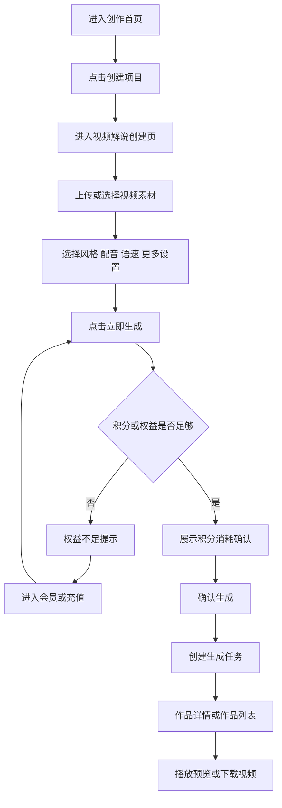

创作流程从首页开始，用户完成素材选择和参数配置后才进入积分确认。系统在生成前必须完成素材校验、权益校验和积分消耗计算。

### 3.2 登录与账户流程

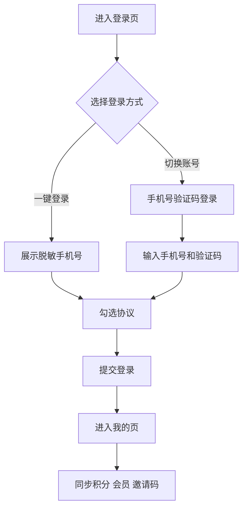

未勾选用户协议和隐私政策时，登录按钮点击后应提示用户先勾选协议。

### 3.3 我的页二级流程

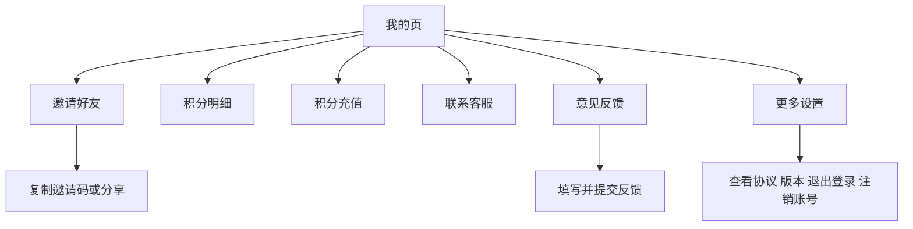

我的页是账户、权益、客服和设置的入口页。当前 Figma 已有入口，邀请好友、更多设置、意见反馈需要补齐页面内容。

---

## 4. 信息架构 / 页面结构

| 一级导航 | 页面 / 状态 | 说明 |
|----------|-------------|------|
| 创作 | 创作首页 | 创建项目、热门案例、积分、会员入口 |
| 创作 | 视频解说创建页 | 上传素材、配置参数、立即生成 |
| 创作 | 上传视频选择弹层 | 从已上传素材中选择视频 |
| 创作 | 风格选择弹层 | 视频解说 / 视频精剪风格选择 |
| 创作 | 配音角色弹层 | 配音角色、试听、情绪标签 |
| 创作 | 创作更多设置弹层 | 多样版本开关、背景音乐入口 |
| 创作 | 积分确认 / 权益不足 / 删除确认 | 关键操作二次确认 |
| 作品 | 我的作品空态 | 无作品提示、立即创造 |
| 作品 | 我的作品列表 | 分类筛选、草稿 / 作品卡片、更多操作 |
| 作品 | 作品详情 | 播放预览、参数标签、下载视频 |
| 我的 | 登录页 | 一键登录、验证码登录、协议勾选 |
| 我的 | 我的页 | 账号、邀请码、积分、VIP、功能入口 |
| 我的 | 邀请好友 | 当前缺失页，需补齐 |
| 我的 | 更多设置 | 当前缺失页，需补齐 |
| 我的 | 意见反馈 | 当前缺失页，需补齐 |
| 我的 | VIP 会员 | 权益、套餐、充值协议 |
| 我的 | 积分充值 | 积分套餐、支付方式、充值协议 |
| 我的 | 积分详情 | 积分流水 |

---

## 5. 页面级详细需求

### 5.1 创作首页

**页面定位**

用户进入 App 后的主创作入口页，承担创建项目、查看热门案例、进入会员和积分相关操作的作用。

**参考素材**

- Figma frame `1:730` / `1`

**页面结构**

1. 顶部状态与权益区：当前积分、开通会员入口。
2. 主视觉文案：开启创作之旅、解说漫剧 / 短剧等内容。
3. 主按钮：创建项目。
4. 热门案例区：标题、类型筛选、案例卡片。
5. 底部导航：创作、作品、我的。

**区块说明**

- 积分区点击后可进入积分相关页面，具体入口可在技术方案阶段确定。
- 开通会员入口进入 VIP 会员页。
- 创建项目进入视频解说创建页。
- 热门案例卡片展示封面、标题、时长，用于展示创作样例。

**主要功能**

- 创建项目。
- 切换热门案例分类。
- 查看积分与会员入口。
- 通过底部导航切换主模块。

**交互流程图**

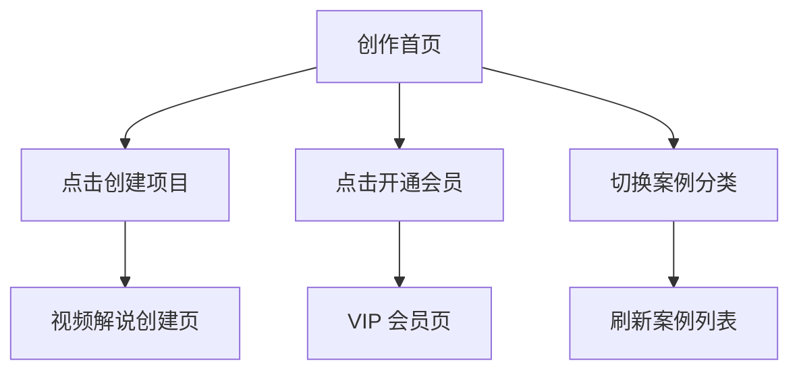

**详细交互说明**

- 点击“创建项目”时，若用户未登录，可先进入登录流程；若已登录，进入视频解说创建页。
- 点击分类标签后，案例列表切换为对应类型。
- 点击底部“作品”“我的”后切换到对应 tab。

**关键状态 / 异常情况**

- 积分加载失败时显示默认值或加载失败提示。
- 案例列表为空时展示空态。

**验收标准**

- 首页可进入创作流程。
- 分类切换不影响底部导航状态。
- 会员入口可进入 VIP 会员页。

### 5.2 登录页

**页面定位**

为未登录用户提供运营商一键登录和手机号验证码登录能力。

**参考素材**

- Figma frame `1:620` / `10`
- Figma frame `1:676` / `11`

**页面结构**

1. 一键登录态：脱敏手机号、运营商认证说明、一键登录按钮、切换账号。
2. 验证码登录态：手机号输入框、验证码输入框、获取验证码、登录按钮。
3. 协议区：用户协议、隐私政策、勾选框。

**区块说明**

- 一键登录默认展示运营商返回的脱敏手机号。
- 切换账号进入手机号验证码登录。
- 协议勾选对两种登录方式都生效。

**主要功能**

- 一键登录。
- 手机号验证码登录。
- 获取验证码。
- 协议查看与勾选。

**交互流程图**

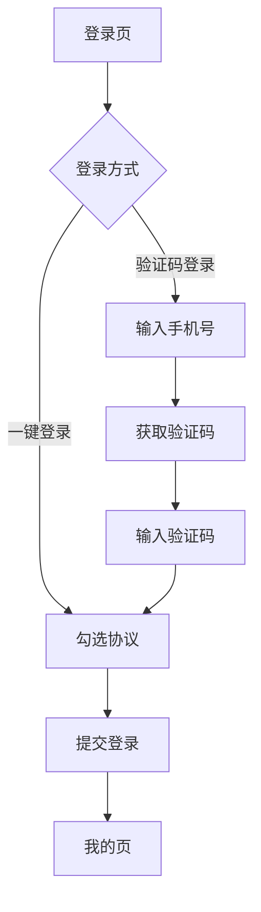

**详细交互说明**

- 未勾选协议点击登录时，提示“请先阅读并同意用户协议和隐私政策”。
- 点击“获取验证码”前需校验手机号格式。
- 验证码发送成功后进入倒计时，倒计时期间不可重复发送。

**关键状态 / 异常情况**

- 手机号格式错误。
- 验证码错误或过期。
- 一键登录失败。
- 协议未勾选。

**验收标准**

- 两种登录方式可互相切换。
- 登录成功后能同步账号、积分、会员和邀请码。
- 协议入口可打开对应内容页或 WebView。

### 5.3 我的页

**页面定位**

账户中心和权益入口页，展示用户身份、积分、VIP、邀请码与常用二级功能。

**参考素材**

- Figma frame `1:318` / `6`

**页面结构**

1. 顶部账户区：脱敏手机号、邀请码、复制按钮。
2. 会员入口：开通 VIP，解锁全部功能。
3. 功能宫格：邀请好友、积分明细、积分充值、联系客服。
4. 设置入口：意见反馈、更多设置。
5. 底部导航：创作、作品、我的。

**区块说明**

- 邀请码可复制。
- VIP 入口进入会员页。
- 积分明细进入积分详情。
- 积分充值进入积分充值页。
- 意见反馈和更多设置为当前确认需补齐的缺失页面。

**主要功能**

- 查看账号信息。
- 复制邀请码。
- 进入会员、积分、客服、反馈、设置功能。

**交互流程图**

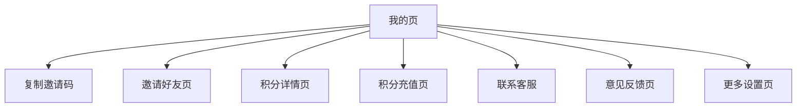

**详细交互说明**

- 点击复制邀请码后，系统复制到剪贴板并展示成功提示。
- 点击邀请好友进入邀请好友页。
- 点击意见反馈进入反馈表单页。
- 点击更多设置进入应用设置页。

**关键状态 / 异常情况**

- 未登录时应先进入登录流程或展示登录入口。
- 邀请码复制失败时提示用户重试。

**验收标准**

- 我的页所有入口均有明确去向。
- 当前确认的 3 个缺失页面在 PRD 中有页面级需求。
- 复制邀请码有明确反馈。

### 5.4 邀请好友页

**页面定位**

当前缺失页面。用于承接我的页“邀请好友”入口，帮助用户复制邀请码或分享邀请，并理解奖励规则。

**参考素材**

- 来源入口：Figma frame `1:318` / `6` 的“邀请好友”
- 当前 Figma 未提供独立页面，需要后续补设计。

**页面结构**

1. 顶部导航：返回、标题“邀请好友”。
2. 邀请码卡片：邀请码、复制按钮。
3. 分享区：分享给好友、保存海报或复制邀请链接。
4. 规则说明：邀请奖励、到账条件、有效期。
5. 邀请记录：好友昵称 / 手机号脱敏、状态、奖励积分。
6. 空态：暂无邀请记录。

**区块说明**

- 邀请码卡片沿用我的页的邀请码。
- 规则说明必须避免模糊承诺，需要明确奖励触发条件。
- 邀请记录可先做 MVP 列表，也可后续按运营需求扩展。

**主要功能**

- 复制邀请码。
- 分享邀请。
- 查看邀请规则。
- 查看邀请记录。

**交互流程图**

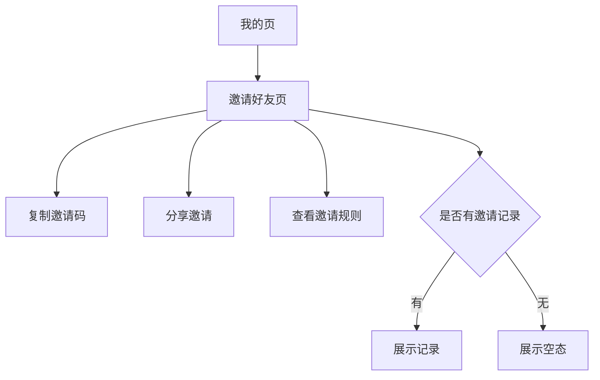

**详细交互说明**

- 点击复制邀请码后展示复制成功提示。
- 点击分享时调用系统分享能力或生成可复制链接。
- 邀请记录按时间倒序展示。

**关键状态 / 异常情况**

- 分享失败。
- 邀请记录加载失败。
- 无邀请记录。

**验收标准**

- 用户能从我的页进入邀请好友页。
- 用户能复制邀请码并获得反馈。
- 邀请规则文案清晰，不与实际奖励逻辑冲突。

### 5.5 我的页更多设置页

**页面定位**

当前缺失页面。用于承接我的页“更多设置”入口，管理账号、协议、版本和退出登录等应用设置。

**参考素材**

- 来源入口：Figma frame `1:318` / `6` 的“更多设置”
- 当前 Figma 未提供独立页面，需要后续补设计。

**页面结构**

1. 顶部导航：返回、标题“更多设置”。
2. 账号设置：账号安全、退出登录、注销账号。
3. 协议与隐私：用户协议、隐私政策。
4. 应用信息：版本号、清理缓存。
5. 可选入口：投诉举报、算法备案、关于我们。

**区块说明**

- “更多设置”指我的页应用设置，不是创作页生成参数弹层。
- 注销账号需要二次确认和风险提示。
- 退出登录后返回未登录态。

**主要功能**

- 查看协议和隐私政策。
- 清理缓存。
- 退出登录。
- 注销账号。
- 查看版本信息。

**交互流程图**

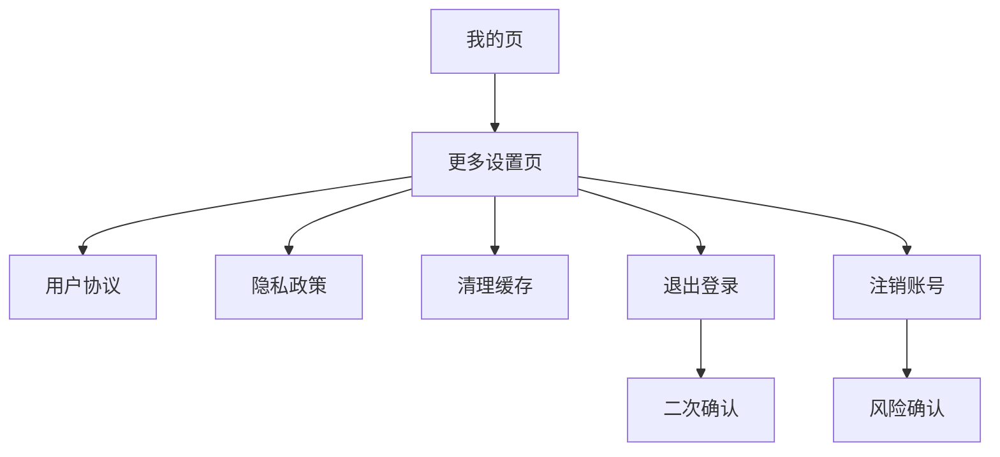

**详细交互说明**

- 点击协议类入口打开对应 WebView 或静态页面。
- 点击清理缓存展示当前缓存大小和确认弹窗。
- 点击退出登录需二次确认。
- 点击注销账号需展示不可恢复风险，并进入后续校验流程。

**关键状态 / 异常情况**

- 清理缓存失败。
- 注销账号条件不满足。
- 协议页面加载失败。

**验收标准**

- 我的页可进入更多设置页。
- 退出登录有二次确认。
- 协议与隐私政策可访问。

### 5.6 意见反馈页

**页面定位**

当前缺失页面。用于收集用户在创作、充值、作品、账号等场景遇到的问题。

**参考素材**

- 来源入口：Figma frame `1:318` / `6` 的“意见反馈”
- 当前 Figma 未提供独立页面，需要后续补设计。

**页面结构**

1. 顶部导航：返回、标题“意见反馈”。
2. 反馈类型：功能异常、生成问题、充值问题、账号问题、建议。
3. 问题描述：多行文本输入。
4. 附件上传：图片或视频，数量和大小待确认。
5. 联系方式：手机号、微信或邮箱。
6. 提交按钮。

**区块说明**

- 反馈类型用于后台分类处理。
- 联系方式可默认带入登录手机号，但需要允许用户修改或删除。
- 附件上传可后置，MVP 至少支持文本反馈。

**主要功能**

- 选择反馈类型。
- 填写问题描述。
- 上传附件。
- 填写联系方式。
- 提交反馈。

**交互流程图**

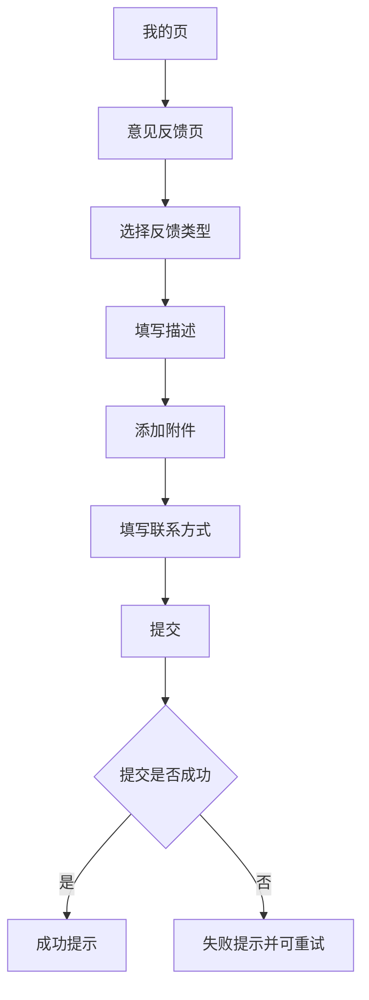

**详细交互说明**

- 未填写问题描述时不可提交或提示补充描述。
- 提交成功后展示成功提示，可返回我的页。
- 提交失败时保留已填内容。

**关键状态 / 异常情况**

- 描述为空。
- 附件上传失败。
- 网络失败导致提交失败。

**验收标准**

- 用户能从我的页进入并提交反馈。
- 提交成功 / 失败都有明确反馈。
- 失败不丢失用户已填写内容。

### 5.7 视频解说创建页

**页面定位**

创作流程的核心配置页，承载素材上传、参数配置和生成入口。

**参考素材**

- Figma frame `1:2745` / `12`
- Figma frame `1:2866` / `13`
- Figma frame `1:151` / `18`
- Figma frame `1:19` / `20`

**页面结构**

1. 顶部导航：返回、标题“视频解说”。
2. 计费提示：按原视频时长收费，每分钟消耗 20 积分。
3. 上传区域：上传视频按钮、上传限制说明。
4. 已选视频区域：缩略图、删除、继续添加、已选数量和总时长。
5. 参数区：解说风格、配音角色、语速、更多设置。
6. 底部按钮：立即生成。

**区块说明**

- 默认态展示上传卡片。
- 已选态展示视频缩略图，并显示已选择数量和总时长。
- 上传视频选择弹层展示已上传素材列表，支持取消和确定。
- 删除确认弹窗用于删除已选素材或分镜。

**主要功能**

- 上传或选择视频素材。
- 管理已选视频。
- 校验单视频时长和数量限制。
- 选择生成参数。
- 发起生成。

**交互流程图**

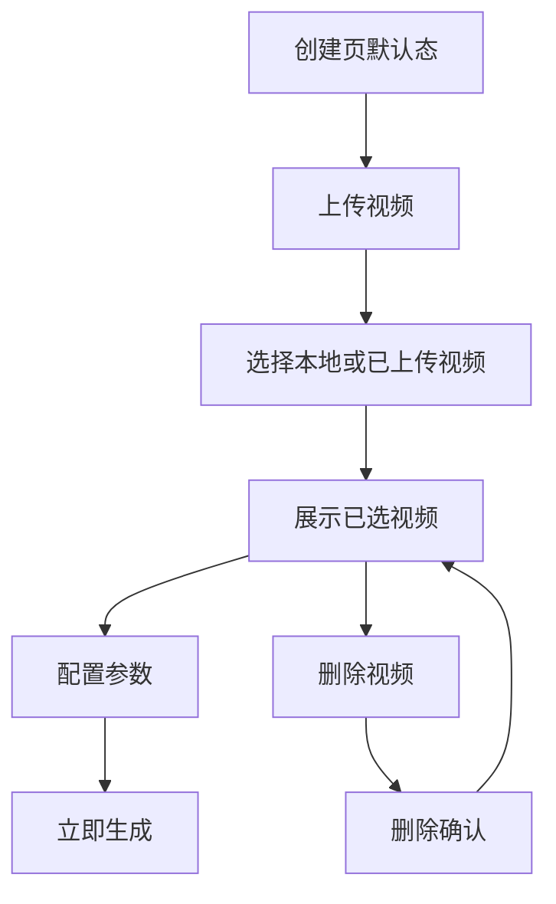

**详细交互说明**

- 点击上传视频后进入系统视频选择或已上传视频弹层，具体入口由实现方案确定。
- 已选视频达到 10 个后，不再允许继续添加。
- 删除时展示二次确认，确认后从已选列表移除。
- 点击立即生成前，校验素材数量、单视频时长、总时长、积分和权益。

**关键状态 / 异常情况**

- 未选择视频。
- 单视频少于 10 秒或超过 30 分钟。
- 已选视频超过 10 个。
- 上传失败或视频解析失败。

**验收标准**

- 用户可以从默认态进入已选视频态。
- 立即生成前能完成必要校验。
- 删除素材有二次确认。

### 5.8 风格选择弹层

**页面定位**

为生成任务选择视频解说或视频精剪的风格类型。

**参考素材**

- Figma frame `1:3601` / `14`
- Figma frame `1:3053` / `15`

**页面结构**

1. 底部弹层容器。
2. 模式切换：视频解说、视频精剪。
3. 风格列表：标题、适用场景、解释说明。
4. 选中态标识。

**区块说明**

- 视频解说模式包括快剪快讲、漫剧解说、视频重构、穿插解说等。
- 视频精剪模式包括剧情顺剪、高光燃剪、剧情混剪等。
- 风格文案中存在疑似错字和重复，需要最终确认。

**主要功能**

- 切换风格模式。
- 选择具体风格。
- 回填到创建页。

**交互流程图**

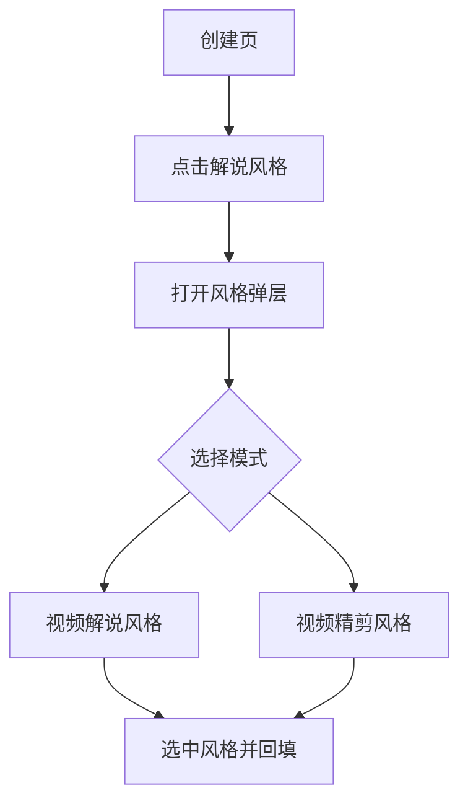

**详细交互说明**

- 点击风格项后更新选中态。
- 关闭弹层后，创建页展示所选风格。
- 若用户未选择，保持默认风格。

**关键状态 / 异常情况**

- 风格列表加载失败。
- 会员专属风格是否锁定待确认。

**验收标准**

- 用户能区分视频解说和视频精剪。
- 选择风格后创建页可展示结果。

### 5.9 配音角色弹层

**页面定位**

为生成视频选择解说配音角色和情绪。

**参考素材**

- Figma frame `1:3352` / `16`

**页面结构**

1. 配音角色列表。
2. 角色头像、名称。
3. 试听按钮。
4. 选择 / 已选择按钮。
5. 情绪标签：通用、开心、惊讶、厌恶、悲伤、生气、害怕。
6. 底部操作：取消、确定。

**区块说明**

- 当前展示角色包括云晓晨、解说小帅、解说小美等。
- 选中角色显示已选择。
- 试听不应改变已选角色。

**主要功能**

- 试听配音。
- 选择配音角色。
- 选择情绪标签。
- 确认或取消。

**交互流程图**

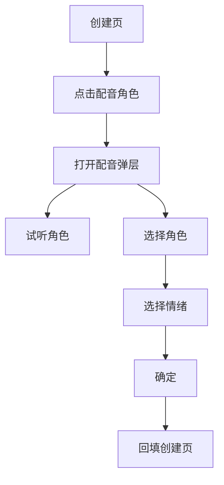

**详细交互说明**

- 点击试听播放对应音色样例，再次点击或切换角色时停止当前试听。
- 点击选择更新角色选中态。
- 点击确定后回填角色和情绪。
- 点击取消不保存本次变更。

**关键状态 / 异常情况**

- 试听加载失败。
- 会员专属配音锁定状态待确认。

**验收标准**

- 试听和选择互不干扰。
- 确认后创建页能展示已选配音。

### 5.10 创作更多设置与背景音乐

**页面定位**

创作页参数扩展入口，用于开启多样版本生成和设置背景音乐。

**参考素材**

- Figma frame `1:3203` / `17`

**页面结构**

1. 底部弹层容器。
2. 多样版本生成开关。
3. 多样版本说明文案。
4. 背景音乐入口。

**区块说明**

- 开启后系统生成一个常规集锦和 1 到 3 个多样版本。
- 开启后可能增加处理时间。
- 背景音乐入口存在，但完整音乐选择页未展开。

**主要功能**

- 开启 / 关闭多样版本生成。
- 进入背景音乐选择。

**交互流程图**

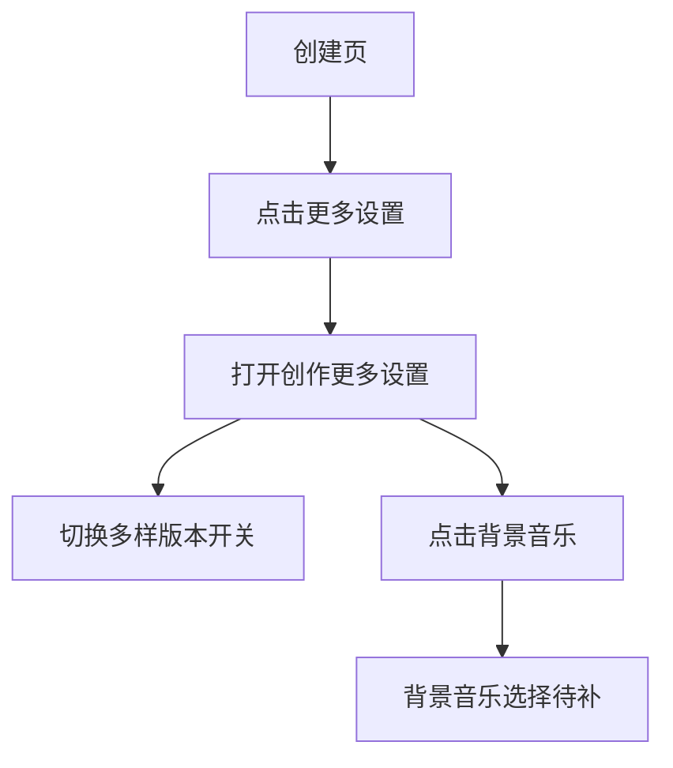

**详细交互说明**

- 切换开关后保存到当前创作项目配置。
- 点击背景音乐进入音乐选择页或后续弹层，具体页面需确认。

**关键状态 / 异常情况**

- 背景音乐完整流程未展开。
- 多样版本是否额外计费待确认。

**验收标准**

- 多样版本开关可保存。
- 背景音乐入口可点击并有后续承接方案。

### 5.11 积分、会员与充值页面

**页面定位**

提供积分消耗确认、权益不足提示、会员购买、积分充值和积分流水查看。

**参考素材**

- Figma frame `1:951` / `2`
- Figma frame `1:1219` / `3`
- Figma frame `1:2055` / `7`
- Figma frame `1:2170` / `8`
- Figma frame `1:2694` / `9`

**页面结构**

1. 积分消耗确认弹窗：消耗积分、立即生成。
2. 权益不足弹窗：提示、我再想想、升级会员。
3. VIP 会员页：权益、套餐、协议、立即充值。
4. 积分充值页：积分套餐、支付方式、协议、立即充值。
5. 积分详情页：任务名称、日期、积分增减。

**区块说明**

- 生成前按原视频时长计算积分消耗。
- 会员权益包括积分折扣、高阶模型、高清流畅、专属配音、创建形象等。
- 充值需提示虚拟产品不支持退款。

**主要功能**

- 确认积分消耗。
- 提示权益不足。
- 开通会员。
- 充值积分。
- 查看积分流水。

**交互流程图**

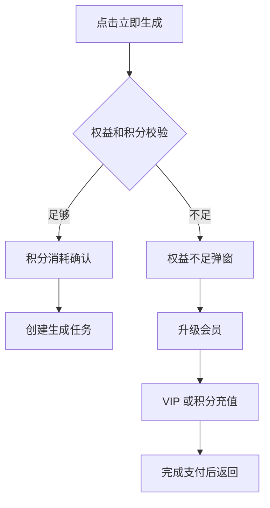

**详细交互说明**

- 积分不足时进入权益不足弹窗。
- 点击升级会员进入 VIP 会员页或充值页，具体策略待确认。
- 充值页必须先勾选协议才能提交支付。
- 积分详情按时间倒序展示流水。

**关键状态 / 异常情况**

- 支付取消、失败、成功结果页未在当前 Figma 中展示，但需要在交互和技术方案中处理。
- 套餐价格存在疑似文案异常，最终价格需确认。

**验收标准**

- 生成前能看到本次消耗积分。
- 权益不足能引导到会员或充值。
- 充值和会员页都有协议勾选。

### 5.12 作品页与作品详情

**页面定位**

展示用户作品、草稿和生成结果，并支持查看详情和下载视频。

**参考素材**

- Figma frame `1:1542` / `4`
- Figma frame `1:1784` / `5`
- Figma frame `1:538` / `19`

**页面结构**

1. 我的作品标题。
2. 作品保留 7 天提示。
3. 分类筛选：全部、短剧、漫剧、电影、电视剧。
4. 空态：暂无记录、立即创造。
5. 列表态：封面、草稿标签、日期、标题、更多操作。
6. 作品详情：视频预览、全屏、作品名称、参数标签、下载视频。

**区块说明**

- 无作品时引导立即创造。
- 列表卡片可进入作品详情。
- 作品详情展示生成参数，如语速、风格、配音角色。

**主要功能**

- 查看作品空态 / 列表。
- 分类筛选。
- 进入作品详情。
- 播放预览。
- 下载视频。

**交互流程图**

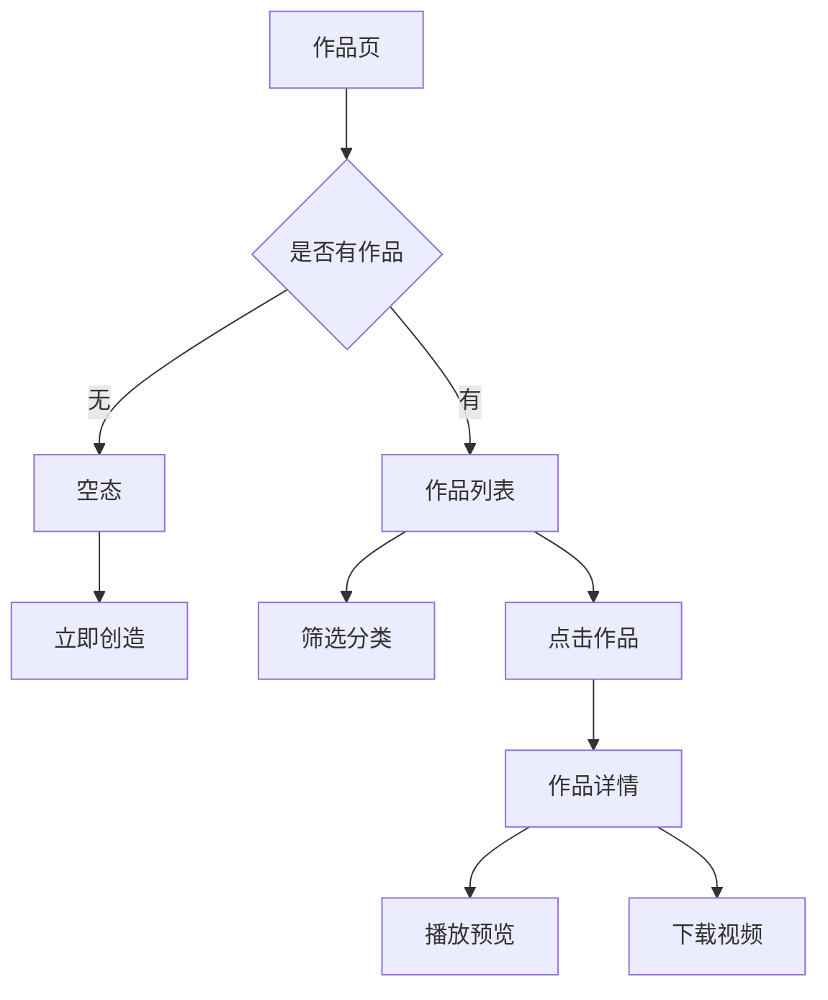

**详细交互说明**

- 点击“立即创造”进入视频解说创建页。
- 点击分类后刷新列表。
- 点击作品卡片进入作品详情。
- 点击下载视频触发下载或保存到系统相册。

**关键状态 / 异常情况**

- 作品保留 7 天，过期处理待确认。
- 下载失败、播放失败需提示。
- 卡片更多菜单内容待确认。

**验收标准**

- 空态可引导创作。
- 列表可筛选并进入详情。
- 详情页可播放和下载。

---

## 6. 数据与同步

| 数据对象 | 核心字段 | 同步要求 |
|----------|----------|----------|
| 用户账号 | userId、手机号、脱敏手机号、登录状态、邀请码、协议同意记录 | 登录后按账号同步 |
| 权益 | 会员状态、会员到期时间、可用权益、积分折扣 | 影响生成、配音、模型和高清能力 |
| 积分账户 | 当前余额、冻结积分、累计充值、累计消耗 | 生成前后需要实时同步 |
| 积分流水 | 流水 ID、任务名称、日期、积分增减、关联订单或任务 | 按时间倒序展示 |
| 视频素材 | 素材 ID、名称、缩略图、时长、上传时间、存储地址、解析状态 | 创作页和选择视频弹层共用 |
| 创作项目 | 项目 ID、素材列表、总时长、风格、配音、语速、背景音乐、多样版本开关 | 生成前保存，便于返回继续编辑 |
| 生成任务 | taskId、状态、积分消耗、失败原因、结果视频地址、创建时间、完成时间 | 前后端按状态机同步 |
| 作品 | workId、名称、封面、类型、状态、参数标签、保留截止时间、下载地址 | 作品页与详情页共用 |
| 反馈 | feedbackId、类型、描述、附件、联系方式、提交时间、处理状态 | 意见反馈页提交后入库 |
| 邀请 | inviteCode、邀请链接、邀请记录、奖励状态 | 邀请好友页展示 |

---

## 7. 核心业务规则

### 7.1 视频素材规则

- 单个视频时长必须在 10 秒到 30 分钟之间。
- 单次最多添加 10 个视频。
- 多视频生成时，当前按总原视频时长计算积分，取整规则待确认。
- 删除已选素材前必须二次确认。

### 7.2 积分规则

- 生成解说视频按原视频时长收费，每分钟消耗 20 积分。
- 点击立即生成后先计算本次消耗积分，再进行二次确认。
- 积分扣减必须具备幂等性，避免重复点击导致重复扣减。
- 生成失败后的积分退回或补偿规则待确认。

### 7.3 会员规则

- 会员权益包括积分折扣、高阶模型、高清流畅、专属配音、免费创建形象等。
- 会员价格、周期和展示文案以最终业务配置为准。
- 会员或积分充值属于虚拟产品，需展示不支持退款提示和协议勾选。

### 7.4 作品规则

- 作品保留 7 天。
- 作品过期后的展示、下载和删除策略待确认。
- 草稿、生成中、生成失败、已完成等状态需要技术方案阶段映射为任务状态。

### 7.5 反馈与邀请规则

- 反馈提交必须包含反馈类型和问题描述。
- 联系方式可选还是必填待确认。
- 邀请奖励发放条件、奖励额度和到账时间待确认。

---

## 8. 前后端交互说明

| 场景 | 前端动作 | 后端 / 服务端响应 | 备注 |
|------|----------|-------------------|------|
| 一键登录 | 提交运营商授权信息 | 返回登录态、用户信息、token | 具体 SDK 待技术方案确认 |
| 验证码登录 | 发送验证码、提交手机号和验证码 | 返回登录态、用户信息、token | 需要频控与风控 |
| 获取用户信息 | 进入我的页 | 返回手机号、邀请码、积分、会员状态 | 支持刷新 |
| 素材上传 | 提交视频文件或选择已上传素材 | 返回素材 ID、缩略图、时长、解析状态 | 后端接入百度智能云智能点播平台 VOD |
| 生成预估 | 点击立即生成 | 返回积分消耗、权益校验结果 | 生成前调用 |
| 创建生成任务 | 确认积分消耗 | 返回 taskId 和初始状态 | 需要幂等 token |
| 查询任务 | 进入作品列表或详情 | 返回任务状态和结果地址 | 可轮询或推送 |
| 下载作品 | 点击下载视频 | 返回下载地址或触发授权下载 | 需处理过期 |
| 会员充值 | 提交套餐和支付方式 | 返回支付参数和订单号 | 支付供应商待确认 |
| 积分充值 | 提交积分套餐和支付方式 | 返回支付参数和订单号 | 支付结果需回调 |
| 积分明细 | 进入积分详情 | 返回分页流水 | 支持分页 |
| 提交反馈 | 提交类型、描述、附件、联系方式 | 返回提交结果 | 附件能力可后置 |
| 邀请记录 | 进入邀请好友页 | 返回邀请码、邀请规则、邀请记录 | 运营规则待确认 |

---

## 9. 非功能要求

- 移动端优先，当前设计基准为 375 x 812。
- App 采用深色视觉体系，关键 CTA 使用黄绿色渐变。
- 登录、充值、生成等关键动作需要防重复提交。
- 视频上传、生成、下载必须考虑弱网、失败重试和超时提示。
- 积分扣减、充值到账、生成任务创建必须幂等。
- 用户协议、隐私政策、短信验证码、手机号登录需满足隐私合规要求。
- 支付链路必须保留订单号、支付状态、回调状态，便于客服追踪。
- 作品下载地址、视频源地址、用户 token 等敏感信息不得在客户端长期明文存储。
- 页面文案中疑似错字和价格异常应在正式开发前完成确认。

---

## 10. 里程碑

| 里程碑 | 目标 | 产物 |
|--------|------|------|
| M1 PRD 确认 | 确认页面范围、核心流程、待确认项 | `requirements.md` |
| M2 需求文档检测 | 检查 PRD 缺口、冲突、不可实现项 | `detection-feedback.md` |
| M3 技术方案 | 明确前后端边界、视频云、支付、短信、任务状态 | `tech-plan.md` |
| M4 工时评估 | 输出三点估计、关键路径、风险缓冲 | `effort-estimate.md` |
| M5 前后端详细文档 | 输出 Flutter / Java 技术文档与开发计划 | `03-前端/`、`04-后端/` |

---

## 11. 待确认项

| 编号 | 待确认项 | 影响 |
|------|----------|------|
| Q1 | 邀请好友奖励规则、邀请记录字段、分享方式 | 影响邀请好友页和后端邀请模块 |
| Q2 | 我的页更多设置是否包含投诉举报、算法备案、关于我们 | 影响设置页 IA |
| Q3 | 意见反馈是否支持附件上传，附件类型和数量限制 | 影响反馈页和存储服务 |
| Q4 | 背景音乐完整选择流程 | 影响创作更多设置和生成参数 |
| Q5 | 生成任务状态机：排队中、生成中、失败、重试、取消 | 影响作品状态、任务接口和积分补偿 |
| Q6 | 生成失败后积分是否退回、何时退回 | 影响积分账务 |
| Q7 | 多视频计费按总时长如何取整 | 影响积分预估 |
| Q8 | VIP 套餐价格和周期文案 | 影响会员页和支付 |
| Q9 | 会员权益“免费创建形象不限次数”是否为当前版本功能 | 影响会员权益和功能入口 |
| Q10 | 作品保留 7 天后的自动删除、下载失效和用户提示策略 | 影响作品列表和详情 |
| Q11 | 视频云、短信、支付供应商选择 | 影响技术方案和工时 |
| Q12 | Figma 中疑似文案问题：高光燃剪、已选择、验证码登录按钮、分镜命名 | 影响最终 UI 文案 |

---

## 12. CHG-0011 邀请好友逻辑文档审核补充

> 状态：`waiting_review`。邀请好友专题需求已拆为独立文件，主 PRD 只保留索引。

独立需求文档：`projects/剧说/01-需求/邀请好友需求文档.md`。

该文档覆盖邀请链接注册、App 内绑定邀请人、注册送积分、会员返佣、我的收益、收益明细、邀请列表、提现、提现记录、后台规则配置、提现审核和公开邀请落地页。
