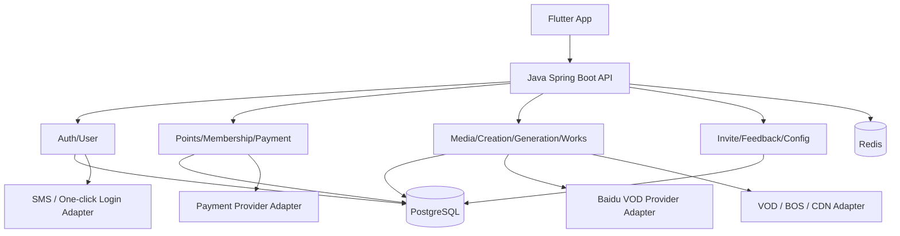

# 剧说 后端方案评估

> 版本：v0.2.2  
> 日期：2026-05-18  
> 关联 PRD：`../01-需求/requirements.md`  
> 关联技术方案：`./tech-plan.md`  
> 关联前端技术文档：`../03-前端/flutter-tech.md`  
> 评估范围：后端技术路线、模块边界、数据与外部服务接入方式  
> 非评估范围：不输出人天、日历排期或详细工时估算

---

## 0. 结论

当前建议把剧说后端收敛为：

| 维度 | 建议 |
|------|------|
| 后端语言 | Java |
| 框架 | Spring Boot 3.x |
| JDK | Java 21 |
| 构建 | Gradle |
| 数据库 | PostgreSQL |
| 缓存 / 幂等 | Redis |
| 持久层 | MyBatis-Plus + Flyway |
| 鉴权 | JWT Bearer Token |
| 视频业务平台 | 百度智能云智能点播平台 VOD |
| 架构方式 | 单体模块化优先，外部供应商通过 Adapter 隔离 |
| 当前策略 | Flutter 继续 mock / adapter 先行；后端按本文确认后再生成 `java-tech.md` |

核心判断：

- Java + Spring Boot + Gradle 更适合当前业务：登录、支付、积分账本、任务回调、后台接口、第三方 SDK 接入都偏企业服务端常规场景。
- 当前不建议让 Flutter 直连视频云、支付或短信供应商；密钥、验签、回调和幂等必须由后端统一处理。
- 当前不建议一开始拆微服务；MVP 阶段用模块化单体更稳，后续按生成任务、支付账务、素材存储的压力再拆。
- 视频业务处理平台已明确为百度智能云智能点播平台 VOD；短信、一键登录、支付渠道仍待确认，后端仍必须做 Provider Adapter，避免业务代码直接绑定供应商 SDK。

本轮继续评估新增结论：

- 可以先生成后端技术文档，不必等待所有真实供应商完全确认；`sms`、`payment` 先以 mock provider 跑通闭环，视频链路按 `BaiduVodProvider` + `MockVodProvider` 双实现设计。
- 后端 MVP 的最小闭环应优先打通：登录态 -> 上传素材 -> 预估积分 -> 冻结积分 -> 创建生成任务 -> mock 成功生成作品 -> 作品列表 / 详情。
- 积分账本、支付回调和生成任务状态机必须先定模型；这些是后续联调最容易出问题的部分。
- 后续 Java 包名、Redis key、数据库迁移建议统一使用 `jushuo` 作为英文工程标识，避免中文项目名在代码和配置中分散出现。
- 百度 VOD 官方能力覆盖媒资上传 / 管理、媒资处理、回调通知、播放分发和视频生成；后端应把 VOD 的媒资 ID、任务 ID、回调事件 ID 和播放地址映射到自己的素材、任务和作品模型中。

---

## 1. 候选方案对比

| 方案 | 适配度 | 优点 | 风险 | 结论 |
|------|--------|------|------|------|
| Java + Spring Boot + Gradle | 高 | 团队和生态成熟，支付/短信/对象存储 SDK 完整，事务和回调处理稳定；与既有 Gradle 习惯一致 | 样板代码较多，需要明确分层 | 推荐 |
| 其他 JVM 方案 | 中 | 可复用 JVM 生态 | 当前规则和后续实现已转 Java；切换语言会增加不必要成本 | 不作为当前主线 |
| Node.js + NestJS | 中 | 接口开发快，前端团队易理解 | 支付账本、任务回调、事务一致性需要更强规范约束 | 不建议作为 MVP 主线 |
| BaaS / Supabase / Firebase | 低 | 快速搭登录和数据 | 国内支付、短信、视频生成、合规和回调链路受限 | 不适合作为核心后端 |
| 无后端，仅 Flutter + 第三方直连 | 低 | 前期快 | 密钥暴露、支付回调和积分账本不可控 | 明确不建议 |

---

## 2. 后端职责边界

### 2.1 后端必须承担

| 能力 | 原因 |
|------|------|
| 登录与 Token | App 需要稳定登录态、用户归属和注销能力 |
| 短信 / 一键登录服务端适配 | 供应商密钥不能放端上 |
| 积分账户与流水 | 生成、充值、失败退回都依赖账本一致性 |
| 会员与订单 | 支付验签、重复回调、到账补偿必须服务端闭环 |
| 素材元数据 | 上传凭证、素材状态、缩略图、时长和归属需要服务端记录 |
| 生成任务编排 | 创建任务、轮询状态、回调同步、失败重试 |
| 作品管理 | 作品列表、详情、播放 / 下载地址、过期策略 |
| 邀请与反馈 | 邀请奖励和问题反馈需要可追踪数据 |
| 配置与预设 | 风格、音色、背景音乐、套餐等可后台配置 |

### 2.2 Flutter 继续先行的边界

- Flutter 可以继续实现 `apis/` 方法、mock data source、Service adapter 和页面状态。
- Flutter 不写死真实 API 路径、错误码和第三方供应商字段。
- 后端接口定稿后，由 adapter 层做路径和字段映射，不让页面层直接感知真实协议变化。

---

## 3. 推荐架构



### 3.1 分层约束

```text
controller -> service -> mapper -> PostgreSQL
                 |
                 -> provider adapter -> 百度 VOD / 支付 / 短信等外部供应商
                 |
                 -> Redis 幂等 / 验证码 / 短期状态
```

- Controller 只做参数解析、鉴权上下文和统一响应。
- Service 承担事务、状态流转、幂等、账本和任务编排。
- Mapper 只处理数据访问。
- Provider Adapter 屏蔽短信、支付、百度 VOD 和对象存储 / CDN 的实现差异。

---

## 4. 模块拆分建议

| 模块 | 优先级 | 主要职责 |
|------|--------|----------|
| infrastructure | P0 | 工程骨架、配置、统一响应、异常、日志、Flyway、Redis |
| auth | P0 | 一键登录、短信验证码、登录、Token、注销 |
| user | P0 | 用户资料、邀请码、我的页聚合信息 |
| points | P0 | 积分账户、流水、冻结、扣减、退回 |
| payment | P0 | 套餐、订单、支付回调、到账补偿、幂等 |
| media | P0 | 百度 VOD 上传凭证、素材元数据、媒资 ID、素材列表、删除 |
| creation | P0 | 草稿、生成参数、积分预估 |
| generation | P0 | 百度 VOD 视频生成任务创建、状态查询、回调、重试 |
| works | P0 | 作品列表、详情、VOD 播放 / 下载地址、过期 |
| membership | P1 | 会员权益、有效期、权益校验 |
| invite | P1 | 邀请码、邀请记录、奖励发放 |
| feedback | P1 | 意见反馈、附件、处理状态 |
| config | P1 | 风格、音色、背景音乐、协议、静态配置 |

---

## 5. 候选接口分组

> 本节是后端方案评估级接口分组，不是最终接口契约。最终路径、字段和错误码应在 `java-tech.md` 中冻结。

| 分组 | 候选接口 | 说明 |
|------|----------|------|
| Auth | `POST /api/auth/one-click-login` | 一键登录服务端换取用户态 |
| Auth | `POST /api/auth/sms/send`、`POST /api/auth/sms/login` | 短信验证码登录 |
| User | `GET /api/user/profile`、`POST /api/user/logout`、`POST /api/user/delete-request` | 我的页和设置 |
| Points | `GET /api/points/account`、`GET /api/points/ledger` | 积分余额和流水 |
| Membership | `GET /api/membership/plans`、`GET /api/membership/status` | 会员套餐与权益 |
| Payment | `POST /api/payments/orders`、`POST /api/payments/callback/{channel}` | 下单与支付回调 |
| Media | `POST /api/media/upload-token`、`GET /api/media/assets`、`DELETE /api/media/assets/{id}` | 上传凭证和素材 |
| Creation | `POST /api/creation/estimate`、`POST /api/creation/drafts` | 生成前预估和草稿 |
| Generation | `POST /api/generation/tasks`、`GET /api/generation/tasks/{id}` | 创建任务和状态查询 |
| Works | `GET /api/works`、`GET /api/works/{id}`、`POST /api/works/{id}/download-url` | 作品列表、详情、下载 |
| Invite | `GET /api/invite/overview`、`GET /api/invite/records` | 邀请页 |
| Feedback | `POST /api/feedback` | 意见反馈 |
| Config | `GET /api/config/presets`、`GET /api/config/static-page/{key}` | 预设和静态协议 |

---

## 6. 数据模型建议

### 6.1 核心表

| 表 | 优先级 | 说明 |
|----|--------|------|
| `users` | P0 | 用户基础信息、手机号、邀请码、状态 |
| `auth_tokens` / `refresh_tokens` | P0 | 可选；如只做短期 JWT 可后置 |
| `sms_codes` | P0 | 验证码、场景、过期、使用状态 |
| `point_accounts` | P0 | 用户积分余额、冻结余额 |
| `point_ledgers` | P0 | 积分收入、支出、冻结、解冻、退回流水 |
| `membership_plans` | P1 | 会员套餐配置 |
| `user_memberships` | P1 | 用户会员权益和有效期 |
| `payment_orders` | P0 | 支付订单、渠道、金额、状态、幂等键 |
| `media_assets` | P0 | 素材文件、缩略图、时长、上传状态、百度 VOD 媒资 ID |
| `creation_drafts` | P1 | 创作草稿和参数快照 |
| `generation_tasks` | P0 | 生成任务、状态、百度 VOD 任务 ID、失败原因 |
| `works` | P0 | 作品、百度 VOD 结果媒资 ID、播放地址、下载状态、过期时间 |
| `provider_events` | P0 | 百度 VOD / 支付等外部回调原文、事件 ID、处理状态 |
| `invite_records` | P1 | 邀请关系、奖励状态 |
| `feedbacks` | P1 | 意见反馈内容、联系方式、处理状态 |
| `app_configs` | P1 | 风格、音色、背景音乐、协议等配置 |

### 6.2 Redis 使用

| 场景 | Key 示例 | 用途 |
|------|----------|------|
| 短信限流 | `jushuo:sms:rate:{phone}` | 防刷 |
| 验证码 | `jushuo:sms:code:{scene}:{phone}` | 5 分钟有效 |
| 接口幂等 | `jushuo:idempotency:{key}` | 防重复提交 |
| 支付回调锁 | `jushuo:pay:callback:{orderNo}` | 防重复到账 |
| 任务轮询缓存 | `jushuo:generation:task:{taskId}` | 降低短期查询压力 |

### 6.3 百度 VOD 字段映射

| 本地对象 | 建议字段 | 百度 VOD 对应含义 |
|----------|----------|-------------------|
| `media_assets` | `provider` | 固定为 `BAIDU_VOD` |
| `media_assets` | `provider_media_id` | VOD 媒资 ID |
| `media_assets` | `source_url` / `cover_url` | VOD 返回的源视频地址与封面地址，仅服务端可信 |
| `generation_tasks` | `provider_task_id` | VOD 视频生成 / 媒资处理任务 ID |
| `generation_tasks` | `provider_status` | VOD 原始任务状态，和本地状态分开保存 |
| `works` | `provider_media_id` | 生成结果写入 VOD 后的媒资 ID |
| `provider_events` | `provider_event_id` | VOD 回调事件 ID，用于幂等 |
| `provider_events` | `event_type` | 例如 `VIDEO_GENERATE_COMPLETE` |

---

## 7. 接口契约草案

> 本节用于推进评估到可生成 `java-tech.md` 的程度。字段名仍是草案，真实接口应在后端技术文档中冻结。

### 7.1 通用约定

| 项 | 建议 |
|----|------|
| API 前缀 | `/api` |
| 鉴权 | `Authorization: Bearer {accessToken}` |
| 幂等 | 关键写接口支持 `Idempotency-Key` header |
| 响应格式 | `code`、`message`、`data`、`traceId` |
| 分页格式 | `items`、`page`、`pageSize`、`total`、`hasMore` |
| 时间格式 | ISO-8601 字符串，服务端统一时区处理 |
| 金额单位 | 后端内部使用分，前端展示时转换 |
| 积分单位 | 整数积分，不使用小数 |

通用响应示例：

```json
{
  "code": "OK",
  "message": "success",
  "data": {},
  "traceId": "202605181650000001"
}
```

### 7.2 P0 接口草案

| 场景 | 接口 | 关键入参 | 关键出参 | 幂等 |
|------|------|----------|----------|------|
| 发送验证码 | `POST /api/auth/sms/send` | `phone`、`scene` | `cooldownSeconds` | 否，走频控 |
| 验证码登录 | `POST /api/auth/sms/login` | `phone`、`code`、`scene` | `accessToken`、`profile` | 否 |
| 我的页聚合 | `GET /api/user/profile` | 无 | 用户、积分、会员、邀请码 | 否 |
| 积分预估 | `POST /api/creation/estimate` | 素材、参数、模式 | `pointsCost`、`entitlementResult` | 否 |
| 创建任务 | `POST /api/generation/tasks` | `draftId` 或参数快照 | `taskId`、`status` | 是 |
| 查询任务 | `GET /api/generation/tasks/{id}` | `id` | 状态、进度、失败原因、作品 ID | 否 |
| 上传凭证 | `POST /api/media/upload-token` | 文件名、大小、类型、时长 | 百度 VOD 上传参数、assetId | 是 |
| 素材列表 | `GET /api/media/assets` | 分页 | 素材列表 | 否 |
| 作品列表 | `GET /api/works` | 分页、状态 | 作品列表 | 否 |
| 作品详情 | `GET /api/works/{id}` | `id` | 播放地址、参数、下载状态 | 否 |
| 创建订单 | `POST /api/payments/orders` | 商品类型、商品 ID、渠道 | `orderNo`、支付参数 | 是 |
| 支付回调 | `POST /api/payments/callback/{channel}` | 渠道原始回调 | 处理结果 | 渠道订单号幂等 |
| VOD 回调 | `POST /api/providers/baidu-vod/callback` | VOD 原始回调 | 处理结果 | `eventId` 幂等 |

### 7.3 错误码分层

| 分类 | 示例 | 前端处理 |
|------|------|----------|
| 通用 | `BAD_REQUEST`、`UNAUTHORIZED`、`FORBIDDEN`、`NOT_FOUND` | 表单提示、登录跳转或错误页 |
| 认证 | `SMS_TOO_FREQUENT`、`SMS_CODE_INVALID`、`TOKEN_EXPIRED` | 登录页提示或重新登录 |
| 积分 / 权益 | `POINTS_NOT_ENOUGH`、`ENTITLEMENT_REQUIRED` | 弹权益不足或进入充值 |
| 支付 | `PAYMENT_ORDER_EXPIRED`、`PAYMENT_VERIFY_FAILED` | 支付失败提示，允许重试 |
| 素材 | `MEDIA_TOO_LARGE`、`MEDIA_FORMAT_UNSUPPORTED`、`MEDIA_UPLOAD_FAILED` | 上传区域错误态 |
| 生成 | `GENERATION_PROVIDER_BUSY`、`GENERATION_FAILED`、`GENERATION_TIMEOUT` | 任务失败、重试或联系客服 |

---

## 8. 状态机与一致性规则

### 8.1 生成任务状态

| 状态 | 含义 | 可流转到 |
|------|------|----------|
| `CREATED` | 服务端已创建任务，尚未提交供应商 | `POINTS_FROZEN`、`FAILED` |
| `POINTS_FROZEN` | 积分已冻结 | `SUBMITTED`、`FAILED` |
| `SUBMITTED` | 已提交生成供应商 | `QUEUED`、`PROCESSING`、`FAILED` |
| `QUEUED` | 供应商排队中 | `PROCESSING`、`FAILED` |
| `PROCESSING` | 生成中 | `SUCCEEDED`、`FAILED`、`TIMEOUT` |
| `SUCCEEDED` | 生成成功，作品已创建 | 终态 |
| `FAILED` | 生成失败，积分应退回 | 终态 |
| `TIMEOUT` | 超时未回调，等待补偿任务确认 | `SUCCEEDED`、`FAILED` |
| `CANCELED` | 用户或系统取消 | 终态 |

### 8.2 积分账本规则

| 规则 | 说明 |
|------|------|
| 账户字段 | `available_points`、`frozen_points` 分开存储 |
| 流水不可改 | `point_ledgers` 只追加，不物理修改历史流水 |
| 冻结 | 创建生成任务时先扣可用余额、增加冻结余额 |
| 成功扣减 | 生成成功后冻结余额减少，写入消费确认流水 |
| 失败退回 | 生成失败后冻结余额减少，可用余额增加，写入退回流水 |
| 幂等 | 同一 `bizType + bizId + operation` 只能生成一组账本动作 |
| 并发 | 更新账户使用乐观锁或数据库行锁，不能只依赖 Redis |

### 8.3 支付订单状态

| 状态 | 含义 | 后端动作 |
|------|------|----------|
| `CREATED` | 订单已创建 | 返回支付参数 |
| `PAYING` | 客户端已调起支付 | 等待回调或查询 |
| `PAID` | 渠道确认支付成功 | 发放积分或会员 |
| `CLOSED` | 订单关闭或超时 | 不发放权益 |
| `FAILED` | 支付失败 | 记录失败原因 |
| `REFUNDED` | 已退款 | 后续如支持退款需冲正权益 |

支付成功只能以服务端验签后的渠道回调或服务端主动查询为准，不能信任客户端“支付成功”回传。

### 8.4 素材与作品状态

| 对象 | 状态 | 说明 |
|------|------|------|
| 素材 | `UPLOAD_PENDING` | 已创建素材记录，等待上传 |
| 素材 | `UPLOADED` | 文件已上传，等待解析 |
| 素材 | `READY` | 可用于生成 |
| 素材 | `FAILED` | 上传或解析失败 |
| 素材 | `DELETED` | 用户删除或系统清理 |
| 作品 | `READY` | 可播放 / 下载 |
| 作品 | `EXPIRED` | 下载或播放地址过期，需要重新签发 |
| 作品 | `DELETED` | 用户删除或系统清理 |

---

## 9. Provider Adapter 设计

### 9.1 Adapter 原则

- 业务 Service 只依赖接口，不直接依赖具体供应商 SDK。
- mock provider 与真实 provider 使用同一接口，方便先完成后端闭环。
- 供应商原始请求和回调原文需要落库或写审计日志，便于排查。
- 回调入口只做验签、幂等和状态推进，不在 Controller 里写复杂业务。
- 视频业务主实现为 `BaiduVodProvider`，同时保留 `MockVodProvider` 用于本地开发、测试和供应商不可用时的降级演练。

### 9.2 接口草案

```java
public interface SmsProvider {
    SendSmsResult sendCode(String phone, String scene, String code);
}

public interface OneClickLoginProvider {
    PhoneVerifyResult verifyToken(String providerToken);
}

public interface PaymentProvider {
    PaymentPrepareResult prepare(PaymentOrder order);
    PaymentCallbackResult verifyCallback(String rawBody, Map<String, String> headers);
}

public interface VodProvider {
    UploadCredential createUploadCredential(MediaAsset asset);
    GenerationSubmitResult submit(GenerationTask task, GenerationInput input);
    GenerationQueryResult query(String providerTaskId);
    VodCallbackEvent verifyCallback(String rawBody, Map<String, String> headers);
    SignedUrl createPlaybackUrl(String providerMediaId, Duration ttl);
}
```

### 9.3 百度 VOD 接入边界

| 后端能力 | 百度 VOD 对应能力 | 本地处理 |
|----------|-------------------|----------|
| 上传素材 | 媒资上传 / 媒资管理 | 后端创建素材记录和上传参数，Flutter 只执行上传 |
| 素材处理 | 工作流 / 媒资通用处理 | 本地记录处理任务 ID 和处理状态 |
| 视频生成 | VOD 视频生成 | 本地任务状态跟随 VOD 回调或查询结果推进 |
| 生成完成 | `VIDEO_GENERATE_COMPLETE` 事件回调 | 以 VOD `eventId` 幂等，创建本地作品 |
| 播放 / 下载 | VOD 媒资播放地址、CDN、自定义域名 / 鉴权 | 后端签发短期播放或下载地址 |
| 存储策略 | VOD 视频生成配置中的永久 / 临时存储 | 本地 `works.expire_at` 与 VOD 生命周期配置保持一致 |

---

## 10. 关键业务流评估

### 10.1 登录

推荐先支持手机号验证码登录，一键登录作为 Provider Adapter 接入项。

```text
手机号 -> 发送验证码 -> 校验验证码 -> 创建/更新用户 -> 签发 JWT -> 返回用户聚合信息
```

风险：

- 一键登录 SDK 的服务端校验流程依赖供应商。
- 注销账号需要和支付、作品、积分等保留策略对齐。

### 10.2 生成任务与积分

推荐采用“创建任务时冻结积分，成功后扣减，失败后退回”的账本策略。

```text
生成前预估 -> 创建任务 -> 冻结积分 -> 调用百度 VOD -> 回调/轮询
成功：冻结转扣减，写入 VOD 结果媒资并生成作品
失败：冻结退回，记录失败原因
```

理由：

- 避免生成中用户重复点击造成超扣。
- 支持任务失败后的自动退回。
- 便于后续做客服排查和账务审计。

### 10.3 支付与到账

支付必须通过后端创建订单和接收回调。

```text
创建订单 -> 调起支付 -> 支付渠道回调 -> 验签 -> 幂等判断 -> 到账积分/会员 -> 记录流水
```

风险：

- iOS 如果卖虚拟内容，可能涉及 Apple IAP 规则，需要单独确认。
- 微信 / 支付宝 / Apple IAP 的订单和回调模型不同，必须通过 `PaymentProvider` 隔离。

### 10.4 视频上传与生成

视频业务处理平台已明确为百度智能云智能点播平台 VOD。推荐后端发放 VOD 上传参数或上传凭证，Flutter 负责上传执行和进度展示，后端记录本地素材、VOD 媒资 ID、生成任务 ID、回调事件和作品状态。

```text
后端创建 media_asset -> 返回 VOD 上传参数
Flutter 上传素材 -> VOD 媒资上传 / 处理
后端创建 generation_task -> 调用 VOD 视频生成 / 处理能力
VOD 回调 VIDEO_GENERATE_COMPLETE -> 后端幂等处理 -> 创建 work -> 积分确认扣减
```

风险：

- 需要确认 VOD 账号、区域、工作流 / 模板、视频生成配置是否已开通。
- 需要确认“生成解说 / 精剪”对应百度 VOD 的具体能力：智能集锦、视频生成、媒资处理工作流，还是定制接口。
- 回调字段可能持续增加，后端解析必须兼容未知字段，并保存原始回调。
- 播放鉴权、下载地址有效期、自定义域名和视频生成结果的存储生命周期会影响作品接口设计。

---

## 11. 外部供应商待确认清单

| 方向 | 必须确认的问题 | 对后端影响 |
|------|----------------|------------|
| 一键登录 | 使用哪个运营商认证服务，是否已有 AppKey / AppSecret | 影响 Auth Provider |
| 短信 | 短信供应商、签名、模板、频控要求 | 影响验证码发送与限流 |
| 视频云 / 生成 | 已确认百度智能云智能点播平台 VOD；仍需确认账号、区域、工作流 / 模板、视频生成能力和回调配置 | 影响 `BaiduVodProvider` 参数、状态映射和回调处理 |
| 对象存储 | 默认随 VOD 使用 BOS / CDN；仍需确认自定义域名、播放鉴权和下载 URL 有效期 | 影响素材和作品 URL 策略 |
| 支付 | 微信 / 支付宝 / Apple IAP / 其他渠道 | 影响 Payment Provider 与审核合规 |
| 客服 | 是否接第三方客服，还是只做反馈表单 | 影响反馈模块和客服入口 |

---

## 12. MVP 实施建议

### 12.1 第一批必须先做

1. Java Spring Boot 工程骨架、统一响应、错误码、日志、配置。
2. 用户、短信登录、JWT、我的页用户聚合信息。
3. 积分账户、积分流水、冻结 / 扣减 / 退回。
4. 素材、生成任务、作品三组核心表与状态枚举。
5. `BaiduVodProvider` 接口和 `MockVodProvider` 实现先跑通内部闭环；支付、短信继续 mock。

### 12.2 第二批接真实供应商

1. 短信 / 一键登录 Provider。
2. 百度 VOD 上传、媒资处理、视频生成和回调联调。
3. 支付 Provider 与回调验签。
4. 上传失败、生成失败、支付重复回调、积分退回联调。

### 12.3 第三批增强

1. 邀请奖励自动发放。
2. 会员权益精细化。
3. 反馈附件上传和后台处理。
4. 配置后台或运营配置表。
5. 任务清理、过期作品清理、审计报表。

---

## 13. 风险结论

| 风险 | 级别 | 建议 |
|------|------|------|
| 百度 VOD 具体模板 / 工作流未确认 | 高 | 先确认账号、区域、工作流、视频生成配置和回调事件；后端以 `BaiduVodProvider` 隔离 |
| 支付渠道和 iOS 虚拟内容合规 | 高 | 尽早确认渠道；iOS 需单独判断是否必须 IAP |
| 积分账本一致性 | 高 | 账本表和任务表必须先设计，不能只用用户余额字段 |
| Flutter 已前端先行 | 中 | 保持 API adapter，后端定稿后做映射 |
| VOD 回调字段演进 | 中 | 回调 DTO 兼容未知字段，原始 payload 入库，使用 `eventId` 幂等 |
| 缺少后台管理 | 中 | MVP 可先数据库 / 配置表维护，后续补管理端 |
| 不做工时评估 | 中 | 本文只给方案，不给排期；如要排期需重新启用第 6 步 |

---

## 14. 百度 VOD 官方依据与联调关注

| 依据 | 后端含义 |
|------|----------|
| [百度智能云 VOD 产品说明](https://cloud.baidu.com/product/vod.html)：覆盖采集、上传、存储、处理、分发、播放链路 | 剧说后端可以把素材、作品播放和下载统一抽象为 VOD 媒资能力 |
| [百度 VOD 视频生成产品说明](https://cloud.baidu.com/product/VOD/gen-video.html)：支持文生视频、图生视频、参考生视频等能力 | “生成任务”模块应预留不同生成输入类型和模板参数 |
| [VOD 视频生成完成事件](https://cloud.baidu.com/doc/VOD/s/Fm5v10gkb)：支持 `VIDEO_GENERATE_COMPLETE` | 后端需要 `provider_events` 表和 `/api/providers/baidu-vod/callback` 回调入口 |
| [修改事件回调设置](https://cloud.baidu.com/doc/VOD/s/cm3h9yj5b)：支持回调 URL、签名、特定事件通知 | 联调前必须确认回调签名 Token，并在后端做验签 |
| [回调解决方案](https://cloud.baidu.com/doc/VOD/s/Jjwvyd3a5)：回调解析建议兼容未知字段 | Java DTO / Jackson 解析不能因新增字段导致回调失败 |
| [VOD 全局设置](https://cloud.baidu.com/doc/VOD/s/Mjwvyd0tz)：支持自定义域名、访问控制、视频生成存储规则 | 作品播放地址、下载地址、过期时间和存储成本策略需要在后端配置化 |

---

## 15. 下一步

当前后端主线已可按以下默认决策进入 `08 后端 Java 技术文档`：

1. 后端主线固定为 Java 21 + Spring Boot 3.x + Gradle。
2. 视频业务处理固定接入百度智能云智能点播平台 VOD，后端通过 `BaiduVodProvider` 隔离上传、媒资处理、视频生成、回调和播放地址签发。
3. 积分账本、支付回调、生成任务状态机作为 `java-tech.md` 的优先冻结内容。

仍建议用户在进入真实联调前确认：

1. 百度 VOD 账号、区域、工作流 / 模板、回调 URL、回调签名 Token、视频生成结果存储策略。
2. 支付 MVP 的首个渠道；如需要 iOS 上架，需单独评估 Apple IAP。
3. VOD 自定义域名、播放鉴权、下载 URL 有效期和是否允许用户长期下载保存。

确认后输出：

- `projects/剧说/04-后端/java-tech.md`
- `projects/剧说/04-后端/java-dev-plan.md`
- `projects/剧说/04-后端/开发计划/*.md`
