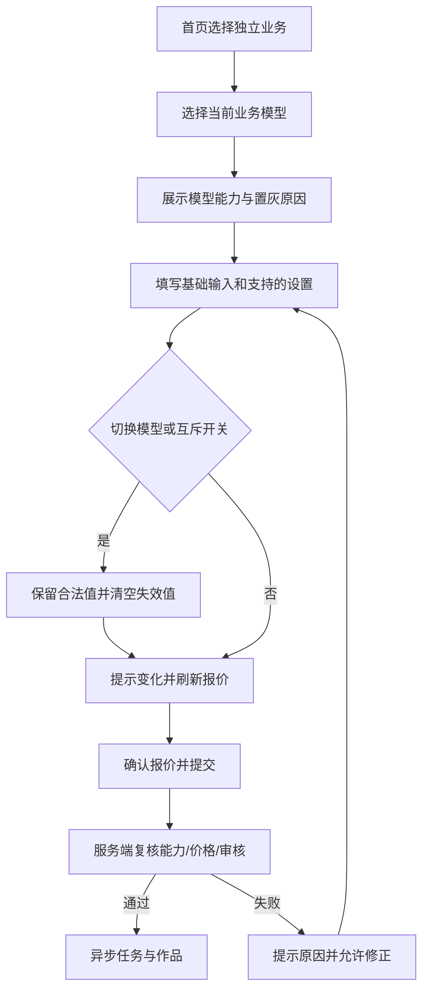

# 喵喵写歌 V2.1 需求清单：当前 Figma 页面与模型驱动参数

> 产品版本：V2.1 · 文档版本：`v2.1-model-driven-params` · CHG：CHG-0076 / CHG-0078 / CHG-0080 / CHG-0081 / CHG-0085
> 更新：2026-09-19 · 状态：`waiting_review`（CHG-0081 中的指定音色入口延期；上传前查重保留，待重新检测）· 迭代模式：`version_iteration`
> 完整需求：[requirements.md](requirements.md) · 快速评审：[requirements-review.md](requirements-review.md)

## 1. 来源与优先级

| 来源 | 本轮用途 | 边界 |
|------|----------|------|
| [简易/专业写歌飞书文档](https://acnrg6qcjuk1.feishu.cn/wiki/TbOdwPGVmi5lmekVYgRcjCMjnZe) | 写歌表单与能力差异 | 文档标题 1.3.0 是原资料名称，本项目当前产品版本仍记 V2.1 |
| [歌曲改编飞书文档](https://acnrg6qcjuk1.feishu.cn/wiki/Nc6nwOEWoipZjKkuoIac1e67nvf) | 保留歌词、识别和来源 | 其中“关闭保留原歌词仍保留原歌词”与开关语义冲突；以用户明确校准的“关闭则创作新歌词”为准 |
| [克隆翻唱飞书文档](https://acnrg6qcjuk1.feishu.cn/wiki/HVCxwGxhziI9nTknaftczy90noe) | 本人音色训练、翻唱与会员积分 | 素材上限以所选模型能力和供应商约束为准，不照搬设计图示例 |
| [首页改版飞书文档](https://acnrg6qcjuk1.feishu.cn/wiki/Db59wzbSFiFLodk4zuLcHrdNnlz) | 轮播海报、三个业务入口、注册赠积分、新人礼弹窗 | [配图](references/images/v2.1/home-revision/README.md)与 Figma 首页/弹窗/任务中心节点已核对；飞书未写明的 H-01～H-04 已由用户补充确认，图中积分数值仍仅作展示示例 |
| [算道接口文档](https://docs.qq.com/doc/DSUhISlNOWFNrQ1Bw) | `sovits_train`/`sovits_cover` 请求字段、训练素材与翻唱参数 | 已核对可见章节；未写明的时长上限、片段数量和 SoVITS 与 Suno Voice Persona 互通性仍不能推定 |
| 当前 Figma `bbxou598`、`working (91:106)` | 当前页面结构、状态和交互真源 | 写歌/改编/首页沿用稳定节点；翻唱声音克隆以 `157:*` 为最新页面族，见[当前快照](references/images/v2.1/figma-bbxou598/README.md)。旧通道仅作历史记录，画面数字不视作最终配置 |
| 用户 2026-09-13 明确补充 | 三业务“设置随模型变化”；不支持的设置仍显示但置灰，点击说明原因 | 优先于旧 PRD 中固定全局参数、仅隐藏不支持项等旧口径 |
| 用户 2026-09-13 D-01/02/04/05/07 答复及 CHG-0080 新稿 | 切模型失效值清空、允许有条件的最小参数提交、首期仅算道、作品沿用现行生命周期；Web/Admin 无稿部分复用工程 UI，App 翻唱页改按当前 `157:*` 验收 | D-03 部分厂家训练能力仍待技术核实，不能从示例数字推断；旧“App 翻唱主页缺稿”已被当前设计取代 |
| 用户 2026-09-13 训练素材与音色补充 | 训练素材只按厂家明确支持的硬限制校验；算道训练音色仅供算道兼容模型使用 | 厂家效果建议不作为拒绝条件；同厂商不同模型也须实际兼容 |
| 用户 2026-09-15 指定音色与资源上传补充 | 专业写歌、歌曲改编的「使用指定音色」统一进入音色库选择；本地资源正式上传前先由后端按摘要判断是否已有可复用资源 | 查重流程参考喵喵带货，但 Catsinger 私有素材仅限同 App、同用户和兼容用途复用，不能照搬跨用户公共复用 |
| 用户 2026-09-19 范围调整 | 专业写歌和歌曲改编的「使用指定音色」暂不纳入 V2.1，下个版本重新评估 | 覆盖 2026-09-15 的本期入口要求；不影响本地资源查重，也不影响翻唱声音克隆选本人/官方音色 |
| 旧 V2.1 文档与现有三端代码 | 差异分析、已确认通用流程 | [旧快照](../archive/CHG-0076-pre-rewrite/README.md)仅 `reference-only`，不作为本轮完成证明 |

## 2. 项目概述与用户

- 面向在手机端写歌、改编已有歌曲或用本人/官方音色翻唱的普通用户；运营和超级管理员在 Web/Admin 配置可用模型、价格和官方音色。
- 目标是在同一套平台审核、报价、积分、任务、资源与作品流程下，让三个业务分别呈现对应模型真正支持的设置，用户不会因切换模型而提交失效参数或被错误报价。
- 本轮重写产品需求，不修改 Flutter、Java、Web/Admin 代码，不视为新功能已发布。

## 3. 本期功能清单

| ID | 业务/页面 | 用户或运营可感知功能 | 优先级 |
|----|-----------|----------------------|--------|
| R-01 | 首页 | AI 写歌、歌曲改编、翻唱声音克隆三个独立入口；按新稿为一张宽卡加两张并列卡，历史改编作品不改归类 | P0 |
| R-02 | 简易写歌 | 灵感输入；纯音乐在输入卡左下；开启后人声项置灰；模型选择、随机灵感与生成 | P0 |
| R-03 | 专业写歌 | 歌名与歌词输入分离；歌词放大在右上，纯音乐在左下、润色在右下；参考音频可替换/删除；本期仅保留模型支持的系统人声选项 | P0 |
| R-04 | 专业设置 | 创意程度、风格参考度、音频参考度、音乐时长和系统人声等按当前模型能力呈现；本期不开放指定音色入口 | P0 |
| R-05 | 歌曲改编 | 自有作品、本地音频、相册视频提音频；保留原歌词默认关闭；开启时复用作品歌词或识别上传音频歌词；本期不开放指定音色入口 | P0 |
| R-06 | 翻唱声音克隆 | 同页完成歌曲来源、翻唱设置、我的/官方音色；生成页不设权利勾选，原请求字段固定传 `true` 兼容后端；覆盖来源上传、官方音色、会员/积分、音色不可用等状态 | P0 |
| R-07 | 音色创建/训练 | 头像昵称、本人权利确认、录制/上传/截取素材、模型选择、单独报价、训练状态和异常恢复 | P0 |
| R-08 | 作品 | 生成中、失败、完成；复用现有播放器；翻唱作品可查看、播放、重新翻唱 | P0 |
| R-09 | Web/Admin | 按 App 切换后配置真实厂家/模型、能力范围内的展示与默认、价格、官方音色和任务/作品 | P0 |
| R-10 | 通用模型交互 | 保留设计稿设置位置；不支持项置灰不可改、点击提示原因；切模型保留有效值、清空失效/越界值并提醒，不自动重置 | P0 |
| R-11 | 报价/提交 | 模型或影响价格的设置变化即刷新报价；服务端重新校验能力、参数和价格，不接收置灰旧值 | P0 |
| R-12 | 首页轮播 | 默认写歌与翻唱两张海报轮播；后台可新增/删除、配置可选功能跳转，未设置目标时只展示图片；首页至少有一张可展示海报 | P0 |
| R-13 | 注册赠积分 | 沿用新账号创建时的现有赠送与流水幂等，只把金额改为后台配置；历史不补差；初始及无效配置回退值 30 积分 | P0 |
| R-14 | 新人礼弹窗 | 后台可启停、换样式、配置目标 App 页面、会员/非会员人群及弹出频次；只面向尚未点领取的新用户；稍后关闭不消耗资格，点击领取后结束弹窗资格并跳签到/任务 | P0 |
| R-15 | 当前 Figma 状态覆盖 | `157:*` 的主页、来源、设置、音色、协议、报价、会员/积分不足、资料、录音、裁剪、训练异常和翻唱作品状态均进入页面需求与验收 | P0 |
| R-16 | 本地资源上传前查重 | 对参考音频、改编/翻唱原曲、音色头像、训练音频及视频提取后的最终文件，先计算摘要与大小并由后端查询；可复用则直接绑定已有资源，不可复用才上传 | P0 |

## 4. 三项业务边界

| 业务 | 核心目的 | 歌曲来源 | 音色 | 计费 | 公开入口现状 |
|------|----------|----------|------|------|--------------|
| AI 写歌 | 从灵感/歌词生成新歌 | 文字为主，专业模式可用参考音频（限模型支持） | 本期仅开放模型支持的系统人声；指定音色留待下版 | 写歌任务报价 | `/api/song-generations` |
| 歌曲改编 | 对已有歌曲换风格/歌词等 | 自有作品、本地音频、相册视频提音频 | 本期仅开放模型支持的系统人声；指定音色留待下版 | 改编任务报价 | `/api/song-covers` |
| 翻唱声音克隆 | 用目标音色重唱整曲 | 自有作品、本地音频、相册视频提音频 | 本人已训练音色或后台官方音色 | 训练与翻唱分别报价 | `/api/song-voice-covers` |

三业务保留独立入口、任务类型、历史作品标签和计费场景；只共用现有平台任务/模型路由、审核、积分、资源和作品底层流程。旧“AI 翻唱”若指历史改编，只作历史命名，不自动归入本期声音克隆业务。

## 5. 参数随模型变化：统一验收口径

1. 后端按每个真实 `provider/model` 维护本业务可用性、能力声明状态、参数键、控件类型、选项、范围、默认值、互斥条件、不支持原因和价格信息；移动端通过现有模型选项标识取得这些信息。公开响应是否直出厂家编码由当前接口契约与技术方案决定，不能用业务模式名冒充厂家模型。
2. 页面保留设计稿中稳定的设置位置。模型不支持时可见但置灰、不可编辑；点击置灰项显示明确原因。纯音乐等业务互斥也采用置灰，不能把不可用字段悄悄隐藏。
3. 切换模型时：新模型仍支持且值合法则保留；不支持、不兼容或越界的已填值一律清空，不自动替换为新默认，也不在切回时暗中恢复。必填项清空后须重选才能提交；页面列明变化，载荷不含失效旧值。
4. 能力状态为 `NOT_DECLARED`/尚未声明时，灵感、歌词、歌曲来源等业务基础输入保持可用，可选高级项全置灰；允许仅带当前业务必要输入的最小参数提交，但前提是服务端确认模型支持该业务、必要素材/权利/审核有效且报价有效。否则禁提交；未知能力绝不等于全部支持。
5. 开启纯音乐时本期可用的人声与歌词编辑等互斥项置灰；专业模式已有歌词暂存而非删除，关闭后恢复；生成请求不带禁用项旧值。
6. 训练素材只按所选厂家训练模型明确支持的硬限制校验。算道 `sovits_train` 文档列出 `mp3/wav/m4a/flac/ogg/aac`、音频 URL 数组（至少 1 条）和总大小不超过 100MB；干声累计超过 5 分钟只是效果建议，不作为提交门槛，也不据此增加平台时长/片段数限制。厂家未声明的单段/累计时长或片段数限制不阻止开放模型；若厂家实际拒绝素材，展示其错误并按现有失败释放积分流程处理。
7. 翻唱声音克隆使用整曲，不默认截成 90 秒；沿用此前确认的平台暂定最长 10 分钟，并与所选翻唱模型更严格的文件/时长限制取交集。
8. 价格来自服务端实时模型报价；后台只可在供应商能力范围内选择启用、展示、默认值和价格。后端提交前再次校验参数和价格版本，不能因前端置灰而放松校验。
9. 专业写歌和歌曲改编的「使用指定音色」不属于 V2.1 可操作设置：本期不展示入口，也不从这两项业务进入 P07；不能把该延期功能当作“模型不支持参数”而留一条置灰入口。后续版本如启用，须重新确认模型兼容、音色库返回、报价和请求契约。翻唱声音克隆在 P05 选择本人/官方音色继续属于本期必做。
10. 本地资源在正式上传前执行查重：对经过裁剪、转码、压缩或视频提取后**实际准备上传的最终字节**计算 `contentMd5 + sizeBytes`，由后端按 `appCode + 当前用户 + resourcePurpose/mediaType + 摘要 + 大小` 判断。命中可复用资源时直接返回并绑定 `resourceId`，未命中才进入预签名/直传/完成流程；查询失败不得当作未命中继续上传。

## 6. 关键流程

## 7. 数据、同步与安全

- App 获取模型配置时应按 `appCode + 业务场景 + 具体厂家模型` 区分；任务提交时记录实际模型与报价快照。后台改默认模型不应静默改动已创建任务。
- 模型切换、后台下架、参数配置变化、价格过期时，App 重新拉取能力与报价，并在提交前显示变更。
- 图片、音频、可展示文字和生成结果沿用现有资源台账与安全审核规则；站内受信来源与现有 AI 改编一致，不新建平行审核工作流。
- 本地上传查重只减少重复传输和重复存储，不绕过安全审核、授权、生命周期和用途校验。私有音频、音色头像及训练素材不得跨用户复用；已拒绝资源不能靠重复上传绕过审核。我的作品等站内来源已有 `resourceId` 时直接按权限复用，不再次做本地文件查重。
- 音色训练仍需本人声音权利和风险确认；歌曲改编与翻唱声音克隆生成页不设歌曲权利勾选，保留原请求字段并固定传 `true` 兼容后端。内容安全审核独立执行；音色训练与翻唱各自报价、冻结、结算和失败释放。
- 厂家临时音频需要平台持久化并确认可播放后才将作品视为成功；最终格式以实际资源为准，不固定 MP3。翻唱任务无取消操作；平台排队不计入厂家接单后的 10 分钟处理时限。
- 首页轮播、可选目标功能与新人礼弹窗按 `catsinger` App 配置下发；Banner 和弹窗图片按现有资源与内容安全规则处理。首页至少保留一张有效海报，配置失败不应显示错误跳转。
- 注册赠积分与弹窗展示分离：积分由新用户创建/注册业务触发并保留可核对流水，弹窗点击只负责去现有签到/任务入口，不直接再次赠送注册积分。

## 8. 现有代码对账：不能标记为已实现

- 后端已有 `/api/ai-model-options?sceneCode=...` 的 `musicContract`，但当前仅按 `song.generate`、`song.cover.generate` 两个场景填充；翻唱声音克隆及音色训练尚无等价逐参数契约。
- `/api/song-config/generation-options` 当前是 App 级选项，不是当前模型的能力清单；现有参数默认或范围也不能等同于厂家正式声明。
- 新 PRD 是目标行为；Flutter 置灰/参数清除、Java 拒绝未声明/禁用参数、Admin 能力边界及报价刷新均须进入下一轮技术方案与代码对账，未在本次文档阶段验收。
- CHG-0078 对账：当前 Flutter 首页宣传卡为静态资源，后端 `UserService` 在创建新用户时使用固定 `30` 积分；两张运营 Banner、注册赠额后台配置和新人礼弹窗不能因设计图存在就记为已实现。
- CHG-0081 对账：喵喵带货现有 `/api/resources/exists` 只允许 Catseller 的公开图片/视频按 MD5 与大小复用；Catsinger 音频和私有素材当前不在该策略范围内。V2.1 需复用其“查询、命中复用、未命中上传、完成时并发去重”的流程，但必须新增 Catsinger 的私有作用域和 `AUDIO`/对应用途支持，不能标记为已实现。

## 9. 非功能与待确认

- 375×812 为主验收视口，390×844/414×896 抽查；长文案、置灰说明、输入框、键盘、固定按钮及底部导航不得互相遮挡。
- 加载中、能力缺失、价格失败、审核失败、网络恢复均提供可理解的状态，不显示伪造可用性或硬编码费用。
- D-01 已确认：切模型后失效、越界及不兼容值清空并提示；不按新默认自动重置，也不在切回时暗中恢复。纯音乐互斥时歌词暂存属于另一交互。
- D-02 已确认：能力未声明时允许有条件的最小参数提交，仅携带业务必需输入；可选项置灰且不提交。模型业务不可用、必要校验或报价不成立则禁提交。
- D-03 已确认产品口径：只执行厂家明确的素材硬限制，效果建议不阻止训练；厂家未声明的时长/片段数不设平台门槛。技术阶段可继续核对接口细节，但不阻断需求和模型开放。
- D-04 已确认：首期只有算道，算道训练音色仅供算道实际兼容的模型使用，不承诺跨厂商兼容。文档明确 `sovits_train` 到 `sovits_cover` 的链路；Suno Voice Persona 是另一套音色机制，不能据此宣称 SoVITS 音色可用于算道所有写歌模型。同厂商模型兼容仍需逐项核实，不兼容则置灰/清空并提示。
- D-05 已确认翻唱作品沿用 Catsinger 现有作品/资源生命周期：当前工程实现约 15 天软删除、约 30 天满足条件后清理，运营豁免与关联引用保护不变；不新建翻唱专属期限或自助恢复规则。
- D-07 已更新：当前 `bbxou598` 已提供翻唱声音克隆完整页面与主要状态，App P05～P12 按 `157:*` 验收；仅 Web/Admin 无专属稿部分继续复用现有工程布局和组件。
- D-06 已按用户既有“仅克隆本人声音”明确决策处理：Figma 的“或已获授权”属于待修正设计文案，不再作为可开放他人声音的待确认规则。
- H-01 已确认：维持后端现有账号创建时发放；游客建号和首次手机号建号均可触发，游客绑定手机号不再发同一笔。
- H-02 已确认：「稍后领取」不消耗弹窗资格；每天/每次打开的频次仅对尚未点「领取新人礼」的新用户生效，点击领取后结束资格；不增加跨设备特殊规则。
- H-03 已确认：后台更改赠额只影响之后符合原建号条件的账号，旧账号不补差。
- H-04 已确认：新配置初始赠额沿用 30 积分；配置缺失或无效时使用该初始值，不照设计稿示例发放。
