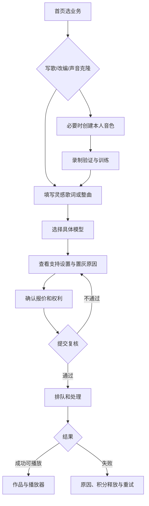

# 喵喵写歌 V2.1 Product Review

> `reference-only`：这是 2026-09-15 的版本快照，保留原决策轨迹。当前执行真源为 [主路径 Product Review](../requirements-review.md)；其中 P03/P04 指定音色已按 CHG-0085 延期。

> 文档版本：`v2.1-model-driven-params` · 产品版本：V2.1 · 更新：2026-09-15 · CHG-0076 / CHG-0078 / CHG-0080 / CHG-0081
> 状态：`waiting_review`（已补指定音色入口与上传前查重，需重新执行第 3 步需求检测）· 预计阅读：5～10 分钟 · 完整需求真源：[requirements.md](requirements.md)
> 来源：[写歌](https://acnrg6qcjuk1.feishu.cn/wiki/TbOdwPGVmi5lmekVYgRcjCMjnZe) / [改编](https://acnrg6qcjuk1.feishu.cn/wiki/Nc6nwOEWoipZjKkuoIac1e67nvf) / [克隆](https://acnrg6qcjuk1.feishu.cn/wiki/HVCxwGxhziI9nTknaftczy90noe) / [首页改版](https://acnrg6qcjuk1.feishu.cn/wiki/Db59wzbSFiFLodk4zuLcHrdNnlz) / [算道接口](https://docs.qq.com/doc/DSUhISlNOWFNrQ1Bw) / 当前 Figma `bbxou598`、`157:*` 页面族。材料记载不等于用户逐项确认；动态积分、时长和容量示例不作为固定配置值。

## 1. 一句话版本

首页有独立的 AI 写歌、歌曲改编、翻唱声音克隆入口。用户选择具体厂家模型后，写歌、改编和翻唱的参数、音色、音频限制和积分报价随模型变化；不支持的设置**保留位置但置灰，点击说明原因**，提交时绝不带上失效旧值。

CHG-0078 把首页变成可运营的两张起始海报轮播，并加入可配置的新用户赠积分和新人礼弹窗；弹窗引导到既有签到/任务页，不代替自动赠积分。

CHG-0080 按当前 Figma 补齐翻唱声音克隆主页、歌曲来源、本人/官方音色、使用规范、设置、报价与资格不足、音色资料、录音/裁剪、训练异常和作品状态。Figma 中仍写「AI翻唱」，正式产品名继续使用「翻唱声音克隆」。

CHG-0081 明确专业写歌和歌曲改编的「使用指定音色」都进入同一音色库，按当前业务/厂家/模型过滤后确认回填；本地图片、音频或视频的最终待上传文件先由后端查重，命中本人合法资源时跳过上传，未命中才上传。

## 2. 本期范围

| 做 | 不做 |
|----|------|
| 简易/专业写歌的新表单与纯音乐互斥 | 不把简易/专业写歌另算两项业务 |
| 改编歌曲“保留原歌词”默认关闭，可新写歌词；开启后复用/识别歌词 | 不把现有改编自动改成声音克隆翻唱 |
| 本人声音验证、训练与本人/官方音色翻唱 | 不允许用户克隆他人声音；不提供取消训练/翻唱 |
| 三项业务的逐模型能力、置灰说明、切换清理、报价和服务器复核 | 不把 Figma 示例价格/时长/容量写死 |
| 专业写歌/歌曲改编统一从「使用指定音色」进入 P07；本地最终资源上传前查重 | 不在两个业务内复制音色库；不跨用户复用私有素材或用查重绕过审核 |
| Web/Admin 在厂家能力内配置和管理 | 不在本轮文档任务中修改三端代码或数据库 |
| 首页海报可增删、可选功能跳转，至少留一张有效海报；三业务入口按新稿排布 | 不把“AI 翻唱”指向旧歌曲改编，也不把两张当作永久数量上限 |
| 注册赠额后台可配置；新人礼按人群、样式、目标和频次配置 | 不把点弹窗当作再次赠送注册积分；不把设计图的积分数字写死 |

## 3. 产品全景流程

首页增量：进入首页 → 读取海报与福利规则 → 海报有目标则点后跳功能、无目标只展示；尚未点过领取的新用户按频次看到新人礼 → 点领取后结束弹窗资格并到现有签到/任务页，点稍后领取仅关闭、保留资格。注册赠额沿用账户创建时发放，与弹窗无关。

## 4. 页面地图

当前逻辑拆分为 **13 个 App 页面 + 9 个 Web/Admin 管理视图**；模型弹层、来源分段、音色 Tab、等待状态和新人礼弹窗不重复计数。P11/P13 复用现有等待页/播放器，W01～W09 在同一 PRD 内；签到/任务中心继续复用现有页面。

| 页面 | 来这里做什么 | 核心操作与去向 |
|------|--------------|----------------|
| P01 首页 | 看轮播、选三项独立业务、按条件看新人礼 | 海报跳目标或静态展示；业务到 P02/P04/P05；新人礼到签到/任务 |
| P02 简易写歌 | 输入灵感 | 纯音乐/模型/人声，生成到 P11 |
| P03 专业写歌 | 编辑歌名歌词和精细设置 | 参考音频、模型、高级项、音色到 P07，生成到 P11 |
| P04 歌曲改编 | 导入原曲、决定是否保留歌词 | P06 选歌；模型支持时「使用指定音色」到 P07；必要时识别歌词，再到 P11 |
| P05 翻唱声音克隆 | 同页导入整曲、调设置、选本人/官方音色 | 使用规范、报价/会员/积分弹层；通过后到 P11 |
| P06 歌曲来源 | 底部层选择本人作品、文件或相册视频 | 上传/解析后返回 P04/P05，关闭不改原选择 |
| P07 音色库 | P05 页内本人/官方试听选择；P03/P04 通过「使用指定音色」独立打开 | 按来源业务和模型过滤；确认后返回调用页，定制到 P08 |
| P08 音色资料/本人确认 | 头像、昵称、本人声音权利声明 | 审核状态原位反馈；确认后到 P09 |
| P09 训练素材 | 录音/上传/相册/截取/试听，选训练模型报价 | 素材空态、硬限制和效果建议分别处理，到 P10 |
| P10 训练状态 | 等可用、失败重练 | 主要回到 P05 本人音色卡查看，不要求长期停留 |
| P11 生成等待 | 等写歌/改编/翻唱任务 | 返回 P12 或到 P13 |
| P12 我的作品 | 查看三业务作品和状态 | 到 P13/P05 |
| P13 播放器 | 播放已完成作品 | 复用现有播放器 |
| W01～W07 | App、模型、价格、音色、任务、审核和作品管理 | 详见 PRD P14，不是 App 页面 |
| W08 首页海报 | 管理图片与可选功能目标 | 至少留一张可展示海报，发布后影响首页 |
| W09 新用户权益 | 配注册赠额和新人礼 | 独立保存金额/弹窗规则，不重发历史积分 |

## 5. 逐页面功能 Checklist

| 页面 | 关键动作、禁止条件、结果与失败恢复 |
|------|------------------------------------|
| □ P01 首页 | 起始两张海报轮播；有目标才跳转；宽写歌卡、并列改编/AI 翻唱卡进各自业务；符合条件时新人礼弹窗可领取跳任务或稍后关闭；配置失败不误跳 |
| □ P02 简易 | 灵感输入/随机灵感；纯音乐开启使人声置灰并解释；能力或报价不足禁生成 |
| □ P03 专业 | 歌名与歌词分离；歌词放大/润色；纯音乐暂存歌词；参考音频可替换/删除；「使用指定音色」到 P07，确认回填；不支持高级项置灰 |
| □ P04 改编 | 保留歌词默认关；开时站内复用歌词、上传来源识别三态；「使用指定音色」到 P07；失败可重试或改为新歌词 |
| □ P05 克隆 | 歌曲卡、设置摘要、本人/官方音色、使用规范和固定按钮；上传/音色/会员/积分/报价各状态可恢复，全部条件满足才提交 |
| □ P06 来源 | 底部层选我的创作、本地或相册；本地最终文件先查重，命中 `resourceId` 跳过上传；关闭不改原选择，替换失败保留旧源 |
| □ P07 音色库 | 试听不等于选中；仅当前来源业务/模型兼容音色可选；P03/P04 点确认才回填；加载/空/失败/训练中/不可用均原位展示 |
| □ P08 资料确认 | 头像裁剪后先查重再上传；昵称、本人权利声明与安全审核；审核中不可公开，失败可改；中途返回显示离开提醒 |
| □ P09 素材训练 | 录音准备/录制/试听、上传/相册、截取与删除；最终片段先查重再上传；切模型重验硬限制；效果建议不冒充提交门槛 |
| □ P10 训练状态 | 在本人音色卡显示排队/处理/成功/失败；已创建任务不可取消，失败重练重新报价 |
| □ P11 等待 | 离页任务继续，返回作品可恢复；失败有原因和积分释放，不能伪成功 |
| □ P12 作品 | 生成中/失败/成功分类，完成可进 P13；重新翻唱回 P05，不误入改编 |
| □ P13 播放器 | 实际可播放、歌词/下载等沿用现有；不可播放时明确失败，不以页面打开算成功 |
| □ W01～W07 | App/权限隔离；参数只能在厂家能力内配置；价格/音色/审核/任务/作品可追溯，保存失败可重试 |
| □ W08 海报 | 可增删和选功能目标，目标留空则静态展示；删到零被拒；图片审核未过不发布 |
| □ W09 新人权益 | 注册赠额、弹窗启停/样式/目标/会员人群/频次可配置；新建账号使用生效金额，旧账号不补差；无效配置回退 30；稍后关闭不消耗资格，点领取后不再弹 |

## 6. 核心业务规则

| 领域 | 当前定义 |
|------|----------|
| 模型 | 三业务独立，按真实 `provider/model` 取当前场景能力；内部业务类型与厂家模型分开 |
| 不支持参数 | 行可见置灰、不可编辑；点行说明模型或互斥条件原因；请求不带失效旧值 |
| 能力未声明 | 基础输入仍可用，可选项全部置灰；业务可用、必要条件和报价成立时允许最小参数提交，否则禁提交 |
| 切换模型 | 保留合法值；不支持、越界或音色不兼容时清空并提示，不自动重置；报价刷新 |
| 纯音乐 | 人声/指定音色/歌词编辑互斥；专业已有歌词暂存，关闭后恢复 |
| 改编歌词 | 默认不保留原歌词；开启时站内复用或上传识别；失败不得假称已保留 |
| 音色 | 用户仅克隆本人；官方由后台发布；首期仅算道，算道训练音色不跨厂家，只供算道实际兼容的写歌/翻唱模型使用 |
| 指定音色入口 | 专业写歌和歌曲改编均从「使用指定音色」进入 P07；不支持时入口置灰；试听不等于选择，确认后才返回并刷新报价 |
| 本地上传查重 | 转码/裁剪/提取后的最终文件按 `appCode + 用户 + 用途/媒体类型 + MD5 + 大小` 查询；合法命中复用，未命中上传，失败不冒充未命中；私有资源不跨用户 |
| 训练素材 | 只按厂家明确的硬限制校验；效果建议和厂家未声明的时长/片段上限不阻止提交 |
| 训练/翻唱 | 会员能力，分别报价与积分结算；后端审核、幂等和资源可播放门槛不因 UI 成功而省略 |
| 翻唱整曲 | 不默认截成 90 秒；平台暂定最长 10 分钟，模型限制更严时按交集校验 |
| Admin | 只能收窄厂家能力；有价格或开关不等于模型支持该参数 |
| 作品期限 | 翻唱沿用现有 Catsinger 作品规则：当前后端普通终态作品约 15 天软删除、约 30 天条件满足后清理资源；无翻唱专属期限 |
| 首页海报 | 起始写歌/翻唱两张，后台可增删、可选功能目标；留空静态展示；至少一张有效海报 |
| 注册积分 | 沿用当前后端建号时发放：游客或手机号首次新建账号取当时有效赠额；绑定/重复登录不重发，历史不补差；初始或无效配置回退 30 积分，与签到、任务和邀请独立 |
| 新人礼 | 默认新用户首次登录展示；后台可配置启停、样式、目标、会员人群和每天/每次打开频次。只对尚未点「领取新人礼」的用户生效；稍后关闭不消耗资格，点领取结束弹窗资格并引导到任务/签到，不直接发注册或任务积分 |

## 7. 产品决策与待核实能力

| 决策 | 当前定义 | 后续核查重点 |
|------|----------|----------------|
| D-01 清空 | 切模型后失效、越界、不兼容的已选值清空并提示，切回不暗中恢复 | 必填项清空后禁提交，纯音乐歌词暂存不受影响 |
| D-02 最小参数提交 | 未声明可选能力时可选项全部置灰；业务可用、必要输入/权利/审核和报价有效才可只提交必需参数 | 后端不得把未声明项当作支持项送厂家 |
| D-03 训练限制 | 用户确认只按厂家硬限制校验；飞书记载“最低 1 分钟”被此决策覆盖；算道文档列六种格式、至少一条可下载音频 URL、总大小 ≤100MB；干声 >5 分钟只是效果建议 | 不增加未声明的时长/片段数门槛，也不因此关闭模型；厂家拒绝时按失败流程提示/释放积分 |
| D-04 算道首期 | 本期仅算道；算道训练音色不跨厂家；`sovits_train` 音色可供 `sovits_cover` | 同厂 Suno Voice Persona 是另一套机制，具体兼容关系待技术核验；未核验不可宣称可用于写歌 |
| D-05 沿用作品规则 | 翻唱作品约 15 天用户侧软删除、约 30 天符合条件后清理；运营豁免和引用保护沿用现有逻辑 | “15 天自动删除”不能解释为当天物理清理或承诺自助找回 |
| D-07 当前 UI 真源 | 当前 `bbxou598` 已提供翻唱声音克隆整页和状态，App P05～P12 以 `157:*` 为准；Web/Admin 仍复用后台既有布局 | 旧“翻唱主页无新稿、复用旧布局”仅作历史，不得继续指导 App 验收 |
| H-01 已确认 | 用户指定维持当前建号时点，后端新建游客/手机号账号即发；绑定同一账号不再发 | 只替换金额来源为后台配置，不改触发与账务链路 |
| H-02 已确认 | 用户明确稍后关闭不消耗资格、仅新用户可见、点领取后结束资格 | 每天/每次打开只在领取前生效；不增加跨设备特殊逻辑 |
| H-03/04 已确认 | 用户明确只影响之后符合条件的账号；初始金额 30，配置无效回退初始值 | 历史不补差，后台调整不能重放旧流水 |

## 8. 异常与边界行为

| 场景 | 用户看到什么/如何恢复 | 是否待确认 |
|------|-----------------------|------------|
| 切模型后原值超范围 | 清空并告知用户，必填值重选后才能提交 | D-01 已确认 |
| 能力未声明或查询失败 | 可填基础信息，可选项置灰；业务或报价不可证明时禁提交并重试 | D-02 已确认 |
| 纯音乐后点击人声 | 不改值，说明纯音乐不支持人声 | 已有用户明确确认 |
| 参考音频替换失败 | 原资源不丢；删除成功则本次不引用它 | 飞书有记载 |
| 改编歌词识别失败 | 显示失败，重试或关闭“保留原歌词”写新词 | 飞书有记载 |
| 训练素材违反厂家明确限制 | 清空本次无效片段选择并说明原因；已上传原资源不删除，不提交 | 效果建议及未声明上限不作为越界理由 |
| 音色与模型不兼容/下架 | 已选音色清空，改选音色/模型 | 跨厂家直接不兼容；算道内部按具体模型核验 |
| 报价过期/积分不足 | 重取报价、重新确认；不足引导充值，不按旧价扣费 | 已确认平台计费原则 |
| 生成返回成功但音频无法播放 | 任务/作品不判成功，展示原因及积分处理 | 已确认可播放门槛 |
| 海报无跳转目标或目标已失效 | 无目标只显示图片；目标失效不可跳错误页，可继续用三业务卡 | 飞书明确“可静态”；目标失效降级为产品安全建议，待技术方案对账 |
| 管理员试图删最后一张海报 | 保存失败并提示至少保留一张可展示海报；现有首页不变 | 飞书明确至少一张 |
| 弹窗配置/素材加载失败 | 首页仍可浏览；不错误发积分，不遮挡业务入口 | 恢复方式按技术方案定 |
| 绑定手机号后再次登录 | 游客绑定保留同一账号，不重发注册奖励；若尚未点新人礼领取且符合频次，弹窗仍可出现 | H-01/H-02 已确认 |
| 用户进入翻唱主页但官方音色接口失败 | 歌曲和本人音色区仍可用；官方 Tab 显示失败并可重试，不让整页空白 | 对照 `157:411/474` |
| 用户上传歌曲过程中失败 | 歌曲卡显示失败原因和重新上传；替换场景下原成功资源不提前丢失 | 对照 `157:783/879` |
| 已选音色在提交前下架 | 页面取消选中、说明不可用并要求重选，不携带旧音色创建任务 | 对照 `157:2138` |
| 用户点击训练卡上的“取消” | 不取消已创建的训练任务；仅关闭当前提示或返回，任务继续 | 固定产品规则优先于 Figma 示例文案 |
| 专业写歌/改编点「使用指定音色」但模型不支持 | 入口保留置灰，点击说明原因；不进入 P07，不提交旧音色 | CHG-0081 已确认 |
| 音色库试听后直接返回 | 停止试听并返回，原页面音色不变；只有确认才回填候选音色 | CHG-0081 已确认 |
| 本地文件查重命中已审核资源 | 直接绑定已有 `resourceId` 并跳过上传；仍执行用途、权限和模型校验 | CHG-0081 已确认 |
| 查重命中审核中/拒绝资源 | 审核中继续显示审核中；拒绝则显示原因并要求更换，不能重传同内容绕过审核 | CHG-0081 已确认 |
| 本地文件查重请求失败 | 保留当前文件选择并提示重试，不把未知状态当未命中继续上传 | CHG-0081 已确认 |

## 9. 用真实场景反向 Review

| 场景 | 当前产品行为 | 验收或核实点 |
|------|--------------|--------|
| 用户简易写歌开纯音乐再点“女声” | 女声可见但置灰，点后解释；不发送女声 | 是否符合期望？ |
| 专业模式写好歌词后开纯音乐，再关闭 | 中间置灰，关闭恢复草稿；纯音乐任务不带歌词 | 是否符合期望？ |
| 从支持创意程度的模型切到不支持的模型 | 创意设置置灰、旧值清空、提示和重新报价 | 切回也不暗中恢复旧值，D-01 |
| 由 0–100 模型切到 0–10 模型，原值 80 | 原值清空并明确告诉用户；必填则重选 | 不自动设为新默认，D-01 |
| 音乐模型能力尚未声明 | 基础输入可用、高级项全灰；满足业务、必需输入/审核及报价条件才最小提交 | 禁用项不进请求，D-02 |
| 改编从本地传音频且保留歌词打开 | 识别中禁按保留歌词生成，成功后可编辑；失败可重试 | 是否符合期望？ |
| 改编关闭保留歌词只输一句灵感 | 帮写生成新歌词，不暗用原词 | 是否符合期望？ |
| 专业写歌或歌曲改编选择本人音色 | 点「使用指定音色」进入 P07，按当前模型过滤；试听后确认才回填并刷新报价 | 两个业务共用音色库，不共用表单内临时选择器 |
| 用户再次选择同一段已上传训练音频 | 最终裁剪文件查重命中本人同用途资源，直接复用，不重复上传或新建绕审记录 | 私有资源不得跨用户复用 |
| 用户切训练模型后现有片段违反明确限制 | 清空本次无效片段选择，已上传资源不删除；标出原因，不扣训练积分 | 只按当前模型明确声明的限制校验，D-03 |
| 用户把 SoVITS 音色用于算道写歌模型 | 先判机制与模型兼容，不兼容清空已选音色并提示 | `sovits_cover` 可用不等于 Suno Voice Persona 写歌可用，D-04 |
| 翻唱作品第 16 天仍需找回 | 普通终态作品已按现有规则从用户侧移除；不新增自助恢复承诺 | 第 30 天符合条件才物理清理，运营豁免/关联保护不变，D-05 |
| 用户看到音色创建文案“或已授权”“成功后立即用于写歌” | 只能克隆本人；验证完成后仍需审核/训练，写歌模型明确兼容时才可选 | 验收 App 实际文案与行为；Figma 原稿不改，不能提前承诺可用 |
| 运营上架两张海报，只给翻唱海报设目标 | 轮播均展示；翻唱海报进翻唱声音克隆，写歌海报是静态图 | 不能把翻唱误路由到旧改编 |
| 运营删至只剩一张后继续删除 | 后台拒绝最后一次删除，首页保持原有效海报 | 最少一张，未设永久上限两张 |
| 游客先拿新用户积分，绑定手机号后弹出新人礼 | 保留同一账号，不重发注册积分；稍后关闭不消耗弹窗资格，点领取后不再弹 | H-01/H-02 已确认 |
| 管理员把赠额从 A 改为 B，旧用户重开 App | 已发积分流水不改、旧用户不补差；新账号在建号时取 B，无效配置回退 30 | H-03/H-04 已确认；图中积分仅示例 |

## 10. 状态变化速查

| 核心对象 | 正常路径 | 失败或恢复路径 |
|----------|----------|----------------|
| 模型设置 | 支持可改 → 切模型复核 → 合法提交 | 不支持/未知置灰，越界清空并说明 |
| 歌曲来源 | 选择 → 上传/审核 → 引用 | 不合规/拒绝时替换或重试，旧源不误用 |
| 本地资源 | 最终文件 → 摘要查重 → 复用或上传 → 审核/引用 | 查询失败重试；拒绝不可重传绕过；并发完成由后端归一到有效资源 |
| 指定音色 | 调用页 → P07 试听/选择 → 确认回填 → 刷新报价 | 不支持入口置灰；取消保留原选择；下架/不兼容时清空并重选 |
| 本人音色 | 验证 → 素材 → 训练 → 可用 | 审核/训练失败有原因，可重新报价重训 |
| 写歌/改编/翻唱任务 | 报价确认 → 冻结 → 生成 → 可播放作品 | 服务/审核/资源失败 → 释放积分并显示原因 |
| 作品 | 完成 → 播放/下载/重新创作 | 不可播放不算成功；翻唱沿用现有作品生命周期 |
| 首页海报 | 审核通过并发布 → 轮播展示 → 可选跳目标 | 无目标静态展示；删到零被拒，资源失效不跳错误页 |
| 注册赠额 | 后台保存 → 新账号创建时按生效值发放 → 既有积分流水 | 重复登录/绑定/弹窗不重发；历史不补差，无效配置回退 30 |
| 新人礼 | 领取前符合人群/频次 → 显示 → 稍后关闭可再见或点领取结束资格并去任务 | 弹窗失败不阻断首页；点领取不等于完成任务积分领取 |

## 11. 已确认 / 待确认

### 已确认

| 决策 | 最终定义 | 确认日期与依据 / 适用版本 |
|------|----------|--------------------------|
| 三业务独立 | AI 写歌、歌曲改编、翻唱声音克隆独立，底层共用流程 | 用户此前 V2.1 明确确认，适用于本轮 |
| 本人声音 | 用户仅克隆本人声音；官方音色由后台训练发布 | 用户此前 V2.1 明确确认，适用于本轮 |
| D-06 实际文案 | 音色创建入口只能写本人声音声明；Figma 原稿保留作视觉参考，不把“或已获授权”作为 App 放行条件 | 用户此前 V2.1“仅克隆本人声音”明确确认 |
| 改编关闭保留原歌词 | 可创作新歌词，不暗保留原歌词 | 用户本轮前明确校准，适用于本轮 |
| 模型决定参数 | 业务内具体厂家模型返回支持参数/选项/范围/默认 | 用户 2026-09-13 明确要求 |
| 不支持置灰 | 设计稿设置保留位置，置灰不可改，点击解释原因 | 用户 2026-09-13 明确要求 |
| D-01 清空 | 切模型后失效、越界和不兼容已选值清空并提示，不自动重置 | 用户 2026-09-13 答复“清空”；本轮 V2.1 |
| D-02 最小参数 | 模型支持业务、必要输入/权利/审核和报价有效时，未声明可选能力仍允许只提交必需参数 | 用户 2026-09-13 答复“最小参数提交”；本轮 V2.1 |
| D-03 训练素材 | 厂家效果建议不作拒绝条件；厂家未声明的时长/片段数上限不补定，不阻止开放训练；飞书记载“最低 1 分钟”不作为平台规则 | 用户 2026-09-13 明确“只要厂商支持，不用管建议”；本轮 V2.1 |
| D-04 厂家范围 | 本期只有算道；具体模型/音色兼容仍待技术核验 | 用户 2026-09-13 答复“目前只有算道”；本轮 V2.1 |
| D-04 音色厂家隔离 | 算道训练音色只供算道实际兼容的模型使用，不承诺跨厂家兼容 | 用户 2026-09-13 明确补充；本轮 V2.1 |
| D-05 作品保留 | 声音克隆翻唱沿用现有 Catsinger 作品与资源生命周期，不设新政策 | 用户 2026-09-13 答复“与其他的资源逻辑一致”；本轮 V2.1 |
| D-07 当前 App 设计 | `bbxou598` 的 `157:*` 已覆盖翻唱主页和主要状态，P05～P12 按当前稿验收；Web/Admin 继续复用现有后台布局 | 用户 2026-09-15 提供并要求按当前设计稿重写；取代旧“App 缺整页稿”口径 |
| CHG-0078 首页与新人权益 | 将飞书首页需求与新 Figma 状态纳入 V2.1；H-01～H-04 按用户补充决策收口 | 用户 2026-09-14 提供来源并逐项回答 H-01～H-04；后端建号与积分调用链只读核验 |
| H-01 发放时点 | 沿用现有新账号创建时发放，游客绑定手机号不重复发 | 用户 2026-09-14 要求核对并维持现有后端逻辑；`UserService` 已只读核验 |
| H-02 弹窗资格 | 「稍后领取」不消耗资格；仅新用户可见，点「领取新人礼」后结束资格；无跨设备特殊规则 | 用户 2026-09-14 逐项答复并补充“点击领取后结束” |
| H-03 历史账户 | 新赠额只影响之后符合建号发放条件的账号，历史不补差 | 用户 2026-09-14 明确答复 |
| H-04 初始/无效配置 | 初始值为 30 积分，配置缺失或无效时使用初始值 | 用户 2026-09-14 明确答复；30 是现有代码固定值，不取 Figma 示例 |
| 本轮仅文档 | 局部增补清单、PRD、Review 与参考素材，不修改三端代码 | 当前需求变更步骤；后续编码需独立流程门禁 |
| 指定音色入口 | 专业写歌与歌曲改编的「使用指定音色」统一进入 P07，试听不等于选择，确认后回填 | 用户 2026-09-15 明确要求；CHG-0081 |
| 本地资源上传前查重 | 最终待上传文件先由后端按摘要、大小和安全作用域判断；可复用则跳过上传，未命中才上传 | 用户 2026-09-15 明确要求并指定参考喵喵带货视频上传；CHG-0081 |

### 待确认

| ID | 待确认问题 | 放行门槛 |
|----|----------------------|--------|
| D-04 技术核验 | 同在算道渠道，SoVITS 训练音色是否可用于 Suno 写歌/Voice Persona？本人/官方音色与各具体模型的兼容关系是什么？ | `sovits_train`→`sovits_cover` 有文档依据；未核验的同厂组合置灰，不影响已确认组合开放 |
