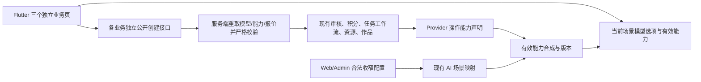

# 喵喵写歌 V2.1 模型驱动参数技术方案

> 文档版本：`v2.1-model-driven-params` · CHG-0076 原方案：`done` · CHG-0078 首页增量：`waiting_review` · 阶段：05 技术方案 · 更新：2026-09-14
> 需求：[PRD](../../01-需求/v2.1-model-driven-params/requirements.md) · [Review](../../01-需求/v2.1-model-driven-params/requirements-review.md) · [CHG-0078 当前检测](../../01-需求/detection-feedback.md)
> UI：当前 Figma `xvrgwxfy` / `working (91:106)`；[模型参数快照](../../01-需求/references/images/v2.1/model-driven-params/README.md)、[CHG-0078 首页与新人礼快照](../../01-需求/references/images/v2.1/home-revision/README.md)。第 04 步已按用户决定 `skipped`，不要求修改设计稿；动态数字以运行时配置为准。
> 基线：2026-09-13 只读核对 Flutter `/Users/soul/code/lxwx/catsinger`、Java `/Users/soul/code/lxwx/lxwx_service/lxwxservice`、Web/Admin `/Users/soul/code/lxwx/lxwx_admin`；CHG-0078 又只读核对建号赠积分、App 配置和首页入口。旧 [CHG-0073 技术方案](../../archive/CHG-0077-legacy-docs-20260913/02-技术方案/v2.1-ai-cover-voice-clone/tech-plan.md)仅作差异输入，不作为当前版本编码依据。算道在线文档在原 CHG-0076 对账时未直接打开，厂家细节仍待发布前复核。

## 0. 决策与边界

1. **三个业务独立**：AI 写歌使用 `/api/song-generations`，歌曲改编使用 `/api/song-covers`，翻唱声音克隆使用 `/api/song-voice-covers`。各自业务类型、输入与历史作品不互改；共用现有模型映射、任务状态机、审核、积分、资源和作品流程。
2. **能力分两层**：Provider 对具体 `provider/model + 操作` 声明可执行性和硬参数上限；后台只能在这份声明内收窄展示、启用、范围和默认值。最终有效能力为二者交集，不用 App 级 `generation-options` 冒充模型契约。
3. **Figma 数字是布局示例**：积分、时长、容量、滑杆端点等若受模型或后台影响，运行时读取有效契约/报价；只验布局、置灰、说明和长短值适配，不以示例数值为校验规则，不修改 Figma。
4. **已确认的固定规则保留**：仅克隆本人声音；算道音色不跨厂家，同厂也须明确兼容；翻唱使用整曲且平台暂定最长 10 分钟；厂家接单后的翻唱闭环 10 分钟，平台排队不计；训练素材只执行厂家明确硬限制，不把效果建议做成拒绝或强制确认。
5. 本文定义 CHG-0076 原方案和第 9 节的 CHG-0078 局部增量；不修改三端代码、迁移脚本、线上配置或正在修复的生产问题。CHG-0078 第 06 步需另评增量工时，第 07～12 步只同步受影响文档和模块计划后才可编码。

## 1. 现状对账与差距

| 层 | 已有实现（只读核对） | 本版本差距 |
|----|----------------------|------------|
| 模型目录 | `AiSceneModelMappingService.publicOptions` 返回不透明 `modelOptionId`、当前价和 `musicContract`；`musicContract` 只覆盖 `song.generate`、`song.cover.generate` | 音色训练和翻唱声音克隆场景未有同等逐参数契约；不能因返回模型/价格就认定所有设置可用 |
| Provider | `IMusicModelService.describeMusicGeneration/describeMusicCover` 与 `MusicOperationContract` 已支持 `SUPPORTED/UNSUPPORTED/NOT_DECLARED`；算道只声明部分确知模型 | 声音训练/声音克隆翻唱缺独立操作声明；现有参数枚举缺训练媒体、移调、音量等标准键；同厂 SoVITS/Suno 音色兼容不能靠厂家名推定 |
| 写歌/改编后端 | `SongGenerationService` 与既有改编入口已有选模型、报价/冻结和工作流；请求 DTO 含一些固定字段 | 任务创建前尚未统一按所选模型契约筛掉禁用/越界/未知可选项；改编歌词开关、纯音乐互斥需按新版 PRD 对账 |
| 克隆后端 | `voicecover/` 已有独立 Controller、任务、音色版本、站内资源审核、报价冻结及生成流程；`VoiceModelOptionResponse` 返回真实 `provider/model` 与 `capabilityLimits` | `capabilityLimits` 当前主要来自映射元数据，不是可信的逐模型 Provider 声明；`VoiceCoverSettings.normalized()` 会注入默认设置；静态 `-12～12`、`0～200%` 及训练 1～10 分钟/单段 1～5 分钟、五分钟风险确认与新口径不一致 |
| Flutter | 写歌/改编模型选项、克隆独立页面均已存在；`SongModelOption` 未解析 `musicContract`，克隆页三条滑杆固定范围 | 三业务缺统一的置灰原因、切换模型清空/保留、无效值不提交与报价刷新；现有 `generationOptions` 仍为 App 级 |
| Web/Admin | 已有 App 切换、模型目录/场景映射、计费、歌曲配置页；场景映射元数据为 JSON | 缺“厂家能力只读 + 后台合法收窄”结构化编辑、保存交集校验和能力收缩告警；克隆音色/训练管理仍需按新版 PRD 对账 |

以上是代码现状，不是本版本完成证明；旧 `v1.2.0+121-as-built` QA 不代替新版三业务验收。

## 2. 整体架构

继续使用现有 Flutter/GetX/Dio、Java/Spring Boot/MyBatis-Plus/PostgreSQL/Flyway。`X-App-Code: catsinger` 和现有 schema routing 不变；本期不建通用平行模型表、任务队列、审核状态机、积分账本或作品库。模型选项作用于**本次任务**，不悄悄改后台场景默认或已创建任务。

### 2.1 有效能力合成

- 操作键与场景一一对应：写歌 `song.generate`，改编 `song.cover.generate`，训练 `song.voice.train`，声音克隆翻唱 `song.voice.cover.generate`。同名厂家模型在不同操作下分别声明，不能共享不相干的参数列表。
- 扩展现有 `MusicOperationContract`/`IMusicModelService` 的操作覆盖面，增加训练媒体及克隆翻唱标准参数；只在确有厂家依据的精确模型上返回 `SUPPORTED`。未适配返回 `NOT_DECLARED`，明确不支持返回 `UNSUPPORTED`；不以后台 `metadataJson` 或页面控件反推厂家能力。
- 有效字段：业务 UI 固定字段目录中的 `key` 与 Provider 声明求交集；后台配置再收窄选项、数值范围、默认与展示。返回每行的 `supported/editable/reason/constraints/effectiveDefault`，并给操作级 `status` 与 `contractVersion`。无法声明的可选项保留在页面但置灰；原因由服务端或固定业务互斥规则给出。
- 训练/源歌曲媒体能力使用结构化 `mediaConstraints`：允许格式、明确的大小/时长/片段数量限制及单位；未声明的上限用 `null` 表示，不伪造 1～5 分钟或 10 分钟训练限制。平台独立确认的整曲最长 10 分钟与厂家更严上限取交集。资源可上传不等于可供该模型使用；切模型时重新验证选中素材引用，不删除原始资源。
- 音色可用性以实际训练/使用机制及 `VoiceProviderBinding` 的精确兼容关系为准；`provider` 相同仍不足以放行。当前可确认的 SoVITS 训练到 SoVITS 翻唱可以独立开放，SoVITS 音色到 Suno 写歌未证实则置灰并禁止提交。
- `NOT_DECLARED` 不是 `SUPPORTED`：只在既有路由/适配器**另外明确证明该基础操作可执行**时，允许带业务必需字段的最小提交；所有可选字段仍置灰且不发送。业务本身也未确认、模型下架、契约请求失败或报价不可用时禁止提交；不能靠实际调用厂家来试探不支持项。

### 2.2 参数与报价版本

- Provider 能力变更和后台收窄配置变化产生可比较的有效 `contractVersion`（实现可用稳定指纹或显式版本，不能使用浮动时间作伪版本）。App 每次换模型/回到前台/配置失效时重取；提交时与当前有效契约比较，失效给出“设置已变化”并要求重新确认。
- `pricePoints`/`pricingVersion` 仍由现有场景映射、计费目录和 `AiModelInvocationService` 得出。模型或影响价格的设置变动后重新报价；对于现有按次固定价，重新取模型选项即可；若业务价格确实依时长/参数变化，第 07/08 步再定义共用的无副作用报价接口，复用现有 `quoteModel/quoteModelDurationSeconds`，不建第二套价格表。
- 服务端创建任务前再次验证 App、场景、模型选项、当前能力/参数、价格版本、素材审核、权利、音色及会员状态，然后沿用现有冻结/结算/失败释放。旧客户端传入已禁用字段也不得绕过服务端校验；兼容范围需在上线计划中明确，而非默默放行。
- 现有生成任务 `normalizedRequestJson` 保存最终有效参数和能力版本；训练任务现有素材/模型/价格快照不足以还原当时媒体约束，实施前在当前 `catsinger` 表上评估新增**一个不可变的有效请求/能力快照字段**（仅对新任务写入）。不提前创建迁移，不给 `narrate` 增表；若发现现有字段可无歧义承载，再取消该列。

## 3. API 契约规划

| 场景 | 现有/建议接口 | 本次增量 |
|------|---------------|----------|
| 写歌、改编模型 | `GET /api/ai-model-options?sceneCode=...` | 保留不透明 `modelOptionId`；扩展 `musicContract` 为有效 UI 字段状态、硬限制/版本，兼容现有字段，不公开厂家私有参数或密钥 |
| 克隆训练、翻唱模型 | `GET /api/song-config/models?sceneCode=...`（现有 `/voice-models` 可保留兼容） | 在 `VoiceModelOptionResponse` 增加同语义 `musicContract`/媒体限制；保留现有真实 `providerCode/modelCode` 和报价字段，不再把 `capabilityLimits` 当唯一能力真源 |
| App 级选项 | `GET /api/song-config/generation-options` | 保留标签、语言等运营展示配置；选定模型后必须与有效能力相交，不得覆盖 Provider 不支持结论 |
| 创建任务 | 现有 `POST /api/song-generations`、`POST /api/song-covers`、`POST /api/song-voice-training-tasks`、`POST /api/song-voice-covers` | 各入口独立，服务端固定业务语义；新客户端只提交当前模型明确支持且实际启用的可选参数及必要字段，未声明或置灰项省略；接收 `contractVersion` 或等价预条件以识别过期，服务端重验后冻结 |
| 任务与作品 | 现有查询、作品、播放器接口 | 保留业务类型和旧任务快照；失败不得伪成功，成品持久化、审核及实际可播放后才算通过 |
| Admin | 现有模型映射、计费与歌曲管理接口 | 只读查看 Provider 硬能力；结构化保存可展示/启用/默认的合法子集，服务端拒绝越界或未声明项；保留 App/角色/审计约束 |

兼容策略：新增响应字段为可选、旧字段不删；旧 Flutter 安装包不会因缺新字段反序列化崩溃。新 App 对缺失或解析失败的可选能力一律置灰；服务端按实际选中模型校验。用户侧响应继续避免泄露计费项内部编码、Provider 私有请求字段、模型文件 URL 与密钥；克隆现有公开 `provider/model` 只表达用户已可见的真实模型选择，不等于开放原始厂家请求。

### 3.1 交互与错误

| 状态 | App 行为 | 服务端行为 |
|------|----------|------------|
| 不支持/互斥 | 行可见且置灰，点行解释；编辑控件禁用 | `UNSUPPORTED_PARAMETER` 或等价业务错误，拒绝旧值；不调用厂家 |
| 切模型失效/越界 | 保留合法草稿，清空无效值并提示，不自动写新默认；切回不恢复 | 不接受与所选模型不符的参数或音色绑定 |
| 能力尚未声明 | 基础输入可编辑，可选项置灰；有证据支持基础操作且报价有效才最小提交 | 明确白名单校验必需字段，拒绝任何可选参数 |
| 能力请求失败/下架 | 显示重试或暂不可用，不回退到全参数可编辑 | 拒绝任务创建，无冻结和厂家调用 |
| 报价变化 | 显示新价格，用户重新确认 | 重报价和版本比较，过期返回明确错误，不按旧价扣费 |

## 4. Flutter 页面与状态

- 继续使用现有首页三业务入口、`SongCreate`、`SongCover`、`SongVoiceCover`、音色资料/训练、作品和 `SongPlayerPage`，不从 Figma 推出新页面；缺新整页稿的克隆主页复用现有组件。
- 在模型解析层增加有类型的有效能力模型，隔离页面与 JSON；固定的页面字段目录只决定**出现位置和控件类型**，不决定能力或价格。不同业务各按字段目录投影；未声明/不支持均保留位置置灰，点击行展示原因，屏幕阅读器读出原因。
- 每个创作 Controller 持有 `modelOptionId + contractVersion + 草稿 + 有效值 + 报价版本`；换模型按字段键与约束原子地筛选、清空并通知，取消过期请求，保留已上传资源但可清空不兼容的本次选择。纯音乐互斥的歌词仅在本地草稿暂存，提交载荷省略；它与“切模型清空无效值”分别处理。
- 简易/专业写歌、改编保留歌词、克隆移调/音量、训练媒体长度和音色选择都按有效契约驱动；现有固定滑杆端点与训练分钟门槛不能继续当所有模型的规则。动态价格、次数、时长与容量允许换行及空/加载/错误状态，375×812 主验收，390×844/414×896 抽查。
- App 仅做交互预校验；权利、审核、素材可用性、模型能力和实时报价始终由后端复核。等待页、作品页和播放器沿用当前代码；重新翻唱回克隆业务，不误进改编。

## 5. Java 与 Provider 改造边界

1. 在现有音乐 Provider 能力抽象补声音训练/克隆翻唱操作声明与标准键；算道仅为实证模型填硬约束，其余返回 `NOT_DECLARED`。Vendor 适配器负责标准字段到厂家字段映射及请求前拒绝未声明参数，不能在 Controller 里拼厂家 JSON。
2. `AiSceneModelMappingService` 与 `VoiceCoverConfigService` 使用同一有效能力合成逻辑，Admin 保存与用户读取走同一服务；不能让 Admin 自由 JSON 配置绕过厂家上限。现有 `metadataJson` 若继续承载展示收窄配置，必须用结构化 DTO 解析、键白名单和约束交集校验，禁止原样把任意 JSON 透传 App/Provider。
3. 在各业务 Service 创建任务、报价/冻结之前做能力与参数校验；不能只在前端置灰或只在 Provider 末端拒绝。所有提交的可选值（包括默认值）都须校验；互斥禁用字段要求不出现在新请求中。模型/价格快照及幂等保持当前链路。
4. 训练移除无厂家依据的累计 1～10 分钟、单段 1～5 分钟强制限制和低于 5 分钟必须确认门槛；保留音频解析、审核、至少一条厂家明确所需素材、格式/总量等已声明硬限制。不得因厂家未声明上限就自动视为无限制；超出平台上传基础安全限制仍按现有资源规则拒绝，并在 UI 区分“平台上传限制”和“模型限制”。
5. 克隆 `VoiceCoverSettings.normalized()` 不再把未选择的可选设置自动补成提交参数；Provider 可自行使用厂家缺省。数值 DTO 固定注解不能代替模型约束；平台整曲 10 分钟与厂家更严限制相交。模型、音色、来源/授权、审核、价格先验，成功仍取决于持久化+成品审核+可播放。
6. Web/Admin 首期在现有 `AiModelOptionsPage`、计费与歌曲配置页增加能力状态/参数子集/官方音色管理入口；切 App 重载并清除旧草稿，角色权限由服务端复核。无新 Web 设计稿，不做独立视觉体系。

## 6. 数据、权限与运维

- `appCode` 仍由请求上下文与 schema routing 隔离；本期优先复用现有 `ai_scene_model_mappings.metadata_json`、计费目录、声音版本/绑定、歌曲任务快照与审核/资源台账。只有训练任务能力快照如确需持久化且现有字段无法承载时，才在 `db/migration/catsinger` 增量迁移；不重写历史 Flyway、不在公共或 narrate schema 建业务字段。
- 任务开始后后台配置变更只影响后续任务，不重写既有任务的模型、报价、素材或参数快照。模型下架/能力缩小时，新创建失败并要求重新选；已提交任务按快照与既有恢复机制处理，若厂家拒绝走失败补偿。
- 图片、音频、可展示文字及输出结果继续用现有资源/审核事实；站内已审核来源不新增重复送审支线。临时厂家资源按现有存储抽象转存、识别 MIME/后缀与时长，不能把临时 URL 或 200 响应当作可播放成功。
- 能力接口对公众只返回安全白名单字段，Admin 变更记录操作者、App、场景、模型和版本；日志可记录标准参数键、契约指纹与拒绝原因，不记录密钥、音频私有地址或原始声音文件路径。

## 7. 当前版本任务拆分（供第 06 步逐项估算）

| ID | 端 | 增量任务 | 验收重点 |
|----|----|----------|----------|
| T-B001 | Java/Provider | 为四种操作补精确模型能力声明、媒体限制和标准键 | 未声明不冒充支持；SoVITS/Suno 机制分开 |
| T-B002 | Java/公共模型 | 合成厂家与后台交集，返回带版本/原因的有效契约；兼容旧响应 | 三业务和训练返回同语义状态 |
| T-B003 | Java/写歌改编 | 两条原有业务按模型校验、纯音乐与歌词互斥、请求快照 | 旧任务不变，新任务拒绝禁用参数 |
| T-B004 | Java/声音训练 | 训练媒体只按厂家硬限制、移除无依据分钟门槛与强制效果确认 | 短素材在满足硬条件时可提交 |
| T-B005 | Java/声音翻唱 | 克隆可选设置、音色兼容、整曲限制及报价重验 | 不兼容先拒绝、无冻结/厂家调用 |
| T-B006 | Java/报价数据 | 复用计费、能力/价格版本与任务快照；必要时最小 catsinger 迁移 | 幂等、过期报价和旧任务兼容 |
| T-W001 | Web/Admin | 模型能力只读和合法收窄配置 | 不支持/未知项不可发布为启用 |
| T-W002 | Web/Admin | 四场景价格、官方音色/任务视图与 App/角色隔离对账 | 切 App 不串数据，保存可审计 |
| T-F001 | Flutter | 模型能力解析与通用字段投影、切换/置灰组件 | 缺契约安全降级，失效值清空 |
| T-F002 | Flutter | 简易/专业写歌和纯音乐、参考音频按模型交互 | 不硬编码设计示例，不送禁用项 |
| T-F003 | Flutter | 歌曲改编歌词策略与模型切换 | 关闭保留原歌词不暗用原词 |
| T-F004 | Flutter | 翻唱声音克隆/训练媒体、音色兼容及动态滑杆 | 训练建议不拦截，模型范围生效 |
| T-F005 | Flutter | 报价/任务恢复/作品播放与多尺寸 UI 回归 | 任务成品实际可播放才算成功 |
| T-Q001 | 联调/QA | Android+iOS 三业务正反向、后台变更与安全/积分回归 | 真机优先、无 iOS 设备/模拟器不判全通过；改编成品必须真实播放 |
| T-B007 | Java/首页运营 | Catsinger 海报配置的白名单读取、发布校验与安全降级 | 仅审核通过资源可展示；发布后至少一张有效海报 |
| T-B008 | Java/新用户积分 | 原建号链路按当前有效配置取赠额并保持流水幂等 | 初始/无效配置回退 30；绑定及历史账号不重发 |
| T-B009 | Java/新人礼 | 独立资格、频次曝光、稍后关闭和领取状态接口 | 领取后永久不弹；关闭不消耗展示次数；并发幂等 |
| T-W003 | Web/Admin | 海报顺序、目标、启停、审核资源发布 | 防止删停最后一张；App 切换与角色权限生效 |
| T-W004 | Web/Admin | 赠额和新人礼样式、人群、频次、目标配置 | 保存校验、历史不补差提示、配置审计 |
| T-F006 | Flutter | 首页新布局、海报轮播与三个独立入口 | 业务路由不串；加载/空态/失效目标安全降级 |
| T-F007 | Flutter | 新人礼弹窗、签到/任务跳转与本地打开标识 | 稍后可再见、领取后不再弹；无积分副作用 |
| T-Q002 | 联调/QA | Android+iOS 首页运营和新用户权益正反向 | 真实建号流水、后台切 App、曝光频次与多设备/重启恢复抽查 |

任务编号只属于 `v2.1-model-driven-params`，不得用旧 CHG-0073 的同名 T-F/T-B 状态推断已完成。第 06 步按本表逐项给 AI 辅助真实工时、测试和 Bug 修复时间；第 07～12 步再拆成可执行模块文档。新版本骨架及真实编码均须遵守各自文档和评审门禁，不因本技术方案记为 `done` 就直接开工。

## 8. 验证与风险

- **契约**：两模型不同参数/范围、`NOT_DECLARED`、`UNSUPPORTED`、后台越界/旧配置失效、操作混用、敏感字段脱敏，含 Admin 保存拒绝和新旧客户端兼容。
- **训练/翻唱**：短训练素材与厂家硬限制交集、音色精确绑定、整曲 10 分钟平台限制、厂商接单后计时、幂等/冻结/结算/退款、内容审核和真实音频持久化/播放。
- **App**：375×812 四个业务入口及所有受影响表单状态，390×844/414×896 长值适配；切模型清空/保留，纯音乐草稿恢复、改编歌词识别/失败、加载/缺价/下架/网络恢复。
- **回归**：旧 AI 写歌、改编、历史作品、`narrate` schema 与 Catsinger 登录/积分/资源不串；Android/iOS 用户流和后台切 App 真实配置联调。文档阶段仅做路径/链接/一致性检查，不宣称代码或设备测试通过。
- **待技术核验**：算道同厂 SoVITS 音色是否能用于具体 Suno 写歌模型，缺证据时保持禁用；各精确模型硬媒体限制以当前厂家文档/实际适配能力为准；价格是否随非模型设置变化由现有计费配置核实。以上不作为让产品负责人猜测数值的待确认产品规则。

## 9. CHG-0078 首页与新用户权益增量

### 9.1 范围与现状

- 本增量只覆盖 PRD P01/P14/W08/W09：海报轮播、三个独立入口、注册赠额后台配置、新人礼引导弹窗。原模型参数方案及 AI 写歌、歌曲改编、翻唱声音克隆的生成 API、任务/计费/作品逻辑不因首页入口改变。设计真源是当前 Figma `xvrgwxfy` 的首页 `151:7830`/`151:7973`、弹窗 `151:8116` 和任务中心 `151:8281`/`151:8422`；截图积分数字仅作排版示例。
- Flutter `HomePage` 的 `_HomePromoCard` 仍为静态宣传图，`MainController` 已有独立的翻唱声音克隆入口；`SongAPI` 已读热门案例与首页歌曲，但现有 `SongCaseEntity.bannerUrl` 属于案例，不能当运营海报。Java `PublicAppConfigController` 白名单目前只有灵感配置，未公开首页海报/新人礼。Admin 已有通用 `/api/admin/configs/{configKey}` 和歌曲配置页，但没有海报发布、赠额或新人礼的字段级校验与可视化闭环。
- `UserService.createUser` 插入新账号后调用 `grantDefaultPointsForNewUser`，目前固定 `30`；游客建号、首次手机号建号及其他既有新账号创建路径均沿用，`bindGuestPhone` 保留同一 `userId` 不重发。`PointsService.grantPermanent` 的 `NEW_USER:{userId}` 业务键仍负责去重。这里仅替换读取金额，不重新定义“注册”时点，也不把弹窗点击接到账务链。

### 9.2 配置、资源与数据归属

| 配置/状态 | 归属与建议载体 | 生效与故障规则 |
|-----------|----------------|----------------|
| 首页海报 `song.home.banners` | `catsinger` schema 的现有 `app_configs`，一份有序 JSON 文档；每项为稳定 ID、资源 ID、顺序、启用态、允许的 App 内目标枚举，不接受任意 URL/路由 | 后台原子发布并校验至少一张已审核、可访问的启用图；读取失败或运行时资源失效时 App 展示不可点击的安全占位，不跳错误页；监控告警 |
| 注册赠额 `song.new_user_points` | 同一 App 的 `app_configs`，值为正整数 `points`；`service-data/apps/catsinger/app-configs.json` 给初始 `30`，现有固定 `30` 作为最终业务兜底 | 每次新建账号时在发放事务内读取当前有效值；缺失、停用、非法 JSON 或越界回退 `30` 并记录告警；数据库/账务故障不伪装成“配置无效”，沿用事务失败处理 |
| 新人礼 `song.new_user_gift` | 同一 App 的 `app_configs`，含启停、可选的自定义图片、可选展示文案、人群枚举、允许目标、固定上线资格起点与 `ONCE / DAILY / PER_OPEN` 频次 | 无图片时使用 App 内置图，不阻止发布；配置自定义图时继续校验资源及审核结论，可展示文案继续审核；服务端校验枚举和目标合法性，配置失效/读取失败时不弹；固定资格起点避免旧账号因配置修改突然成为“新用户” |
| 领取与曝光 | `catsinger` 专属轻量状态表，按 `userId` 唯一保存 `claimedAt` 及按策略计数所需的曝光标识/日期/打开标识 | 只记录弹窗资格与展示，不存积分余额；历史账户不批量写入，不修改公共 `user_app_profiles`、`point_accounts` 或 `narrate` 表 |

`AppConfigStoreService` 已按当前 `AppContext`/schema 读写 `app_configs`，且运行时数据库覆盖、缺 key 再读 `service-data` 默认；但其解析失败会抛错，不会自动回退 30。赠额读取需在 Catsinger 专用规则服务捕获**配置内容错误**并回退，不能修改公共配置服务的错误语义。现有通用 Admin 配置写入口只对部分 key 做专项校验，必须把上述三个 key 的验证集中在同一规则服务，并让通用 `PUT /api/admin/configs/{configKey}` 与专用页面写入口都经过它，防止绕过“至少一张”和金额/目标限制。首次两张海报需把已审核素材导入平台资源并作为 Catsinger 默认配置发布；未准备好资源不得以硬编码远程地址发布。

新增状态表仅在 `db/migration/catsinger` 建立；`app_configs` 是既有公共结构在各 App schema 的实例，**不新增**海报/赠额/弹窗专属配置表。图片及弹窗文案沿用现有上传、审核、可访问资源发布链；后台选择的是资源标识，用户端只返回审核通过的展示地址与白名单目标。删除或停用海报时须在同一配置事务校验剩余有效项，防止并发删到零。仅对之后符合既有建号条件的账号发新赠额，历史账户和流水不补差；新注册的冻结/测试账号触发范围保持代码现状，是否面向外部展示由原账号规则决定。

### 9.3 建议接口与调用链（均为待实现契约）

| 调用 | 建议接口/落点 | 关键响应或动作 |
|------|----------------|----------------|
| App 读海报 | `GET /api/song-config/home-banners` | 只返回当前 `catsinger` 已发布的有序列表 `id/imageUrl/targetCode?`；未绑目标为 `null`，App 不触发跳转；不透出原始配置 JSON |
| App 查新人礼 | `GET /api/song-config/new-user-gift`（登录态） | 服务端根据 `userId`、配置、人群、领取态与频次给 `shouldShow`、可空的审核通过图片 URL、目标和可用于幂等曝光的令牌；图片 URL 为空时 App 用内置图；未登录或配置故障返回不展示 |
| 弹窗确实出现 | `POST /api/song-config/new-user-gift/impressions` | App 完成渲染后提交令牌；服务端按账号/配置版本去重，更新默认一次、每日一次或每次打开的曝光状态，重复请求不重复计数 |
| 稍后领取 | `POST /api/song-config/new-user-gift/dismiss` | 只关闭当前曝光并释放其展示次数，不写 `claimedAt`、不发积分；下一次符合频次触发仍可展示 |
| 领取新人礼 | `POST /api/song-config/new-user-gift/claim` | 幂等写入 `claimedAt`，返回配置的签到/任务目标；App 再跳转，目标失效时给可读提示但资格不重开；不调用 `PointsService` |
| Admin 海报与福利 | `GET/PUT /api/admin/song/home-banners`、`GET/PUT /api/admin/song/new-user-points`、`GET/PUT /api/admin/song/new-user-gift` | 专用 DTO 便于 Web 表单；全部委托共同校验与现有 `AppConfigStoreService`，`X-App-Code: catsinger` 和 `song_config` 管理块权限由服务端复核，保存留审计记录 |

领取接口须在用户状态行上原子检查并更新；同一账号双击、重试或并发打开只产生一个领取结果。服务端以既有账号 `createdAt` 不早于这次功能固定上线资格起点、账号仍有效且未领取为“新用户”资格门槛；历史账号不补弹，后续修改启停或频次不能移动该起点。曝光令牌与打开标识仅用于频次幂等，不是跨设备另立身份体系。`DAILY` 使用服务端统一时区/自然日，`PER_OPEN` 用本次 App 启动标识；`ONCE` 在未领取期间不因“稍后”永久消耗。曝光实际显示才计数，稍后关闭按令牌撤回**本次**计数；同一令牌重复关闭不可把其他曝光扣掉。App 切后台/进程重启须重新查服务端资格，不能以本地布尔值当最终领取态。规则配置改变只影响之后触发的展示，已领取状态不回滚。第 07/08 步技术文档需把曝光状态字段、并发更新和统一自然日时区写成实现契约，避免“每天一次”和“稍后不消耗次数”各端解释不同。

三个创作卡仅绑定已存在的三个独立路由；本段**不**新增或修改 `/api/song-generations`、`/api/song-covers`、`/api/song-voice-covers`。进入对应页面不等于提交任务，不冻结积分。后台目标使用受控枚举与 App 路由映射，禁用功能与未知目标在发布时拒绝、运行时降级不可点击；不能把 AI 改编误路由到翻唱声音克隆。

### 9.4 前端、后台与验收边界

- Flutter 仍在 `HomePage`/`MainController` 局部调整：轮播状态、指示点、三卡布局、审核图加载/占位、热案例不受海报接口失败影响；新人礼作为首页覆盖层，按服务端资格决定，点击“稍后”与“领取”分别调用对应 API。375×812 主验，390×844/414×896 抽查内容和底栏不遮挡。收益、签到与任务数值沿用原接口，不因 Figma 示例改账务规则。
- Web/Admin 在现有 Catsinger 歌曲配置导航下加海报与新用户福利管理块；沿用 App 切换和 `song_config` 角色权限，切离 Catsinger 清空编辑草稿。分别展示图片审核/资源可用状态、目标选择、赠额生效说明、弹窗预览/人群/频次与保存结果；无权或切 App 后不能调用 Catsinger 专属保存。通用配置 API 也必须受同一后端校验保护。
- 验证分层：本步只检查技术文档与代码事实吻合，不宣称功能已实现。后续 Java 重点验建号路径、`NEW_USER:{userId}` 幂等、配置缺失/非法与真实数据库故障区别、并发删海报、领取/稍后/频次；Flutter 验路由与弹窗状态；Admin 验图片审核、权限与 App 切换。端到端用新建游客、手机号账户、绑定账户和历史账户核对积分流水，真实 Android/iOS 验首页与任务跳转；不运行线上赠额变更。
