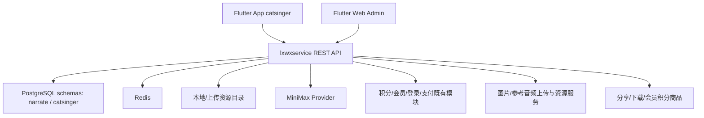
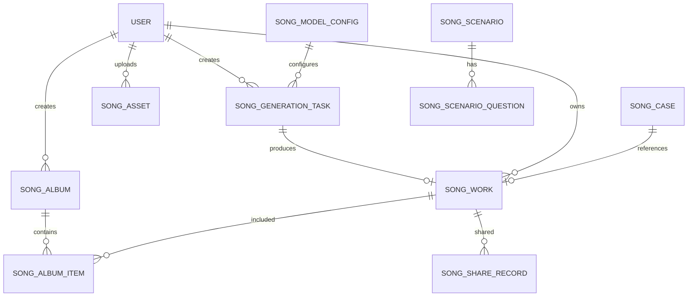
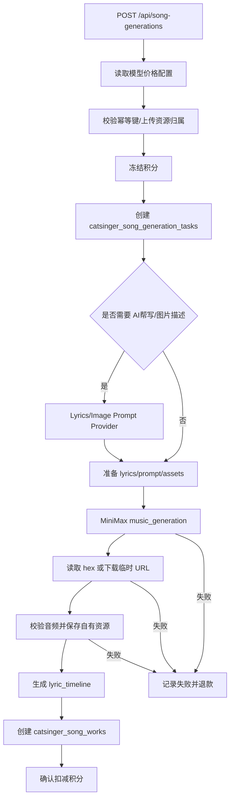

# 喵喵写歌技术方案计划

> 版本：v0.1.1  
> 创建日期：2026-06-09  
> 最近更新：2026-06-11 18:27  
> 当前阶段：5 技术方案  
> 关联需求文档：`../01-需求/requirements.md`  
> 关联检测反馈：`../01-需求/detection-feedback.md`  
> UI/Figma 流程：用户已明确跳过，不生成 `../01-需求/figma-design-plan.md`  
> UI 真源：`../01-需求/references/images/v1.0/`  
> CHG-0011 返工结论：前端 UI 需要局部返工对稿；需求、后端架构、MiniMax、积分和 schema routing 不全量返工。  
> 前端工程：`/Users/soul/code/lxwx/catsinger`  
> 后端工程：`/Users/soul/code/lxwx/lxwx_service/lxwxservice`  
> Web/Admin 工程：`/Users/soul/code/lxwx/lxwx_admin`

---

## 1. 系统架构概述

### 1.1 整体架构

喵喵写歌采用移动端、Web/Admin、Java 后端、第三方生成 Provider 分层架构。



- 移动端 App 使用 `X-App-Code: catsinger` 访问用户端接口。
- 后端沿用 Spring Boot、JWT、AppContext、schema routing、MyBatis-Plus、Flyway、Redis、积分服务和资源服务。
- 后端新增 catsinger schema 映射和歌曲业务模块，不改动旧 `narrate` 业务行为。
- Web/Admin 在现有 Flutter Web 管理台中新增 App 切换、歌曲配置、歌曲任务、作品、专辑和权限模块。
- MiniMax 真实配置值按既有阿里云短信配置方式处理，代码完成后通过环境变量或本地配置补齐，不硬编码密钥。
- 第三方 Provider 只作为生成源，不作为作品长期存储源；后端必须把音频下载或解码后保存到自有资源目录/OSS，App 和后台只使用自有资源地址。
- 资源持久化允许使用第三方云存储，但必须是我们账号和权限控制下的存储桶；云厂商存储视为自有资源存储实现，不等同于生成方临时 URL。
- CHG-0010 后，MVP 从“基础写歌骨架”扩大为真实功能闭环：图片写歌、AI 帮写、参考音频、热门案例详情、最近作品、下载分享、会员积分商品都进入技术方案范围。
- 图片和参考音频统一先上传到后端资源服务，生成任务只引用自有资源 `assetId/resourceKey`，不把本地文件或第三方临时地址直接传递到业务表。

### 1.1.1 CHG-0011 返工影响结论

本轮返工由前端 UI 对稿偏差触发，不改变系统架构和后端主链路：

- 需求文档不全量返工：当前 PRD 已覆盖新设计稿页面、成功标准和功能范围。
- 技术方案不全量返工：案例、图片写歌、AI帮写、最近作品、分享、生成进度、资源持久化、积分和 Admin 配置均已纳入方案。
- Java 后端不全量返工：已完成 catsinger 生成、配置、上传、AI帮写、作品、专辑、分享、权限等接口和表结构；后续只根据 Flutter 对账结果修字段或补接口。
- Web/Admin 不作为本轮返工主线：若配置字段缺口影响 App 页面，再单独登记后续变更。
- Flutter App 需要局部返工：以 `03-前端/ui-rework-dev-plan.md` 为编码入口，优先对齐首页、写歌、作品、我的四个主 Tab，再补接口消费。

### 1.2 技术栈选型

| 层级 | 技术 | 当前版本 / 来源 | 选型理由 |
|------|------|------------------|----------|
| 移动端 | Flutter | SDK `^3.11.4` | 现有 `catsinger` 工程已使用 Flutter |
| 移动端状态 | GetX + Store + Controller | `get ^4.7.3` | 现有页面使用 Controller / Store 结构 |
| 移动端路由 | go_router | `^17.2.3` | 现有 `CustomRouter` 已使用 |
| 移动端网络 | Dio | `^5.9.2` | 现有 `HttpService` 自动带 `X-App-Code` |
| 移动端音频 | audioplayers | `6.6.0` | 已存在依赖，可承接歌曲播放和歌词同步 |
| 移动端存储 | GetStorage / Hive | `get_storage`、`hive` | 复用登录态、本地缓存、配置缓存 |
| Web/Admin | Flutter Web | SDK `^3.11.4` | 现有 `lxwx_admin` 是 Flutter Web 管理台 |
| Web/Admin 网络 | Dio | `^5.9.2` | 现有 `ApiClient` 统一请求 |
| 后端 | Spring Boot + Java | Spring Boot `3.3.0` / Java 21 | 现有服务栈 |
| 后端 ORM | MyBatis-Plus | `3.5.7` | 现有 repository/entity 风格 |
| 后端迁移 | Flyway | Gradle runtime | 现有多 schema 迁移 |
| 数据库 | PostgreSQL | 现有 datasource | 支持 schema routing 和关系数据 |
| 缓存/风控 | Redis | Spring Data Redis | 可用于幂等、轮询节流、任务锁 |
| 文档 | springdoc-openapi | `2.6.0` | 现有依赖，可补接口文档 |
| 第三方生成 | MiniMax Music API | 官方 `music_generation` / `lyrics_generation` | 满足 v1 歌词与音乐生成 |

### 1.3 MiniMax 官方接口约束

技术方案按 MiniMax 官方文档设计：

- 音乐生成接口：`POST https://api.minimax.io/v1/music_generation`，输入包含 `model`、`prompt`、`lyrics`、`audio_setting`、`lyrics_optimizer`、`is_instrumental` 等；模型包含 `music-2.6`、`music-2.6-free`、`music-cover`、`music-cover-free`。来源：[MiniMax Music Generation](https://platform.minimax.io/docs/api-reference/music-generation)。
- 官方文档提示 `output_format=url` 的链接会过期，因此后端必须下载或解析音频并落到持久资源位置，不能只保存第三方临时 URL。来源：[MiniMax Music Generation](https://platform.minimax.io/docs/api-reference/music-generation)。
- 歌词生成接口：`POST https://api.minimax.io/v1/lyrics_generation`，支持 `write_full_song` 和 `edit`，返回标题、风格标签和歌词。来源：[MiniMax Lyrics Generation](https://platform.minimax.io/docs/api-reference/lyrics-generation)。
- 当前官方文档没有稳定展示“逐句歌词时间轴”字段。v1 需要实现 `LyricTimelineService`：优先解析 Provider 返回时间轴；若 MiniMax 真实响应未返回时间轴，则用歌词行、歌曲时长和结构标签生成估算时间轴，并标记 `timelineSource=ESTIMATED`，技术联调时验证是否需要接入额外对齐服务。

### 1.4 关键工程现状

- `/Users/soul/code/lxwx/catsinger` 仍保留 `name: narrate`、`AppConstants.appName='漫剧工坊'`、`AppConstants.appCode='narrate'`、`tobias.url_scheme=narratealipay`，需要优先清理。
- 移动端已有登录、积分、会员、支付、作品、设置、音频播放、下载、错误/空态组件，喵喵写歌应复用这些基础能力。
- 后端已有 `AppContext`、`AppSchemaRoutingProperties`、schema routing datasource、JWT appCode 校验、积分冻结/确认/退款能力、作品接口和 Admin API。
- Web/Admin 已有 Flutter Web shell、侧边导航、登录、系统页、作品、积分、热门案例等页面，并有 `AdminRepository` demo 数据模式。

## 2. 数据库设计

### 2.1 Schema 与迁移

新增配置：

```yaml
app:
  schema-routing:
    mappings:
      narrate: ${NARRATE_DB_SCHEMA:narrate}
      catsinger: ${CATSINGER_DB_SCHEMA:catsinger}
```

Flyway 按 `common + {appCode}` 执行迁移。迁移目录建议为：

- `db/migration/common/V1__common_schema.sql`
- `db/migration/narrate/V2__narrate_schema.sql`
- `db/migration/narrate/V12__task_center.sql`
- `db/migration/catsinger/V13__catsinger_song.sql`
- 若后台权限结构改动较大，可在公共目录追加角色权限迁移。

### 2.2 核心数据表

| 表名 | 用途 | 关键字段 |
|------|------|----------|
| `catsinger_song_model_configs` | 模型与价格配置 | `id`, `provider`, `model`, `display_name`, `price_points`, `default_flag`, `enabled`, `sort_order`, `config_json` |
| `catsinger_song_scenarios` | 情景模板 | `id`, `scene_code`, `name`, `description`, `enabled`, `sort_order` |
| `catsinger_song_scenario_questions` | 情景问题 | `id`, `scenario_id`, `question_code`, `question_text`, `answer_tags_json`, `required`, `sort_order` |
| `catsinger_song_examples` | 首页示例歌曲 | `id`, `title`, `cover_url`, `audio_url`, `lyrics`, `lyric_timeline_json`, `style_tags_json`, `status`, `sort_order` |
| `catsinger_song_cases` | 热门案例/模板 | `id`, `case_code`, `title`, `subtitle`, `banner_url`, `cover_url`, `prompt`, `style_tags_json`, `scene_code`, `example_work_id`, `enabled`, `sort_order` |
| `catsinger_song_assets` | 图片写歌、参考音频、专辑封面等上传资源 | `id`, `user_id`, `asset_type`, `biz_type`, `original_filename`, `content_type`, `size_bytes`, `duration_ms`, `storage_provider`, `resource_key`, `public_url`, `meta_json`, `status` |
| `catsinger_song_generation_tasks` | 生成任务 | `id`, `user_id`, `mode`, `provider`, `model`, `prompt`, `lyrics`, `title`, `style_tags_json`, `instrumental`, `lyrics_optimizer`, `scene_code`, `scene_answers_json`, `image_asset_id`, `reference_audio_asset_id`, `ai_lyrics_meta_json`, `idempotency_key`, `cost_points`, `status`, `progress_percent`, `stage_text`, `estimated_remaining_seconds`, `provider_task_id`, `provider_trace_id`, `work_id`, `failure_reason` |
| `catsinger_song_works` | 歌曲作品 | `id`, `user_id`, `generation_task_id`, `title`, `cover_url`, `audio_url`, `lyrics`, `lyric_timeline_json`, `timeline_source`, `style_tags_json`, `provider`, `model`, `status`, `duration_ms`, `audio_format`, `audio_size_bytes`, `storage_provider`, `storage_bucket`, `storage_region`, `resource_key`, `storage_meta_json`, `provider_output_type`, `favorite`, `hidden` |
| `catsinger_song_albums` | 用户专辑 | `id`, `user_id`, `title`, `cover_url`, `hidden`, `sort_order` |
| `catsinger_song_album_items` | 专辑歌曲关系 | `id`, `album_id`, `work_id`, `sort_order` |
| `catsinger_song_share_records` | 作品分享记录 | `id`, `work_id`, `user_id`, `share_channel`, `share_url`, `status`, `expire_at`, `created_at` |
| `catsinger_song_operation_logs` | 后台操作日志，后续需要时追加 | `id`, `admin_id`, `target_type`, `target_id`, `action`, `reason`, `before_json`, `after_json` |
| `admin_role_permission` | 管理块权限 | `id`, `role_code`, `module_code`, `actions_json`, `enabled` |

说明：

- 如果现有 `WorkEntity` 已足够承接作品列表，可让 `catsinger_song_works` 与通用作品视图建立一对一映射；否则直接以 `catsinger_song_works` 作为歌曲作品真源并在用户端作品接口统一适配。
- `lyric_timeline_json` 存储数组：`[{ "lineNo": 1, "text": "...", "startMs": 0, "endMs": 3200 }]`。
- `timeline_source` 枚举：`PROVIDER`、`ESTIMATED`、`MANUAL`。
- `provider_output_type` 枚举：`HEX`、`TEMP_URL`、`DIRECT_BINARY`；仅用于追踪生成结果接收方式，不把第三方临时 URL 暴露给 App。
- `storage_provider` 枚举：`LOCAL`、`ALIYUN_OSS`、`TENCENT_COS`、`QINIU_KODO`、`S3_COMPATIBLE`；v1 可先落本地上传目录，生产可切第三方云存储。
- `storage_bucket`、`storage_region`、`resource_key` 记录云存储定位信息；`storage_meta_json` 保留 `etag`、`contentType`、`cdnHost`、`checksum`、`objectSize` 等厂商差异字段。
- `progress_percent` 范围 0-100，`stage_text` 面向用户展示当前阶段，`estimated_remaining_seconds` 用于生成中页和作品页生成中卡片。
- `catsinger_song_assets.asset_type` 枚举建议：`IMAGE_PROMPT`、`REFERENCE_AUDIO`、`ALBUM_COVER`、`EXAMPLE_COVER`、`EXAMPLE_AUDIO`。
- 热门案例与歌曲示例分开：案例负责首页模板和详情页 Prompt，示例歌曲负责可播放的运营素材；案例可关联示例作品或独立配置音频。
- 专辑公开展示、排序、封面上传、批量移入 v1 不实现，但表结构保留 `sort_order`、`cover_url`，接口设计不阻断扩展。
- 下载普通/高清 v1 不区分，但 `catsinger_song_works.resource_key` 和下载响应保留 `variantId`。

### 2.3 ER 图文字说明



## 3. API 接口规划

### 3.1 用户端接口列表

| 模块 | 方法 | 路径 | 描述 |
|------|------|------|------|
| 配置 | GET | `/api/song-config/models` | 获取模型列表、价格、默认模型 |
| 配置 | GET | `/api/song-config/scenarios` | 获取情景模板和问题 |
| 配置 | GET | `/api/song-config/examples` | 获取首页示例歌曲 |
| 配置 | GET | `/api/song-config/inspiration` | 获取灵感速递 Prompt |
| 案例 | GET | `/api/song-cases` | 获取首页热门案例 |
| 案例 | GET | `/api/song-cases/{id}` | 获取案例详情 |
| 作品 | GET | `/api/song-works/recent` | 获取首页最近作品 |
| 资源 | POST | `/api/song-assets/images` | 上传图片写歌图片 |
| 资源 | POST | `/api/song-assets/reference-audios` | 上传或保存参考音频 |
| 作词 | POST | `/api/song-lyrics/assist` | AI 帮写歌词 |
| 生成 | POST | `/api/song-generations` | 创建歌曲生成任务 |
| 生成 | GET | `/api/song-generations/{id}` | 查询生成任务 |
| 作品 | GET | `/api/song-works` | 获取作品列表 |
| 作品 | GET | `/api/song-works/{id}` | 获取作品详情 |
| 作品 | POST | `/api/song-works/{id}/download-url` | 获取下载地址 |
| 作品 | POST | `/api/song-works/{id}/share` | 创建分享链接或系统分享数据 |
| 作品 | POST | `/api/song-works/{id}/regenerate` | 创建关联原 `workId` 的重新生成任务；提交后原作品立即切为生成中，成功原地更新，失败恢复，不新增作品 |
| 作品 | POST | `/api/song-works/{id}/favorite` | 收藏/取消收藏作品 |
| 作品 | POST | `/api/song-works/disable` | 隐藏作品 |
| 专辑 | GET | `/api/song-albums` | 获取专辑列表 |
| 专辑 | POST | `/api/song-albums` | 创建专辑 |
| 专辑 | GET | `/api/song-albums/{id}` | 获取专辑详情 |
| 专辑 | POST | `/api/song-albums/{id}/songs` | 添加歌曲到专辑 |
| 专辑 | DELETE | `/api/song-albums/{id}/songs/{songId}` | 从专辑移除歌曲 |
| 会员积分 | GET | `/api/member/profile` | 复用会员信息，按 appCode 返回 |
| 会员积分 | GET | `/api/points/account` | 复用积分余额 |
| 会员积分 | GET | `/api/points/ledger` | 复用积分明细 |
| 会员积分 | GET | `/api/products` | 复用会员/积分商品列表，按 catsinger 过滤 |

### 3.2 Web/Admin 接口列表

| 模块 | 方法 | 路径 | 描述 |
|------|------|------|------|
| App | GET | `/api/admin/apps` | 获取服务端全部 appCode 配置 |
| 模型 | GET | `/api/admin/song/models` | 查询当前 App 模型配置 |
| 模型 | POST | `/api/admin/song/models` | 新增或修改模型配置 |
| 模型 | POST | `/api/admin/song/models/{id}/status` | 上下架模型 |
| 案例 | GET | `/api/admin/song/cases` | 查询热门案例 |
| 案例 | POST | `/api/admin/song/cases` | 新增或修改热门案例 |
| 案例 | POST | `/api/admin/song/cases/{id}/status` | 上下架热门案例 |
| 情景 | GET | `/api/admin/song/scenarios` | 查询情景模板 |
| 情景 | POST | `/api/admin/song/scenarios` | 新增或修改情景模板 |
| 示例 | GET | `/api/admin/song/examples` | 查询歌曲示例 |
| 示例 | POST | `/api/admin/song/examples` | 新增或修改歌曲示例 |
| 示例 | POST | `/api/admin/song/examples/{id}/status` | 上下架歌曲示例 |
| 灵感 | GET/POST | `/api/admin/song/inspirations` | 维护 `song.inspiration.prompts` |
| 任务 | GET | `/api/admin/song/generations` | 查询生成任务 |
| 任务 | GET | `/api/admin/song/generations/{id}` | 查询生成任务详情 |
| 作品 | GET | `/api/admin/song/works` | 查询歌曲作品 |
| 作品 | POST | `/api/admin/song/works/{id}/hide` | 隐藏作品 |
| 专辑 | GET | `/api/admin/song/albums` | 查询专辑 |
| 专辑 | GET | `/api/admin/song/albums/{id}` | 查询专辑详情 |
| 商品 | GET/POST | `/api/admin/products` | 维护 catsinger 会员/积分商品 |
| 权限 | GET | `/api/admin/roles` | 查询角色列表 |
| 权限 | POST | `/api/admin/roles/{id}/permissions` | 配置角色管理块权限 |

后台请求必须携带当前选中 appCode。实现方式建议：

- `ApiClient` 增加 `selectedAppCode`，请求头携带 `X-App-Code`。
- 后端 admin filter 使用该 header 设置 `AppContext`。
- `/api/admin/apps` 不依赖当前 schema，直接读取 `AppSchemaRoutingProperties.appCodes()`。

### 3.3 接口规范

- 统一响应沿用既有 `ApiResponse<T>`：`{ code, message, data, traceId }`。
- 用户端鉴权沿用 Bearer JWT，Token appCode 必须与 `X-App-Code` 一致。
- 后台鉴权沿用 Admin Token。
- 提交生成任务必须携带 `Idempotency-Key` 或请求体 `idempotencyKey`。
- 需要新增错误码：
  - `SONG_MODEL_DISABLED`
  - `SONG_MODEL_NOT_FOUND`
  - `SONG_GENERATION_IN_PROGRESS`
  - `SONG_GENERATION_FAILED`
  - `POINTS_NOT_ENOUGH`
  - `PROVIDER_UNAVAILABLE`
  - `SONG_ASSET_INVALID`
  - `SONG_SHARE_FAILED`
  - `ADMIN_PERMISSION_DENIED`

## 4. 前端模块划分（Flutter App）

### 4.1 页面路由规划

| 路由 | 页面 | 说明 |
|------|------|------|
| `/` | `MainPage` | 四 Tab 容器：首页、写歌、作品、我的 |
| `/song/create` | `SongCreatePage` | 写歌页，支持 simple/custom |
| `/song/scenario` | `SongScenarioPage` | 情景问答页 |
| `/song/cases/:id` | `SongCaseDetailPage` | 热门案例详情 |
| `/song/generating/:id` | `SongGeneratingPage` | 生成中全屏浮层 |
| `/song/generations/:id` | `SongGenerationDetailPage` | 生成任务详情 |
| `/song/works/:id` | `SongPlayerPage` | 播放页，Song/Lyrics 切换 |
| `/song/albums/:id` | `SongAlbumDetailPage` | 专辑详情 |
| 既有路由 | 登录、会员、积分、设置、反馈、WebView | 复用并改品牌/appCode |

### 4.2 核心模块列表

| 模块 | 功能描述 | 优先级 |
|------|----------|--------|
| App 标识清理 | `pubspec`、Android/iOS 包名、URL scheme、MethodChannel、`AppConstants` | 高 |
| 主 Tab | 首页、写歌、作品、我的 | 高 |
| Song API | 模型、情景、示例、案例、上传、作词、生成、作品、专辑、分享 API 封装 | 高 |
| 首页 | 输入卡、快捷入口、热门案例、案例详情、最近作品 | 高 |
| 写歌 | 灵感/高级表单、模型选择、纯音乐、AI 帮写、图片写歌、参考音频、提交状态 | 高 |
| 情景问答 | 问题流、标签答案、自定义答案、回填 prompt | 中 |
| 生成中 | 计时、关闭等待、任务轮询、失败提示 | 高 |
| 作品 | 任务列表、作品列表、Song/Album 切换、空态、失败态 | 高 |
| 播放器 | 音频播放、下载、分享、收藏、重新生成、Song/Lyrics 切换、逐句高亮 | 高 |
| 我的 | 复用登录、积分、会员、订单、充值、任务、设置并换品牌 | 中 |
| Mock/占位 | 示例为空、后台未配置、Provider 未联调场景 | 中 |

### 4.3 状态管理方案

- 沿用 GetX Controller + Store。
- 新增 `SongConfigStore` 缓存模型、情景、示例。
- 新增 `SongGenerationStore` 管理当前生成任务、生成中计时、轮询状态。
- 新增 `SongWorkStore` 管理作品列表、专辑列表、播放器当前作品。
- 新增 `SongAssetStore` 管理图片、参考音频、专辑封面、上传进度和失败重试。
- 播放器使用单独 `SongPlayerController`，监听 `audioplayers` 进度，按 `LyricTimelineLine.startMs/endMs` 计算当前高亮行。

### 4.4 设计约束引用

用户已明确跳过 UI/Figma 流程，本技术方案不引用 `figma-design-plan.md`。前端实现直接对齐：

- PRD 页面说明。
- `../01-需求/references/README.md` 中已归档截图。
- 现有 Flutter 工程组件：`AppButton`、`AppEmpty`、`AppLoading`、`AppStateBuilder`、`CustomScaffold`。

## 5. Web/Admin 模块划分

### 5.1 页面与导航规划

| 模块 | 页面 / 区块 | 说明 |
|------|-------------|------|
| App 切换 | TopBar 或 Shell 全局选择器 | 从 `/api/admin/apps` 读取，不写死 |
| 模型价格 | Song Model Page | provider/model/价格/默认/上下架 |
| 情景模板 | Song Scenario Page | 场景、问题、标签、排序、启用 |
| 歌曲示例 | Song Example Page | 标题、封面、音频、歌词、时间轴、排序、上下架 |
| 热门案例 | Song Case Page | 首页案例卡、案例详情、Prompt、关联示例 |
| 灵感文案 | Song Inspiration Page | 维护灵感速递 JSON 数组 |
| 生成任务 | Song Generation Page | 状态筛选、失败原因、Provider trace |
| 歌曲作品 | Song Works Page | 作品详情、隐藏、资源查看 |
| 专辑 | Song Albums Page | 用户专辑列表和详情 |
| 会员积分商品 | Product Page 扩展 | catsinger 会员、积分充值商品 |
| 权限 | System Page 扩展 | 超级管理员分配管理块 |

### 5.2 状态与权限

- `AdminRepository` 增加 `selectedAppCode`、`availableApps`、`rolePermissions`。
- `ShellPage` 根据权限过滤 `_navItems`。
- 非授权模块不展示入口；后端接口仍必须二次校验。
- demo 模式补 catsinger mock 数据，方便后台页面开发期预览。

## 6. 后端模块划分（Java）

### 6.1 项目结构建议

```text
src/main/java/com/lxwx/narrateservice/
├── app/catsinger/song/
│   ├── config/
│   ├── scenario/
│   ├── example/
│   ├── generation/
│   ├── works/
│   ├── album/
│   └── provider/
├── admin/
│   ├── controller/AdminSongController.java
│   ├── controller/AdminAppController.java
│   ├── controller/AdminRoleController.java
│   └── service/AdminRolePermissionService.java
└── common/
    ├── context/AppContext.java
    ├── config/AppSchemaRoutingProperties.java
    └── security/
```

### 6.2 核心服务

| 服务 | 职责 | 优先级 |
|------|------|--------|
| `SongConfigService` | 模型配置、价格、默认模型 | 高 |
| `SongCaseService` | 热门案例列表、详情、模板回填 | 高 |
| `SongScenarioService` | 情景模板、问题、标签 | 中 |
| `SongExampleService` | 首页示例和后台素材配置 | 中 |
| `SongAssetService` | 图片、参考音频、示例素材、专辑封面上传与校验 | 高 |
| `SongLyricAssistService` | AI 帮写歌词，复用 Provider lyrics 能力或后续文本模型 | 高 |
| `SongGenerationService` | 创建任务、幂等、积分冻结、Provider 调用、状态流转 | 高 |
| `SongGenerationProvider` | Provider 抽象，按 provider/model 分发 | 高 |
| `MiniMaxSongGenerationProvider` | 调 MiniMax 歌词和音乐生成接口 | 高 |
| `LyricTimelineService` | 生成或解析逐句歌词时间轴 | 高 |
| `SongWorkService` | 作品列表、详情、下载地址、隐藏 | 高 |
| `SongShareService` | 分享链接、分享记录、分享资源校验 | 中 |
| `SongAlbumService` | 专辑创建、列表、歌曲关系 | 中 |
| `SongResourceService` | 音频、封面、示例素材持久化 | 高 |
| `MemberProductAdapter` | 复用现有会员、积分商品、订单与积分明细 | 高 |
| `AdminSongService` | 后台配置、任务、作品、专辑操作 | 中 |
| `AdminRolePermissionService` | 管理块权限分配和校验 | 高 |

### 6.3 Provider 调用流程



说明：

- MiniMax `output_format` 推荐优先使用 `hex`，后端解码后保存，避免 URL 24 小时过期问题。
- 如使用 `url`，必须立即下载并保存到 `app.upload.local-dir` 或统一资源服务。
- Provider traceId、base_resp、请求摘要和异常原因写入任务表，密钥不写日志。
- 任务状态建议：`CREATED`、`POINTS_FROZEN`、`LYRICS_GENERATING`、`MUSIC_GENERATING`、`RESOURCE_SAVING`、`SUCCEEDED`、`FAILED`、`REFUNDED`。
- 每次状态变化同步写入 `progress_percent`、`stage_text`、`estimated_remaining_seconds`，前端轮询任务详情即可展示生成中和生成详情。
- 图片写歌先通过 `SongAssetService` 保存图片，再由 `SongImagePromptProvider` 生成音乐描述；最终 Provider 未确认前保留接口抽象，真实上线必须接入一个可用图片理解 Provider。
- 参考音频如果当前音乐模型支持音频参考，则传入 Provider；若首期模型不支持，只保存并随任务记录展示，不参与生成参数，产品文案需避免承诺“按音频克隆”。

### 6.4 生成结果持久化与资源归属

后端必须把第三方生成结果转存为自有资源，作为歌曲作品的唯一播放和下载来源。

处理规则：

- `MiniMaxSongGenerationProvider` 返回统一 `GeneratedAudioPayload`，包含 `outputType`、`bytes`、`temporaryUrl`、`contentType`、`format`、`durationMs`、`providerTraceId`。
- 当 `outputType=HEX` 时，后端将 hex 解码为字节流，校验文件头、大小、格式和最小时长，再写入资源服务。
- 当 `outputType=TEMP_URL` 时，后端使用服务端 HTTP 客户端立即下载，设置超时、最大文件大小、content-type 白名单和重定向限制；下载成功后写入资源服务。
- 资源保存由 `SongResourceStorageService` 负责，内部按配置选择 `ResourceStorageProvider`：`LocalResourceStorageProvider` 用于开发/低成本部署，`CloudObjectStorageProvider` 用于阿里云 OSS、腾讯 COS、七牛云、S3 兼容存储等生产方案。
- 云存储上传必须由后端完成：后端写入对象、记录 `storage_provider/storage_bucket/storage_region/resource_key/storage_meta_json`，再生成公开 CDN 地址或后端签名下载地址；App 不直接依赖云厂商私有地址。
- v1 默认配置可先使用 `app.upload.local-dir`；上线若接云存储，只替换存储 Provider 和配置，不改变歌曲生成、作品和下载 API。
- `catsinger_song_works.audio_url` 只能保存自有资源地址，禁止保存第三方临时 URL；第三方 URL 只允许在任务处理中短暂存在，日志中需脱敏。
- 资源保存成功后再创建 `catsinger_song_works` 并确认扣减积分；如果 Provider 已成功但下载、解码、校验、本地保存或云存储上传失败，任务进入 `FAILED/REFUNDED`，积分退款。
- App 播放、作品详情、下载接口和后台资源查看都走自有资源地址；后台可展示 `storage_provider`、`storage_bucket`、`resource_key`、`audio_size_bytes` 和失败原因用于排障。
- 生成结果涉及用户创作内容，第三方侧可能存在生成日志或临时留存，隐私政策与第三方 SDK/服务清单需声明“第三方生成处理”，但产品存储源以自有资源为准。

### 6.5 积分与幂等

- 沿用 `PointsService.freezeForGeneration`、`confirmGenerationCost`、`refundGenerationCost`。
- `bizId` 使用 `catsinger_song_generation_tasks.id` 或稳定业务号。
- `idempotency_key` 建唯一索引：`(user_id, idempotency_key)`；真正隔离依赖当前 appCode 路由到的 schema。
- 重复提交返回已有任务，不重复冻结积分。
- Provider 成功但资源保存失败时，任务进入 `FAILED` 并退款，后台可查看失败原因。

### 6.6 歌词逐句时间轴方案

`LyricTimelineService` 设计三层策略：

1. `PROVIDER`：若 MiniMax 后续或真实响应中返回逐句时间轴，直接清洗保存。
2. `ESTIMATED`：按歌词有效行、结构标签和 `extra_info.music_duration` 生成估算时间轴；结构标签不作为歌词行展示。
3. `MANUAL`：后台示例歌曲允许运营录入或编辑时间轴，方便首页示例更准确。

时间轴生成规则：

- 输入：歌词文本、歌曲时长 `durationMs`、可选 Provider timing。
- 输出：`List<LyricTimelineLine>`。
- 过滤空行和结构标签行。
- 每行至少 1200ms，过短时合并或均分。
- 前端若 `timelineSource=ESTIMATED`，仍正常高亮；若时间轴缺失，降级静态歌词。

## 7. 开发任务拆分

### 7.1 Flutter App 任务

| 任务 ID | 任务 | 描述 | 优先级 |
|---------|------|------|--------|
| T-F001 | 主题和适配基线 | 颜色、渐变按钮、卡片、分段 Tab、标签、底部安全区 | 高 |
| T-F002 | 主 Tab 与迷你播放器 | 首页、写歌、作品、我的四 Tab；底部导航和迷你播放器避让 | 高 |
| T-F003 | Song API 扩展 | 案例、最近作品、AI帮写、图片、参考音频、生成进度、分享、专辑详情 | 高 |
| T-F004 | 首页 UI | 输入卡、快捷功能、热门案例、最近作品按设计稿实现 | 高 |
| T-F005 | 热门案例详情 | Banner、案例信息、Prompt、试听、使用模板 | 中 |
| T-F006 | 写歌页 UI | 灵感创作/高级创作表单、模型、价格、固定按钮 | 高 |
| T-F007 | AI帮写/图片/参考音频 | 真实入口、上传/录音状态、提交参数 | 高 |
| T-F008 | 场景写歌 UI | 4 步问答、进度条、选项卡片、prompt 回填 | 中 |
| T-F009 | 生成中与生成详情 | 阶段、百分比、剩余时间、后台生成说明 | 高 |
| T-F010 | 作品页 UI | 生成中/已完成分组、歌曲/专辑 Tab、空态 | 高 |
| T-F011 | 作品详情 | Prompt、歌词、操作区、加入专辑 | 中 |
| T-F012 | 专辑创建与详情 | 创建专辑、专辑详情、添加/移除歌曲 | 中 |
| T-F013 | 播放器和歌词 | Song/Lyrics、唱片、逐句高亮、下载、分享、重新生成 | 高 |
| T-F014 | 我的页 UI | 用户卡、快捷功能、PRO 卡、菜单 | 中 |
| T-F015 | 会员积分联调 | 会员信息、积分余额、充值、明细、订单 | 中 |
| T-F016 | 前端 QA | analyze/test/截图检查/适配验收 | 中 |

### 7.2 Web/Admin 任务

| 任务 ID | 任务 | 描述 | 优先级 |
|---------|------|------|--------|
| T-A001 | App 切换上下文 | `/api/admin/apps`、selectedAppCode、请求头、TopBar 展示 | 高 |
| T-A002 | 权限管理块 | 超级管理员角色权限配置、导航过滤、接口权限错误处理 | 高 |
| T-A003 | 模型价格配置 | provider/model/价格/默认/上下架 | 高 |
| T-A004 | 热门案例配置 | 案例卡、详情、Prompt、关联示例、排序、上下架 | 高 |
| T-A005 | 情景模板配置 | 场景、问题、标签、排序、启用 | 中 |
| T-A006 | 歌曲示例配置 | 封面、音频、标题、风格标签、歌词、时间轴、上下架 | 高 |
| T-A007 | 灵感文案配置 | 维护灵感速递 Prompt 数组 | 中 |
| T-A008 | 生成任务管理 | 任务列表、状态、进度、失败原因、Provider trace | 中 |
| T-A009 | 作品管理 | 作品列表、详情、隐藏、资源查看、分享记录 | 中 |
| T-A010 | 专辑管理 | 专辑列表、详情、用户维度查询 | 中 |
| T-A011 | 会员积分商品 | catsinger 会员和积分充值商品维护 | 中 |
| T-A012 | Demo/Mock 与回归 | 后台 demo 数据、旧页面回归 | 中 |

### 7.3 Java 后端任务

| 任务 ID | 任务 | 描述 | 优先级 |
|---------|------|------|--------|
| T-B001 | catsinger schema | 增加 schema routing mapping、Flyway 表结构、默认配置 seed | 高 |
| T-B002 | 歌曲配置接口 | 模型、情景、示例、灵感、热门案例用户端接口 | 高 |
| T-B003 | 资源上传接口 | 图片、参考音频、封面、示例素材上传和校验 | 高 |
| T-B004 | AI 帮写与图片描述 | 歌词帮写、图片转音乐描述 Provider 抽象 | 高 |
| T-B005 | 生成任务核心 | 创建任务、幂等、积分冻结、进度字段、状态机 | 高 |
| T-B006 | MiniMax Provider | 配置、歌词生成、音乐生成、异常映射、trace | 高 |
| T-B007 | 资源持久化 | hex 解码、临时 URL 下载、音频校验、本地/云存储适配、下载地址 | 高 |
| T-B008 | 歌词时间轴 | Provider 解析、估算时间轴、后台示例手工时间轴 | 高 |
| T-B009 | 作品接口 | 最近作品、列表、详情、下载、分享、收藏、重新生成、隐藏、失败态 | 高 |
| T-B010 | 专辑接口 | 专辑创建、列表、详情、添加/移除歌曲 | 中 |
| T-B011 | 会员积分适配 | catsinger 会员、积分商品、订单、积分明细复用和校验 | 高 |
| T-B012 | Admin App/权限 | App 列表、角色管理块权限、后端权限校验 | 高 |
| T-B013 | Admin Song API | 模型、案例、情景、示例、灵感、任务、作品、专辑、商品管理 | 高 |
| T-B014 | 测试 | appCode 路由、Provider mock、上传、积分幂等、退款、权限、旧 narrate 回归 | 高 |

## 8. 开发阶段规划

| 阶段 | 前端任务 | 后端任务 | 后台任务 | 里程碑 |
|------|----------|----------|----------|--------|
| 阶段 1 UI 与基础配置 | T-F001, T-F002, T-F004, T-F006 | T-B001, T-B002, T-B012 | T-A001, T-A002, T-A003, T-A004 | 先按设计稿跑通首页、写歌、App 切换和基础配置 |
| 阶段 2 创作输入闭环 | T-F003, T-F005, T-F007, T-F008 | T-B003, T-B004, T-B005 | T-A005, T-A006, T-A007 | 案例、场景、AI帮写、图片、参考音频能提交任务 |
| 阶段 3 生成与资源 | T-F009 | T-B006, T-B007, T-B008 | T-A008 | MiniMax、积分冻结扣减退款、资源自有存储、生成进度 |
| 阶段 4 作品播放专辑 | T-F010, T-F011, T-F012, T-F013 | T-B009, T-B010 | T-A009, T-A010 | 作品、播放、歌词高亮、下载分享、专辑 |
| 阶段 5 我的会员与回归 | T-F014, T-F015, T-F016 | T-B011, T-B013, T-B014 | T-A011, T-A012 | 我的页、会员积分商品、后台回归、旧 narrate 回归 |

具体人天、人员并行和日历周期由第 6 阶段工作时长评估输出。

## 9. 测试策略

### 9.1 后端测试

- `./gradlew test`
- 覆盖：
  - `X-App-Code: catsinger` schema routing。
  - Token appCode 与请求头不一致拒绝。
  - 模型价格默认值和后台修改。
  - MiniMax Provider Mock 请求映射。
  - MiniMax `hex` 与临时 `url` 两种音频结果持久化路径。
  - App/下载接口不返回第三方临时 URL。
  - 图片上传、参考音频上传、资源归属和大小/格式校验。
  - AI 帮写接口、图片描述 Provider 抽象和失败兜底。
  - 本地存储与云存储 Provider 的保存、读取、签名 URL 或 CDN URL 映射。
  - 幂等提交不重复冻结。
  - 成功确认扣减，失败退款。
  - 任务进度字段 `progressPercent/stageText/estimatedRemainingSeconds`。
  - 分享、重新生成、收藏、加入专辑。
  - 会员积分商品按 catsinger 过滤，不串 narrate。
  - 作品详情返回歌词时间轴。
  - 后台权限管理块校验。
  - 旧 `narrate` 生成、作品、积分接口回归。

### 9.2 移动端测试

- `dart format`
- `flutter analyze`
- Model/Controller 单元测试。
- 移动端截图验收：
  - 首页。
  - 写歌页。
  - 热门案例详情。
  - 图片写歌、AI 帮写、参考音频上传。
  - 情景问答页。
  - 生成中浮层。
  - 作品 Song/Album 空态和生成中。
  - 播放页 Song/Lyrics。
  - 我的页。
  - 会员、积分余额、充值商品和积分明细入口。

### 9.3 Web/Admin 测试

- `flutter analyze`
- Repository/API model 测试。
- 验证 App 切换后所有页面按当前 App 刷新。
- 验证非授权角色隐藏管理块，且接口直接调用被拒绝。
- 验证模型价格、热门案例、示例歌曲、情景模板、灵感文案、会员积分商品保存失败时表单不丢失。

## 10. 风险与应对

| 风险 | 影响 | 应对方案 |
|------|------|----------|
| MiniMax 真实配置值未提供 | 无法真实联调 | 先完成配置结构和 Mock Provider，代码完成后按既有阿里云短信方式补配置 |
| MiniMax 不返回逐句歌词时间轴 | 歌词高亮准确度受影响 | `LyricTimelineService` 支持 Provider/估算/手工三种来源，示例歌可后台手工时间轴 |
| 图片写歌最终 Provider 未定 | 图片内容无法真实转为音乐描述 | 保留 `SongImagePromptProvider` 抽象；上线前必须选定可用图片理解 Provider，否则图片入口只能作为资源附加，不能宣称识别图片写歌 |
| 参考音频不被当前模型支持 | 用户期望和生成结果不一致 | 上传与任务记录先打通；若模型不支持，前端提示“作为创作参考保存”，不承诺音色/旋律克隆 |
| 分享形态未最终确认 | 分享入口实现反复 | 后端先提供 `share` 抽象，v1 可返回系统分享文案/下载链接；H5 分享页作为扩展 |
| 会员积分商品 SKU 未定 | 支付和价格展示无法最终验收 | Web/Admin 支持配置，开发期使用 catsinger 默认商品占位；上线前由运营确认 SKU |
| `output_format=url` 过期 | 播放/下载资源失效 | 优先使用 hex 或立即下载 URL，统一持久化资源 |
| 资源下载或保存失败 | 第三方已生成但用户无法播放 | 任务标记失败并退款，后台记录失败原因；支持后续增加重试/补偿任务 |
| 误保存第三方临时 URL | 用户作品过期、隐私和运维不可控 | `catsinger_song_works.audio_url` 只允许自有资源地址，测试覆盖临时 URL 不外泄 |
| 云存储配置或权限错误 | 上传失败或下载地址不可访问 | 存储 Provider 启动校验配置，生成任务保存失败退款；后台展示存储错误，QA 覆盖签名 URL/CDN URL |
| 云存储成本和带宽增长 | 成本不可控 | 记录文件大小和下载次数，预留生命周期、CDN 缓存和清理任务 |
| 后台权限模型不完整 | 超级管理员分配管理块落地风险 | 技术实现先按 module/action RBAC，后续再扩展细粒度字段权限 |
| 复制工程旧命名残留 | 包名、支付 scheme、接口 appCode 混乱 | T-F001 作为最高优先级，编码前先做全量扫描 |
| 新 catsinger 影响 narrate | 旧业务回归风险 | 单独 schema、appCode 校验、旧接口回归测试 |
| 歌曲生成耗时较长 | 用户误以为卡死 | 生成中浮层、作品页生成中状态、任务轮询节流 |
| 后台示例素材未配置 | 首页内容为空 | 前端空态，后台配置入口，开发期 Mock |

## 11. 外部依赖

- MiniMax API Key / Group ID / Token Plan 权限。
- MiniMax 实际响应是否包含可用歌词时间轴，需要真实联调确认。
- 图片写歌使用的图片理解 Provider。
- 参考音频是否参与 MiniMax 或其他音乐 Provider 的真实生成参数。
- 分享方式：系统分享、H5 分享页或下载链接。
- 会员和积分商品 SKU、支付渠道、商品上下架规则。
- 第三方云存储配置：存储厂商、bucket、region、访问域名/CDN 域名、AccessKey、权限策略、生命周期规则。
- 运营提供示例歌曲封面、音频、标题、风格标签。
- 后台角色权限范围和超级管理员账号初始化规则。

## 12. 技术方案结论

本方案建议以“复用现有工程骨架 + 新增 catsinger 独立业务模块”为主：

- 移动端复用 GetX、go_router、Dio、audioplayers 和已有登录/积分/会员/设置能力。
- 后端复用 appCode、schema routing、JWT、积分、作品、资源、Flyway 和 Admin 安全能力。
- Web/Admin 复用现有 Flutter Web shell、仓库层和系统页，新增 App 切换与歌曲业务管理块。
- MiniMax 首期作为唯一真实 Provider，但 Provider 抽象必须支持后续扩展。
- v1 歌词逐句时间轴通过 `LyricTimelineService` 落地，Provider 无时间轴时采用估算或后台手工时间轴兜底。
- CHG-0010 后的真实 MVP 以“设计稿 UI 先对齐 + 生成/上传/会员积分/分享链路补齐”为主；技术实现不能只停留在旧版写歌骨架。

技术方案通过后，下一步进入第 6 阶段：工作时长评估，按更新后的任务 ID `T-Fxxx`、`T-Axxx`、`T-Bxxx` 重新输出功能排期、人员并行和里程碑周期。

## 路径恢复补充实现轨迹

2026-07-31 恢复的支付、首页编排、AI 提示词、音乐工厂、运营账号和资源缓存技术演进位于 `recovered-engineering-track-20260731/tech-plan.md`。该补充轨迹使用 CHG-0015～CHG-0040，不改变当前技术方案入口和 v1.1.0 QA 主线。
