# 喵喵写歌 PRD

> 历史状态：`reference-only`
> 当前实际交付需求：[`v1.1.0-as-built/requirements.md`](v1.1.0-as-built/requirements.md)
> 说明：本文件保留 v0.1.0 原始规划，不再作为 1.1.0 安装包的测试预期；当前三 Tab、页面入口和交互以实际交付需求为准。

> 版本：v0.1.0  
> 最近更新：2026-06-11 18:00  
> 新产品文档：`references/docs/v1.0/喵喵写歌产品文档v1.0.md`  
> 新设计稿：`references/images/v1.0/`  
> 文档状态：reference-only  
> 重点要求：前端页面必须按照设计稿写 UI，设计稿是页面验收基准。

## 1. 产品概述

喵喵写歌是一款 AI 音乐创作 App。用户无需懂乐理、编曲、作词，只需输入一句描述、完成场景问答、上传图片或填写歌词，即可生成完整歌曲，并在作品页播放、下载、分享和管理专辑。

固定约束：

- App 展示名：喵喵写歌
- appCode：`catsinger`
- Bundle / applicationId：`com.lxwx.catsinger`
- 用户端：Flutter iOS / Android
- 后端：Java Spring Boot
- Admin：Flutter Web
- 设计稿实现基准：Flutter `375x812`

新产品文档中的「漫音 AI」为暂定名，不替换当前已确认的「喵喵写歌」。

## 2. 当前版本范围

### 2.1 范围内

- 首页、写歌、作品、我的四个主 Tab
- AI 写歌、AI 作词、场景写歌、图片写歌、纯音乐生成
- 灵感创作和高级创作
- 灵感速递、AI 帮写、音乐名称、曲风标签、参考音频
- 生成中页、生成中详情、作品详情
- 播放器、歌词模式、下载、分享、重新生成、删除、收藏、加入专辑
- 专辑创建、专辑列表、专辑详情、添加歌曲
- 会员中心、积分余额、积分明细、积分充值、支付订单、任务中心
- Web/Admin 配置模型、价格、案例、示例、情景、任务、作品、专辑、会员积分商品

### 2.2 范围外

- AI 翻唱、AI MV、社区广场、创作者中心、版权证书
- Web 用户端
- 字级卡拉 OK 高亮，v1 只做逐句时间轴
- Figma 设计稿制作；本轮直接使用 PNG 设计稿

### 2.3 成功标准

- 用户能从首页或写歌页创建歌曲任务
- 用户能使用场景写歌、图片写歌、AI 作词、纯音乐和高级创作入口
- 用户能看到生成中进度和生成详情
- 成功作品能播放、看歌词、下载、分享、删除、重新生成、加入专辑
- 用户能创建专辑并查看专辑详情
- 我的页能展示会员、积分、订单、任务、客服和设置入口
- 前端 UI 在 375x812 下对齐设计稿主结构、视觉层级和底部固定区域

### 2.4 CHG-0011 UI 返工验收口径

用户反馈前端 UI 未按设计稿实现后，本 PRD 结论为：需求范围不需要全部返工，仍以当前 `v1.0-design-mvp` PRD 和本项目内 `01-需求/references/images/v1.0/` 新设计稿为准。

本轮 UI 返工验收聚焦四个主 Tab 截图：

- 首页：品牌区、大输入卡、2x2 快捷功能、热门案例和最近作品。
- 写歌：AI 写歌标题、灵感/高级分段、核心表单、固定开始创作按钮和迷你播放器避让。
- 作品：歌曲/专辑分段、生成中卡、已完成歌曲列表、专辑卡和创建入口。
- 我的：用户资产卡、快捷入口、PRO 升级卡和菜单列表。

若后续截图发现页面功能缺失，再按变更管控单独登记，不把本次 UI 对稿问题扩大为 PRD 全量重写。

## 3. 整体流程

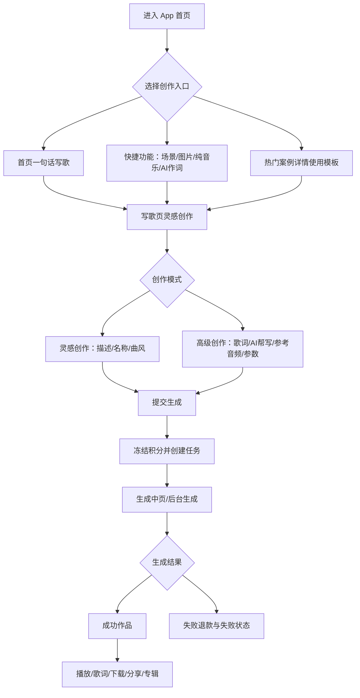

## 4. 信息架构

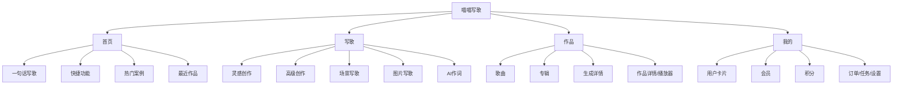

## 5. 页面级详细需求

### 5.1 首页

参考素材：

页面定位：最快开始创作歌曲。

页面结构：

1. 顶部状态区下方显示猫头像、喵喵写歌、品牌副标题和 PRO 会员按钮
2. 大输入卡片：描述输入、推荐标签、字数、开始创作按钮
3. 快捷功能四宫格：场景写歌、图片写歌、纯音乐、AI作词
4. 热门案例横向列表和更多入口
5. 最近作品列表
6. 底部四 Tab

交互：

- 输入 prompt 后点「开始创作」：切到写歌 Tab，并填入灵感创作描述
- 点场景写歌：进入场景 4 步问答
- 点图片写歌：进入图片选择/上传流程
- 点纯音乐：切到写歌 Tab，纯音乐开关默认开启
- 点 AI 作词：进入 AI 帮写/歌词生成流程
- 点热门案例：进入案例详情
- 点最近作品：进入作品详情或播放器

交互流程：

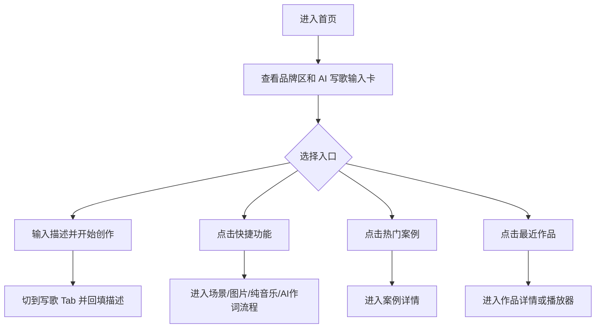

关键状态：

- loading：加载案例、最近作品和配置
- empty：无热门案例或最近作品时展示占位
- error：配置加载失败，提供重试
- disabled：输入为空时仍可进入写歌页，但不提交生成

验收标准：

- 首页第一屏必须和设计稿一样突出输入卡和快捷入口
- 不出现旧 Explore/Sonus 风格布局
- 在 375x812 下热门案例露出首行内容，底部导航不遮挡卡片

### 5.2 热门案例详情

参考素材：

页面结构：

1. 返回按钮 + 标题「案例详情」
2. Banner：案例标题、简介
3. 案例信息：曲风、情绪、时长、适用场景
4. 创作 Prompt：完整内容、复制按钮
5. 示例歌曲试听
6. 底部固定按钮「使用该模板创作」

交互：

- 复制按钮复制 prompt
- 使用模板创作：跳到写歌 Tab，填入 prompt、曲风和标题

交互流程：

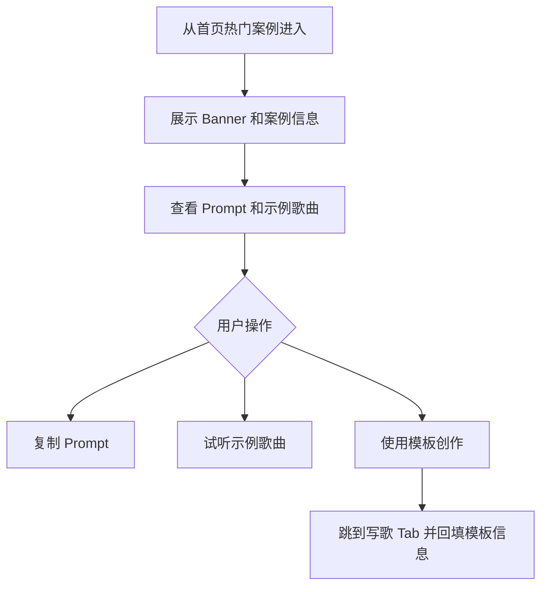

关键状态：

- loading：详情加载中
- not_found：案例不存在或已下架
- error：加载失败可重试
- submitting：使用模板时防重复跳转

### 5.3 写歌页

参考素材：

页面定位：核心创作入口。

页面结构：

1. 标题「AI 写歌」
2. 分段 Tab：灵感创作 / 高级创作
3. 当前模式表单
4. 底部固定「开始创作」按钮
5. 迷你播放器和底部 Tab

灵感创作字段：

- 音乐描述：最大 200 字，底部「灵感速递」和字数
- 音乐名称：选填，最大 80 字
- 曲风描述：最大 200 字
- 曲风标签：多选回填
- 纯音乐：从纯音乐入口进入时默认开启

高级创作字段：

- 歌词输入：最大 3000 字，底部「AI 帮写」和字数
- 音乐名称：最大 80 字
- 曲风描述和标签：最大 200 字
- 歌手类型：默认、男声、女声
- 歌曲语言：中文、英文、日文、韩文、粤语
- 歌曲时长：1/2/3/5 分钟
- 参考音频：现场录制、导入音频
- AI 模型：从后端读取

提交校验：

- 灵感创作至少需要音乐描述、图片或可用模板 prompt
- 高级创作至少需要歌词或 AI 帮写结果
- 防重复提交
- 提交成功进入生成中页

交互流程：

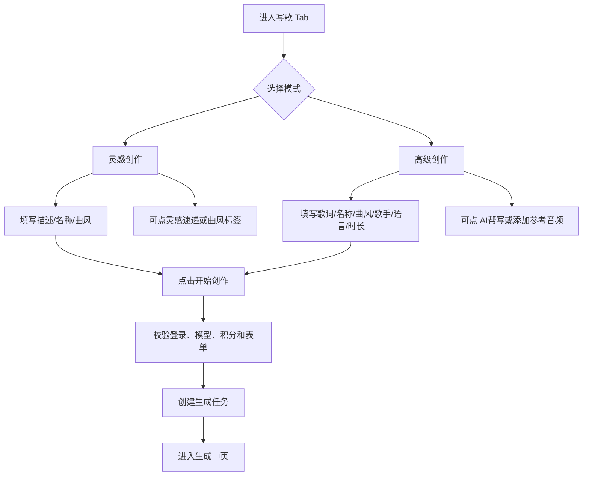

关键状态：

- loading：模型、价格、配置加载
- submitting：创建任务中，按钮禁用
- disabled：必填内容为空或模型不可用
- error：积分不足、上传失败、生成任务创建失败
- draft：保留首页、案例、场景带入的 prompt

验收标准：

- 页面按设计稿实现，不能沿用旧玻璃拟态大卡片风格
- 底部固定按钮不能压住迷你播放器或底部导航
- 所有输入框字数实时变化
- 标签多选能自动同步到曲风描述

### 5.4 场景写歌

参考素材：

页面结构：

1. 返回按钮 + 标题「场景写歌」
2. 4 段进度条
3. 步骤说明「第 N 步，共 4 步」
4. 问题标题
5. 选项卡片
6. 底部下一步按钮

完成后生成 prompt 并进入写歌页。

交互流程：

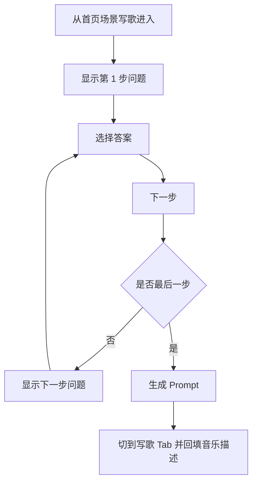

关键状态：

- disabled：当前步骤未选择答案时下一步不可点
- back：支持返回上一题
- empty：场景配置缺失时展示不可用提示
- error：配置加载失败可重试

### 5.5 生成中与生成详情

参考素材：

页面结构：

- 全屏生成中：Logo、计时、生成状态、预计时间、退出等待
- 生成详情：歌曲名、当前状态、百分比、流程步骤、剩余时间、后台生成说明

验收标准：

- 离开页面后任务继续
- 回到作品页能看到生成中列表
- 失败时展示失败原因并提示积分退回

交互流程：

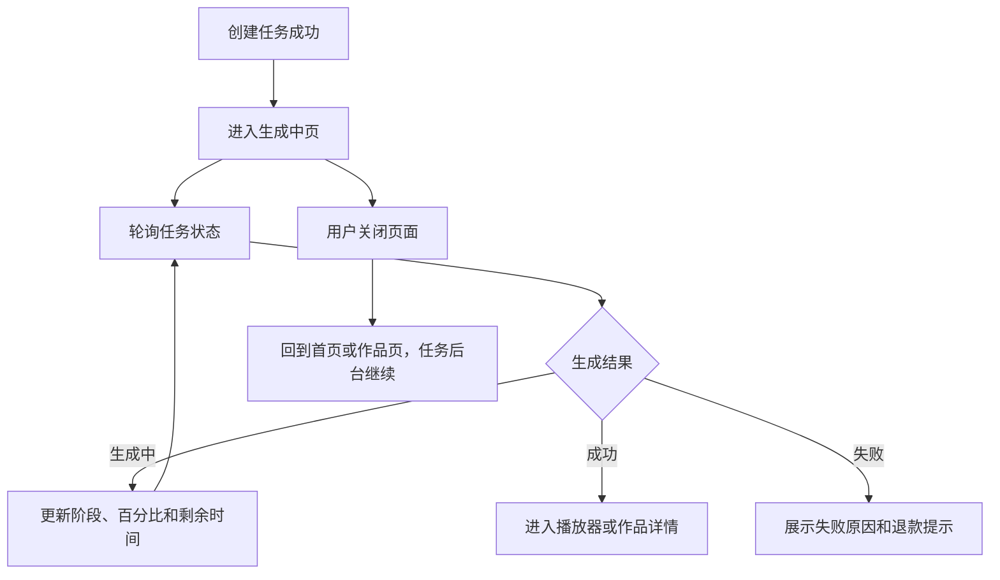

关键状态：

- generating：展示阶段和进度
- failed：展示失败原因
- succeeded：跳转作品
- background：离开后继续生成

### 5.6 作品页

参考素材：

页面结构：

1. 标题「作品」
2. 歌曲 / 专辑 Tab
3. 歌曲 Tab：生成中分组、已完成分组
4. 专辑 Tab：空态或专辑列表
5. 底部导航

交互：

- 生成中项进入生成详情
- 已完成项播放或进入作品详情
- 专辑项进入专辑详情
- 空态可开始创作或创建专辑

交互流程：

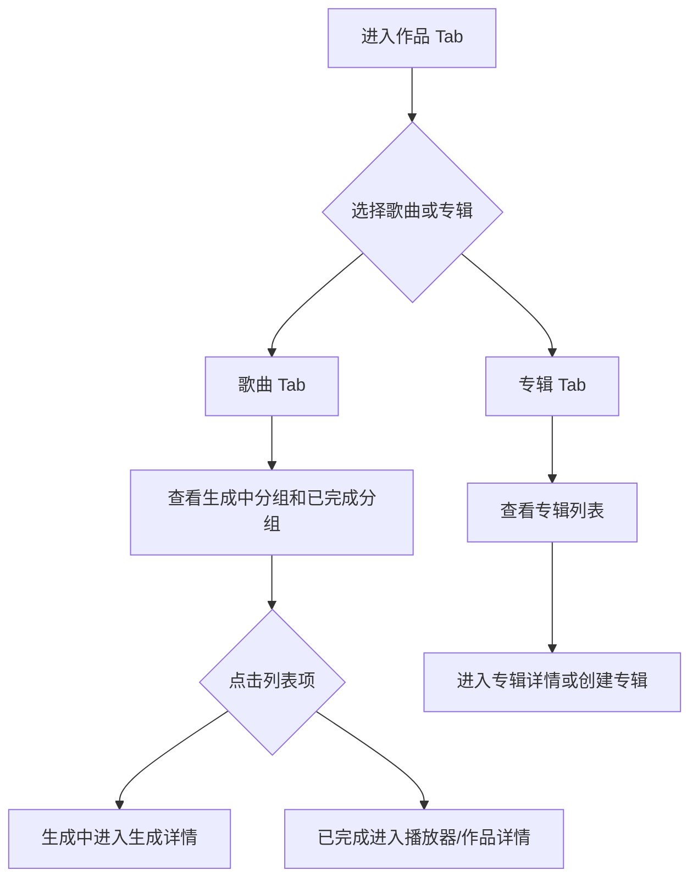

关键状态：

- loading：作品和专辑加载中
- empty_song：暂无歌曲，展示开始创作
- empty_album：暂无专辑，展示创建专辑
- error：加载失败可重试

### 5.7 作品详情

页面结构：

- 封面
- 歌曲名称、创建时间、模型、时长、积分消耗
- 创作 Prompt，支持复制
- 歌词
- 操作区：播放、下载、分享、重新生成、删除、加入专辑

交互流程：

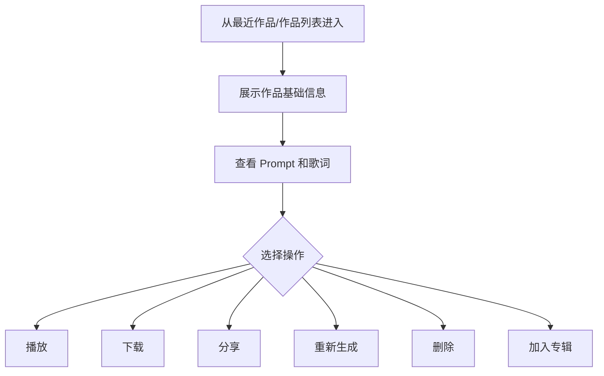

关键状态：

- loading：详情加载中
- not_found：作品不存在或无权限
- action_loading：下载、分享、删除等操作中
- error：操作失败提示

### 5.8 专辑创建与详情

参考素材：

创建字段：

- 专辑名称
- 专辑简介
- 专辑封面

详情展示：

- 封面、名称、简介、歌曲数量、创建时间
- 歌曲列表
- 底部添加歌曲按钮

交互流程：

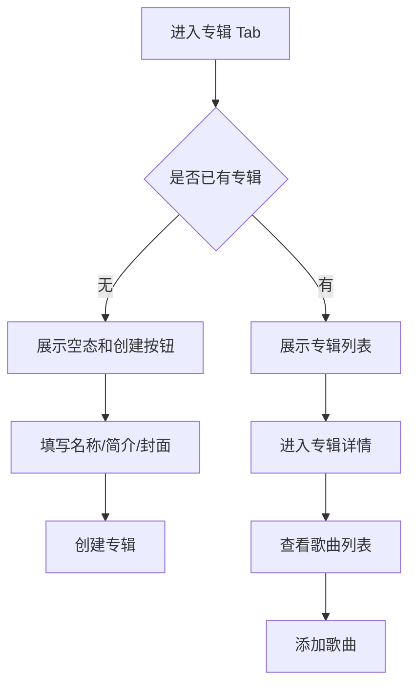

关键状态：

- creating：创建中防重复提交
- empty：暂无专辑或专辑内暂无歌曲
- error：创建、加载、添加歌曲失败

### 5.9 播放器与歌词模式

页面结构：

- Song / Lyrics 切换
- 唱片封面、歌曲信息、进度条、播放控制
- 下载、分享、收藏、重新生成
- Lyrics 模式使用封面模糊背景和逐句高亮

验收标准：

- 播放器可播放后端自有资源地址
- `lyricTimeline` 存在时按进度高亮
- 时间轴缺失时静态展示歌词

交互流程：

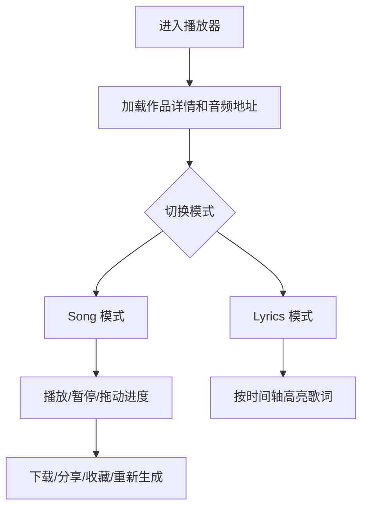

关键状态：

- loading：音频和歌词加载
- playing：唱片旋转、进度推进
- paused：停止旋转
- no_timeline：静态歌词降级
- error：音频地址不可用或播放失败

### 5.10 我的页

参考素材：

当前增量视觉真源：Figma 节点 `81:559「个人」`（CHG-0044，替代原节点 `67:90`）。本节点只约束个人页内容，不改共享底部导航。

页面结构：

1. 顶部操作：积分余额、设置
2. 用户信息：头像、脱敏手机号或登录引导
3. SVIP 卡：会员标识、有效期/说明和开通或续费入口
4. 菜单：积分充值、积分福利、订单列表、积分明细、邀请好友、联系客服、意见反馈、更多设置

验收标准：

- 未登录展示登录引导
- 登录后展示积分和会员信息
- 顶部积分和积分充值进入积分充值页，订单列表进入订单页，积分明细进入原积分详情页，积分福利进入任务中心
- 顶部积分、积分充值、订单列表和积分明细统一使用现有隐私同意与登录门禁
- 菜单复用现有路由能力，不新增接口或路由
- `375x812` 对齐 Figma，`390x844`、`414x896` 可滚动且不被底部导航遮挡

交互流程：

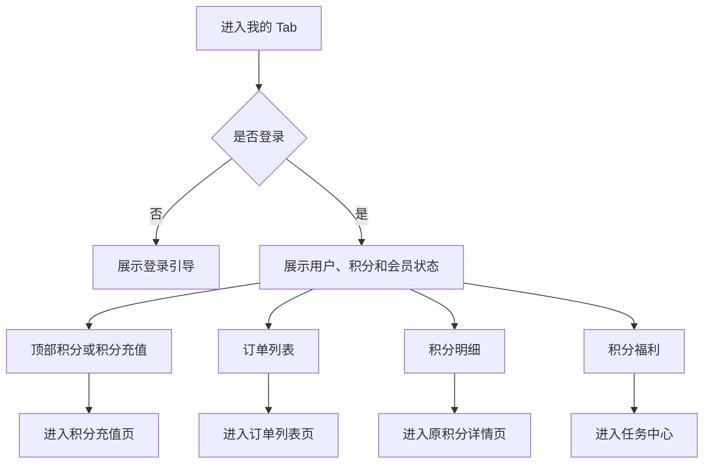

关键状态：

- guest：未登录
- loading：会员/积分加载
- logged_in：已登录展示卡片
- error：用户信息加载失败可重试

## 6. 数据与同步

| 数据 | 来源 | 前端使用 |
|------|------|----------|
| 模型和价格 | 后端配置 | 写歌页模型选择、扣费展示 |
| 热门案例 | Admin 配置 | 首页、案例详情、模板创作 |
| 最近作品 | 用户作品接口 | 首页最近作品 |
| 生成任务 | 后端任务表 | 生成中页、作品生成中分组 |
| 歌曲作品 | 后端作品表 | 作品页、播放器、详情 |
| 专辑 | 后端专辑表 | 专辑 Tab、详情、添加歌曲 |
| 会员 | 会员接口 | 我的页、会员中心 |
| 积分 | 积分接口 | 我的页、扣费、积分明细 |

## 7. 核心业务规则

- 前端不写死价格，所有价格从后端模型或商品配置读取
- 生成前冻结积分，成功扣减，失败退款
- 创建生成任务必须携带幂等键
- 图片写歌和参考音频需要上传资源并由后端持久化
- 下载和播放只使用后端返回的自有资源地址
- Admin 切换 App 后只能查看和操作当前 App 数据

## 8. 前后端交互说明

现有接口继续保留：

- `GET /api/song-config/models`
- `GET /api/song-config/scenarios`
- `GET /api/song-config/examples`
- `GET /api/song-config/inspiration`
- `POST /api/song-generations`
- `GET /api/song-generations/{id}`
- `GET /api/song-works`
- `GET /api/song-works/{id}`
- `POST /api/song-works/{id}/download-url`
- `POST /api/song-works/disable`
- `GET/POST /api/song-albums`

本轮新增或补强接口方向：

- 热门案例列表与详情
- 最近作品
- AI 帮写歌词
- 图片写歌上传与生成参数
- 参考音频上传/录音资源
- 生成进度百分比和阶段详情
- 作品详情操作：分享、重新生成、加入专辑
- 专辑详情和添加歌曲
- 会员信息、积分信息、积分充值和积分明细

## 9. 非功能要求

- 设计稿还原优先级高于旧参考图和当前已写页面
- UI 尺寸按内层手机屏幕换算到 375x812
- 所有尺寸使用 ScreenUtil：`.w/.h/.sp/.r`
- 固定底部按钮、迷你播放器、底部导航必须避让
- 375x812、390x844、414x896、小屏高度均需检查
- loading、empty、error、disabled、submitting 必须完整

## 10. 里程碑

| 里程碑 | 内容 |
|--------|------|
| M1 文档重整 | 新 PRD、前端 UI 计划、流程记录 |
| M2 首页/写歌 UI | 首页、写歌页、场景写歌按设计稿实现 |
| M3 作品/播放器 UI | 作品、专辑、生成中、播放器按设计稿实现 |
| M4 我的/会员积分 UI | 我的页、会员、积分入口适配 |
| M5 真功能联调 | 图片写歌、AI帮写、参考音频、下载分享、会员积分 |

## 11. 待确认项

- 图片写歌的最终 Provider
- AI 帮写是否复用 MiniMax Lyrics Generation
- 参考音频首期是否真实参与生成
- 分享方式是系统分享、H5 分享页，还是仅分享下载链接
- 会员和积分商品 SKU

## 12. 路径恢复补充实现轨迹

2026-07-31 从错误工作区别名 `catsinger` 恢复的完整需求轨迹位于 `recovered-engineering-track-20260731/requirements.md`，对应 CHG-0015～CHG-0040。当前验收仍以 `CURRENT.md` 指向的 `v1.1.0-as-built` 需求为准。
