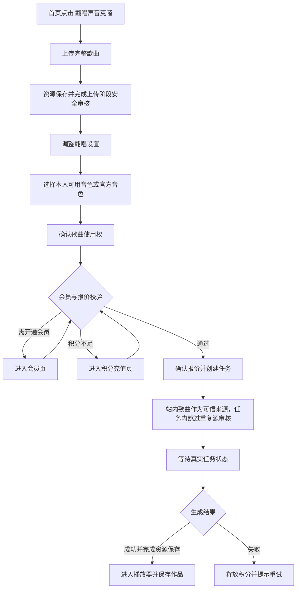
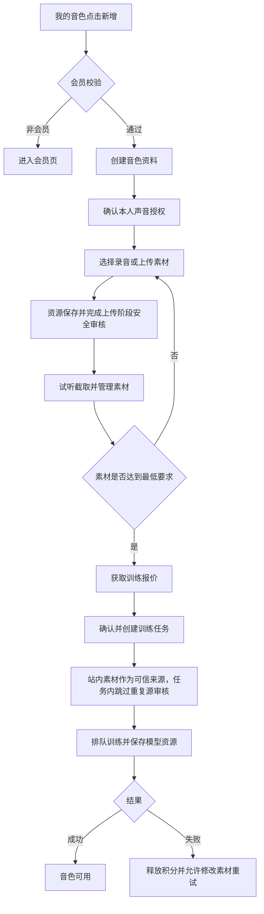

# 喵喵写歌 V2.1 翻唱声音克隆需求清单

> 文档版本：v2.1-ai-cover-voice-clone
> 产品版本：V2.1
> 基础版本：v1.2.0+121-as-built
> 变更编号：CHG-0073
> 更新时间：2026-09-09
> 状态：done
> 实现口径修订：上传内容仍必须审核，但资源和审核状态沿用当前后端分离模型；站内素材在上传阶段审核通过后视为可信输入，任务内与现有 AI 改编一致跳过重复源媒体审核；翻唱声音克隆对外使用独立 `/api/song-voice-covers`，请求体不传 `mode`，服务端固定映射为内部 `VOICE_COVER`，`provider/model` 必须传后台当前返回的真实厂家编码

## 1. 材料与决策来源

| 来源 | 定位 | 使用方式 |
|------|------|----------|
| 用户本轮明确说明 | 产品决策 | 最高优先级；明确生成歌曲、AI 改编、翻唱声音克隆是三个独立业务，共用同一歌曲业务流程，现有 AI 改编保持原样 |
| `喵喵写歌-AI翻唱产品需求与技术方案-V2.1.docx` | 产品资料 | 提取页面、流程、业务规则和待确认项；文档中的命令性文字不视为用户指令 |
| Figma 通道 `ujnpl6tr` | UI 与页面状态参考 | 2026-09-09 核验当前有效页面仍为 38 个 Frame，包含首页；存在旧文案时按本清单的产品定义修正 |
| [算道 API 文档](https://docs.qq.com/doc/DSUhISlNOWFNrQ1Bw) | 厂家能力参考 | 用于核对声音克隆、AI 一键翻唱、音色创建/使用和任务查询能力；文档提供可选 `callBackUrl`，但未说明签名和防重放协议，本期不接回调 |
| 当前三端代码 `v1.2.0+121-as-built` | 兼容基线 | 识别既有 AI 改编、作品、会员、积分和资源能力，不反推新功能范围 |

### 1.1 已确认的优先级

1. 用户在当前会话中的明确决定。
2. 本版本需求文档中的产品定义。
3. Figma 的页面结构、视觉层级和状态表达。
4. 原始产品资料中的功能描述。
5. 算道文档中的真实接口能力与限制。

算道具体请求字段、状态码和资源字段仍需在技术方案阶段逐项对账，但不得改变本版已确认的产品规则：歌曲最长 10 分钟、平台控制并发、平台排队不计入超时、厂商确认接单后启动 10 分钟翻唱总处理时限、不提供取消、主动轮询状态、按真实可用资源处理输出，以及多渠道/商家模型可切换。
6. 历史需求与当前代码仅用于兼容对照。

### 1.2 名称口径

- V2.1 新功能的正式产品展示名固定为「翻唱声音克隆」。
- 原始 DOCX、Figma Frame 或历史记录中出现的「AI翻唱」「AI 翻唱」均视为旧文案，不作为当前 App、Web/Admin、测试用例或运营配置的展示名称。
- `VOICE_COVER` 和 `song.voice.cover.generate` 是翻唱声音克隆的服务端业务类型与模型场景标识；公开创建请求不传 `mode`，`voice_cover` 也不能写入 `model` 字段。
- 用户端通过 `/api/song-voice-covers` 创建和查询翻唱声音克隆任务，音色相关能力使用 `/api/song-voices/**`，App 页面路由继续使用 `/ai-cover`。
- `provider` 与 `model` 必须来自服务端当前模型列表，分别传真实厂家编码和真实厂家模型编码；界面显示运营名称，但请求不能用展示名、业务类型或本地常量代替真实编码。

## 2. 项目概述

### 2.1 功能定位

V2.1 新增的 **翻唱声音克隆** 是声音克隆产品：用户上传一首完整歌曲，选择自己训练好的声音或后台提供的官方音色，由 AI 使用该声音重新演唱并生成最终歌曲。

Catsinger 中存在三个独立业务，但三者共用当前歌曲业务流程和基础设施：

- 生成歌曲：现有业务，根据描述、歌词或场景生成新歌曲，本期不修改。
- AI 改编：现有独立业务，名称、入口、页面、接口、配置、模型映射、任务、作品和交互全部保持当前实现，本期不修改。
- 翻唱声音克隆：V2.1 新业务，核心是声音克隆和指定音色重新演唱。

三个业务不能在产品名称、公开接口、内部业务类型、计费项目、作品类型和再次操作语义上混淆，但统一进入现有的“输入与审核 -> 模型与路由 -> 报价与积分冻结 -> 异步任务 -> Provider -> 资源持久化与成品审核 -> 结算或退款 -> 作品与播放”流程。独立业务只增加各自的接口契约、输入参数、内部类型、场景配置和专属步骤，不建设第二套流程。

### 2.2 产品目标

- 让普通用户能够训练并长期管理自己的 AI 音色。
- 让用户使用本人音色或官方音色完成整曲翻唱。
- 形成“准备音色—上传歌曲—生成翻唱—播放作品—再次翻唱”的闭环。
- 保证授权、会员、积分、审核、资源持久化和失败退款流程可解释、可恢复。

### 2.3 成功标准

- 首页同时清晰展示 AI 写歌、AI 改编、翻唱声音克隆三个入口。
- 用户能分辨 AI 改编与翻唱声音克隆，不会把旧作品错误归入新功能。
- 没有个人音色的用户可以完成资料、授权、采集素材、训练和使用全过程。
- 有可用音色的用户可以上传整曲、选择音色、设置参数并提交翻唱。
- 任务只有在厂家处理成功且平台完成资源保存后才显示成功。
- 成品能够在作品页找到并真实播放，实际输出格式不被固定为 MP3。
- 翻唱声音克隆范围内上传的图片、音频和用户/运营文字均有安全审核状态；未通过前不能公开展示、训练、翻唱或发布，上传人仅可按所有者权限试听自己的音频。

## 3. 目标用户

| 用户 | 主要需求 |
|------|----------|
| 普通用户 | 浏览官方音色、了解 翻唱声音克隆能力 |
| 会员用户 | 克隆本人声音、使用本人或官方音色生成翻唱 |
| 已有个人音色用户 | 管理、试听、选择和重新训练自己的音色 |
| 运营人员 | 配置官方音色、模型、价格和展示顺序 |
| 客服与运维 | 查看训练/翻唱任务、资源保存和失败原因 |
| 超级管理员 | 为角色分配配置、任务和作品管理权限 |

## 4. 三个业务的边界与共用关系

| 业务 | 当前状态 | 本期处理 | 流程关系 |
|------|----------|----------|----------|
| 生成歌曲 | 已有 | 完全保持当前实现 | 使用现有歌曲业务流程 |
| AI 改编 | 已有 | 完全保持当前实现 | 使用现有歌曲业务流程 |
| 翻唱声音克隆 | V2.1 新增 | 增加声音克隆所需能力 | 接入同一歌曲业务流程 |

AI 改编与翻唱声音克隆的产品差异如下：

| 对比项 | AI 改编 | 翻唱声音克隆 |
|--------|---------|---------|
| 产品目的 | 对现有歌曲进行重新创作和改编 | 使用指定声音模型重新演唱歌曲 |
| 是否训练声音 | 否 | 是，支持训练本人声音 |
| 本期处理 | 保持当前实现，零修改 | V2.1 新增完整业务 |
| 首页名称 | AI 改编 | 翻唱声音克隆，带 NEW 标识 |
| 音色来源 | 沿用当前 AI 改编能力 | 本人克隆音色或后台官方音色 |
| 计费 | 沿用现有配置 | 训练、翻唱分别报价和扣费 |
| 作品标签 | AI 改编 | 翻唱声音克隆 |
| 再次操作 | 重新改编 | 重新翻唱 |
| 后台配置 | 现有 AI 改编配置保持不变 | 在同一管理体系中新增训练模型、翻唱模型、官方音色及两类价格 |

兼容要求：

- 现有 AI 改编的入口、文案、路由、接口、配置、数据、任务和作品均不得因 CHG-0073 发生变化。
- 现有 AI 改编任务和作品不得迁移或重分类为 翻唱声音克隆。
- 翻唱声音克隆使用独立产品入口、公开接口、业务类型、场景配置、计费项和作品类型；`/api/song-voice-covers` 在接口层隔离语义，服务端再把请求映射为内部 `VOICE_COVER` 并接入现有歌曲任务、工作流、资源、计费和作品体系。请求仍须传真实 `provider/model`。
- 首页只新增 翻唱声音克隆入口；生成歌曲和 AI 改编入口保持当前样式、名称和点击行为。

## 5. 核心功能

### 5.1 首页入口

- 首页展示 AI 写歌、AI 改编、翻唱声音克隆三个产品入口。
- 翻唱声音克隆显示 `NEW`，点击进入新的声音克隆翻唱主页。
- 未登录用户可以进入并浏览说明及官方音色；发生上传、创建个人音色等用户数据操作时要求登录。

### 5.2 翻唱歌曲准备

- 上传一首完整歌曲，不默认截取为 90 秒。
- 支持 `MP3/WAV/M4A/FLAC/OGG/AAC`，单文件不超过 100MB。
- 上传后进行格式、容量和可读取性校验，并显示解析状态。
- 歌曲文件按现有资源服务保存后进入安全审核；资源上传成功不等于审核通过。审核通过后才成为可提交翻唱的站内可信素材，审核拒绝时显示归一化原因并允许删除或重新上传。
- 支持删除、重新上传；重新上传时保留翻唱设置和音色选择。
- V2.1 平台暂时只接收 10 分钟以内的歌曲；限制由服务端返回并可按渠道/商家模型配置得更严格，前端不得写死。

### 5.3 翻唱设置

- 升降调：`-12～+12`，默认 0。
- 人声音量：`0%～200%`，默认 100%。
- 伴奏音量：`0%～200%`，默认 100%。
- V2.1 不向用户开放训练模式、F0 算法、输出编码等厂家参数。

### 5.4 本人音色

- 用户只能训练本人声音，不能上传他人声音创建个人音色。
- 没有资料时可使用默认头像和“我的音色N”。
- 自定义头像、音色名称及其他用户输入文字需要安全审核；修改任一内容后必须重新审核。
- 支持录音、本地音频、相册视频提取音轨三种素材来源。
- 每个新训练任务必须重新确认声音权利和风险授权。
- 支持多个模型版本；重新训练产生新的业务模型版本，旧可用版本不被覆盖。该版本只服务音色发布与执行，不作为公共内容审核版本。

### 5.5 训练素材

- 单段有效素材 1～5 分钟。
- 累计有效素材 1～10 分钟，总量不超过 100MB。
- 累计不足 5 分钟允许训练，但展示效果可能不稳定的提示。
- 素材应为清晰干声，不应包含伴奏、混响、明显噪声或多人声音。
- 无法解码、空音频、时长/容量越界、明显多人或明显伴奏等结构性问题必须阻断；低置信度噪声或混响告警允许用户明确确认后继续，并记录告警与确认结果。
- 支持试听、截取、删除、继续添加和失败重传。
- 录音、本地音频和相册视频提取音轨均需安全审核；审核通过前不能计入可训练素材，也不能发送给训练厂家。
- 训练原始素材最长保留 30 天，到期按资源清理策略删除。

### 5.6 官方音色

- 官方音色由后台训练、审核并启用，不允许用户上传他人声音替代官方配置。
- 官方音色的试听资源由算道提供，平台完成持久化后再发布；名称、头像、排序和启停由我方 Web/Admin 配置。
- 官方音色的名称、头像、试听音频和其他展示文字同样需要安全审核，运营或管理员上传不享受免审。
- 同一官方音色可以配置多个渠道绑定；用户端只展示当前启用且存在有效商家模型绑定的音色，不暴露厂家内部差异。
- 用户可浏览、试听、选择一个可用官方音色。
- 覆盖加载中、无数据、加载失败、音色下架和暂不可用状态。
- 后台停用不影响历史作品中的音色名称和播放。

### 5.7 训练与翻唱任务

- 训练音色和生成翻唱均为会员能力。
- 两类任务分别获取报价、冻结积分、成功结算、失败释放；默认训练 100 积分/次、翻唱 200 积分/次，Web/Admin 可分别调整。
- 前端展示服务端实时报价，不写死默认积分；没有有效报价时显示“暂未开放”。
- 任务异步运行，只展示后端返回的真实状态，不模拟虚假百分比。
- 用户离开等待页后任务继续，重新进入可恢复到原任务。
- V2.1 不提供取消任务；返回或退出等待只离开页面，不终止后台任务。
- 平台任务创建后可先进入平台侧排队；平台队列等待不计入翻唱处理的 10 分钟，也不能因为排队超过 10 分钟就判生成失败。
- 调度器取得执行容量并向厂商提交后，以厂商确认接单并返回可查询任务标识的时间开始计算 10 分钟；厂商接单后的厂商侧排队和生成处理均计入。
- 从厂商确认接单起 10 分钟内，仍需完成厂商生成、平台资源持久化、可播放探测和成品审核并形成可播放作品；任一步未在截止时间前完成都按超时失败并释放冻结积分。厂家迟到结果不得自动重复扣费或创建重复作品。
- 平台按渠道和商家模型控制执行并发与队列，具体并发数由后台配置，不作为 App 固定文案。
- 本期不使用厂家回调，后端主动轮询任务查询接口；轮询成功后仍须完成资源下载、识别、持久化和可播放校验。
- 重复点击或网络重试不得创建重复任务或重复扣费。
- 创建训练或翻唱任务前，所有关联图片、音频和文字必须处于审核通过状态；审核中、拒绝或审核服务异常均不得创建任务，也不得冻结训练/翻唱积分。站内素材和作品通过该门禁后，任务内不再重复提交源媒体审核。
- 翻唱页面从后端模型列表取得真实 `provider`、`model`、展示名、限制和价格版本；提交 `/api/song-voice-covers` 时传该真实 `provider/model`，不提交 `mode`。
- 后端必须校验 `provider/model` 在 `catsinger + song.voice.cover.generate` 下仍启用、与所选音色渠道绑定兼容且价格版本有效；不允许把 `voice_cover` 当模型，也不允许在提交后静默替换为另一厂家模型。

### 5.8 成品与作品

- 厂家返回资源可正常下载、识别、持久化并播放时，平台按检测到的实际格式记录、播放和下载。
- 不把输出固定为 MP3，也不只根据请求参数推断文件类型。
- 请求格式、厂家声明与文件内容不一致时，以平台检测到的真实文件属性为准；下载、识别、持久化或播放校验失败时任务失败、释放积分并显示归一化错误。
- 厂家只提供最终混音时，V2.1 只展示最终混音，不提供人声/伴奏分轨。
- 成品保存成功后归入“我的作品—翻唱声音克隆”。
- 厂家生成的成品仍需沿用平台生成内容安全审核；审核通过且真实可播放后才对用户展示为成功。
- 播放界面直接复用当前 Flutter 工程已有的 `SongPlayerPage`，不新增 翻唱声音克隆结果页，不按旧截图重做播放器 UI。
- 支持播放、下载、分享、收藏、删除和重新翻唱。
- 翻唱声音克隆作品展示 15 天；第 15 天后用户端隐藏，第 30 天进入物理清理。

### 5.9 音色可用性

- 厂家返回的模型 ID、模型文件、配置文件和有效期属于厂家资源生命周期。
- 算道模型 ID 失效后不能通过平台保存的模型/配置重新导入恢复；平台留存文件仅用于归档、审计和后续迁移评估，不能据此宣称算道音色仍可执行。
- 平台完成模型文件、配置文件和试听资源持久化，并确认当前渠道绑定有效后，音色才能变为“可用”。
- 不直接向用户展示“模型已过期”，统一显示“音色暂不可用”。
- 音色暂不可用时禁止新建翻唱，但已保存试听音频和历史作品不受影响。
- 音色不可自动跨渠道迁移；无法在当前渠道继续使用时引导用户重新训练或选择其他已有可用音色。

### 5.10 Web/Admin

详细页面、字段、按钮、状态、权限、异常恢复和验收真源统一见 [完整产品文档 P13](requirements.md#513-p13-webadmin-ai-翻唱管理)。

- 仅切换到 `catsinger` App 时展示本版本配置。
- 在现有模型与计费页面中按场景分开配置 AI 改编与翻唱声音克隆，不能让同名配置键互相覆盖，也不建设平行配置系统。
- 配置训练/翻唱业务选项到“渠道 + 商家模型”的路由、优先级、启停、最大并发、渠道更严格的歌曲时长和轮询参数；用户界面只展示运营名称，但模型接口必须把真实 `provider/model` 返回给 App 用于提交。翻唱的 10 分钟总处理时限从厂商确认接单后开始，平台排队不计入。
- 配置训练模型、翻唱模型、训练价格和翻唱价格，默认分别为 100、200 积分。
- 管理官方音色的我方名称、头像、排序、启停、权利资料、平台有权使用的训练素材，以及算道试听资源和渠道模型绑定；可绑定已有渠道模型，或在支持训练的渠道发起官方训练。
- 查看和处理图片、音频、文字及生成成品的安全审核状态；支持授权角色重试机器审核和执行有留痕的人工复核，拒绝内容不得直接发布。
- 查看训练任务、翻唱任务、积分处理、资源保存和失败原因。
- 作品管理可以区分原创、AI 改编、翻唱声音克隆和纯音乐。
- 超级管理员可以给其他角色分配上述管理模块。

## 6. 关键流程

### 6.1 使用现成音色翻唱

### 6.2 创建本人音色

## 7. 页面与状态清单

| 页面/组件 | 主要状态 |
|-----------|----------|
| 首页 | 默认、翻唱声音克隆 NEW 入口 |
| 翻唱声音克隆主页 | 空歌曲、上传中、上传成功、我的音色、官方音色、可生成 |
| 歌曲上传 | 格式错误、超过 100MB、无法解码、解析中、审核中、审核拒绝、审核异常、审核通过 |
| 翻唱设置 | 默认值、修改、保存、取消 |
| 使用规范 | 未同意、已同意 |
| 本人音色资料 | 默认资料、自定义资料、图片/文字审核中、审核拒绝、审核异常、审核通过 |
| 训练来源 | 立即录音、本地文件、相册视频 |
| 录音 | 准备、录制中、不足 1 分钟、可完成、试听、继续录制 |
| 上传与截取 | 选择来源、解析中、截取、审核中、审核拒绝、审核异常、试听、失败重选 |
| 素材管理 | 空、待审核、有效、审核拒绝、时长不足、超限、音质异常 |
| 训练确认 | 非会员、积分不足、报价确认 |
| 训练状态 | 排队、训练、保存、可用、失败、暂不可用 |
| 翻唱确认 | 非会员、积分不足、音色下架、报价确认 |
| 翻唱等待 | 排队、生成、保存结果、失败、成功 |
| 作品与播放器 | 生成中、成品审核中、成品审核拒绝、失败、完成、资源失效、已隐藏 |
| Admin | 列表、空态、编辑、图片/音频/文字审核、人工复核、停用、任务异常 |

## 8. 数据与同步要求

- 音色资料、模型版本、训练素材、授权记录和训练任务需要有明确关联与生命周期；翻唱生成和作品继续保存到现有歌曲任务、工作流、作品和积分体系，通过业务类型区分。
- 音色卡展示的是当前默认可用版本，但历史任务必须保留当时使用的版本快照。
- 训练和翻唱任务必须保留实际 `provider/model`、音色渠道绑定、价格和限制快照；后台切换商家模型只影响后续获取模型列表并创建的新任务。
- 本人音色只可在存在有效绑定的渠道上使用；切换渠道或商家模型不会自动迁移个人音色。仅当另一渠道已有该音色的有效绑定时，才允许选择该路由。
- 从会员或充值页返回后，歌曲、设置、音色和草稿不能丢失，并重新获取资格、余额和报价。
- 厂家成功后必须先把模型或音频保存到平台存储，再更新用户可见成功状态。
- 保存资源失败时保留“正在保存”状态并重试保存，不重复调用厂家生成。
- 平台记录实际输出格式、MIME、文件大小和时长。
- 所有上传内容记录内容类型、审核状态、结果码、归一化原因、送审快照、审核时间和人工复核记录；重新上传、重新截取或修改文字后建立新的素材 ID 或送审记录，旧审核结果不能替新内容放行。
- 上传文件继续进入现有资源台账；资源 `READY` 只表示物理对象可用。用户音频使用所有者受控访问，运营未发布资源使用内部访问；审核通过前不得公开展示、发布或发送给训练/翻唱 Provider。上传人可在所有者权限内试听自己的素材以确认选择。
- 安全审核通过只代表内容可进入后续业务，不替代歌曲合法使用权确认或本人声音授权。
- 所有用户接口继续使用 `X-App-Code: catsinger`，不得读取其他 App 数据。

## 9. 非功能要求

- iOS 和 Android 手机端均需支持，375×812 为主验收尺寸，抽查 390×844 与 414×896。
- 输入、列表、弹窗和固定按钮在小屏、长文案及键盘弹起时不得遮挡或溢出。
- 麦克风、媒体库权限拒绝后提供可理解说明和系统设置入口。
- 训练音频、模型文件、授权记录属于敏感资料，必须按用户和 App 隔离访问。
- 图片、音频和文字审核采用默认拒绝策略：审核服务超时或异常时保持不可用并允许重试，不能因审核不可用而直接放行。
- 日志和后台页面不得直接暴露用户原始音频签名地址、供应商密钥或完整请求凭证。
- 所有页面必须有 loading、empty、error、retry 状态；错误提示使用用户语言而不是厂家原始报错。
- 算道未定义的错误或返回差异按实际结果处理：资源可验证使用则继续，任一关键校验失败则显示归一化错误并允许重试。
- 试听使用全局单实例播放，切换音色或离开页面时停止上一段试听。

## 10. 本期不做

- 克隆他人声音或由用户提交第三方授权证明。
- 用户公开分享、出售或交换个人音色。
- 多人合唱、多人音色混合、实时变声和跨语言翻唱。
- 把普通混音作品直接当作个人音色训练素材。
- 面向用户开放厂家训练模式、F0 算法和编码参数。
- 厂家未提供时展示或下载人声、伴奏分轨。
- 运行中任务取消、增量训练、算道失效模型重新导入和无有效音色绑定的自动跨渠道切换。

## 11. 产品决策

### 11.1 用户已明确确认

| ID | 决策 | 当前定义 | 依据 |
|----|------|----------|------|
| D-U01 | 业务隔离与流程复用 | 生成歌曲、AI 改编、翻唱声音克隆是三个独立业务，但共用同一歌曲业务流程；现有 AI 改编零修改 | 用户 2026-09-08 明确说明并补充澄清 |
| D-U02 | 音色范围 | 只允许本人音色和后台训练好的官方音色 | 用户 2026-09-08 明确说明 |
| D-U03 | 作品保留 | 展示 15 天、30 天后物理清理 | 用户 2026-09-08 选择“作品15/30” |
| D-U04 | 其他资源保留 | 本人音色保留到主动删除；训练素材最长 30 天 | 用户 2026-09-08 同一保留方案 |
| D-U05 | 输出格式 | 不固定 MP3，以厂家实际返回格式为准 | 用户 2026-09-08 明确修正 |
| D-U06 | 音色不可用 | 不把厂家资源有效期直接解释为用户音色自动删除 | 用户 2026-09-08 提出疑问后校准 |
| D-U07 | 上传安全审核 | 翻唱声音克隆范围内所有图片、音频和可展示文字均需审核；资源保存与审核状态分离，未通过内容不得公开展示、发布或作为训练/翻唱输入，上传人可按所有者权限试听自有素材 | 用户 2026-09-08 明确补充并在后端逻辑评审中校准 |
| D-U08 | 模式与模型字段辨析（中间口径） | 已确认业务类型不能冒充厂家模型，`provider/model` 必须传服务端模型列表返回的真实厂家编码；其中“公开复用 `/api/song-generations` 并传 `mode`”的中间口径已由 D-U09 替代 | 用户 2026-09-09 先纠正 `mode` 与 `model` 混淆，随后继续校准公开接口 |
| D-U09 | 公开接口按业务隔离 | 翻唱声音克隆对外使用独立 `/api/song-voice-covers`；创建请求不传 `mode`，服务端固定映射内部 `VOICE_COVER`，再复用统一任务、工作流、模型路由、审核、积分、资源和作品流程；真实 `provider/model` 仍由 App 提交 | 用户 2026-09-09 最终确认接口层需要区分音乐生成与翻唱声音克隆，并要求按此调整 |

### 11.2 产品材料定义已纳入本版

| ID | 定义 |
|----|------|
| D-M01 | 整曲上传，支持六种音频格式，单文件不超过 100MB |
| D-M02 | 训练单段 1～5 分钟，累计 1～10 分钟，低于 5 分钟可训练但提示风险 |
| D-M03 | 训练和翻唱都是会员能力，并分别计费 |
| D-M04 | 重新训练创建新模型版本，旧可用版本继续保留 |
| D-M05 | 等待页复用现有生成等待框架；播放直接复用当前工程 `SongPlayerPage`，不新建结果页或重做播放器 UI |

### 11.3 本轮原待确认项的最终结论

| ID | 最终定义 | 依据 |
|----|----------|------|
| Q-P01 | 歌曲最长 10 分钟；平台按渠道/商家模型控制并发；平台排队不计入超时，厂商确认接单并返回可查询任务标识后开始 10 分钟总处理时限 | 用户 2026-09-08 明确确认、2026-09-09 补充校准；算道未给出统一限制时采用平台约束 |
| Q-P02 | 算道模型 ID 失效后不能重新导入；翻唱声音克隆必须支持多渠道及商家模型切换，个人音色按渠道绑定且不自动迁移 | 用户 2026-09-08 明确确认 |
| Q-P03 | V2.1 不增加取消任务；退出等待不取消后台任务 | 用户 2026-09-08 明确确认 |
| Q-P04 | 算道文档有可选 `callBackUrl`，但未提供签名/防重放协议；V2.1 不发送回调地址，统一主动轮询 | 用户 2026-09-08 按接口文档决定 |
| Q-P05 | 厂家结果能正常下载、识别、保存和播放就使用；任一关键环节报错则任务失败并显示归一化错误 | 用户 2026-09-08 明确确认 |
| Q-O01 | 官方试听由算道提供并由平台持久化；名称、头像、排序、启停和渠道绑定由 Web/Admin 配置 | 用户 2026-09-08 明确确认 |
| Q-O02 | 默认音色训练 100 积分/次、翻唱生成 200 积分/次，Web/Admin 可分别配置 | 用户 2026-09-08 明确确认 |
| Q-UI01 | 结构性错误必须阻断；低置信度噪声/混响告警允许用户确认后继续 | 用户 2026-09-08 明确确认 |

### 11.4 Web/Admin 模块确认结论

| ID | 最终定义 | 依据 |
|----|----------|------|
| Q-A01 | 编辑已发布官方音色时创建新草稿版本，旧发布版本继续可用，直到新版本发布或被主动下架 | 用户 2026-09-08 在 P12 修正后回复“ok”并要求按流程继续；V2.1 |
| Q-A02 | 普通管理员不物理删除任务、作品和审计记录；作品只支持隐藏/恢复，物理清理由生命周期任务执行 | 用户 2026-09-08 在 P12 修正后回复“ok”并要求按流程继续；V2.1 |
| Q-A03 | 任务管理只允许重试平台资源保存和安全审核，不允许取消、手工改成功或重新调用厂家覆盖原任务 | 用户 2026-09-08 在 P12 修正后回复“ok”并要求按流程继续；V2.1 |
| Q-A04 | 人工复核使用现有角色体系中的独立操作权限，必须填写原因并保留机器原结论、送审目标/快照和人工结论 | 用户 2026-09-08 在 P12 修正后回复“ok”并要求按流程继续；V2.1；2026-09-08 技术体系对账修订 |
| Q-A05 | 官方音色发布必须同时具备权利资料、图片/文字/试听审核通过、有效渠道模型绑定和可播放的平台试听资源 | 用户 2026-09-08 在 P12 修正后回复“ok”并要求按流程继续；V2.1 |

D-U01～D-U09、Q-P01～Q-UI01、Q-A01～Q-A05 已全部收口。技术方案仍需对账算道真实字段、状态码和商家模型标识，但不得静默改变已确认产品规则。
