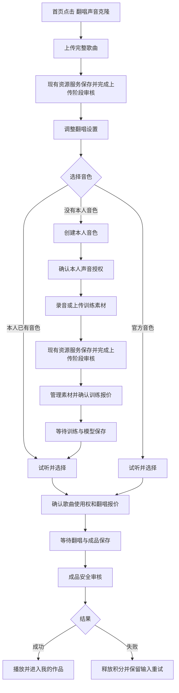

# 喵喵写歌 V2.1 翻唱声音克隆 Product Review

> 文档版本：v2.1-ai-cover-voice-clone · 产品版本：V2.1 · 更新：2026-09-09
> 状态：done · 预计阅读：5～10 分钟
> 完整需求真源：[requirements.md](requirements.md)
> 需求清单：[requirements-list.md](requirements-list.md)
> 说明：产品资料、Figma 和厂家文档有记载，不等于用户已确认；D-U01～D-U09、Q-P01～Q-UI01、Q-A01～Q-A05 均已有用户确认依据，完整记录见第 11 节。
> 技术体系校准：生成歌曲、AI 改编、翻唱声音克隆是三个独立业务，但共用当前歌曲任务生命周期和模型、路由、资源、审核、积分、作品、播放器及 Web/Admin 基础设施；现有 AI 改编本期零修改。

## 1. 一句话版本

V2.1 在现有生成歌曲、AI 改编之外新增翻唱声音克隆业务：用户上传完整歌曲，使用本人训练的声音或后台官方音色重新演唱。三个业务入口和语义独立，技术上进入同一套 Catsinger 歌曲业务流程，现有 AI 改编保持原样。

正式展示名统一为「翻唱声音克隆」；设计源文件中的旧名称只用于溯源，内部 `VOICE_COVER` 等技术标识保持不变。

## 2. 本期范围

| 做 | 不做 |
|----|------|
| 首页新增 翻唱声音克隆 NEW，原生成歌曲和 AI 改编入口保持不变 | 不修改、改名、迁移或重做 AI 改编 |
| 使用本人音色或后台官方音色翻唱完整歌曲 | 不允许克隆他人声音或上传第三方授权证明 |
| 录音、本地文件、相册视频音轨训练本人音色 | 不使用普通混音作品训练音色 |
| 音色资料、审核、授权、多素材和异步训练 | 不做音色市场、转让、公开分享 |
| App 与 Web/Admin 上传的图片、音频和可展示文字统一先安全审核 | 不让用户、运营或普通管理员绕过拒绝状态，不在审核异常时默认放行 |
| 训练和翻唱分别会员校验、报价和扣费 | 不把两类费用合并成一次固定价格 |
| 保存厂家模型；最终混音持久化且成品安全审核通过后再标记成功 | 不直接依赖厂家临时资源地址，不把未审核成品暴露给用户 |
| 平台按渠道/商家模型路由并控制并发，任务保留路由快照 | 不把无有效绑定的本人音色静默迁移到其他渠道 |
| 后端主动轮询任务；厂商确认接单后 10 分钟仍未形成已持久化、已审核、可播放作品则失败并释放积分 | 不把厂商接单前的平台排队计入 10 分钟，不接无签名/防重放协议的回调，不提供取消任务 |
| 实际输出什么格式就记录、播放和下载什么格式 | 不把输出写死为 MP3，不承诺厂家没有的分轨 |
| 作品增加 翻唱声音克隆类型并与现有类型区分 | 不修改或重分类现有 AI 改编作品 |

## 3. 产品全景流程

## 4. 页面地图

当前产品地图共 13 个一级逻辑页面/管理域；弹窗、Tab 和同页状态不重复计数。App 端 12 个，Web/Admin 端 P13 是 1 个产品管理域，其管理任务映射到现有后台页面和少量音色子模块，详见完整 PRD P13。

Figma 初次读取曾列出 39 个 Frame，其中训练指南节点 `114:7853` 与 `114:5887` 重复；导出期间前者已由外部移除。当前 38 个有效 Frame 均已导出并映射到下列页面、弹窗或状态，未伪造第 39 张资源。

| 页面 | 用户来这里做什么 | 核心操作 | 去向 |
|------|------------------|----------|------|
| P01 首页 | 选择创作能力 | AI 写歌、AI 改编、翻唱声音克隆 | 对应业务主页 |
| P02 翻唱声音克隆主页 | 准备翻唱任务 | 上传歌曲、设置、选音色、授权、提交 | P03/P04/P10 |
| P03 翻唱设置 | 调整演唱混音参数 | 升降调、人声、伴奏、保存 | P02 |
| P04 本人音色资料 | 建立私人音色草稿 | 默认/自定义资料、本人授权 | P05/P06 |
| P05 训练来源选择 | 选择采集方式 | 录音、本地文件、相册视频 | P06/P07 |
| P06 录音采集 | 录制本人干声 | 录制、试听、重录、保存 | P08 |
| P07 上传与截取 | 准备上传素材 | 解析、截取、试听、保存 | P08 |
| P08 训练素材与提交 | 管理素材并开始训练 | 添加、删除、试听、报价、训练 | P09 |
| P09 音色训练状态 | 查看音色结果 | 等待、查看原因、重训、选择 | P02/P08 |
| P10 翻唱生成状态 | 查看翻唱任务 | 退出等待、查看失败、恢复 | P11/P12 |
| P11 我的作品—翻唱声音克隆 | 找到翻唱作品 | 查看生成中/失败/完成作品 | P10/P12 |
| P12 翻唱播放 | 使用成品 | 直接复用当前工程播放器，执行已有播放与作品操作 | P02/P11 |
| P13 Web/Admin 管理 | 配置和排障 | 模型、价格、官方音色、任务、作品 | 当前后台模块 |

## 5. 逐页面功能 Checklist

### P01 首页

| 检查项 | 当前需求 |
|--------|----------|
| □ 三个入口 | 同时显示 AI 写歌、AI 改编、翻唱声音克隆 NEW |
| □ 业务隔离 | 现有 AI 改编入口名称、样式和行为保持当前实现；新增 翻唱声音克隆入口才进入声音克隆 |
| □ 翻唱声音克隆 | 点击进入 P02；功能维护时给出明确说明 |

### P02 翻唱声音克隆主页

| 检查项 | 当前需求 |
|--------|----------|
| □ 歌曲 | 上传完整歌曲，支持六种格式且不超过 100MB |
| □ 时长 | V2.1 暂时限制在 10 分钟以内；App 展示服务端按实际渠道返回的限制 |
| □ 安全审核 | 歌曲由现有资源服务保存并在上传阶段送审；审核通过前不能创建翻唱任务，审核异常可重试，拒绝后可删除或重传；上传者可按 OWNER 权限试听自有音频，页面可显示模型参考价格 |
| □ 设置 | 打开 P03；重新上传不清空设置 |
| □ 音色 | 本人/官方切换、试听、单选、下架处理 |
| □ 定制本人音色 | 非会员去会员页，返回后恢复草稿 |
| □ 授权 | 未确认歌曲合法使用权不能提交 |
| □ 开始翻唱 | 歌曲及所选音色关联图片、文字、试听音频全部审核通过后，重新核对实时价格、资格和余额，再创建任务、冻结积分并调用 Provider |
| □ 失败恢复 | 格式、容量、解码、加载、会员、积分、厂家异常分别提示 |
| □ 独立接口 | 使用 `/api/song-voice-covers` 创建、查询和恢复任务；创建请求不传 `mode`，不调用 AI 写歌 `/api/song-generations` 或现有 AI 改编 `/api/song-covers` |
| □ 厂家模型 | 模型列表返回真实 `provider/model`，App 提交时原样传回；内部业务类型不能作为 `model`，任务保留实际路由快照 |

### P03 翻唱设置

| 检查项 | 当前需求 |
|--------|----------|
| □ 参数范围 | 升降调 -12～+12；人声和伴奏 0%～200% |
| □ 保存 | 保存后回 P02 并更新摘要；关闭放弃未保存值 |
| □ 技术参数 | 不向用户展示 F0、训练模式或输出格式选择 |

### P04 本人音色资料

| 检查项 | 当前需求 |
|--------|----------|
| □ 默认资料 | 未填时使用默认头像和“我的音色N” |
| □ 自定义资料 | 名称和头像上传后分别进入文字/图片安全审核；内容修改后重新审核，失败时定位字段并允许改用平台已审核默认资料 |
| □ 声音权利 | 只能训练本人声音，每次新训练重新确认 |
| □ 返回 | 有未保存内容时提示；已保存草稿可恢复 |

### P05 训练来源选择

| 检查项 | 当前需求 |
|--------|----------|
| □ 三种来源 | 录音、本地音频、相册视频提取音轨 |
| □ 权限拒绝 | 保留资料，并提供系统设置入口 |
| □ 训练指南 | 说明干声、安静环境、无伴奏/混响/变声 |
| □ 上传审核 | 三种来源形成的音频均由现有资源服务保存并创建安全审核记录，通过前不计入有效训练素材 |

### P06 录音采集

| 检查项 | 当前需求 |
|--------|----------|
| □ 时长 | 不足 1 分钟不能完成，达到 5 分钟自动停止 |
| □ 中断 | 来电或退后台安全停止并保留可恢复片段 |
| □ 保存失败 | 保留本地录音并允许重试，不要求重新录制 |
| □ 保存后审核 | 上传成功只代表资源物理可用；审核拒绝可重录，审核异常可重试 |

### P07 上传与截取

| 检查项 | 当前需求 |
|--------|----------|
| □ 解析 | 解析中禁止确认，失败后允许重选 |
| □ 截取 | 单段必须为 1～5 分钟，不再使用 90 秒规则 |
| □ 试听 | 播放/暂停与其他试听互斥 |
| □ 片段审核 | 每次截取生成新的素材 ID 和审核记录，原文件通过结果不能复用于新片段 |

### P08 训练素材与提交

| 检查项 | 当前需求 |
|--------|----------|
| □ 素材范围 | 单段 1～5 分钟，累计 1～10 分钟，总量不超过 100MB |
| □ 质量建议 | 1～5 分钟允许训练，但建议累计达到 5 分钟 |
| □ 音质告警 | 结构性问题阻断；低置信度噪声/混响可由用户确认后继续并留痕 |
| □ 审核门禁 | 只有图片、文字和全部有效音频安全审核通过后才允许创建任务、冻结积分和调用 Provider；价格可从现有模型选项读取，安全拒绝不能用“确认继续”绕过 |
| □ 报价 | 默认 100 积分，后台可配置；App 使用服务端实时报价，不使用 Figma 中的 30 |
| □ 分场景计费 | 在现有积分体系中使用不同计费项，训练与翻唱分别冻结和结算 |

### P09 音色训练状态

| 检查项 | 当前需求 |
|--------|----------|
| □ 真实状态 | 排队、训练、保存、可用、失败、暂不可用 |
| □ 成功门禁 | 模型和配置资源保存完成后才可用 |
| □ 重训 | 创建新版本，旧可用版本不被覆盖 |
| □ 暂不可用 | 禁止新翻唱；试听与历史作品仍可用 |
| □ 失效恢复 | 算道模型 ID 失效后不能重新导入；需重新训练或改选已有可用音色 |

### P10 翻唱生成状态

| 检查项 | 当前需求 |
|--------|----------|
| □ 真实阶段 | 不使用虚假进度；退出等待不取消任务 |
| □ 状态获取 | 不接未签名回调，后端主动轮询厂家任务查询接口 |
| □ 超时 | 平台排队不计时；厂商确认接单并返回可查询任务标识后开始 10 分钟，到时仍未完成生成、持久化、审核和可播放校验则失败并释放积分 |
| □ 取消 | V2.1 无取消按钮和取消接口；退出等待不影响后台任务 |
| □ 成品审核 | 最终混音保存后进入平台生成内容安全审核；审核期间不可播放、下载或分享 |
| □ 成功门禁 | 最终混音保存、成品安全审核通过、作品完整且可播放后才成功 |
| □ 失败 | 释放积分、显示原因并保留输入重试 |

### P11 我的作品—翻唱声音克隆

| 检查项 | 当前需求 |
|--------|----------|
| □ 类型 | AI 改编和 翻唱声音克隆明确分开 |
| □ 状态 | 生成中、成品审核中、失败和完成均有对应入口；审核未通过的作品不能播放或下载 |
| □ 保留 | 成功后展示 15 天，第 30 天进入物理清理 |

### P12 翻唱播放（复用现有播放器）

| 检查项 | 当前需求 |
|--------|----------|
| □ UI | 直接复用当前 Flutter 工程 `SongPlayerPage`；不新增结果页、不重做布局、不以旧截图作为验收基线 |
| □ 播放 | 打开本次目标作品且进度真实增长 |
| □ 审核门禁 | 只有成品安全审核通过的作品才能进入播放器，不能用直接资源地址绕过 |
| □ 格式 | 显示、播放和下载厂家实际返回并经平台识别的格式 |
| □ 操作 | 沿用现有播放器的下载、分享、收藏和删除；通过现有操作入口进入重新翻唱 |
| □ 分轨 | 厂家没有分轨时不展示分轨入口 |

### P13 Web/Admin 管理

> 完整字段、操作和验收统一见 [完整产品文档 P13](requirements.md#513-p13-webadmin-ai-翻唱管理)。
> W01～W12 是运营任务分组，不是平行后台；模型、路由、计费、AI 运维任务、资源、作品、角色和审计继续使用现有管理模块，仅增加场景筛选、业务类型和音色子模块。

| 检查项 | 当前需求 |
|--------|----------|
| □ App 隔离 | 仅 catsinger 显示本模块并读取对应数据 |
| □ 配置隔离 | 在现有配置体系中按场景区分 AI 改编与翻唱声音克隆的模型选项、计费项和作品类型 |
| □ 多渠道路由 | 配置业务模型到渠道/商家模型的映射、启停、优先级和并发 |
| □ 价格 | 默认训练 100、翻唱 200 积分，可分别配置 |
| □ 官方音色 | 名称/头像由我方配置；试听由算道提供并持久化；支持绑定已有渠道模型或使用平台有权素材发起官方训练，管理版本、启停、排序和渠道绑定；官方训练不产生用户积分流水 |
| □ 安全审核 | 官方音色名称、头像、试听和其他展示文字与用户内容执行同一审核；提供审核状态、异常重试和有独立权限且留痕的人工复核 |
| □ 任务排障 | 能区分厂家处理、平台保存、积分和作品状态 |
| □ 权限 | 超级管理员可把不同管理块及审核查看、重试、人工复核权限分别分配给角色；普通配置权限不能绕过拒绝状态 |

## 6. 核心业务规则

### 功能边界

| 规则 | 当前定义 |
|------|----------|
| 生成歌曲 | 已有独立业务，本期保持当前实现 |
| AI 改编 | 已有独立业务，本期保持名称、入口、接口、配置、任务和作品不变 |
| 翻唱声音克隆 | 新声音克隆翻唱；只使用本人或后台官方音色 |
| 业务流程 | 三个业务共用现有歌曲任务、路由、审核、计费、资源、作品和后台管理流程 |
| 现有作品 | AI 改编作品不修改、不迁移、不自动转为 翻唱声音克隆 |

### 文件与素材

| 规则 | 当前定义 |
|------|----------|
| 翻唱歌曲 | 整曲；MP3/WAV/M4A/FLAC/OGG/AAC；不超过 100MB |
| 歌曲最大时长 | V2.1 暂时限制为 10 分钟以内；服务端可按当前渠道/商家模型返回更严格限制 |
| 训练素材 | 单段 1～5 分钟；累计 1～10 分钟；总量不超过 100MB |
| 质量建议 | 累计不足 5 分钟允许训练并提示风险；低置信度噪声/混响可确认继续，结构性错误必须阻断 |

### 上传与生成内容安全审核

| 规则 | 当前定义 |
|------|----------|
| 审核范围 | 翻唱声音克隆内 App 用户和 Web/Admin 上传的图片、音频、可展示文字全部审核；厂家生成成品沿用平台生成内容审核 |
| 资源与业务门禁 | 上传完成后写入现有资源台账，资源技术状态不代表审核通过；通过前不得公开展示、计入训练素材、发送给 Provider、创建任务或发布官方音色，上传者可按 OWNER 权限试听自有音频 |
| 审核状态 | 审核中、审核通过、审核拒绝、审核异常；异常可重试，拒绝必须修改、删除或重新上传 |
| 默认策略 | 审核超时、服务不可用或响应无法识别时保持不可用，不能默认放行 |
| 内容变化 | 图片、音频或文字发生变化即保存为新素材 ID 或资料修订并创建新审核记录，旧内容审核结果不复用 |
| 人工复核 | 仅授权角色可操作，必须记录操作者、时间、前后状态和原因；普通运营不能直接把拒绝内容发布 |
| 计费关系 | 模型参考价格可提前展示；全部必需输入审核通过后才创建任务、冻结积分和调用 Provider，提交时重新核价；安全审核本身不扣训练或翻唱积分 |
| 独立义务 | 安全审核通过不替代歌曲合法使用权确认，也不替代本人声音授权 |

### 计费与成功

| 规则 | 当前定义 |
|------|----------|
| 资格 | 浏览试听开放；训练和翻唱要求有效会员 |
| 价格 | 默认训练 100、翻唱 200 积分，后台可分别配置；前端只使用服务端实时报价 |
| 失败 | 释放对应冻结积分，不影响另一类任务 |
| 训练成功 | 所有输入审核通过，且厂家成功、模型/配置完成平台保存 |
| 翻唱成功 | 所有输入审核通过，厂家成功、成品保存并通过生成内容审核，作品完整且真实可播放 |
| 翻唱超时 | 厂商接单前的平台排队不计入；确认接单并返回可查询任务标识后开始 10 分钟，到时仍未形成已持久化、已审核、可播放作品则失败并释放积分，迟到结果不自动结算 |

### 资源与保留

| 规则 | 当前定义 |
|------|----------|
| 输出格式 | 以厂家实际返回并经平台识别的格式为准，不固定 MP3 |
| 分轨 | 厂家只返回最终混音时，本期不提供分轨 |
| 翻唱作品 | 展示 15 天，第 30 天进入物理清理 |
| 本人音色 | 保留至用户删除；厂家资源有效期不代表自动删除 |
| 原始训练素材 | 最长保留 30 天 |

### 渠道、模型与任务

| 规则 | 当前定义 |
|------|----------|
| 多渠道 | 服务端模型列表返回当前启用的真实 `provider/model`；后台切换只影响后续获取列表并创建的新任务 |
| 音色绑定 | 本人音色按渠道绑定，没有目标渠道有效绑定时不自动切换 |
| 算道模型失效 | 不能用平台归档文件重新导入；提示音色暂不可用并引导重训或改选 |
| 并发 | 平台按渠道/商家模型控制并发和排队，App 不显示固定并发数 |
| 状态 | 算道回调没有签名/防重放说明，本期不接回调，后端主动轮询 |
| 取消 | V2.1 不提供取消任务；退出等待不终止任务 |
| 站内源音频 | 上传阶段通过审核或已有作品审核事实后，`sourceAudioAssetId`、`sourceWorkId`、`referenceAudioAssetId` 在任务内与 AI 改编一致跳过重复源媒体审核；外部 URL 仍走现有任务内送审步骤 |

## 7. ⚠️ 必须人工确认的产品决策

本版本需要人工确认的产品决策均已完成，以下保留最终结论和确认依据，便于检测与后续追溯。

| 决策 | 最终定义 | 确认依据 |
|------|----------|----------|
| D-U07 上传安全审核 | 翻唱声音克隆范围内所有图片、音频和可展示文字上传均需安全审核；资源与审核状态分离，未通过内容不得公开展示、训练、翻唱或发布，上传者可按 OWNER 权限试听自有音频 | 用户 2026-09-08 明确补充并在当前后端逻辑对账后校准 |
| D-U08 模式与模型字段辨析（中间口径） | 业务类型不能冒充厂家模型，`provider/model` 必须传真实厂家编码；其中公开复用 `/api/song-generations` 并传 `mode` 的中间口径由 D-U09 替代 | 用户 2026-09-09 先纠正字段混淆，随后继续校准公开接口 |
| D-U09 公开接口按业务隔离 | 使用独立 `/api/song-voice-covers`；创建请求不传 `mode`，服务端固定内部 `VOICE_COVER` 后复用统一歌曲任务流程 | 用户 2026-09-09 最终确认并要求调整 |
| Q-P01 时长、并发、超时 | 歌曲最长 10 分钟；平台控制渠道/商家模型并发；平台排队不计入超时，厂商确认接单后启动 10 分钟总处理时限 | 用户 2026-09-08 明确确认、2026-09-09 补充校准 |
| Q-P02 模型与渠道 | 算道失效模型不能重新导入；支持多渠道和商家模型切换，音色按渠道绑定且不自动迁移 | 用户 2026-09-08 明确确认 |
| Q-P03 任务取消 | V2.1 不增加取消任务，退出等待只离开页面 | 用户 2026-09-08 明确确认 |
| Q-P04 状态回调 | 文档有可选 `callBackUrl` 但无签名/防重放协议；本期不接回调，使用主动轮询 | 用户 2026-09-08 按接口文档决定 |
| Q-P05 输出差异 | 资源能正常下载、识别、保存和播放就使用，否则失败并显示归一化错误 | 用户 2026-09-08 明确确认 |
| Q-O01 官方音色 | 试听由算道提供，名称和头像由我方提供，均通过后台配置 | 用户 2026-09-08 明确确认 |
| Q-O02 价格 | 默认训练 100、翻唱 200 积分，后台可分别配置 | 用户 2026-09-08 明确确认 |
| Q-UI01 音质告警 | 结构性问题阻断，低置信度噪声/混响允许确认继续 | 用户 2026-09-08 明确确认 |

### Web/Admin 已确认决策

| 决策 | 最终定义 | 确认依据 |
|------|----------|----------|
| Q-A01 官方音色版本 | 编辑已发布音色时创建新草稿，旧发布版本继续可用，直到新版本发布或主动下架 | 用户 2026-09-08 在 P12 修正后回复“ok”并要求按流程继续；V2.1 |
| Q-A02 删除边界 | 普通管理员不物理删除任务、作品和审计记录；作品只隐藏/恢复，物理清理由生命周期任务执行 | 用户 2026-09-08 在 P12 修正后回复“ok”并要求按流程继续；V2.1 |
| Q-A03 任务修复边界 | 只允许资源保存和审核重试，不取消、不手工改成功、不重新调用厂家覆盖原任务 | 用户 2026-09-08 在 P12 修正后回复“ok”并要求按流程继续；V2.1 |
| Q-A04 人工复核 | 使用现有角色体系中的独立操作权限，强制填写原因并记录机器原结论、审核目标/请求快照和人工结论 | 用户 2026-09-08 在 P12 修正后回复“ok”并要求按流程继续；V2.1；2026-09-08 技术体系对账修订 |
| Q-A05 官方音色发布门禁 | 权利资料、内容审核、有效渠道绑定和平台试听可播放全部满足后才能发布 | 用户 2026-09-08 在 P12 修正后回复“ok”并要求按流程继续；V2.1 |

## 8. 异常与边界行为

| 场景 | 当前行为 | 是否需要确认 |
|------|----------|----------------|
| 用户把 AI 改编当成 翻唱声音克隆 | 入口、作品标签和再次操作明确分开 | 否，D-U01 已确认 |
| 用户上传他人声音 | 不允许训练，提示只能使用本人声音 | 否，D-U02 已确认 |
| 图片、音频或文字仍在审核 | 保留草稿并展示审核中；不能公开展示、训练、翻唱或发布，上传者仅可按 OWNER 权限试听自有音频，页面可显示当前模型参考价格 | 否，D-U07 已确认 |
| 安全审核拒绝 | 展示归一化原因，只允许修改、删除或重新上传；用户和普通运营都不能确认绕过 | 否，D-U07 已确认 |
| 安全审核服务超时或异常 | 关闭式处理，内容保持不可用于任务并可重试；不创建任务、不冻结积分、不调用 Provider | 否，D-U07 已确认 |
| 生成成品审核拒绝 | 不创建用户可播放的成功作品，任务失败并按规则释放积分 | 否，沿用生成内容审核门禁 |
| 歌曲超过 10 分钟或渠道限制 | 后端按当前更严格限制拒绝并说明 | 否，Q-P01 已确认 |
| 音色训练成功但模型未保存 | 保持“正在保存音色”，不能使用 | 否 |
| 算道模型 ID 失效 | 显示“音色暂不可用”，不能导入恢复；历史作品不受影响 | 否，Q-P02 已确认 |
| 厂家返回非 MP3 | 按实际格式保存、播放和下载 | 否，D-U05 已确认 |
| 厂家返回格式与文件内容不一致 | 能正常验证和播放则按真实属性使用，否则失败并释放积分 | 否，Q-P05 已确认 |
| 厂商确认接单后 10 分钟仍未形成可播放作品 | 任务超时失败、释放积分；迟到结果不自动结算。平台排队超过 10 分钟不触发该规则 | 否，Q-P01 已确认并校准 |
| 用户退出翻唱等待页 | 后台继续执行，不出现取消入口 | 否，Q-P03 已确认 |
| 当前渠道无本人音色绑定 | 不自动跨渠道执行，提示重训或改选可用音色 | 否，Q-P02 已确认 |
| 用户退到会员/充值页 | 保留全部草稿，返回后重新校验与报价 | 否 |
| 网络重试重复提交 | 返回原任务，不重复扣费 | 否 |
| 客户端使用业务类型代替 `model`，或提交已停用/不匹配的 `provider/model` | 拒绝创建和冻结积分，刷新模型列表后重新确认 | 否，D-U08、D-U09 已确认 |
| 第 15 天到期 | 用户端隐藏；第 30 天进入物理清理 | 否，D-U03 已确认 |

## 9. 用真实场景反向 Review

| 场景 | 当前产品行为 | Review 结论 |
|------|--------------|-------------|
| 小王想“换一种编曲” | 使用 AI 改编，不进入声音训练 | D-U01 已确认 |
| 小王想让 AI 用自己的声音唱歌 | 进入 翻唱声音克隆，先训练本人音色 | D-U02 已确认 |
| 非会员只想听官方音色 | 允许浏览和试听；点击开始翻唱才去开会员 | 保持低门槛浏览路径 |
| 用户只录了 2 分钟清晰干声 | 可以训练，但提示建议增加至 5 分钟 | 材料规则已纳入本版 |
| 低置信度音质告警已确认，但安全审核拒绝 | 质量告警可留痕后继续，内容安全拒绝仍然阻断 | Q-UI01、D-U07 已确认 |
| 上传成功后安全审核服务不可用 | 内容停留在审核异常状态，可重试且不计入有效素材；可读取参考价格，但不创建任务、不冻结积分 | D-U07 已确认 |
| 管理员新增或修改官方音色头像、名称或试听 | 与用户内容执行同一审核；修改后建立新的素材/资料修订和审核记录，普通配置权限不能免审发布 | D-U07 已确认 |
| 训练完成但模型文件保存失败 | 页面继续显示保存中，后台只重试保存 | 保持成功门禁 |
| 供应商返回 FLAC，或声明格式与文件内容不一致 | 按真实可验证属性保存和播放；无法验证则失败，不固定 MP3 | D-U05、Q-P05 已确认 |
| 已选官方音色突然下架 | 清除选择，保留歌曲和设置，要求重选 | 保持运营下架边界 |
| 渠道切换但本人音色没有新渠道绑定 | 不自动故障转移，提示重训或选择已有可用音色 | Q-P02 已确认 |
| 平台仍在排队超过 10 分钟 | 继续保持排队状态，不误判生成超时；单独监控容量积压 | Q-P01 已确认并校准 |
| 厂商确认接单后达到 10 分钟仍未完成生成、持久化、审核和可播放校验 | 超时失败并释放积分，迟到结果不自动结算 | Q-P01 已确认并校准 |
| 用户退出等待页 | 任务继续执行，不显示取消按钮 | Q-P03 已确认 |
| 翻唱作品达到第 15 天 | 从用户端隐藏，第 30 天进入物理清理 | D-U03 已确认 |
| 用户删除本人音色 | 不能新建翻唱，历史作品继续存在 | 已写入 PRD |

## 10. 状态变化速查

| 核心对象 | 正常路径 | 失败或恢复路径 |
|----------|----------|----------------|
| 上传内容安全审核 | 现有资源服务保存—创建审核记录—审核通过—按业务使用 | 审核拒绝—修改/删除/重传；审核异常—保持不可用于任务并重试 |
| 翻唱歌曲 | 选择—上传—解析成功—安全审核通过—可使用 | 格式/容量/解码失败或审核拒绝—重新上传 |
| 音色资料 | 草稿—图片/文字审核通过—准备素材 | 审核拒绝—修改或使用默认资料；审核异常—重试 |
| 训练素材 | 录制/上传—截取—安全审核通过—有效 | 不足/超限/音质异常—继续添加或替换；审核拒绝—删除或重录 |
| 音色模型 | 排队—训练—保存—渠道绑定有效—可用 | 失败—修改素材重训；算道 ID 失效—不可导入，改选或重训 |
| 翻唱任务 | 平台排队—厂商接单并开始计时—主动轮询—生成—保存作品—成品审核通过—成功 | 接单后 10 分钟内任一步仍未完成或明确失败—释放积分并保留参数重试 |
| 翻唱作品 | 审核通过—完成—播放—15 天后隐藏—30 天清理 | 审核未通过或资源不能播放时不得标记成功 |

## 11. 已确认 / 待确认

### 已确认

| ID | 最终定义 | 确认日期与依据 / 适用版本 |
|----|----------|---------------------------|
| D-U01 | 生成歌曲、AI 改编、翻唱声音克隆是三个独立业务，但共用同一歌曲业务流程；现有 AI 改编零修改 | 用户 2026-09-08 明确说明并补充澄清；V2.1 |
| D-U02 | 仅本人声音和后台官方音色 | 用户 2026-09-08 明确说明；V2.1 |
| D-U03 | 展示 15 天，第 30 天进入物理清理 | 用户 2026-09-08 选择确认；V2.1 |
| D-U04 | 本人音色到主动删除；训练素材最长 30 天 | 用户 2026-09-08 选择确认；V2.1 |
| D-U05 | 按厂家实际返回格式记录、播放和下载，不固定 MP3 | 用户 2026-09-08 明确修正；V2.1 |
| D-U06 | 厂家有效期不等同于用户音色自动删除；不可用时阻止新任务 | 用户 2026-09-08 追问后校准；V2.1 |
| D-U07 | 翻唱声音克隆范围内所有图片、音频和可展示文字上传均需安全审核；资源与审核状态分离，未通过内容不得公开展示、训练、翻唱或发布，上传者可按 OWNER 权限试听自有音频 | 用户 2026-09-08 明确补充并在当前后端逻辑对账后校准；V2.1 |
| D-U08 | 模式与模型字段辨析（中间口径）：业务类型不能冒充厂家模型，任务请求中的 `provider/model` 必须使用服务端返回的真实厂家编码；公开接口部分由 D-U09 替代 | 用户 2026-09-09 先纠正字段混淆，随后继续校准公开接口；V2.1 |
| D-U09 | 翻唱声音克隆使用独立 `/api/song-voice-covers`；公开创建请求不传 `mode`，服务端固定内部 `VOICE_COVER` 并接入统一任务流程 | 用户 2026-09-09 最终确认接口层区分并要求调整；V2.1 |
| Q-P01 | 歌曲最长 10 分钟；并发由平台控制；平台排队不计入，厂商确认接单并返回可查询任务标识后开始 10 分钟总处理时限 | 用户 2026-09-08 明确确认、2026-09-09 补充校准；V2.1 |
| Q-P02 | 算道模型 ID 失效后不能重新导入；支持多渠道和商家模型切换，音色按渠道绑定且不自动迁移 | 用户 2026-09-08 明确确认；V2.1 |
| Q-P03 | V2.1 不提供取消任务，退出等待不终止后台任务 | 用户 2026-09-08 明确确认；V2.1 |
| Q-P04 | 文档有可选 `callBackUrl` 但没有签名/防重放协议；本期不接回调，后端主动轮询 | 用户 2026-09-08 按算道文档决定；V2.1 |
| Q-P05 | 厂家资源可正常验证使用就按真实属性保存；关键环节报错则失败并展示归一化错误 | 用户 2026-09-08 明确确认；V2.1 |
| Q-O01 | 试听由算道提供，名称和头像由我方提供，统一由 Web/Admin 配置 | 用户 2026-09-08 明确确认；V2.1 |
| Q-O02 | 默认训练 100、翻唱 200 积分，Web/Admin 可分别配置 | 用户 2026-09-08 明确确认；V2.1 |
| Q-UI01 | 结构性错误阻断，低置信度噪声/混响允许用户确认后继续 | 用户 2026-09-08 明确确认；V2.1 |
| Q-A01 | 已发布官方音色编辑时创建新草稿版本，旧发布版本继续服务 | 用户 2026-09-08 在 P12 修正后回复“ok”并要求按流程继续；V2.1 |
| Q-A02 | 普通管理员不物理删除任务、作品和审计记录，作品使用隐藏/恢复 | 用户 2026-09-08 在 P12 修正后回复“ok”并要求按流程继续；V2.1 |
| Q-A03 | 任务只支持资源保存和审核重试，不取消、不手工改成功、不覆盖式重跑厂家 | 用户 2026-09-08 在 P12 修正后回复“ok”并要求按流程继续；V2.1 |
| Q-A04 | 人工复核使用现有角色体系中的独立操作权限、原因必填并保存完整前后结论 | 用户 2026-09-08 在 P12 修正后回复“ok”并要求按流程继续；V2.1；2026-09-08 技术体系对账修订 |
| Q-A05 | 官方音色通过权利、内容审核、渠道绑定和试听可播放四类门禁后才能发布 | 用户 2026-09-08 在 P12 修正后回复“ok”并要求按流程继续；V2.1 |

### 待确认

| ID | 当前结论 | 适用版本 |
|----|----------|----------|
| 无 | 当前没有阻塞 V2.1 需求检测的待确认产品决策 | V2.1 |

D-U01～D-U09、Q-P01～Q-UI01、Q-A01～Q-A05 均已收口，可以进入第 3 步完整需求文档检测。技术方案只负责核对算道字段、状态码、资源字段和多渠道实现方式，不能把已确认规则重新降级为待定。
