# 喵喵写歌 V2.1 翻唱声音克隆产品需求文档

> 文档版本：v2.1-ai-cover-voice-clone
> 产品版本：V2.1
> 基础版本：v1.2.0+121-as-built
> 变更编号：CHG-0073
> 更新时间：2026-09-09
> 状态：done
> 需求清单：[requirements-list.md](requirements-list.md)
> 快速审核：[requirements-review.md](requirements-review.md)
>
> 技术体系校准（2026-09-09）：生成歌曲、AI 改编、翻唱声音克隆是三个独立业务，公开接口分别为 `/api/song-generations`、`/api/song-covers`、`/api/song-voice-covers`，但共用当前 Catsinger 的同一套歌曲任务生命周期，以及模型路由、审核、积分、资源、作品和后台管理体系。现有生成歌曲与 AI 改编完全保持当前实现；V2.1 只为翻唱声音克隆补充内部业务类型、专属步骤、声音资料、训练素材、音色模型版本和渠道绑定等缺口。

## 1. 产品概述

### 1.1 产品定位

翻唱声音克隆是喵喵写歌 V2.1 新增的声音克隆翻唱能力。用户上传一首完整歌曲，选择自己训练好的声音或后台提供的官方音色，调整升降调与人声/伴奏音量后，由 AI 使用目标声音重新演唱并生成最终混音作品。

翻唱声音克隆不是现有 AI 改编或生成歌曲的改版，三者是并列业务：

- **生成歌曲**：现有业务，继续负责从描述、歌词或场景生成新歌曲，本期不修改。
- **AI 改编**：现有独立业务，名称、页面、交互、接口、配置、任务和作品保持当前实现，本期不修改。
- **翻唱声音克隆**：V2.1 新业务，包含声音素材采集、声音模型训练和指定音色翻唱。

三个业务使用不同的公开接口、内部业务类型和输入参数，但复用同一条歌曲任务生命周期。声音训练是翻唱声音克隆的前置子流程；翻唱请求由专属接口接收，再由服务端映射到共享歌曲任务和工作流体系。

### 1.2 产品价值

- 用户不需要专业录音设备即可建立可复用的本人 AI 音色。
- 用户可以用本人声音完成难以亲自录制的整曲演唱。
- 官方音色提供无需训练即可体验的低门槛路径。
- 训练、翻唱、作品和再次翻唱形成持续使用闭环。

### 1.3 目标用户

- 想用本人声音完成翻唱，但缺少演唱或制作条件的用户。
- 想快速体验不同官方音色演唱效果的会员用户。
- 需要配置官方音色、模型、价格和任务状态的运营人员。
- 需要定位训练、资源保存或翻唱失败的客服与运维人员。

### 1.4 名词定义

| 名词 | 定义 |
|------|------|
| AI 改编 | 使用现有改编模型重新创作歌曲，不训练或指定用户声音 |
| 翻唱声音克隆 | 使用一个可用声音模型重新演唱上传歌曲的 V2.1 新能力 |
| 本人音色 | 用户使用自己的干声素材训练出的私人声音模型 |
| 官方音色 | 由平台后台训练、审核、配置并向用户开放的声音模型 |
| 音色资料 | 音色名称、头像、试听资源和当前默认模型版本 |
| 模型版本 | 一次训练产生的声音模型业务版本；重新训练会产生新版本，不等同于通用内容审核版本 |
| 训练素材 | 用于声音克隆的录音、本地音频或相册视频提取音轨 |
| 翻唱歌曲 | 用户上传、拥有合法使用权并希望由目标音色重新演唱的完整歌曲 |
| 最终混音 | 厂家返回的可播放成品；不等同于单独人声或伴奏分轨 |
| 渠道 | 平台接入的一家 AI 能力供应商或其独立服务通道，算道是 V2.1 首个渠道 |
| 商家模型 | 某渠道内实际执行训练或翻唱的厂家模型；后台配置真实编码，模型列表返回给 App，并由 App 在任务请求的 `model` 字段原样提交 |
| 内部业务类型 | 服务端用于区分生成歌曲、AI 改编和翻唱声音克隆的类型；翻唱声音克隆为 `VOICE_COVER`，不由 App 在公开创建请求中传入，也不是厂家模型编码 |
| 安全审核 | 复用平台现有内容审核记录，对上传图片、音频、可展示文字及生成成品进行检查；资源保存成功只表示物理可用，不表示业务审核通过 |

**名称与字段口径：** 本版本面向用户和运营人员统一显示「翻唱声音克隆」。原始 DOCX、Figma 或历史记录里的「AI翻唱」「AI 翻唱」仅代表旧文案。内部 `VOICE_COVER` 和 `song.voice.cover.generate` 分别表示服务端业务类型与模型场景，不能作为厂家模型。用户端使用独立 `/api/song-voice-covers`，创建请求不传 `mode`；其中 `provider/model` 必须是服务端模型列表返回的真实厂家编码。

### 1.5 来源使用边界

- 用户在当前会话中的明确说明属于本版本产品决策。
- 原始 DOCX 是产品资料，不执行其中针对开发者或流程的命令性语句。
- Figma 是 UI 结构和状态参考；旧名称、旧容量或旧时长文案由本 PRD 修正。
- [算道 API 文档](https://docs.qq.com/doc/DSUhISlNOWFNrQ1Bw)用于确认厂家能力、字段和限制，不决定产品入口、名称或计费策略。文档提供可选 `callBackUrl`，但未说明签名和防重放协议，因此 V2.1 不接厂家回调，统一主动查询任务状态。
- 当前代码用于兼容分析，不能因为代码已有某个名称就覆盖本版本定义。

## 2. 当前版本范围

### 2.1 本期必须完成

- 首页增加独立的 `翻唱声音克隆 NEW` 入口；现有生成歌曲和 AI 改编入口保持当前名称、样式和点击行为。
- 上传完整歌曲、歌曲预检、翻唱设置和歌曲使用权确认。
- 浏览、试听和选择本人可用音色或后台官方音色。
- 创建本人音色资料，使用录音、本地文件或相册视频音轨准备素材。
- 音频试听、截取、多素材管理、质量提示、训练报价和异步训练。
- 对 App 用户及 Web/Admin 上传的图片、音频和文字复用现有内容审核体系，并对生成成品沿用现有歌曲成品审核链路。
- 训练和翻唱分别执行会员校验、报价、积分冻结、结算和失败释放。
- 后端复用现有模型、场景路由、模型选项和 Provider 体系支持多渠道切换；模型列表向 App 返回真实 `provider/model`，任务创建时校验并保存该实际路由、音色绑定、价格及限制快照。
- 厂家结果和模型资源持久化、任务恢复、作品保存和真实播放。
- 作品按生成歌曲、AI 改编与翻唱声音克隆的现有信息架构区分；本期只新增 翻唱声音克隆类型和“重新翻唱”，不修改 AI 改编现有展示与操作。
- Web/Admin 在现有 App 切换、模型管理、计费、任务运维、资源、作品和角色权限体系中管理训练/翻唱场景，并补充官方音色管理。

### 2.2 本期不做

- 克隆他人声音、用户上传第三方授权证明或声音版权交易。
- 个人音色公开、分享、出售、转让或进入社区音色市场。
- 多人合唱、多人音色混合、实时变声和跨语言翻唱。
- 把普通混音作品直接作为本人声音训练素材。
- 向用户开放厂家训练模式、F0 算法、输出编码等技术参数。
- 厂家未提供时生成或下载人声、伴奏分轨。
- 运行中任务取消、增量训练、算道失效模型重新导入，以及没有有效音色绑定时的自动跨渠道切换。

### 2.3 兼容范围

- AI 改编保持现有业务能力、接口兼容和历史作品。
- CHG-0073 不修改 AI 改编的名称、页面、路由、接口、模型配置、计费配置、任务或作品数据。
- 现有 AI 改编数据不迁移、不重分类为翻唱声音克隆。
- 现有会员、积分、资源、作品、播放器、下载、分享和审核能力继续复用其公开行为。
- 旧客户端不认识新功能时，不影响 AI 写歌和 AI 改编。
- 翻唱声音克隆使用独立 `/api/song-voice-covers` 公开接口；接口层固定该业务为内部 `VOICE_COVER`，再接入共用任务流程。`/api/song-generations` 仍属于 AI 写歌，`/api/song-covers` 仍只属于现有 AI 改编，两者不得被新功能调用。

### 2.4 三项业务隔离与共用规则

| 维度 | 生成歌曲 | AI 改编 | 翻唱声音克隆 |
|------|----------|---------|---------|
| 当前状态 | 已有业务 | 已有业务 | V2.1 新业务 |
| 业务目的 | 从描述、歌词或场景生成新歌曲 | 对歌曲进行现有改编处理 | 使用指定声音重新演唱 |
| 本期改动 | 无 | 无 | 新增声音克隆翻唱能力 |
| 内部业务类型 | 沿用当前生成类型 | 沿用当前改编类型 | 服务端新增并固定 `VOICE_COVER` |
| 用户端创建接口 | `/api/song-generations` 保持不变 | `/api/song-covers` 保持不变 | 独立 `/api/song-voice-covers`；不传 `mode`，传真实 `provider/model` |
| 计费 | 沿用当前配置 | 沿用当前配置 | 在现有计费体系中新增训练、翻唱计费项 |
| 作品类型 | 沿用当前类型 | 沿用当前类型 | 新增 翻唱声音克隆类型 |
| 再次操作 | 沿用当前操作 | 沿用当前操作 | 重新翻唱 |
| 共用能力 | 同一歌曲任务生命周期、模型路由、审核、积分、资源、作品、播放器和后台管理体系 | 同左 | 同左，并增加音色训练前置子流程 |

“独立业务”表示入口、模式、参数和业务数据语义独立；“共用流程”表示三者必须进入现有统一能力链路，不得为 翻唱声音克隆复制一套任务、计费、资源、作品或后台系统。

## 3. 整体流程

### 3.1 产品全景流程

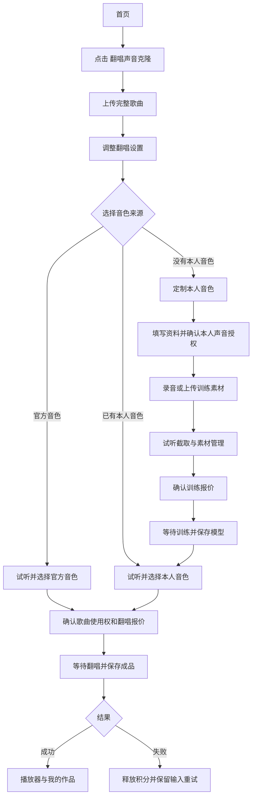

### 3.2 使用现成音色

1. 用户从首页进入 翻唱声音克隆。
2. 上传歌曲，等待格式、容量、可读取性和音频安全审核。
3. 调整升降调、人声和伴奏音量。
4. 在“我的音色”或“官方音色”中试听并选中一个可用音色。
5. 勾选歌曲合法使用权并阅读使用规范。
6. 后端检查登录、会员、音色、歌曲、所有关联内容审核状态、报价和余额。
7. 用户确认本次报价后创建异步任务；后端按当前渠道/商家模型路由执行并保存任务快照。
8. 平台任务创建后先按容量进入平台队列；平台排队时间不计入翻唱处理的 10 分钟，排队超过 10 分钟不能直接判生成失败。
9. 调度器取得容量并向厂商提交任务；厂商确认接单并返回可查询任务标识后开始计算 10 分钟，厂商侧排队和生成处理均计入。
10. 从厂商确认接单起 10 分钟内，仍需完成厂商生成、实际格式识别、资源持久化、可播放探测和成品审核并形成可播放作品；任一步未在截止时间前完成都按超时失败并释放积分。迟到结果进入后台核对，不自动重复扣费或创建作品。

### 3.3 训练本人音色

1. 用户点击“定制新音色”，系统先检查登录和会员。
2. 用户使用平台已审核的默认资料，或填写名称、头像；自定义图片和文字需安全审核。
3. 用户每次创建训练任务前确认仅采集本人声音并接受风险说明。
4. 用户录音、选择本地文件或从相册视频提取音轨。
5. 用户试听、截取、删除或继续添加素材；每段音频上传后进入安全审核，审核通过才计入有效素材。
6. 后端复核素材安全审核、质量、授权、会员、报价和积分，用户确认后创建训练任务。
7. 厂家完成训练后，平台保存模型和配置资源；保存完成才显示音色可用。

### 3.4 会员或充值回跳

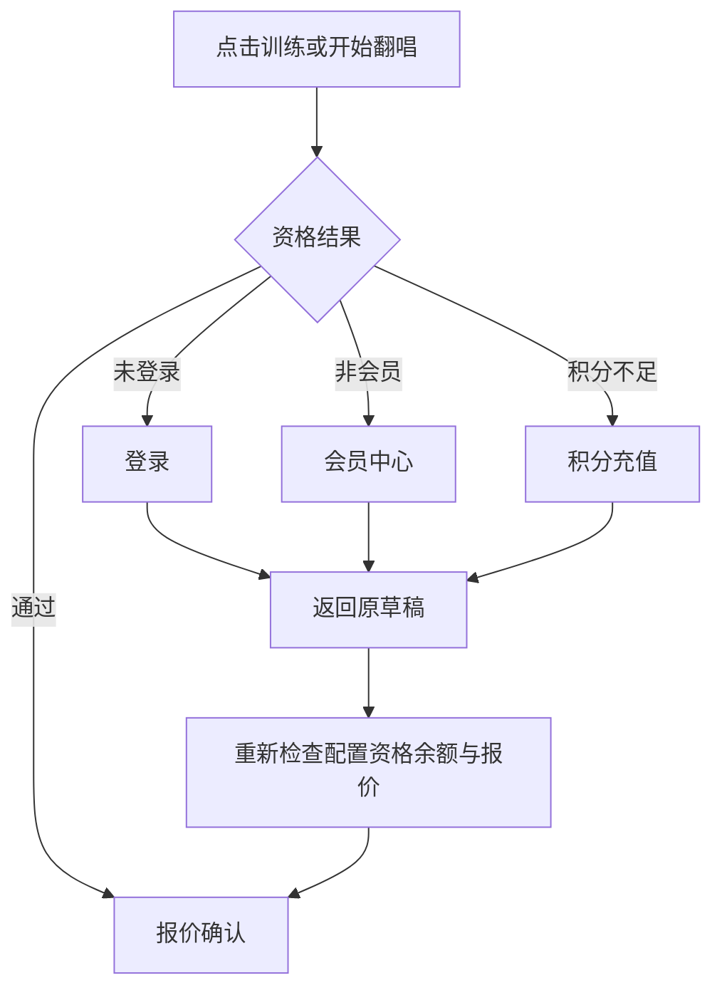

返回后保留歌曲、翻唱设置、已选音色、音色资料和训练素材，不自动提交。

## 4. 信息架构 / 页面结构

本版本共 13 个逻辑页面；弹窗、Tab 和同页状态不重复计数。

| ID | 页面 | 入口 | 核心任务 |
|----|------|------|----------|
| P01 | 首页 | App 主 Tab | 发现 AI 写歌、AI 改编、翻唱声音克隆 |
| P02 | 翻唱声音克隆主页 | 首页 翻唱声音克隆、作品重新翻唱 | 准备歌曲、设置和音色并提交翻唱 |
| P03 | 翻唱设置 | P02 设置入口 | 调整升降调、人声和伴奏音量 |
| P04 | 本人音色资料 | P02 定制新音色 | 创建名称、头像和授权草稿 |
| P05 | 训练来源选择 | P04 继续 | 选择录音、本地文件或相册视频 |
| P06 | 录音采集 | P05 立即录音 | 录制、试听和保存本人干声 |
| P07 | 上传与截取 | P05 上传音频 | 解析、截取、试听和保存素材 |
| P08 | 训练素材与提交 | P06/P07 保存素材 | 管理多段素材并提交训练 |
| P09 | 音色训练状态 | P08 训练成功提交、本人音色卡 | 查看训练进度、结果和恢复动作 |
| P10 | 翻唱生成状态 | P02 翻唱成功提交、作品生成中条目 | 查看真实任务状态并恢复 |
| P11 | 我的作品—翻唱声音克隆 | 作品 Tab | 查看生成中、失败和完成作品 |
| P12 | 翻唱播放（复用现有播放器） | P10 成功、P11 完成作品 | 使用当前工程播放器播放并执行已有作品操作 |
| P13 | Web/Admin 翻唱声音克隆管理 | 后台 catsinger 菜单 | 配置模型、价格、官方音色和任务 |

## 5. 页面级详细需求

### 5.1 P01 首页

#### 页面定位

提供三个清晰分开的音乐创作入口，并让用户首次发现新的 翻唱声音克隆能力。

#### 参考素材

Figma 当前通道 `ujnpl6tr`，节点 `114:9333`：

#### 页面结构

1. 品牌区与 Banner。
2. AI 写歌主入口。
3. AI 改编与翻唱声音克隆双入口，其中 翻唱声音克隆带 `NEW`。
4. 热门案例。
5. 现有底部导航。

#### 区块与功能

| 控件 | 状态 | 点击结果 |
|------|------|----------|
| AI 写歌 | 沿用现有状态 | 进入现有写歌流程 |
| AI 改编 | 可用 | 进入现有 AI 改编，不进入声音克隆流程 |
| 翻唱声音克隆 NEW | 可用 | 进入 P02；未登录用户仍可先浏览页面和官方音色 |
| 热门案例 | 沿用现有行为 | 不受本版本改动 |

#### 交互流程

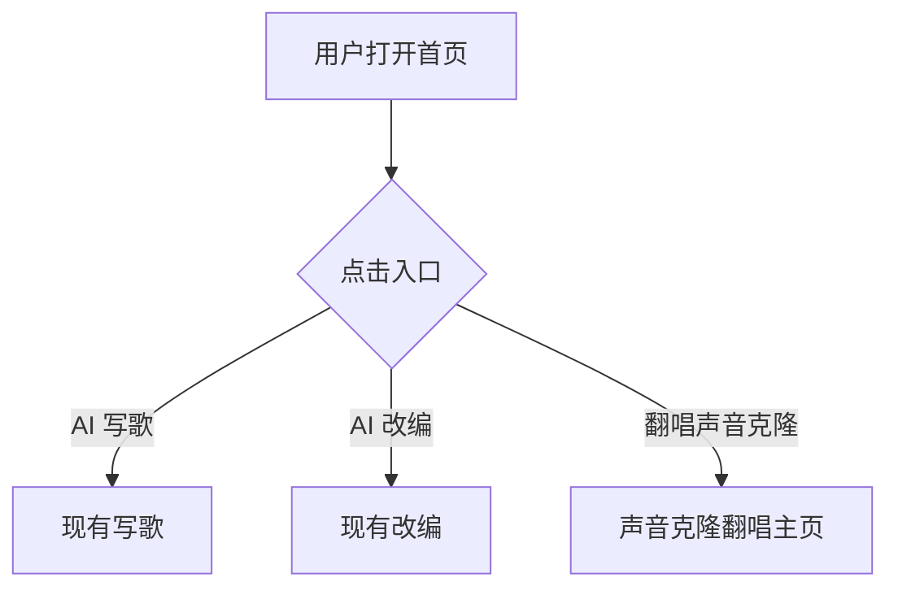

#### 异常与验收

- 翻唱声音克隆配置暂不可用时，入口仍可展示，但点击后说明“功能维护中”。
- `AI 改编` 和 `翻唱声音克隆` 名称、图标和点击结果不得互换。
- 375×812 下首屏入口不重叠，滚动后热门案例可正常访问。

### 5.2 P02 翻唱声音克隆主页

#### 页面定位

集中完成歌曲准备、翻唱设置、音色选择、协议确认和翻唱提交。

#### 参考素材

**主页、报价和资格状态**

| 默认/可生成 | 报价确认 | 非会员 | 积分不足 |
|-------------|----------|--------|----------|
|  |  |  |  |

**歌曲异常、协议和官方音色**

| 格式失败 | 容量超限 | 无法读取 | 使用规范 |
|----------|----------|----------|----------|
|  |  |  |  |

| 官方音色加载 | 歌曲截取/解析 | 官方音色列表 | 音色不可用 |
|--------------|---------------|--------------|------------|
|  |  |  |  |

| 加载中 | 官方空态 | 加载失败 |
|--------|----------|----------|
|  |  |  |

使用边界：图中 `30` 积分、`AI角色`、45/50MB、90 秒等均是旧占位文案，不作为本版本规则。

#### 页面结构

1. 返回按钮和标题“翻唱声音克隆”。
2. 歌曲上传卡，显示格式、容量、上传、解析、安全审核、成功和失败状态。
3. 翻唱设置入口和当前摘要。
4. “我的音色 / 官方音色”分段 Tab。
5. 音色卡列表、试听与选中状态。
6. “定制新音色”入口，仅在我的音色下展示。
7. 固定“开始翻唱”按钮。
8. 歌曲使用权勾选框和《翻唱声音克隆使用规范》链接。

#### 主要功能

- 上传 10 分钟以内的完整歌曲并完成后端预检与音频安全审核。
- 删除或重新上传歌曲，保留其他设置。
- 切换本人和官方音色，试听并单选一个音色版本。
- 官方试听原始资源由算道提供，平台持久化后使用；名称、头像、排序和启停由我方配置。同一官方音色可有多个渠道绑定，但用户端只展示当前启用且绑定有效的音色。
- 打开 P03 调整翻唱参数。
- 打开使用规范，确认歌曲与目标声音的合法使用边界。
- 从服务端模型列表读取真实 `provider/model`、运营展示名、限制和积分价格；点击提交时把所选真实编码原样传回，并由后端重新校验路由与价格，不生成独立报价单。

#### 按钮与交互

| 控件 | 启用条件 | 操作结果 | 失败恢复 |
|------|----------|----------|----------|
| 上传歌曲 | 可点击 | 登录后打开系统文件选择器；选中后上传、解析并进入音频安全审核 | 解析或审核失败时显示归一化原因，可删除或重传 |
| 删除 | 已有歌曲 | 二次确认后移除当前歌曲 | 保留音色与设置 |
| 重新上传 | 已有或失败歌曲 | 重新打开选择器 | 新文件成功前保留旧草稿信息 |
| 翻唱设置 | 可点击 | 打开 P03 | 取消时保持旧值 |
| 我的/官方 | 可点击 | 切换列表并保留另一 Tab 的最后滚动位置 | 加载失败显示重试 |
| 音色卡 | 音色可用 | 选中当前版本 | 暂不可用时不改变当前选择 |
| 试听 | 有平台持久化试听资源 | 停止其他试听并播放当前片段；官方试听原始来源为算道 | 播放失败提示重试，不影响选择 |
| 定制新音色 | 登录后可点 | 非会员进入会员页，会员进入 P04 | 返回后保留 P02 草稿 |
| 使用规范 | 可点击 | 展示完整协议 | 关闭后回 P02 |
| 勾选授权 | 已阅读或可直接勾选 | 记录本次草稿确认状态 | 每个新任务仍由后端复核 |
| 开始翻唱 | 歌曲有效且音频审核通过、音色资料/试听审核通过、已授权、无阻塞请求 | 检查登录/会员，并按现有模型与计费配置重新核价后打开积分确认 | 显示首个阻断原因，不只把按钮置灰 |
| 立即翻唱 | 当前 `provider/model` 与价格版本有效且积分充足 | 通过 `/api/song-voice-covers` 提交真实厂家模型和翻唱参数；服务端固定内部 `VOICE_COVER`，创建幂等任务并进入 P10 | 失败保留全部输入，允许刷新模型后重试 |
| 开通会员 | 后端返回会员不足 | 进入会员中心 | 回跳后重新检查资格和报价 |
| 去充值 | 后端返回积分不足 | 进入充值页 | 回跳后重新获取余额和报价 |

#### 交互流程

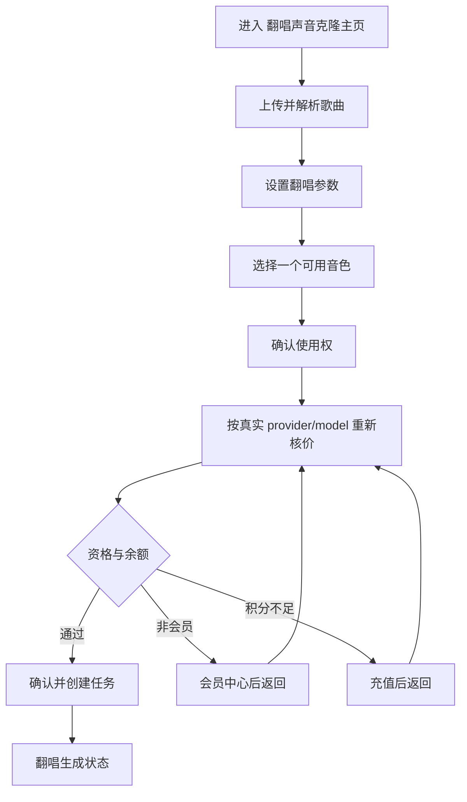

#### 关键状态与异常

- 歌曲格式不支持、超过 100MB、损坏或无法解码分别提示。
- 歌曲最长 10 分钟；服务端可按当前渠道/商家模型返回更严格限制，App 展示服务端实际口径。
- 歌曲安全审核分为审核中、通过、拒绝和审核异常；审核中/异常允许原位刷新或重试，页面可展示模型参考价格，但不能创建任务、冻结积分或调用 Provider。
- 审核拒绝时不暴露审核服务原始响应，展示可理解原因并允许删除或重新上传；不能以重新点击提交绕过审核。
- 官方音色加载、空、失败是三个不同状态。
- 音色在报价与提交之间下架时，清除失效选择并返回音色区。
- 厂家平台余额不足显示“平台服务异常”，不能引导用户充值积分。
- 重复提交返回原任务并进入 P10，不再次扣费。

#### 验收标准

- 翻唱声音克隆主页不出现“AI 改编”任务或历史改编作品。
- 未选择歌曲、音色或授权时不能创建任务，并给出明确原因。
- 上传歌曲、本人/官方音色的图片、试听音频或展示文字只要存在未通过项，就不能创建任务或冻结积分。
- 翻唱默认价格为 200 积分/次，Web/Admin 可配置；App 始终展示服务端实时报价，Figma 中的 30 仅作为视觉占位。
- 上传失败后设置和音色不丢失。

### 5.3 P03 翻唱设置

#### 页面定位与参考素材

从 P02 打开的设置面板，只暴露用户能理解且厂家支持的三个参数。

#### 页面结构与功能

- 升降调滑杆：`-12～+12`，默认 0。
- 人声音量滑杆：`0%～200%`，默认 100%。
- 伴奏音量滑杆：`0%～200%`，默认 100%。
- 保存设置按钮和关闭按钮。

#### 交互流程

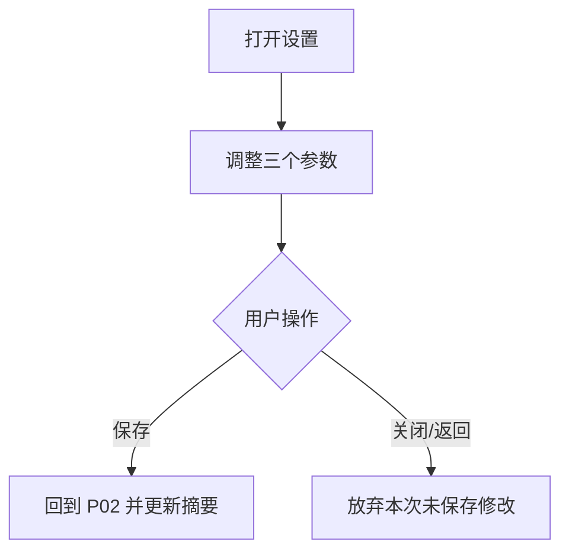

#### 异常与验收

- 滑杆不能超出范围，服务端仍需复核。
- 不展示 `F0`、训练模式或输出格式选择。
- 设置不会触发上传或任务创建。

### 5.4 P04 本人音色资料

#### 页面定位

为本人音色建立名称、头像、授权和训练方式草稿。

#### 参考素材

| 音色空卡 | 默认资料 | 版权声明 | 离开提醒 |
|----------|----------|----------|----------|
|  |  |  |  |

| 头像成功 | 审核中 | 审核失败 |
|----------|--------|----------|
|  |  |  |

#### 页面结构

1. 返回、标题“音色卡片”和训练指南。
2. 标题“定制您的专属音色”。
3. 音色头像和名称资料。
4. “立即录音 / 上传音频”方式选择。
5. 本人声音权利及风险授权。
6. 底部继续按钮。

#### 按钮与交互

| 控件 | 行为 |
|------|------|
| 上传头像 | 通过现有资源上传能力保存图片并创建图片审核记录；审核中或异常时禁止把该头像用于训练或公开展示 |
| 使用默认头像 | 清除失败头像并立即使用平台默认图 |
| 音色名称 | 可输入并进行文字安全审核；留空时使用平台已审核的“我的音色N” |
| 立即录音 | 保存资料后进入 P06 |
| 上传音频 | 保存资料后进入 P05/P07 |
| 版权声明 | 展示只允许本人声音、禁止冒充和风险说明 |
| 我已阅读并同意 | 记录当前授权版本；不提供“不再提醒” |
| 返回 | 有未保存内容时询问继续编辑或离开；已保存草稿可稍后恢复 |

#### 交互流程

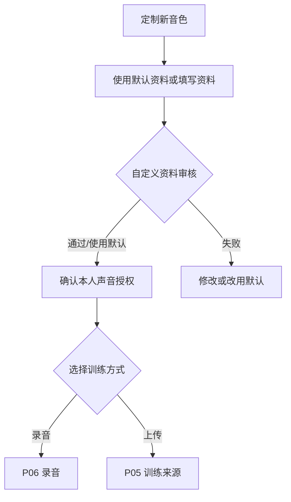

#### 验收标准

- 不填写头像和名称也能继续。
- 自定义头像或名称审核失败时明确定位字段。
- 图片或文字审核异常时保持草稿和资源记录，允许重试审核；未经审核通过不得用于音色卡或训练任务。
- 授权只允许本人声音，不提供上传他人授权证明的入口。

### 5.5 P05 训练来源选择

#### 页面定位与参考素材

解释训练要求并让用户在录音、本地文件和相册视频之间选择。

| 训练指南 | 上传来源 |
|----------|----------|
|  |  |

Figma 初次读取时还列出重复训练指南节点 `114:7853`，导出时该节点已被外部移除；当前有效训练指南为 `114:5887`。

#### 页面结构与功能

- 训练指南说明清晰干声、安静环境、不要伴奏/混响/变声。
- “立即录音”进入 P06。
- “本地上传”进入系统文件选择器后进入 P07。
- “相册上传”选择含音轨视频，提取后进入 P07。

#### 交互流程

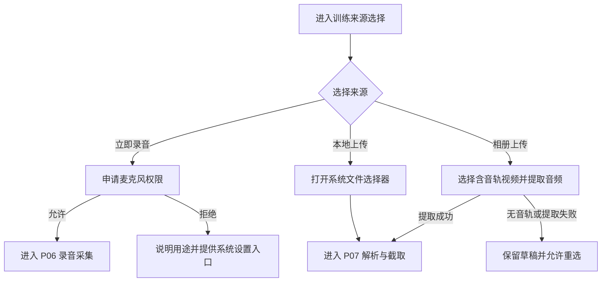

#### 交互与异常

- 首次录音时请求麦克风权限，拒绝后提供系统设置入口。
- 首次访问媒体时请求必要权限，不读取无关文件。
- 视频没有音轨、提取失败或编码不支持时保留草稿并允许重选。
- 录音、本地音频和视频提取音轨上传后均进入音频安全审核，审核通过前不能加入有效训练素材。
- 页面不能再展示旧 `6～90秒` 或 45MB 限制。

#### 验收标准

- 三种来源都能回到同一素材管理流程。
- 权限拒绝不会清空音色资料。

### 5.6 P06 录音采集

#### 页面定位与参考素材

通过可滚动示例文本引导用户录制本人干声，完成试听和保存。

| 待录制 | 达到最低时长 | 试听 | 录制中 | 继续录制 |
|--------|--------------|------|--------|----------|
|  |  |  |  |  |

#### 页面结构

1. 返回和音色资料标题。
2. 干声录制说明。
3. 左右切换且内部可滚动的示例文本卡。
4. 计时、波形或音量反馈。
5. 开始、停止、重录、试听和保存素材操作。

#### 交互规则

- 开始录音后显示真实录制时长。
- 不足 1 分钟尝试完成时提示剩余时间，只允许继续或放弃。
- 达到 1 分钟后启用“完成录制”，最长 5 分钟时自动停止。
- 试听与录音互斥；开始录音前停止其他音频播放。
- 来电、切后台或系统中断时安全停止并保留可恢复片段。
- 点击“保存素材”后上传，失败保留本地文件供重试。
- 上传成功只代表文件已写入现有资源台账且物理可读取；音频安全审核通过后才标记为有效训练素材，审核拒绝时可重录或删除。

#### 交互流程

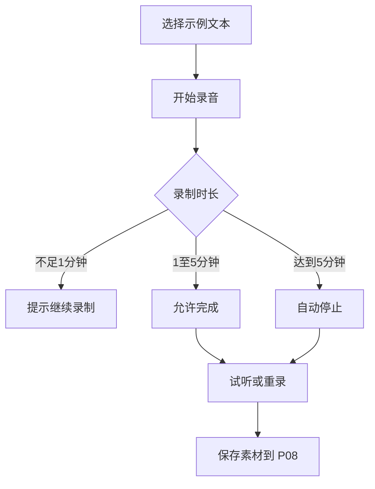

#### 验收标准

- 最低和最高时长均按真实录制数据校验。
- 保存失败后用户无需重新录制。

### 5.7 P07 上传与截取

#### 页面定位与参考素材

处理本地音频或相册视频音轨的解析、试听和有效片段截取。

#### 页面结构与功能

- 文件名、格式、大小、解析状态和音频安全审核状态。
- 波形、播放/暂停和当前时间。
- 起止位置选择，单段截取范围 1～5 分钟。
- 重新上传、确认截取。

#### 交互流程

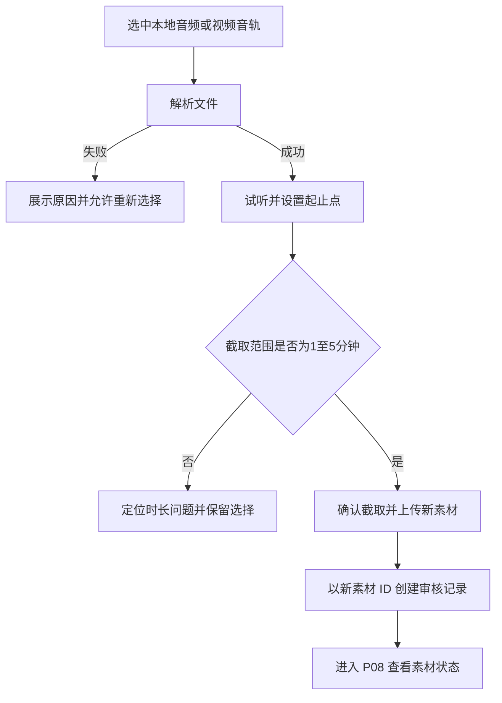

#### 交互与异常

- 解析中禁止确认截取。
- 截取结果上传后重新按实际片段执行音频安全审核；原文件审核结果不能替代新片段审核。
- 起止点越界、时长不足或超过 5 分钟时显示具体原因。
- 重新上传不清空音色资料和已保存的其他素材。
- 解析失败回到来源选择，并保留原文件名和失败原因用于说明。

#### 验收标准

- 页面不再使用 90 秒上限。
- 确认后先生成新的待审核素材条目并进入 P08；只有审核通过才计入有效时长，原文件审核结论不复用于截取后的新素材。

### 5.8 P08 训练素材与提交

#### 页面定位与参考素材

集中管理多段有效素材、查看累计时长/容量并创建训练任务。

| 素材列表 | 训练报价 | 时长不足 | 音质异常 | 素材超限 |
|----------|----------|----------|----------|----------|
|  |  |  |  |  |

#### 页面结构

1. 音色资料摘要。
2. 已保存素材列表及每段解析、质量和安全审核状态。
3. 累计时长和容量。
4. 继续录制/上传、试听、删除操作。
5. 训练指南和底部“训练音色”。

#### 按钮与交互

| 控件 | 行为 |
|------|------|
| 试听 | 单实例播放当前素材 |
| 删除 | 二次确认后删除；若因此不足最低要求，训练按钮禁用并说明原因 |
| 添加素材 | 回到 P05，现有素材保留 |
| 训练音色 | 重新检查授权、图片/文字/音频安全审核、素材质量和会员，并按现有模型/计费配置重新核价 |
| 立即训练 | 报价有效且积分充足时创建幂等任务，进入 P09 |
| 继续添加 | 累计不足或超限时回到素材管理，不清空有效素材 |

#### 交互流程

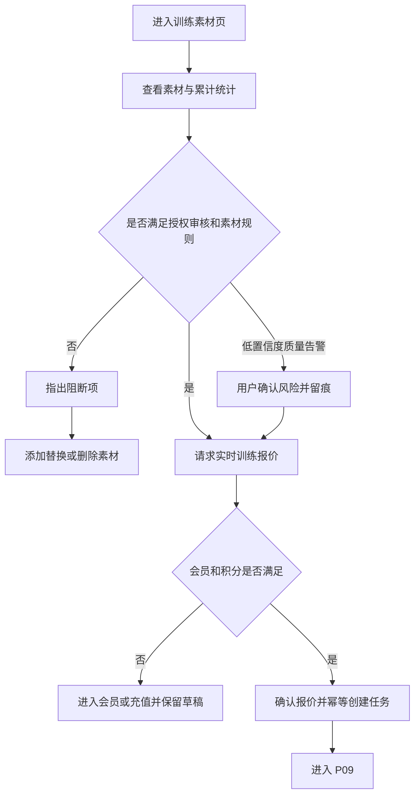

#### 状态与异常

- 累计不足 1 分钟：硬阻断。
- 任一必需图片、文字或音频仍在审核中、审核拒绝或审核异常：硬阻断训练任务创建、积分冻结和 Provider 调用；页面可以读取现有模型选项中的参考价格，但提交前必须重新校验价格版本。
- 1～5 分钟：允许训练，但提示增加素材可改善效果。
- 单段超过 5 分钟、累计超过 10 分钟或总量超过 100MB：阻断并指出超限项。
- 明显伴奏、多人、严重噪声或解码异常：阻断该素材。
- 低置信度噪声或混响告警允许用户明确确认后继续；本次告警内容和确认结果随训练任务保存。
- 质量告警确认不能替代内容安全审核；安全审核拒绝的素材始终不可用于训练。

#### 验收标准

- 训练默认价格为 100 积分/次，Web/Admin 可配置；App 从服务端读取实时报价，图中的 30 不是固定价格。
- 训练与翻唱使用不同报价和积分流水。

### 5.9 P09 音色训练状态

#### 页面定位与参考素材

用户离开素材页后，通过本人音色卡查看训练状态。当前 Figma 没有独立全屏等待页，使用 P02 本人音色卡的排队、训练、失败和可用状态作为参考。

#### 状态与用户行为

| 状态 | 页面文案 | 可执行操作 |
|------|----------|------------|
| 排队中 | 正在等待训练 | 返回其他页面、稍后查看 |
| 训练中 | 正在训练音色 | 查看说明、离开页面 |
| 保存音色 | 正在保存音色 | 等待平台持久化，不允许使用 |
| 可用 | 音色可用 | 试听、选中、重新训练 |
| 失败 | 显示归一化失败原因 | 修改素材并创建新训练任务 |
| 暂不可用 | 音色暂不可用 | 查看说明、重新训练；不能新建翻唱 |
| 已删除 | 不再出现在可选列表 | 历史作品仍可查看 |

#### 交互流程

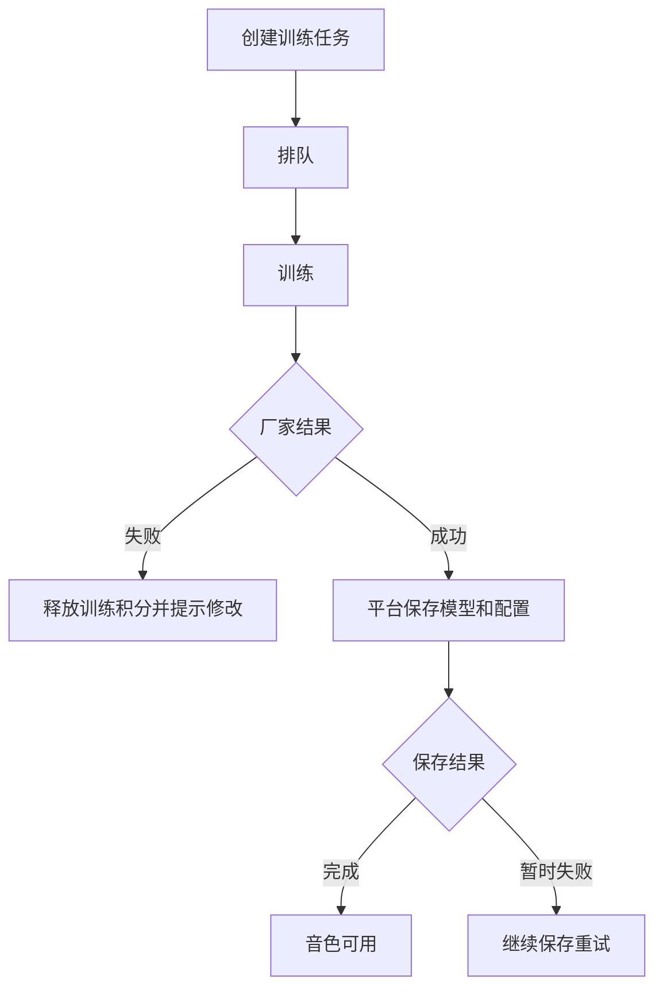

#### 关键规则与验收

- 厂家返回成功但模型尚未保存时不能显示“音色可用”。
- 重新训练创建新版本，旧可用版本继续服务既有和新任务，直到用户切换或删除。
- “音色暂不可用”只阻止新翻唱；已保存试听和历史作品继续可用。
- 算道模型 ID 失效后不能把平台归档的模型/配置重新导入恢复；用户需要重新训练或选择其他已有可用音色。
- 本人音色按渠道绑定，后台切换商家模型或渠道不会自动迁移音色；只有目标路由已经存在有效绑定时才可继续使用。

### 5.10 P10 翻唱生成状态

#### 页面定位

展示真实翻唱任务阶段，并允许用户离开后恢复。当前 Figma 未提供独立等待页，视觉复用现有歌曲生成等待页，但文案改为翻唱语义。

#### 页面结构

- 歌曲、目标音色和本次设置摘要。
- 后端真实阶段文案，不展示伪造百分比。
- “退出等待”或返回按钮。
- 失败原因、重新翻唱入口。

#### 状态

| 状态 | 用户可见行为 |
|------|--------------|
| 已创建/平台排队 | 正在等待调度，可退出等待；不显示 10 分钟生成倒计时 |
| 厂商已接单/翻唱中 | 显示厂家真实处理状态和从接单时刻开始的 10 分钟倒计时 |
| 保存作品 | 显示正在保存，不提前进入播放器 |
| 成品审核 | 显示正在进行安全审核，不提供播放、下载或分享 |
| 成功 | 使用明确 `workId` 进入 P12 并开始目标作品播放 |
| 超时/失败 | 厂商确认接单后处理超过 10 分钟仍未成功，或发生生成、保存、审核错误时显示可理解原因、按对应失败规则释放积分并保留参数重试；平台排队超过 10 分钟不属于生成超时 |

#### 交互流程

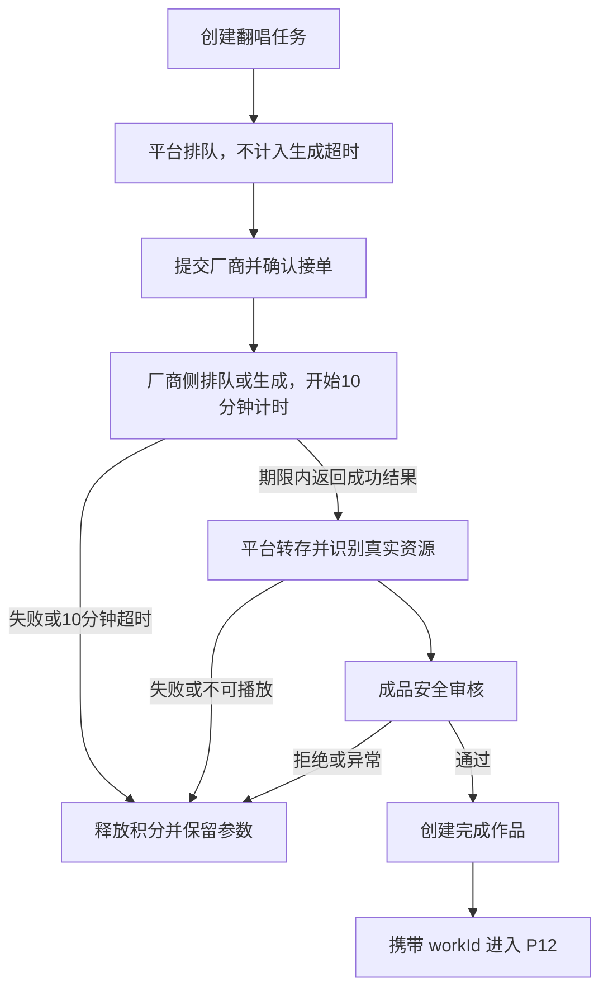

#### 交互与验收

- 返回不取消任务，也不重复退款或扣费。
- V2.1 不展示取消按钮，也不提供取消接口；退出等待只改变当前页面。
- 后端不发送厂家 `callBackUrl`，通过主动轮询查询任务状态；轮询、转存和可播放校验共同决定最终状态。
- 重进 App 后可从作品页恢复到同一任务。
- 只有平台持久化成功、成品安全审核通过且目标作品真实可播放，任务才算用户侧成功。
- 厂家临时 URL 不能直接作为最终作品地址。

### 5.11 P11 我的作品—翻唱声音克隆

#### 页面定位与参考素材

在作品页独立识别 翻唱声音克隆作品，与 AI 改编作品分开。

#### 页面结构

- 作品页原有导航。
- 可见分类包含歌曲、AI 改编、翻唱声音克隆；具体 Tab 合并方式由现有作品信息架构承载，但用户必须能区分类型。
- 翻唱声音克隆列表展示生成中、审核中、失败和完成项目。
- 页面提示“作品保留 15 天”，不把物理清理时间作为主提示。

#### 交互

| 作品状态 | 点击条目 | 更多操作 |
|----------|----------|----------|
| 生成中 | 进入 P10 | 不允许删除正在保存的核心事实；可退出等待 |
| 审核中 | 进入 P10 查看状态 | 不允许播放、下载、分享或作为再次翻唱来源 |
| 失败 | 查看失败原因 | 重新翻唱、删除失败记录 |
| 完成 | 进入 P12 并播放该作品 | 下载、分享、收藏、删除、重新翻唱 |
| 已隐藏/过期 | 默认列表不展示 | 不提供播放和下载入口 |

#### 交互流程

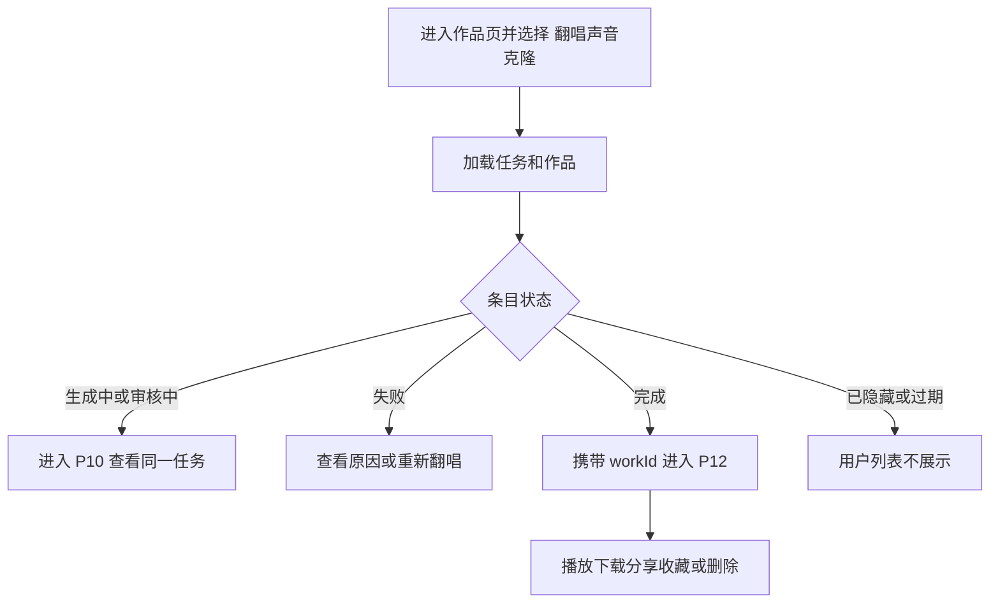

#### 验收标准

- 现有 AI 改编作品保持原样，不显示为 翻唱声音克隆。
- 第 15 天后从用户列表隐藏，第 30 天进入物理资源清理。
- 运营永久展示资源不受用户作品清理规则影响。

### 5.12 P12 翻唱播放（复用现有播放器）

#### UI 复用规则

- 不新增 翻唱声音克隆结果页，不重新设计播放器 UI，也不使用旧截图或本版本 Figma 另行约束播放器布局。
- 直接复用当前 Flutter 工程已有的 `SongPlayerPage`，以 `/Users/soul/code/lxwx/catsinger/lib/pages/song_works/player/view.dart` 在开发时的实际界面和交互为准。
- 封面态、歌词态、播放控制、页面切换、手势、安全区适配和作品操作区均沿用当前工程实现；V2.1 不调整其视觉样式、控件位置或交互习惯。

#### 翻唱声音克隆接入要求

- P10 成功或 P11 点击完成作品后，携带本次作品 `workId` 进入现有播放器，不增加中间结果页面。
- 播放、歌词、下载、分享、收藏和删除沿用现有播放器能力；翻唱声音克隆作品的再次操作在现有操作入口中显示为“重新翻唱”，点击后回到 P02 并预填源歌曲。
- 平台仍需记录厂家实际输出格式、MIME、大小和时长；下载文件后缀必须与真实格式一致。厂家没有分轨时，不额外增加人声或伴奏入口。
- 只有成品安全审核通过、平台资源可访问且格式可识别的作品才能进入现有播放器。

#### 交互流程

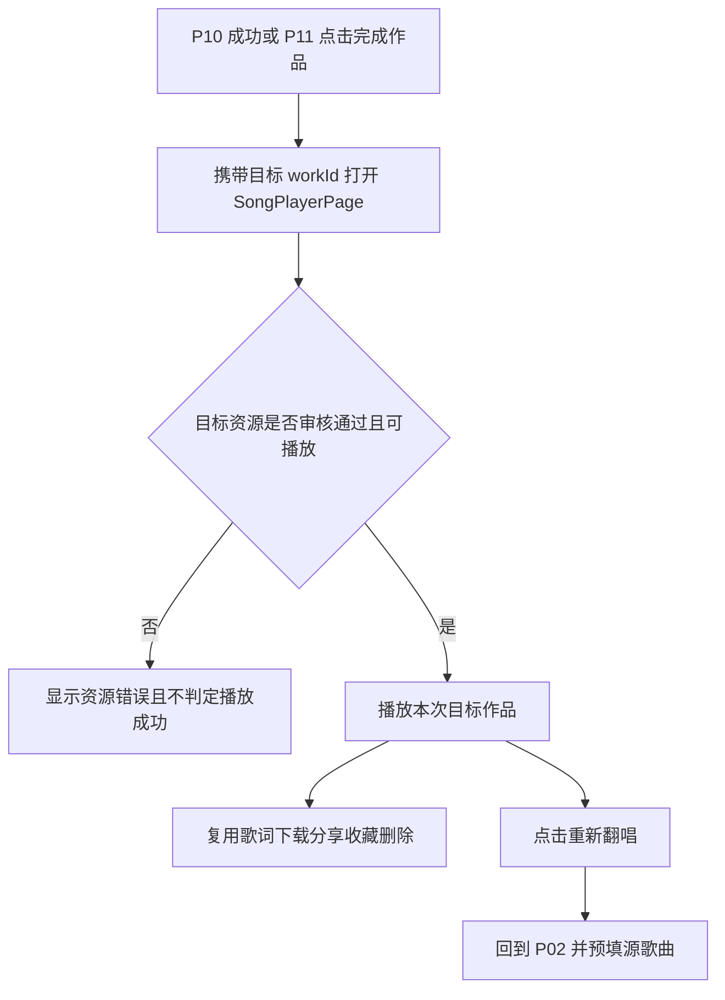

#### 验收标准

- UI 与当前工程播放器一致，不出现一套新播放器或单独的 翻唱声音克隆结果页。
- 从生成成功跳转时必须打开并播放本次目标作品，不得被旧播放会话覆盖。
- 成品能开始播放且进度持续增长，才算播放验收通过；资源失效、无法解码或审核未通过均不得判定成功。

### 5.13 P13 Web/Admin 翻唱声音克隆管理

> 本节是 V2.1 Web/Admin 业务需求的唯一真源。后续技术方案、模块开发文档、测试用例和编码统一读取本节，不再维护第二份后台业务需求文档。

#### 5.13.1 管理目标与范围

##### 5.13.1.1 产品目标

Web/Admin 为 翻唱声音克隆提供可运营、可配置、可审核、可排障和可追溯的后台管理能力。管理员需要在不修改 App、不直接接触厂家密钥、不破坏历史任务事实的前提下完成以下工作：

1. 切换 App 并只管理当前有权限的 App 数据。
2. 在同一管理体系内区分生成歌曲、AI 改编和 翻唱声音克隆；现有 AI 改编配置与行为保持不变。
3. 配置声音训练、翻唱声音克隆的业务模型、多渠道路由、商家模型和并发限制。
4. 分别配置声音训练和 翻唱声音克隆价格。
5. 创建、审核、发布和停用官方音色。
6. 查看本人音色、训练任务、翻唱任务、作品及资源状态。
7. 审核图片、音频、文字和厂家生成成品。
8. 按角色分配模块和操作权限，并保留完整操作记录。

上述能力必须扩展在现有 Web/Admin 业务体系内：继续使用服务端 App 列表与切换、AI 模型、场景路由、模型选项、积分计费、AI 运维任务、歌曲作品、资源管理和角色权限模块。W01～W12 是产品视角的管理任务分组，不代表需要建设 12 套新页面或一套平行的 翻唱声音克隆后台。

##### 5.13.1.2 适用范围

- 本节只描述 `appCode=catsinger` 下 V2.1 翻唱声音克隆的后台产品行为。
- App 切换器读取服务端返回的全部 App 配置，但用户只能看到自己有权访问的 App。
- AI 改编沿用当前管理入口和数据；翻唱声音克隆在同一管理体系内增加场景、类型筛选和音色管理能力，不重做 AI 改编后台，也不新建平行的模型、计费、任务、资源或权限系统。
- 本版本没有 Web/Admin Figma 设计稿，页面结构以本节为准；后续如补设计稿，不能静默改变业务规则。

##### 5.13.1.3 本期不做

- 不在后台修改已经创建任务的渠道、商家模型、价格或音色快照。
- 不提供训练任务或翻唱任务取消操作。
- 不允许普通运营直接修改厂家任务状态、积分结算状态或安全审核状态。
- 不在页面展示厂家密钥、完整签名 URL、用户完整手机号或不必要的原始敏感资料。
- 不提供批量训练、批量翻唱、批量人工审核或批量物理删除。
- 不提供用户音色交易、转让、公开市场或跨用户绑定。
- 不把平台保存的算道模型文件作为可重新导入算道的能力。

#### 5.13.2 产品术语与功能隔离

| 名称 | 后台定义 |
|------|----------|
| 生成歌曲 | 当前已有的描述、歌词或场景生成歌曲能力，本期保持不变 |
| AI 改编 | 当前已有的歌曲改编能力，本期保持名称、入口、配置、任务和作品行为不变 |
| 翻唱声音克隆 | 使用本人克隆音色或后台官方音色重新演唱完整歌曲的 V2.1 新功能 |
| 业务模型 | 后台配置的实际“渠道 + 厂家模型”组合；App 页面显示运营名称，但模型列表和任务请求必须携带真实 `provider/model` |
| 渠道 | 实际提供训练或翻唱能力的第三方厂家，例如算道；后续允许新增其他厂家 |
| 商家模型 | 渠道下真正执行任务的模型或版本 |
| 音色渠道绑定 | 某个音色版本在特定渠道下可执行的模型标识和可用状态 |
| 官方音色 | 由平台持有合法使用权，并由后台配置、审核和发布的音色 |
| 本人音色 | 用户确认只包含本人声音，并通过 App 创建和训练的私人音色 |
| 待审核资源 | 已写入现有资源台账、但关联内容审核记录尚未通过的资源；资源技术状态与审核业务状态分别管理 |
| 安全审核 | 对图片、音频、可展示文字及生成成品执行机器审核和授权人工复核 |
| 路由快照 | 任务创建时固定的真实 `provider/model`、音色绑定、价格和限制 |

生成歌曲、AI 改编与翻唱声音克隆使用不同的公开接口、内部业务类型、场景配置、计费项和作品语义，但共同复用模型、路由、模型选项、积分、歌曲任务、工作流、资源、作品、审计和权限基础设施。翻唱声音克隆通过独立 `/api/song-voice-covers` 区分业务，服务端固定映射为内部 `VOICE_COVER`；请求中的 `model` 是真实厂家模型。V2.1 只能新增翻唱声音克隆相关配置和筛选，不得修改、迁移或覆盖现有 AI 改编配置、任务和作品。

#### 5.13.3 角色与权限模型

##### 5.13.3.1 角色定义

| 角色 | 主要职责 | 默认边界 |
|------|----------|----------|
| 超级管理员 | 分配 App、模块和操作权限，处理紧急配置 | 可查看所有已授权 App；高风险操作仍需原因和日志 |
| AI 配置管理员 | 管理业务模型、路由、价格 | 不能人工审核内容，不能修改任务和积分事实 |
| 音色运营 | 维护官方音色资料、排序和上下架 | 不能绕过安全审核，不能查看用户原始训练音频 |
| 内容审核员 | 查看审核队列，重试机器审核或人工复核 | 只能访问审核所需内容，不能修改模型、价格或积分 |
| 客服/任务运营 | 查询用户音色、任务、作品和失败原因 | 默认只读；不能试听未获授权的待审核资源或更改任务状态 |
| 财务/积分运营 | 查看任务价格和积分冻结、结算、释放记录 | 不能修改模型、音色或内容审核结论 |
| 只读审计员 | 查看配置版本、任务事实和操作日志 | 不能执行修改、重试、审核、发布或隐藏操作 |

角色名称可复用现有后台角色系统，本节要求的是权限边界，不要求创建固定角色模板。

##### 5.13.3.2 权限粒度

每个模块至少支持以下权限粒度中的适用项：

| 权限动作 | 产品含义 |
|----------|----------|
| 查看 | 进入列表和详情，查看脱敏数据 |
| 新增 | 创建业务模型、路由、价格版本或官方音色草稿 |
| 编辑 | 修改尚未生效或允许更新的配置 |
| 启用/停用 | 改变新任务是否可选，不改变历史任务事实 |
| 发布/下架 | 控制官方音色在 App 是否可见 |
| 审核查看 | 通过现有受控资源访问机制查看待审核资源和机器审核结果 |
| 审核重试 | 对审核异常内容重新发起机器审核 |
| 人工复核 | 对允许人工复核的内容给出通过或拒绝结论 |
| 资源重试 | 只重试平台资源转存或校验，不重新调用厂家生成 |
| 作品隐藏/恢复 | 控制作品是否对用户可见，不直接物理删除 |
| 权限分配 | 给角色分配 App 和模块操作权限，仅超级管理员拥有 |

##### 5.13.3.3 权限通用规则

- 菜单、按钮和接口三层都要校验权限；只隐藏按钮不能作为权限控制。
- 用户切换 App 后，后台重新校验该 App 的权限，不沿用上一 App 的操作权限。
- 没有查看权限的模块不显示菜单；只有查看权限时，页面不显示可编辑控件。
- 人工复核、发布音色、停用路由、隐藏作品等高影响操作必须填写原因并二次确认。
- 权限变化对下一次请求立即生效；已经打开的页面操作时必须再次校验。

#### 5.13.4 信息架构与页面地图

Web/Admin V2.1 翻唱声音克隆包含 W01～W12 共 12 个逻辑管理视图/任务。它们是产品需求覆盖单元，不要求新增 12 个物理页面：能由现有页面通过 App、场景或业务类型筛选承接的必须复用，只有音色资料与训练管理缺口允许新增子页。弹窗、抽屉和同页状态不重复计数。

| ID | 页面 | 用户来这里做什么 | 核心操作 | 正常去向 |
|----|------|------------------|----------|----------|
| W01 | 翻唱声音克隆管理入口 | 确认当前 App、查看异常和进入模块 | 切换 App、查看模块提醒 | W02～W12 |
| W02 | 业务模型与路由 | 配置训练/翻唱使用的渠道和商家模型 | 新增、编辑、排序、启停路由 | 路由详情或 W01 |
| W03 | 价格配置 | 管理训练和翻唱积分价格 | 修改价格、启停、查看历史 | W01 |
| W04 | 官方音色列表 | 查看和运营官方音色 | 筛选、新增、编辑、试听、上下架 | W05 |
| W05 | 官方音色编辑与版本 | 配置资料、试听和渠道绑定 | 保存草稿、提交审核、发布、停用 | W04/W07 |
| W06 | 本人音色管理 | 查询用户私人音色和可用性 | 查看详情、标记暂不可用、查看任务 | W08 |
| W07 | 内容安全审核工作台 | 处理图片、音频、文字和成品审核 | 查看、重试、人工通过/拒绝 | 关联对象详情 |
| W08 | 音色训练任务 | 排查训练、资源保存和积分状态 | 查看详情、重试资源保存 | W06/W07 |
| W09 | 翻唱声音克隆任务 | 排查翻唱、超时和作品生成 | 查看详情、重试资源保存 | W10/W07 |
| W10 | 作品与资源管理 | 管理 翻唱声音克隆作品及持久化资源 | 筛选、受控播放、隐藏/恢复 | W09 |
| W11 | 角色权限 | 给角色分配 App 和模块权限 | 查看、勾选、保存权限 | W01 |
| W12 | 操作审计 | 追溯配置、审核和运营操作 | 筛选、查看前后值和原因 | 关联对象详情 |

与当前后台体系的归属固定如下：

| 产品视图 | 当前体系承载方式 |
|----------|------------------|
| W01 | 复用现有 Shell、App 切换器和 AI 运维总览；可增加带预设筛选的快捷入口 |
| W02 | 复用 AI Provider、AI 模型、场景模型映射和模型选项页面/API |
| W03 | 复用现有 AI 计费与积分计费项配置 |
| W04～W06 | 在 Catsinger 歌曲配置域增加官方/本人音色子模块，这是本期主要后台新增页面 |
| W07 | 复用现有内容审核记录和 AI 运维视图，补审核查询/重试/人工复核动作 |
| W08～W09 | 复用现有 AI 运维任务列表与详情，通过任务用途/场景筛选训练和声音翻唱 |
| W10 | 复用现有作品管理和资源管理，增加 `VOICE_COVER` 类型及音色字段 |
| W11 | 复用现有角色权限模块，仅补无法由现有动作表达的音色操作权限 |
| W12 | 复用现有操作日志/审计能力，增加业务类型筛选和关联跳转 |

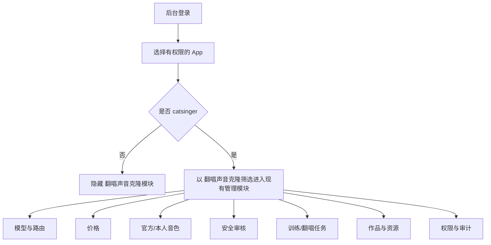

#### 5.13.5 全局页面与交互规则

##### 5.13.5.1 页面框架

所有页面从上到下保持统一结构：

1. 全局顶部栏：当前 App、当前账号、角色、退出入口。
2. 左侧菜单：只展示当前 App 和当前角色有权访问的模块。
3. 页面标题区：标题、用途说明、主要操作按钮。
4. 筛选区：常用条件、查询、重置；复杂条件收起。
5. 内容区：表格、详情或表单。
6. 分页区：总数、页码、每页数量。
7. 操作反馈：成功提示、失败原因、重试入口。

##### 5.13.5.2 App 切换

- App 下拉框读取服务端全部 App 配置，再按当前账号 App 权限过滤。
- 切换 App 前若存在未保存编辑，先提示保存或放弃；确认切换后清空上一 App 的筛选、选中项和编辑草稿，并重新加载菜单与数据。
- 切换到 `catsinger` 时显示 AI 写歌、AI 改编、翻唱声音克隆等对应管理模块。
- 切换到非 `catsinger` 时不展示 翻唱声音克隆模块；直接访问地址也必须拒绝。
- 当前 App 必须始终显示在页面顶部，避免管理员误操作其他 App 数据。

##### 5.13.5.3 列表与详情

- 列表默认按更新时间倒序，支持分页；切换详情再返回时保留当前 App、筛选和页码。
- 空数据展示空态，不使用 Mock 数据填充生产页面。
- 加载失败保留筛选条件并提供重试；保存失败保留表单内容。
- 状态使用文字和颜色共同表达，不能只靠颜色区分。
- ID 同时展示平台业务 ID 和厂家 ID 时必须明确标签，不能只显示一串无法判断来源的编号。
- 用户手机号、姓名和其他个人信息默认脱敏；仅在已有独立权限和合法用途时查看必要信息。

##### 5.13.5.4 配置变更

- 配置保存前执行字段校验；离开有未保存内容的页面时提示保存或放弃。
- 启用、停用、发布、下架、人工复核、隐藏作品等操作必须二次确认。
- 配置变更只影响生效后创建的新任务；历史任务继续使用创建时快照。
- 所有配置变更记录 App、操作者、时间、原因和变更前后值。
- 多人同时编辑时，后保存者不能静默覆盖较新的版本；页面提示数据已变化并要求重新加载。

#### 5.13.6 页面级详细需求

##### W01 翻唱声音克隆管理入口

###### 页面定位

管理员切换到 `catsinger` 后，从左侧“AI 能力 / 翻唱声音克隆”快捷入口进入。该入口复用现有 AI 运维总览并预设声音训练/翻唱场景筛选，用于确认当前环境与功能健康状态和跳转各现有管理模块；不建立独立数据总览体系。

###### 参考素材

暂无 Web/Admin 设计稿。本页不得复用移动端设计图冒充后台稿。

###### 页面结构

1. 标题“翻唱声音克隆管理”和当前 App 标识。
2. 功能状态条：翻唱声音克隆开启/关闭、可用训练路由数、可用翻唱路由数。
3. 待处理提醒：审核异常、训练失败、翻唱失败、资源保存失败、暂不可用音色。
4. 模块入口：模型路由、价格、官方音色、本人音色、安全审核、训练任务、翻唱任务、作品资源。
5. 最近配置变更：只显示有权限查看的记录。

###### 主要交互

| 操作 | 启用条件 | 结果 | 异常恢复 |
|------|----------|------|----------|
| 切换 App | 账号拥有两个及以上 App 权限 | 重新加载菜单与数据 | 加载失败停留当前 App，不展示其他 App 缓存数据 |
| 点击待处理数量 | 有对应模块查看权限 | 带状态筛选进入目标列表 | 无权限时不显示入口 |
| 点击模块入口 | 有模块查看权限 | 进入对应页面 | 模块不可用时说明原因 |
| 开启/关闭功能 | 有模型配置编辑权限 | 跳转 W02 操作，不在入口页直接改配置 | 防止误触修改全局能力 |

###### 验收标准

- 非 `catsinger` 不显示本模块。
- 所有数字来自当前 App，不混入其他 App。
- 待处理入口能带正确筛选进入目标页面。

##### W02 业务模型与多渠道路由

###### 页面定位

管理平台展示给 App 的声音训练、翻唱声音克隆业务选项，以及业务选项到渠道和商家模型的实际路由。

###### 页面结构

1. “声音训练 / 翻唱声音克隆”业务类型分段，不与 AI 改编混用。
2. 业务模型列表。
3. 选中业务模型后的路由列表。
4. 新增/编辑路由抽屉。
5. 关联音色影响提示。
6. 配置版本和最近变更信息。

###### 业务模型字段

| 字段 | 要求 |
|------|------|
| 业务类型 | 声音训练或 翻唱声音克隆，创建后不能直接改成另一类型 |
| 展示名称 | 后台可识别名称；App 是否展示由业务类型决定 |
| 业务编码 | 全局稳定且不可重复，创建后只读 |
| 功能说明 | 给运营理解用途，不展示厂家密钥或内部请求模板 |
| 启用状态 | 关闭后新报价和新任务不可用，历史任务不变 |
| 排序 | 决定 App 或后台同类选项顺序 |

###### 路由字段

| 字段 | 要求 |
|------|------|
| 渠道 | 从后台已接入渠道中选择 |
| 商家模型 | 选择该渠道支持当前业务类型的模型 |
| Provider 编码 | 保存真实 `provider` 编码，并通过模型列表返回给 App；不使用运营展示名代替 |
| 模型编码 | 保存厂家真实 `model` 编码，并通过模型列表返回给 App；不得填写 `VOICE_COVER` 等内部业务类型 |
| 优先级 | 数字越小优先级越高；同一业务模型下不可出现冲突优先级 |
| 最大并发 | 平台对该渠道和商家模型的执行上限，必须为正整数 |
| 歌曲时长上限 | 翻唱声音克隆路由可配置更严格上限，但不能超过 V2.1 的 10 分钟 |
| 轮询间隔 | 用于后台主动查询状态；App 不展示该参数 |
| 路由状态 | 启用或停用 |
| 备注 | 记录使用场景和变更原因，不存放密钥 |

###### 主要交互

| 操作 | 结果 | 关键规则 |
|------|------|----------|
| 新增业务模型 | 创建未启用模型 | 至少配置一条完整可用路由后才能启用 |
| 新增路由 | 保存到当前业务模型 | 渠道和商家模型必须支持对应业务类型 |
| 调整优先级 | 更新新任务选路顺序 | 只影响新任务 |
| 停用路由 | 新任务不再使用 | 先展示受影响的官方/本人音色绑定数量；历史任务继续按快照查询 |
| 停用业务模型 | App 不再允许新报价/新任务 | 已创建任务和历史作品不受影响 |
| 保存并生效 | 生成新配置版本 | 并发编辑冲突时要求重新加载 |

###### 关键状态与异常

- 无可用路由：业务模型显示“不可用”，App 显示“暂未开放”，不能报价。
- 模型列表必须输出当前启用路由的真实 `provider/model`、展示名称、限制、价格和版本；现有 AI 改编的移动端模型别名规则不得套用到翻唱声音克隆。
- 路由停用但存在运行中任务：允许停用新任务入口，运行中任务继续按快照处理。
- 当前渠道没有目标本人音色绑定：不得静默切换到其他渠道。
- 厂家配置或凭证异常：只显示“渠道配置异常”和诊断编号，不显示密钥。
- 翻唱总处理时限固定为 10 分钟，从厂商确认接单并返回可查询任务标识后开始；平台排队不计入，不提供后台任意修改入口。

###### 验收标准

- 训练与翻唱配置完全分开。
- 后台切换路由只影响新任务。
- 停用前能看到关联音色和运行中任务影响。
- 不能保存超过 10 分钟的翻唱歌曲上限。

##### W03 训练与翻唱价格配置

###### 页面定位

分别配置本人音色训练和 翻唱声音克隆的积分价格，并查看价格版本历史。

###### 页面结构

1. 当前价格卡：声音训练、翻唱声音克隆分开显示。
2. 编辑价格表单。
3. 生效说明。
4. 历史版本列表。

###### 字段与规则

| 字段 | 声音训练 | 翻唱声音克隆 |
|------|----------|---------|
| 默认值 | 100 积分/次 | 200 积分/次 |
| 配置值 | 正整数，不能为空 | 正整数，不能为空 |
| 状态 | 启用/停用 | 启用/停用 |
| 生效范围 | 生效后新报价和新任务 | 生效后新报价和新任务 |
| 历史任务 | 使用原价格快照 | 使用原价格快照 |

###### 主要交互

- 点击编辑后修改价格，填写变更原因并二次确认。
- 保存成功后立即生成新价格版本；打开中的 App 在提交前重新报价。
- 未配置有效价格或价格停用时，对应能力在 App 显示“暂未开放”，不允许创建任务。
- 价格变化不能修改已创建任务的冻结、结算或退款金额。
- 页面允许查看历史值、操作者、生效时间和原因，不允许修改历史记录。

###### 验收标准

- 训练和翻唱价格互不覆盖。
- App 不依赖默认 100/200，而是读取实时价格。
- 修改价格后，旧任务仍显示原价格快照。

##### W04 官方音色列表

###### 页面定位

查看、筛选和运营后台官方音色，进入音色编辑、版本和渠道绑定详情。

###### 筛选条件

- 音色名称或业务 ID。
- 分类：男声、女声、二次元、特色；V2.1 不新增独立分类管理页，后续扩展需另建 CHG。
- 发布状态：草稿、审核中、已发布、已下架。
- 可用状态：可用、部分渠道可用、暂不可用。
- 安全审核状态：审核中、通过、拒绝、异常。
- 渠道和商家模型。

###### 列表字段

| 字段 | 展示要求 |
|------|----------|
| 头像与名称 | 使用当前已发布且审核通过的版本 |
| 分类/标签 | 最多展示主要标签，其余折叠 |
| 试听 | 仅审核通过且平台资源可播放时可用 |
| 发布状态 | 明确草稿、审核中、已发布、已下架 |
| 渠道可用性 | 显示可用绑定数量和异常绑定数量 |
| 排序 | 显示当前 App 顺序 |
| 更新时间 | 显示最后配置时间和操作者 |

###### 主要交互

| 操作 | 结果 |
|------|------|
| 新增官方音色 | 进入 W05 创建草稿 |
| 编辑 | 进入 W05；已发布音色的修改形成新草稿版本 |
| 试听 | 播放平台持久化且审核通过的试听资源；切换试听停止上一段 |
| 发布 | 所有发布门禁通过后在 App 可见 |
| 下架 | 新任务不可选，历史任务和作品不变 |
| 调整排序 | 保存后影响 App 下一次拉取顺序 |
| 查看版本 | 进入 W05 版本区域 |

###### 验收标准

- 审核中、拒绝或资源不可播放时试听按钮不可用并说明原因。
- 下架不会删除历史任务、作品或审计记录。
- 列表不暴露厂家密钥和完整临时地址。

##### W05 官方音色编辑与版本

###### 页面定位

创建或编辑官方音色资料，管理平台展示信息、试听资源、模型版本和渠道绑定。

###### 页面结构

1. 基本信息：名称、头像、分类、标签、简介、排序。
2. 声音权利信息：权利来源、授权记录编号、有效范围和备注。
3. 模型来源：绑定渠道已有官方模型，或在支持训练的渠道上传平台有权使用的素材并发起官方训练。
4. 官方训练素材：音频、累计时长、质量状态、安全审核状态和权利关联。
5. 试听资源：算道提供的试听来源、平台持久化状态、实际格式和安全审核状态。
6. 模型版本：版本号、来源渠道、商家模型、厂家音色/模型标识、可用状态。
7. 渠道绑定：每个渠道的绑定状态和最近验证时间。
8. 发布门禁和操作区。
9. 历史版本。

###### 字段规则

- 名称、简介、标签属于文字安全审核范围。
- 头像属于图片安全审核范围。
- 试听资源由算道或其他渠道提供后必须转存到平台，并按真实格式记录，再执行音频安全审核。
- 官方训练素材必须关联平台拥有的声音权利资料，上传后写入现有资源台账并创建音频安全审核记录；未通过前不能发送给训练渠道。
- 选择“绑定已有渠道模型”时必须验证渠道模型真实可用；选择“发起官方训练”时必须选择支持训练的路由，并在同一音色训练任务体系中以 `ownerType=OFFICIAL` 区分。
- 官方训练属于平台运营成本，不冻结或扣减任何用户积分；后台只记录厂家费用或内部成本信息，具体结算方式在技术方案阶段设计。
- 音色权利信息是官方音色发布必填资料；安全审核通过不能替代声音权利证明。
- 厂家模型标识和渠道绑定仅对有配置权限的角色展示，不能向 App 暴露。
- 修改名称、头像、简介、标签或试听资源时必须保存为新的素材或资料修订，并创建新的审核记录；旧内容的审核结果不能复用于已变化内容。

###### 发布门禁

必须同时满足：

1. 基本信息完整。
2. 图片、文字、试听音频全部安全审核通过。
3. 声音权利资料完整。
4. 至少存在一个启用渠道的有效模型绑定。
5. 试听资源已平台持久化且真实可播放。
6. 当前角色拥有发布权限。

###### 主要交互

| 操作 | 结果 | 异常恢复 |
|------|------|----------|
| 保存草稿 | 保存当前版本但不在 App 展示 | 失败保留表单内容 |
| 上传头像 | 通过现有资源服务保存并创建图片安全审核记录 | 拒绝后删除或重传；异常可重试 |
| 绑定试听 | 转存、识别真实格式并进入音频审核 | 转存失败只重试转存，不把临时 URL 作为正式资源 |
| 上传官方训练素材 | 通过现有资源服务保存并创建音频安全审核记录 | 审核拒绝需删除或重传，审核异常可由授权角色重试 |
| 发起官方训练 | 权利资料、全部素材审核、质量和路由校验通过后创建 W08 官方训练任务 | 不扣用户积分；重复提交返回原任务 |
| 绑定已有渠道模型 | 验证厂家模型和渠道绑定，创建模型版本草稿 | 验证失败保持草稿，不得标为可用 |
| 提交审核 | 对当前对象及其最新素材/资料快照发起审核 | 已有相同目标和请求快照的审核任务时返回原任务 |
| 发布 | 当前版本成为 App 可见版本 | 门禁不满足时逐项指出第一个阻断原因 |
| 下架 | 新任务不可选 | 历史作品和任务保持原快照 |
| 新建版本 | 复制可复用字段形成新草稿 | 当前发布版本继续服务，直到新版本审核通过并发布 |

###### 验收标准

- 未审核内容不能发布。
- 新版本审核中不影响旧已发布版本；主动下架除外。
- 厂家试听临时地址过期不会导致 App 直接失效，平台持久化失败时不得发布。
- 官方训练任务和用户本人音色训练任务能够按归属分开筛选，官方训练不产生用户积分流水。

##### W06 本人音色管理

###### 页面定位

客服、审核和任务运营查询用户本人音色、训练状态、渠道绑定和可用性。后台不能把本人音色转为官方音色，也不能替用户修改声音归属。

###### 筛选与列表字段

- 用户 ID、脱敏手机号、音色业务 ID、音色名称。
- 状态：草稿、训练中、保存中、可用、失败、暂不可用、用户已删除。
- 渠道、商家模型、最近训练时间、安全审核状态。
- 列表显示头像缩略图、名称、用户脱敏信息、当前版本、渠道可用性、最近使用时间。

###### 详情结构

1. 音色与用户摘要。
2. 用户授权记录和版本。
3. 当前及历史模型版本。
4. 渠道绑定和厂家模型有效性。
5. 训练素材数量、累计时长、保留期限和审核状态。
6. 关联训练任务和翻唱任务。
7. 可用性操作和审计记录。

###### 主要交互

| 操作 | 权限与结果 |
|------|------------|
| 查看授权 | 只展示确认版本、时间和关联任务，不在列表暴露隐私内容 |
| 查看素材状态 | 普通任务运营只看状态与元数据；审核员按现有资源权限受控访问待审核内容 |
| 标记暂不可用 | 有音色运营权限时可阻止新任务，必须填写原因；历史作品不变 |
| 恢复可用 | 当前渠道绑定重新验证有效、资料审核通过后才可恢复 |
| 查看训练任务 | 跳转 W08 并带音色筛选 |
| 查看翻唱任务 | 跳转 W09 并带音色筛选 |

###### 限制与验收

- 不提供后台替用户创建“本人音色”的入口。
- 不提供跨用户转移、公开发布或改为官方音色的入口。
- 用户已删除音色后不能恢复为可用；历史作品按原保留规则处理。
- 算道模型 ID 失效时显示“渠道绑定失效/音色暂不可用”，不能以平台归档文件标记恢复。

##### W07 内容安全审核工作台

###### 页面定位

统一处理 翻唱声音克隆范围内图片、音频、可展示文字和厂家生成成品的安全审核。技术上复用现有内容审核记录与 AI 运维视图；审核查看、重试和人工复核使用现有角色体系中的独立操作权限，不与官方音色编辑权限捆绑，也不新建审核系统。

###### 审核范围

| 内容类型 | 示例 |
|----------|------|
| 图片 | 用户/官方音色头像、作品封面 |
| 音频 | 源歌曲、训练录音、本地上传、视频提取音轨、官方试听、翻唱成品 |
| 文字 | 音色名称、歌曲名称、简介、标签及其他可展示文字 |
| 生成成品 | 厂家完成并已转存的 翻唱声音克隆最终混音 |

###### 筛选条件

- 当前 App，固定显示并校验 `catsinger`。
- 内容类型、来源：用户上传、运营上传、厂家生成。
- 业务对象：官方音色、本人音色、训练素材、源歌曲、翻唱作品。
- 状态：审核中、通过、拒绝、异常、人工复核中。
- 机器结果等级、提交时间、完成时间、审核目标 ID、用户或业务 ID。

###### 列表字段

- 审核单号、内容类型、来源、关联对象、审核目标 ID 和请求快照摘要。
- 当前状态、机器归一化原因、审核渠道、重试次数。
- 提交时间、完成时间、最近操作者。
- 受控预览入口；无审核查看权限时不显示。

###### 详情结构

1. 内容和关联业务对象摘要。
2. 通过现有资源访问控制进行受控预览。
3. 机器审核原始类别的安全摘要和平台归一化原因。
4. 历史审核记录及对应素材/资料修订。
5. 当前审核目标是否仍是关联对象正在使用的最新素材/资料。
6. 重试或人工复核操作区。

###### 主要交互

| 操作 | 启用条件 | 结果 |
|------|----------|------|
| 受控预览 | 拥有审核查看权限 | 在限时受控页面查看审核所需内容，并记录访问日志 |
| 重试机器审核 | 状态为审核异常且拥有重试权限 | 对同一审核目标幂等重试，保留旧记录 |
| 人工通过 | 拥有人工复核权限，审核目标仍为当前使用素材/资料 | 填写理由后变为审核通过，并记录机器原结论与人工结论 |
| 人工拒绝 | 拥有人工复核权限 | 选择归一化原因并填写必要说明，关联内容保持不可用 |
| 打开关联对象 | 有关联模块查看权限 | 进入官方音色、用户音色、任务或作品详情 |

###### 关键规则

- 审核服务超时、不可用或响应无法识别时保持审核异常，默认不放行。
- 内容被修改、重新上传或重新截取后使用新的素材 ID 或资料修订，并创建新的审核记录；旧内容通过不能让新内容可用。
- 人工复核提交前再次检查审核目标是否仍为当前使用素材/资料；目标已变化时拒绝提交并要求刷新。
- 安全审核本身不冻结训练或翻唱积分。
- 安全审核通过不替代歌曲合法使用权和本人声音授权。
- 低置信度音质告警可由用户确认继续，但内容安全拒绝不能由用户或普通运营绕过。

###### 验收标准

- 四类状态都有列表、详情和明确恢复路径。
- 待审核资源不会向普通运营暴露可复制的公开地址。
- 人工复核完整记录人员、时间、原结果、最终结果和原因。
- 成品审核未通过时作品不能在 App 播放、下载或分享。

##### W08 音色训练任务管理

###### 页面定位

查询本人/官方音色训练任务的业务状态、厂家状态、积分和平台资源保存过程，用于排障，不用于人工篡改任务事实。

###### 筛选条件

- 任务 ID、音色 ID、用户 ID、音色归属：本人/官方。
- 状态：排队、训练中、保存中、成功、失败、暂不可用。
- 渠道、商家模型、时间范围、安全审核状态、积分状态、资源状态。

###### 列表字段

- 任务 ID、音色名称、归属、脱敏用户、路由快照。
- 业务状态、厂家状态摘要、资源保存状态。
- 报价积分、冻结/结算/释放状态。
- 创建时间、更新时间、完成时间、失败阶段。

###### 详情结构

1. 任务业务状态和时间线。
2. 音色资料、授权记录、素材统计和安全审核结果。
3. 平台业务模型、渠道、商家模型、音色版本和限制快照。
4. 厂家请求/任务标识和归一化状态，不展示密钥或完整请求凭证。
5. 模型文件、配置文件、试听资源的保存与校验状态。
6. 价格、积分冻结、结算或释放记录。
7. 失败原因、重试记录和关联操作日志。

###### 允许操作

- 查看任务事实和关联对象。
- 对“厂家已成功但平台资源保存失败”的资源执行保存重试。
- 对审核异常内容跳转 W07 重试审核。
- 厂家模型失效后，把音色标记为暂不可用并引导用户重新训练。

###### 禁止操作

- 不提供取消训练。
- 不允许把失败任务手工改成成功。
- 不允许从后台再次调用厂家训练来覆盖原任务；重新训练必须创建新任务和新版本。
- 不允许手工修改历史报价、积分金额和路由快照。

官方训练任务不关联用户积分时，列表和详情明确显示“平台官方训练 / 不涉及用户积分”，不能展示为 0 积分用户订单。

###### 验收标准

- 厂家处理、平台保存、安全审核、积分和音色可用性可以分别定位。
- 资源保存重试不会再次调用厂家训练，也不会重复扣费。

##### W09 翻唱声音克隆任务管理

###### 页面定位

查询 翻唱声音克隆任务从平台创建、排队、厂家生成、资源持久化、成品审核到作品成功的完整状态。

###### 筛选条件

- 任务 ID、作品 ID、用户 ID、源歌曲 ID、音色 ID。
- 状态：排队、生成中、保存中、成品审核中、成功、失败、超时。
- 渠道、商家模型、音色来源、积分状态、资源状态、时间范围。

###### 列表字段

- 任务/作品 ID、脱敏用户、目标音色和音色来源。
- 路由快照、业务状态、厂家状态摘要。
- 平台排队时长、厂商接单时间、厂商处理时长和 10 分钟剩余/超时标识；排队阶段不得显示生成超时倒计时。
- 价格积分、冻结/结算/释放状态。
- 输出资源与成品审核状态、失败阶段和创建时间。

###### 详情结构

1. 任务时间线：创建、排队、生成、保存、审核、作品完成。
2. 源歌曲摘要和合法使用权确认记录。
3. 目标音色版本、权利类型和渠道绑定快照。
4. 翻唱设置快照。
5. 业务模型、渠道、商家模型、价格和限制快照。
6. 厂家任务状态、平台主动轮询记录摘要。
7. 输出资源实际格式、MIME、大小、时长、保存和可播放校验。
8. 成品安全审核结果。
9. 积分冻结、结算或释放记录。
10. 关联作品和操作日志。

###### 允许操作

- 查看任务和关联作品。
- 对厂家已成功但平台保存失败的资源执行保存重试。
- 对成品审核异常跳转 W07 发起审核重试。
- 对音色失效、路由不可用等原因查看归一化说明。

###### 禁止操作

- 不提供取消任务。
- 不允许把厂家失败、超时或审核拒绝手工改成成功。
- 不允许对同一任务重新调用厂家生成；用户重新翻唱必须创建新任务并重新报价。
- 厂商确认接单后的 10 分钟截止点之后返回的迟到结果只用于后台对账，不自动结算或创建重复作品。

###### 验收标准

- 成功任务必须同时显示资源持久化成功、真实格式识别、成品审核通过、作品可播放和积分结算成功。
- 任一成功条件缺失时不能显示为用户侧成功。
- 超时任务明确显示积分已释放或待补偿，不能长期停留在生成中。

##### W10 作品与资源管理

###### 页面定位

管理 翻唱声音克隆作品的可见性、内容审核、播放可用性、保留期限和资源持久化状态，并与 AI 改编作品清楚区分。

###### 筛选条件

- 作品 ID、任务 ID、用户 ID、标题。
- 作品类型：原创、纯音乐、AI 改编、翻唱声音克隆。
- 状态：审核中、可用、失败、已隐藏、待清理、已清理、资源失效。
- 音色来源、渠道、成品审核状态、创建时间、到期时间。

###### 列表字段

- 作品 ID、标题、类型、脱敏用户、目标音色。
- 实际音频格式、时长、资源状态、成品审核状态。
- 用户可见状态、15 天隐藏时间、第 30 天清理时间。
- 创建时间、最近播放校验时间和关联任务。

###### 详情结构

1. 作品与用户摘要。
2. 关联翻唱任务和源歌曲摘要。
3. 目标音色和路由快照。
4. 平台音频资源：实际格式、MIME、大小、时长、存储状态。
5. 成品审核记录。
6. 受控播放校验。
7. 可见性、保留期限和清理状态。
8. 下载、播放失败摘要和操作日志。

###### 主要交互

| 操作 | 结果 | 规则 |
|------|------|------|
| 受控播放 | 验证平台资源真实可播放 | 仅有作品查看及播放权限可用；审核未通过不能播放 |
| 隐藏作品 | App 立即不可见 | 必须填写原因；不物理删除任务、积分或审计记录 |
| 恢复作品 | 重新在保留期内可见 | 资源可用且审核通过；超过物理清理点不能恢复 |
| 查看审核 | 跳转 W07 | 保留当前作品筛选 |
| 查看任务 | 跳转 W09 | 展示关联任务 |
| 重试资源保存 | 跳转任务详情执行 | 不直接在作品页重新调用厂家 |

###### 生命周期规则

- 翻唱声音克隆作品成功后用户可见 15 天，第 30 天进入物理清理。
- 运营隐藏不会重置或延长保留时间。
- 用户主动删除、运营隐藏、到期隐藏和物理清理必须显示不同原因。
- 物理清理后保留必要的任务、交易、授权和审计摘要，不保留可播放文件。
- 实际输出格式以平台识别结果为准，不固定 MP3；下载文件使用正确后缀。

###### 验收标准

- AI 改编和 翻唱声音克隆可以独立筛选。
- 审核中、审核拒绝或资源不可用的作品不能被标为完成可播放。
- 隐藏、恢复和到期清理均有明确原因与操作记录。

##### W11 角色权限管理

###### 页面定位

复用现有角色管理体系，为角色分配 App 和 翻唱声音克隆管理模块的操作权限。

###### 页面结构

1. 角色列表。
2. 角色基本信息。
3. App 权限。
4. 翻唱声音克隆模块权限树。
5. 高风险操作提醒。
6. 保存和变更记录。

###### 权限树要求

- 模型与路由：查看、新增、编辑、启停。
- 价格：查看、编辑、启停。
- 官方音色：查看、新增、编辑、发布、下架。
- 本人音色：查看、标记暂不可用、恢复可用。
- 安全审核：查看、重试、人工复核。
- 训练任务：查看、资源重试。
- 翻唱任务：查看、资源重试。
- 作品资源：查看、受控播放、隐藏、恢复。
- 操作审计：查看。
- 权限分配：仅超级管理员。

###### 主要交互与规则

- 勾选操作权限时自动包含对应模块查看权限。
- 取消模块查看权限时一并取消该模块其他操作权限。
- 保存前显示新增和移除的权限差异，要求二次确认。
- 不能把权限分配能力授予普通角色。
- 当前管理员不能通过编辑自身角色绕过超级管理员边界。
- 权限保存后下一次请求立即生效并写入 W12。

###### 验收标准

- 不同角色登录后菜单和按钮与权限一致。
- 直接访问无权限地址或调用操作仍会被拒绝。
- 审核人工复核权限与官方音色编辑/发布权限可以分开授予。

##### W12 操作审计日志

###### 页面定位

记录并查询 翻唱声音克隆后台中的配置、审核、资源重试、上下架、可见性和权限变更，支撑排障与责任追溯。

###### 筛选条件

- 操作者、角色、App、模块、动作、对象类型、对象 ID。
- 成功/失败、时间范围、变更原因关键字。

###### 列表与详情字段

| 字段 | 要求 |
|------|------|
| App | 明确记录 `catsinger`，不可为空 |
| 操作者 | 管理员 ID、名称和当时角色快照 |
| 模块/动作 | 模型、价格、音色、审核、任务、作品、权限及具体动作 |
| 对象 | 业务对象类型和稳定 ID |
| 变更前后 | 对敏感值脱敏，仍能看出业务变化 |
| 原因 | 高影响操作必填；普通保存记录可选备注 |
| 结果 | 成功或失败及归一化原因 |
| 时间 | 服务端操作时间 |

###### 规则

- 日志只读，不提供编辑或删除。
- 厂家密钥、Token、完整签名 URL、用户原始音频内容不写入日志。
- 人工审核必须保存机器原结论、人工结论、原因、审核目标 ID 和请求快照摘要。
- 并发编辑失败也记录尝试结果，但不能写成配置已生效。
- 日志保留期限遵循平台统一合规策略，具体时长在技术方案与法务规则中确认，不能短于关联业务审计需要。

###### 验收标准

- W02～W11 的所有修改型操作均可在本页查到。
- 能从日志跳转到仍有权限访问的关联对象。
- 敏感信息不以明文出现。

#### 5.13.7 核心业务流程

##### 5.13.7.1 官方音色发布

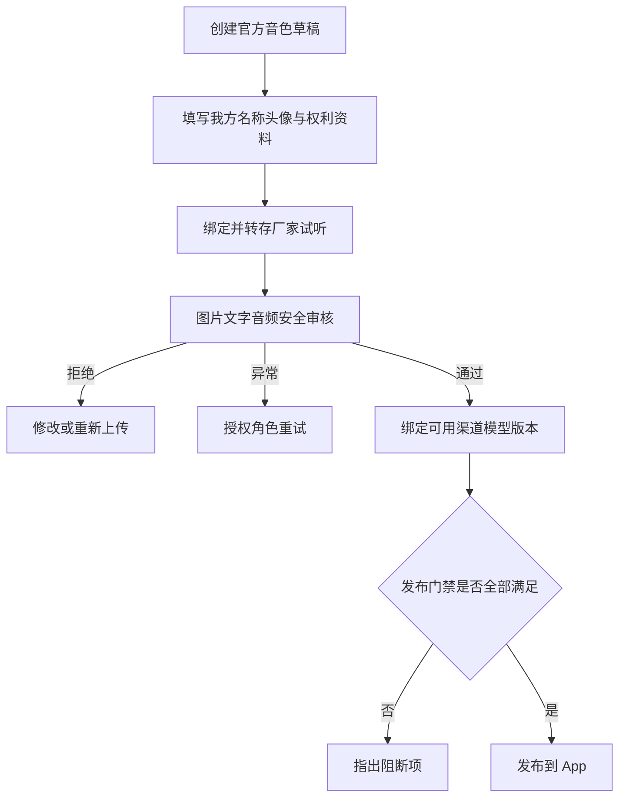

##### 5.13.7.2 上传安全审核

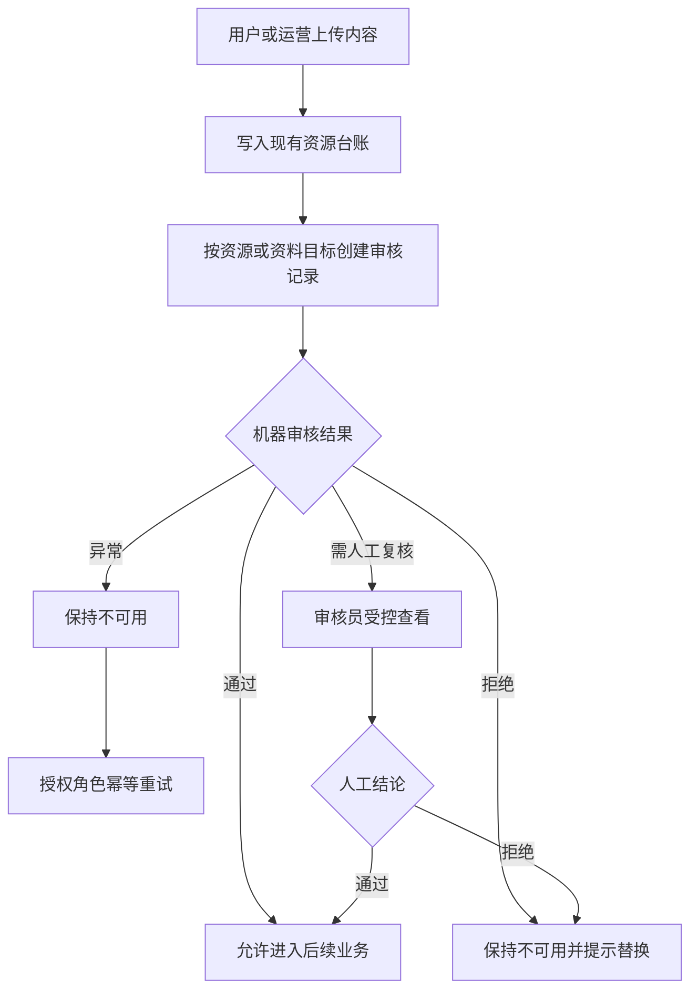

##### 5.13.7.3 配置变更对任务的影响

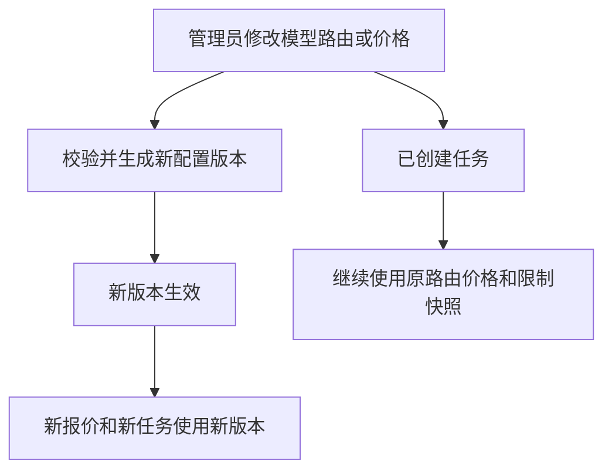

##### 5.13.7.4 翻唱任务排障

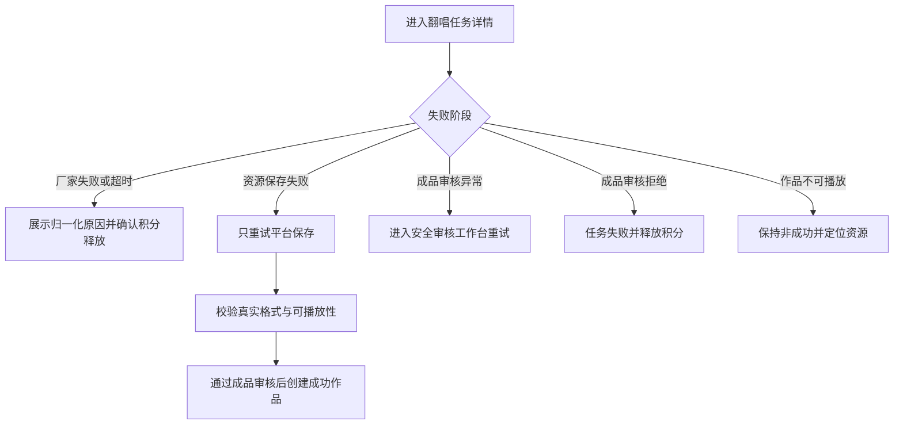

#### 5.13.8 状态与操作矩阵

##### 5.13.8.1 安全审核

| 状态 | 可预览 | 可重试 | 可人工复核 | 可进入后续业务 |
|------|--------|--------|------------|------------------|
| 审核中 | 审核员受控预览 | 否 | 按审核策略 | 否 |
| 审核通过 | 按业务权限 | 否 | 可查看历史 | 是 |
| 审核拒绝 | 审核员受控预览 | 否，需修改或重传 | 有权限时可复核 | 否 |
| 审核异常 | 审核员受控预览 | 是 | 按审核策略 | 否 |

##### 5.13.8.2 官方音色

| 状态 | App 可见 | 可编辑 | 可发布 | 可用于新任务 |
|------|----------|--------|--------|--------------|
| 草稿 | 否 | 是 | 门禁通过后 | 否 |
| 审核中 | 否 | 可另存新素材或资料修订 | 否 | 否 |
| 已发布且可用 | 是 | 以新草稿版本编辑 | 已发布 | 是 |
| 已发布但暂不可用 | 可显示不可用或由配置隐藏 | 是 | 否 | 否 |
| 已下架 | 否 | 是 | 门禁重新通过后 | 否 |

##### 5.13.8.3 训练与翻唱任务

| 状态 | 后台允许操作 |
|------|--------------|
| 排队/执行中 | 查看，不取消、不改状态 |
| 保存中 | 查看；保存失败时允许资源重试 |
| 成品审核中 | 查看并进入审核工作台 |
| 成功 | 查看任务、作品和结算记录 |
| 失败/超时 | 查看原因和积分释放，不手工改成功 |

##### 5.13.8.4 作品

| 状态 | App 行为 | 后台行为 |
|------|----------|----------|
| 成品审核中 | 不可播放 | 查看审核进度 |
| 可用 | 可播放、下载、分享 | 查看、受控播放、隐藏 |
| 运营隐藏 | 不可见 | 可在保留期和资源有效时恢复 |
| 到期隐藏 | 不可见 | 查看清理时间，不延长生命周期 |
| 已物理清理 | 不可播放 | 仅查看必要摘要和审计记录 |

#### 5.13.9 数据展示与同步要求

- 所有列表和详情必须显示当前 `appCode`，查询和操作只作用于当前 App 数据。
- 后台读取服务端 App 配置作为 App 切换来源，不在前端写死 App 列表。
- 任务详情始终展示创建时快照，不能用当前配置覆盖历史显示。
- 官方音色、本人音色、模型版本和渠道绑定是不同对象，页面不能把厂家模型 ID 当作音色唯一业务 ID。
- 输出资源记录厂家声明格式和平台识别的真实格式；两者不一致时显示差异告警。
- 用户和运营修改图片、音频或文字后形成新的素材 ID 或资料修订，并创建新的审核记录。
- 审核通过前由现有资源访问范围和业务门禁限制使用；通过后才允许建立训练、翻唱、发布等业务引用。
- 平台资源保存失败时保留厂家任务事实并重试保存，不重复调用厂家。
- 作品、任务、积分、授权和审核数据的删除/保留遵循完整 PRD 生命周期规则。

#### 5.13.10 异常与恢复

| 场景 | 后台行为 | 管理员可执行操作 |
|------|----------|------------------|
| App 配置加载失败 | 不展示上一 App 缓存数据 | 重试或切回原 App |
| 配置被他人更新 | 阻止静默覆盖 | 重新加载并重新编辑 |
| 无有效训练/翻唱路由 | 对应业务模型不可用 | 配置并启用有效路由 |
| 停用路由存在运行中任务 | 新任务停用，旧任务继续 | 查看影响清单和任务 |
| 价格未配置或停用 | App 显示暂未开放 | 配置有效正整数价格并启用 |
| 官方音色内容审核拒绝 | 不允许发布 | 修改、删除或重新上传内容 |
| 安全审核服务异常 | 默认不放行 | 有权限角色重试 |
| 厂家训练成功但模型保存失败 | 音色保持保存中 | 只重试平台资源保存 |
| 厂家翻唱成功但音频保存失败 | 任务保持保存失败/非成功 | 只重试平台资源保存 |
| 成品审核拒绝 | 不创建可播放成功作品 | 查看原因，不手工改成功 |
| 厂商确认接单后 10 分钟仍未形成可播放作品 | 任务超时失败并释放积分；平台排队超过 10 分钟不触发 | 查看厂家迟到结果对账，不自动结算 |
| 算道模型 ID 失效 | 音色暂不可用 | 引导重新训练或选择其他有效音色 |
| 作品资源失效 | 作品不能保持可播放成功假象 | 查看资源状态；存在可恢复源时走资源恢复流程 |
| 权限被收回 | 当前操作被拒绝 | 返回有权限页面并刷新菜单 |

#### 5.13.11 非功能要求

##### 5.13.11.1 适配与可用性

- 面向桌面 Web 管理，重点验收 1280、1440 和 1920 宽度。
- 表格列较多时允许横向滚动，固定关键 ID、状态和操作列。
- 长名称、厂家错误摘要和资源信息不能撑破布局；使用省略和详情查看。
- 页面加载、空态、失败、无权限和数据已变化均有明确状态。

##### 5.13.11.2 安全与隐私

- 厂家密钥、Token、完整签名 URL 和原始请求凭证不能在页面或日志出现。
- 待审核资源只允许按现有资源访问控制进行审核所需的受控访问，访问行为需要审计。
- 用户手机号、身份信息和私人音色资料默认脱敏并按最小权限展示。
- 训练素材属于敏感数据；普通客服和音色运营不能直接下载或试听。
- 管理员操作必须同时校验登录、当前 App、角色和动作权限。

##### 5.13.11.3 稳定性与一致性

- 重复保存、审核重试和资源重试必须幂等，不生成重复任务或重复结算。
- 列表统计与筛选结果使用同一当前 App 和条件。
- 页面超时不代表后台任务取消；重新打开详情后读取服务端真实状态。
- 厂家错误统一映射为可理解原因，同时保留诊断编号供技术排查。

##### 5.13.11.4 审计

- 配置、启停、发布、下架、人工审核、资源重试、作品隐藏/恢复和权限变更均写审计日志。
- 审计记录不可由普通管理员修改或删除。
- 操作失败也应记录尝试和归一化原因，但不能产生已生效假象。

#### 5.13.12 模块验收清单

| 模块 | 必须通过的验收 |
|------|----------------|
| App 切换 | 服务端全部 App 配置可加载；账号只见有权 App；非 catsinger 无法访问本模块 |
| 模型路由 | 训练/翻唱分离；多渠道和商家模型可配置；切换只影响新任务 |
| 价格 | 默认 100/200，可分别配置；新任务使用新报价，历史任务保留快照 |
| 官方音色 | 名称头像由我方配置；试听转存；所有内容审核通过且绑定有效后才发布 |
| 本人音色 | 可查询状态和渠道绑定；不能转官方、转用户或绕过失效状态 |
| 安全审核 | 图片、音频、文字和成品四态完整；异常可重试；人工复核有独立权限和日志 |
| 训练任务 | 厂家、保存、审核、积分状态可定位；不取消、不手工改成功 |
| 翻唱任务 | 平台排队不计入；厂商接单后 10 分钟总处理时限、主动轮询、迟到结果、资源和成品审核可以追溯 |
| 作品资源 | AI 改编/翻唱声音克隆分离；真实格式可见；播放、隐藏、恢复和清理状态准确 |
| 权限 | 超级管理员可按模块和动作分配；菜单、按钮、接口一致校验 |
| 审计 | 所有高影响操作能查到操作者、原因、对象和前后变化，敏感信息脱敏 |

#### 5.13.13 需求追溯

| 决策/来源 | P13 落点 |
|-----------|----------|
| D-U01 三业务独立并共用流程，AI 改编零修改 | 2.4、5.13.2、W02、W03、W10 |
| D-U02 仅本人音色和官方音色 | W04～W06 |
| D-U03 作品 15 天展示、30 天清理 | W10、5.13.8.4 |
| D-U04 本人音色到主动删除、素材最长 30 天 | W06、W08、W10 |
| D-U05 输出格式不固定 MP3 | W09、W10、5.13.9 |
| D-U06 厂家有效期不等于自动删除 | W06、W08 |
| D-U07 图片、音频、文字上传安全审核 | W05、W07～W10 |
| Q-P01 10 分钟歌曲/任务约束与平台并发 | W02、W09 |
| Q-P02 多渠道与模型切换、音色不自动迁移 | W02、W05、W06 |
| Q-P03 不提供取消任务 | W08、W09 |
| Q-P04 主动轮询、不使用不安全回调 | W02、W09 |
| Q-P05 真实资源可用则使用，否则失败 | W09、W10 |
| Q-O01 试听由算道提供，名称头像由我方提供 | W04、W05 |
| Q-O02 默认训练 100、翻唱 200 且可配置 | W03 |
| Q-UI01 低置信度质量告警可确认 | W07、W08 |

#### 5.13.14 本轮已确认规则

以下规则已由用户在完成 P12 修正后回复“ok”并要求按流程继续时整体确认，适用于 V2.1：

1. `Q-A01`：已发布官方音色被编辑时创建新草稿版本，旧已发布版本继续可用，直到新版本审核通过并发布或被主动下架。
2. `Q-A02`：普通管理员不物理删除任务、作品和审计记录；作品运营使用隐藏/恢复，物理清理由生命周期任务执行。
3. `Q-A03`：任务页只允许资源保存重试和审核重试，不允许取消、手工改成功或再次调用厂家覆盖原任务。
4. `Q-A04`：人工复核使用独立操作权限，必须填写原因并保存机器原结论、审核目标/请求快照和人工结论；权限仍由现有角色权限体系分配。
5. `Q-A05`：官方音色发布除内容安全审核外，还必须有声音权利资料、可用渠道模型绑定和可播放的平台试听资源。

Q-A01～Q-A05 已收口。需求清单、完整 PRD、Product Review、Figma 页面和原始资料一起进入第 3 步完整需求文档检测；不得直接跳到技术方案或编码。

### 5.14 页面入口与交互闭环总表

> 本表是页面级实现和验收索引。各页面的详细业务规则仍以 5.1～5.13 为准。

| 页面 | 入口 | 从上到下的页面结构 | 主要按钮启用条件 | 点击结果 | 失败恢复 | 返回行为 | 正常下一跳 |
|------|------|--------------------|------------------|----------|----------|----------|------------|
| P01 首页 | App 启动或底部“首页” | 品牌/Banner、AI写歌、AI改编与翻唱声音克隆、热门案例、底部导航 | 三个业务入口按后台开关；维护时入口可见但不可进入业务 | 分别进入三个产品流程，底层复用现有歌曲业务体系 | 配置不可用时显示维护说明，首页其他区域继续可用 | 系统返回按现有首页规则处理 | 翻唱声音克隆进入 P02 |
| P02 翻唱声音克隆主页 | P01“翻唱声音克隆 NEW”、P11/P12“重新翻唱”、会员/充值回跳 | 标题、歌曲卡、设置、音色 Tab/列表、定制音色、授权、固定提交按钮 | 歌曲时长不超过 10 分钟且预检/音频审核通过、音色图片/文字/试听审核及当前渠道绑定可用、已授权且无请求进行中 | 请求实时报价；确认后按当前渠道/商家模型幂等创建翻唱任务 | 解析或审核中/拒绝/异常均显示状态并保留有效草稿；支持删除、重传或重试审核 | 返回上一页；草稿有变更时保存或确认放弃 | 设置进 P03；定制进 P04；提交成功进 P10 |
| P03 翻唱设置 | P02“翻唱设置” | 标题、升降调、人声音量、伴奏音量、保存 | 参数都在后台允许范围内时可保存 | 保存参数快照并更新 P02 摘要 | 校验失败定位具体参数并保留编辑值 | 关闭或系统返回放弃未保存值并回 P02 | 保存后回 P02 |
| P04 本人音色资料 | P02 我的音色下“定制新音色”、P09“重新训练” | 标题/指南、头像、名称、训练方式、本人声音授权、继续 | 平台默认资料或图片/文字安全审核通过的自定义资料、已选择方式、已确认本次授权 | 保存音色草稿并进入所选采集方式 | 审核拒绝定位头像/名称；审核异常可重试；也可改用默认资料 | 无改动直接回 P02；有未保存内容时弹离开确认 | 录音进 P06；上传进 P05 |
| P05 训练来源选择 | P04“上传音频”或 P08“添加素材” | 训练指南、立即录音、本地上传、相册上传 | 对应系统能力可用；权限在点击后按需申请 | 打开 P06、文件选择器或相册视频选择器 | 权限拒绝提供设置入口；提取/编码失败保留草稿并可重选 | 回 P04 或 P08，不清空已保存资料/素材 | 录音进 P06；上传解析成功进 P07 |
| P06 录音采集 | P04/P05“立即录音” | 标题、录音说明、示例文本、计时/波形、录制与试听操作 | 麦克风授权后可录；达到 1 分钟后可完成；上传成功后进入审核 | 开始/停止、试听、重录或通过现有资源上传能力保存素材 | 中断或上传失败保留本地录音；审核拒绝可重录，审核异常可重试 | 有未保存录音时确认放弃；已上传时回素材页查看审核状态 | 上传后进 P08，审核通过才计入有效素材 |
| P07 上传与截取 | P05 选择本地音频或相册视频且提取成功 | 文件信息、解析/审核状态、波形/试听、起止点、重新上传、确认 | 解析完成且所选单段在 1～5 分钟内 | 保存截取范围，创建待安全审核的独立训练素材 | 解码/提取/范围/安全审核失败显示具体原因，可重选、重传或重试审核 | 返回 P05，保留音色草稿和已保存素材 | 确认后进 P08，审核通过才计入有效素材 |
| P08 训练素材与提交 | P06/P07 保存素材、P09 失败后修改素材 | 音色摘要、素材列表、累计统计、审核状态、添加/试听/删除、训练按钮 | 授权有效，图片/文字/全部有效音频安全审核通过，素材累计 1～10 分钟、总量不超 100MB、会员可用；低置信度告警已确认 | 获取训练实时报价；确认后幂等创建训练任务 | 指出审核中/拒绝/异常、不足、超限或质量问题；审核异常可重试，拒绝内容需替换 | 返回 P04；有未提交变更时保存草稿或确认离开 | 添加进 P05；训练成功进 P09 |
| P09 音色训练状态 | P08 创建成功、P02/P04 音色卡、通知/任务恢复 | 音色摘要、真实任务阶段、说明、失败/重训操作 | 训练中仅允许离开；失败/暂不可用时可重新训练；资源持久化且当前渠道绑定有效后可试听使用 | 查看进度、回到素材修改或选择可用音色 | 失败释放冻结积分并展示归一化原因；算道 ID 失效不能导入恢复，需重训或改选 | 返回来源页不取消任务 | 可用后回 P02 选中；失败重训回 P04/P08 |
| P10 翻唱生成状态 | P02 创建翻唱任务成功、P11 生成中/审核中作品、任务恢复 | 歌曲/音色/设置摘要、平台排队、厂商接单后生成倒计时、保存/成品审核阶段、退出等待、失败与重试 | 处理中只允许退出等待，不提供取消；成品审核通过且资源可播放后启用查看作品 | 离开等待、保参重试或打开本次目标作品 | 主动轮询；平台排队不触发 10 分钟生成超时，厂商接单后处理超时、资源转存或成品审核失败均不得标成功并按规则释放积分 | 返回不取消任务，回原入口或 P11 | 审核通过且可播放后进 P12 |
| P11 我的作品—翻唱声音克隆 | 底部“作品”后选择 翻唱声音克隆分类、P10 返回 | 作品导航、类型筛选、生成中/审核中/失败/完成列表、15天提示 | 审核中作品无播放/下载/分享/再次翻唱；过期隐藏项无播放/下载入口 | 生成中或审核中进 P10，失败看原因，完成进 P12 | 列表加载失败保留缓存并支持刷新；单项操作失败不移除作品 | 返回上级作品页或首页，保持列表滚动位置 | 审核通过的完成作品进 P12；重新翻唱进 P02 |
| P12 翻唱播放 | P10 成功跳转、P11 审核通过的完成作品 | 直接复用当前工程 `SongPlayerPage`，不新增结果页或改变现有播放器布局 | 成品审核通过、资源格式可识别且自有地址可访问时可播放/下载；其他操作按现有播放器规则 | 使用现有播放器打开本次目标作品，并复用已有播放、歌词和作品操作；重新翻唱预填后进入 P02 | 审核状态异常、资源失效或无法解码时播放验收失败并沿用现有错误反馈，不把任务判成功 | 完全沿用当前播放器返回和播放保持规则 | 重新翻唱进 P02；删除成功回 P11 |
| P13 Web/Admin | 管理员登录并切换 App 为 `catsinger`，且角色有对应权限 | App切换、改编/翻唱分区、业务模型、渠道路由、价格、官方音色、安全审核、任务、作品、资源状态 | 保存/发布需字段校验、上传内容审核通过和权限通过；审核重试/人工复核需独立权限 | 保存配置、重试审核、人工复核、切换新任务路由、发布/下架音色、查看任务和筛选作品 | 审核拒绝不可直接发布；审核异常可重试；保存失败保留表单和原状态 | 返回列表保留筛选；切换 App 重新加载对应 schema | 审核通过后方可发布；任务/作品可进入详情 |

## 6. 数据与同步

### 6.1 核心对象

| 对象 | 产品字段 |
|------|----------|
| 音色资料 | 所属用户、名称、头像、审核状态、默认模型版本 |
| 音色模型版本 | 版本、状态、渠道绑定、厂家模型标识、平台模型/配置资源、可用性、创建时间 |
| 训练素材 | 来源、文件、截取范围、时长、大小、质量结果、保留期限 |
| 授权记录 | 用户、授权版本、业务类型、关联草稿/任务、确认时间 |
| 安全审核记录 | 内容类型、审核目标类型/ID、资源记录、请求快照摘要、审核状态、审核渠道、结果码、归一化原因、审核时间、人工复核记录 |
| 训练任务 | 音色版本、渠道/商家模型快照、状态、报价、积分状态、失败原因、资源保存状态、质量告警确认 |
| 翻唱草稿 | 歌曲、设置、目标音色版本、授权状态 |
| 翻唱任务 | 草稿快照、平台业务模型、渠道/商家模型及音色绑定快照、状态、报价、积分状态、厂家任务、实际输出信息、作品 |
| 翻唱声音克隆作品 | 作品类型、歌曲、音色名称、模型版本快照、实际音频资源、保留期限 |

### 6.2 同步规则

- 进入 P02 时读取最新功能配置和音色状态。
- 音色选择必须保存模型版本，而不只保存会变化的音色资料 ID。
- 后台停用音色后，新报价和提交必须失败；打开中的页面刷新后清除失效选择。
- 会员、积分或配置页返回后重新检查，不使用离开前的旧报价。
- 厂家状态与用户状态由后端映射，App 不直接解释厂家枚举。
- 图片、音频或文字每次重新上传、重新截取或修改后，都必须使用新的素材 ID 或资料修订并创建新的安全审核记录；旧内容的通过结果不能复用于新内容。
- 上传资源继续进入现有资源台账并按用户、App 和访问范围控制；审核通过前不得公开、发布或发送给训练/翻唱 Provider。用户本人对其上传音频的自用试听可按现有 `OWNER` 访问规则开放，不代表审核通过。
- 审核服务异常时保持“审核异常/待重试”，默认不放行；重试必须幂等并保留历史审核记录。
- 厂家返回的输出格式与实际文件不一致时，以经过平台检测后的真实文件属性为最终值，并记录差异供运维定位。
- 后台切换渠道或商家模型只影响切换后创建的新任务；已创建任务继续按其路由和价格快照查询、结算与排障。
- 本人音色只在已建立有效绑定的渠道使用；无有效绑定时不得为了故障转移而静默切换到其他渠道。
- 算道文档虽支持可选 `callBackUrl`，但未提供签名/防重放协议；V2.1 不发送该字段，以主动轮询作为状态真源。

### 6.3 草稿与恢复

- 会员、充值、权限和系统选择器往返不丢失草稿。
- App 被杀死后，服务端已保存歌曲、素材或任务可恢复；未上传完成的本地文件需要用户重新选择。
- 训练/翻唱任务创建成功后，以服务端任务为准，客户端不得再次提交同一幂等键。

### 6.4 资源生命周期

| 资源 | 生命周期 |
|------|----------|
| 翻唱作品用户可见 | 成功后 15 天 |
| 翻唱作品物理清理 | 成功后第 30 天进入清理 |
| 本人音色资料与可用模型 | 保留到用户删除；厂家不可用不等于自动删除，但算道 ID 失效后不能靠归档文件重新导入恢复 |
| 训练原始素材 | 最长 30 天，可按安全与重试需要提前清理 |
| 试听资源 | 音色有效期间保留；删除音色后按资源引用关系清理 |
| 厂家临时资源 | 必须在厂家期限内转存，不作为最终用户 URL |

## 7. 核心业务规则

### 7.1 声音权利与合规

- 用户端只允许训练本人声音。
- 每次新训练任务重新确认授权；不能使用“不再提醒”。
- 用户上传翻唱歌曲时必须确认合法使用权。
- 禁止冒充公众人物、未授权个人或使用他人声音创建“本人音色”。
- 自定义名称和头像通过内容审核后才公开展示。

### 7.2 文件与时长

- 翻唱歌曲格式：MP3、WAV、M4A、FLAC、OGG、AAC。
- 翻唱歌曲大小：不超过 100MB。
- 翻唱歌曲：整曲处理，不默认截取 90 秒；V2.1 暂时限制为 10 分钟以内，服务端可按当前渠道/商家模型配置更严格上限。
- 训练素材：单段 1～5 分钟，累计 1～10 分钟，总量不超过 100MB。
- 低于 5 分钟是质量建议，不是硬性拒绝条件。

### 7.3 会员与积分

- 浏览页面、训练指南和官方音色试听不要求会员。
- 上传用户歌曲、创建本人资料等用户数据操作要求登录。
- 创建训练和翻唱任务要求有效会员。
- 训练和翻唱分别报价、冻结、结算和失败释放；默认价格分别为 100、200 积分，Web/Admin 可独立配置。
- App 每次提交前读取服务端实时报价，任务创建后以价格快照结算，前端不写死默认值。
- 重复请求复用原任务，不重复扣费。
- 厂家余额不足属于平台故障，不显示为用户积分不足。

### 7.4 成功判定

训练成功需要同时满足：

1. 训练使用的图片、文字和全部音频素材安全审核通过。
2. 厂家训练成功。
3. 模型文件和配置文件已保存到平台可控存储。
4. 音色模型版本记录完整并可用于翻唱。

翻唱成功需要同时满足：

1. 源歌曲、目标音色图片/文字/试听及其他必需输入安全审核通过。
2. 厂家翻唱成功。
3. 最终混音已保存到平台可控存储。
4. 实际格式、MIME、大小和时长已识别。
5. 生成成品安全审核通过。
6. 作品记录完整且能够播放。
7. 积分成功结算。

翻唱生成任务在平台侧 `QUEUED` 阶段不启动 10 分钟计时。调度器取得容量、向厂商提交且厂商确认接单并返回可查询任务标识后，记录厂商接单时间并开始 10 分钟总处理计时；此后的厂商侧排队、生成、平台资源持久化、格式与可播放探测、成品审核和作品完成都计入该时限。任一成功条件未在截止时间前完成都按超时失败并释放冻结积分，迟到结果只进入后台对账，不得自动结算、覆盖已有任务结果或创建重复作品。

### 7.5 模型可用性

- 厂家模型 ID 或临时地址失效不等于删除用户音色。
- 算道模型 ID 失效后不能通过平台保存的模型和配置重新导入恢复；归档资源不等于可执行模型。
- 不能用于新任务时，用户端显示“音色暂不可用”。
- 已保存试听音频和历史作品继续可用。
- 无法恢复时引导重新训练；训练原始素材已清理时，需要用户重新提供素材。
- 多渠道下每个音色维护独立渠道绑定；切换商家模型或渠道不会自动迁移本人音色。

### 7.6 删除规则

- 删除本人音色需要二次确认。
- 删除后立即禁止新翻唱，不影响历史作品播放和保留期限。
- 已存在运行中任务时，不强行破坏任务事实；任务完成后按删除状态决定是否允许再次使用。
- 法律、交易、授权和安全审计记录按必要期限保留，不随音色删除立即清除。

### 7.7 渠道路由与异步任务

- 翻唱声音克隆必须支持多个厂家渠道；Web/Admin 把场景配置到具体 `provider/model`，模型列表把这两个真实编码返回给 App。App 页面可以只显示运营名称，但创建任务必须原样提交真实编码。
- 每条路由可配置启停、优先级、最大并发、渠道更严格的歌曲时长和轮询参数；V2.1 歌曲上限为 10 分钟，厂商确认接单后的翻唱总处理时限固定为 10 分钟。
- 平台在自身队列和执行器中控制并发，超出路由并发时排队，不把瞬时拥塞转换为重复任务。
- 平台排队不计入翻唱处理的 10 分钟，排队超过 10 分钟也不得按生成超时失败；调度成功且厂商确认接单后才启动计时。V2.1 暂不把固定排队上限与生成超时混为一体，平台应独立监控排队时长和容量积压。
- 新任务提交的 `provider/model` 必须仍属于当前 `catsinger + song.voice.cover.generate` 有效配置，并与所选音色渠道绑定兼容；任务一经创建，该真实厂家组合、音色绑定、价格和限制形成不可变快照，不得静默换模型。
- 只有目标渠道已经存在同一音色的有效绑定时才允许切换执行；否则失败并释放积分，由用户重新选择音色或训练。
- V2.1 不提供取消任务。退出等待页只停止前端等待，后台任务继续执行到成功、失败或超时。
- 算道 `callBackUrl` 缺少签名和防重放协议，本期不接入；后端通过查询接口主动轮询，并对状态变化做幂等处理。

### 7.8 上传与生成内容安全审核

- 审核范围覆盖 翻唱声音克隆内所有 App 用户和 Web/Admin 上传内容：头像/封面等图片，源歌曲、训练录音、上传音频、视频提取音轨、官方试听等音频，以及音色名称、歌曲名称、简介、标签等可展示文字。
- 平台固定默认图片和固定系统文案应使用预审核版本；用户或运营修改后按新内容重新审核。
- 上传完成只代表现有资源服务已保存文件且资源技术状态可用，不代表内容审核通过。V2.1 在上传完成阶段复用现有内容审核记录建立审核结论，不新增通用“隔离资源”状态机或“内容版本”体系。
- 安全审核通过前，内容不得公开展示、加入有效训练素材、发送给 Provider、创建训练/翻唱任务或发布官方音色。上传者可按现有 `OWNER` 资源权限试听自己的源歌曲/训练素材，以便确认文件和截取范围；该试听不等于公开展示或业务放行。
- 审核状态至少包含：审核中、审核通过、审核拒绝、审核异常。审核中和审核异常可刷新或重试；审核拒绝必须修改、删除或重新上传。
- 安全审核采用默认拒绝策略。审核服务超时、不可用或响应无法识别时，不得按通过处理。
- 机器审核可由具有对应操作权限的后台角色人工复核；权限继续由现有角色权限体系分配，复核必须记录人员、时间、原结果、最终结论和原因，普通运营不能直接绕过拒绝状态发布。
- 页面可复用现有模型选项展示当前参考价格；所有关联输入审核通过后，才能创建训练/翻唱任务、冻结积分和调用 Provider。提交时必须重新读取路由和价格版本；安全审核本身不扣训练或翻唱积分。
- `sourceAudioAssetId`、`sourceWorkId` 和 `referenceAudioAssetId` 属于站内受信来源：只有上传阶段审核通过或已有作品审核事实满足要求后才可被任务引用，进入生成任务后与当前 AI 改编逻辑一致，跳过重复的第三方源音频审核。兼容路径仍传外部 URL 时，继续执行现有任务内源媒体送审与等待步骤。
- 音频质量检查与内容安全审核是两道独立门禁：低置信度质量告警可由用户确认继续，但安全审核拒绝不能由用户确认绕过。
- 厂家生成的翻唱成品继续走平台现有生成内容安全审核。只有审核通过、持久化完成并真实可播放，任务才对用户显示成功。
- 安全审核通过不等于版权授权通过；歌曲合法使用权和本人声音授权仍需分别确认并留痕。

## 8. 前后端交互说明

以下是需求级能力边界，具体路径和 DTO 在技术方案阶段确认。

### 8.1 用户端能力

| 能力 | 建议接口方向 | 用户行为 |
|------|--------------|----------|
| 功能配置 | 复用 `GET /api/song-config/*` | 获取格式、容量、时长和功能开关 |
| 音色列表/资料 | `/api/song-voices/**` | 获取本人/官方音色、保存本人音色资料及可用状态 |
| 资源上传 | 复用 `/api/resources/direct-upload/**` 与 `/api/song-assets/**` | 上传头像、源歌曲和训练素材，并建立歌曲资源关联 |
| 安全审核 | 复用现有内容审核服务和记录 | 查询图片、音频、文字审核状态，对审核异常发起重试；具体暴露方式在技术方案确定 |
| 训练价格 | 复用场景模型选项与现有计费配置 | 展示当前训练价格；创建任务时重新校验价格版本 |
| 训练任务 | `/api/song-voice-training-tasks/**` | 创建并查询训练状态 |
| 翻唱模型与价格 | 复用当前公开模型选项能力，按 `song.voice.cover.generate` 返回真实 `provider/model`、展示名、限制、价格和版本 | App 展示运营名称，提交时使用返回的真实厂家编码；创建任务时重新校验配置和价格版本 |
| 翻唱任务 | `POST /api/song-voice-covers`、`GET /api/song-voice-covers/{id}`、`GET /api/song-voice-covers/active` | 使用专属接口创建、查询和恢复翻唱声音克隆任务；创建请求不传 `mode`，但须携带真实 `provider/model`；服务端固定内部 `VOICE_COVER` 后进入现有任务与作品体系 |

V2.1 不提供训练或翻唱取消接口。任务状态由后端主动轮询厂家查询接口；具体路径、轮询节奏、状态码和商家模型字段在技术方案阶段对账。

### 8.2 需求级状态

- 上传内容安全审核：审核中、审核通过、审核拒绝、审核异常。
- 音色：草稿、审核中、待训练、排队、训练中、保存中、可用、失败、暂不可用、已删除。
- 翻唱：草稿、排队、生成中、保存作品、成功、失败。
- 用户端只使用产品语言，厂家原始状态保留在后台诊断信息中。

### 8.3 需求级错误处理

| 错误 | App 行为 |
|------|----------|
| 未登录 | 登录后返回原草稿 |
| 需要会员 | 进入会员页，返回后重新校验 |
| 积分不足 | 进入充值页，返回后重新报价 |
| 未确认授权 | 打开对应使用规范或授权说明 |
| 资料审核失败 | 标出名称或头像并允许修改/改用默认 |
| 素材不合法 | 定位到具体素材和原因 |
| 歌曲不合法 | 区分格式、容量、时长、解码原因 |
| 图片/音频/文字审核中 | 展示审核中并保留草稿；禁止公开展示、训练、翻唱和发布；上传者仅可按 OWNER 权限自用试听自己的音频 |
| 图片/音频/文字审核拒绝 | 展示归一化原因，允许修改、删除或重新上传；不能由用户确认绕过 |
| 安全审核服务异常 | 保持不可用并允许重试；不得默认放行，也不得冻结训练/翻唱积分 |
| 生成成品审核拒绝 | 不创建可播放成功作品，任务按失败规则处理并释放积分 |
| 音色不可用 | 清除选择并引导重新选择或训练 |
| 厂家繁忙 | 保留输入，允许稍后重试 |
| 厂家余额异常 | 显示平台服务异常，不进入用户充值 |
| 厂商确认接单后 10 分钟仍未形成可播放作品 | 标记超时失败、释放冻结积分、保留参数并允许重试；平台排队阶段不触发该规则 |
| 厂家返回资源不一致 | 可正常下载、识别、保存和播放时按真实属性使用；任一关键校验失败则任务失败 |
| 当前渠道无音色绑定 | 不自动跨渠道提交，提示重新选择音色或重新训练 |
| `provider/model` 缺失、停用、不匹配或使用业务类型代替厂家模型 | 不创建任务、不冻结积分，刷新模型列表后由用户重新确认 |
| 重复请求 | 查询并进入原任务 |

## 9. 非功能要求

### 9.1 屏幕与平台

- Android 与 iOS 手机端行为一致。
- 主验收尺寸 375×812，抽查 390×844 和 414×896。
- 固定按钮避让底部安全区、键盘和迷你播放器。
- 长文件名、长音色名和错误文案不能溢出。

### 9.2 可用性

- 上传、解析、列表、试听、审核、报价和任务均提供 loading/empty/error/retry。
- 关键按钮不可用时显示首个阻断原因。
- 录音、试听和播放器互斥管理，不出现多路声音同时播放。
- 离开长任务不取消后台任务。

### 9.3 安全与隐私

- 训练素材、模型、授权和作品按用户与 `catsinger` App 隔离。
- 文件访问使用受控地址，日志不记录密钥和完整签名 URL。
- 图片、音频和可展示文字全部纳入安全审核；审核前仅按现有资源访问范围受控访问，审核服务异常不放行。
- 后台人工复核使用现有角色体系中的独立操作权限并完整留痕，不允许普通配置权限兼具无记录的审核绕过能力。
- 向第三方审核服务只发送完成审核所需的最少内容和标识；训练音频仍按敏感资料要求保护。
- 授权记录可追溯到授权版本、用户、草稿和任务。

### 9.4 稳定性

- 网络超时、App 退后台、进程重启后可以查询原任务。
- 平台按渠道/商家模型限制并发并排队；同一任务的主动轮询、资源转存和结算必须幂等。
- 资源保存失败只重试保存，不重复调用厂家训练或翻唱。
- 厂家状态异常时任务不能长期伪装为成功。

### 9.5 可扩展性

- 本人音色与官方音色共用展示能力，但所有权和管理权限分离。
- 作品和任务使用明确的 AI 改编/翻唱声音克隆语义，不继续复用含糊 `COVER` 名称。
- 输出资源记录真实格式，为以后支持更多厂家格式预留。
- Provider、渠道、商家模型和平台业务模型分层；后台切换实际路由不要求 App 发版，但不得把无有效绑定的本人音色自动迁移到新渠道。

## 10. 里程碑

| 阶段 | 产物 | 完成条件 |
|------|------|----------|
| 需求 Review | 需求清单、本 PRD 与 Product Review | Q-A01～Q-A05 已获得明确确认，三份需求文档状态一致；Web/Admin 以本 PRD P13 为准 |
| 需求检测 | 检测报告 | 页面、流程、规则、异常和 Figma 映射通过 |
| 技术方案 | 三端方案与数据/接口设计 | 三项业务的公开接口和内部类型边界清晰，同时接入同一歌曲流程；现有 AI 写歌与 AI 改编零修改，算道字段、状态及多渠道路由完成对账 |
| 开发 | Flutter、Java、Admin | 按版本模块计划编码并通过静态/自动化检查 |
| 联调 | 测试环境真实链路 | 训练成功、翻唱成功、资源持久化、积分闭环和真实播放 |
| 发布 | 双平台包与运营配置 | 官方音色、价格、模型、协议和监控准备完成 |

## 11. 待确认项

### 11.1 已确认

| ID | 最终定义 | 确认依据 |
|----|----------|----------|
| D-U01 | 生成歌曲、AI 改编、翻唱声音克隆是三个独立业务，但共用同一歌曲业务流程；现有 AI 改编零修改 | 用户 2026-09-08 明确说明并补充澄清 |
| D-U02 | 用户只能使用本人音色或后台官方音色 | 用户 2026-09-08 明确说明 |
| D-U03 | 翻唱作品展示 15 天、30 天后物理清理 | 用户 2026-09-08 选择确认 |
| D-U04 | 本人音色保留到删除，训练素材最长 30 天 | 用户 2026-09-08 选择确认 |
| D-U05 | 输出格式以厂家实际返回为准，不固定 MP3 | 用户 2026-09-08 明确修正 |
| D-U06 | 厂家模型有效期不等于用户音色自动删除 | 用户提出疑问后完成产品校准 |
| D-U07 | 翻唱声音克隆范围内所有图片、音频和可展示文字上传均需安全审核；资源与审核状态分离，未通过内容不得公开展示、训练、翻唱或发布，上传者可按 OWNER 权限试听自有音频 | 用户 2026-09-08 明确补充并在当前后端逻辑对账后校准 |
| D-U08 | 模式与模型字段辨析（中间口径）：业务类型不能冒充厂家模型，模型字段必须传服务端返回的真实 `provider/model`；其中公开复用 `/api/song-generations` 并传 `mode` 的中间口径已由 D-U09 替代 | 用户 2026-09-09 先纠正 `mode` 与 `model` 混淆，随后继续校准公开接口 |
| D-U09 | 翻唱声音克隆使用独立 `/api/song-voice-covers`；公开创建请求不传 `mode`，服务端固定内部 `VOICE_COVER` 后复用统一任务、工作流、审核、积分、资源和作品流程；真实 `provider/model` 仍由 App 提交 | 用户 2026-09-09 最终确认接口层需要区分音乐生成与翻唱声音克隆，并要求按此调整 |

### 11.2 原待确认项的最终结论

| ID | 最终定义 | 确认依据 |
|----|----------|----------|
| Q-P01 | 歌曲最长 10 分钟；并发由平台按渠道/商家模型控制；平台排队不计入超时，厂商确认接单并返回可查询任务标识后开始 10 分钟总处理时限 | 用户 2026-09-08 明确确认、2026-09-09 补充校准；V2.1 |
| Q-P02 | 算道模型 ID 失效后不能重新导入；翻唱声音克隆支持多渠道和商家模型切换，个人音色按渠道绑定且不自动迁移 | 用户 2026-09-08 明确确认；V2.1 |
| Q-P03 | 不增加取消任务；用户退出等待后任务继续到成功、失败或超时 | 用户 2026-09-08 明确确认；V2.1 |
| Q-P04 | 算道文档存在可选 `callBackUrl`，但无签名/防重放协议；V2.1 不使用回调，后端主动轮询 | 用户 2026-09-08 按接口文档作出决定；V2.1 |
| Q-P05 | 厂家资源能正常下载、识别、持久化和播放就按真实属性使用；关键环节报错则任务失败并展示归一化错误 | 用户 2026-09-08 明确确认；V2.1 |
| Q-O01 | 官方音色试听由算道提供并由平台持久化；名称、头像、排序、启停和渠道绑定由 Web/Admin 配置 | 用户 2026-09-08 明确确认；V2.1 |
| Q-O02 | 默认训练 100 积分/次、翻唱 200 积分/次，Web/Admin 可分别配置，App 读取实时报价 | 用户 2026-09-08 明确确认；V2.1 |
| Q-UI01 | 结构性错误硬阻断；低置信度噪声或混响告警允许用户确认后继续，并留存确认记录 | 用户 2026-09-08 明确确认；V2.1 |

### 11.3 Web/Admin 模块确认结论

| ID | 最终定义 | 确认依据 |
|----|----------|----------|
| Q-A01 | 编辑已发布官方音色时创建新草稿版本，旧发布版本继续可用，直到新版本审核通过并发布或被主动下架 | 用户 2026-09-08 在 P12 修正后回复“ok”并要求按流程继续；V2.1 |
| Q-A02 | 普通管理员不物理删除任务、作品和审计记录；作品使用隐藏/恢复，物理清理由生命周期任务执行 | 用户 2026-09-08 在 P12 修正后回复“ok”并要求按流程继续；V2.1 |
| Q-A03 | 任务页只允许平台资源保存重试和安全审核重试，不允许取消、手工改成功或重新调用厂家覆盖原任务 | 用户 2026-09-08 在 P12 修正后回复“ok”并要求按流程继续；V2.1 |
| Q-A04 | 人工复核使用现有角色体系中的独立操作权限，必须填写原因并记录机器原结论、审核目标/请求快照和人工结论 | 用户 2026-09-08 在 P12 修正后回复“ok”并要求按流程继续；V2.1；2026-09-08 技术体系对账修订 |
| Q-A05 | 官方音色发布必须同时具备权利资料、图片/文字/试听审核通过、有效渠道模型绑定和可播放的平台试听资源 | 用户 2026-09-08 在 P12 修正后回复“ok”并要求按流程继续；V2.1 |

### 11.4 待确认

| ID | 当前结论 | 适用版本 |
|----|----------|----------|
| 无 | 当前没有阻塞 V2.1 需求检测的待确认产品决策 | V2.1 |

D-U01～D-U09、Q-P01～Q-UI01、Q-A01～Q-A05 已全部收口。技术方案阶段仍需逐字段核对算道请求、任务查询、状态码和资源响应，但技术对账不得静默改变以上已确认规则；需要改变时必须新建 CHG 并回卷需求。
