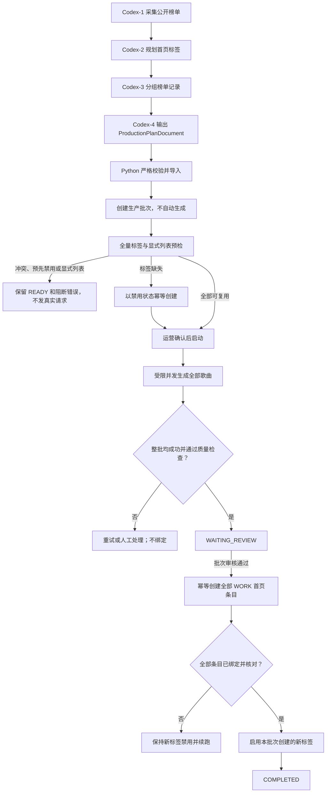

# AI 音乐内容自动生产工具 PRD

> 补充实现轨迹：2026-07-31 从错误工作区别名 `catsinger` 恢复；CHG 已按 `旧编号 + 14` 重编号。正确项目现有主文档继续优先，本文不得单独覆盖 `CURRENT.md` 指定入口。

> 版本：v0.5.0
> 日期：2026-07-20
> 关联变更：CHG-0033

## CHG-0034 补充需求：运营专用账号

### 目标

为正式服提供一个独立于 App 审核账号的运营专用用户账号，供内部内容生产和联调使用。账号采用服务端私有配置的固定登录凭证，但默认不可用；后台管理员每次显式解冻后才允许登录。

### 业务规则

1. 运营账号和审核账号必须是不同身份、不同配置、不同管理接口；运营账号不继承 Apple 审核沙盒支付能力。
2. 配置启用后，账号首次创建即为 `FROZEN`。服务启动时和每天 `Asia/Shanghai` 00:00 自动设回 `FROZEN`，重复执行必须幂等。
3. 后台用户管理页展示运营账号的启用、创建、冻结和每日重置状态，只显示脱敏手机号。
4. 冻结/解冻是高风险后台操作，必须二次确认并填写原因。只有解冻后固定登录凭证才可换取用户 Token。
5. 冻结后，既有用户 Access Token 在下一次 API 请求立即失效，Refresh Token 全部撤销。
6. 运营账号继续走普通用户积分和音乐生成规则；本变更不提供免积分、机器账户或绕过内容审核能力。
7. 正式手机号、固定验证码和 Token 只存在于私有运行配置，不进入 Git、项目文档、接口响应或日志。

### 接口范围

- 用户登录继续使用 `POST /api/auth/sms/login`。
- 新增 `GET /api/admin/operations-account` 查询当前 App 运营账号状态。
- 新增 `PATCH /api/admin/operations-account/frozen` 冻结或解冻运营账号。
- Flutter App 无接口和页面改动。

### 验收

- 初始、服务重启和每日零点后均为冻结；后台解冻前登录失败。
- 解冻后登录成功；再次冻结后新登录、旧 Access Token 和旧 Refresh Token 均不可用。
- Admin 切换 App 不展示或操作上一 App 的缓存账号。
- 无数据库迁移，审核账号登录与 Apple 审核能力回归不受影响。

## 1. 产品概述

本工具是 Catsinger 内部内容生产系统。Codex 对话负责公开榜单事实采集、首页业务标签规划、榜单歌曲分组和逐首原创方案；Python 负责严格校验、状态持久化、标签准备、受限并发调度、失败恢复、整批门禁和 Java 同步；Catsinger Java 后台继续负责真实歌词、音乐、资源、审核和作品链路。

Codex 可以协助读取脱敏状态、调试和修复 Python，但不是生产运行依赖。Python 不集成 OpenAI API，不需要也不读取 `OPENAI_API_KEY`。

## 2. 当前版本范围

MVP 包含：

- 采集包校验、导入和历史趋势分析。
- 严格 `ProductionPlanDocument` 导入与不可变存档。
- 首页标签全量预检、缺失标签禁用创建、冲突和显式列表阻断。
- 生产批次、单曲状态机、Provider + Model 全局并发滑动窗口。
- 整批生成门禁、批次人工审核、首页条目幂等绑定和新标签延迟启用。
- PostgreSQL 续跑、CLI/Celery 唤醒、脱敏诊断和状态核对。

MVP 不包含自动榜单爬虫、内部 Web 控制台、OpenAI API、Flutter 页面、Java 接口/计费/数据库改造、Admin 页面改造或显式首页列表自动编排。

## 3. 角色与系统边界

| 角色/系统 | 职责 | 不负责 |
|---|---|---|
| 内容运营 | 通过 Codex 完成内容准备，确认方案，启动、审核和处理阻断 | 不手工维护 Python 数据库 |
| Codex | 形成采集包和生产方案，读取脱敏信息辅助调试 | 不常驻运行、不直接调度 Provider、不持有生产事实状态 |
| Python | 校验并执行明确方案，管理并发、状态、门禁、绑定与续跑 | 不自主创作真实生产方案，不复制 Java 音乐能力 |
| Catsinger Java | 生成歌词/音乐、管理资源/作品，提供现有 Admin 配置接口 | 本轮不新增接口、不改变普通用户计费 |
| Web/Admin | 继续提供现有标签、首页歌曲和显式列表人工配置能力 | 本轮无页面和代码改动 |
| Flutter App | 消费现有首页标签与歌曲接口 | 本轮无代码改动 |

## 4. Codex 1–4 内容准备流程

### 4.1 Codex-1：公开榜单采集

每次采集生成独立目录：

```text
intake/{collectionId}/
├── collection.md
├── collection.json
└── manifest.json
```

采集包只保存公开榜单元数据及来源引用。禁止下载或保存音频、歌词、旋律、音频指纹、封面文件、媒体下载地址和私有签名 URL。导入动作只形成 `CollectionBatch`，不触发分析、标签创建或歌曲生成。

### 4.2 Codex-2：首页业务标签规划

Codex 根据明确的 `sourceCollectionIds` 和聚合趋势，规划需要生产的首页模块标签，并输出独立标签分析资料：

```text
profiles/{profileId}/
├── profile.md
└── tag-profile.json
```

`tag-profile.json` 保存首页业务标签、榜单样本引用、样本数量和平台分布、聚合风格/情绪/语言/场景，以及每个标签的原创生产方向和配额。它用于人工审阅和形成生产方案，不直接触发后台写入。

标签规划表达的是业务方向，例如古风、欧美流行、日韩风格或特定场景；它不等同于歌曲自由风格标签，也不直接写入首页显式列表。

### 4.3 Codex-3：榜单歌曲分组

Codex 使用 `{collectionId, platform, chartType, chartDate, rank}` 稳定引用，将采集记录归入计划标签，形成覆盖范围和生产配额依据。分组数据只用于审计和聚合分析；提交 Java 生成时必须剥离全部具体榜单歌曲、歌手和来源引用。

### 4.4 Codex-4：原创歌曲方案

Codex 为每首计划歌曲明确：

- 稳定 `planSongId`、原创标题、描述和 prompt。
- 语言、人声、纯音乐标记、主题、情绪、场景、风格、乐器、速度和结构。
- 歌曲内容标签 `styleTags`。
- 首页模块归属 `tagCodes`。
- 对应榜单分组的 `sourceGroupCode`。

最终输出一个可直接执行的方案包：

```text
plans/{planId}/
├── plan.md
├── production-plan.json
└── manifest.json
```

Python 不根据趋势权重临时补歌、改标签或重写 prompt，只执行经过校验和人工确认的歌曲清单。

## 5. ProductionPlanDocument 契约

### 5.1 顶层结构

```json
{
  "schemaVersion": "1.0",
  "planId": "2026-07-20-market-trends-v2",
  "createdAt": "2026-07-20T12:00:00+08:00",
  "sourceCollectionIds": ["collection-a"],
  "businessTags": [
    {
      "tagCode": "guofeng",
      "tagName": "国风",
      "sortOrder": 50
    }
  ],
  "sourceGroups": [
    {
      "groupCode": "guofeng-samples",
      "label": "国风榜单聚合样本",
      "styleTags": ["国风", "古风", "流行"],
      "tagCodes": ["guofeng"],
      "sourceEntries": [
        {
          "collectionId": "collection-a",
          "platform": "公开音乐平台",
          "chartType": "GUOFENG_WEEKLY",
          "chartDate": "2026-07-20",
          "rank": 1
        }
      ]
    }
  ],
  "songs": [
    {
      "planSongId": "song-001",
      "sequence": 1,
      "sourceGroupCode": "guofeng-samples",
      "title": "原创标题",
      "description": "原创方向说明",
      "prompt": "不包含来源歌曲和歌手的原创生成提示",
      "styleTags": ["古风", "治愈", "女声"],
      "tagCodes": ["guofeng"],
      "language": "zh",
      "vocal": "female",
      "instrumental": false,
      "durationSeconds": 120,
      "theme": "春日江南旅途",
      "instruments": ["古琴", "笛子"],
      "bpm": 82,
      "structure": "intro-verse-chorus-verse-chorus-outro"
    }
  ],
  "execution": {
    "provider": "minimax",
    "model": "music-2.6",
    "maxInFlight": 1,
    "pollIntervalSeconds": 15,
    "minSubmitIntervalSeconds": 2,
    "maxAttempts": 3,
    "generationTimeoutMinutes": 30,
    "publishMode": "REVIEW_REQUIRED"
  },
  "copyrightGuard": {
    "requireOriginal": true,
    "forbidSongImitation": true,
    "forbidArtistImitation": true,
    "forbidLyricsCopy": true,
    "forbidMelodyCopy": true
  }
}
```

### 5.2 校验规则

1. Schema 严格拒绝未知字段和整数/布尔字符串转换；`planId`、`planSongId`、`groupCode/sourceGroupCode` 最长 64 字符，且 `planId`、`planSongId` 和 `tagCode` 在各自范围内唯一。
2. `sourceCollectionIds` 和 `sourceGroups[].sourceEntries` 必须解析到已导入的采集事实。
3. 每首歌曲至少有一个 `tagCode`，且只能引用本文档 `businessTags` 以及其 `sourceGroupCode` 分组声明的标签。
4. `styleTags` 必须非空，并与 `tagCodes` 分开保存，不允许 Python 相互推导。
5. 标题、描述、prompt 和发送给生成平台的 `styleTags` 不得包含采集歌曲名、歌手或正向模仿要求；严格 Schema 同时禁止歌词、旋律、参考音频和音频指纹字段。
6. 文档不得包含 `home-list`、`itemCodes`、`displayCount` 等显式列表写入意图。
7. 相同规范化内容重复导入返回原方案；同一 `planId` 内容变化必须拒绝并要求新 ID。
8. 方案导入、校验和保存没有 Java/Admin 外部写操作，也不启动生产。

## 6. 三层标签和首页展示语义

### 6.1 `styleTags`：歌曲内容标签

`styleTags` 描述歌曲本身的风格、情绪、人声、语言或场景，由 Codex 在每首歌曲方案中明确。它进入歌曲生成参数和最终首页歌曲条目，但不创建首页模块，不决定 App 顺序，也不能自动映射为 `tagCodes`。

### 6.2 `tagCodes`：首页模块归属

`tagCodes` 指向现有 Catsinger 首页模块标签。Python 只使用方案明确的编码；真实生成前必须确认标签存在性、启用状态以及是否存在显式列表。已启用存量标签的名称与方案名称不同时记录警告并保留后台名称，不因此修改后台或中断生产。

初始规范映射如下：

| 榜单方向 | `tagCode` | 标签名称 |
|---|---|---|
| 热歌榜、抖音热歌 | `hot_song` | 热歌 |
| 新歌榜 | `new_song` | 新歌 |
| 飙升榜 | `rising_song` | 飙升 |
| 原创榜 | `original_song` | 原创 |
| 国风、古风榜 | `guofeng` | 国风 |
| 欧美榜 | `western` | 欧美 |
| 日韩榜 | `japan_korea` | 日韩 |

缺失标签由 Python 使用现有 Admin 接口先以 `enabled=false` 创建。批次创建的新标签在整批生成和绑定期间保持禁用，避免半批内容提前展示。

### 6.3 显式 `home-list`：运营人工编排

显式列表保存有序 `itemCodes` 和 `displayCount`，继续由现有 Admin 人工维护，不属于生产方案。

- Python 可读查询显式列表状态进行安全预检。
- 任何目标标签已经存在持久化显式列表时，整批阻断，不提交真实生成请求。
- Python 永不调用 `PUT /api/admin/song/home-lists/{tagCode}`，不追加、删除、重排或覆盖运营列表。
- 未保存显式列表时继续使用现有 Java 兼容回退；本轮不改变 CHG-0026 行为。

## 7. 端到端业务流程



## 8. 标签准备与阻断规则

标签准备分为全量只读校验和缺失标签创建两个阶段：

1. 一次性查询目标 App 的首页标签和首页列表。
2. 先检查全部已存在标签；重复编码、非本批次创建的禁用标签或持久化显式列表会立即阻断。存量启用标签的名称差异只记警告。
3. 无阻断项后，批量按方案创建缺失标签，统一使用 `enabled=false`，并保存后台标签 ID 和本批次归属。
4. 创建部分成功后发生网络错误时，批次保留准备状态；重试先查询事实并按 `tagCode` 对账，不重复创建。
5. 因同一批次创建而处于禁用状态的标签是合法状态；其他预先禁用标签不可被 Python 擅自启用或接管。
6. 所有标签准备完成前，不得调用真实歌曲生成接口。

## 9. 整批生成和发布门禁

### 9.1 生成门禁

- 只有绑定了有效 `ProductionPlanDocument`、标签准备完成且运营明确启动的批次才能提交任务。
- 标签准备未完成时，`resume`、`reconcile` 和 Worker 都不能把批次推进到生成或认领槽位。
- 调度器按 Provider + Model 的全局并发槽位滚动补位，不一次提交全部歌曲。
- 单曲完成只保存 `workId`、资源引用和质量结果；不得提前创建首页条目。
- 任意歌曲仍在生成、重试、人工干预、终止失败或缺少有效 `workId` 时，批次都不能进入发布审核。

### 9.2 批次审核和绑定

- 全部歌曲成功并通过质量检查后，批次统一进入 `WAITING_REVIEW`。
- `approve-publish` 是批次级人工批准，不是单曲完成回调。
- 审核通过后，Python 才使用稳定 `itemCode`、`sourceType=WORK`、`sourceWorkId`、`styleTags` 和明确 `tagCodes` 创建首页歌曲条目。
- 绑定必须幂等；进程退出或响应不确定时先核对后台事实，再继续剩余歌曲。
- 部分绑定失败不回滚已成功条目，不启用本批次新标签，也不阻塞后续重试。
- 显式部分发布后若重新生成失败歌曲，旧审核、部分发布授权和公开核验结果全部失效；人工审核模式必须再次审核后才能绑定新增结果。若失败点仅在绑定且已有 `workId`，重试不得重新生成或重复审核，但必须让旧标签激活和公开核验失效，并在新增绑定后全量复核。

### 9.3 新标签启用

- 仅处理标记为“本批次创建”的标签。
- 所有计划歌曲均已在 Admin 侧绑定并核对成功后，才调用现有标签更新接口将这些标签设为启用。
- 任意歌曲未绑定或标签启用失败时，批次不完成；重试从保存状态继续。
- 公开歌曲接口受 `displayCount` 限制。Java 会先过滤禁用条目和不可用作品再补位，因此最终反查以 Admin 兼容回退有序 `itemCodes` 为排序事实，要求公开歌曲是其有序有效子序列，并确认本批至少一首可用歌曲可见；旧歌继续保留，不要求一次返回该标签下全部已绑定歌曲。
- 公开查询后再次读取 Admin 列表。若本批无可见可用歌曲、公开顺序不符合 Admin 相对顺序或生产期间出现持久化显式列表，保存 Admin/公开实际值和错误并暂停，等待运营调整后 `resume`；Python 不写列表。
- 复用的已有启用标签不修改名称、排序、封面或启用状态。

## 10. CLI 操作面

MVP 没有新增可视化页面，操作面由 CLI 构成：

- 采集：`manifest-build`、`collection-import`。
- 分析与方案：`analyze`、`plan-manifest-build`、`plan-import`。
- 生产：`batch-create`、`prepare`、`start`、`worker`。
- 状态与调试：`status`、`inspect`、`doctor`、`reconcile`。
- 运维：`pause`、`resume`、`retry`、`retry-failed`。
- 批次发布：`approve-publish`。

所有命令返回结构化 JSON。相关命令分别显示 planId、batchId、标签状态和阻断原因；单曲 `inspect` 显示 traceId，但不输出 Token、完整歌词、完整 prompt 或敏感响应。

## 11. 现有 Java/Admin 接口结合

| 能力 | 现有接口 | 本轮行为 |
|---|---|---|
| 歌曲创建 | `POST /api/song-generations` | 审核方案启动后按槽位调用，沿用用户鉴权和积分 |
| 歌曲查询 | `GET /api/song-generations/{id}` | 短轮询并恢复 `status/workId/failureReason` |
| 标签查询 | `GET /api/admin/song/home-tags` | 生产前全量预检和续跑对账 |
| 标签创建/更新 | `POST/PUT /api/admin/song/home-tags` | 缺失时禁用创建；全部绑定后只启用本批次新标签 |
| 列表查询 | `GET /api/admin/song/home-lists` | 只读检测持久化显式列表并阻断 |
| 首页条目 | `GET/POST /api/admin/song/home-items` | 批次审核后按稳定编码幂等绑定 `WORK` 作品 |
| 显式列表覆盖 | `PUT /api/admin/song/home-lists/{tagCode}` | 禁止调用 |

本轮只修改独立 Python 工具（含其自身 Alembic 迁移）及 CHG-0033 文档，不修改 Java、Web/Admin、Flutter、Catsinger 数据库、公开接口、鉴权、积分或 Provider。

## 12. 状态、持久化和恢复

批次主状态为：

```text
READY → PREPARING_TAGS → TAGS_READY → RUNNING
→ GENERATION_COMPLETE → WAITING_REVIEW → BINDING → COMPLETED
```

旁路状态为 `PAUSED`、`PARTIAL_FAILED` 和 `FAILED`；`PUBLISHING` 只保留为旧批次兼容状态，不用于新方案主流程。

- `CollectionBatch` 保存不可变采集包。
- `AnalysisRun` 保存聚合趋势，不再直接决定真实生产歌曲。
- `ProductionPlanDocument` 保存不可变显式方案和哈希。
- `ProductionBatch` 引用方案并保存标签准备、批次审核和发布阶段。
- `GenerationJob` 保存 `planSongId`、单曲状态、幂等键、Java/Provider/作品/首页映射。
- 每个目标标签的存在性、后台 ID、是否由本批次创建、预检警告、启用进度保存在 `ProductionBatch.tag_preparation_json`；公开反查结果保存在 `public_verification_json`。
- `JobEvent` 追加记录单曲状态迁移和脱敏摘要；批次阶段使用批次状态与时间戳保存。
- PostgreSQL 是事实源；Redis/Celery 消息丢失后可再次扫描活动批次。

## 13. 非功能与合规要求

- 平台并发未知时默认为 1；任何时刻不得超过 Provider + Model 全局上限。
- 任务提交、标签创建、首页条目绑定和标签启用必须可安全重放。
- PostgreSQL 使用事务、行锁和 `SKIP LOCKED` 防止多 Worker 重复领取。
- 榜单歌曲名、歌手和分组引用不得进入 Java 生成 prompt 或 `styleTags`。
- 周期 Worker 按批次隔离错误；某批次标签启用或公开核验失败不得中止其他批次。
- 不保存版权歌曲文件、歌词、旋律、指纹或媒体下载地址。
- 不读取 `OPENAI_API_KEY`；运行所需凭证仅为现有数据库、Redis、Catsinger 用户/Admin Token 和 Provider 配置。
- 生产故障时可以暂停新提交，Codex 修复 Python 后通过 `reconcile`、`resume` 继续原批次。

## 14. 验收重点

1. Codex 1–4 的产物边界清晰，最终方案可严格校验且不可变。
2. `styleTags`、`tagCodes`、显式 `home-list` 不混用。
3. 缺失标签在真实生成前以禁用状态创建；冲突、预先禁用和显式列表会阻断整批。
4. 任意单曲提前完成不会创建首页条目；只有整批成功后才进入审核。
5. 批次批准后才绑定，全部绑定后才启用新标签。
6. Python 全过程不调用显式列表 PUT。
7. Worker 重启、网络不确定和代码修复后不会重复生成、重复绑定或提前启用标签。
8. 不需要 `OPENAI_API_KEY`，且 Java/Admin/Flutter 无代码改动。
9. 已有兼容回退歌曲不会阻止追加；公开结果允许过滤不可用作品，但相对顺序必须与最终 Admin 回退顺序一致，且本批至少一首可用歌曲可见，否则批次以可诊断状态暂停。
