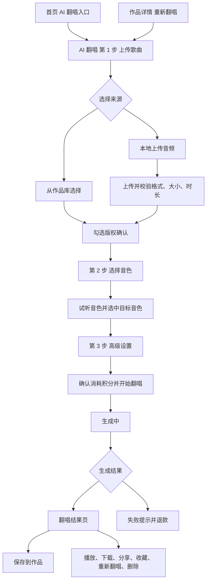
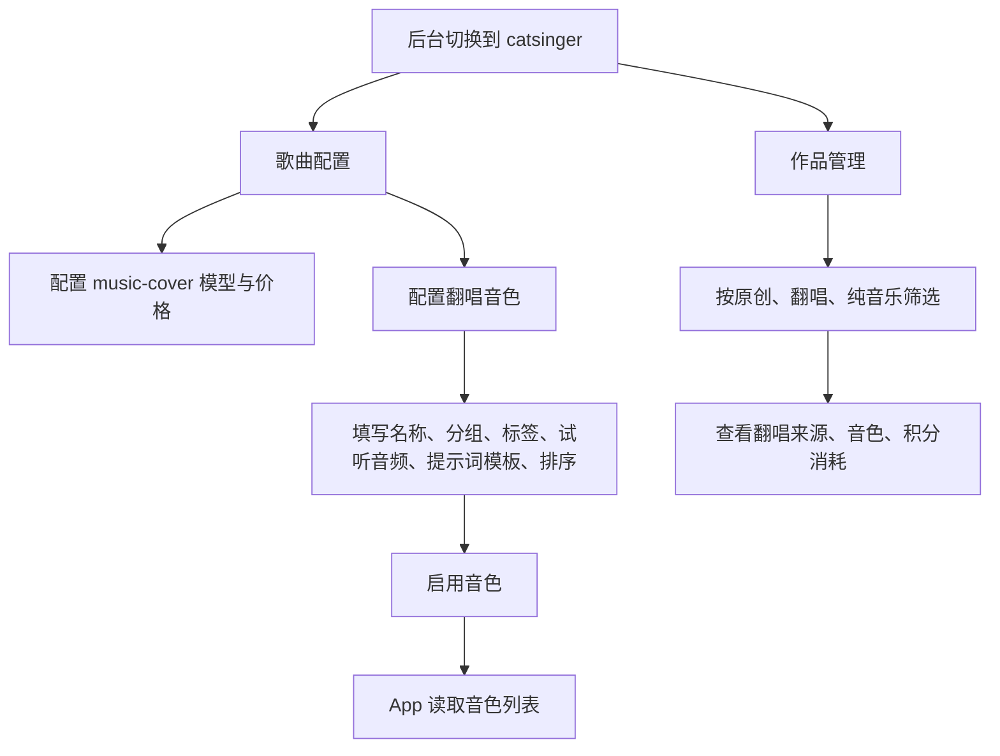
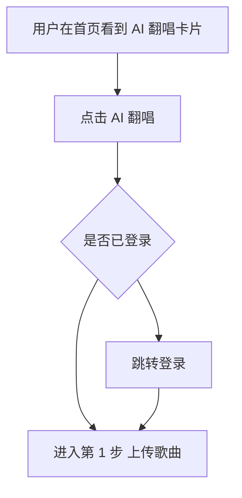
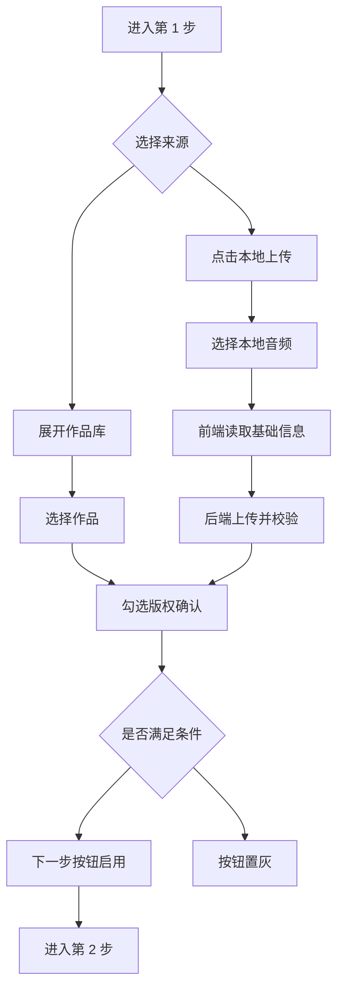
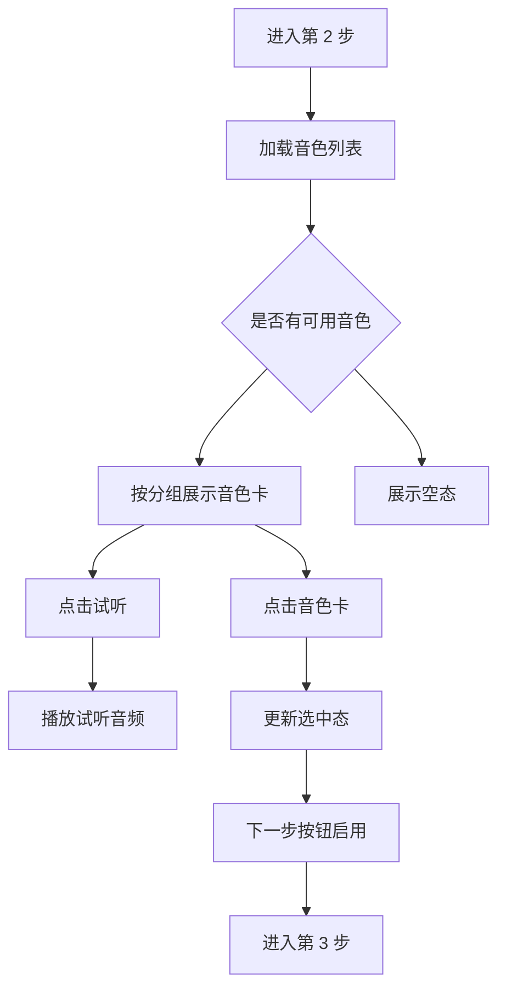
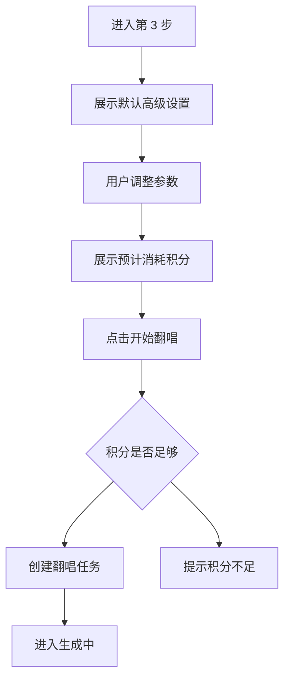
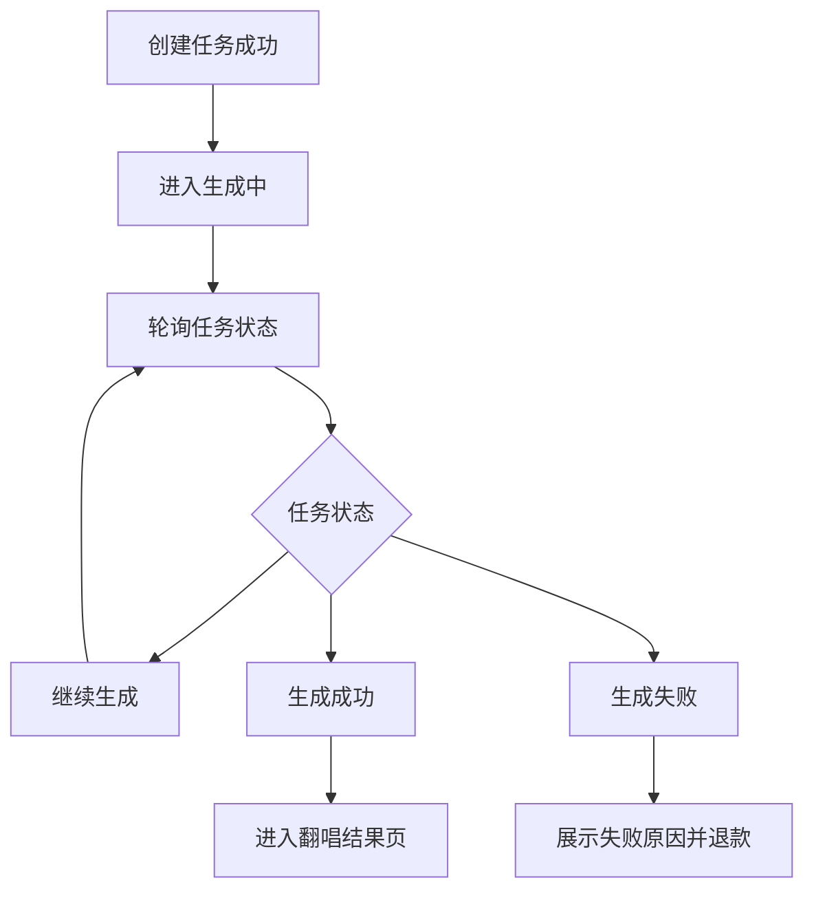
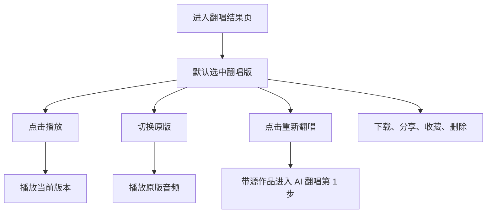
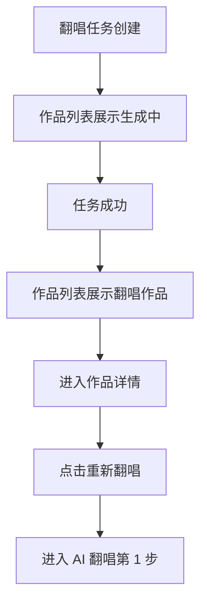

# 喵喵写歌 v1.1 AI 翻唱需求文档

> V2.1 名称校准：本文件中的“AI 翻唱”是历史名称，当前产品统一称为“AI 改编”；它不包含声音克隆，也不得作为 V2.1 新“AI 翻唱（声音克隆）”的需求或编码依据。
> 历史状态：`reference-only`
> 当前实际交付需求：[`../v1.1.0-as-built/requirements.md`](../v1.1.0-as-built/requirements.md)
> 说明：本文件记录 AI 翻唱原计划。当前安装包的入口和页面交互已经发生变化，整 App 验收以实际交付需求为准。

> 版本：`v1.1-ai-cover`
> 变更：`CHG-0013 AI 翻唱功能`
> 状态：`reference-only`
> 当前文档入口：`01-需求/v1.1-ai-cover/requirements.md`
> 原始资料：`01-需求/references/docs/v1.1/ai翻唱.md`
> 设计稿目录：`01-需求/references/images/v1.1/ai翻唱/`
> 重要差异：原始文档和设计稿出现“最长 10 分钟”，v1.1 按已确认的 MiniMax `music-cover` 接入约束统一为“最长 6 分钟”。

---

## 1. 产品概述

### 1.1 功能定位

AI 翻唱是喵喵写歌 v1.1 的新增功能，归属「写歌」能力体系。用户可以选择自己的已有作品，或上传本地音频，选择一个目标音色后，由 AI 生成新的翻唱版本。

功能目标：

- 提升已有作品的复用率，让用户不只生成一次作品，还能反复二创。
- 增加用户留存，通过音色试听、翻唱结果播放、重新翻唱形成循环玩法。
- 增加积分和会员转化，翻唱作为独立付费消耗能力。
- 为后续声音克隆、多人合唱、跨语言翻唱预留入口和数据结构。

### 1.2 目标用户

- 已经在 App 内生成歌曲，希望换一种声音重新演绎的用户。
- 手里有本地歌曲或 Demo，希望快速试听不同声音效果的用户。
- 运营侧需要配置可用翻唱音色、模型价格和作品类型筛选。

### 1.3 成功标准

- 用户能从首页或作品详情进入 AI 翻唱。
- 用户能完成「上传歌曲 / 选择音色 / 高级设置 / 创建翻唱」完整路径。
- 翻唱任务生成后进入作品体系，能播放、下载、分享、收藏、重新翻唱、删除。
- 后台可配置翻唱模型和音色，作品管理能识别原创、翻唱、纯音乐。

---

## 2. 当前版本范围

### 2.1 v1.1 必做范围

- 首页新增「AI 翻唱」快捷入口。
- 作品详情新增「重新翻唱」入口。
- AI 翻唱三步流程：
  - 第 1 步：上传歌曲。
  - 第 2 步：选择音色。
  - 第 3 步：高级设置。
- 生成中状态和翻唱结果页。
- 作品列表和详情增加作品类型：`原创 / 翻唱 / 纯音乐`。
- 用户端接口支持翻唱音色列表、源音频上传、创建翻唱、查询翻唱任务。
- 后端接入 MiniMax `music-cover`。
- 生成结果资源必须持久化到自有资源体系，不依赖第三方临时 URL。
- 积分按模型配置扣费，默认 `150积分/首`。
- Web/Admin 支持翻唱模型、翻唱音色配置，以及作品类型筛选。

### 2.2 v1.1 不做范围

- 不做用户自定义声音克隆。
- 不做多人合唱。
- 不做跨语言翻唱。
- 不做歌词翻译。
- 不做音色训练和声纹采集。
- 不做复杂版权审核，只做用户版权确认和后台可追溯记录。
- 分享可沿用当前轻实现或占位实现，但入口需要保留。

### 2.3 兼容范围

- 不影响 v1.0 原有写歌、场景写歌、图片写歌、作品、专辑、积分和会员链路。
- `appCode` 固定为 `catsinger`。
- 后台 App 切换仍按服务端 appCode 配置读取，AI 翻唱配置只在 catsinger 下生效。

---

## 3. 整体流程

### 3.1 用户主流程

### 3.2 后台配置流程

### 3.3 约束说明

- 第三方生成结果可能是临时 URL，后端必须下载并保存到自有本地上传目录或云存储。
- 本地上传音频必须由后端校验，前端校验只做提前提示。
- 创建翻唱任务必须携带幂等键，避免重复点击导致重复扣费。

---

## 4. 信息架构 / 页面结构

### 4.1 App 页面

| 页面 | 入口 | 主要内容 |
|------|------|----------|
| 首页 | 底部 Tab 首页 | AI 翻唱快捷入口 |
| AI 翻唱 第 1 步 | 首页 AI 翻唱、作品详情重新翻唱 | 作品库选择、本地上传、版权确认 |
| AI 翻唱 第 2 步 | 第 1 步下一步 | 音色分组、音色卡、试听、选择 |
| AI 翻唱 第 3 步 | 第 2 步下一步 | 保留原歌词、保留原伴奏、音高、情感强度、混响、积分提示 |
| 生成中 | 开始翻唱后 | 当前阶段、进度、预计时间、可退出等待 |
| 翻唱结果 | 任务成功后 | 原版/翻唱版切换、播放、操作栏、详情信息 |
| 作品列表 | 底部 Tab 作品 | 作品类型标签、生成中和完成态 |
| 作品详情 | 作品列表进入 | 重新翻唱、下载、分享、收藏、删除 |

### 4.2 Web/Admin 页面

| 页面 | 主要内容 |
|------|----------|
| App 切换 | 切换到 catsinger 后查看喵喵写歌配置和数据 |
| 歌曲模型配置 | 增加 `music-cover` 模型、价格、启用状态、排序 |
| 翻唱音色配置 | 配置名称、分组、标签、头像/图标、试听音频、提示词模板、启用状态、排序 |
| 作品管理 | 按原创、翻唱、纯音乐筛选，查看翻唱来源和积分消耗 |

---

## 5. 页面级详细需求

### 5.1 首页 AI 翻唱入口

#### 页面定位

首页提供 AI 翻唱快捷入口，让用户能从主创作入口发现翻唱能力。

#### 页面入口

| 入口来源 | 进入方式 | 前置条件 | 进入结果 |
|----------|----------|----------|----------|
| App 启动默认页 | 用户打开 App 后进入底部 Tab「首页」 | 无 | 展示首页内容和 AI 翻唱入口卡 |
| 底部 Tab | 点击底部 Tab「首页」 | 无 | 回到首页当前位置或首页顶部 |
| 其他页面返回 | 从 AI 翻唱流程、作品页、我的页返回首页 | 无 | 保留首页基础状态，AI 翻唱入口仍可点击 |

#### 参考素材

#### 页面结构

- 顶部品牌区：喵喵写歌名称和 PRO 会员按钮。
- 主创作输入卡：保留原有写歌入口。
- AI 翻唱横向入口卡：
  - 左侧图标。
  - 标题：`AI 翻唱`。
  - 标签：`NEW`。
  - 描述：上传歌曲，换个音色重新演绎。
  - 右侧箭头。
- 快捷功能区：场景写歌、图片写歌、纯音乐、AI 作词。
- 底部 Tab：首页、写歌、作品、我的。

#### 主要功能

- 点击 AI 翻唱卡片进入 AI 翻唱第 1 步。
- 首页入口不要求用户先输入音乐描述。
- 未登录用户点击时，进入登录流程或弹出登录引导。

#### 页面内按键交互

| 按键 / 区域 | 默认状态 | 点击反馈 | 后续流向 |
|-------------|----------|----------|----------|
| PRO 会员按钮 | 可点击 | 进入会员中心或会员购买页 | 会员中心 |
| 主创作输入卡 | 可输入 | 输入音乐描述，字数实时变化 | 留在首页，点击开始创作后进入写歌流程 |
| 开始创作按钮 | 输入为空时也可按现有写歌规则处理 | 若有描述则回填到写歌页；若为空则进入写歌页空表单 | 底部 Tab「写歌」 |
| AI 翻唱卡片 | 可点击；若功能关闭则置灰 | 已登录进入 AI 翻唱；未登录先走登录 | AI 翻唱第 1 步 |
| AI 翻唱卡片右箭头 | 与卡片点击一致 | 给出点击态 | AI 翻唱第 1 步 |
| 场景写歌 | 可点击 | 进入场景写歌问答流程 | 场景写歌页 |
| 图片写歌 | 可点击或按功能开关置灰 | 可用时进入图片写歌；未开放时 toast 提示 | 图片写歌页或停留首页 |
| 纯音乐 | 可点击 | 切到写歌页并打开纯音乐状态 | 底部 Tab「写歌」 |
| AI 作词 | 可点击 | 切到写歌页高级创作/歌词输入区域 | 底部 Tab「写歌」 |
| 底部 Tab | 当前首页高亮 | 切换到对应页面 | 写歌、作品、我的 |

#### 交互流程图

#### 关键状态 / 异常情况

- 入口加载失败时不影响首页其他区域展示。
- 如果后端功能开关关闭，入口可隐藏或置灰，并提示暂未开放。
- 长文案不得挤压右侧箭头和 NEW 标签。

#### 验收标准

- 375x812 下入口位置、卡片层级、文字和图标不遮挡。
- 点击入口能进入 AI 翻唱流程。
- 未登录行为符合现有登录规则。

---

### 5.2 AI 翻唱第 1 步：上传歌曲

#### 页面定位

用户选择用于翻唱的源音频。源音频可以来自作品库，也可以来自本地上传。

#### 页面入口

| 入口来源 | 进入方式 | 前置条件 | 进入结果 |
|----------|----------|----------|----------|
| 首页 AI 翻唱卡片 | 点击首页「AI 翻唱」入口 | 已登录；未登录先登录 | 进入第 1 步，未选择源音频 |
| 作品详情重新翻唱 | 点击作品详情「重新翻唱」 | 当前作品可播放且有音频资源 | 进入第 1 步，并默认选中当前作品 |
| 翻唱结果页重新翻唱 | 点击结果页「重新翻唱」 | 当前翻唱作品可作为源作品 | 进入第 1 步，并默认选中当前作品 |
| 生成失败重试 | 从失败状态点击重新选择或重新翻唱 | 上次任务失败 | 进入第 1 步，保留可复用来源或允许重新选择 |

#### 参考素材

#### 页面结构

- 顶部返回按钮。
- 页面标题：`AI 翻唱`。
- 页面副标题：`声音转换，赋予歌曲新生命`。
- 三步进度条：
  - 第 1 步：上传歌曲。
  - 第 2 步：选择音色。
  - 第 3 步：高级设置。
- 从作品库选择：
  - 默认折叠选择框。
  - 展开后展示作品列表。
  - 选中后展示作品卡片和选中态。
- 分隔线：`或`。
- 本地上传：
  - 虚线上传区域。
  - 上传图标。
  - 文案：点击上传音频文件。
  - 格式提示：MP3、WAV、M4A、AAC、FLAC。
  - 限制提示：最大 50MB，最长 6 分钟。
- 版权确认：
  - 勾选框。
  - 文案：我确认拥有该音频的合法使用权，并同意平台使用条款。
- 底部固定按钮：`下一步`。

#### 主要功能

- 从作品库选择源作品。
- 上传本地音频。
- 校验版权确认。
- 校验源音频格式、大小、时长。
- 只有选择了源音频且勾选版权确认后，下一步按钮才启用。

#### 页面内按键交互

| 按键 / 区域 | 默认状态 | 点击反馈 | 后续流向 |
|-------------|----------|----------|----------|
| 返回按钮 | 可点击 | 若无选择直接返回来源页；若已有上传或选择，弹出确认离开 | 首页、作品详情或结果页 |
| 作品库选择框 | 折叠态 | 展开作品列表；再次点击收起 | 留在第 1 步 |
| 作品列表项 | 可点击 | 当前作品高亮，折叠选择框显示作品名、风格和时长 | 留在第 1 步 |
| 已选作品卡右侧箭头 | 可点击 | 展开或收起作品库，允许更换歌曲 | 留在第 1 步 |
| 本地上传区域 | 可点击 | 打开系统文件/媒体选择器 | 系统选择器 |
| 重新上传 / 更换文件 | 已上传后显示 | 清掉旧文件并重新选择；上传成功后替换源音频 | 留在第 1 步 |
| 版权确认勾选框 | 未勾选 | 勾选后更新按钮可用性；再次点击取消 | 留在第 1 步 |
| 使用条款文字 | 可点击 | 打开平台使用条款页面或弹窗 | 条款页 / 弹窗 |
| 下一步按钮 | 未满足条件置灰；满足条件主色高亮 | 置灰时提示缺少来源或版权确认；可用时进入下一步 | AI 翻唱第 2 步 |

#### 交互流程图

#### 详细交互说明

- 点击作品库选择框后展开作品列表，再次点击可收起。
- 作品库列表优先展示当前用户已完成、可播放的歌曲。
- 可选作品类型：原创、纯音乐、已完成翻唱作品。若后续需要限制翻唱作品不能再次翻唱，由后端配置或接口字段控制。
- 本地上传选择文件后，前端先校验扩展名和大小，再上传后端校验真实格式和时长。
- 源音频时长无法识别时，不允许进入下一步。
- 选择作品和本地上传互斥：选中一种来源后，另一种来源不再作为本次任务来源。

#### 关键状态 / 异常情况

- 作品库为空：展示空态和“去创作歌曲”入口。
- 文件格式不支持：提示仅支持 MP3/WAV/M4A/AAC/FLAC。
- 文件超过 50MB：提示文件过大。
- 文件短于 6 秒或长于 6 分钟：提示音频时长不符合要求。
- 未勾选版权确认：按钮保持置灰，点击可提示需要先确认合法使用权。
- 上传失败：展示失败提示，允许重新选择。

#### 验收标准

- 375x812 下底部按钮固定但不遮挡版权确认。
- 展开作品库后列表可滚动，底部按钮仍保持可用。
- 选中作品后卡片显示绿色选中态。
- 本地上传区域与版权确认区域间距符合设计稿。
- 文案统一写“最长 6 分钟”，不沿用设计稿中的 10 分钟。

---

### 5.3 AI 翻唱第 2 步：选择音色

#### 页面定位

用户选择翻唱后的目标音色。音色由后台配置，前端按分组展示。

#### 页面入口

| 入口来源 | 进入方式 | 前置条件 | 进入结果 |
|----------|----------|----------|----------|
| AI 翻唱第 1 步 | 点击可用的「下一步」 | 已选择源音频并勾选版权确认 | 进入第 2 步并加载音色列表 |
| 第 3 步返回 | 点击第 3 步返回按钮 | 已进入高级设置 | 回到第 2 步，保留已选音色 |
| 任务创建失败返回修改 | 点击修改音色或重新选择 | 创建任务失败且源音频仍有效 | 回到第 2 步，保留源音频 |

#### 参考素材

#### 页面结构

- 顶部返回按钮。
- 标题和副标题。
- 三步进度条：
  - 第 1 步显示完成态。
  - 第 2 步显示当前态。
  - 第 3 步显示未完成态。
- 音色分组：
  - 男声。
  - 女声。
  - 二次元。
  - 特色。
- 音色卡：
  - 左侧头像/图标。
  - 音色名称。
  - 风格标签。
  - 试听按钮。
  - 选中态勾选。
- 底部固定按钮：`下一步`。

#### 主要功能

- 展示可用音色列表。
- 按分组和排序展示音色。
- 支持试听音色。
- 支持选择一个目标音色。
- 选择音色后才能进入下一步。

#### 页面内按键交互

| 按键 / 区域 | 默认状态 | 点击反馈 | 后续流向 |
|-------------|----------|----------|----------|
| 返回按钮 | 可点击 | 回到第 1 步，保留源音频和版权确认 | AI 翻唱第 1 步 |
| 步骤条第 1 步完成节点 | 可点击或仅展示完成态 | 若支持点击则回到第 1 步；否则无跳转 | AI 翻唱第 1 步或留在当前页 |
| 音色卡片 | 未选中 | 选中当前音色，卡片显示绿色边框/底色和勾选 | 留在第 2 步 |
| 试听按钮 | 可点击；无试听资源时仍显示或置灰 | 有试听音频时播放/暂停试听；无资源时 toast 提示暂无试听 | 留在第 2 步 |
| 下一步按钮 | 未选音色置灰；已选音色高亮 | 置灰时提示先选择音色；可用时进入高级设置 | AI 翻唱第 3 步 |

#### 交互流程图

#### 详细交互说明

- 默认可选分组：男声、女声、二次元、特色。
- 音色字段包括：音色编码、展示名称、分组、标签、图标/头像、试听音频、提示词模板、启用状态、排序。
- 同一时间只能选择一个音色。
- 点击试听按钮播放试听音频，不改变选中态。
- 点击卡片其他区域选择音色。
- 若试听音频为空，点击试听提示“暂无试听音频”。

#### 关键状态 / 异常情况

- 音色接口失败：展示错误提示和重试入口。
- 当前分组无音色：隐藏空分组或展示轻量空态。
- 音色下架：不展示禁用音色。
- 试听播放失败：提示播放失败，不影响选择。

#### 验收标准

- 选中音色卡有绿色边框/底色和勾选标识。
- 试听按钮不会和选中勾选互相遮挡。
- 分组标题和卡片间距符合设计稿。
- 长音色名称和标签不溢出。

---

### 5.4 AI 翻唱第 3 步：高级设置

#### 页面定位

用户在创建翻唱前调整翻唱参数，并确认预计积分消耗。

#### 页面入口

| 入口来源 | 进入方式 | 前置条件 | 进入结果 |
|----------|----------|----------|----------|
| AI 翻唱第 2 步 | 点击可用的「下一步」 | 已选择目标音色 | 进入第 3 步，展示默认高级设置 |
| 积分不足弹窗关闭后 | 用户关闭充值引导或返回修改 | 源音频和音色仍有效 | 回到第 3 步，保留设置 |
| 创建失败后返回修改 | 点击重试或修改设置 | 任务未成功创建 | 回到第 3 步，保留上次参数 |

#### 参考素材

#### 页面结构

- 顶部返回按钮。
- 标题和副标题。
- 三步进度条：
  - 第 1 步和第 2 步完成。
  - 第 3 步当前。
- 高级设置卡片：
  - 保留原歌词。
  - 保留原伴奏。
  - 音高调整。
  - 情感强度。
  - 混响。
- 底部区域：
  - 预计消耗：150 积分。
  - 固定主按钮：`开始翻唱`。

#### 主要功能

- 保留原歌词开关，默认开启。
- 保留原伴奏开关，默认开启。
- 音高调整范围：`-6 ~ +6`，默认 `0`。
- 情感强度：柔和、标准、激情，默认标准。
- 混响：关闭、录音棚、演唱会，默认录音棚。
- 展示预计积分消耗，优先使用后端模型配置返回值。
- 创建翻唱任务。

#### 页面内按键交互

| 按键 / 区域 | 默认状态 | 点击反馈 | 后续流向 |
|-------------|----------|----------|----------|
| 返回按钮 | 可点击 | 回到第 2 步，保留源音频、版权确认和已选音色 | AI 翻唱第 2 步 |
| 步骤条第 1 步完成节点 | 可点击或仅展示完成态 | 若支持点击则回到第 1 步；否则无跳转 | AI 翻唱第 1 步或留在当前页 |
| 步骤条第 2 步完成节点 | 可点击或仅展示完成态 | 若支持点击则回到第 2 步；否则无跳转 | AI 翻唱第 2 步或留在当前页 |
| 保留原歌词开关 | 默认开启 | 开关切换并即时保存到本地参数 | 留在第 3 步 |
| 保留原伴奏开关 | 默认开启 | 开关切换并即时保存到本地参数 | 留在第 3 步 |
| 音高滑杆 | 默认 0 | 拖动后显示当前值，范围限制 -6 到 +6 | 留在第 3 步 |
| 情感强度按钮 | 默认标准 | 点击柔和/标准/激情后更新选中态 | 留在第 3 步 |
| 混响按钮 | 默认录音棚 | 点击关闭/录音棚/演唱会后更新选中态 | 留在第 3 步 |
| 开始翻唱按钮 | 可点击；提交中 loading | 创建任务，冻结积分；重复点击无效 | 生成中页面 |
| 积分不足弹窗充值按钮 | 积分不足时出现 | 进入充值或会员页 | 充值 / 会员页 |
| 积分不足弹窗取消按钮 | 积分不足时出现 | 关闭弹窗，保留当前设置 | 留在第 3 步 |

#### 交互流程图

#### 详细交互说明

- 设置项变化后立即更新本地状态，不需要实时请求后端。
- 积分价格由模型配置接口返回，前端不得写死生产价格。
- 若配置接口没有返回价格，前端可展示默认兜底 `150积分`，但提交仍以后端实际扣费为准。
- 点击开始翻唱后按钮进入 loading，禁止重复点击。
- 生成请求必须带上幂等键。

#### 关键状态 / 异常情况

- 积分不足：提示用户充值或开通会员。
- 网络异常：提示创建失败，保留当前填写内容。
- 后端校验失败：按后端错误提示展示，例如音频过长、版权确认缺失、音色不可用。

#### 验收标准

- 音高滑杆左右范围和当前值展示清晰。
- 三组选项按钮的选中态符合设计稿。
- 底部积分提示和开始按钮在小屏下不遮挡内容。

---

### 5.5 生成中页面

#### 页面定位

用户创建翻唱任务后查看任务进度，可退出等待，生成完成后进入结果页或作品详情。

#### 页面入口

| 入口来源 | 进入方式 | 前置条件 | 进入结果 |
|----------|----------|----------|----------|
| AI 翻唱第 3 步 | 点击「开始翻唱」并创建任务成功 | 积分冻结成功，任务创建成功 | 进入生成中页面并开始轮询 |
| 作品列表生成中卡片 | 点击翻唱生成中任务 | 任务仍在排队或处理中 | 进入生成中页面并恢复轮询 |
| 推送 / 站内通知 | 点击生成进度通知 | 用户登录且任务存在 | 打开生成中或结果页 |

#### 页面结构

- 顶部返回/关闭入口。
- 标题：AI 翻唱生成中。
- 源歌曲名称。
- 目标音色。
- 当前阶段。
- 进度条和百分比。
- 预计剩余时间。
- 提示文案：可以退出页面，完成后会保存到作品。

#### 主要功能

- 轮询任务状态。
- 展示生成阶段。
- 成功后进入翻唱结果页或作品详情。
- 失败后展示失败原因，积分退款。

#### 页面内按键交互

| 按键 / 区域 | 默认状态 | 点击反馈 | 后续流向 |
|-------------|----------|----------|----------|
| 关闭 / 返回按钮 | 可点击 | 提示任务会继续生成，确认后退出 | 作品列表或上一页 |
| 查看作品按钮 | 任务成功后出现 | 打开翻唱结果页或作品详情 | 翻唱结果页 / 作品详情 |
| 失败重试按钮 | 任务失败后出现 | 使用原来源、音色和设置重新进入创建流程 | AI 翻唱第 3 步或重新创建任务 |
| 重新选择按钮 | 任务失败后可出现 | 清理当前失败任务上下文 | AI 翻唱第 1 步 |
| 轮询重试按钮 | 网络异常时出现 | 重新请求任务状态 | 留在生成中页面 |

#### 交互流程图

#### 关键状态 / 异常情况

- 任务排队：展示排队中。
- 阶段未知：展示生成中。
- 进度缺失：按状态映射默认进度。
- 轮询失败：展示网络提示并继续允许重试。
- 用户退出：任务继续执行，作品列表展示生成中任务。

#### 验收标准

- 生成中信息能展示源作品、目标音色和任务阶段。
- 失败状态不会扣除积分，或扣除后能退款。
- 用户退出后在作品页能看到生成中状态。

---

### 5.6 翻唱结果页

#### 页面定位

用户查看翻唱结果，进行原版/翻唱版对比播放，并对作品执行操作。

#### 页面入口

| 入口来源 | 进入方式 | 前置条件 | 进入结果 |
|----------|----------|----------|----------|
| 生成中成功态 | 任务成功后自动跳转或点击查看作品 | 翻唱作品已生成 | 进入翻唱结果页，默认展示翻唱版 |
| 作品列表 | 点击翻唱作品卡片 | 作品状态为成功且可播放 | 进入翻唱结果页或作品详情 |
| 作品详情 | 点击播放或查看翻唱结果 | 当前作品为翻唱作品 | 进入翻唱结果页 |
| 通知入口 | 点击生成完成通知 | 用户登录且作品存在 | 进入翻唱结果页 |

#### 参考素材

#### 页面结构

- 顶部收起/返回按钮。
- 标题：翻唱结果。
- 副标题：目标音色。
- 唱片视觉。
- 歌曲标题。
- 元信息：原曲、音色、创建时间。
- 原版/翻唱版切换。
- 播放进度条。
- 播放按钮。
- 操作栏：
  - 下载。
  - 分享。
  - 收藏。
  - 重新翻唱。
  - 删除。
- 信息卡：
  - 歌曲名称。
  - 翻唱音色。
  - 创建时间。
  - 积分消耗。

#### 主要功能

- 播放原版音频。
- 播放翻唱版音频。
- 原版/翻唱版 AB 切换。
- 下载翻唱作品。
- 分享翻唱作品。
- 收藏/取消收藏。
- 重新翻唱。
- 删除作品。

#### 页面内按键交互

| 按键 / 区域 | 默认状态 | 点击反馈 | 后续流向 |
|-------------|----------|----------|----------|
| 顶部收起 / 返回按钮 | 可点击 | 停止或保留播放器状态，返回来源页 | 生成中来源页、作品列表或作品详情 |
| 原版 Tab | 未选中或可选 | 切换到源音频，进度条和播放按钮绑定原版 | 留在结果页 |
| 翻唱版 Tab | 默认选中 | 切换到翻唱音频，进度条和播放按钮绑定翻唱版 | 留在结果页 |
| 播放 / 暂停按钮 | 可点击 | 播放或暂停当前版本音频 | 留在结果页 |
| 进度条 | 可拖动 | 拖动后跳转到指定播放进度 | 留在结果页 |
| 下载按钮 | 可点击 | 请求下载地址，成功后下载或保存到系统 | 系统下载 / 留在结果页 |
| 分享按钮 | 可点击 | 调起分享面板；轻实现时复制链接或提示暂未开放 | 系统分享 / 留在结果页 |
| 收藏按钮 | 可点击 | 收藏/取消收藏，图标状态即时变化 | 留在结果页 |
| 重新翻唱按钮 | 可点击 | 使用当前作品作为源作品进入翻唱流程 | AI 翻唱第 1 步 |
| 删除按钮 | 可点击 | 弹出二次确认；确认后隐藏或删除作品 | 作品列表 |
| 删除确认取消 | 弹窗内 | 关闭弹窗，不删除 | 留在结果页 |

#### 交互流程图

#### 详细交互说明

- 默认展示翻唱版。
- 切换原版和翻唱版时，播放进度按当前音频重置或按播放器能力保持。
- 下载只下载翻唱成品，不下载源音频，除非后续另有产品规则。
- 重新翻唱使用当前作品作为源作品进入第 1 步。
- 删除需要二次确认。

#### 关键状态 / 异常情况

- 原版音频不可用：隐藏原版切换或提示源音频不可播放。
- 下载地址获取失败：提示稍后重试。
- 分享轻实现：可提示已复制链接或暂未开放。
- 删除成功后返回作品列表。

#### 验收标准

- 长标题在 375x812 下换行后不遮挡播放器。
- 原版/翻唱版切换按钮有明确选中态。
- 操作栏按钮数量较多时不溢出。
- 信息卡内容清晰展示积分消耗。

---

### 5.7 作品列表与作品详情联动

#### 页面定位

AI 翻唱生成后的作品需要进入统一作品体系，支持列表识别和再次操作。

#### 页面入口

| 入口来源 | 进入方式 | 前置条件 | 进入结果 |
|----------|----------|----------|----------|
| 底部 Tab「作品」 | 点击底部作品 Tab | 用户已登录 | 进入作品列表，展示歌曲/专辑分段 |
| 生成中退出后 | 从生成中页面关闭返回作品 | 翻唱任务已创建 | 作品列表展示生成中任务 |
| 翻唱结果页返回 | 点击返回或删除后返回 | 当前作品存在或已删除 | 回到作品列表并刷新状态 |
| 我的页作品入口 | 点击我的页作品相关入口 | 用户已登录 | 进入作品列表 |

#### 页面结构

- 作品列表：
  - 生成中任务。
  - 已完成作品。
  - 类型标签：原创、翻唱、纯音乐。
  - 翻唱作品展示目标音色。
- 作品详情：
  - 标题、封面、播放区。
  - 类型标签。
  - 翻唱来源信息。
  - 重新翻唱入口。

#### 页面内按键交互

| 按键 / 区域 | 默认状态 | 点击反馈 | 后续流向 |
|-------------|----------|----------|----------|
| 歌曲 / 专辑分段 | 歌曲默认选中 | 切换列表内容 | 作品歌曲列表或专辑列表 |
| 作品类型筛选 | 默认全部 | 选择原创/翻唱/纯音乐后刷新列表 | 留在作品列表 |
| 生成中任务卡 | 可点击 | 打开任务进度 | 生成中页面 |
| 完成作品卡 | 可点击 | 打开作品详情或播放器 | 翻唱结果页 / 作品详情 |
| 作品更多按钮 | 可点击 | 展开下载、分享、收藏、删除等操作 | 操作菜单 |
| 重新翻唱按钮 | 翻唱或可播放作品上展示 | 带当前作品进入 AI 翻唱流程 | AI 翻唱第 1 步 |
| 删除按钮 | 可点击 | 二次确认后隐藏作品并刷新列表 | 留在作品列表 |
| 创建专辑按钮 | 专辑 Tab 可见 | 进入创建专辑流程 | 创建专辑页 |

#### 交互流程图

#### 验收标准

- 翻唱作品必须能和原创、纯音乐区分。
- 作品列表筛选和详情展示不影响旧作品。
- 重新翻唱入口能正确带入源作品。

---

### 5.8 Web/Admin 配置页面

#### 页面定位

运营和管理员配置 AI 翻唱模型、音色和查看作品数据。

#### 页面入口

| 入口来源 | 进入方式 | 前置条件 | 进入结果 |
|----------|----------|----------|----------|
| Web/Admin 登录页 | 管理员登录成功 | 拥有后台访问权限 | 进入后台首页或默认 App 数据页 |
| App 切换器 | 选择 `catsinger` | 当前账号拥有 catsinger 管理权限 | 展示喵喵写歌配置和作品数据 |
| 歌曲配置菜单 | 点击歌曲配置 | 拥有歌曲配置权限 | 进入模型配置和翻唱音色配置 |
| 作品管理菜单 | 点击作品管理 | 拥有作品查看权限 | 进入作品列表，可筛选翻唱作品 |
| 角色管理菜单 | 超级管理员进入 | 超级管理员权限 | 分配普通角色是否可管理翻唱配置 |

#### 页面结构

- App 切换：
  - 读取服务端全部 appCode。
  - 切换到 `catsinger` 后展示喵喵写歌数据。
- 歌曲配置：
  - 模型列表中增加 `music-cover`。
  - 价格配置默认 150 积分。
  - 启用状态和排序。
- 翻唱音色配置：
  - 音色名称。
  - 音色编码。
  - 分组。
  - 标签。
  - 头像/图标。
  - 试听音频。
  - 提示词模板。
  - 启用状态。
  - 排序。
- 作品管理：
  - 作品类型筛选：原创、翻唱、纯音乐。
  - 查看翻唱来源、目标音色、积分消耗。

#### 页面内按键交互

| 按键 / 区域 | 默认状态 | 点击反馈 | 后续流向 |
|-------------|----------|----------|----------|
| App 切换下拉框 | 展示当前 appCode | 切换 app 后刷新模型、音色和作品数据 | 当前后台页面刷新 |
| 新增翻唱模型 | 可点击，需权限 | 打开模型配置弹窗 | 模型配置弹窗 |
| 编辑模型 | 可点击，需权限 | 打开当前模型编辑弹窗 | 模型配置弹窗 |
| 启用 / 禁用模型 | 可点击，需权限 | 二次确认后更新状态 | 留在歌曲配置页 |
| 新增音色 | 可点击，需权限 | 打开音色配置弹窗 | 音色配置弹窗 |
| 编辑音色 | 可点击，需权限 | 回填当前音色信息 | 音色配置弹窗 |
| 上传头像 / 图标 | 弹窗内可点击 | 上传资源并回填 URL | 音色配置弹窗 |
| 上传试听音频 | 弹窗内可点击 | 上传资源并回填试听 URL | 音色配置弹窗 |
| 保存音色 | 表单合法时可点击 | 保存配置并刷新音色列表 | 歌曲配置页 |
| 删除 / 禁用音色 | 可点击，需权限 | 二次确认后禁用，不影响历史作品展示 | 歌曲配置页 |
| 作品类型筛选 | 默认全部 | 按原创/翻唱/纯音乐刷新作品列表 | 作品管理页 |
| 查看作品详情 | 可点击 | 打开作品详情抽屉或详情页 | 作品详情 |
| 导出 / 刷新 | 可点击，若存在 | 导出当前筛选数据或刷新列表 | 作品管理页 |

#### 验收标准

- 超级管理员能配置翻唱音色。
- 普通角色是否可配置由角色权限控制。
- 切换 app 后只能操作对应 app 的配置和作品数据。

---

## 6. 数据与同步

### 6.1 用户端数据

| 数据 | 说明 |
|------|------|
| 源作品 ID | 从作品库选择时记录 |
| 源音频资源 ID | 本地上传后记录 |
| 源音频 URL | 后端内部使用，前端不直接信任第三方 URL |
| 版权确认 | 创建翻唱任务必填 |
| 目标音色 | `coverVoiceCode`、展示名、分组、标签 |
| 高级设置 | 保留歌词、保留伴奏、音高、情感强度、混响 |
| 任务状态 | 排队、处理中、成功、失败 |
| 作品类型 | `ORIGINAL`、`COVER`、`INSTRUMENTAL` |

### 6.2 后台配置数据

| 数据 | 说明 |
|------|------|
| 翻唱模型配置 | provider、model、价格、是否启用、排序 |
| 翻唱音色配置 | 名称、编码、分组、标签、头像、试听、提示词模板、启用状态、排序 |
| 作品管理字段 | 作品类型、源作品、源音频、目标音色、积分消耗 |

### 6.3 同步规则

- 前端进入音色选择页时读取最新启用音色。
- 后台禁用音色后，新任务不可再选择，历史作品仍保留音色展示名。
- 翻唱任务成功后，后端创建作品记录并持久化音频资源。
- 失败任务保留失败原因，积分按冻结链路退款。

---

## 7. 核心业务规则

### 7.1 音频限制

- 支持格式：MP3、WAV、M4A、AAC、FLAC。
- 最大文件：50MB。
- 最短时长：6 秒。
- 最长时长：6 分钟。
- 时长无法识别时拒绝上传。
- 设计稿中的“最长 10 分钟”不作为 v1.1 执行口径。

### 7.2 版权确认

- 用户必须勾选版权确认后才能创建翻唱。
- 前端需要控制按钮状态。
- 后端必须二次校验。
- 任务和作品需要保留版权确认记录，便于后续追溯。

### 7.3 积分计费

- 默认价格：150 积分/首。
- 实际价格以后端模型配置为准。
- 创建任务前冻结积分。
- 生成成功后确认扣减。
- 生成失败后退回冻结积分。
- 幂等键用于避免重复提交和重复扣费。

### 7.4 资源持久化

- 源音频上传后进入自有资源体系。
- 第三方生成结果必须下载并保存到自有本地上传目录或云存储。
- App 播放、下载、分享只使用自有资源地址。
- 删除作品时按现有资源生命周期规则处理资源，不直接在用户端暴露存储细节。

### 7.5 作品类型

| 类型 | 说明 |
|------|------|
| `ORIGINAL` | 原创歌曲 |
| `COVER` | AI 翻唱作品 |
| `INSTRUMENTAL` | 纯音乐 |

---

## 8. 前后端交互说明

### 8.1 用户端接口

| 方法 | 路径 | 说明 |
|------|------|------|
| GET | `/api/song-cover/voices` | 获取启用的翻唱音色 |
| POST | `/api/song-assets/cover-source-audios` | 上传本地翻唱源音频 |
| POST | `/api/song-covers` | 创建 AI 翻唱任务 |
| GET | `/api/song-covers/{id}` | 查询 AI 翻唱任务 |
| GET | `/api/song-works` | 作品列表，补充 `songType` |
| GET | `/api/song-works/{id}` | 作品详情，补充翻唱字段 |
| POST | `/api/song-works/{id}/download-url` | 获取下载地址 |
| POST | `/api/song-works/disable` | 删除或隐藏作品 |

### 8.2 创建翻唱请求字段

| 字段 | 必填 | 说明 |
|------|------|------|
| `mode` | 是 | 固定 `cover` |
| `provider` | 否 | 默认 `minimax` |
| `model` | 否 | 默认 `music-cover` |
| `sourceWorkId` | 条件必填 | 从作品库选择时传 |
| `sourceAudioAssetId` | 条件必填 | 本地上传后传 |
| `copyrightConfirmed` | 是 | 必须为 true |
| `coverVoiceCode` | 是 | 目标音色编码 |
| `preserveOriginalLyrics` | 否 | 默认 true |
| `preserveOriginalAccompaniment` | 否 | 默认 true |
| `pitchShift` | 否 | -6 到 +6 |
| `emotionIntensity` | 否 | soft、standard、passionate |
| `reverb` | 否 | off、studio、concert |
| `idempotencyKey` | 是 | 防重复提交 |

说明：

- `sourceWorkId` 和 `sourceAudioAssetId` 二选一。
- 后端以最终校验为准，前端不得假设上传成功就一定可翻唱。

### 8.3 响应字段

| 类型 | 关键字段 |
|------|----------|
| `CoverVoiceConfig` | `voiceCode`、`displayName`、`groupCode`、`tags`、`iconUrl`、`auditionAudioUrl`、`enabled`、`sortOrder` |
| `CoverTaskDetail` | `id`、`status`、`progressPercent`、`stageText`、`estimatedRemainingSeconds`、`songType`、`coverVoiceName` |
| `CoverWorkDetail` | `id`、`title`、`songType`、`audioUrl`、`originalAudioUrl`、`coverVoiceName`、`pointCost`、`createdAt` |

---

## 9. 非功能要求

### 9.1 屏幕适配

- Flutter 主验收尺寸：375x812。
- 抽查尺寸：390x844、414x896。
- v1.1 设计稿实际接近 392x846 到 402x848，开发时按 App 内容区域适配，不按图片尺寸机械缩放。
- 底部固定按钮需要避让系统安全区、底部 Tab 和键盘。
- 长标题、长音色名、长标签不得溢出或遮挡按钮。

### 9.2 性能体验

- 音色列表和作品库列表需要有 loading、empty、error 状态。
- 上传音频需要展示上传中状态，禁止重复上传。
- 创建任务后按钮进入 loading，禁止重复创建。
- 生成中允许退出等待，不要求用户停留页面。

### 9.3 安全与合规

- 用户必须确认合法使用权。
- 后端记录源音频和翻唱任务，便于追溯。
- 不向前端暴露第三方临时生成地址。
- 后台操作受角色权限控制。

### 9.4 可扩展性

- 音色卡是配置化预设，不绑定固定枚举。
- 模型价格由后端配置返回。
- 后续可扩展声音克隆、跨语言翻唱、多人合唱，但 v1.1 不进入范围。

---

## 10. 里程碑

| 阶段 | 目标产物 | 验收方式 |
|------|----------|----------|
| 需求文档 | 当前 PRD | 用户确认需求范围、页面流程和业务规则 |
| 技术方案 | v1.1 技术方案 | 确认接口、表结构、Provider、积分和资源持久化 |
| 前端计划 | Flutter 技术文档和开发计划 | 确认页面、状态、适配和接口消费 |
| 后端计划 | Java 技术文档和开发计划 | 确认任务链路、上传校验、MiniMax 和 Admin |
| 编码实现 | Flutter、Java、Web/Admin | 命令验证和截图验收 |
| 联调 QA | QA 计划和缺陷清单 | 真机流程、接口、积分和资源闭环 |

---

## 11. 待确认项

| 问题 | 当前处理 |
|------|----------|
| 首批上线音色清单和试听音频由谁提供 | 先由 Web/Admin 配置；未配置时前端展示空态 |
| `music-cover` 真实 API Key、Group ID 和模型参数 | 按既有配置方案后置添加 |
| 分享最终形态 | v1.1 可沿用轻实现或占位实现 |
| 云存储是否上线前启用 | 未配置云存储时先落本地上传目录 |
| 翻唱作品是否允许继续作为源再次翻唱 | v1.1 允许，后续可由后端字段限制 |
| 后台普通角色是否能配置音色 | 由角色权限模块配置，超级管理员可分配 |
