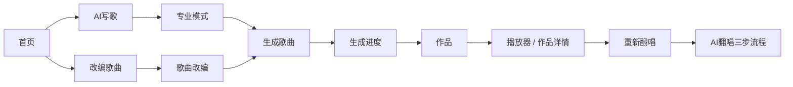

# 喵喵写歌 v1.1.0 实际交付需求

> 文档版本：`v1.1.0-as-built`
> App 版本：`1.1.0 (110)`
> 包名：`com.lxwx.catsinger`
> appCode：`catsinger`
> 校准日期：2026-07-31
> 校准方式：当前 Flutter 代码反向梳理 + Android 真机截图
> 文档状态：`active`

## 1. 文档用途

本文件记录当前已经完成并安装到测试设备上的 App 实际功能，用于需求验收和整 App 测试。它不删除旧 PRD，而是把“原计划”与“当前交付”分开，避免测试继续使用已经失效的四 Tab、首页 AI 翻唱入口等旧口径。

当前验收真源优先级：

1. Android 安装包 `1.1.0 (110)` 的可达页面和交互。
2. `/Users/soul/code/lxwx/catsinger` 当前 Flutter 路由、页面和 Controller。
3. 当前 Java 接口及 Flutter API 请求模型。
4. v1.0、v1.1 原始 PRD和设计图，仅用于识别差异。

旧需求与当前实现冲突时，不静默修改历史文档；差异统一记录在本文件第 12 节。

## 2. 产品定位

喵喵写歌是一款 AI 音乐创作 App。当前版本围绕“首页发起创作、后台生成歌曲、作品播放管理、会员与积分”提供闭环，并保留灵感写歌、热歌改编、场景写歌和 AI 翻唱的代码能力。

当前主路径为：

## 3. 当前信息架构

### 3.1 底部主导航

当前版本固定为 3 个底部 Tab：

| 序号 | Tab | 页面 | 登录要求 |
|---|---|---|---|
| 1 | 首页 | 品牌、宣传卡、创作入口、热门案例 | 可游客浏览；发起创作需登录 |
| 2 | 作品 | 生成中、失败、已完成作品 | 需要登录 |
| 3 | 我的 | 用户、会员、积分、邀请、客服、反馈、设置 | 可游客浏览；受保护功能需登录 |

当前没有独立“写歌”Tab，也没有“探索”Tab。

### 3.2 路由能力

| 路由 | 页面 | 当前主要入口 |
|---|---|---|
| `/song/create` | 歌曲创作容器 | 首页“AI写歌”“改编歌曲” |
| `/song/cover` | 独立 AI 翻唱三步页 | 作品详情或播放器“重新翻唱” |
| `/song/scenario/:code` | 场景写歌四步页 | 路由与代码存在，首页当前未直接暴露 |
| `/song/generating/:id` | 生成进度 | 创建歌曲或翻唱成功后、作品生成中条目 |
| `/song/works/:id` | 播放器 | 点击已完成作品 |
| `/song/work-detail/:id` | 作品详情 | 作品更多菜单“查看详情” |
| `/song/albums/:id` | 专辑详情 | 代码能力保留，作品页当前没有可见专辑入口 |

## 4. 首页

### 4.1 页面内容

- 顶部品牌：喵喵写歌。
- 宣传卡：让灵感变成音乐、生成你的专属 AI 歌曲、AI 作词/作曲/演唱。
- 创作入口：AI写歌、改编歌曲。
- 热门案例：后端有配置时展示真实歌曲；无配置时展示本地双列占位案例。
- 底部导航：首页、作品、我的。
- 有正在播放的歌曲时，主页面上方可展示迷你播放器。

### 4.2 按键与交互

| 控件 | 当前行为 |
|---|---|
| AI写歌 | 检查隐私授权和登录，进入“专业模式” |
| 改编歌曲 | 检查隐私授权和登录，进入“歌曲改编” |
| 真实热门案例 | 有可播放资源时进入配置歌曲播放器 |
| 本地占位案例 | 仅展示，不可播放 |
| 作品 Tab | 未登录跳登录；已登录打开作品页 |
| 我的 Tab | 打开我的页 |

### 4.3 页面状态

- 加载中：热门案例区域显示加载指示。
- 配置成功：展示后端返回的真实案例。
- 无配置或失败：使用本地占位案例，不阻塞首页。
- 游客点击创作：跳登录，登录成功后需要用户再次触发创作。

## 5. 专业模式与歌曲改编

### 5.1 页面入口

- 首页“AI写歌”。
- 首页“改编歌曲”进入同一创作容器的“歌曲改编”模式。
- 其他业务入口可通过 `SongCreateController` 指定 `custom` 或 `cover` 模式进入。

### 5.2 页面内容

- 返回按钮和顶部“简易模式 / 专业模式 / 歌曲改编”三个模式入口。
- 歌曲名称，最多 50 字。
- 歌词输入区，支持展开编辑和 AI 帮写入口。
- 人声选择：男声、女声。
- 纯音乐开关。
- 音乐风格、音乐场景、歌曲对象、音频参考。
- 底部固定“生成歌曲”按钮。

### 5.3 按键与校验

| 控件 | 行为/校验 |
|---|---|
| 返回 | 返回首页，未提交内容不自动生成 |
| 歌曲名称 | 实时计数，最多 50 字 |
| 歌词输入 | 人声歌曲需要有效歌词 |
| 展开歌词 | 进入大文本歌词编辑页 |
| AI 帮写 | 根据现有内容请求歌词辅助；成功后回填 |
| 男声/女声 | 单选并显示选中态 |
| 纯音乐 | 开启后不要求歌词；至少提供名称、曲风或参考音频之一 |
| 音乐风格 | 打开选择面板并回填摘要 |
| 音乐场景 | 打开选择面板并回填摘要 |
| 歌曲对象 | 打开选择面板并回填摘要 |
| 音频参考 | 支持录音或媒体库导入、上传、试听和删除；最长 5 分钟，最大 50MB（52,428,800 字节），恰好 50MB 允许，超过 1 字节即拒绝 |
| 生成歌曲 | 校验隐私、登录、必填项和积分；确认后创建任务 |

### 5.4 其他创作模式

当前代码仍保留以下能力，但首页没有直接可见入口：

- 灵感模式：音乐描述、灵感速递、人声、纯音乐、生成。
- 热歌改编：选择或上传来源、选择人声风格、曲风改编、生成。
- 场景写歌：送给谁、什么场景、想表达什么、喜欢什么风格，共四步。

这些能力进入“代码存在但当前主界面未直接暴露”的测试范围，不作为首页可达性通过项。

## 6. 生成进度

### 6.1 页面入口

- 创建歌曲或翻唱任务成功后自动进入。
- 点击作品页的生成中或生成失败条目进入。

### 6.2 页面内容与行为

- 显示任务百分比、当前阶段和辅助说明。
- 固定显示六个阶段：准备创作、生成歌词、生成音频、生成歌名、生成海报、保存作品。
- 每 3 秒轮询一次后端任务状态。
- 后端未确认成功前，模拟进度最高停在 99%。
- “退出等待”返回主页面，任务继续在后端执行。
- 成功后进入播放器；失败时显示失败阶段和原因。
- 返回和退出不取消任务，也不重复扣积分。

## 7. 作品

### 7.1 当前页面结构

- 页面标题：我的作品。
- 当前可见分类：我的音乐。
- 列表按状态展示生成中、失败、已完成作品。
- 当前作品页没有可见“专辑”Tab、创建专辑入口、“草稿歌曲”或“喜欢”Tab。

### 7.2 列表交互

| 作品状态 | 点击条目 | 更多菜单 |
|---|---|---|
| 生成中 | 打开生成进度 | 不允许删除 |
| 生成失败 | 打开失败进度 | 可删除 |
| 已完成 | 开始播放并进入播放器 | 查看详情、删除歌曲 |

其他行为：

- 下拉刷新作品列表。
- 空列表展示空态和“开始创作”入口。
- 从作品页离开时停止作品列表可见态轮询。
- 播放后返回主页面时可显示迷你播放器。

## 8. 播放器与作品详情

### 8.1 播放器

- 播放/暂停、上一首、下一首、拖动进度。
- 封面模式和歌词模式切换。
- 有逐句时间轴时跟随音频高亮并滚动；无时间轴时静态显示歌词。
- 私有作品支持更多操作；运营配置歌曲只提供播放能力。

### 8.2 作品详情

- 展示封面、标题、Prompt、歌词、模型、时长、积分和曲风。
- 支持播放、下载、分享、重新生成封面、加入专辑、重新生成、重新翻唱和删除。
- 分享内容未配置时给出明确提示或复制分享链接。
- “重新翻唱”进入独立 AI 翻唱三步页，并预选当前作品。

## 9. AI 翻唱

### 9.1 页面入口

- 当前主入口：已完成作品的播放器或作品详情“重新翻唱”。
- `/song/cover` 需要登录。
- 旧 v1.1 PRD 中的首页 AI 翻唱卡，当前首页未展示。

### 9.2 三步流程

1. 上传歌曲：
   - 从可播放作品库选择，或本地选择 `MP3/WAV/M4A/AAC/FLAC/MP4`。
   - 最大 50MB，时长 6 秒至 6 分钟。
   - 本地来源上传成功后使用平台资源地址。
   - 用户必须确认拥有合法使用权。
2. 选择音色：
   - 只展示启用的音色，按后台排序。
   - 支持试听和停止试听。
   - 至少选择一个音色才能继续。
3. 高级设置：
   - 保留原歌词、保留原伴奏。
   - 音高范围 `-6 ~ +6`。
   - 情感强度、混响。
   - 展示本次预计积分，默认 150，实际以后端模型配置为准。

创建成功后复用生成进度页和作品体系。

### 9.3 当前已知校验缺口

当前 Flutter 代码中：

- 第一步“下一步”只校验是否已选择音源，未把版权确认纳入按钮门禁。
- 提交请求固定发送 `copyrightConfirmed=true`，没有使用页面勾选值。

正确验收要求仍是“未确认版权不可进入下一步，也不可提交”。测试失败时登记缺陷，不能把当前缺口改写成产品需求。

## 10. 我的

### 10.1 页面内容

- 当前积分、设置入口。
- 头像、手机号或“立即登录”。
- SVIP 会员卡和会员有效期/升级入口。
- 八项菜单按顺序展示：积分充值、积分福利、订单列表、积分明细、邀请好友、联系客服、意见反馈、更多设置。
- 顶部积分余额和“积分充值”进入积分充值页；“订单列表”进入订单页；“积分明细”进入原积分详情页；“积分福利”进入任务中心。
- 底部导航：首页、作品、我的。

### 10.2 登录态

| 功能 | 游客 | 已登录 |
|---|---|---|
| 我的页浏览 | 可用 | 可用 |
| 设置、反馈、客服 | 可进入 | 可进入 |
| 会员、顶部积分、积分充值、订单列表、积分明细、积分福利、邀请 | 跳登录 | 进入对应页面 |
| 头像/账号 | 跳登录 | 展示脱敏手机号 |

## 11. 通用要求

### 11.1 UI 与适配

- Flutter 设计基准：`375x812`。
- 本次真机截图：`1080x2408`、Android 12、density 480。
- 抽查：`390x844`、`414x896`。
- 底部导航、固定生成按钮、迷你播放器和系统安全区不得互相遮挡。
- 键盘弹起时输入框保持可见，固定提交按钮不覆盖输入内容。
- 长标题、长歌词、长标签和空数据不得造成溢出或布局跳动。

### 11.2 登录、隐私与积分

- 首次启动必须先完成隐私授权；拒绝时不得初始化受限 SDK。
- 作品、创作、生成、会员、积分和订单操作需要登录。
- 生成前展示积分消耗并确认。
- 创建任务使用幂等键；失败时积分退款，成功时确认扣减。

### 11.3 资源

- 第三方生成结果不能直接作为最终作品地址。
- 音频、封面和歌词时间轴必须持久化到平台控制的本地或云存储。
- App 使用平台资源 URL；第三方临时 URL 过期不应影响已完成作品。

## 12. 旧需求与当前交付差异

| 旧需求/旧文档 | 当前 1.1.0 交付 | 当前处理 |
|---|---|---|
| 首页、写歌、作品、我的四 Tab | 首页、作品、我的三 Tab | 以三 Tab 验收 |
| 曾记录五槽导航/探索页 | 已不存在 | 旧 QA 基线归为历史 |
| 首页有独立 AI 翻唱入口 | 当前无 | 从作品详情/播放器进入 |
| 首页“改编歌曲”进入歌曲改编 | 当前进入歌曲改编模式 | 按当前行为测试 |
| 首页可进入场景写歌 | 路由和页面存在，首页未接入口 | 记录为不可达能力 |
| 首页图片写歌 | 当前页面无入口 | 不生成假用例 |
| 作品页歌曲/专辑分段 | 当前只显示我的音乐 | 专辑仅测接口/深层页面，不测主入口 |
| 草稿、喜欢可见 | Controller 有代码，UI 未开放 | 不作为可见 Tab 验收 |
| 热门案例无数据展示空态 | 当前展示本地占位案例 | 验证占位不可误当真实作品 |

## 13. 当前验收标准

- 真机启动后稳定展示三 Tab 首页，页面结构与本文件截图一致。
- 首页“AI写歌”进入专业模式，“改编歌曲”进入歌曲改编模式。
- 专业模式能完成输入校验、积分确认、任务创建和生成进度跳转。
- 生成中任务可退出等待并在作品页恢复查看。
- 已完成作品能播放、查看详情、下载、分享、删除和进入重新翻唱。
- AI 翻唱完成音源、版权、音色、设置、积分和创建任务闭环；版权门禁缺口必须修复后才可通过。
- 我的页登录态、会员、积分充值/明细/福利、邀请、客服、反馈和设置入口正确。
- `375x812` 主验收以及两档大屏抽查无溢出、遮挡和不可点击控件。
