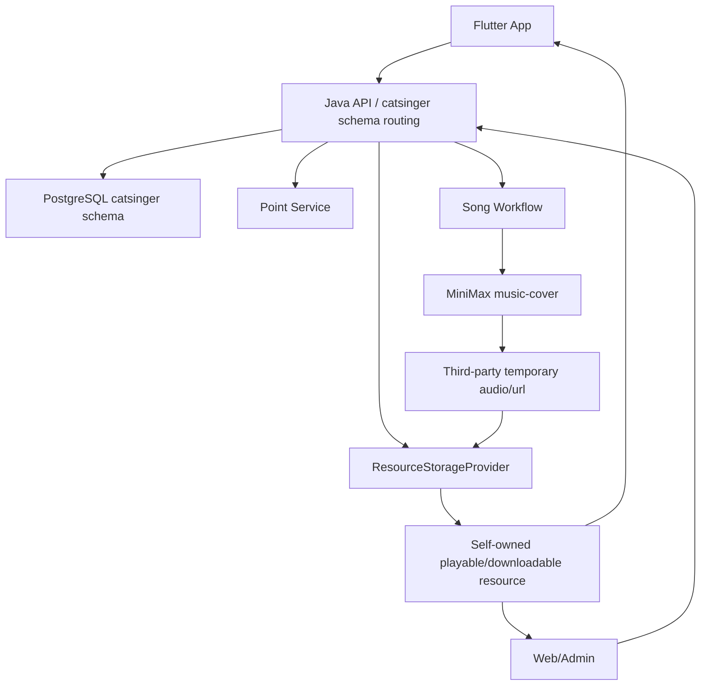
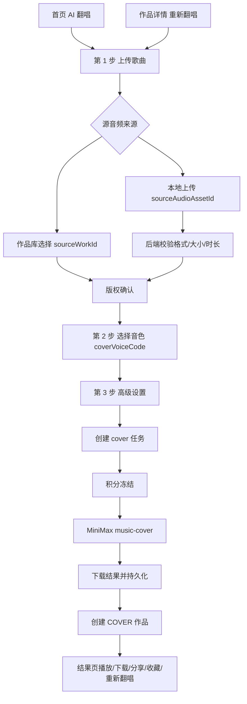
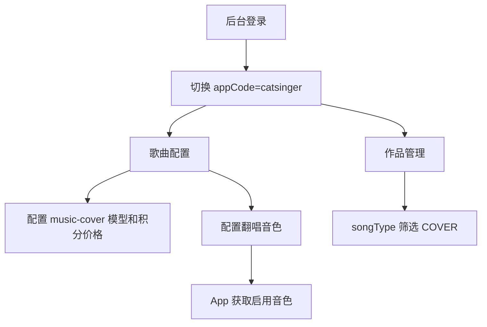
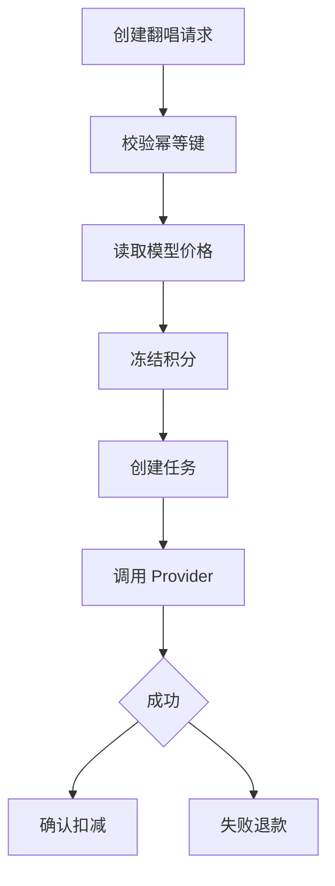

# 喵喵写歌 v1.1 AI 翻唱技术方案

> V2.1 名称校准：本文件描述的旧链路现称“AI 改编”，不包含声音克隆；仅作实现差异参考，禁止用于 V2.1 新“AI 翻唱（声音克隆）”编码。
> 版本：`v1.1-ai-cover`
> 变更：`CHG-0013 AI 翻唱功能`
> 状态：`reference-only`
> 创建日期：2026-06-25
> 关联需求：`../01-需求/v1.1-ai-cover/requirements.md`
> 参考资料：`../01-需求/references/docs/v1.1/ai翻唱.md`
> 设计稿：`../01-需求/references/images/v1.1/ai翻唱/`
> 外部依据：[MiniMax Music Generation](https://platform.minimax.io/docs/api-reference/music-generation)

---

## 1. 系统架构概述

### 1.1 总体架构

v1.1 在现有喵喵写歌 `catsinger` App 上新增 AI 翻唱链路。整体采用「Flutter App + Java Spring Boot 后端 + Web/Admin 后台 + PostgreSQL schema routing + 自有资源存储 + MiniMax Provider」架构。



核心原则：

- App 和 Admin 不直接使用第三方临时 URL。
- 源音频和生成结果都进入自有资源体系。
- 翻唱任务复用现有歌曲生成 workflow、积分、资源、作品体系，但使用独立 `mode=cover` 和 `songType=COVER`。
- `catsinger` 专属表和字段只放在 `db/migration/catsinger/`，不污染 narrate schema。

### 1.2 技术栈选型

| 层级 | 技术 | 当前工程事实 | 选型说明 |
|------|------|--------------|----------|
| App | Flutter | `/Users/soul/code/lxwx/catsinger` | 复用现有移动端工程 |
| App 状态 | GetX + Store | `get`、`store/` | 页面 Controller 管局部状态，Store 管跨页面配置 |
| App 路由 | go_router | `routes/` | 路由名集中管理 |
| App 网络 | Dio | `apis/` | 接口统一封装 |
| App 适配 | flutter_screenutil | 375x812 基准 | 对齐 v1.1 设计稿 |
| 后端 | Java + Spring Boot | `/Users/soul/code/lxwx/lxwx_service/lxwxservice` | 复用现有服务 |
| 数据库 | PostgreSQL + Flyway | common/narrate/catsinger 分层迁移 | App 级 schema 隔离 |
| 后端 ORM | MyBatis-Plus / Repository | 现有 Entity/Repository | 复用现有模式 |
| 资源 | ResourceStorageProvider | 本地上传目录，预留云存储 | 生成结果持久化 |
| 外部模型 | MiniMax `music-cover` | Provider 扩展 | 首期翻唱模型 |
| Admin | Flutter Web | `/Users/soul/code/lxwx/lxwx_admin` | 复用后台工程 |

---

## 2. 业务流程设计

### 2.1 App 用户流程



### 2.2 后端任务状态流

| 状态 | 说明 | 前端表现 |
|------|------|----------|
| `PENDING` | 任务创建成功，等待执行 | 生成中，阶段显示排队中 |
| `PROCESSING` | 音频校验、调用模型、处理结果 | 进度条和阶段文案 |
| `SUCCEEDED` | 已生成作品并持久化资源 | 进入翻唱结果页 |
| `FAILED` | 生成失败或资源处理失败 | 失败提示，积分退款 |
| `CANCELLED` | 后续预留 | v1.1 可不开放取消 |

### 2.3 Admin 配置流程



---

## 3. 数据库设计

### 3.1 迁移目录规则

AI 翻唱属于 `catsinger` 专属业务，只允许在：

```text
src/main/resources/db/migration/catsinger/
```

新增迁移。公共表不因 AI 翻唱新增字段；narrate schema 不创建翻唱表。

### 3.2 核心表与字段

#### 3.2.1 `catsinger_song_cover_voices`

翻唱音色配置表，由 Admin 维护，App 只读取启用音色。

| 字段 | 类型建议 | 说明 |
|------|----------|------|
| `id` | BIGINT / UUID | 主键 |
| `voice_code` | VARCHAR(64) | 音色编码，App 提交使用 |
| `display_name` | VARCHAR(64) | 展示名称 |
| `group_code` | VARCHAR(32) | `male/female/anime/special` 等 |
| `tags_json` | TEXT / JSONB | 标签数组 |
| `icon_url` | TEXT | 头像或图标 |
| `audition_audio_url` | TEXT | 试听音频 |
| `prompt_template` | TEXT | 给 Provider 的音色/风格提示模板 |
| `enabled` | BOOLEAN | 是否启用 |
| `sort_order` | INT | 排序 |
| `created_at` | TIMESTAMP | 创建时间 |
| `updated_at` | TIMESTAMP | 更新时间 |

索引：

- `UNIQUE(voice_code)`
- `(enabled, sort_order)`
- `(group_code, enabled, sort_order)`

#### 3.2.2 `catsinger_song_assets`

源音频上传复用歌曲素材资源表，补充或使用已有字段：

| 字段 | 说明 |
|------|------|
| `asset_type` | 增加或使用 `COVER_SOURCE_AUDIO` |
| `duration_ms` | 音频时长，上传时必须识别 |
| `mime_type` | 文件 MIME |
| `file_size` | 文件大小 |
| `resource_url` | 自有资源地址 |

#### 3.2.3 `catsinger_song_generation_tasks`

任务表补充翻唱字段：

| 字段 | 说明 |
|------|------|
| `mode` | `cover` |
| `song_type` | `COVER` |
| `source_work_id` | 从作品库选择时记录 |
| `source_audio_asset_id` | 本地上传时记录 |
| `source_audio_url` | Provider 可访问源音频 |
| `cover_voice_code` | 目标音色编码 |
| `cover_voice_name` | 创建时快照名称 |
| `cover_settings_json` | 高级设置 JSON |
| `copyright_confirmed` | 版权确认 |
| `progress_percent` | 进度 |
| `stage_text` | 阶段文案 |
| `estimated_remaining_seconds` | 预计剩余秒数 |

#### 3.2.4 `catsinger_song_works`

作品表补充翻唱字段：

| 字段 | 说明 |
|------|------|
| `song_type` | `ORIGINAL/COVER/INSTRUMENTAL` |
| `source_work_id` | 翻唱来源作品 |
| `source_audio_asset_id` | 翻唱来源音频资源 |
| `original_audio_url` | 原版播放地址 |
| `audio_url` | 翻唱成品播放地址 |
| `cover_voice_code` | 音色编码 |
| `cover_voice_name` | 音色展示名快照 |
| `cover_settings_json` | 高级设置快照 |
| `point_cost` | 消耗积分 |

---

## 4. API 接口规划

### 4.1 用户端接口

| 模块 | 方法 | 路径 | 鉴权 | 说明 |
|------|------|------|------|------|
| 翻唱音色 | GET | `/api/song-cover/voices` | 可匿名或登录 | 获取启用音色列表 |
| 翻唱源音频 | POST | `/api/song-assets/cover-source-audios` | 登录 | 上传本地翻唱源音频 |
| 翻唱任务 | POST | `/api/song-covers` | 登录 | 创建翻唱任务 |
| 翻唱任务 | GET | `/api/song-covers/{id}` | 登录 | 查询翻唱任务 |
| 作品 | GET | `/api/song-works` | 登录 | 列表补 `songType`、翻唱字段 |
| 作品 | GET | `/api/song-works/{id}` | 登录 | 详情补翻唱字段 |
| 作品下载 | POST | `/api/song-works/{id}/download-url` | 登录 | 获取自有资源下载地址 |
| 作品删除 | POST | `/api/song-works/disable` | 登录 | 隐藏或删除作品 |

### 4.2 Admin 接口

| 模块 | 方法 | 路径 | 说明 |
|------|------|------|------|
| App | GET | `/api/admin/apps` | App 切换列表 |
| 模型配置 | GET/POST/PUT | `/api/admin/song/models` | 包含 `music-cover` |
| 翻唱音色 | GET | `/api/admin/song/cover-voices` | 音色列表 |
| 翻唱音色 | POST | `/api/admin/song/cover-voices` | 新增音色 |
| 翻唱音色 | PUT | `/api/admin/song/cover-voices/{id}` | 编辑音色 |
| 作品管理 | GET | `/api/admin/song/works?songType=COVER` | 按类型筛选 |

### 4.3 `CreateCoverRequest`

```json
{
  "mode": "cover",
  "provider": "minimax",
  "model": "music-cover",
  "sourceWorkId": "可选，和 sourceAudioAssetId 二选一",
  "sourceAudioAssetId": "可选，和 sourceWorkId 二选一",
  "copyrightConfirmed": true,
  "coverVoiceCode": "warm_male",
  "preserveOriginalLyrics": true,
  "preserveOriginalAccompaniment": true,
  "pitchShift": 0,
  "emotionIntensity": "standard",
  "reverb": "studio",
  "idempotencyKey": "uuid"
}
```

校验规则：

- `copyrightConfirmed` 必须为 `true`。
- `sourceWorkId` 和 `sourceAudioAssetId` 必须二选一。
- 音频必须符合 6 秒到 6 分钟、最大 50MB。
- `coverVoiceCode` 必须存在且启用。
- `pitchShift` 取值 `-6 ~ +6`。
- `emotionIntensity` 取值 `soft/standard/passionate`。
- `reverb` 取值 `off/studio/concert`。

---

## 5. 外部 Provider 方案

### 5.1 MiniMax `music-cover`

MiniMax 官方 Music Generation 文档列出 `music-cover` 和 `music-cover-free`，其中 `music-cover` 用于 reference audio 的 cover generation；参考音频约束为 6 秒到 6 分钟、最大 50MB、常见音频格式。官方也说明 `output_format=url` 时 URL 会过期，需要及时下载。

本项目实现口径：

- 首期使用 `music-cover`。
- 源音频使用自有资源可访问 URL；如公网访问不可用，再使用 base64 方案。
- 输出优先使用 `hex` 或 `url` 后下载，统一转入 ResourceStorageProvider。
- 如后续需要改歌词，预留 `cover_feature_id` 两步模式，但 v1.1 默认不使用。

### 5.2 Provider 抽象

```text
SongGenerationProvider
├── MinimaxSongGenerationProvider
│   ├── generateSong()
│   ├── generateLyrics()
│   └── generateCover()
└── FutureProvider
```

Provider 输入：

- `provider`
- `model`
- `sourceAudioUrl` 或 `sourceAudioBase64`
- `prompt`
- `lyrics`
- `coverSettings`
- `audioSetting`

Provider 输出：

- `traceId`
- `audioBytes` 或临时 `audioUrl`
- `durationMs`
- `sampleRate`
- `bitrate`
- `size`
- `providerRawResponse`

---

## 6. 积分与幂等

### 6.1 计费配置

| 模型 | 默认积分 | 配置来源 |
|------|----------|----------|
| `music-cover` | 150 积分/首 | 后端模型配置 / Admin |

App 只展示后端返回的价格；后端为最终扣费权威。

### 6.2 计费流程



### 6.3 幂等规则

- `userId + appCode + idempotencyKey` 唯一。
- 相同幂等键重复提交返回原任务，不重复冻结积分。
- 任务失败后再次创建需生成新的幂等键。

---

## 7. 前端模块划分

| 模块 | 说明 | 影响文件 |
|------|------|----------|
| 首页入口 | AI 翻唱卡片和跳转 | `pages/song_home/`、`pages/main/` |
| 翻唱页面 | 三步流程、生成中、结果页 | `pages/song_cover/` |
| API | 音色、上传、创建、查询 | `apis/song.dart` |
| 模型 | 音色、请求、任务、作品字段 | `models/data/song.dart`、`models/params/` |
| Store | 音色缓存、模型价格 | `store/song.dart` |
| 作品联动 | songType、重新翻唱入口 | `pages/song_works/`、作品详情/播放器 |

---

## 8. 后端模块划分

| 模块 | 说明 | 影响范围 |
|------|------|----------|
| Cover Voice | 翻唱音色配置 | `app/catsinger/cover/`、Admin song |
| Song Asset | 翻唱源音频上传校验 | `app/catsinger/song/asset` |
| Song Generation | cover mode 请求和任务 | `app/catsinger/song/generation` |
| Workflow | cover workflow 步骤 | `app/catsinger/song/workflow` |
| Provider | MiniMax `music-cover` | `thirdparty/aimodel` / catsinger provider |
| Resource | 源音频和结果持久化 | `reusable/resource` |
| Point | 冻结、扣减、退款 | `point` |
| Admin | 音色配置、作品筛选 | `admin/song`、`admin/work` |

---

## 9. Web/Admin 技术方案

后台使用现有 Flutter Web Admin 工程，不新建后台项目。

页面调整：

- `catsinger/song_config_page` 增加翻唱音色 Tab。
- 模型配置支持 `music-cover`。
- 作品管理类型筛选支持 `ORIGINAL/COVER/INSTRUMENTAL`。

权限：

- 超级管理员可配置音色和模型。
- 普通角色通过角色管理分配配置权限。
- 所有 Admin 请求携带当前选择 appCode，后端按 appCode/schema 路由。

---

## 10. 非功能设计

| 维度 | 技术要求 |
|------|----------|
| 屏幕适配 | App 以 375x812 为主，390x844 / 414x896 抽查 |
| 上传安全 | 后端校验 MIME、扩展名、大小、时长 |
| 音频时长 | 无法识别时拒绝上传 |
| 资源安全 | App 不信任第三方 URL，只用自有资源 |
| 超时 | Provider 调用设置连接/读取超时 |
| 重试 | Provider 网络异常可短重试，业务失败不盲重试 |
| 日志 | 记录 provider、model、traceId，不记录 Token |
| 兼容 | 不影响 narrate schema 和 v1.0 写歌链路 |

---

## 11. 测试策略

### 11.1 后端

- Schema routing：catsinger 有翻唱表和字段，narrate 无翻唱专属表。
- 上传校验：格式、大小、时长、无法识别时长。
- 创建任务：版权确认、来源二选一、音色启用、积分不足、幂等。
- Provider mock：MiniMax 请求字段映射、结果下载、失败退款。
- 作品查询：`songType=COVER` 筛选和详情字段。
- Admin：音色 CRUD、模型价格、作品筛选。

### 11.2 Flutter App

- 入口：首页、作品详情、结果页重新翻唱。
- 第 1 步：作品库展开、作品选中、本地上传、版权确认、按钮状态。
- 第 2 步：音色加载、试听、选中、空态、错误态。
- 第 3 步：设置切换、音高、积分展示、提交 loading。
- 生成中：轮询、失败、退出后作品列表展示。
- 结果页：AB 切换、播放、下载、分享、收藏、重新翻唱、删除。

### 11.3 Web/Admin

- App 切换到 catsinger 后展示翻唱配置。
- 新增/编辑/禁用音色。
- 配置 `music-cover` 价格。
- 作品管理按 `COVER` 筛选并展示音色。

---

## 12. 风险与应对

| 风险 | 影响 | 应对 |
|------|------|------|
| MiniMax 真实配置未提供 | 无法真机生成 | 先 Mock Provider，真实配置后联调 |
| 第三方 URL 过期 | 作品无法播放 | 生成后立即下载并持久化 |
| 上传音频无法识别时长 | 无法判断是否符合限制 | 后端拒绝上传并提示用户换文件 |
| 音色效果不可控 | 用户不满意 | 后台音色可配置、可禁用、可排序 |
| 重复点击扣费 | 用户资金问题 | 幂等键 + 冻结积分唯一批次 |
| 云存储未就绪 | 资源访问范围受限 | 先本地上传目录，保留云存储 Provider |
