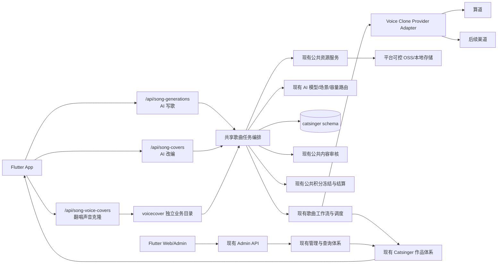
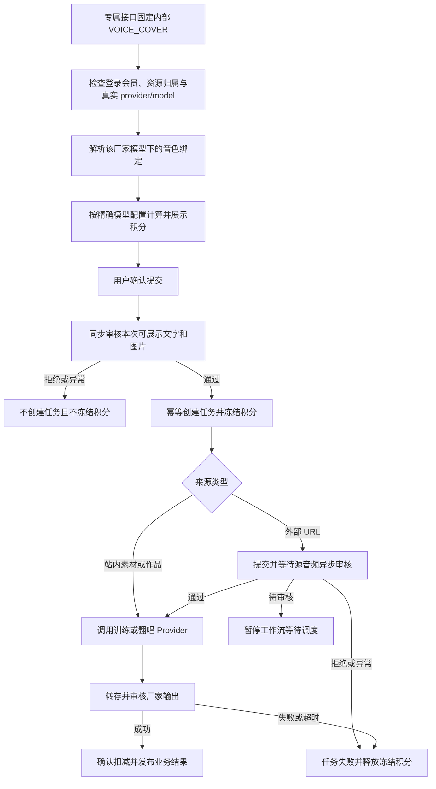

# 喵喵写歌 V2.1 翻唱声音克隆技术方案

> 文档版本：`v2.1-ai-cover-voice-clone`
> 变更编号：`CHG-0073`
> 状态：`done`
> 创建日期：2026-09-08
> 最后修订：2026-09-09（独立 `/api/song-voice-covers`、独立 `voicecover` 业务目录、共用内部工作流程、模型契约及最小数据库变更校准）
> 需求真源：`../../01-需求/v2.1-ai-cover-voice-clone/requirements.md`
> Product Review：`../../01-需求/v2.1-ai-cover-voice-clone/requirements-review.md`
> 需求检测：`../../01-需求/v2.1-ai-cover-voice-clone/detection-feedback.md`
> UI 真源：`../../01-需求/references/images/v2.1/ai-cover-voice-clone/`
> 厂家资料：[算道 API 文档](https://docs.qq.com/doc/DSUhISlNOWFNrQ1Bw)
> 代码基线：Flutter `/Users/soul/code/lxwx/catsinger`、Java `/Users/soul/code/lxwx/lxwx_service/lxwxservice`、Web/Admin `/Users/soul/code/lxwx/lxwx_admin`
> 评审修订：2026-09-08 已按当前 Java 资源、内容审核、歌曲工作流和积分实现重新对账；生成歌曲、AI 改编、翻唱声音克隆作为三个独立业务接入同一流程，现有 AI 改编零修改；2026-09-09 明确新增独立 `/api/song-voice-covers` 和与 `cover/` 同级的 `voicecover/` 业务目录，但不复制通用任务、工作流、模型、审核、积分、资源或作品体系；用户继续推进后，按当前 Flyway、Entity、资源台账与作品生命周期代码收缩数据库变更，删除重复字段和重复状态真源

---

## 0. 方案结论

### 0.1 本轮流程边界

- 第 3 步需求检测已由用户确认，结论为 `PASS`。
- 第 4 步 Figma 设计稿计划由用户明确跳过，状态记为 `skipped`，不生成 `figma-design-plan.md`。
- 跳过的是重复设计计划，不是取消 UI 约束。Flutter 页面仍以当前通道 `ujnpl6tr` 已定稿的 38 个 Frame 及本地导出为视觉真源；2026-09-09 核验节点清单未变化。
- 本文只完成第 5 步技术方案，不修改 Flutter、Java、Web/Admin 代码，不执行数据库迁移或真实厂家任务。

### 0.2 核心技术结论

1. 生成歌曲、AI 改编、翻唱声音克隆是三个独立业务，不是同一个产品功能，也不存在互相改名、替换或迁移关系；三者使用独立公开接口和内部业务类型。
2. 现有生成歌曲与 AI 改编保持零修改。尤其是 AI 改编当前的 `COVER`、`mode=cover`、`/api/song-covers`、`SongCoverPage`、模型配置、计费、任务和作品行为，CHG-0073 均不得调整。
3. 三个业务共用现有歌曲业务流程：请求校验与审核、模型和路由选择、报价与积分冻结、歌曲任务与工作流、Provider 调用、资源持久化、成品审核、结算或退款、作品保存和播放。
4. V2.1 翻唱声音克隆只在共用流程中增加内部 `VOICE_COVER` 业务类型、声音翻唱场景、音色引用、输入快照和专属步骤。公开请求不传 `mode`；`VOICE_COVER` 也绝不能作为厂家模型编码。声音训练是翻唱声音克隆的前置子流程，同样复用当前 AI 路由、计费、资源、审核和运维能力。
5. V2.1 新建与现有 `cover/` 同级的 `app/catsinger/voicecover/` 独立业务目录，集中承载翻唱声音克隆的公开 Controller/DTO、音色资料、训练、渠道绑定、专属校验和工作流步骤。目录和公开接口独立不等于流程另起一套：`/api/song-voice-covers` 在服务端固定内部 `VOICE_COVER` 后，继续复用 `generation + songworkflow + works`、统一模型路由、审核、积分、资源和 Admin 基础设施；Provider 适配放在 `thirdparty/aimodel/music/voiceclone`。
6. 图片、音频和可展示文字继续复用现有“资源台账 + 内容审核记录 + 业务工作流门禁”：文件先保存为技术可用资源，审核结论独立记录；资源 `READY` 不代表内容审核通过。
7. 音色训练和翻唱均为平台异步任务。V2.1 不使用算道回调，不提供取消，通过调度器主动轮询。
8. 翻唱任务创建后的平台侧排队不计入 10 分钟。调度器取得容量、厂商确认接单并返回可查询任务标识后，记录 `providerAcceptedAt` 并计算 `deadlineAt = providerAcceptedAt + 10 分钟`；厂商侧排队、生成、平台资源持久化、探测、成品审核和作品完成均计入。截止时仍未形成已持久化、已审核、可播放作品即超时失败并释放积分。
9. 厂家临时 URL 只作为输入源，模型、配置、试听和翻唱成品必须转存到平台可控存储。输出格式以实际文件探测结果为准，不固定为 MP3。
10. 多渠道切换基于现有 AI 模型、场景映射和容量控制能力。`/api/song-config/models` 为声音翻唱场景返回后台配置的真实 `provider/model`，App 创建任务时原样提交；本人音色必须在该精确厂家组合上有有效绑定。
11. 翻唱声音克隆使用独立 `POST /api/song-voice-covers` 和对应专属查询接口；公开请求不传 `mode`，`SongVoiceCoverController` 固定内部 `VOICE_COVER` 后委托共用任务编排。不得调用或修改 AI 写歌 `/api/song-generations` 与现有 AI 改编 `/api/song-covers` 的公开契约。
12. 「翻唱声音克隆」是唯一产品展示名；`VOICE_COVER`、`song.voice.cover.generate`、`/ai-cover`、`/api/song-voice-covers` 与 `/api/song-voices/**` 作为稳定内部类型、场景、页面和接口契约。厂家模型始终使用 `model` 单独表达，不能填业务类型、展示名称或移动端兼容别名。

| 独立业务 | 当前模式/场景 | V2.1 处理方式 | 共用流程 |
|----------|---------------|----------------|----------|
| 生成歌曲 | `SCENE_SONG`、`INSPIRATION_SONG`、`ADVANCED_SONG` / `song.generate` | 完全保持当前实现 | 现有 `SongGenerationService`、歌曲工作流、计费、资源、作品 |
| AI 改编 | `COVER_SONG` / `song.cover.generate` | 完全保持当前实现 | 同上 |
| 翻唱声音克隆 | 新增 `VOICE_COVER` / `song.voice.cover.generate` | 新建 `voicecover/` 业务目录，并通过模式处理器接入共用流程 | 同上 |

### 0.3 基线差异提醒

- `workflow.md` 将现有安装包基线记录为 `v1.2.0+121-as-built`，当前 Flutter `pubspec.yaml` 实际为 `1.2.0+120`。进入编码前必须以准备发布的真实分支和构建号重新冻结基线，不能在技术方案阶段猜测修正版本号。
- 当前 `song.cover.generate`、`COVER`、`mode=cover` 和相关后台配置全部属于现有 AI 改编。V2.1 不修改这些编码、展示或行为，也不复用它们表达声音克隆。
- 当前 `app/catsinger/cover/` 中的 `SongCoverController`、`SongCoverVoiceEntity` 和 `coverVoiceCode` 属于现有 AI 改编；其中音色是运营配置的声线/风格预设，实体注释已明确“不是用户训练出的专属声纹”。V2.1 不向该目录加入本人音色、训练任务或渠道模型绑定。
- 当前 `SongConfigService.toCoverModelResponse` 会为旧 AI 改编输出 `music-cover` 移动端兼容别名。该兼容逻辑必须保持原样且仅限 `song.cover.generate`；新增 `song.voice.cover.generate` 必须直接返回 `AiModelConfigResponse.providerCode/modelCode` 的真实配置值。

### 0.4 当前后端处理逻辑对账

- `ResourceStatuses` 只包含 `UPLOAD_PENDING/READY/LOCAL_RETAINED/OSS_UPLOAD_FAILED/OVERDUE/FAILED/DELETED` 等技术状态，并明确不代表素材、作品或审核业务状态；本方案不新增 `QUARANTINED`。
- 资源访问继续使用 `PUBLIC/OWNER/INTERNAL`。V2.1 训练素材、源歌曲和未发布官方试听必须使用 `OWNER` 或 `INTERNAL` 受控访问；当前图片默认公开的规则不能直接用于未审核头像，编码时需为 V2.1 私有图片类型补受控范围或等价的专用上传策略。
- 审核事实继续写入 `content_moderation_records`，沿用 `PENDING/PASS/REVIEW/REJECT/ERROR`、`request_snapshot_json`、Provider 任务和轮询字段，不新增通用 `contentVersion`。
- 当前歌曲创建在任务和积分冻结前同步审核文字/图片；任务内只对外部 URL 型源音频提交并等待异步审核，站内素材与作品直接跳过；成品转存后再做输出审核，拒绝或异常走现有失败补偿。
- V2.1 与现有 AI 改编保持一致：`sourceAudioAssetId/sourceWorkId/referenceAudioAssetId` 均作为站内可信来源，任务内不重复提交第三方源音频审核。V2.1 新上传音频在上传完成阶段建立审核记录，只有审核通过的素材才能成为站内可信输入。

---

## 1. 系统架构

### 1.1 整体架构



### 1.2 技术栈

| 层级 | 当前技术 | V2.1 使用方式 |
|------|----------|---------------|
| 移动端 | Flutter、Dart、GetX、go_router、Dio、flutter_screenutil | 新建独立 `ai_cover` 功能模块；复用登录、会员、积分、资源上传、音频播放和当前播放器 |
| 原生媒体 | Android MediaExtractor/MediaMuxer、iOS AVFoundation、`record` | 复用录音与视频音轨提取能力；新增 V2.1 时长和格式规则，不改变现有 AI 改编的 6 分钟限制 |
| 后端 | Java 21、Spring Boot 3.3、Gradle、MyBatis-Plus | 新建 `app/catsinger/voicecover/` 业务模块；通过明确委托接入现有生成/工作流/作品，不把新业务规则继续堆入 `cover/` 或通用 Controller |
| 数据库 | PostgreSQL、Flyway、App schema routing | 公共能力继续在 `common`，V2.1 业务表只在 `catsinger` schema 创建 |
| 异步控制 | Spring Scheduler、Redis、数据库任务状态、AI control plane | 数据库为业务状态真源；Redis 只做短期锁、限流和调度协助 |
| 资源 | `IResourceService`、本地/OSS、受控访问 URL | 复用现有资源状态与 `PUBLIC/OWNER/INTERNAL`；资源可读取和业务可使用分别判断，厂家结果必须转存 |
| 审核 | `ContentModerationService`、`content_moderation_records`、异步音频审核 | 复用文字/图片同步审核、源音频与成品异步审核，按目标和送审快照留痕 |
| 计费 | `PointChargeService`、`AiModelInvocationService` | 在现有计费体系中按场景使用不同计费项，并复用报价快照、冻结、确认和释放 |
| 模型路由 | `ai_model_configs`、`ai_scene_model_mappings`、AI control plane | 新增训练和声音翻唱场景；向 App 返回真实 `provider/model`，保存厂家模型、能力、价格和限制快照 |
| Web/Admin | Flutter Web、Dio、现有 Shell/App 切换器 | 在现有模型管理、AI 运营、歌曲配置、作品、资源和角色模块中增加 翻唱声音克隆能力 |

### 1.3 复用与新增边界

| 能力 | 处理方式 | 原因 |
|------|----------|------|
| 登录、会员、积分账户 | 复用 | 已有 App 隔离和鉴权能力 |
| 资源存储、OSS、受控访问 | 复用并补 V2.1 私有资源类型 | `READY` 继续只表示物理对象可用；未审核内容由审核记录和业务查询门禁阻断 |
| 内容审核 | 复用并扩展人工复核元数据 | 已支持文本、图片、音频及异步轮询 |
| AI 模型/场景配置 | 复用并新增场景 | 已支持 Provider、商家模型、公开选项和计费映射 |
| 生成歌曲 | 保持当前链路，零修改 | V2.1 不影响已有写歌模式和作品 |
| AI 改编 | 保持当前链路，零修改 | 不改名称、页面、接口、配置、任务、作品或交互 |
| 翻唱声音克隆业务模块 | 新建 `app/catsinger/voicecover/` | 与 `cover/` 同级、业务代码互不混放；集中维护声音资料、训练、绑定、专属校验和流程接入 |
| 声音克隆音色、训练任务 | 在 `voicecover/` 新增 | 与现有 AI 改编配置互不覆盖，但继续接入统一模型、资源、审核、计费和运维体系 |
| 翻唱声音克隆生成任务 | `voicecover/` 提供独立 `/api/song-voice-covers` 并处理业务准备，再委托现有歌曲任务/工作流 | 公开接口隔离语义，服务端固定内部 `VOICE_COVER`，以真实 `provider/model` 选定厂家能力，同时复用状态、调度、审核、计费、补偿和作品链路 |
| 播放器 | 复用现有 `SongPlayerPage` | PRD P12 已明确不新建结果页、不重做播放器 UI |

### 1.4 当前业务体系一致性约束

下表中的扩展都发生在现有统一流程内。三个业务使用不同公开接口、内部类型和场景选择各自参数与步骤，但共享任务状态机、执行器、计费补偿、资源、审核、作品和运维入口。

| 当前能力 | V2.1 接入方式 | 允许新增的最小内容 |
|----------|---------------|--------------------|
| App/schema 路由 | 继续使用 `X-App-Code: catsinger` 和现有 schema routing | 无 |
| Catsinger 业务目录 | 新建 `app/catsinger/voicecover/`，专属 Controller 固定内部 `VOICE_COVER` 后委托共享任务编排 | 新业务的 Controller、DTO/VO、领域对象、实体、Repository、Service 和工作流步骤实现 |
| Provider、商家模型、场景映射、模型选项 | 在现有 AI 模型管理中增加 `song.voice.train`、`song.voice.cover.generate` 场景；公开模型响应携带真实 `provider/model` | 声音模型特有的协议元数据与渠道绑定字段 |
| 积分与价格 | 继续使用 `point_billing_items`、模型选项、`BillingQuote` 和冻结/结算/释放链路 | 两个新场景对应的计费项配置 |
| 歌曲生成任务 | `/api/song-voice-covers` 接收真实 `provider/model` 和翻唱专属字段；服务端生成内部 `VOICE_COVER` 命令并进入现有 `catsinger_song_generation_tasks` 和歌曲工作流 | 独立 HTTP 契约、内部业务类型、精确厂家模型校验、音色版本引用、声音翻唱步骤及快照字段 |
| 音色训练任务 | 使用同一 AI 路由、调用记录、容量、计费和 Admin 运维聚合；训练业务状态由 Catsinger 音色训练表承载 | 音色资料、素材、模型版本、渠道绑定和训练任务 |
| 资源与审核 | 继续使用 `IResourceService`、Catsinger asset 和 `content_moderation_records` | V2.1 私有资源类型、上传完成触发审核、必要人工复核字段 |
| 作品与播放 | 继续使用 `catsinger_song_works`、现有作品接口和 `SongPlayerPage` | `VOICE_COVER` 类型、音色/来源引用和实际输出属性 |
| Web/Admin | 继续使用现有 Shell/App 切换、模型、计费、AI 运维、作品、资源、角色和审计模块 | 场景/类型筛选、音色管理子页和少量专属动作权限 |

允许新建独立 `voicecover/` 业务目录，明确禁止新建第二套 Provider/模型配置表、第二套积分账户或扣费服务、第二套资源/审核状态机、声音翻唱专用生成任务/作品表、独立 Admin App 切换或角色系统，以及覆盖上述能力的 `/api/ai-cover/**` 或 `/api/admin/ai-cover/**` 总入口。

---

## 2. 领域边界与代码结构

### 2.1 Java 领域结构

新增与现有 `cover/` 同级的 `voicecover/` 业务目录。它是独立业务边界，不是独立技术底座：

```text
src/main/java/com/lxwx/narrateservice/app/catsinger/
├── cover/                      # 现有 AI 改编；保持原样，不承载声音克隆
├── voicecover/                 # V2.1 翻唱声音克隆独立业务目录
│   ├── controller/             # /api/song-voices/**、训练接口及独立 /api/song-voice-covers
│   ├── domain/                 # 音色、模型版本、渠道绑定、训练状态及业务常量
│   ├── dto/                    # CreateSongVoiceCoverRequest、声音资料/训练请求及内部命令
│   ├── entity/                 # 音色资料、素材关系、模型版本、渠道绑定、训练任务和授权记录
│   ├── repository/             # 上述专属表的数据访问
│   ├── service/                # 资料、训练、绑定、授权及 VoiceCoverApplicationService
│   ├── vo/                     # 用户端音色、训练任务和可用性响应
│   └── workflow/step/          # 实现共享歌曲工作流 SPI 的声音训练/翻唱专属步骤
├── generation/                 # 保留 AI 写歌接口；提供内部共享任务编排、持久化、冻结与启动
├── songworkflow/               # 共享工作流引擎、定义、步骤表、事件、调度和补偿
├── asset/                      # 扩展源歌曲、训练素材和试听资源类型
└── works/                      # 扩展 VOICE_COVER 作品查询与生命周期

src/main/java/com/lxwx/narrateservice/admin/
├── aimodel/                    # 复用模型、场景映射和公开模型选项
├── aioperations/               # 复用任务总览、任务详情、运行态和容量策略
├── song/                       # 增加本人/官方音色和 VOICE_COVER 作品管理
├── resource/                   # 复用资源台账、受控预览和存储重试
└── role/                       # 复用角色权限分配

src/main/java/com/lxwx/narrateservice/thirdparty/aimodel/music/voiceclone/
├── channel/IVoiceCloneModelProvider.java
├── service/VoiceCloneModelService.java
├── dto/                        # 供应商无关命令和结果
└── channel/suandao/            # 算道适配器及 HTTP Client
```

约束：

- `cover/` 只属于现有 AI 改编。`voicecover/` 不引用 `SongCoverVoiceEntity/SongCoverVoiceService`，也不复用 `coverVoiceCode` 表达克隆音色；新业务使用 `voiceProfileId/voiceModelVersionId/voiceProviderBindingId`。
- `voicecover/` 拥有翻唱声音克隆的业务规则和专属持久化；`generation/songworkflow/works` 继续拥有通用歌曲任务、执行引擎、计费补偿、资源结果和作品生命周期，不能复制到新目录。
- `SongVoiceCoverController` 只暴露 `/api/song-voice-covers`，接收 `CreateSongVoiceCoverRequest`；它不接受客户端业务模式，而是调用 `VoiceCoverApplicationService` 固定构造内部 `VOICE_COVER` 命令。
- `VoiceCoverApplicationService` 校验源歌曲、音色版本、厂家绑定、授权、价格和输入快照，再把 `VoiceCoverCreateCommand` 映射为共享任务命令，委托 `generation` 内部任务编排完成任务落库、冻结积分和入队。公开接口独立，任务生命周期不复制。
- `SongGenerationController` 的 `/api/song-generations` 继续只服务现有 AI 写歌；`SongCoverController` 的 `/api/song-covers` 继续只服务现有 AI 改编。两者的公开 DTO 和行为均不因 V2.1 改变。
- `voicecover/workflow/step` 只实现声音训练/翻唱专属步骤并注册到共享 `songworkflow` 引擎；步骤状态、租约、事件和补偿仍写现有工作流表。
- `thirdparty/.../voiceclone` 只做能力适配、请求映射、状态归一化和返回解析。
- Controller 只做参数绑定、鉴权和返回；业务校验进入 Service；SQL 只在 Repository/Mapper。
- `CreateSongVoiceCoverRequest` 是翻唱声音克隆的专属 HTTP DTO，不继承也不复用 `CreateSongGenerationRequest`，且不定义 `mode`。`VoiceCoverCreateCommand` 是专属应用命令，内部 `creationMode=VOICE_COVER` 由服务端设置，不从请求体复制。
- `provider/model` 精确选择后台已启用的厂家模型。`modelOptionId` 如继续随请求携带，只能用于配置追溯与一致性校验，不能代替真实 `provider/model`。任何客户端字段都不能覆盖内部 `VOICE_COVER`。

### 2.2 业务编码

| 范围 | 生成歌曲（现有） | AI 改编（现有） | V2.1 翻唱声音克隆（新增） |
|------|------------------|------------------|-----------------------|
| 用户入口 | 保持当前实现 | 保持当前实现 | `翻唱声音克隆 NEW` |
| 创建接口/内部类型 | `/api/song-generations`；沿用现有模式 | `/api/song-covers`；`COVER_SONG` | `/api/song-voice-covers`；服务端固定 `VOICE_COVER`，公开请求无 `mode` |
| 作品类型 | 保持当前类型 | `COVER` 保持当前含义 | 新增 `VOICE_COVER` |
| 训练任务 | 无 | 无 | `VOICE_TRAINING` |
| 工作流 | `MUSIC_TEXT_TO_SONG_V1`、`MUSIC_ADVANCED_SONG_V1` | `MUSIC_COVER_SONG_V1` | 在同一工作流引擎增加 `MUSIC_VOICE_TRAIN_V2_1`、`MUSIC_VOICE_COVER_V2_1` |
| AI 场景 | `song.generate` | `song.cover.generate` | 新增 `song.voice.train`、`song.voice.cover.generate` |
| 计费项 | 保持当前配置 | 保持当前配置 | 在现有模型/计费配置中新增训练与声音翻唱计费项，默认 100/200 |
| 用户接口 | `/api/song-generations` 保持不变 | `/api/song-covers` 保持不变 | 音色/训练使用 `/api/song-voices/**`；翻唱使用独立 `/api/song-voice-covers` 并传真实 `provider/model` |
| 作品与操作 | 保持当前实现 | 保持当前实现 | 新增 `翻唱声音克隆` 标签和“重新翻唱” |

现有 `COVER` 数据、配置和展示均不修改，不批量迁移为 `VOICE_COVER`。新模式只写入 V2.1 新任务；不得通过前端文案、后台配置迁移或 SQL 清理去“校准”AI 改编。

---

## 3. 核心状态机与流程

### 3.1 内容审核状态

| 状态 | 含义 | 是否可进入业务 |
|------|------|----------------|
| `PENDING` | 等待审核 | 否 |
| `PASS` | 当前送审目标通过 | 是 |
| `REVIEW` | 需要复核；用户端仍按审核中/不可用处理 | 否 |
| `REJECT` | 当前送审目标拒绝 | 否，必须修改或重传 |
| `ERROR` | 审核异常 | 否，可幂等重试 |

审核事实沿用当前 `appCode + stage + targetType + targetId + contentType` 和 `request_snapshot_json`。新上传、重新截取或重新生成内容必须创建新的素材/目标 ID；文字发生变化时创建新的送审记录和请求快照，不能复用旧内容的 `PASS` 结论。音色资料与模型可以保留业务发布修订，但不把该修订泛化成公共审核的 `contentVersion`。

### 3.2 音色与模型状态

```text
DRAFT -> REVIEWING -> READY_TO_TRAIN -> QUEUED -> TRAINING
      -> SAVING_MODEL -> AVAILABLE
      -> FAILED
AVAILABLE -> UNAVAILABLE -> AVAILABLE 或重新训练
任意非运行中状态 -> DELETED
```

- `AVAILABLE` 需要至少一个有效渠道绑定、平台自有模型/配置快照和可播放试听资源。
- 算道 ID 或执行资源失效时进入 `UNAVAILABLE`，用户端显示“音色暂不可用”，不删除音色和历史作品。
- 重新训练创建新的 `modelVersion`，旧 `AVAILABLE` 版本不受新任务失败影响。
- 用户删除音色后立即禁止新任务；已运行任务保留事实，历史作品按作品规则处理。

### 3.3 训练任务状态

```text
CREATED -> QUEUED -> SUBMITTING -> PROVIDER_QUEUED -> TRAINING
        -> PERSISTING_MODEL -> REVIEWING_AUDITION -> AVAILABLE
        -> FAILED / SUBMIT_UNKNOWN / TIMED_OUT
```

- 训练超时由路由配置，不套用翻唱固定 10 分钟；具体值在商家模型上线前实测并配置。
- `SUBMIT_UNKNOWN` 表示 HTTP 结果不确定且厂家没有可验证的幂等查询能力。该状态不得自动再次提交，以免重复训练和重复成本。
- 厂家成功后先转存模型、配置和试听，再更新渠道绑定；任一必需资源缺失时不能进入 `AVAILABLE`。

### 3.4 翻唱任务状态

```text
CREATED -> QUEUED -> SUBMITTING -> PROVIDER_QUEUED -> GENERATING
        -> PERSISTING_OUTPUT -> REVIEWING_OUTPUT -> CREATING_WORK
        -> SETTLING -> SUCCEEDED
        -> FAILED / SUBMIT_UNKNOWN / TIMED_OUT
```

成功必须同时满足：

1. 所有关联输入完成当前工作流要求的审核，歌曲权利和目标声音授权有效。
2. 厂家任务成功且结果可下载。
3. 结果转存到平台可控存储。
4. 后端识别真实格式、MIME、大小、时长并完成可播放探测。
5. 成品安全审核通过。
6. `VOICE_COVER` 作品创建完成。
7. 积分冻结单确认成功。

平台侧 `QUEUED` 不设置生成截止时间。调度器取得容量并提交厂商后，只有明确收到厂商可查询任务标识才写入 `providerAcceptedAt` 和 `deadlineAt = providerAcceptedAt + 10 分钟`。从 `PROVIDER_QUEUED/GENERATING` 到 `PERSISTING_OUTPUT/REVIEWING_OUTPUT/CREATING_WORK` 均受同一截止时间约束；到期仍未满足全部成功条件时进入 `TIMED_OUT` 并释放冻结积分，迟到结果进入后台核对，不自动创建作品或扣费。如果厂家已成功但平台后续步骤尚未完成，只允许在剩余时间内重试资源保存、探测、审核或作品入库，不得再次调用厂家。

### 3.5 报价与提交



价格来自请求中真实 `provider/model` 对应的当前模型配置和 `point_billing_items`，不新增限时 `quoteId` 记录。读取/计算价格不冻结积分，因此允许在素材审核过程中展示；用户最终提交时重新检查会员、站内素材审核结论、资源归属、文字/图片审核、精确厂家模型、音色绑定和 `pricingVersion`。模型或价格变化时 App 刷新模型列表并再次确认，后端不能静默换成另一厂家模型。站内素材、作品和参考音频沿用现有 AI 改编逻辑，在任务内跳过重复源媒体审核；只有仍以外部 URL 传入的来源才执行 `SUBMIT_SOURCE_MEDIA_REVIEW/WAIT_SOURCE_MEDIA_REVIEW`。

---

## 4. 数据库设计

### 4.1 迁移规则

- V2.1 业务表只放在 `src/main/resources/db/migration/catsinger/`。
- 当前 `common` 最高版本为 `V4.7`，`catsinger` 最高版本为 `V4.6`。按当前基线建议新增 `catsinger/V4.8__catsinger_voice_clone_cover.sql`；编码前必须重新扫描当前 schema 会加载的全部 location，若版本已占用则顺延，禁止改写已执行迁移。
- Q-A04 已确认上线人工复核，因此公共审核表建议另增 `common/V4.9__content_moderation_manual_review.sql`。它只补人工结论与审计字段，不创建 Catsinger 专属业务表或第二套审核状态机。
- `narrate`、`catseller` 等 schema 不创建 `catsinger_song_voice_*` 表。
- 独立 `/api/song-voice-covers` 只是公开业务边界，不构成另建歌曲任务、作品、资源、报价或积分表的理由。

### 4.2 新增 Catsinger 表

| 表 | 关键字段 | 用途 |
|----|----------|------|
| `catsinger_song_voice_profiles` | `id,user_id,owner_type,status,current_display_version_id,current_model_version_id,deleted_at` | 本人/官方音色稳定业务身份 |
| `catsinger_song_voice_profile_versions` | `profile_id,version_no,display_name,avatar_asset_id,intro,tags_json,rights_status,status,lock_version` | 名称、头像、简介和官方音色的发布修订；与公共内容审核版本无关 |
| `catsinger_song_voice_materials` | `profile_id,asset_id,source_type,trim_start_ms,trim_end_ms,duration_ms,quality_status,quality_json,warning_confirmed,retain_until_at` | 训练素材及截取、质量、保留信息 |
| `catsinger_song_voice_model_versions` | `profile_id,version_no,status,audition_asset_id,training_task_id,available_at,unavailable_reason` | 用户可选择的具体音色模型版本 |
| `catsinger_song_voice_provider_bindings` | `model_version_id,provider_code,model_code,protocol_code,provider_voice_id,provider_model_ref,model_resource_id,config_resource_id,status,provider_expires_at` | 某模型版本在每个渠道下的独立执行绑定 |
| `catsinger_song_voice_training_tasks` | `public_id,user_id,profile_version_id,model_version_id,idempotency_key,status,route_snapshot_json,provider_task_id,query_token,charge_order_no,next_poll_at,deadline_at,error_code,error_message` | 训练异步任务与提交时业务快照；训练产物是音色模型，不冒充歌曲任务 |
| `catsinger_song_voice_consent_records` | `user_id,consent_type,consent_version,profile_id,task_id,content_hash,confirmed_at` | 本人声音、歌曲权利和风险授权留痕 |

这 7 张表只承载当前数据库不存在的声音身份、发布修订、多段素材、训练模型版本、厂家绑定、训练生命周期和授权证据。它们不是第二套歌曲业务流程。

现有 `catsinger_song_cover_voices` 继续只表示 AI 改编的运营声线/风格预设，不增加用户归属、训练素材或厂家声纹模型字段。V2.1 不复用或迁移该表。

不新增 `voice_cover_drafts/voice_cover_quotes/voice_cover_tasks` 三套平行表：提交前草稿复用 Flutter 当前创作草稿持久化方式；报价复用 `BillingQuote + point_billing_items`；声音翻唱生成任务复用 `catsinger_song_generation_tasks`、工作流步骤、补偿和事件表。

### 4.3 复用表的必要变更

#### `catsinger_song_assets`

本期不新增字段。现表已有 `mime_type`、`file_size`、`duration_ms`、存储位置、对象 Key、状态和 `meta_json`；公共 `resource_records` 已保存真实 MIME、大小、访问范围、本地/OSS 位置及保留期限。`catsinger_song_voice_materials.asset_id` 只建立训练素材业务关系，不复制资源事实。

不向素材表增加 `resource_record_id`、`detected_format`、`detected_mime_type`、`retain_until_at`、`deleted_at`、`QUARANTINED` 或通用审核版本。现有资源访问服务已能从平台资源地址解析资源 ID；实际格式放在公共资源台账的 `content_type`、对象 Key 和 `meta_json` 中，不能再在素材与作品各维护一份真源。

素材 `READY/FAILED` 与资源 `READY/LOCAL_RETAINED/...` 继续只描述上传和物理存储事实；业务是否可用于训练、翻唱、官方发布或公共展示，按当前目标在 `content_moderation_records` 中的审核结论和工作流步骤判断。V2.1 新上传或重新截取得到新的素材 ID，旧素材的通过结论不能自动复用。

#### `catsinger_song_works`

只补 `voice_profile_version_id` 和 `voice_model_version_id`，用于定位本次作品实际使用的展示修订和声音模型版本。不可变的显示与路由摘要继续写入现有 `creation_params_json`，不依赖音色当前资料覆盖历史作品。

现有字段和服务继续负责其余事实：

- `generation_task_id` 已关联声音翻唱生成任务，不增加重复的 `voice_cover_task_id`。
- `source_work_id/source_audio_asset_id/source_audio_url` 已覆盖作品库和上传歌曲来源，不增加 `source_song_asset_id`。
- `audio_url/audio_urls_json`、`duration_ms` 和现有存储字段继续保存平台作品入口；真实 MIME、大小、格式和资源保留状态以 `resource_records` 为准，不在作品表复制。
- 当前 `SongWorkLifecycleService` 已按 `created_at` 执行 15 天隐藏和 30 天物理清理，本期不增加 `visible_until_at/purge_after_at/lifecycle_status` 第二套生命周期真源。

现有 `song_type` 字段新增业务值 `VOICE_COVER`，无需新增同名字段。现有 `song_type=COVER` 保持当前解释和行为，不回填为 `VOICE_COVER`。

#### `catsinger_song_generation_tasks`、工作流与计费表

- 现有 `creation_mode` 和 `song_type` 字段分别新增业务值 `VOICE_COVER`，不增加同名列。
- 最小新增 `voice_profile_version_id`、`voice_model_version_id`、`voice_provider_binding_id`、`consent_record_id`、`provider_accepted_at`、`deadline_at`。前三项固定本次选中的展示修订、模型版本和精确渠道绑定；授权记录支持长期审计；两个时间字段在平台排队时保持空值，厂商确认接单后一次性写入。
- 继续复用 `normalized_request_json` 保存声音翻唱设置快照，不新增 `voice_cover_settings_json`；继续复用 `source_work_id/source_audio_asset_id/source_audio_url`、`provider/model/model_option_id`、计费快照、`provider_task_id`、`work_id`、进度、失败原因和调度租约。`provider/model` 保存 App 提交并经服务端精确校验的真实厂家组合；`model_option_id` 仅作关联和追溯，不能覆盖它们。
- 工作流步骤、补偿记录和事件日志继续使用现有 `catsinger_song_workflow_steps`、`catsinger_song_compensation_records`、`catsinger_song_task_event_logs`，只增加 V2.1 步骤定义。
- 不新增业务报价表。报价由现有 `AiModelInvocationService.quoteModel` 读取 `point_billing_items`；提交时使用 `createAndFreezeWithQuote`，任务表和扣费单保存价格快照。

#### `content_moderation_records`（公共）

保留现有 `result`、`request_snapshot_json`、`provider_raw_summary_json`、异步任务和轮询字段。Q-A04 已确认本期支持授权人工复核，因此只新增最小公共字段：`manual_result`、`manual_reviewer_id`、`manual_reason`、`manual_reviewed_at`、`revision`。机器结果仍保存在现有 `result` 中，人工复核采用乐观锁和独立权限，不覆盖 Provider 摘要；不新增 `content_version`、`machine_result` 或另一套资源状态机。

#### 明确不新增或重复的字段

以下事实当前数据库已经具备，本期只增加枚举值、业务关联或代码处理，不重复建列：

- `song_type`、`creation_mode`。
- `source_work_id`、`source_audio_asset_id`、`source_audio_url`。
- `cover_settings_json`、`copyright_confirmed`、`duration_ms`。
- `provider/model/model_option_id`、计费项和价格版本快照。
- MIME、文件大小、本地/OSS 存储与资源保留字段。
- 作品到生成任务的关联和 15/30 天生命周期字段。

### 4.4 约束与索引

- 任务唯一：`UNIQUE(user_id, idempotency_key)`，训练和翻唱分别建唯一索引。
- 音色版本唯一：`UNIQUE(profile_id, version_no)`。
- 渠道绑定唯一：`UNIQUE(model_version_id, provider_code, model_code, protocol_code)`。
- 草稿更新使用 `revision` 乐观锁，避免多端静默覆盖。
- 报价不新增持久化表或专用索引；继续使用模型选项、计费项和任务价格快照。
- 新增训练任务调度索引：`(status, next_poll_at)`、`(status, deadline_at)`；生成任务继续使用现有恢复索引，只按实际查询补含 `creation_mode` 的过滤索引。
- 翻唱生成任务的 `deadline_at` 只在厂商确认接单后赋值。作品与通用资源生命周期继续使用现有索引，不建立重复索引。
- 所有按 ID 查询必须追加当前用户或当前 App 防御校验，不能只依赖主键。

### 4.5 ER 关系

```text
VoiceProfile 1 --- N VoiceProfileVersion
VoiceProfile 1 --- N VoiceMaterial
VoiceProfile 1 --- N VoiceModelVersion
VoiceModelVersion 1 --- N VoiceProviderBinding
VoiceTrainingTask 1 --- 1 VoiceModelVersion
VoiceMaterial N --- 1 SongAsset/ResourceRecord
SongGenerationTask(VOICE_COVER) N --- 1 VoiceProfileVersion
SongGenerationTask(VOICE_COVER) N --- 1 VoiceModelVersion
SongGenerationTask(VOICE_COVER) N --- 1 VoiceProviderBinding
SongGenerationTask(VOICE_COVER) 1 --- 0..1 SongWork
Asset/Work/Task N --- N ContentModerationRecord（通过 stage + targetType + targetId + contentType）
Task 1 --- 1 PointChargeOrder
```

---

## 5. 用户端 API

所有接口继续要求 `X-App-Code: catsinger`。登录接口沿用设备头；需要用户数据的接口要求 JWT，且 Token 中 `appCode` 必须与请求头一致。统一返回 `{code,message,data,traceId}`，ID 对 App 使用不透明字符串。

### 5.1 配置与音色

| 方法 | 路径 | 说明 |
|------|------|------|
| GET | `/api/song-config/voice-cover` | 在现有歌曲配置域返回功能开关、文件规则、参数范围、授权版本和轮询建议 |
| GET | `/api/song-config/models` | 复用现有歌曲模型列表；新增 `sceneCode=song.voice.cover.generate` 项并直接返回真实 `provider/model`、展示名、限制、积分和价格版本 |
| GET | `/api/song-voices?scope=MY|OFFICIAL` | 当前用户本人音色或已发布官方音色 |
| GET | `/api/song-voices/{voiceId}` | 音色资料、模型版本、可用性和试听访问地址 |
| DELETE | `/api/song-voices/{voiceId}` | 删除本人音色；二次确认值放请求体，不接受查询串高风险操作 |

音色响应只返回平台 ID、展示资料、状态、试听和阻断原因，不暴露模型 URL、厂家音色 ID 或签名资源地址。厂家 `provider/model` 由歌曲模型列表返回，不从音色详情拼接或猜测。

`/api/song-config/models` 的兼容规则：

- 现有生成歌曲和 AI 改编响应保持当前行为，尤其不得删除 AI 改编的 `music-cover` 兼容别名。
- 新增声音翻唱场景时单独使用真实映射，不调用 `toCoverModelResponse`，响应的 `provider` 直接取 `providerCode`，`model` 直接取 `modelCode`。
- App 按 `sceneCode=song.voice.cover.generate` 过滤可用项；页面显示 `displayName/providerName`，提交使用 `provider/model`。

### 5.2 音色资料与素材

| 方法 | 路径 | 说明 |
|------|------|------|
| POST/PATCH | `/api/song-voices`、`/api/song-voices/{id}` | 创建或更新本人音色资料，沿用当前用户鉴权和 `revision` |
| POST | `/api/resources/direct-upload/prepare` | 复用公共资源直传准备；resourceType 区分源歌曲、训练素材、头像和试听 |
| POST | `/api/resources/direct-upload/complete` | 复用公共资源直传完成和资源台账登记 |
| POST | `/api/song-assets/voice-materials` | 将资源 ID 绑定为 Catsinger 训练素材，探测媒体并启动上传阶段安全审核 |
| POST | `/api/song-assets/voice-cover-sources` | 将资源 ID 绑定为声音翻唱源歌曲并启动上传阶段安全审核 |
| GET/DELETE | `/api/song-assets/{assetId}` | 查询素材上传/探测/审核状态，或删除未被运行任务引用的素材 |
| POST | `/api/song-assets/{assetId}/moderation/retry` | 仅对当前素材的 `ERROR` 审核记录幂等重试 |
| POST/DELETE | `/api/song-voices/{id}/materials`、`/api/song-voices/{id}/materials/{materialId}` | 绑定审核通过的素材和截取范围，或从音色资料移除 |

100MB 文件默认走 OSS 直传。后端签发短期、单对象、限 MIME/大小的上传凭证；完成接口通过对象 HEAD、内容指纹和 `ffprobe` 重新确认格式、音轨、时长和可解码性。客户端提交的时长只作交互提示，不能作为服务端事实。

### 5.3 训练与翻唱

| 方法 | 路径 | 说明 |
|------|------|------|
| GET | `/api/song-config/models?sceneCode=song.voice.train` | 复用现有模型选项接口返回训练模型和积分，不新增报价表 |
| GET | `/api/song-config/models?sceneCode=song.voice.cover.generate` | 返回当前可用翻唱渠道的真实 `provider/model`、展示名、限制、积分和价格版本 |
| POST | `/api/song-voice-training-tasks` | 携带 `modelOptionId + pricingVersion + idempotencyKey`，复用现有模型选择、报价和冻结服务创建训练任务 |
| GET | `/api/song-voice-training-tasks/{id}` | 查询训练产品状态、阶段、错误和可用音色版本 |
| POST | `/api/song-voice-covers` | 使用专属 DTO 提交声音翻唱；Controller 固定内部 `VOICE_COVER`，再复用现有任务创建、积分冻结、工作流和作品链路 |
| GET | `/api/song-voice-covers/{id}` | 只查询当前用户且内部类型为 `VOICE_COVER` 的任务状态、阶段、错误和成功 `workId` |
| GET | `/api/song-voice-covers/active` | 只恢复当前用户未完成的 `VOICE_COVER` 任务，不混入 AI 写歌或 AI 改编任务 |

这三个翻唱接口是面向 App 的业务门面，不对应新的任务表。`SongVoiceCoverController -> VoiceCoverApplicationService -> generation 内部任务编排` 是固定调用方向；查询服务必须同时校验任务所有者与 `creationMode=VOICE_COVER`，因此即使用户拿到其他业务的任务 ID，也不能从翻唱接口读取。现有 `/api/song-generations` 和 `/api/song-covers` 的路径、DTO 与返回行为保持不变。

不提供训练或翻唱取消接口。前端离开等待页只停止页面轮询，服务端任务继续执行。翻唱状态响应补充 `queueEnteredAt`、`providerAcceptedAt`、`deadlineAt`：平台排队时后两个字段为空，App 仅展示“排队中”；厂商确认接单后才展示到总截止时间的倒计时。

### 5.4 关键 DTO

`CreateVoiceTrainingTaskRequest`：

```json
{
  "voiceId": "voice_xxx",
  "modelOptionId": "model_option_uuid",
  "pricingVersion": 3,
  "qualityWarningConfirmed": true,
  "consentVersion": "voice-rights-v1",
  "idempotencyKey": "uuid"
}
```

`CreateSongVoiceCoverRequest`：

```json
{
  "provider": "suandao",
  "model": "<后台 ai_model_configs 中启用的真实厂家模型编码>",
  "sourceAudioAssetId": "asset_xxx",
  "sourceWorkId": null,
  "voiceModelVersionId": "voice_version_xxx",
  "settings": {
    "pitch": 0,
    "vocalVolume": 100,
    "accompanimentVolume": 100
  },
  "songRightsConfirmed": true,
  "consentVersion": "voice-cover-use-v1",
  "modelOptionId": "model_option_uuid_optional",
  "pricingVersion": 5,
  "idempotencyKey": "uuid"
}
```

公开 DTO 不定义 `mode`。`SongVoiceCoverController` 把请求映射为 `VoiceCoverCreateCommand` 时固定设置内部 `creationMode=VOICE_COVER`，客户端不能选择或覆盖业务类型。`sourceAudioAssetId` 与 `sourceWorkId` 必须且只能填写一个。

这里的 `model` 必须等于模型列表返回的真实厂家模型编码。以算道为例，具体值取 Web/Admin 保存到 `ai_model_configs.model_code` 且通过真实接口对账的编码；`VOICE_COVER`、`song.voice.cover.generate`、运营展示名和旧移动端别名都不是合法 `model` 值。

模型项响应至少保留当前 `id/sceneCode/provider/model/displayName/pricePoints/pricingVersion/defaultFlag/enabled`。`modelOptionId` 可继续作为可选配置追溯 ID；如果请求同时包含它，后端必须验证它解析出的 `provider/model` 与显式字段一致。提交时后端按该精确厂家组合重新核价，不得忽略请求后重新选择另一个模型；版本或金额变化返回 `QUOTE_EXPIRED`/价格已变化，App 刷新列表并再次确认。无需新建 `quoteId` 和报价持久化体系。

后端校验顺序固定为：

1. `/api/song-voice-covers` 完成鉴权与 App/schema 校验，并由服务端固定内部 `VOICE_COVER`；不读取客户端业务模式。
2. `sourceAudioAssetId/sourceWorkId` 二选一，源资源属于当前用户、可读取且已满足站内审核门禁。
3. `provider/model` 均非空，且 `model` 不得使用内部业务类型；兼容别名只有在它本身就是该场景后台配置的真实厂家模型编码时才合法。
4. 精确组合必须在当前 `catsinger + song.voice.cover.generate + MUSIC` 下启用。
5. `voiceModelVersionId` 必须拥有该 `provider/model` 对应的可用渠道绑定。
6. 授权、`modelOptionId`（如有）、`pricingVersion`、计费项、参数与限制必须与该组合一致。
7. 全部通过后才委托共享任务编排创建任务和冻结积分；不匹配时不做默认模型回退或静默跨渠道切换。

### 5.5 业务错误

| 错误码 | App 行为 |
|--------|----------|
| `MEMBERSHIP_REQUIRED` | 进入会员页并保存回跳草稿 |
| `INSUFFICIENT_POINTS` | 进入充值页，返回后重新报价 |
| `CONSENT_REQUIRED` | 打开相应授权说明 |
| `CONTENT_REVIEW_PENDING` | 展示审核中，禁止后续操作 |
| `CONTENT_REJECTED` | 定位字段或素材并允许修改/重传 |
| `CONTENT_REVIEW_UNAVAILABLE` | 保持不可用，允许重试 |
| `MEDIA_FORMAT_UNSUPPORTED` | 显示实际支持格式 |
| `MEDIA_TOO_LARGE` | 显示 100MB 上限或当前路由更严限制 |
| `MEDIA_DURATION_INVALID` | 显示歌曲 10 分钟或训练 1 至 5/1 至 10 分钟规则 |
| `MEDIA_DECODE_FAILED` | 重新选择文件，不丢其他草稿 |
| `VOICE_NOT_READY` | 清除选择并引导重选或训练 |
| `VOICE_PROVIDER_BINDING_MISSING` | 不自动跨渠道，提示音色暂不可用 |
| `MODEL_SELECTION_REQUIRED` | 刷新模型列表，要求重新选择，不创建任务 |
| `MODEL_ROUTE_MISMATCH` | 提交的 `provider/model`、模型选项或音色绑定不一致，刷新后重新确认 |
| `MODEL_NOT_AVAILABLE` | 厂家模型已停用或不属于声音翻唱场景，保留草稿并刷新列表 |
| `QUOTE_EXPIRED` | 重新报价并再次确认 |
| `DUPLICATE_REQUEST` | 返回原任务，不重复冻结 |
| `PROVIDER_BUSY` | 保留输入，稍后重试 |
| `PROVIDER_BALANCE_ERROR` | 显示平台服务异常，不跳用户充值 |
| `GENERATION_TIMEOUT` | 失败并释放积分，保留草稿 |

---

## 6. Provider 与多渠道方案

### 6.1 供应商无关接口

```java
public interface IVoiceCloneModelProvider {
    boolean supports(String providerCode, String modelCode, String protocolCode);
    VoiceCloneCapabilities capabilities(String modelCode, String protocolCode);
    VoiceTrainingSubmission submitTraining(VoiceTrainingCommand command);
    VoiceTrainingQueryResult queryTraining(VoiceTrainingQuery query);
    VoiceCoverSubmission submitCover(VoiceCoverCommand command);
    VoiceCoverQueryResult queryCover(VoiceCoverQuery query);
}
```

命令只包含平台已校验数据和短期 Provider 可读 URL；结果只返回归一化状态、厂家任务标识、资源描述和脱敏诊断摘要。Provider 不访问 Repository，不创建作品，不冻结积分。

### 6.2 算道首期适配

- 首期建立 `SuandaoVoiceCloneProvider`，把后台启用的 `protocolCode` 映射到算道对应协议。
- 当前产品资料以 `sovits_train` / `sovits_cover` 为目标能力：提交走 `/api/queue/music_tool`，查询走 `/api/midjourney/drawInfo4?id={providerTaskId}`，厂家状态归一化为排队、处理中、成功、失败。
- `sovits_cover` 只有在它与算道线上接口对账一致并作为 `ai_model_configs.model_code` 保存时，才可以作为请求中的真实 `model`；不能因为内部业务是 `VOICE_COVER` 就把 `voice_cover` 当成厂家模型。
- 训练参数放在厂家要求的 `params` 内；`train_mode` 固定使用已验证的草稿训练值，不把训练模式暴露给 App。
- 训练输出的 `g_model_url` 对应翻唱请求的 `model_url`；`config_url` 独立保存和传入。若厂家同时返回模型 ID，也只作为该渠道绑定的一部分。
- 翻唱请求传入完整源歌曲、冻结的音色绑定和 `pitch/vocal_volume/accompaniment_volume`；`f0_predictor` 等内部值来自商家模型配置。
- 平台允许六种上传格式不等于厂家接受六种输入。路由配置声明 Provider 输入格式；不兼容时由平台在冻结积分前规范化转码并复核时长。
- `output_format` 只在该商家模型明确支持且后台配置时作为偏好发送。最终扩展名、MIME、大小和时长一律由下载后的实际文件探测决定。
- 不发送 `callBackUrl`，只主动轮询。Bearer Token、签名 URL 和完整厂家响应不进入业务日志。

算道文档还存在 Voice Persona、`artist_cover`、`vox_cover` 等另一套能力。V2.1 不把不同协议字段混入同一请求；若以后启用，必须作为新的 `protocolCode` 适配策略、单独配置商家模型并完成真实契约测试。

### 6.3 路由与模型切换

- 在现有场景模型体系中新增 `song.voice.train` 和 `song.voice.cover.generate`。
- 复用 `ai_model_configs` 维护真实 `providerCode/modelCode`，复用 `ai_scene_model_mappings` 提供可选路由和真实计费项；歌曲模型列表把它们分别映射到用户端 `provider/model` 字段。
- `metadata_json` 由后台结构化表单维护：`protocolCode`、输入格式、时长上限、轮询间隔、训练超时、翻唱超时、内部参数和能力版本；禁止保存密钥。
- 并发限制复用平台 `ai_capacity_policies` 和 Provider 账号租约；队列选择时同时校验目标音色的渠道绑定。
- 每个任务冻结请求选定的 `providerCode/modelCode` 以及 `protocolCode/accountRoute/modelOptionId/chargeItem/pricingVersion/limits/binding` 快照。配置切换只影响新请求获取到的模型列表。
- 单个已创建任务不得静默改用另一 `provider/model`。当前组合不可用时任务失败并释放积分；App 刷新模型列表后，只有用户重新确认并创建新任务时才能切换到同一音色已有 `AVAILABLE` 绑定的其他厂家模型。

### 6.4 不确定提交处理

- 请求发出前保存 `SUBMITTING` 和平台请求指纹。
- 明确收到厂家任务 ID 或等价可查询标识后，在同一状态更新中保存 `providerTaskId/queryToken`、`providerAcceptedAt` 和 `deadlineAt = providerAcceptedAt + 10 分钟`，再进入轮询。
- 网络断开且不能确认厂家是否创建任务时进入 `SUBMIT_UNKNOWN`。
- 只有厂家提供并已验证 `request_id` 查询或幂等提交时才能自动恢复；否则后台只允许人工核对，不允许一键重发覆盖原任务。

---

## 7. 资源、安全审核与生命周期

### 7.1 上传链路

1. App 请求业务上传会话，后端继续通过 `IResourceService` 和 Catsinger 资产表保存文件；大文件走现有 OSS 直传完成链路。
2. 后端校验对象大小、内容指纹、魔数、真实 MIME、音轨和时长，必要时做平台规范化；资源和素材写为 `READY` 只表示物理对象可用，不代表审核通过。
3. V2.1 用户源歌曲、训练音频和未发布试听使用现有 `OWNER/INTERNAL` 访问范围及短期签名 URL。当前资源服务对普通图片默认 `PUBLIC`，因此编码时要为 V2.1 未审核头像/封面增加明确的私有资源类型或等价受控上传策略，不能靠资源状态伪装审核状态。
4. V2.1 上传完成接口为音频创建/复用 `content_moderation_records` 并执行异步审核；审核待定、拒绝或异常时素材保留，但不能绑定到有效训练素材或翻唱草稿。作品库来源复用作品完成阶段已有审核事实，不重复送审。
5. 提交训练/翻唱时，先校验站内素材的审核通过状态，再复用 `ContentModerationService` 同步审核本次可展示文字和图片。拒绝、需复核或关闭式异常时直接返回，不创建任务、不冻结积分。
6. 文图和站内素材均通过后幂等创建任务和冻结积分。任务中的 `sourceAudioAssetId/sourceWorkId/referenceAudioAssetId` 与现有 AI 改编一致，执行 `SUBMIT_SOURCE_MEDIA_REVIEW/WAIT_SOURCE_MEDIA_REVIEW` 时直接跳过；只有兼容入口仍传外部 URL 时才在任务内提交异步审核并等待通过。
7. 上传人可按现有所有者鉴权试听自己的源素材以确认选择，但未通过内容不得进入公开列表、官方发布或作为有效训练/翻唱输入。
8. 重新上传、重新截取或替换图片时创建新的资产 ID；修改文字时创建新的送审记录和 `request_snapshot_json`。旧记录保留审计，但不能替新内容放行。

训练录音、本地音频和相册视频提取后的音频统一走上述上传阶段审核。V2.1 任务内复用现有 AI 改编“站内可信来源跳过重复源审核”的分支，不增加站内资源换签后再次送审。

### 7.2 厂家结果持久化

- 下载前校验 URL 协议、域名策略、重定向次数、响应大小和超时，防止 SSRF 和无限下载。
- 厂家成功结果先写临时私有对象；使用内容探测识别真实格式和可解码性。
- 模型文件、配置文件、试听和翻唱成品写平台资源台账并记录厂家声明与平台探测差异。
- 翻唱成品完成音频审核和实际播放探测后才创建作品。
- App 播放和下载只请求平台资源访问地址；数据库不长期保存可过期的厂家签名 URL 作为作品地址。

### 7.3 生命周期

| 资源 | 规则 |
|------|------|
| 翻唱作品 | 成功后第 15 天对用户隐藏，第 30 天进入物理清理 |
| 本人音色资料/模型 | 保留到用户主动删除；不可用不等于删除 |
| 训练原始素材 | 最长 30 天，运行任务和审计保留需要可暂缓并记录原因 |
| 官方音色试听 | 已发布有效期间保留；下架后按引用关系清理 |
| 厂家临时 URL | 只在转存阶段短期保存，转存后不作为访问源 |
| 授权、账单、任务摘要、审核和操作日志 | 按合规与审计期限保留，不随用户素材物理删除一并消失 |

生命周期调度必须先检查运行任务、作品、模型绑定和审核引用。清理失败记录重试次数与原因，不能把数据库标记删除等同于对象已物理删除。

### 7.4 人工复核

- 人工复核要求在现有角色权限体系中增加最小动作权限 `song.voice.safety.manual_review`，并要求原因和二次确认；不创建独立权限系统。
- 后端在现有审核记录上保留机器 `result` 和 Provider 摘要，并记录人工结论、管理员、原因、时间和 revision；不覆盖机器事实。
- 管理员只能查看审核所需的短期受控资源，列表不返回永久公开地址。
- 普通配置管理员、音色运营和客服不能通过修改业务状态绕过审核。

---

## 8. 计费、幂等与并发

### 8.1 计费项

| 场景 | 默认积分 | 说明 |
|------|----------|------|
| `song.voice.train` | 100/次 | 每个新模型版本使用该场景的模型选项与计费项 |
| `song.voice.cover.generate` | 200/次 | 每次整曲声音克隆翻唱使用该场景的模型选项与计费项 |

价格由 `point_billing_items` 和模型路由绑定提供。默认值只进入初始化配置，App 和任务逻辑不写死。

### 8.2 事务边界

- `创建任务 + 保存当前报价快照 + 创建扣费单 + 冻结积分` 按现有任务/扣费事务边界完成。
- Provider 调用不得处于数据库长事务内。
- 任务最终成功后确认扣减；失败、超时、审核拒绝和无法形成作品时释放冻结。
- 厂家已成功但平台仍在保存或审核时保持冻结，不提前结算。
- 已结算后因最终审核异步拒绝时使用现有已结算退款能力，并保存补偿事件。

### 8.3 幂等

- 客户端每次明确创建意图生成 UUID，同一意图重试复用。
- 重复 `idempotencyKey` 返回原任务和原扣费单。
- 轮询、资源保存、审核重试、作品创建、确认扣减、退款和生命周期清理均有独立幂等键。
- Redis 锁只防止并发执行，数据库唯一约束和状态条件更新才是最终一致性保障。

### 8.4 并发与超时

- 并发按 `appCode + sceneCode + provider + model + account` 控制。
- 平台任务创建后进入 `QUEUED`，此时不计算翻唱生成截止时间；平台排队超过 10 分钟不能按 `GENERATION_TIMEOUT` 失败。
- 调度器取得容量并提交厂商，明确收到厂家任务 ID 或等价可查询标识后写入 `providerAcceptedAt` 和 `deadlineAt`；两者一经写入不可因重试或轮询刷新。
- 从厂商侧 `PROVIDER_QUEUED/GENERATING` 到平台 `PERSISTING_OUTPUT/REVIEWING_OUTPUT/CREATING_WORK` 都受 `deadlineAt` 约束；到期仍未形成已持久化、已审核、可播放作品时标记 `GENERATION_TIMEOUT` 并释放积分。
- 平台排队时长单独监控，不与厂商接单后的 10 分钟总处理时限共用起点。若以后需要平台队列最大等待时间，必须使用独立配置和错误码，不能复用 `GENERATION_TIMEOUT`。
- App 使用服务端返回的 `pollAfterMs`，切后台后停止高频轮询；恢复时直接查询任务。
- 没有厂家可信百分比时只展示阶段文案，不伪造处理百分比。

---

## 9. Flutter App 方案

### 9.1 模块与路由

新增独立 `lib/pages/ai_cover/`，不继续扩展旧 `lib/pages/song_cover/`：

| 路由 | 页面 | PRD |
|------|------|-----|
| `/ai-cover` | 翻唱声音克隆主页 | P02 |
| `/ai-cover/settings` | 翻唱设置 | P03 |
| `/ai-cover/voice-draft/:id` | 本人音色资料 | P04 |
| `/ai-cover/voice-source/:id` | 训练来源选择 | P05 |
| `/ai-cover/voice-record/:id` | 录音采集 | P06 |
| `/ai-cover/voice-trim/:id` | 上传与截取 | P07 |
| `/ai-cover/voice-materials/:id` | 训练素材与提交 | P08 |
| `/ai-cover/training/:id` | 音色训练状态 | P09 |
| `/ai-cover/task/:id` | 翻唱生成状态 | P10 |

P01 在首页同时展示生成歌曲、AI 改编、翻唱声音克隆 `NEW`。现有 AI 改编的路由、展示文案和点击行为保持不变；翻唱声音克隆使用新的路由名，不能互相跳错。

### 9.2 状态管理

- `AiCoverDraftStore`：保存提交前的本地歌曲资产、设置、选中音色版本、授权版本，以及当前模型列表项的真实 `provider/model`、可选 `modelOptionId` 和 `pricingVersion`；不新增服务端翻唱草稿体系。刷新列表后若该厂家组合已失效，清除选择并要求重新确认。
- `AiCoverVoiceStore`：本人/官方音色分页、当前试听、可用性刷新。
- `AiCoverTaskStore`：训练和翻唱活动任务、轮询生命周期、作品跳转。
- 页面 Controller 只管理临时输入和 UI 状态；服务端草稿/任务是恢复真源。
- App 重启后先请求 `/api/song-voice-covers/active` 和本地草稿，不根据本地缓存重建已提交任务。
- 数据层调用独立 `/api/song-voice-covers`；创建 JSON 不包含 `mode`，必须包含模型列表返回的真实 `provider/model`，不得把页面路由名或内部业务类型写入 `model`。

### 9.3 媒体与上传

- 客户端预检扩展名、大小和时长用于快速反馈；后端复核决定业务结果。
- 复用 `MediaAudioConverter` 与现有 Android/iOS 原生桥接从相册视频提取音轨。
- 录音单段 1 至 5 分钟；累计 1 至 10 分钟、总量不超过 100MB。
- 上传进度、取消和重试只影响上传，不等于取消训练或翻唱任务。
- 所有试听共用单一音频会话；切换音色停止上一条，离页停止试听，不能和主播放器同时发声。

### 9.4 页面状态

每个 P01 至 P11 页面必须具备 `loading/empty/content/error/retry`，并覆盖 38 个定稿 Frame。按钮禁用时显示首个阻断原因。固定按钮避让键盘、安全区、底部导航和迷你播放器，按 375x812 主验收，抽查 390x844、414x896。

### 9.5 作品与播放器

- 作品列表增加 `VOICE_COVER` 分类和“翻唱声音克隆”标签；现有生成歌曲和 AI 改编作品的标签、筛选及操作保持当前实现。
- P10 成功后携带服务端 `workId` 打开现有 `SongPlayerPage`。
- P12 不新增结果页，不修改播放器布局；只增加正确的数据映射和“重新翻唱”动作。
- “重新翻唱”创建新草稿并带入源歌曲和可用音色偏好；失效音色不得静默保留。
- 测试只有在目标作品真实开始播放且播放进度持续增长后才算通过。

---

## 10. Web/Admin 方案

### 10.1 信息架构

后台不新建一套独立 翻唱声音克隆基础设施或 `/api/admin/ai-cover` 总入口。P13 的 W01～W12 是产品管理视角，技术上拆回现有管理体系；切换到 `catsinger` 后，由现有页面增加场景筛选、类型筛选或音色子页：

```text
lib/pages/common/ai_model_options_page.dart  # 训练/翻唱场景的模型映射与移动端选项
lib/pages/common/ai_billing_page.dart        # Provider、商家模型和积分价格
lib/pages/common/ai_operations_page.dart     # 训练/翻唱任务、运行态、容量和排障
lib/pages/common/resources_page.dart         # 资源台账、受控预览和存储重试
lib/pages/common/system_page.dart            # 角色和权限
lib/pages/app/catsinger/song_config_page.dart# 本人/官方音色配置入口及发布管理
lib/pages/app/narrate/works_page.dart         # 现有作品管理增加 VOICE_COVER 筛选/字段
```

可在 Shell 增加“翻唱声音克隆”导航分组或快捷入口，但它只跳转到上述现有模块的预设筛选，不复制页面、Repository、模型管理、计费或权限逻辑。现有 AI 改编后台入口和“翻唱音色”等配置保持当前名称、位置、字段和行为；新声音克隆音色使用新增类型和绑定字段，不能覆盖或复用现有 `coverVoiceCode/promptTemplate` 的业务语义。

### 10.2 Admin API

| P13 管理能力 | 复用/扩展的现有接口域 |
|--------------|-----------------------|
| W01 总览与告警 | `/api/admin/ai-operations/overview`、`/alerts` 增加 `sceneCode/taskType=VOICE_*` 筛选 |
| W02 模型与路由 | `/api/admin/model-providers`、`/api/admin/ai-models`、`/api/admin/ai-scene-model-mappings`、`/api/admin/ai-model-options` |
| W03 价格 | 复用现有模型计费/`point_billing_items` 管理接口，不新增 翻唱声音克隆价格表 |
| W04/W05 官方音色 | 在 `/api/admin/song/voice-profiles` 下增加官方音色资料、训练、发布和下架接口 |
| W06 本人音色 | 在 `/api/admin/song/voice-profiles` 下按 `ownerType=USER` 脱敏查询 |
| W07 安全审核 | 在现有 AI 运营审核视图补 `content_moderation_records` 查询、重试和人工复核，不复制审核表 |
| W08/W09 任务 | `/api/admin/ai-operations/tasks` 统一查询训练任务和 `catsinger_song_generation_tasks` 中的 VOICE_COVER |
| W10 作品资源 | `/api/admin/song/works` 增加 `songType=VOICE_COVER`；资源操作复用 `/api/admin/resources` |
| W11 权限 | 复用 `/api/admin/roles`，只增加必要权限点 |
| W12 操作审计 | 复用现有后台操作日志/审计查询能力并增加业务类型筛选 |

任务接口不提供取消、强制成功、修改 Provider 状态或重新调用厂家按钮。资源重试只从已有厂家结果继续；审核重试只作用于原审核目标和送审快照。

W02 保存时必须把真实 `providerCode/modelCode` 绑定到 `song.voice.cover.generate`。移动端歌曲模型列表对该场景输出对应的 `provider/model`，不能像旧 AI 改编一样改写成 `music-cover` 等兼容别名；运营展示名称与厂家模型编码是两个独立字段。

### 10.3 权限点

沿用现有模块权限，按高风险动作补最小权限点，避免为每个页面复制一套权限：

- `song.voice.view`
- `song.voice.official.manage`
- `song.voice.official.publish`
- `song.voice.personal.view`
- `song.voice.safety.retry`
- `song.voice.safety.manual_review`
- `song.work.voice_cover.hide_restore`

模型/路由/计费、AI 任务、资源、作品查看和审计继续校验现有对应模块权限；上述权限只覆盖现有权限无法表达的 翻唱声音克隆专属操作。

菜单、按钮和 Java 接口都校验当前 App 和权限。高影响操作要求原因、二次确认和操作日志，使用版本号防止多人编辑覆盖。

---

## 11. 安全、日志与可观测性

### 11.1 安全

- 用户只能访问自己的草稿、素材、音色、任务和作品；官方音色只返回发布版本。
- 上传使用短期凭证和固定对象 Key，不接受客户端任意对象路径或长期 URL。
- Provider URL 下载执行 SSRF 防护、响应大小限制、超时和 MIME/魔数校验。
- 日志不记录 Token、模型文件完整 URL、签名参数、用户原始音频内容或厂家完整响应。
- 授权记录保存版本和摘要，不把勾选布尔值当作唯一证据。
- 删除用户音色时执行引用检查和软删除，物理资源由生命周期任务处理。

### 11.2 指标

至少监控：

- 按 Provider/商家模型的提交成功率、查询失败率、排队时长、执行时长。
- 平台排队时长与积压量、`SUBMIT_UNKNOWN`、厂商接单后 10 分钟总处理超时、迟到结果数量。
- 模型/配置/试听/成品转存失败率和重试积压。
- 审核排队、拒绝、异常、人工复核数量。
- 冻结未结算、退款失败、价格配置缺失。
- 官方/本人音色可用率和无有效渠道绑定数量。
- 作品第 15 天隐藏、第 30 天清理成功率、逾期资源。
- App 上传、试听、报价、会员/积分拦截、任务恢复、真实播放成功率。

### 11.3 诊断信息

用户端只返回归一化错误和 `traceId`。Admin 可查看平台任务 ID、脱敏厂家任务 ID、路由快照、状态事件、资源与审核摘要、积分单号；密钥和完整签名 URL 始终不可见。

---

## 12. 开发任务拆分

本节只定义技术任务，不在第 5 步填工时。第 6 步必须按下列 ID 一项不漏地估算。

### 12.1 Flutter App

| ID | 模块 | 范围 | 优先级 |
|----|------|------|--------|
| T-F001 | 契约与数据层 | 新增 `/api/song-voice-covers` 专属 API/DTO，创建请求不传 `mode`；补真实 `provider/model`、音色版本、错误映射、草稿与任务 Store | P0 |
| T-F002 | 首页与业务入口 | 保持生成歌曲和 AI 改编入口原样，仅新增 翻唱声音克隆 NEW 路由 | P0 |
| T-F003 | 翻唱主页与设置 | P02/P03、歌曲上传、参数、音色选择、授权和报价 | P0 |
| T-F004 | 音色资料与来源 | P04/P05、默认资料、头像、文字审核、录音/文件/相册入口 | P0 |
| T-F005 | 录音、截取和素材 | P06/P07/P08、原生媒体桥、上传、波形、质量与累计限制 | P0 |
| T-F006 | 音色训练状态 | P09、轮询、失败恢复、不可用和重新训练 | P0 |
| T-F007 | 翻唱任务状态 | P10、平台排队不倒计时、厂商接单后 10 分钟状态、后台恢复、失败/超时 | P0 |
| T-F008 | 作品与播放器 | P11、`VOICE_COVER` 标签、复用 P12、重新翻唱 | P0 |
| T-F009 | 会员积分与草稿恢复 | 会员/充值回跳、重新报价、进程重启、幂等提交 | P0 |
| T-F010 | Flutter 验证 | Controller/Widget/契约测试、Android/iOS 真机流程、三尺寸截图 | P0 |

### 12.2 Web/Admin

| ID | 模块 | 范围 | 优先级 |
|----|------|------|--------|
| T-W001 | 导航与 App 权限 | W01、catsinger 快捷入口、现有模块预设筛选和术语隔离 | P0 |
| T-W002 | 复用模型路由与价格 | W02/W03，在现有 AI 模型选项和计费页增加新场景、真实 `providerCode/modelCode`、限制和 100/200 默认价格 | P0 |
| T-W003 | 歌曲配置扩展 | W04/W05，在现有歌曲配置模块增加官方音色资料、审核、试听、绑定和发布/下架 | P0 |
| T-W004 | 本人音色查询 | W06，在现有歌曲配置/用户视图增加脱敏查询、版本、绑定和暂不可用 | P1 |
| T-W005 | AI 运营审核扩展 | W07，在现有 AI 运营页增加受控预览、机器重试和人工复核 | P0 |
| T-W006 | AI 运营任务扩展 | W08/W09，在现有任务查询中增加训练/VOICE_COVER 类型、积分和资源重试 | P0 |
| T-W007 | 作品/资源/审计扩展 | W10/W12，在现有页面增加 VOICE_COVER 筛选、隐藏/恢复、生命周期和操作日志 | P1 |
| T-W008 | Admin 验证 | 页面、权限、App 切换、并发编辑和接口契约测试 | P0 |

### 12.3 Java 后端

| ID | 模块 | 范围 | 优先级 |
|----|------|------|--------|
| T-B001 | `voicecover` 业务骨架、Schema 与实体 | 新建 `app/catsinger/voicecover/{controller,domain,dto,entity,repository,service,vo,workflow/step}`，只增加 7 张音色/训练领域表，并为现有生成任务补 6 个音色绑定与超时字段、为作品补 2 个音色版本引用；素材、资源事实和 15/30 天生命周期零扩表。源码落地后同步后端项目结构规则，不新增翻唱任务、报价或草稿平行表 | P0 |
| T-B002 | 媒体上传与探测 | 复用资源服务、V2.1 私有资源类型、OSS 直传完成、`ffprobe`、格式/时长/大小校验 | P0 |
| T-B003 | 内容审核门禁 | 上传阶段音频审核、提交阶段文图审核、站内可信来源跳过重复审核、成品审核、重试和人工复核 | P0 |
| T-B004 | `voicecover` 音色资料与发布修订 | 本人/官方资料、发布修订、删除与发布门禁 | P0 |
| T-B005 | `voicecover` 训练素材与质量 | 素材绑定、截取、累计规则、质量阻断/告警确认 | P0 |
| T-B006 | 现有模型路由扩展 | 在 `ai_model_configs/ai_scene_model_mappings/ai_capacity_policies` 增加两个新场景；声音翻唱模型列表返回真实 `provider/model`，不套用 AI 改编别名 | P0 |
| T-B007 | Provider 抽象 | `IVoiceCloneModelProvider`、统一命令/结果和错误归一化 | P0 |
| T-B008 | 算道适配 | `sovits_train/sovits_cover` 提交查询、字段映射、契约 fixtures | P0 |
| T-B009 | `voicecover` 训练工作流 | 在独立业务目录实现报价、冻结、提交、轮询、模型/配置/试听转存和可用性，并接入共享 AI/资源/审核/计费能力 | P0 |
| T-B010 | `voicecover` 生成接入 | 新增 `SongVoiceCoverController`、`CreateSongVoiceCoverRequest` 和 `/api/song-voice-covers` 创建/详情/活动任务接口；服务端固定内部 `VOICE_COVER`，完成真实厂家模型/音色绑定一致性校验后委托共享任务编排，并继续复用报价/冻结、站内来源规则、工作流、厂商接单后 10 分钟总时限、转存、成品审核、作品和结算 | P0 |
| T-B011 | 作品与生命周期 | `VOICE_COVER`、播放器资源、15/30 天、素材 30 天和删除引用 | P0 |
| T-B012 | Admin 现有模块扩展 | 在 aimodel/aioperations/song/resource/role 现有 API 增加筛选和专属动作，不建统一 翻唱声音克隆后台 API | P0 |
| T-B013 | 调度与可观测性 | 主动轮询、迟到结果、补偿、指标、告警和任务诊断 | P0 |
| T-B014 | 后端验证 | schema routing、专属接口与 DTO、服务端固定 `VOICE_COVER`、真实 `provider/model`、跨业务任务查询隔离、AI 改编别名隔离、Provider Mock、状态机、审核、计费、幂等、Admin 集成测试 | P0 |

---

## 13. 开发阶段规划

| 阶段 | App | 后端 | Web/Admin | 里程碑 |
|------|-----|------|-----------|--------|
| M1 基础契约 | T-F001/T-F002 | T-B001/T-B006/T-B007 | T-W001/T-W002 | 三项业务公开接口清晰，`song-voice-covers` 契约无客户端 `mode`、服务端固定内部类型、真实厂家模型独立、AI 写歌和 AI 改编保持零差异、模型和价格可配置 |
| M2 音色闭环 | T-F004/T-F005/T-F006 | T-B002/T-B003/T-B004/T-B005/T-B008/T-B009 | T-W003/T-W004/T-W005 | 本人/官方音色可审核、训练、持久化、试听和选择 |
| M3 翻唱闭环 | T-F003/T-F007/T-F008/T-F009 | T-B010/T-B011/T-B013 | T-W006/T-W007 | 整曲翻唱、平台排队与厂商接单后 10 分钟总时限、作品和积分形成完整闭环 |
| M4 验证交付 | T-F010 | T-B012/T-B014 | T-W008 | 三端自动化、真机、真实 Provider 和资源生命周期验收 |

具体小时和日历排期由第 6 步工时评估输出。

---

## 14. 测试与验收策略

### 14.1 后端

- 干净 `narrate/catsinger` schema 启动：Catsinger 有新表，Narrate 没有 Catsinger 专属表；公共审核字段两者都有。
- 用户隔离、`X-App-Code`、JWT appCode、Admin App 权限和越权访问。
- 六种用户输入格式、100MB、10 分钟、训练单段/累计边界；客户端伪造 MIME/时长必须被服务端拦截。
- 图片、音频、文字和成品审核的通过、拒绝、异常、重试和人工复核；新素材 ID 或新文字快照不得复用旧 `PASS`。
- V2.1 上传音频通过后成为站内可信素材；任务内 `sourceAudioAssetId/sourceWorkId/referenceAudioAssetId` 跳过重复源媒体审核，外部 URL 仍必须提交并等待审核。
- 训练/翻唱报价、价格变化、会员、余额、幂等、冻结、确认、释放和已结算退款。
- 算道请求映射、状态映射、输出资源差异、Provider 余额、提交不确定和查询异常。
- 音色渠道绑定、多渠道切换、无绑定禁止故障转移、历史任务快照不漂移。
- `/api/song-voice-covers` 接收专属 DTO 且不依赖客户端 `mode`；Controller 固定内部 `VOICE_COVER`。缺少真实 `provider/model`、把业务类型当模型、停用模型、错误场景、音色绑定不匹配和 `modelOptionId` 不一致均在冻结积分前失败。
- `/api/song-config/models` 的声音翻唱条目返回真实 `provider/model`；旧 AI 改编仍保留自身别名与 `/api/song-covers` 行为，互不污染。
- 接口隔离测试确认 `/api/song-generations` 只走 AI 写歌、`/api/song-covers` 只走 AI 改编、`/api/song-voice-covers` 只读写当前用户的 `VOICE_COVER` 任务，不能通过 ID 查询另外两类任务。
- 包边界测试确认 `cover/` 不新增声音克隆依赖，`voicecover/` 不使用旧 `SongCoverVoiceEntity/coverVoiceCode`，专属应用服务只通过内部命令委托共享任务编排。
- 平台排队超过 10 分钟不误判生成超时；厂商接单后 10 分钟内须完成生成、持久化、审核和可播放校验；超时和迟到结果不创建重复作品，厂家成功后的资源保存只能在剩余时间内重试且不得再次调用厂家。
- 15/30 天作品和 30 天素材生命周期、运行任务引用保护。
- 回归生成歌曲和 AI 改编的原入口、接口、模型配置、计费、工作流、作品及再次操作，确认 CHG-0073 没有产生行为或数据差异。

### 14.2 Flutter App

- 375x812 核对 P01 至 P11；390x844、414x896 抽查安全区、键盘、长文件名和固定按钮。
- Android/iOS 测试录音、本地文件、相册视频提取、系统权限拒绝和进程恢复。
- 我的/官方音色加载、空、失败、试听互斥、下架和不可用。
- 模型列表只显示 `displayName`；提交抓包只进入 `/api/song-voice-covers`，请求体不含 `mode`，并携带所选真实 `provider/model`；刷新后失效模型要求重新选择。
- 会员与积分回跳保留草稿，报价变化重新确认。
- 训练和翻唱等待离页不取消，App 重启进入原任务。
- 成功后打开目标 `workId`；只有实际播放启动且进度持续增长才通过。

### 14.3 Web/Admin

- 服务端全部 App 列表与当前角色权限过滤；非 catsinger 不显示且接口拒绝 翻唱声音克隆模块。
- W01 至 W12 的查看、编辑、启停、发布、审核、重试、隐藏/恢复权限矩阵。
- 已发布官方音色编辑产生新草稿，旧版本继续可用。
- 任务不可取消、强制成功或重调 Provider；资源重试不重复生成和扣费。
- 人工复核记录原结论、最终结论和原因；并发编辑不静默覆盖。

### 14.4 真实链路门禁

正式通过必须至少完成：

1. 测试会员账号训练本人音色，模型、配置、试听均已转存且试听可播放。
2. 同一账号使用本人音色完成整曲翻唱，作品资源已转存并实际播放。
3. 使用官方音色完成一次翻唱。
4. 一次厂家失败或可控 Mock 失败确认积分释放。
5. 一次平台转存失败恢复确认没有重复调用厂家。
6. Android 和 iOS 各完成至少一条用户主链路；无真机时 iOS 使用模拟器，真机和模拟器都没有则 iOS 测试不通过。

Mock、接口返回成功、任务状态成功或仅能下载文件，都不能单独证明 翻唱声音克隆通过。

---

## 15. 风险与技术核验门禁

| 风险/待核验 | 影响 | 编码前或上线前动作 |
|-------------|------|--------------------|
| 算道 `sovits_train/sovits_cover` 字段与线上文档漂移 | 请求失败或资源关联错误 | 冻结脱敏请求/响应 fixture；逐字段确认 `params.train_mode`、任务 ID、查询结果、`g_model_url/model_url/config_url` |
| 算道还有 Persona/vox 协议 | 错把两套协议混用 | 用 `protocolCode` 分离适配策略，V2.1 只启用真实验收通过的一套 |
| 厂家提交超时后无法按请求 ID查询 | 重复厂家任务 | 进入 `SUBMIT_UNKNOWN`，禁止自动重提，运营核对 |
| 厂家接受格式比 App 少 | 任务提交失败 | 冻结积分前规范化转码并真实验证六种用户格式 |
| 厂家不返回独立试听 | 音色训练成功但用户无法试听 | 上线前验证试听来源；无法闭环则该商家模型不能发布为可用 |
| 厂家模型地址过期且不能重新导入 | 音色以后不可执行 | 保存资源仅用于审计/迁移准备；执行可用性靠渠道绑定健康检查，失效提示重训 |
| 当前 App 构建号基线不一致 | 计划和发布版本混淆 | 编码前冻结真实分支、commit、dirty diff 和构建号 |
| 平台容量不足导致排队超过 10 分钟 | 用户等待较久，但任务尚未到达厂商 | 平台队列不启动厂商处理倒计时；单独监控排队时长和容量积压，不使用 `GENERATION_TIMEOUT` 误杀任务 |
| 音频审核或平台后处理时间过长 | 用户提交前等待，或厂家成功后剩余完成时间不足 | V2.1 上传阶段完成站内音频审核；厂商接单后的保存、探测和输出审核计入 10 分钟总时限，需控制各步骤超时并避免无界重试 |
| 100MB 上传占用应用服务带宽 | 上传不稳 | 默认 OSS 直传，应用服务只签发和完成校验 |
| 生命周期误删仍被任务引用资源 | 音色或作品不可用 | 引用检查、两阶段删除、审计和可重试清理 |

其中供应商契约、试听闭环、六种格式真实兼容和提交不确定恢复是实现/上线技术门禁，不重新打开已确认的产品规则。若核验结果要求改变用户流程、价格、安全或范围，必须新建 CHG 并回卷需求。

---

## 16. 数据库变更披露

- **有数据库变更**。
- Catsinger 专属变更：新增声音资料、发布修订、训练素材关系、模型版本、渠道绑定、训练任务和授权记录 7 张表；现有歌曲生成任务只补 `voice_profile_version_id`、`voice_model_version_id`、`voice_provider_binding_id`、`consent_record_id`、`provider_accepted_at`、`deadline_at`，作品只补 `voice_profile_version_id`、`voice_model_version_id`。
- Catsinger 明确无变更：`catsinger_song_assets` 不扩字段；不重复新增 `song_type/creation_mode`、来源音频、翻唱设置、版权确认、音频属性、资源存储、任务关联或作品生命周期字段；不新增翻唱草稿、报价和翻唱任务平行表。
- 公共变更：只为 `content_moderation_records` 补人工复核结论、人员、原因、时间和乐观锁字段；不新增通用内容版本或隔离资源状态。
- 无 Narrate 专属表变更，无现有 AI 改编数据重分类，无破坏性删表。
- 上线迁移必须先在干净 schema 和含历史 Catsinger 数据的副本验证；确认 Flyway 版本、索引创建时间和回滚预案后再进入部署。

---

## 17. 评审结论与下一步

本方案为翻唱声音克隆建立独立 `/api/song-voice-covers` 公开接口和 `app/catsinger/voicecover/` 业务目录，同时不重写 AI 写歌或 AI 改编、不重做播放器，也不另建模型管理、后台管理、资源、审核、计费、翻唱任务和作品平行体系。接口与业务代码独立，内部工作流程和技术底座共用。数据库已经按当前代码基线收缩到声音克隆领域数据和现有任务/作品的最小关联字段。用户要求继续下一步后，本技术方案状态为 `done`。

当前按流程进入第 6 步工作时长评估；工时分别覆盖 App、Java 后端、Web/Admin 和 QA，评估通过后才生成 V2.1 前后端技术文档与开发计划。未经后续文档门禁，不进入编码。
