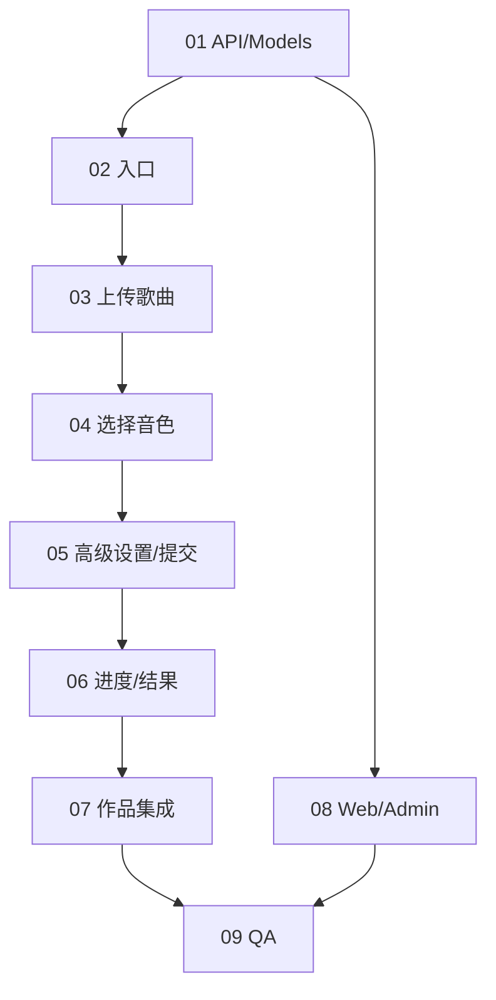

# v1.1 AI 翻唱 Flutter 模块开发文档索引

- V2.1 名称校准：本目录记录的旧链路现称“AI 改编”，不包含声音克隆；整组文档为 `reference-only`，不得用于 V2.1 新“AI 翻唱”编码。
- 项目：喵喵写歌
- 版本：v1.1-ai-cover
- 变更：CHG-0013 AI 翻唱功能
- 状态：reference-only（历史任务已完成）
- 执行入口：本目录下 `00-09` 模块文档

## 1. 模块顺序

| 顺序 | 文档 | 对应任务 | 说明 |
| --- | --- | --- | --- |
| 1 | `01-cover-api-models.md` | F-COVER-01 | API、DTO、Store、路由参数先补齐 |
| 2 | `02-home-and-work-entry.md` | F-COVER-02、F-COVER-07 | 首页入口和作品页重新翻唱入口 |
| 3 | `03-cover-upload-step.md` | F-COVER-03 | 上传歌曲页，含本地音频和作品库来源 |
| 4 | `04-cover-voice-step.md` | F-COVER-04 | 选择音色页，分组、试听、选中态 |
| 5 | `05-cover-settings-submit.md` | F-COVER-05 | 高级设置页和提交创建翻唱任务 |
| 6 | `06-cover-progress-result.md` | F-COVER-06 | 生成中与结果页，原版/翻唱 AB 切换 |
| 7 | `07-works-integration.md` | F-COVER-07 | 作品列表、详情、类型标签、重新翻唱 |
| 8 | `08-admin-cover-ui.md` | A-COVER-01 | Web/Admin 翻唱模型、音色、作品管理 |
| 9 | `09-flutter-qa.md` | F-COVER-08 | Flutter 与 Web/Admin 验收 |

## 2. 编码前门禁

- 必须读取当前版本文档：
  - `01-需求/v1.1-ai-cover/requirements.md`
  - `02-技术方案/v1.1-ai-cover/tech-plan.md`
  - `03-前端/v1.1-ai-cover/flutter-tech.md`
  - `03-前端/v1.1-ai-cover/flutter-dev-plan.md`
  - 本目录对应模块文档
- 不得使用 `v0.1.0`、`CHG-0011 rework` 或 archive 中旧计划作为 v1.1 编码依据。
- 若后端接口字段和本目录文档不一致，先回写 `java-tech.md` 与对应 Java 模块文档，再改 Flutter。

## 3. 公共设计规则

- 主验收基准：375x812。
- 抽查尺寸：390x844、414x896。
- 设计来源：
  - `01-需求/references/images/v1.1/ai翻唱/`
  - `01-需求/references/docs/v1.1/ai翻唱.md`
- 文案以 PRD 为准；设计稿里“10 分钟”统一改为 MiniMax 约束“最长 6 分钟”。
- 底部固定按钮必须避让键盘、底部 Tab、迷你播放器。

## 4. 模块依赖

## 5. 统一验收口径

- 页面能从入口完整走到结果页。
- 本地音频限制：`MP3/WAV/M4A/AAC/FLAC`，最大 `50MB`，最长 `6分钟`。
- 未勾选版权确认时不能进入下一步或提交。
- 未选择音色时不能进入高级设置。
- 提交时必须带 `idempotencyKey`。
- 生成任务失败时页面展示失败原因，并保留重新翻唱入口。
