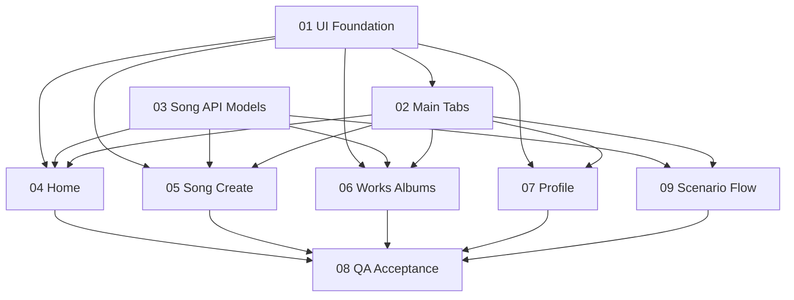

# CHG-0011 前端 UI 返工模块开发索引

> 文档版本：v1.0-design-mvp  
> 关联变更：CHG-0011 前端 UI 未按设计稿对齐返工  
> 当前状态：coding_done_waiting_visual_acceptance  
> 编码工程：`/Users/soul/code/lxwx/catsinger`  
> 设计稿真源：`01-需求/references/images/v1.0/`  
> 说明：本目录是 CHG-0011 的唯一编码入口。旧 Flutter App 模块文档已归档到 `archive/legacy-20260611-pre-rework/`，不再作为本次返工直接执行依据。

## 1. 返工目标

本次返工只解决“Flutter App 主页面没有按新设计稿实现”的问题，不推翻需求、后端架构、积分、Provider 和 schema routing。

目标页面：

- 首页
- 写歌
- 作品
- 我的
- 底部四 Tab 和公共 UI 基线

核心标准：

- 375x812 下主结构、层级、留白和底部固定区域与设计稿一致。
- 390x844、414x896 下不明显变形、不遮挡、不溢出。
- 不再出现旧 Sonus/Explore/Library 风格。
- 真实数据优先走后端接口；无数据展示空态，不在生产逻辑写死假业务。

## 2. 模块执行顺序

| 顺序 | 模块文档 | 状态 | 依赖 | 输出 |
|------|----------|------|------|------|
| 1 | `01-ui-foundation.md` | done | 设计稿、主题文档 | 主题 token、公共 UI 组件 |
| 2 | `02-main-tabs.md` | done | UI foundation | 底部导航对稿 |
| 3 | `03-song-api-models.md` | done | 后端接口、现有 Song API | Flutter 模型和 API 补齐 |
| 4 | `04-home.md` | done | UI foundation、Main tabs、Song API | 首页对稿 |
| 5 | `05-song-create.md` | done | UI foundation、Song API | 写歌页对稿 |
| 6 | `06-works-albums.md` | done | UI foundation、Song API | 作品/专辑页对稿 |
| 7 | `07-profile.md` | done | UI foundation、现有账号路由 | 我的页对稿 |
| 8 | `08-qa-acceptance.md` | in_progress | 全部模块 | 命令验证已通过，截图验收待补 |
| 9 | `09-scenario-flow.md` | done | UI foundation、Main tabs、Song API Models | 场景写歌 4 步流程补齐 |

执行要求：

- 必须按顺序做，公共 UI 和 API 模型先于页面。
- 每完成一个模块，更新对应文档状态和 `workflow.md` 当前恢复点。
- 页面模块编码时如果发现接口字段缺失，先走 `03-song-api-models.md` 的补齐规则，不回头改后端主链路。

## 3. 依赖关系

## 4. 统一编码约束

- 使用现有 `GetX Controller + Store + go_router + Dio + ScreenUtil`。
- 尺寸使用 `.w/.h/.sp/.r`，禁止批量裸尺寸。
- 颜色和渐变优先集中到 `CustomTheme` 或公共组件，页面内只允许少量局部色值。
- UI 组件优先放 `lib/widgets/`，仅页面强绑定组件放当前页面文件。
- Controller 不使用 `Get.context`；需要跳转或弹窗时由 View 传入 `BuildContext`。
- 错误提示按项目规范使用 `CustomToast.fail/text/success/loading/dismiss`，不要新增另一套 toast。
- 页面必须覆盖 `loading/empty/error/disabled/submitting`，不只做 happy path。

## 5. 统一验收门槛

命令：

- `flutter analyze`
- `flutter test`

截图/手动：

- 375x812：四个主 Tab 必验。
- 390x844、414x896：抽查底部导航、固定按钮、长文本、输入框和列表底部。
- 首页开始创作和作品空态去写歌必须直接切到写歌 Tab。
- 灵感速递必须能填充音乐描述，失败必须有用户可读提示。

## 6. 完成定义

CHG-0011 完成需要同时满足：

1. 本目录 9 份模块文档状态都更新为 `done`。
2. 四个主页面代码已对稿。
3. Flutter API/Model 缺口已补齐到页面需要的程度。
4. `flutter analyze` 和 `flutter test` 通过，或无法通过的原因已记录且不是本轮引入。
5. `change-plan.md` 中 CHG-0011 从 `in_progress` 归档到 `change-log.md`。
