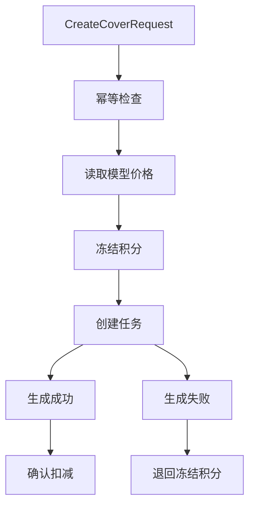

# 喵喵写歌 v1.1 AI 翻唱 Java 后端技术文档

> V2.1 名称校准：本文件描述的旧链路现称“AI 改编”，不包含声音克隆；仅作实现差异参考，禁止用于 V2.1 新“AI 翻唱（声音克隆）”编码。
> 版本：`v1.1-ai-cover`
> 变更：`CHG-0013 AI 翻唱功能`
> 状态：`reference-only`
> 创建日期：2026-06-25
> 关联需求：`../../01-需求/v1.1-ai-cover/requirements.md`
> 关联技术方案：`../../02-技术方案/v1.1-ai-cover/tech-plan.md`
> 后端工程：`/Users/soul/code/lxwx/lxwx_service/lxwxservice`
> 基础包名：`com.lxwx.narrateservice`

---

## 1. 后端总体结构

当前服务继续使用 Java + Spring Boot + Gradle，AI 翻唱作为 catsinger App 专属能力落在：

```text
src/main/java/com/lxwx/narrateservice/
├── app/catsinger/
│   ├── cover/
│   └── song/
├── admin/song/
├── admin/work/
├── reusable/resource/
├── point/
├── thirdparty/aimodel/
└── common/
```

迁移脚本只放：

```text
src/main/resources/db/migration/catsinger/
```

schema routing：

- 请求头 `X-App-Code: catsinger` 进入 catsinger schema。
- Token 内 appCode 与请求头必须一致。
- 公共表仍由 common migration 创建。
- narrate schema 不创建 `catsinger_song_cover_*` 表。

---

## 2. 接口设计

### 2.1 用户端接口

#### `GET /api/song-cover/voices`

说明：返回当前 catsinger schema 下启用的翻唱音色。

响应：

```json
{
  "items": [
    {
      "voiceCode": "warm_male",
      "displayName": "温柔男声",
      "groupCode": "male",
      "groupName": "男声",
      "tags": ["温柔"],
      "iconUrl": "https://...",
      "auditionAudioUrl": "https://...",
      "enabled": true,
      "sortOrder": 10
    }
  ]
}
```

#### `POST /api/song-assets/cover-source-audios`

说明：上传翻唱源音频。

请求：

- `multipart/form-data`
- file 字段名：`file`

后端校验：

- 扩展名 / MIME：MP3、WAV、M4A、AAC、FLAC。
- 文件大小：最大 50MB。
- 时长：6 秒到 6 分钟。
- 时长无法识别：拒绝上传。

响应：

```json
{
  "assetId": "asset-id",
  "fileName": "demo.mp3",
  "mimeType": "audio/mpeg",
  "fileSize": 1024000,
  "durationMs": 180000,
  "resourceUrl": "https://..."
}
```

#### `POST /api/song-covers`

说明：创建 AI 翻唱任务，语义上等价于 `mode=cover` 的歌曲生成。

请求：

```json
{
  "provider": "minimax",
  "model": "music-cover",
  "sourceWorkId": "work-id",
  "sourceAudioAssetId": null,
  "copyrightConfirmed": true,
  "coverVoiceCode": "warm_male",
  "preserveOriginalLyrics": true,
  "preserveOriginalAccompaniment": true,
  "pitchShift": 0,
  "emotionIntensity": "standard",
  "reverb": "studio",
  "idempotencyKey": "uuid"
}
```

规则：

- `sourceWorkId` 和 `sourceAudioAssetId` 二选一。
- `copyrightConfirmed` 必须为 true。
- `coverVoiceCode` 必须存在且启用。
- `idempotencyKey` 必填。
- 创建前冻结积分，默认 150，实际按模型配置。

响应：

```json
{
  "id": "task-id",
  "status": "PENDING",
  "songType": "COVER",
  "coverVoiceName": "温柔男声",
  "progressPercent": 0,
  "stageText": "排队中",
  "estimatedRemainingSeconds": null
}
```

#### `GET /api/song-covers/{id}`

说明：查询翻唱任务状态。

响应字段：

- `id`
- `status`
- `songType`
- `sourceWorkId`
- `sourceAudioAssetId`
- `coverVoiceCode`
- `coverVoiceName`
- `progressPercent`
- `stageText`
- `estimatedRemainingSeconds`
- `workId`
- `failureReason`

### 2.2 作品接口扩展

`GET /api/song-works` 和 `GET /api/song-works/{id}` 补充：

- `songType`
- `sourceWorkId`
- `sourceAudioAssetId`
- `originalAudioUrl`
- `coverVoiceCode`
- `coverVoiceName`
- `coverSettingsJson`
- `pointCost`

### 2.3 Admin 接口

| 方法 | 路径 | 说明 |
|------|------|------|
| GET | `/api/admin/song/cover-voices` | 查询音色 |
| POST | `/api/admin/song/cover-voices` | 新增音色 |
| PUT | `/api/admin/song/cover-voices/{id}` | 编辑音色 |
| GET | `/api/admin/song/works?songType=COVER` | 筛选翻唱作品 |

权限：

- 超级管理员可操作全部配置。
- 普通角色按管理块权限控制。
- 所有 Admin 查询写入都按当前 appCode 路由。

---

## 3. DTO / VO 设计

### 3.1 `CreateCoverRequest`

| 字段 | 校验 | 说明 |
|------|------|------|
| `provider` | 可空 | 默认 minimax |
| `model` | 可空 | 默认 music-cover |
| `sourceWorkId` | 条件必填 | 作品来源 |
| `sourceAudioAssetId` | 条件必填 | 上传音频来源 |
| `copyrightConfirmed` | 必须 true | 版权确认 |
| `coverVoiceCode` | NotBlank | 目标音色 |
| `preserveOriginalLyrics` | 可空 | 默认 true |
| `preserveOriginalAccompaniment` | 可空 | 默认 true |
| `pitchShift` | -6 到 +6 | 默认 0 |
| `emotionIntensity` | 枚举 | soft/standard/passionate |
| `reverb` | 枚举 | off/studio/concert |
| `idempotencyKey` | NotBlank | 幂等键 |

### 3.2 `SongCoverVoiceResponse`

| 字段 | 说明 |
|------|------|
| `id` | 后台使用 |
| `voiceCode` | App 提交编码 |
| `displayName` | 展示名 |
| `groupCode` | 分组 |
| `groupName` | 分组展示名 |
| `tags` | 标签 |
| `iconUrl` | 图标 |
| `auditionAudioUrl` | 试听 |
| `promptTemplate` | Admin 可见，App 可不返回 |
| `enabled` | 是否启用 |
| `sortOrder` | 排序 |

### 3.3 `SongGenerationTaskResponse`

补充：

- `songType`
- `sourceWorkId`
- `sourceAudioAssetId`
- `coverVoiceCode`
- `coverVoiceName`
- `coverSettingsJson`
- `progressPercent`
- `stageText`
- `estimatedRemainingSeconds`

---

## 4. 数据库迁移

### 4.1 `catsinger_song_cover_voices`

建议迁移：

```sql
CREATE TABLE IF NOT EXISTS catsinger_song_cover_voices (
    id BIGSERIAL PRIMARY KEY,
    voice_code VARCHAR(64) NOT NULL,
    display_name VARCHAR(64) NOT NULL,
    group_code VARCHAR(32) NOT NULL,
    tags_json TEXT,
    icon_url TEXT,
    audition_audio_url TEXT,
    prompt_template TEXT,
    enabled BOOLEAN NOT NULL DEFAULT TRUE,
    sort_order INT NOT NULL DEFAULT 0,
    created_at TIMESTAMP NOT NULL DEFAULT CURRENT_TIMESTAMP,
    updated_at TIMESTAMP NOT NULL DEFAULT CURRENT_TIMESTAMP,
    CONSTRAINT uk_catsinger_song_cover_voice_code UNIQUE (voice_code)
);

CREATE INDEX IF NOT EXISTS idx_catsinger_song_cover_voice_enabled_sort
    ON catsinger_song_cover_voices(enabled, sort_order);
```

### 4.2 `catsinger_song_assets`

补充：

- `duration_ms BIGINT`
- `asset_type` 支持 `COVER_SOURCE_AUDIO`

### 4.3 `catsinger_song_generation_tasks`

补充：

- `song_type`
- `source_work_id`
- `source_audio_asset_id`
- `source_audio_url`
- `cover_voice_code`
- `cover_voice_name`
- `cover_settings_json`
- `copyright_confirmed`

### 4.4 `catsinger_song_works`

补充：

- `song_type`
- `source_work_id`
- `source_audio_asset_id`
- `original_audio_url`
- `cover_voice_code`
- `cover_voice_name`
- `cover_settings_json`
- `point_cost`

索引建议：

- `idx_catsinger_song_works_user_song_type(user_id, song_type, created_at)`
- `idx_catsinger_song_tasks_user_mode(user_id, mode, created_at)`

---

## 5. Service 设计

### 5.1 `SongCoverVoiceService`

职责：

- 查询启用音色。
- Admin 新增/编辑/启用/禁用音色。
- 校验 `coverVoiceCode` 是否可用。
- 将 Entity 转 Response。

### 5.2 `SongAssetService`

新增能力：

- `uploadCoverSourceAudio(userId, MultipartFile file)`
- 校验扩展名和 MIME。
- 读取音频时长。
- 保存资源记录。
- 返回 `assetId` 和资源元数据。

### 5.3 `SongGenerationService`

cover 模式新增校验：

- 请求来源二选一。
- 版权确认。
- 源音频时长。
- 音色启用。
- 模型配置和积分价格。
- 幂等键。

创建任务时：

- `mode=cover`
- `songType=COVER`
- 保存 source 和 cover settings。
- 冻结积分。

### 5.4 Workflow 支撑

cover workflow 步骤：

1. `ValidateRequestStep`
2. `ValidateCoverAudioStep`
3. `FreezePointsStep`
4. `CallCoverProviderStep`
5. `PersistGeneratedAudioStep`
6. `CreateCoverWorkStep`
7. `CommitPointsStep`
8. `RefundPointsOnFailureStep`

失败策略：

- Provider 失败、资源下载失败、审核失败，都进入失败状态并退款。
- 幂等重复提交返回已有任务。

---

## 6. MiniMax Provider 设计

### 6.1 请求映射

MiniMax `music-cover` 输入：

| 本项目字段 | MiniMax 字段 | 说明 |
|------------|--------------|------|
| `model` | `model` | `music-cover` |
| `promptTemplate + settings` | `prompt` | 目标音色和风格说明 |
| `lyrics` | `lyrics` | v1.1 可空，空时由参考音频提取 |
| `sourceAudioUrl` | `audio_url` | 和 `audio_base64` 二选一 |
| `sourceAudioBase64` | `audio_base64` | 公网 URL 不可用时使用 |
| audio output config | `audio_setting` | mp3 / 44100 / bitrate |

约束：

- `audio_url`、`audio_base64`、`cover_feature_id` 互斥。
- v1.1 默认不使用 `cover_feature_id`。
- 源音频 6 秒到 6 分钟、最大 50MB。
- 返回 URL 有过期风险，必须下载持久化。

### 6.2 Provider 返回处理

1. 解析响应。
2. 若返回 hex/audio bytes，直接写资源。
3. 若返回 URL，立即下载到临时文件。
4. 调用 ResourceStorageProvider 保存。
5. 写入 `catsinger_song_works.audio_url`。
6. 原始响应脱敏后写入任务日志或 raw response 字段。

### 6.3 配置

配置项参考既有阿里云短信方案，真实值后置添加：

- `MINIMAX_API_KEY`
- `MINIMAX_BASE_URL`
- `MINIMAX_GROUP_ID` 如需要
- Provider 超时
- Provider 重试次数

---

## 7. 积分设计

默认价格：

- `music-cover = 150` 积分/首。

流程：



实现要求：

- 冻结、扣减、退款使用同一业务批次或 taskId。
- 任务失败必须可重复执行退款但不会重复退款。
- 积分不足直接拒绝创建任务，不进入 Provider。

---

## 8. 鉴权与安全

- 用户端创建/上传/查询自己的任务必须登录。
- `GET /api/song-cover/voices` 可开放匿名，也可登录后读取；如果走匿名，需要仍按 `X-App-Code` 返回 catsinger 配置。
- 所有按 ID 查询作品、任务、资产的接口必须校验归属当前用户。
- 上传文件禁止信任扩展名，必须结合 MIME 和解析结果。
- 日志不得输出完整音频 URL 的签名参数、Token、API Key。
- Admin 接口必须校验角色权限和 appCode。

---

## 9. Admin 后端设计

### 9.1 音色配置

Controller：

- `AdminSongConfigController`
- 或独立 `AdminSongCoverVoiceController`

Service：

- 复用 `SongCoverVoiceService`。

校验：

- `voiceCode` 唯一。
- `displayName` 必填。
- `groupCode` 必填。
- `sortOrder` 默认 0。
- 禁用音色不影响历史作品展示。

### 9.2 作品管理

`AdminWorkQueryService` 增加：

- `songType` 参数。
- `coverVoiceName` 返回字段。
- `sourceWorkId` / `sourceAudioAssetId` 详情字段。

---

## 10. 错误码建议

| 错误场景 | 建议 code | 文案 |
|----------|-----------|------|
| 未确认版权 | 14001 | 请先确认拥有该音频合法使用权 |
| 来源音频缺失 | 14002 | 请选择作品或上传音频 |
| 来源二选一冲突 | 14003 | 作品来源和上传音频只能选择一种 |
| 音频格式不支持 | 14004 | 仅支持 MP3/WAV/M4A/AAC/FLAC |
| 音频过大 | 14005 | 音频文件不能超过 50MB |
| 音频时长不符合 | 14006 | 音频时长需在 6 秒到 6 分钟之间 |
| 音频时长无法识别 | 14007 | 无法识别音频时长，请更换文件 |
| 音色不可用 | 14008 | 当前音色不可用 |
| 积分不足 | 14009 | 积分不足，请充值后再试 |
| Provider 失败 | 14301 | 翻唱生成失败，请稍后重试 |
| 资源持久化失败 | 14302 | 生成结果保存失败 |

---

## 11. 测试设计

### 11.1 集成测试

- `SongCoverVoiceIntegrationTests`
- `SongCoverAssetUploadIntegrationTests`
- `SongCoverGenerationIntegrationTests`
- `AdminSongCoverVoiceIntegrationTests`
- `AdminSongWorkFilterIntegrationTests`

### 11.2 覆盖点

- schema routing：catsinger / narrate 隔离。
- 上传：格式、大小、时长、无法识别时长。
- 创建：版权确认、来源二选一、音色启用、积分不足、幂等。
- Provider mock：请求字段、成功资源持久化、失败退款。
- 作品：`songType=COVER` 列表和详情字段。
- Admin：音色 CRUD 和权限。

### 11.3 命令验证

```bash
./gradlew test
./gradlew build
git diff --check
```

---

## 12. 编码注意事项

- 新增 SQL 只进 `db/migration/catsinger/`。
- 不重写已发布 migration；如当前仍开发期且用户明确允许，需先记录。
- Controller 不写业务逻辑，只调用 Service。
- Service 写事务边界和积分/资源一致性。
- Provider 调用必须设置超时、日志和错误映射。
- 任务状态和积分流水必须可追溯。
- 与 Flutter 字段保持一致，不私自发明 wire shape。
