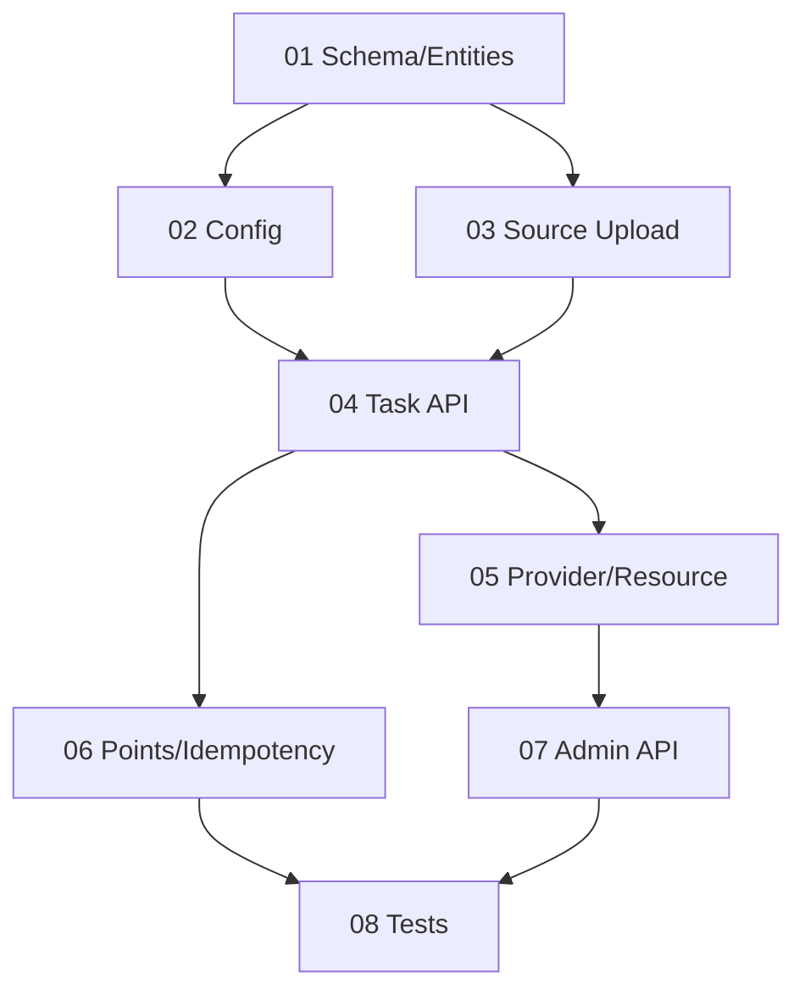

# v1.1 AI 翻唱 Java 模块开发文档索引

- V2.1 名称校准：本目录记录的旧链路现称“AI 改编”，不包含声音克隆；整组文档为 `reference-only`，不得用于 V2.1 新“AI 翻唱”编码。
- 项目：喵喵写歌
- 版本：v1.1-ai-cover
- 变更：CHG-0013 AI 翻唱功能
- 状态：reference-only（历史任务已完成）
- 执行入口：本目录下 `00-08` 模块文档

## 1. 模块顺序

| 顺序 | 文档 | 对应任务 | 说明 |
| --- | --- | --- | --- |
| 1 | `01-schema-and-entities.md` | B-COVER-01 | catsinger schema、实体、迁移 |
| 2 | `02-cover-voice-config.md` | B-COVER-02 | 翻唱模型与音色配置 |
| 3 | `03-cover-source-audio-upload.md` | B-COVER-03 | 源音频上传、格式/大小/时长校验 |
| 4 | `04-cover-task-api-service.md` | B-COVER-04 | 用户端翻唱创建和任务查询 |
| 5 | `05-cover-workflow-provider-resource.md` | B-COVER-05 | MiniMax music-cover、资源持久化 |
| 6 | `06-points-idempotency.md` | B-COVER-06 | 积分冻结、扣减、退款、幂等 |
| 7 | `07-admin-cover-api.md` | B-COVER-07 | 后台模型、音色、作品管理接口 |
| 8 | `08-java-tests.md` | B-COVER-08 | 单测和联调验收 |

## 2. 编码前门禁

- 必须读取当前版本文档：
  - `01-需求/v1.1-ai-cover/requirements.md`
  - `02-技术方案/v1.1-ai-cover/tech-plan.md`
  - `04-后端/v1.1-ai-cover/java-tech.md`
  - `04-后端/v1.1-ai-cover/java-dev-plan.md`
  - 本目录对应模块文档
- 数据库表只进入 `db/migration/catsinger`，不得放入 `common` 或 `narrate`。
- 翻唱接口必须继续校验 `X-App-Code: catsinger` 与 Token 内 appCode 一致。
- Provider 返回的临时音频 URL 必须下载持久化，不能直接落库临时 URL。

## 3. 模块依赖

## 4. 统一验收口径

- 翻唱源音频：`6秒 - 6分钟`，最大 `50MB`。
- 支持格式：`MP3/WAV/M4A/AAC/FLAC`。
- `music-cover` 默认消耗 `150` 积分，但最终从模型配置读取。
- 请求必须带 `idempotencyKey`，重复请求不能重复扣费。
- 生成失败必须退款并记录失败原因。
- 所有 catsinger 专属表只在 catsinger schema 创建。
