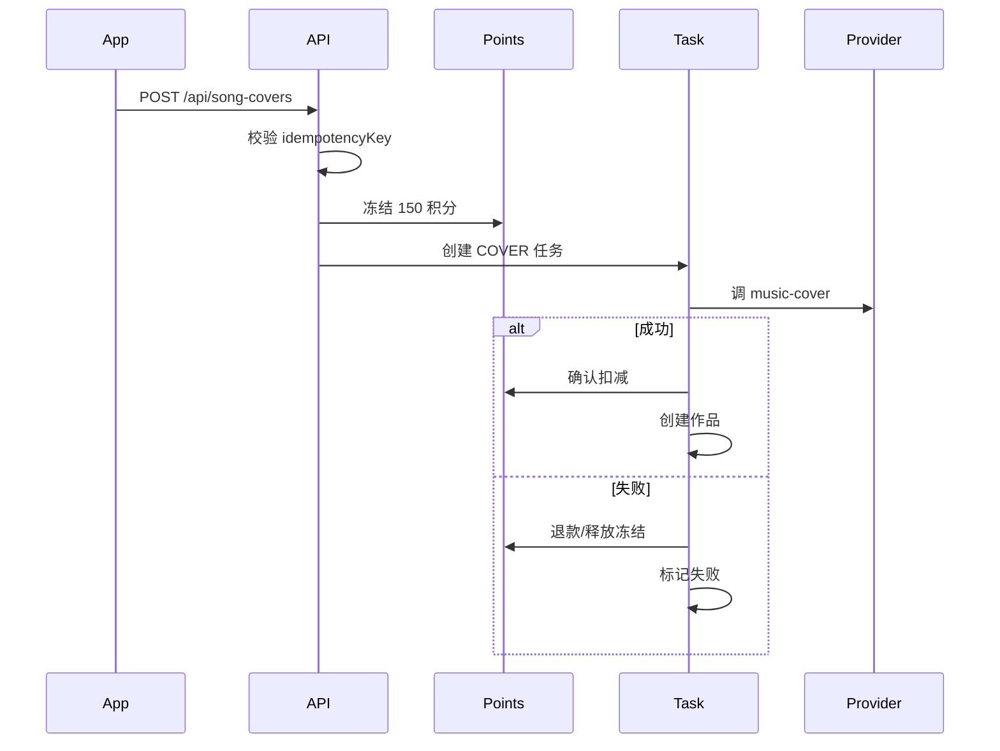

# 06 翻唱积分与幂等模块

- 版本：v1.1-ai-cover
- 对应任务：B-COVER-06
- 状态：done
- 影响工程：`/Users/soul/code/lxwx/lxwx_service/lxwxservice`

## 1. 功能定位

AI 翻唱按次扣积分。创建任务时冻结积分，成功后确认扣减，失败后退款。重复提交不能重复扣费。

## 2. 价格来源

- 从翻唱模型配置读取。
- 默认配置：`music-cover = 150积分/首`。
- 前端只展示后端返回价格，不写死生产价格。

## 3. 积分流程

## 4. 幂等规则

- 幂等键作用域：`userId + appCode + idempotencyKey + operation=COVER_CREATE`。
- 首次请求创建任务。
- 重复请求：
  - 若任务存在，返回原任务。
  - 不重复冻结积分。
  - 不重复调用 Provider。

## 5. 异常规则

| 场景 | 处理 |
| --- | --- |
| 积分不足 | 不创建任务，返回积分不足 |
| 冻结成功但任务创建失败 | 释放冻结 |
| Provider 失败 | 任务失败并退款 |
| 持久化失败 | 任务失败并退款 |
| 确认扣减失败 | 记录告警，任务进入人工处理状态或重试 |

## 6. 实现步骤

1. 扩展积分服务支持翻唱业务类型。
2. 创建任务前调用冻结。
3. 任务成功后确认扣减。
4. 任务失败后释放/退款。
5. 幂等记录绑定任务 ID。

## 7. 验收标准

- 重复提交只扣一次积分。
- 失败任务积分退回。
- 积分流水能区分 AI 写歌和 AI 翻唱。
