# 喵喵写歌 V2.1 产品需求：三业务与模型驱动参数

> 产品版本：V2.1 · 文档版本：`v2.1-model-driven-params` · CHG：CHG-0076 / CHG-0078
> 更新：2026-09-14 · 状态：`done`（CHG-0078 H-01～H-04 已确认，第 3 步复检 PASS 并获用户继续确认）· 迭代：`version_iteration`
> [需求清单](requirements-list.md) · [Product Review](requirements-review.md) · [设计图索引](references/images/v2.1/model-driven-params/README.md)

## 1. 产品概述

喵喵写歌向用户提供 **AI 写歌、歌曲改编、翻唱声音克隆** 三项独立业务。AI 写歌把灵感或歌词变成新歌；歌曲改编调整已有歌曲的风格、歌词或演唱；翻唱声音克隆用本人已训练音色或后台官方音色重新演唱完整歌曲。三项业务在入口、任务语义、作品标签、报价场景上区分，在平台的模型路由、审核、积分、异步任务、资源和作品流程上共用能力。

本轮核心体验变化：用户选择具体厂家模型后，**当前模型决定哪些设置可用、可选值、范围和默认值**。设计稿中存在的设置保持在原位置；当前模型不支持时置灰、不可改，点击时解释原因。切换模型时处理旧值和报价，提交时平台复核，不能把置灰的旧参数带入任务。

### 1.1 目标与验收

1. 用户明确知道自己选的是哪项业务、哪个模型、哪些设置可用以及为什么不可用。
2. 同一表单切换不同能力模型时，不丢失仍合法的输入；失效值不静默提交。
3. 后台无法把供应商未声明或不支持的参数配置成“可用”；价格变化有明确反馈。
4. 旧 AI 改编历史任务和作品不被重命名或迁到翻唱声音克隆。
5. 本文是**目标需求**，不是当前三端已完成声明；新增能力必须先做技术与代码对账。

### 1.2 来源和冲突优先级

业务材料：[写歌改版](https://acnrg6qcjuk1.feishu.cn/wiki/TbOdwPGVmi5lmekVYgRcjCMjnZe)、[歌曲改编改版](https://acnrg6qcjuk1.feishu.cn/wiki/Nc6nwOEWoipZjKkuoIac1e67nvf)、[克隆翻唱](https://acnrg6qcjuk1.feishu.cn/wiki/HVCxwGxhziI9nTknaftczy90noe)。厂家资料：[算道接口文档](https://docs.qq.com/doc/DSUhISlNOWFNrQ1Bw)，本轮只核对其中可见的 `sovits_train`、`sovits_cover` 与 Suno Voice Persona 章节；未写明的能力仍待厂家确认。**原 Figma 连接为 `vn7k0jqv`，当前已重连 `xvrgwxfy`；文件仍为 `working`、页面 `working (91:106)`**；已导出的 21 张关键状态图仅是文档快照，后续若线上画面更新，以当前 Figma 为准核对布局、组件和交互，不另做一版设计稿。用户已确认的固定业务规则约束 App 实际文案和行为；价格、积分、时长、容量等动态数值以模型能力与后台配置为准，与画面示例不同不构成设计冲突，也不要求修改 Figma。飞书标题中的 1.3.0 是资料自身名称，不改变当前工作区 V2.1 产品版本。

CHG-0078 新增[首页改版资料](https://acnrg6qcjuk1.feishu.cn/wiki/Db59wzbSFiFLodk4zuLcHrdNnlz)。已重新连接 Figma 通道 `xvrgwxfy`，在同一 `working (91:106)` 页面核对首页两张海报、三入口、新人礼弹窗和任务中心节点；首页以这些**较新的页面状态**为视觉参考，其他页面仍按各自当前 Figma 节点核对。飞书文字决定轮播、后台配置和赠积分业务行为；截图中的积分数额仅是布局示例，不代替后台配置。

源材料中有三处须显式校准：

- 改编文档同时写“不保留原歌词”与“歌曲会保留原歌词”；按用户明确校准，关闭开关表示可输入新歌词或用灵感创作新歌词，开启才走保留/识别路径。
- 音色创建 Figma 写“本人声音或已获授权”，本期按用户已确认的**仅克隆本人声音**执行；App 实际文案须使用本人声明，不把授权他人声音作为放行条件，Figma 原稿不改。
- Figma 的积分、音频时长和容量是页面展示示例；这些数值随模型和后台配置变化，不构成设计冲突，也不要求修改设计稿。App 按所选模型、厂家真实约束与后台合法配置展示和校验，不硬编码示例值。

## 2. 当前版本范围

### 2.1 做

| 范围 | 本期定义 |
|------|----------|
| 三业务 | 首页分别进入 AI 写歌、歌曲改编、翻唱声音克隆；业务类型/作品标签/任务/报价不混用 |
| 写歌 | 简易与专业模式布局改版；专业可使用模型支持的参考音频、歌词润色、高级设置和指定音色 |
| 改编 | 新增保留原歌词开关和歌词识别状态；来源覆盖自有作品、本地音频、相册视频提音频 |
| 声音克隆 | 本人声音验证、训练素材、训练模型/报价、本人/官方音色库、翻唱设置、异步生成和作品 |
| 模型能力 | 可用性、参数/选项/范围/默认、置灰解释、切换清理、报价刷新、服务端校验 |
| Admin | 在供应商能力上限内控制展示、启用、默认和价格；管理官方音色与任务/作品 |
| 首页运营 | 两张海报起始轮播，后台可增删和选配目标功能；三业务入口按新稿布局，至少保留一张可展示海报 |
| 新用户权益 | 新用户自动赠送积分数量由后台配置；新人礼弹窗可按用户类型、样式、目标页面和频次配置，点击后引导到签到或任务 |

### 2.2 不做或不改变

- 不把历史“AI 翻唱”（现有 AI 改编）任务、作品和计费自动归入声音克隆翻唱。
- 不提供他人自上传声音克隆、训练任务取消、翻唱任务取消、人声/伴奏分轨下载。
- 不假设所有厂家支持相同设置；不把画面中的示例价格、45/100MB、6–90 秒等数字当统一后端限制。
- 不新造一套平行的审核、积分、任务和作品流程；原已确认资源保留、审核及可播放门槛继续适用。
- 本轮**仅更新文档**；Flutter、Java、Web/Admin 代码与数据库不在 CHG-0076 这一文档动作中修改。

## 3. 整体流程

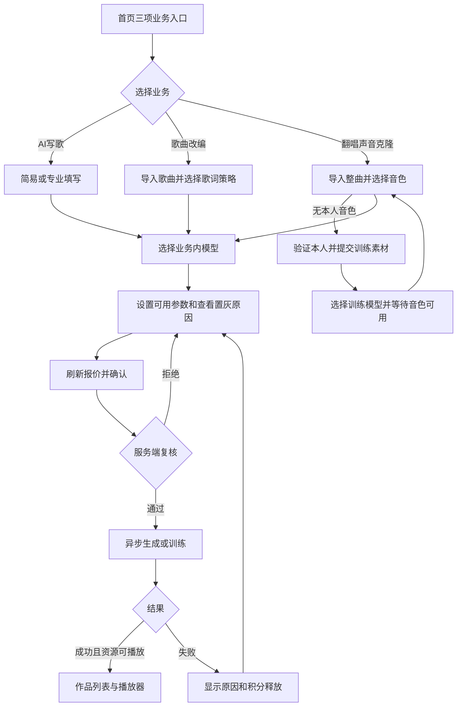

首页与新人权益增量流程：

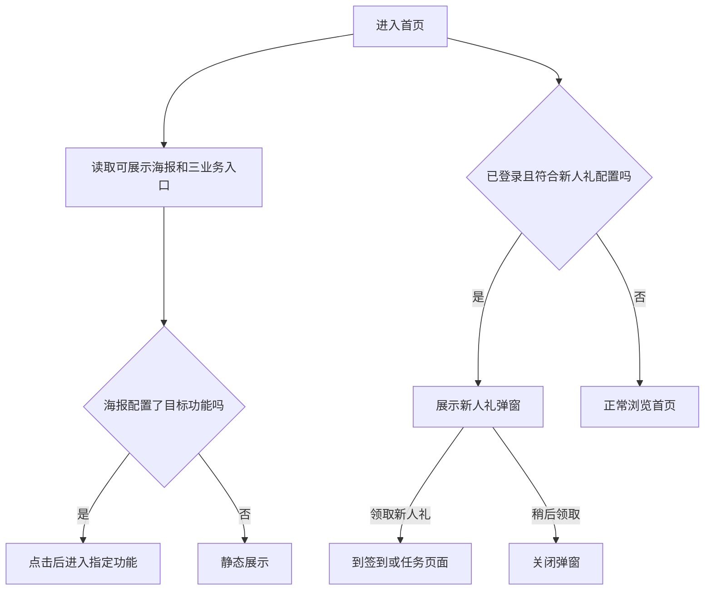

注册赠积分沿用现有“创建新账号”时点按后台当时有效金额独立发放，**不由弹窗点击触发**；游客绑定手机号不再发一次。新人礼弹窗只面向尚未点击「领取新人礼」的新用户；「稍后领取」不消耗资格，点击「领取新人礼」后结束该弹窗的新用户资格，和任务实际积分领取分开。

- 平台内部仍沿用模型路由、资源/审核、积分和异步作品链路；业务入口和校验独立。
- 用户从等待页返回作品页，任务继续；成功必须是已持久化、已通过必要审核且可播放，不以“提交成功”代替作品成功。
- 厂家模型变化只影响新任务；已经创建的任务保留任务时的模型和价格快照。

## 4. 信息架构 / 页面结构

| ID | 逻辑页面 | 入口与主要去向 | 复用/状态 |
|----|----------|----------------|-----------|
| P01 | 首页 | 主 Tab；轮播海报可选目标功能，三入口进入 P02/P04/P05 | 新人礼是 P01 弹窗状态，不另算页面 |
| P02 | 简易写歌 | 首页 AI 写歌；切 P03、提交 P11 | 模型/纯音乐状态 |
| P03 | 专业写歌 | P02 分段切换；选 P07、提交 P11 | 模型弹层/高级设置为本页状态 |
| P04 | 歌曲改编 | 首页歌曲改编；选 P06、提交 P11 | 歌词识别与开关状态 |
| P05 | 翻唱声音克隆 | 首页入口；选 P06/P07、提交 P11 | 独立业务页 |
| P06 | 歌曲来源选择 | P04/P05 的导入动作；返回原页 | 作品/文件/相册共用 |
| P07 | 音色库 | P03/P05；到 P08 或返回 | 本人/官方两个 Tab |
| P08 | 音色资料与本人验证 | P07 创建；到 P09 | 创建与验证为连续步骤 |
| P09 | 训练素材与提交 | P08；到 P10 | 录制、上传、截取、试听多状态 |
| P10 | 音色训练状态 | P09；回 P07/P05 | 排队、处理中、成功、失败 |
| P11 | 生成等待 | P02/P03/P04/P05 提交；返回 P12 | 复用专业写歌等待页 |
| P12 | 我的作品 | 主 Tab/P11；到 P13 | 歌曲/MV/翻唱分类 |
| P13 | 作品播放器 | P12/生成成功；返回 P12 | 复用现有 `SongPlayerPage` |

Admin 作为同一 PRD 的管理域：W01 App 切换与权限、W02 厂家/模型与能力、W03 场景默认和价格、W04 官方音色、W05 训练/翻唱任务、W06 资源与审核、W07 作品与审计、W08 首页海报、W09 新用户权益与弹窗。管理视图不计入 13 个 App 逻辑页面；新人礼弹窗、Tab 和状态画面也不重复计数。签到/任务中心沿用现有页面，不凭设计图新增一个独立 App 页面。

## 5. 页面级详细需求

### P01 首页

**页面定位**：用户通过轮播海报或三个独立入口进入对应创作业务；符合配置的新用户可从福利弹窗进入签到/任务。

**参考素材**：[首页改版飞书文档](https://acnrg6qcjuk1.feishu.cn/wiki/Db59wzbSFiFLodk4zuLcHrdNnlz)及[原图索引](references/images/v2.1/home-revision/README.md)。已在当前 Figma 通道 `xvrgwxfy` / `working (91:106)` 核对：`151:7830`（写歌海报）、`151:7973`（翻唱海报）、`151:8116`（新人礼弹窗）；任务中心结果图为 `151:8281`/`151:8422`。旧 `148:7536` 仅为本轮前首页快照，不作为新布局的验收图。


**页面结构（上到下）**：品牌区；顶部 Banner 轮播与页码指示；一张通栏「AI 写歌」卡；下方并列「改编歌曲」「AI 翻唱 NEW」卡；热门案例网格；底部导航。新人礼作为覆盖首页的弹窗状态，不改变底部 Tab 数量。

**区块与主要功能**：初始运营内容为「AI 写歌」与「AI 翻唱」两张海报，展示时轮播；后台可增删，海报数量不是永远固定为二，但首页任何时候至少保留一张可展示海报。海报若绑定已支持的 App 功能入口，点整张海报进入该功能；未绑定目标时只作为静态图片，点后不跳转。AI 写歌卡进 P02（可切 P03）；改编歌曲卡进 P04；设计稿「AI 翻唱」卡映射独立的**翻唱声音克隆** P05，不能指向历史 AI 改编。案例沿用现有案例行为，不跨业务改写来源。

**交互流程**：
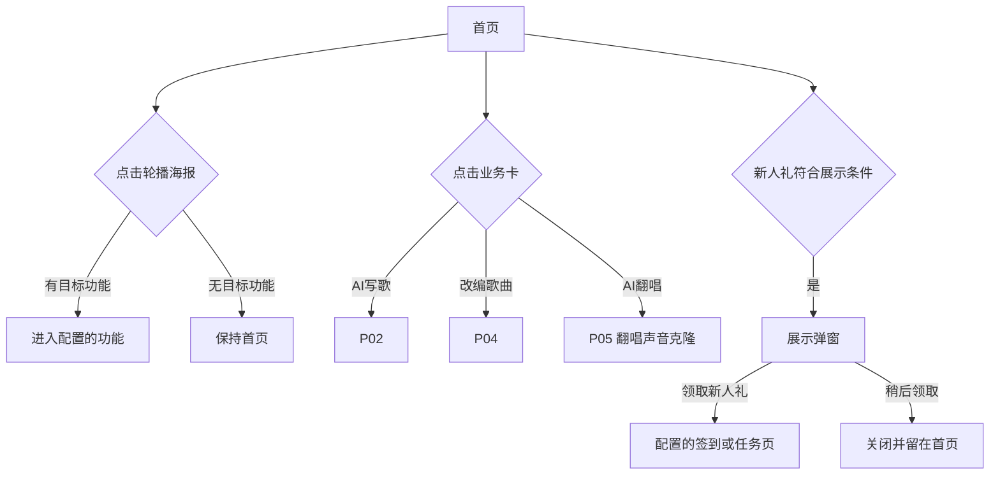
**详细交互**：轮播图按后台配置展示并可切换，指示点反映当前海报；删除最后一张可展示海报时后台必须阻止操作。跳转目标由后台选择，不允许把静态图误当可点击入口。业务卡点击后保留明确业务类型；登录/会员门槛按后续页面动作触发，不因卡片点击就扣费。返回首页保持滚动位置；案例为空显示空分区，不伪造示例。

**新人礼弹窗**：默认在新用户首次登录后展示；后台可关闭、替换弹窗样式、选择跳转的现有 App 页面、限定会员/非会员人群，并可改为「每天一次」或「每次打开 App」等展示规则。这里的“新用户”指尚未点击过「领取新人礼」的符合条件用户；所有频次只在这段资格内生效，不扩展到已点击领取的用户，也不新做跨设备特殊判定。满足启用、人群和频次条件时覆盖首页显示。「领取新人礼」点击后结束弹窗资格并跳到后台指定的签到或任务入口；真正的签到/任务积分仍须在对应页面按原规则领取，不因弹窗点击而发放注册赠积分。「稍后领取」只关闭弹窗留在首页，**不消耗默认一次的资格**；下次仍符合人群和频次时可再出现。

**状态/异常**：轮播加载中、海报图片失效、目标功能已关闭或配置读取失败时，不展示错误跳转；后台保证至少一张有效海报。新用户未登录、弹窗已关闭或不符人群时正常浏览首页；弹窗配置读取失败不阻塞首页。任务页返回后不重复赠送注册积分。配置中的积分与奖励数字实时取服务端，不照抄图中 `120`、`+3`、`+10` 等示例。

**验收**：默认两张海报可轮播、后台可增删且不能删到零，绑定目标能进入正确业务、无目标保持静态；三入口名称/目标页/任务作品分类一一对应；新人礼默认首次登录展示，点「稍后领取」后仍可按频次重现，点「领取新人礼」后不再弹出；点击与关闭动作不产生注册积分重复发放。375×812 主验，390×844/414×896 抽查海报、卡片、案例与弹窗不遮挡。

### P02 简易写歌

**页面定位**：以自然语言灵感快速创建新歌。

**参考素材**：`148:1287` 默认、`148:1404` 另一模型状态，Figma `vn7k0jqv`。


**页面结构（上到下）**：简易/专业/改编分段；灵感输入卡（提示语“在此输入您的灵感，系统将为您深度思考。例如：写一首关于思念家人的，民谣风歌曲。”）；卡左下纯音乐；随机灵感；人声选择；创作模型；底部生成歌曲按钮。

**区块与主要功能**：输入灵感可编辑；随机灵感回填但不自动提交；纯音乐开启时人声项可见置灰；创作模型选择后重新计算可用项和报价。

**交互流程**：
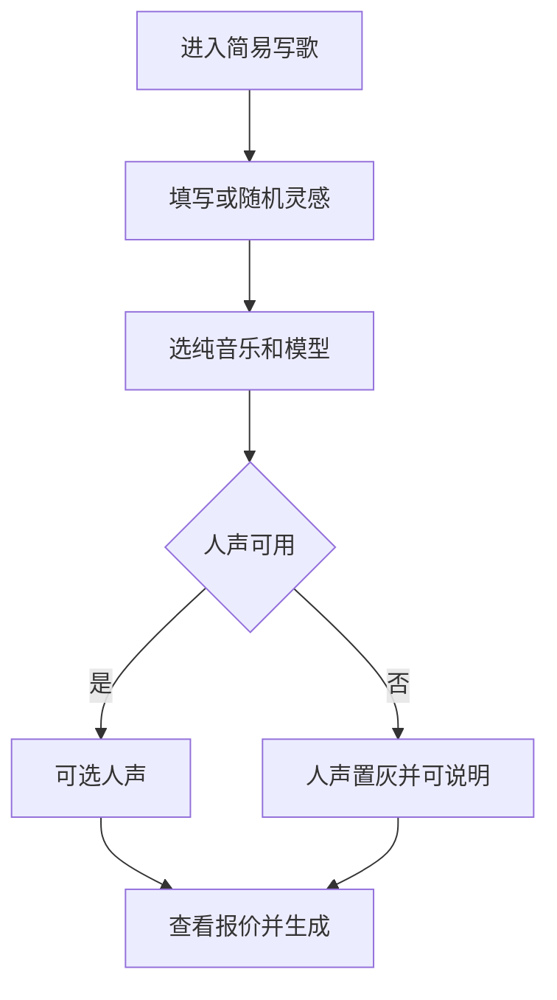
**详细交互**：点击置灰人声时提示“纯音乐不支持选择人声”或当前模型的具体不支持原因；切模型保留合法灵感，清理不支持人声值。切专业模式可传已有输入，但不得把业务类型改成改编。

**状态/异常**：模型能力未声明时可继续写灵感，但可选项置灰；模型不支持写歌或报价不可获得时生成按钮禁用并说明；请求失败留表单。

**验收**：控件位置与新稿一致；纯音乐互斥字段不随请求提交；不同模型的可选人声和价格真实变化。

### P03 专业写歌

**页面定位**：编辑歌名、歌词、风格和可选参考音频，做精细创作。

**参考素材**：`148:1674` 纯音乐置灰、`148:1934` 模型选择、`148:2068` 高级设置、`148:2205` 指定音色、`148:7238` 歌词全屏编辑/确认。


**页面结构（上到下）**：模式切换；独立歌名输入；歌词卡（右上放大、左下纯音乐、右下润色歌词）；风格/人声/时长；参考音频；创作模型；高级设置与固定生成按钮。

**区块与主要功能**：
- 歌名与歌词彼此独立；放大歌词全屏编辑后原位回填；“润色歌词”对当前歌词或灵感发起辅助写词，回填前可检查结果。
- 纯音乐开启后歌词、人声、指定音色等互斥项保留位置并置灰。已输入歌词暂存在页面草稿，关闭纯音乐后恢复；本次请求不带禁用歌词和音色。
- 参考音频必须由模型能力支持；上传后可“替换”和“删除”。删除即本次任务不使用原参考音频；音频参考度只有提供有效参考音频且模型支持时可调。
- 高级设置按模型支持项显示创意程度 `weirdness_constraint`、风格参考度 `style_weight`、音频参考度 `audio_weight`，不支持项置灰。前两者作用于结果变化/文字风格，音频参考度作用于参考音频依赖；不得承诺固定数值的线性效果。
- 人声可选择系统选项；模型明确支持指定音色时可进入 P07 选择已验证本人音色或后台官方音色。本期仅算道，仍须核对具体模型与音色的兼容性；不兼容时此项置灰并提示。
**交互流程**：
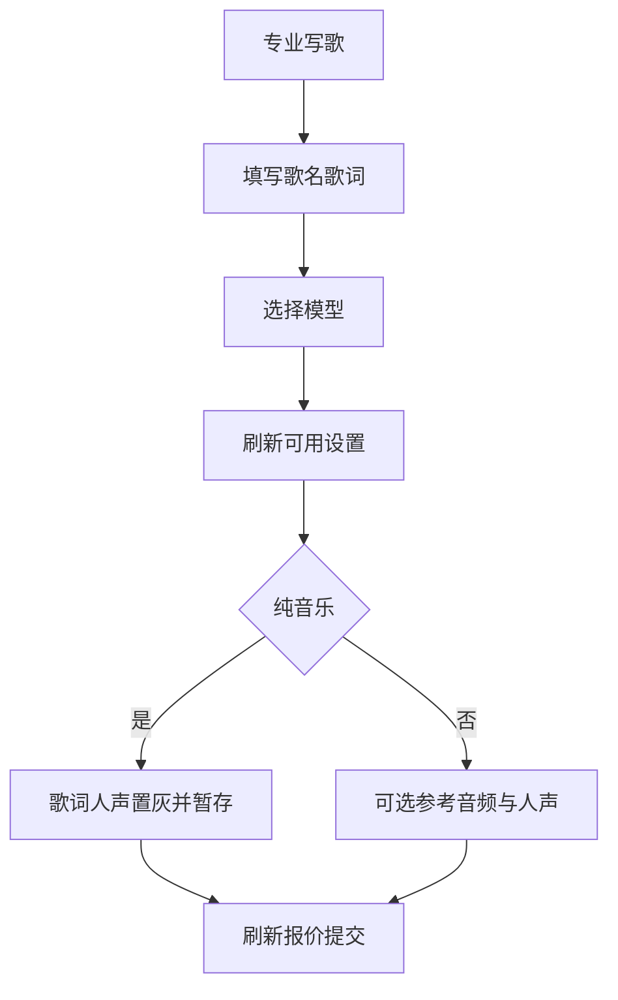
**详细交互**：模型切换前后的每个已填项按第 7 章规则保留或清空；显示变化提示。高级设置保存时只保存该模型支持项；用户点置灰滑杆/行显示“该模型不支持此设置”或“需先添加参考音频”。参考音频替换失败保持旧资源，不提前丢弃；删除后清除音频参考度。

**状态/异常**：权限拒绝、文件不合规、审核中/拒绝、歌词润色失败、价格刷新失败均可返回本页恢复；不把上传成功当审核通过。

**验收**：新布局位置、歌词恢复、参考音频替换/删除、模型切换和无效值剔除均符合用户可见反馈。

### P04 歌曲改编

**页面定位**：基于现有歌曲改变音乐表现或歌词，区别于声音克隆翻唱。

**参考素材**：`148:5350` 默认、`148:5548` 歌词、`148:5750` 识别中、`148:5647` 识别失败。


**页面结构（上到下）**：模式导航；导入歌曲卡；“保留原歌词”开关；歌词或灵感输入；歌名、风格、人声、模型、高级设置；固定生成按钮。

**区块与主要功能**：来源为本人作品、本地音频、相册视频提音频。开关默认关闭：用户输入新歌词，或只写一句灵感后用 AI 帮写生成完整新歌词；可放大/润色。开启：站内自有作品复用已有歌词；本地/相册来源识别音频歌词，显示识别中、成功、失败/重试；识别后允许修正错字和润色。模型支持哪些改编设置由该改编模型逐项决定。

**交互流程**：
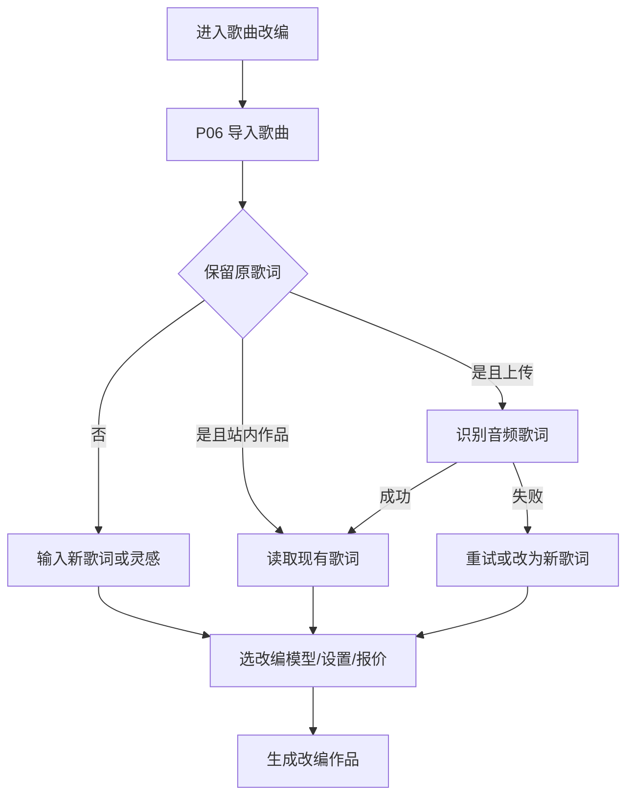
**详细交互**：切换开关时保留用户已编辑文本的草稿并说明将使用哪份歌词；不开启保留时不得悄悄送原歌词。开启而识别未成功且无可用歌词时不能按“保留原歌词”提交。高级设置按模型能力置灰，禁用旧参数不提交；不支持的音频参考度不可编辑。

**状态/异常**：来源上传/音频提取失败可重新选；歌词识别失败可重试、关闭保留开关或返回；模型价格变化需重新确认。

**验收**：默认关闭、识别三态、来源三种、歌词策略、置灰及最终改编作品标签正确。

### P05 翻唱声音克隆

**页面定位**：用户上传完整歌曲，选择本人或官方音色并按所选翻唱模型生成重唱作品。

**参考素材**：本轮 Figma `vn7k0jqv` 未提供独立的“翻唱主页全页”画面；新飞书 [克隆翻唱](https://acnrg6qcjuk1.feishu.cn/wiki/HVCxwGxhziI9nTknaftczy90noe) 提供业务结构，P07 音色库和 P12 作品有新稿。D-07 已确认本页复用现有 Flutter 工程的布局和组件，再按本需求补足声音克隆专属功能与状态；无需等待新的整页视觉稿，也不得拿旧歌曲改编截图冒充声音克隆已完成页面。

**页面结构（上到下）**：标题与返回；完整歌曲来源卡；翻唱设置；本人/官方音色选择和试听；创作模型与价格；歌曲权利确认；提交按钮。

**区块与主要功能**：歌曲来源可选本人作品、本地音频、相册视频提音频；使用整曲，不默认截成 90 秒，沿用此前确认的平台暂定最长 10 分钟，并与所选翻唱模型更严格的输入限制取交集。算道 `sovits_cover` 文档写明输入不超过 100MB、升降调 `-12～12`、人声/伴奏音量 `0～200`，可请求 `wav/flac/mp3` 输出；这些是**该接口的厂家能力上限**，不是所有翻唱模型的统一 UI 默认值，实际可调项、范围及报价仍由当前模型配置返回。选择已训练且可用的本人音色或后台官方音色；不能克隆第三人的自上传声音。翻唱任务与训练任务分别报价。

**交互流程**：
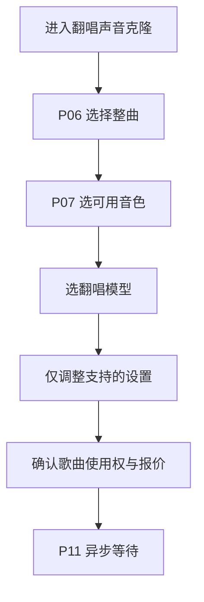
**详细交互**：点击置灰参数行说明具体模型不支持原因。切换翻唱模型时校验音色渠道兼容和音频限制；不兼容时保留歌曲草稿，清除失效音色/设置并提示。模型整体不支持翻唱时禁提交。音色试听是听音色样本，不自动代表生成任务成功。

**状态/异常**：上传或审核未通过、音色未就绪/下架、余额不足、非会员、报价失效均停在本页并给可恢复入口。失败不创建伪成功作品。

**验收**：业务类型是声音克隆而非歌曲改编，提交模型为真实厂家/模型，设置与报价随模型变化。

### P06 歌曲来源选择

**页面定位**：为改编/翻唱提供合法歌曲来源，返回调用页。

**参考素材**：新稿 `148:7058` 为“我的创作”选择状态；本地与相册选择使用系统选择器，无单独完整 Figma 状态。


**页面结构（上到下）**：来源分段/列表、本人作品列表或文件/相册系统入口、当前选中项与确认。

**区块与主要功能**：作品库仅列本账号可用作品；本地按所选模型支持的格式、时长和大小检查；视频需要先提取音频并检查。

**交互流程**：
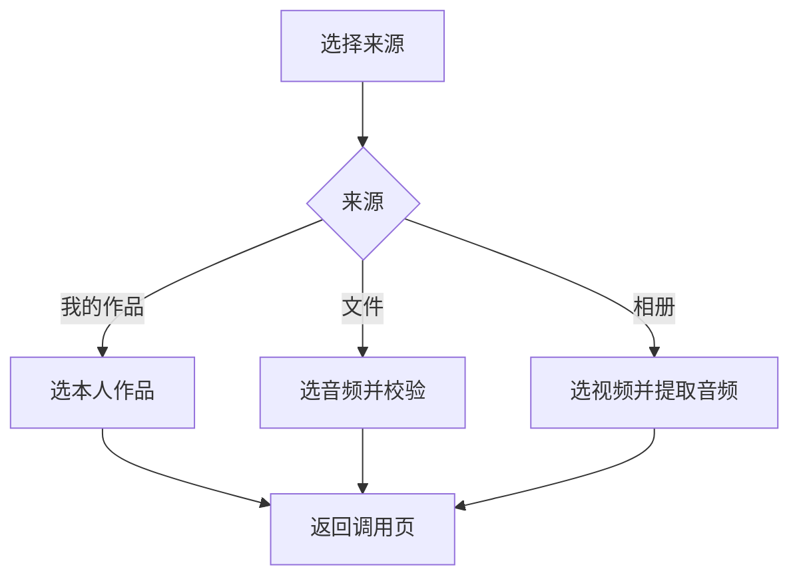
**详细交互**：确认前显示实际文件信息和不合规原因；替换成功后回填新源，失败保留原选择；删除后来源为空并清理相关参考度/识别结果。

**状态/异常**：权限拒绝、无作品、文件损坏、提取失败或审核中/拒绝均有可返回、重试路径。

**验收**：三类来源都只回填给原业务，不将站内他人作品作为“我的创作”。

### P07 音色库

**页面定位**：在可用的本人音色和后台官方音色中选择、试听或创建本人音色。

**参考素材**：新稿 `148:129`，含本人/官方 Tab 和训练中状态。


**页面结构（上到下）**：标题/管理入口、本人/官方 Tab、音色卡列表、试听/选中态、底部确定；空态可创建音色。

**区块与主要功能**：官方名称/头像由后台维护，试听资源按渠道返回；本人音色仅显示当前用户经验证训练的音色及排队/失败/不可用状态。音色能否用于当前写歌或翻唱模型，要按业务与厂家兼容能力再次判断，不能因为音色在库中就一律可选。

**交互流程**：
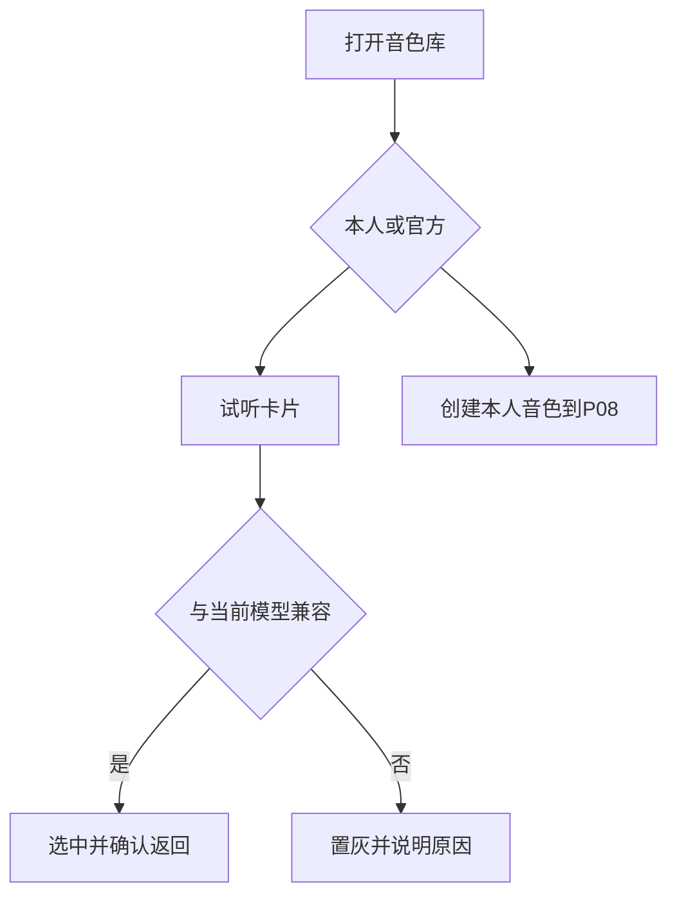
**详细交互**：点卡试听，再点停止；点可用卡选中，确认返回原 P03/P05；不可用卡仍展示原因，不能提交。管理本人音色时删除前二次确认，删除后不能创建新任务，历史作品按既有保留规则处理；官方音色由后台下架，不提供用户删除。

**状态/异常**：本人库空、官方库空、试听失败、训练中、训练失败、音色下架或兼容性失败分别显示；试听失败不影响返回。

**验收**：人声选择与模型兼容一致；写歌可使用已验证本人音色但仅在当前模型支持时开放。

### P08 音色资料与本人验证

**页面定位**：创建本人音色资料并证明待克隆声音属于本人。

**参考素材**：`148:381` 创建引导和 `148:432` 本人验证。


**页面结构（上到下）**：创建说明；头像/昵称；本人声音与风险确认；随机短句录制和倒计时；重录/提交；继续到训练素材。

**区块与主要功能**：昵称、头像和音频都需安全审核；未填写资料时可使用产品定义的默认“我的音色”名称，但展示前仍需审核；每次新训练任务重新确认本人声音权利与风险。随机短句过期重新获取，不允许复用旧验证片段。

**交互流程**：
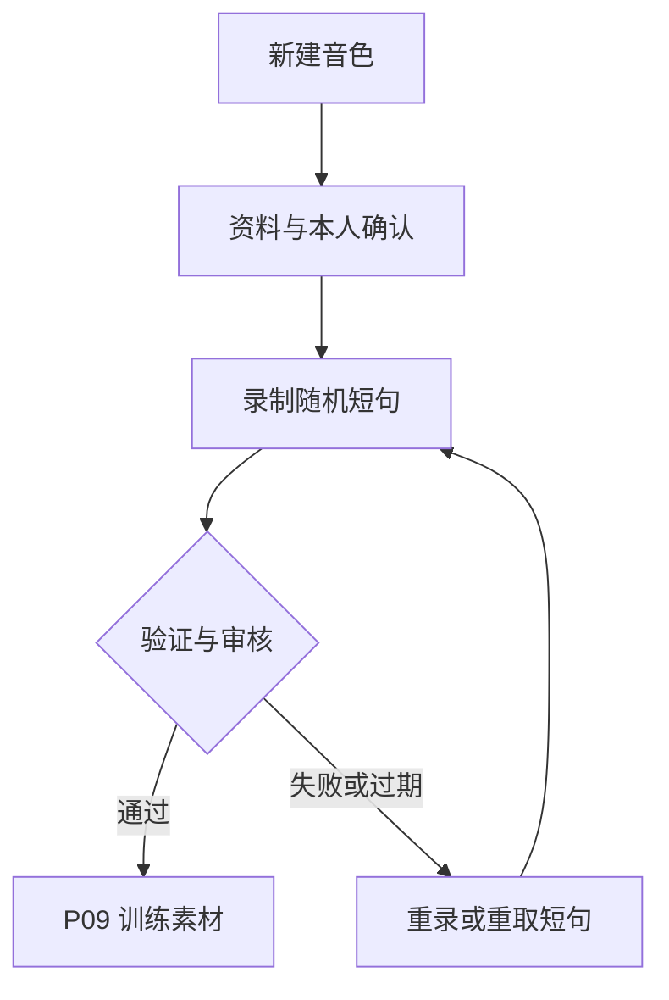
**详细交互**：Figma 的“或已获授权”文案与本期仅本人规则冲突，实际按钮文案需改为本人声明；不允许代他人上传授权书替代验证。图中的“创建成功后立即用于 AI 写歌”也不成立：资料/验证完成后还需素材审核与训练，只有音色可用且所选算道写歌模型明确兼容时才能选择，否则写歌音色项置灰。返回前未提交资料可保留草稿，但不得生成可用音色。

**状态/异常**：麦克风权限拒绝、录制中断、短句过期、头像/昵称审核失败均可恢复或重新提交。

**验收**：无法绕过本人验证进入训练；拒绝的头像/昵称不公开展示。

### P09 训练素材与提交

**页面定位**：收集、试听、管理本人声音素材并选择训练模型。

**参考素材**：`148:3888` 训练素材卡、`148:3965` 上传入口、`148:7293` 成功反馈。画面“45MB”“6–90s”是示例，不当作统一限制。


**页面结构（上到下）**：录制指南；素材累计时长/容量；立即录音或上传音频；片段截取与试听；素材删除/重录；训练模型及报价；确认训练。

**区块与主要功能**：可直接录音，或从文件/相册视频提音频后截取。训练素材只按所选厂家模型明确支持的硬限制校验。算道 `sovits_train` 文档明确音频 URL 数组至少 1 条、需可由厂家下载；素材格式为 `mp3/wav/m4a/flac/ogg/aac`，总大小不超过 100MB，支持 `lite/draft/fast` 训练模式。飞书来源记载“最低有效时长 1 分钟”，但用户 2026-09-13 最终明确“只要厂商支持”，故此数字不作为平台最低时长；厂家“干声累计超过 5 分钟”是效果建议，也不作为拒绝或警告条件。文档未明确单段/累计时长硬上限与最多片段数，平台不自行设定这些限制，也不因此关闭训练模型；若厂家实际拒绝素材，展示失败原因并按现有任务/积分失败流程恢复。

**交互流程**：
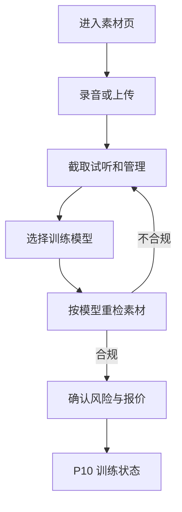
**详细交互**：切训练模型时，重新校验已有片段；不合规则清空本次选中的无效片段并标明原因，已上传的原始资源不因此删除，用户需重新选择合法片段。训练价格由所选模型实时返回；仅会员可提交，积分不足引导充值；训练与翻唱各计一次，失败按平台冻结/释放流程处理。上传、审核和训练是不同状态，不能把文件上传成功显示为音色可用。

**状态/异常**：未满足厂家明确的最低素材要求、超出明确上限、背景噪声提醒、音频解析失败、厂家拒绝、审核拒绝、报价过期、网络失败都有明确重试或替换入口；效果建议本身不产生禁用状态。

**验收**：厂家明确声明不同限制的训练模型按各自约束和报价处理；未声明的时长/片段上限不被凭空补出，满足明确硬限制的短素材可提交；旧素材不会因切模型被误送不兼容模型。

### P10 音色训练状态

**页面定位**：查看音色排队、训练、成功、失败和可用性。

**参考素材**：`148:129` 的训练中音色卡、`148:7293` 成功状态；新稿没有独立完整“训练状态页”截图，本页按产品状态描述验收。


**页面结构（上到下）**：音色资料、排队/处理状态、进度或阶段说明、失败原因/重试、返回音色库。

**区块与主要功能**：训练任务可离开页面继续执行；仅在素材、训练结果及必要审核完成且模型可用后，音色才能被 P07 选中。

**交互流程**：
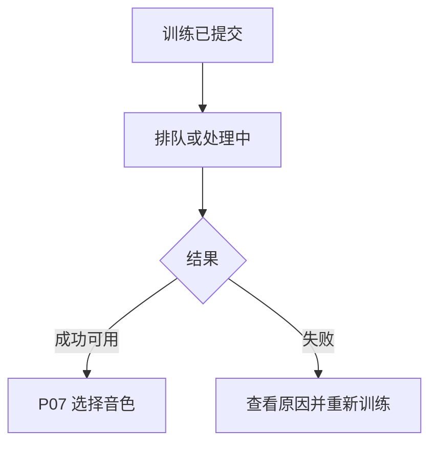
**详细交互**：离开后从本人音色卡恢复查看；“重新训练”产生新任务和独立报价确认，不自动重复扣费。官方音色不走用户本人训练页。

**状态/异常**：任务超时/厂家错误、素材审核拒绝、音色暂不可用分别提示；已持久化试听仍可听，但暂不可用音色不能新建翻唱。

**验收**：未完成训练的音色无法被写歌或翻唱选择，历史作品不因音色后来不可用而直接改状态。

### P11 生成等待

**页面定位**：写歌、改编和声音克隆翻唱共同使用的任务等待反馈。

**参考素材**：飞书明确沿用当前专业写歌生成等待页；本轮新 Figma 未提供独立改版截图，按现有工程 UI 复用，不新增一套等待页视觉。

**页面结构（上到下）**：业务/歌曲标题、排队或生成阶段、剩余时间（有依据时）、返回作品页入口。

**区块与主要功能**：显示当前任务业务名称，不把写歌展示成翻唱；点击返回只停页面轮询，服务端任务继续；作品页可恢复活动任务。

**交互流程**：
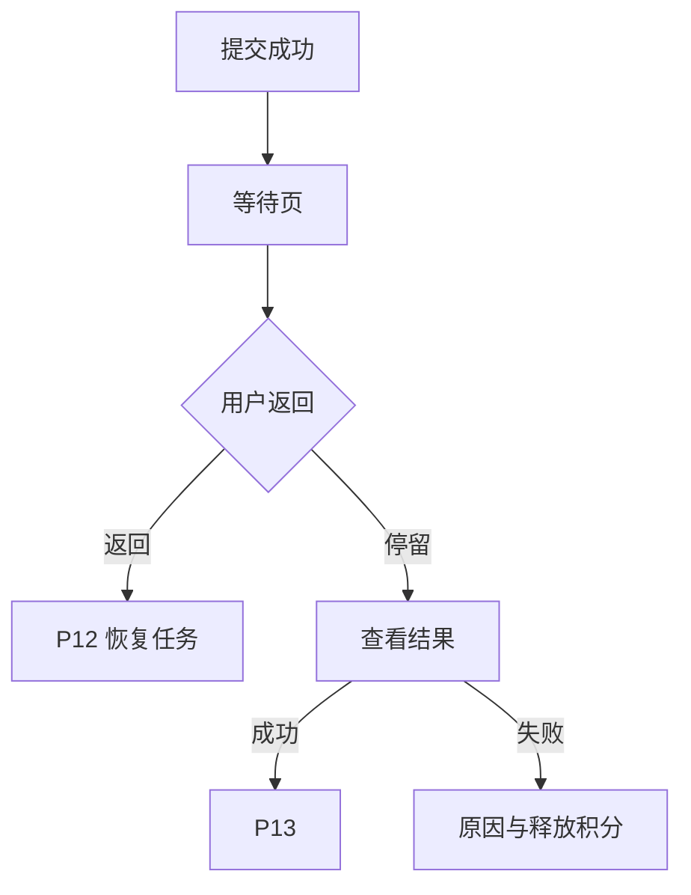
**详细交互**：平台排队不计入翻唱“厂家接单后 10 分钟”处理时限；厂家确认接单并提供可查任务 ID 后才开始倒计时。不能假装有可准确预测的进度或剩余时间。

**状态/异常**：客户端退出/重启、轮询失败、厂家超时、持久化或审核失败，都应回到真实任务状态；失败不能标完成。

**验收**：每个业务返回和恢复正确；任务只有作品已可播放才作为生成成功验收。

### P12 我的作品

**页面定位**：集中查看歌曲、MV 和声音克隆翻唱的任务及成品。

**参考素材**：新稿 `148:5115`；画面中的“15 天后自动删除”按 D-05 已确认口径解释为用户侧软删除/移出作品列表，不代表当日物理清理。展示文案须与现有 Catsinger 作品生命周期一致。


**页面结构（上到下）**：标题、歌曲/MV/翻唱分类、生成中/失败/已完成列表、作品卡、底部导航。

**区块与主要功能**：AI 写歌和歌曲改编进入各自历史作品类别/标签，声音克隆翻唱进入“翻唱”；生成中可查看状态，完成可播放，失败展示原因和可重试动作。

**交互流程**：
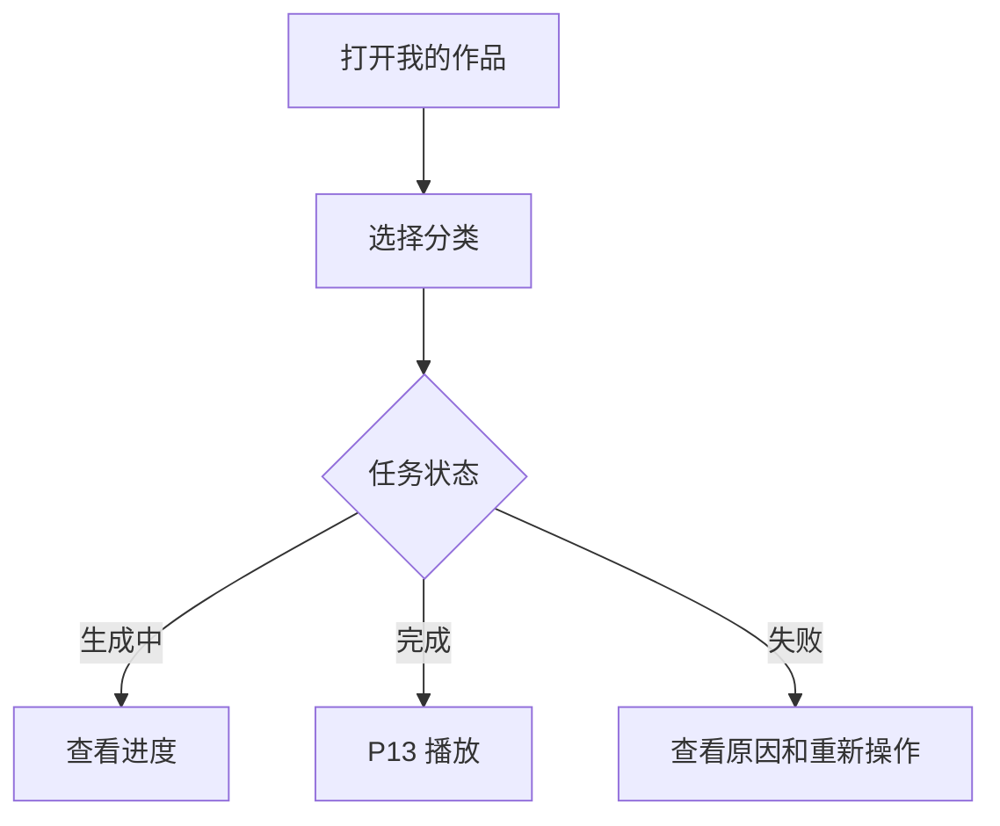
**详细交互**：删除作品需确认；可重新翻唱的作品返回 P05 并回填允许复用的来源，不自动沿用已下架音色或旧模型不支持参数。

**状态/异常**：空分类、任务状态同步延迟、资源失效等显示真实状态；音频不可播放不能算成功。

**验收**：三业务作品不混标；翻唱作品可从作品页进入复用播放器并真实播放。

### P13 作品播放器

**页面定位**：复用当前 `SongPlayerPage` 播放已完成作品，不设计新翻唱专属结果页。

**参考素材**：Figma 新稿 `146:7543` 仅作播放外观对照；实际交互复用当前工程现有播放器。


**页面结构（上到下）**：当前作品信息、封面/播放区、进度与播放控件、歌词与已有操作入口。

**区块与主要功能**：播放、暂停、歌词、下载、分享、收藏、删除和重新创作沿用现有能力；翻唱作品增加“重新翻唱”入口时必须返回 P05，不能误入歌曲改编。

**交互流程**：
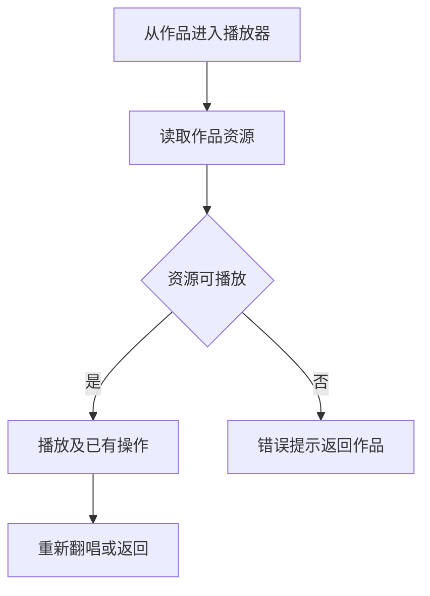
**详细交互**：下载使用平台实际文件格式和正确后缀；不可用或过期资源不能提供假下载地址。用户先看歌词再切播放不应切到别的作品。

**状态/异常**：网络中断、资源审核未通过、资源持久化失败或无法解码时显示不可播放，不把任务错误隐去。

**验收**：播放进度实际增长、听到目标作品音频，不能仅用播放器打开或接口返回 200 判通过。

### P14 Web/Admin 管理域（W01～W09）

**页面定位**：运营和有授权的管理员通过现有后台管理三个业务共用的模型、音色、任务与作品，以及首页海报和新用户福利。

**参考素材**：本轮新 Figma 为移动端画面，**无 Web/Admin 专属设计稿**；D-07 已确认复用后台既有导航、表格、表单和权限块，不等待新后台视觉稿，也不以移动端截图冒充后台 UI。字段与操作如下。

| 视图 | 从上到下结构 | 可操作项、启用条件和结果 | 异常/恢复与验收 |
|------|--------------|--------------------------|-----------------|
| W01 App 切换与权限 | App 选择器、菜单、权限信息 | 从服务端所有 `appCode` 配置切换；超级管理员分配管理块；普通角色只能操作授权块 | 切换后列表、价格、音色均按 App 重载；越权拒绝而非隐藏后可直连 |
| W02 厂家模型与能力 | 业务场景、真实厂家/模型列表、能力明细、启用/排序/默认 | 本期仅算道；只在其具体模型已声明的参数、选项与范围内设置展示、启用和默认；选择不支持参数时不能保存 | 厂家能力未声明则可选设置均不可启用；显示原因，能力更新后可重新配置 |
| W03 报价与场景默认 | 业务/模型、计费项、积分价格、版本、生效状态 | 写歌、改编、声音训练、声音克隆翻唱分别配置；缺价时客户端显示暂未开放 | 配置失败保留草稿；价格或默认变更只影响新报价/新任务 |
| W04 官方音色 | 音色列表、名称头像/分组、试听资源、渠道模型兼容、审核与启停 | 后台创建/编辑/审核/发布或下架官方音色；试听可来自厂家资源，展示资料由平台提供 | 审核拒绝/资源不可用不发布；下架不能被新任务选用 |
| W05 训练/翻唱任务 | 业务筛选、任务列表、模型路由、进度、错误、操作日志 | 查看训练与翻唱任务及失败原因、审核/资源/积分状态；依角色处理人工运维动作 | 不修改历史 AI 改编任务业务类型；操作必须可追溯 |
| W06 资源与审核 | 用户/官方上传素材、图片、可展示文字、审核结果与资源状态 | 按既有安全审核工作流处理，不因后台上传绕过审核；拒绝内容不能公开/送厂家 | 失败允许按权限替换/重新送审，保留审计记录 |
| W07 作品与审计 | 作品筛选、资源详情、音色来源、操作记录 | 按原创/改编/声音克隆翻唱区分，查看模型和真实资源，授权删除/隐藏 | 资源不可播放、作品失效/过期须准确呈现，不能改写历史任务分类 |
| W08 首页海报 | App 选择、海报列表、预览、目标功能、状态与操作 | 授权运营可新增、编辑、删除海报；可绑定已支持的功能入口，留空则静态展示 | 保存/删除后首页至少一张可展示海报；无权限或不合法目标不能发布；图片沿用安全审核 |
| W09 新用户权益 | App 选择、注册赠积分配置、弹窗启停/样式/目标/人群/频次 | 授权管理员调整新用户自动赠额和新人礼展示规则；弹窗目标可指定签到/任务等现有页面 | 仅新建账号使用新赠额，历史不补差；无效配置回退初始 30；点击领取后结束新人礼弹窗资格 |

**主要功能**：W02 的“参数启用”是厂家能力的受限交集，而非自由输入任意参数；W03 返回实时价格供 App 引用，管理员保存前也要校验当前能力版本。W08 的海报与 W09 的赠额/弹窗是不同配置项；调整弹窗不更改已发积分。W01 切 App 时表单草稿若未保存需提醒，不能跨 App 保存。

**交互流程**：
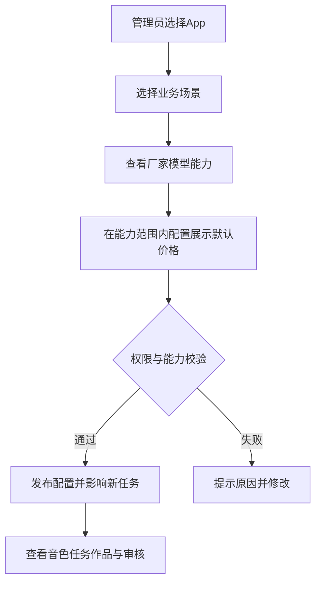
**详细交互**：每个 W 视图的列表可加载/空/失败重试；危险操作确认后执行并记录管理员/时间/目标 App；模型能力收缩后现有配置中失效参数须显式标出并阻止继续发布，不默默继续开放。

**验收**：切 `catsinger` 才看到本业务数据，能力未声明/不支持项不可保存为启用，任何后台开关都不能使 App 发出厂家不支持参数。海报、注册赠额、弹窗规则按当前 App 与管理权限隔离。

#### W01 App 切换与权限

**页面定位**：管理员选择要管理的 App，只能看见自己获授权的管理块与对应数据。

**参考素材**：暂无新 Figma Web/Admin 稿；沿用后台现有导航和表格设计，`appCode` 列表以服务端全部配置为准。

**页面结构（上到下）**：顶部 App 选择器、当前 App 标识、角色权限提示、管理菜单与内容区域。

**区块说明/主要功能**：切 App 时重载模型、价格、音色、任务与作品；未保存表单先确认是否离开；超级管理员分配不同角色的管理块，普通角色不能通过直连 URL 越权。

**交互流程**：
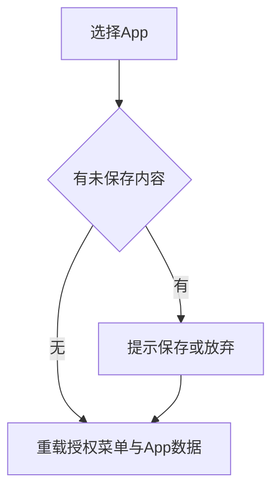
**详细交互/状态**：切换成功后页面标题和所有列表的 App 一致；权限或加载失败时保持旧 App 且提示，不出现混合数据。

**验收**：切到 `catsinger` 才能操作本业务；无权限保存返回拒绝并有审计。

#### W02 厂家模型与能力

**页面定位**：为写歌、改编、音色训练和声音克隆翻唱配置当前可选模型及参数展示。

**参考素材**：暂无 Web/Admin 新稿；字段以产品规则和现有后台模型管理为依据，不复制 App 截图。

**页面结构（上到下）**：App/业务筛选、模型列表、真实厂家/模型标识、能力声明状态、参数明细、展示/启用/排序/默认表单、保存动作。

**区块说明/主要功能**：查看供应商声明的参数键、值类型、允许选项、范围、默认和禁用原因；管理员只能选择**声明集合内**的展示与启用方式，收窄范围但不能扩张或把 `NOT_DECLARED` 当支持。不同业务同名模型也分别校验其操作契约。

**交互流程**：
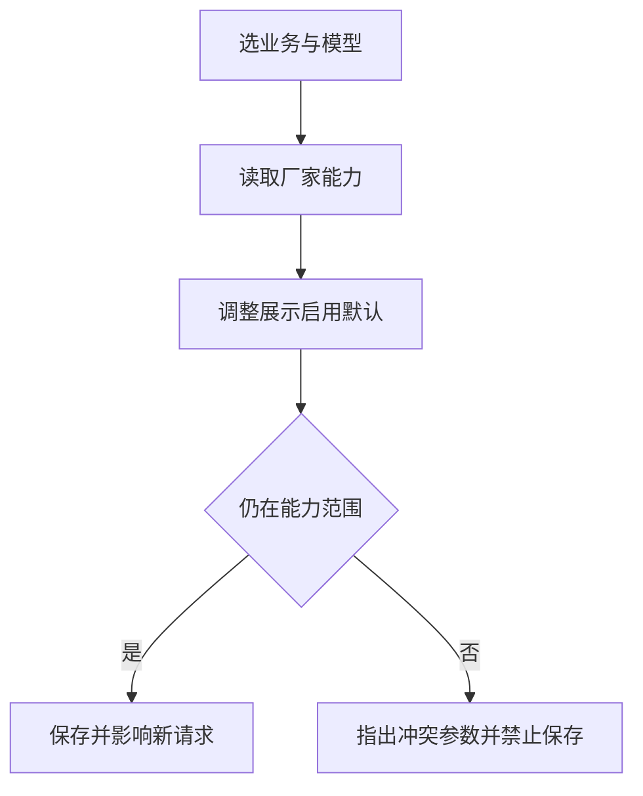
**详细交互/状态**：能力未声明时参数行可见但管理员不可将其改为启用；厂家收缩能力后把旧启用项标成“需修正”，不能继续发布。保存失败保留表单草稿；管理员可重新选择合法默认值。

**验收**：模拟不支持参数、范围越界、非法选项、无默认及能力变更，后台均无法发布虚假能力；已在运行任务的快照不被回写。

#### W03 业务场景、默认模型与价格

**页面定位**：给四种计费动作配置实时有效价格与默认模型。

**参考素材**：暂无 Web/Admin 新稿，沿用现有场景路由/计费配置布局。

**页面结构（上到下）**：App/场景筛选、启用模型列表、默认标记、积分价格/单位、价格版本、生效状态与保存。

**区块说明/主要功能**：AI 写歌、歌曲改编、音色训练、声音克隆翻唱分别定价；同模型在不同场景可有不同计费项；只有该场景能力可用的模型才可设默认。价格未配或失效时 App 显示暂未开放，而非图上的例子价格。

**交互流程**：
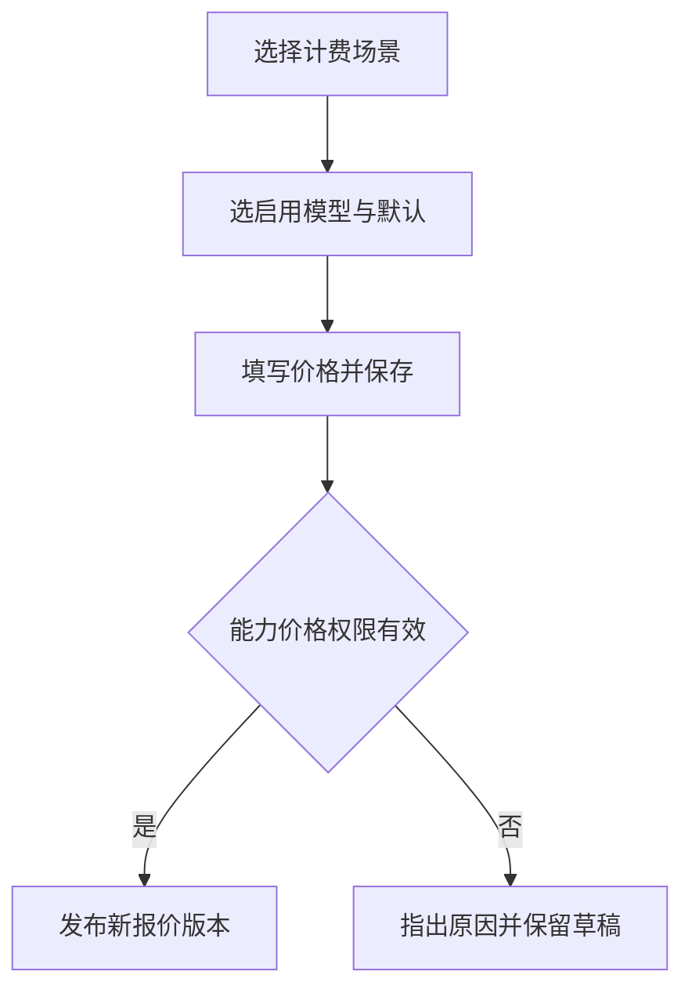
**详细交互/状态**：管理员改价后新报价立刻使用新版本；用户已确认但尚未创建的旧报价提交时须重取，已创建任务不追溯改价。空场景/未配置价格需可见。

**验收**：训练和翻唱报价分开；切模型或改价能影响 App 新报价但不更改历史积分记录。

#### W04 官方音色

**页面定位**：管理由平台准备的官方音色，而不是代用户创建本人音色。

**参考素材**：暂无 Web/Admin 新稿；移动端音色库仅为消费结果参考。

**页面结构（上到下）**：App/分类筛选、音色列表、名称/头像/标签、渠道模型兼容、试听资源、审核状态、排序启停与发布。

**区块说明/主要功能**：名称和头像由平台填写并审核；试听音频可使用厂家提供的受控资源，平台需保证其可播放且符合现有审核/资源规则。配置音色与哪些厂家/模型兼容；下架后新任务不可选。

**交互流程**：
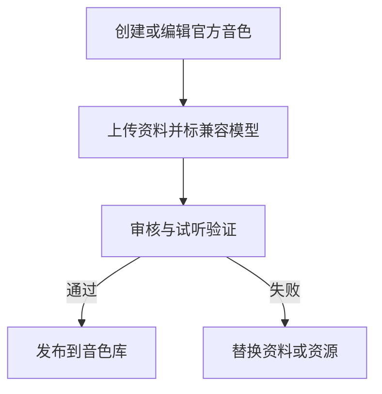
**详细交互/状态**：资料审核中/拒绝、试听不可用、兼容模型下架时不能发布或需暂停；已用该音色的历史作品按作品规则保留。普通管理员是否有审核/发布权限由 W01 管理块决定。

**验收**：App 音色库仅展示当前 App、已发布且可用的官方音色；名称/头像和试听资源来源可追溯。

#### W05 训练与翻唱任务

**页面定位**：查看新声音克隆训练和翻唱任务全流程，不改旧改编任务归类。

**参考素材**：暂无 Web/Admin 新稿；沿用现有 AI 任务运维列表。

**页面结构（上到下）**：App/业务/状态筛选、任务列表、用户/模型/报价快照、排队与厂家阶段、审核/资源/积分结果、错误详情与操作日志。

**区块说明/主要功能**：区分平台排队和厂家接单后处理时限；查看失败究竟在素材、厂家、持久化、审核还是播放验证；经授权人员可执行既有运维动作，但不能把失败改成伪成功。

**交互流程**：
```mermaid
flowchart TD
    A[筛选任务] --> B[查看阶段与错误]
    B --> C{是否需要人工处理}
    C -->|是且有权限| D[执行既有运维动作并审计]
    C -->|否| E[只读记录]
```
**详细交互/状态**：任务未到厂家时不显示 10 分钟倒计时；厂家接单后显示真实时间点。列表失败可重试加载，不能因后台模型改动重写历史任务的厂家/价格快照。

**验收**：按写歌、改编、训练、声音克隆翻唱准确筛选；旧 `COVER` 任务不会被认作声音克隆任务。

#### W06 资源与安全审核

**页面定位**：让有权限人员查看图片、音频和可展示文字的审核与资源技术状态。

**参考素材**：暂无 Web/Admin 新稿；复用现有资源台账与审核管理流程。

**页面结构（上到下）**：App/资源类型/审核状态筛选、素材列表、来源/所属用户、审核记录、技术存储状态、替换/重新送审入口。

**区块说明/主要功能**：技术上传成功与安全审核通过分别显示；用户、运营和普通管理员均不可绕过拒绝状态。站内受信来源可沿用已有审核事实，厂家生成成品仍须审核和资源可播放检查。

**交互流程**：
```mermaid
flowchart TD
    A[查看资源] --> B[区分上传与审核状态]
    B --> C{是否通过}
    C -->|是| D[可按业务规则使用]
    C -->|否| E[替换或按权限重新送审]
```
**详细交互/状态**：审核失败显示可定位的原因，重新送审保留原记录；敏感音频仅授权人员可访问，不能因后台预览生成公开链接。

**验收**：被拒绝的头像、昵称、训练音频和成品都不可公开/训练/生成；所有处理动作有操作人和时间。

#### W07 作品与审计

**页面定位**：从运营视角核对作品业务类型、资源可用性和操作历史。

**参考素材**：暂无 Web/Admin 新稿；移动端 P12/P13 是用户展示效果参考，不作为后台布局。

**页面结构（上到下）**：App/作品类型/状态筛选、作品列表、来源歌曲/音色/厂家模型/积分快照、资源播放信息、删除/隐藏与审计记录。

**区块说明/主要功能**：原创、旧改编、声音克隆翻唱分别查询；显示实际文件类型和是否可播放；可按已有权限隐藏/删除，不能把资源仍未持久化的任务标完成。

**交互流程**：
```mermaid
flowchart TD
    A[筛选作品] --> B[查看业务与资源]
    B --> C{需管理操作}
    C -->|是且有权限| D[确认后操作并记审计]
    C -->|否| E[只读查看]
```
**详细交互/状态**：隐藏/删除前展示影响范围；资源失效显示真实错误；被删除音色不自动删除历史作品，翻唱成品沿用现有 Catsinger 作品生命周期，不另设期限。

**验收**：按 `appCode`、业务和作品状态筛选准确；后台操作后 App 对应作品变化一致且可审计。

#### W08 首页海报管理

**页面定位**：运营决定首页展示哪些海报，以及每张海报是否跳转到 App 内的具体功能。

**参考素材**：暂无 Web/Admin 单独设计稿；App 首页视觉参考为 Figma `151:7830` / `151:7973` 和[飞书原图](references/images/v2.1/home-revision/home-carousel.png)。后台沿用现有列表、上传、预览和权限组件。

**页面结构（上到下）**：当前 App 标识、海报列表与预览、图片及可选目标功能编辑、增删操作和保存结果。

**区块说明/主要功能**：初始展示两张海报；运营可新增或删除，给每张海报选择现有 App 功能入口或留空作为静态图。**首页至少保留一张可展示海报**；删除/停用最后一张时拒绝保存并说明原因。上传图片沿用现有资源和安全审核，审核未通过不得发布。目标功能下线或权限变化时不能继续提供错误跳转。

**交互流程**：
```mermaid
flowchart TD
    A[选择catsinger] --> B[查看海报和目标]
    B --> C[新增编辑或删除]
    C --> D{至少一张可展示且资源目标有效}
    D -->|是| E[保存并让首页读取新列表]
    D -->|否| F[保留原配置并提示修正]
```

**详细交互/状态**：管理员必须具有对应管理块权限；无权限不能通过直连接口修改。上传失败保留原图片；目标功能留空明确标识“静态展示”。页面预览应能分辨写歌和翻唱海报；后台改动仅影响新拉取的首页配置，不能把 AI 翻唱路由错指向旧改编。

**验收**：两张海报可显示、切换；增加第三张/删除到只剩一张均可，试图删除最后一张失败；有目标点击跳正确功能，无目标不跳；切换其他 App 不混用数据。

#### W09 新用户赠积分与福利弹窗

**页面定位**：管理员维护新用户自动赠额和首页新人礼展示，两者是独立配置，仍在同一 App 管理域内。

**参考素材**：暂无 Web/Admin 单独设计稿；App 弹窗及任务入口参考 Figma `151:8116` / `151:8281` / `151:8422` 和[飞书原图](references/images/v2.1/home-revision/new-user-gift.png)。截图中的积分数字不是后台默认值。

**页面结构（上到下）**：当前 App、注册赠积分数量与生效提示、弹窗启停、样式预览/替换、点击目标、会员/非会员人群、展示频次、保存与操作记录。

**区块说明/主要功能**：后台可改新用户自动赠送的积分数；弹窗可单独启停，可更换样式、指定 App 内跳转页面和展示人群，默认“首次登录后一次”，可配置“每天一次”或“每次打开 App”。点击「领取新人礼」只导航到现有签到/任务页面，实际签到/任务积分按原规则领取；弹窗配置变更不修改用户既有积分流水，也不把任务奖励当成注册赠额。

**交互流程**：
```mermaid
flowchart TD
    A[选择catsinger] --> B[编辑赠额或弹窗规则]
    B --> C{有权限且配置有效}
    C -->|是| D[保存新配置]
    C -->|否| E[保留原配置并提示]
    D --> F[符合条件的新用户按规则看到弹窗]
    F --> G[点击后进入指定签到或任务页]
```

**详细交互/状态**：赠额修改只影响保存后新创建且按既有流程符合赠送条件的账号，历史账号不补差、既有流水不改；创建游客或手机号新账号时发放，游客绑定手机号保留同一账号，不再领取。新配置初始值为 30 积分；配置缺失或无效时使用该初始值，不使用设计稿示例数字。「稍后领取」不消耗弹窗资格；点击「领取新人礼」后结束该资格，之后即使配置为每天/每次打开也不再弹。频次仅在领取前的新用户资格内生效，不新增跨设备特殊规则；弹窗点击不替代签到/任务页面的实际积分领取。

**验收**：有权角色可分别保存赠额和弹窗配置，无权角色被服务端拒绝；赠额变更不改已有流水、只影响后续新账号，无效配置回退 30；弹窗启停/人群/频次/目标影响正确，稍后关闭可再见、点领取后不再弹。资金与频控联调必须分别核对，不以 UI 状态代替实际账务。

## 6. 数据与同步

### 6.1 必要的产品数据

| 数据 | 归属 | 用于用户可感知的什么结果 |
|------|------|--------------------------|
| 业务场景 | 平台配置 | 区分写歌、改编、音色训练、声音克隆翻唱及各自模型列表 |
| 模型身份 | 后台真实厂家 + 真实模型，公开选项可使用不透明 ID | 显示运营名称、控制设置和最终任务路由；不以内部模式名称冒充厂家模型 |
| 模型能力 | 厂家已声明的操作和参数契约 | 每项设置的支持状态、选项、范围、默认值、置灰原因、互斥关系和文件限制 |
| 后台展示配置 | 某 App + 场景 + 模型 | 在厂家能力内选择显示、启用、默认顺序和推荐模型，不能扩大支持范围 |
| 模型报价 | 场景 + 模型 + 影响价格的选择 | 实时显示积分及报价版本；训练与翻唱分别计价 |
| 表单草稿 | 当前用户与当前业务 | 切模型时保留合法的基础输入/参数，恢复互斥开关前的歌词 |
| 任务快照 | 用户实际提交并经服务端复核的配置 | 任务进行中后台改模型/价格不篡改旧任务 |
| 音色与素材 | 本人验证/审核/训练/可用性及官方发布状态 | 决定能否试听、选择、训练、翻唱或写歌 |
| 作品资源 | 持久化后的实际音频格式、大小、时长、可播放状态 | 播放、下载、保留期限与异常提示 |
| 首页海报 | 当前 App 的图片、可选目标功能和展示顺序 | 决定轮播内容、指示点及点按结果，保证至少一张有效展示 |
| 新用户赠额 | 当前 App 的赠送积分数量和生效配置 | 首次符合条件时自动发放，与签到、任务、邀请分开显示和记账 |
| 新人礼规则 | 启停、样式、目标页面、会员人群、展示频次和用户展示记录 | 决定谁在何时看到弹窗及按钮去哪一页；不决定注册积分是否发放 |

### 6.2 同步点

1. 进入 P02/P03/P04/P05 或切业务时加载该场景模型列表及默认模型。选中模型后读取对应能力、选项和实时报价，不用 App 级 `generation-options` 冒充逐模型能力。
2. 切模型、纯音乐/保留歌词等互斥条件变化、参考音频增删、音色变更或后台配置更新时，重新计算可用设置和受影响报价。刷新中禁重复提交。
3. 草稿可暂存被互斥开关遮挡的旧值供用户恢复，但**请求体只包含当前有效、启用且经过校验的参数**；不能把界面置灰和提交过滤混为一谈。
4. 任务创建返回后显示实际业务、模型、报价和状态快照；用户离页返回作品后读服务端真实状态。生成成功前不得让作品卡播放临时 URL。
5. 后台 App 切换后重新获取 App 专属配置/数据；管理员权限和厂家能力限制在服务端重新校验。
6. 首页拉取当前 App 的有效海报列表；新配置生效后下次拉取使用新内容，图片未通过现有安全审核或目标功能失效时不可当作可跳转海报。首次打开或刷新首页时同时读取符合条件的新人礼配置，弹窗查询失败不阻塞首页业务卡。
7. 新用户赠额沿用当前账户创建时点：创建游客或手机号新账号后，按当时有效的后台金额通过既有积分账本发一次；游客后续绑定手机号不再发，重复登录不重发。只影响配置生效后新建且符合条件的账号，历史不补差；初始金额 30 积分，配置无效时回退 30。不由弹窗展示、关闭或点按触发。

## 7. 核心业务规则

### 7.1 能力优先级与设置状态

| 情况 | 页面呈现 | 点击/提交行为 |
|------|----------|---------------|
| 模型明确支持业务及参数 | 参数正常可改；按模型选项、范围和默认呈现 | 值合法且报价有效时可提交 |
| 模型支持业务但不支持某参数 | 参数保留设计位置并置灰 | 点击说明该模型不支持，载荷不含该参数 |
| 参数声明存在，但业务条件不满足（如纯音乐下人声、无参考音频时音频参考度） | 保留位置置灰，解释条件 | 条件恢复后可恢复仍合法的草稿值；禁用时不提交 |
| 能力 `NOT_DECLARED`/未声明 | 基础业务输入可编辑；**全部可选设置置灰** | 可按 D-02 做有条件的最小参数提交：只带当前业务必要字段，服务端须确认该模型支持本业务、素材/权利/审核及报价均有效；否则禁提交并说明 |
| 模型整体不支持本业务或已下架 | 基础输入可保留；该模型明确不可用 | 不允许提交，提示选择其他模型 |
| 能力请求失败/过期 | 显示加载/重试，不回退到“全参数可用” | 提交前必须重新取到可校验的能力与报价 |

“置灰但可点说明”在 UI 上指设置行仍能响应解释动作，实际编辑控件不可操作；屏幕阅读器也能读出不可用原因。模型未声明不等于“供应商支持所有参数”，后台不能按未声明状态放开控件。

### 7.2 切换模型、越界值与草稿

1. 先对新模型确定业务可用性和参数契约；仍支持且值在新范围/选项内的输入保持不变。
2. 新模型不支持的参数变为置灰，已选值立即清空；切回原模型也不暗中恢复该值。此规则只针对模型切换，不改变纯音乐互斥时歌词暂存的既有交互。
3. 新模型仍支持但原值越界、选项失效或关联音色不兼容时，均清空已选值并提示用户重新选择；**不自动替换为新模型默认值**。可选项留空则请求省略，必填项留空则禁提交。新模型首次进入时可显示其声明的默认值，但不能借此覆盖刚被清空的失效输入。
4. 变更后以摘要提示“哪些设置被保留、清空或暂不可用”，并刷新报价；歌曲来源不兼容时清空表单中的已选来源引用，要求用户重新选择合法来源，已上传的资源本身不因此删除。
5. 纯音乐开启使人声/指定音色及专业歌词编辑互斥置灰；专业歌词仅在草稿层保留，关闭后恢复。禁用时最终请求不携带旧歌词与人声选择。
6. 参考音频删除后清除本次参考资源和音频参考度；替换成功后重新验证文件与模型限制，旧引用不能继续暗中使用。

### 7.3 参数含义和权限

- `style_weight`：对文字风格描述的服从程度；不等于参考音频相似度。
- `weirdness_constraint`：结果变化/非常规程度；不专门依赖参考音频。
- `audio_weight`：对参考音频的依赖；仅在当前业务、模型都支持且已有有效参考音频时可用。
- 升降调、人声音量、伴奏音量属于翻唱声音克隆的可选设置；算道 `sovits_cover` 文档范围分别为 `-12～12` 和 `0～200`，仅作该接口能力上限。实际页面默认值和允许范围仍取所选模型返回的配置，不向其他模型外推。
- 音色按训练厂家隔离：算道训练的本人音色只可供算道明确兼容的模型使用，不承诺跨厂家互通；同一厂家内部也不能仅凭厂家相同就判为兼容。算道文档区分 `sovits_train` 训练出的模型（供 `sovits_cover` 使用）与 Suno Voice Persona（写歌/其自身翻唱接口使用）；**不能推导 SoVITS 的 `model_id` 可直接传入 Suno 写歌模型**。
- 本期可用厂家仅算道。指定本人/官方音色须按具体算道模型与音色机制核验，明确支持时才可选；跨厂家或同厂不兼容时置灰，已选音色在切模型后清空并提示。“已验证本人音色可用于写歌和翻唱”保留为受模型能力约束的产品目标，不表示同一份 SoVITS 音色已可跨算道内部两套机制复用；后续厂家接入另行对账。
- 后台配置只能收窄厂家声明的能力，不能新增厂家不支持的键、扩展范围、强行启用缺省能力或制造无效默认值。价格是平台配置，但有价格不等于有对应参数能力。

### 7.4 报价、积分和任务

- App 展示服务端当前报价，不写死 Figma 120/180/260、100/200 或其他示例数字。旧 V2.1 训练 100、翻唱 200 可作为后台默认配置参考，仍以实时有效报价为准。
- 模型、设置或会影响价格的素材变化后重新报价；报价刷新失败或版本过期不可按旧价静默提交。用户须看见新价再确认。
- 提交由后端复核：App、业务场景、真实厂家/模型、能力状态、所有传入参数及其范围/互斥、音色/素材可用性、权利确认、审核与实时价格。已置灰的旧值即便被旧客户端携带也拒绝或按明确服务端兼容策略处理，不能交给厂家“试试看”。具体 wire/错误码留技术方案定义。
- 成功提交任务前冻结相应积分；训练成功与翻唱成功各自结算，失败释放/退款，幂等键防重复任务/扣费。平台排队、厂家执行和用户离开页面不应引发重复扣费。
- 不提供取消训练或翻唱操作。翻唱厂家确认接单且有可查询任务标识后计 10 分钟处理时限；平台排队不计。用户侧仅显示真实可解释状态。

### 7.5 内容、权利、资源和作品

- 音色训练只允许本人声音；每个新训练任务重新确认本人权利和风险。用户选他人作品/声音、后台未发布音色均不可走“试一试”捷径。
- 歌曲使用权确认、本人声音确认与图片/音频/文字安全审核相互独立。原用户上传与现有平台资源/审核体系保持一致；站内已审核作品/素材进入任务时沿用现有 AI 改编“不重复送源审核”的规则，厂家成品仍需平台审核。
- 审核未通过的资料、素材或成品不能公开展示、参与训练、生成可播放作品；上传成功仅是资源技术状态，不是审核成功。
- 厂家临时音频必须转存到平台资源，记录实际 MIME、格式、大小、时长并验证可播放后标记作品成功；不固定 MP3，不默认提供人声/伴奏分轨。
- D-05 已确认声音克隆翻唱作品**不设独立保留政策**，与现有 AI 写歌/歌曲改编作品共用 Catsinger 作品与资源生命周期。当前后端实现对普通终态作品约 15 天软删除、从用户侧移除；约 30 天且满足条件后由清理任务物理清理业务数据与资源。运营引用作品可永久豁免；有关联保护或资源清理未完成时延后并重试；历史存量作品受现有启用时间缓冲保护。页面“15 天后自动删除”只能解释为用户侧移除，不承诺第 15 天物理删除或第 16 天自助恢复。上线时核对实际环境的生命周期配置与调度，不另建翻唱专属清理规则。

### 7.6 首页运营与新用户权益

- 海报内容、顺序、可选功能目标、展示状态属于 `catsinger` 的后台配置；**至少一张有效海报**是发布门槛。初始两张仅是这次投放内容，不是轮播数量上限。未选目标的海报是纯展示，不暗绑首页默认写歌入口。
- 后台只允许有相应管理块权限的人员配置；新增图片和弹窗可展示文字沿用现有内容安全审核。失效资源或不存在的目标不能变成可点击错误页，旧 AI 改编与翻唱声音克隆仍按独立路由处理。
- 新用户自动赠积分是独立于签到、任务、邀请和弹窗的账户权益；配置数值是动态业务值，不使用设计稿中的示例。沿用后端现有新账号创建时点与 `NEW_USER:{userId}` 流水幂等，不因重复登录、游客绑定或多次看到弹窗而重复领取。后台金额变更只影响之后符合条件的新账号，老账号不补差；初始和无效配置回退值均为 30 积分。
- 新人礼只是引导发现签到与任务。后台可控制启停、样式、目标页面、会员/非会员展示人群与展示频次；默认新用户首次登录展示，频次配置只在尚未点「领取新人礼」的资格内生效。点「领取新人礼」结束弹窗资格并跳页面，不代替页面上的实际积分领取；点「稍后领取」只关弹窗且不消耗资格，下次满足频次仍可展示。不新增跨设备特殊判定。
- 后台调整海报或弹窗只影响之后拉取/符合条件的展示；不改变已有作品、订单、积分流水和正在执行的任务。

## 8. 前后端交互说明

> 本节给出产品需要的交互结果及现状差距，**不是新接口实现声明**。独立业务入口沿用当前已确认命名，下一步技术方案决定字段与兼容策略。

| 用户动作 | 产品需要的服务端结果 | 当前只读代码对账/后续缺口 |
|----------|----------------------|--------------------------|
| 选择写歌/改编模型 | 按后台真实 `provider/model` 解析的业务可用性、模型级参数契约和报价，关联本次选中的公开模型选项 | 已有 `/api/ai-model-options?sceneCode=...` 的 `musicContract`，仅 `song.generate` 与 `song.cover.generate` 填充；公开选项当前使用不透明 `modelOptionId`，需核验各模型声明完整性 |
| 选择翻唱/训练模型 | 同等级别返回翻唱参数、训练素材限制、音色兼容和报价 | 当前 `song.voice.cover.generate` 与训练模型响应未有等价逐参数契约；不得标已实现 |
| 打开高级设置 | 只启用当前模型支持且业务条件满足的设置，带范围/选项/原因 | 当前 `generation-options` 为 App 级选项，不可视为逐模型能力；Flutter/Admin 消费待对账 |
| 提交 AI 写歌 | 使用该业务独立入口与实际厂家模型，服务端重新验能力/报价 | `/api/song-generations`；本轮不混入改编/克隆参数 |
| 提交歌曲改编 | 使用改编业务入口，含歌词策略和来源，服务端重新校验 | `/api/song-covers`；保留歌词关闭/开启的新交互需对账 |
| 提交翻唱声音克隆 | 使用克隆专属入口，服务端固定内部业务类型，校验音色和参数 | `/api/song-voice-covers`；不可复用改编公开 API；现有页面/后台实现待核实 |
| 训练音色 | 依训练模型检查片段/累计限制、本人验证、审核与独立报价 | 已有训练骨架/实现不能证明厂家能力契约或上线闭环 |
| 查看任务/作品 | 返回真实阶段、模型/积分快照及可播放成品 | 任务成功与可播放不同；QA 必须验实际播放 |
| 进入首页/点击海报 | 返回当前 App 至少一张可展示海报及每张可选目标；无目标不跳转 | 目前 Flutter 首页宣传卡为静态资源，需新增运营配置消费和目标校验；不复用歌曲案例 `bannerUrl` 冒充运营海报 |
| 新建游客或手机号账号 | 使用当时有效配置金额走原 `UserService` → `PointsService` 发放与幂等；绑定不重发，老账号不补差，无效配置回退 30 | 现有代码已在建号时发固定 30，业务时点与账务链路不改；仅缺后台配置读取与金额替换 |
| 新人礼展示/领取/关闭 | 仅未点过领取且符合人群/频次的用户可见；点领取结束弹窗资格并导航到现有签到/任务页，稍后关闭不消耗资格、不触发积分 | 当前无该配置化弹窗闭环；目标页面有效性与按账号记录领取状态在后续方案定义，不新增跨设备单独规则 |

### 8.1 当前后端能力边界（2026-09-13 只读核验）

现有 `AiSceneModelMappingService.musicContract` 仅在 `song.generate` 调 `describeMusicGeneration`、`song.cover.generate` 调 `describeMusicCover`；其他场景返回空契约。 `MusicOperationContract.NOT_DECLARED` 表示供应商能力未适配/未声明，不应解释为“均支持”。通用 `AiModelPublicOptionResponse` 公开 `modelOptionId`、名称、价格和 `musicContract`，本身不公开真实 `provider/model`；翻唱声音克隆专用 `VoiceModelOptionResponse` 当前则包含厂家/模型编码和能力限制，但尚无同等逐参数契约。后端确有 App 级 `generation-options`，但它不按所选模型自动推导。公开字段形态要在技术方案统一对账；以上只是代码现状，Flutter 置灰、后台配置和提交拒绝均待专项核验。

CHG-0078 只读对账（2026-09-14）：Flutter 首页 `_HomePromoCard` 使用静态宣传图；`HomePage` 已有独立翻唱声音克隆入口回调，但布局和海报轮播尚未对齐新稿。Java `UserService.createUser` 插入新账号后调用 `grantDefaultPointsForNewUser`，当前固定 `NEW_USER_DEFAULT_POINTS = 30L`；`createGuestUser` 与首次手机号建号都走该路径，`bindGuestPhone` 仅更新同一 `userId` 不重发，`PointsService.grantPermanent` 用 `NEW_USER:{userId}` 去重。受控冻结账号和后台测试账号新建时也沿用现有赠送调用，本次不改变这些既有触发范围。新需求仅把**赠额改为后台可配置**。当前 `SongCaseEntity.bannerUrl` 属于热门案例素材，不是首页运营 Banner 配置。新弹窗和后台 W08/W09 尚未据此验收实现。

## 9. 非功能要求

- **屏幕**：375×812 主验收，390×844 与 414×896 抽查；中文长词、键盘、固定按钮、底部导航、置灰说明和模态层不能遮挡核心操作。
- **可理解性**：置灰仍保持足够可辨识度；点击/辅助技术均能读到不支持原因，不用“灰了就是不能用”代替解释。价格更新需让用户知道“为什么变了”。
- **可靠性**：加载、无数据、能力未声明、模型下架、供应商错误、审核拒绝、网络恢复均有明确状态；未知能力默认不开放可选设置。
- **安全与隔离**：每项用户端请求携带正确 `X-App-Code: catsinger`；Admin 按 App/角色隔离数据与操作。服务器需重新鉴权和校验，前端置灰不构成安全边界。
- **可观察性**：任务、报价版本、具体厂家模型、参数校验失败和资源持久化失败可审计；App 只展示用户可理解的原因，不暴露内部密钥和敏感响应。
- **首页与福利**：375×812 下 Banner、三入口和案例不互相覆盖；新人礼弹窗在小屏、系统字体放大和任务页返回时可关闭、可操作。海报/弹窗图片审核、后台操作权限、配置变更和赠积分流水须可追溯；弹窗不可阻断已有用户正常创作。
- **验收边界**：只更新文档不能算三端功能通过；完整验收要用至少两种支持能力不同的模型、上传边界素材、低积分账号和真实成品播放验证。

## 10. 里程碑

| 阶段 | 本轮结果 / 下阶段门禁 |
|------|-----------------------|
| CHG-0076 需求清单、PRD、Review | 本轮产出，`waiting_review`；旧版本保留 `reference-only` |
| 需求评审/检测 | 用户已明确 H-01～H-04；第 3 步对 CHG-0078 独立复检，不复用旧 CHG-0076 PASS |
| Figma 设计计划 | 新稿已给，按流程可评估是否跳过重复设计；仍需核对未导出的翻唱主页和授权文案 |
| 技术方案与三端开发计划对账 | 针对逐模型契约、Admin 边界、Flutter 置灰/报价值、训练限制生成当前文档增量；旧技术/计划标待对账 |
| 编码与 QA | 用户进入编码阶段后按当前版本计划实施；以业务成功、审核/积分正确和实际可播放作品为通过门槛 |
| CHG-0078 首页增量 | 本次只补需求清单、PRD、Review 和最新设计参考；第 3 步重新检测受影响章节，之后局部回卷技术、工时、Flutter/Java/Web 模块计划和截图/积分用例；不把原 CHG-0076 骨架记为新功能完成 |

## 11. 待确认项

| ID | 当前定义和来源 | 需要产品/技术回答的问题 | 是否阻断 |
|----|----------------|--------------------------|----------|
| D-01 已确认 | 用户 2026-09-13 答复“清空” | 切模型后不支持、越界、不兼容的已选值清空并提示；不自动重置或切回暗中恢复 | 技术/前端对账 |
| D-02 已确认 | 用户 2026-09-13 答复“最小参数提交” | 能力未声明时可选设置置灰；模型支持当前业务、必需输入/权利/审核及报价有效时，只提交最小必需参数，否则禁提交 | 技术/后端对账 |
| D-03 已确认产品口径 | 用户 2026-09-13 明确“只要厂商支持，不用管建议”；[算道接口文档](https://docs.qq.com/doc/DSUhISlNOWFNrQ1Bw) | 只执行厂家明确的格式、数量和容量等硬限制；效果建议不限制提交，未声明的时长或片段上限不由平台补定 | 技术阶段核对实际响应与错误处理；不阻断需求或训练模型开放 |
| D-04 已确认厂家隔离、同厂兼容待核验 | 用户 2026-09-13 明确算道训练音色只给算道模型使用；算道文档列出 SoVITS 与 Suno Voice Persona 两套流程 | 首期仅算道，音色不跨厂家；`sovits_train` 到 `sovits_cover` 有文档依据。同厂的 Suno 写歌是否能使用该音色仍无证据，不兼容已选音色清空 | 具体算道模型/音色兼容关系发布前核验 |
| D-05 已确认 | 用户 2026-09-13 答复“与其他的资源逻辑一致” | 翻唱作品复用现有 Catsinger 作品生命周期；当前后端约 15 天软删除、约 30 天条件满足后物理清理，无翻唱专属期限 | 上线环境对账 |
| D-07 已确认 | 用户 2026-09-13 答复“是的” | 无新整页稿的翻唱主页及 Web/Admin 复用现有工程布局和组件，按 PRD 补足状态与交互 | 开发阶段对稿 |
| H-01 已确认 | 用户 2026-09-14 指定沿用现有后端逻辑；`UserService.createUser` 建号后即发 | 新赠额在新账号创建时取当时配置并按原账务链路发放；游客绑定手机号不再次领取 | 仅配置读取与金额替换待技术对账 |
| H-02 已确认 | 用户 2026-09-14 明确「稍后领取」不消耗资格，频次仅适用于新用户；补充确认“点击领取后结束” | 新用户弹窗资格持续到点击「领取新人礼」为止；日频/每次打开只在领取前生效，领取后不再弹；不新增跨设备特殊逻辑 | 弹窗领取状态与频次记录待技术方案对账 |
| H-03 已确认 | 用户 2026-09-14 明确“只影响之后符合条件的账户” | 赠额变更只影响配置生效后符合原建号条件的账号；老账户不补差 | 技术/后台提示对账 |
| H-04 已确认 | 用户 2026-09-14 指定沿用现有固定 `30` 并在配置无效时使用初始化值 | 初始赠额为 30 积分；配置缺失或无效时回退 30，不按设计示例发放 | 配置校验与回退测试 |

> D-06 是已明确的 App 实现口径，不是 Figma 修改任务：本期只允许克隆本人声音，App 实际声明不得包含“或已获授权”；Figma 原稿保持不变。D-01、D-02、D-03、D-04 的厂家隔离、D-05、D-07 已有用户明确答复；D-04 仅剩算道内部具体模型与音色机制的技术兼容核验，不阻断 PRD。用户要求继续后，需求文档仅作为第 5 步技术方案的已检测输入，不代表旧技术方案、旧计划或三端代码符合新需求。
