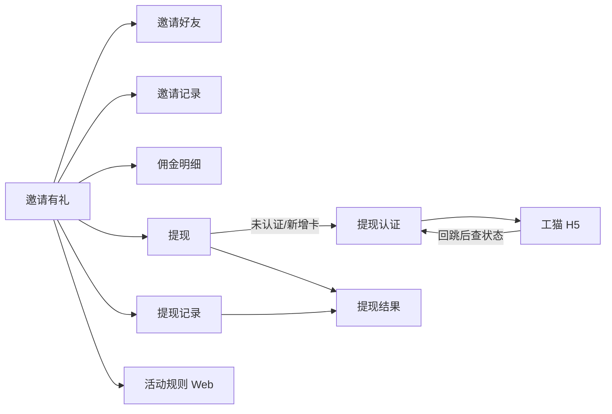

# 邀请好友与银行卡提现 Figma 设计稿计划

> 版本：v1.0.5 设计基线  
> 日期：2026-08-26  
> 状态：`done`  
> Figma 通道：`mj5kz8uv`  
> 最新复核：2026-08-27，22 个节点重新导出后与现有 PNG 字节一致；设计基线和映射不变  
> Figma 页面：`39:95`（邀请好友）  
> 上游需求：[requirements.md](./requirements.md)  
> 素材索引：[references/README.md](./references/README.md)

> 2026-09-03 行为增量：P06 的《灵活用工协议》改为打开 Admin/Web 提供的 Catseller 固定 HTML 页，不再实时取工猫短期 PDF。该增量只改变协议内容来源，不改变节点 `66:120` 布局，点击仍不改变勾选。

用户在需求检测通过后明确要求生成技术方案，视为确认本轮 22 张现有高保真稿可以作为技术方案输入。本计划用于固定设计范围、节点映射和实现覆盖规则，不新增 Figma 产出，也不把未提供设计稿的 Admin 或其他 App 页面伪装成已对稿页面。

## 1. 设计目的与范围

- 覆盖喵喵带货移动端的邀请好友、直接返佣、提现认证、银行卡提现和结果页。
- 固定 P01～P09、D01～D03 的视觉与交互输入；Figma 未覆盖的资金和异常状态由 PRD 文字补齐。
- 活动规则采用 Admin/Web 工程中的独立静态 Web 页；Figma 只提供内容层级和移动端排版参考。
- Admin 复用现有 `/Users/soul/code/lxwx/lxwx_admin/lib/pages/common/invite_page.dart` 与后台 UI 规则，本轮没有 Admin Figma。
- 其他 App 共用业务和接口能力，但需要按各自品牌系统适配，不直接复制喵喵带货视觉资产。

不在范围：支付宝、微信、银行卡短信验证码、二级/团队佣金、后台 CMS、旧综合需求页面、其他 App 的品牌设计。

## 2. 设计目标与视觉方向

1. 让用户在首页直接理解当前返佣比例、真实邀请进度、收益和下一步动作。
2. 把“邀请好友”和“推广素材”收敛为同一页面，降低导航歧义。
3. 把实名、电签、绑卡和提现拆成可恢复的状态流程，外部工猫 H5 中断后仍能回到 App 查询真实状态。
4. 金额、银行卡和认证状态优先使用服务端真值；不得因 Figma 示例文案把“申请已提交”显示为“到账成功”。
5. 延续现有暖色品牌、卡片分组、圆角按钮和底部弹层风格；组件实现优先复用工程已有主题、间距和字体。

## 3. 页面清单与优先级

| 优先级 | 页面/弹层 | 页面 ID | 设计覆盖 |
|--------|-----------|---------|----------|
| P0 | 邀请有礼 | P01 | 10%/20%/30% 三个主状态 |
| P0 | 邀请好友（推广素材） | P02 | 链接、海报、保存与分享 |
| P0 | 提现 | P05 | 未绑卡、正常、超限、选卡 |
| P0 | 提现认证 | P06 | 表单、协议确认、绑卡/认证成功失败 |
| P0 | 提现记录与结果 | P07/P08 | 列表、申请已提交、未到账 |
| P1 | 邀请记录 | P03 | 筛选与脱敏列表 |
| P1 | 佣金明细 | P04 | 有数据和空状态 |
| P1 | 活动规则 Web | P09 | 内容层级与移动端排版 |
| P1 | 实名重要通知/银行卡选择 | D01/D03 | 弹框或底部弹层；D02 仅保留历史素材，不属于当前流程 |
| P1 | Admin 邀请收益管理 | A01 | 无 Figma，复用现有后台框架 |

## 4. 需求与 Figma 节点映射

| 页面 | Figma 节点 | 本地素材 | 实现说明 |
|------|------------|----------|----------|
| P01 邀请有礼 | `43:1638`、`43:1754`、`43:1870` | `01-invite-level-10.png`～`03-invite-level-30.png` | 两段进度线按有效人数逐人填充，不按档位整段跳满 |
| D01 实名重要通知 | `43:1989` | `04-realname-policy-dialog.png` | 法规正文上线前由法务确认 |
| P02 邀请好友 | `43:2118` | `05-promotion-materials.png` | 页面标题统一“邀请好友”，不另建推广素材路由 |
| P03 邀请记录 | `43:2222` | `06-invite-records.png` | 全部/已开通/未开通 |
| P04 佣金明细 | `43:2285`、`43:3403` | `07-commission-list.png`、`22-commission-empty.png` | 加载、N 天待结算与预计结算时间、冲正、负余额由 PRD 补充 |
| P05 提现 | `43:2362`、`43:2951`、`43:3014` | `08-withdrawal-unbound.png`、`16-withdrawal-form.png`、`17-withdrawal-excess.png` | 金额与资格以服务端返回为准 |
| D03 银行卡选择 | `43:3079` | `18-bank-selection.png` | 弹层标题以“选择银行卡”为准 |
| P06 实名认证 | `66:120`（通道 `x5x4ir6u`） | `23-realname-auth.png` | 三项资料、两面照片、锁定提示、签署按钮、`8.w` 间距和默认未勾选的双协议区；两份协议分别可读，不再使用 D02 二次确认弹窗 |
| P10 绑定银行卡 | `66:198`（通道 `x5x4ir6u`） | `24-bank-bind.png` | 已实名后独立绑卡，不重复照片或 H5 |
| P07 提现记录 | `43:2425` | `09-withdrawal-records.png` | 状态由统一映射输出 |
| P08 提现结果 | `43:3257`、`43:3338` | `20-withdrawal-submitted.png`、`21-withdrawal-not-received.png` | “申请已提交”不等于到账成功 |
| P09 活动规则 Web | `43:3167` | `19-activity-rules.png` | 在 `lxwx_admin/web` 实现，不建 Flutter 原生规则页 |
| A01 Admin | 无 | 无 | 复用现有后台页面、App 切换、表格、详情与确认框 |

所有相对图片均位于 `references/images/invite-withdrawal/`，详细 SHA-256 和使用边界以素材索引为准。

## 5. 页面级设计输出检查

| 检查项 | 结果 | 说明 |
|--------|------|------|
| 主状态 | 完成 | 22 张 PNG 覆盖主要页面、弹层和成功/失败示例 |
| 页面定位与导航 | 完成 | PRD 明确 P01 六类入口及 P02 单页命名 |
| 数据真值 | 完成 | 金额、人数、尾号、日期、二维码和文案均不得写死 |
| 真实等级进度 | 完成 | 第一段 `min(count,10)/10`，第二段 `min(max(count-10,0),10)/10` |
| 加载/空/错误 | PRD 补充 | 复用同页骨架、空状态和重试组件，不要求新增 Figma |
| 资金异常 | PRD 补充 | 退款冲正、负余额、人工审核、待查单、退票以状态组件表达 |
| 安全与脱敏 | PRD 补充 | App 列表不显示完整身份证、手机号、银行卡 |
| Admin | 现有 UI 基线 | 不使用移动端 Figma 冒充后台设计 |

## 6. 组件与设计令牌复用

- 复用现有 App 的导航栏、主题色、文字层级、卡片、分割线、主次按钮、Toast、加载和错误组件。
- 新增可复用组件：等级进度条、金额输入卡、银行卡摘要卡、提现状态时间线、状态筛选标签、协议勾选区和只读动态协议 WebView。
- 二维码、分享和保存能力复用现有推广素材实现；受控 H5 复用 `webview_flutter` 依赖，但使用专门的域名白名单与回跳策略。
- Admin 延续现有 Flutter Web 表格、筛选、详情面板、App 切换和确认弹框，不引入另一套视觉框架。
- Web 活动规则复用 `lxwx_admin/web/site.css` 的响应式基础，不修改现有隐私协议页面。

## 7. 交互与原型约束

- 没有单独提供可点击原型 URL；以上路由与每页交互以 PRD 第 5 节 Mermaid 为真源。
- H5 回跳只触发确认和查询，不以 URL 参数直接判定签约成功。
- P06 的协议名称是独立点击目标；点击不改变勾选。灵活用工协议打开 Catseller 专用固定 HTML 页，实名认证服务协议打开公共固定 HTML 页，签署按钮与协议行之间保持 `8.w`。
- 提现结果页在前台恢复、手动刷新和轮询时更新状态；终态后停止轮询。
- P09 只允许打开配置的 HTTPS 活动规则域名，外链交由系统浏览器或拒绝。

## 8. 设计验收标准

1. 22 张素材与 Figma 节点一一对应，PRD 详细页面已直接嵌图。
2. P01 在 0、1、9、10、11、19、20 人边界正确表现两段真实进度。
3. P02 页面标题为“邀请好友”，复制、分享、保存失败均有反馈。
4. P05/P08 不混淆可提现、冻结、预计到账、申请提交和到账成功。
5. P06 在 H5 取消、无摄像头权限、回跳失败和合同生成中时可以恢复并重查。
6. 加载、空、网络错误、负余额、冲正、查单、失败与退票状态遵守 PRD，即使 Figma 未单独出图也不得遗漏。
7. Admin 和其他 App 不套用喵喵带货图片；各自遵循现有视觉与品牌规范。

## 9. 待确认项与设计门禁结论

上线前仍需产品/运营/法务确认活动规则正式文案、协议名称与版本、税费说明、首批启用 App 及品牌适配。本轮不要求新增设计稿，这些内容通过配置、文案审查和实现对稿验收闭环。

设计门禁结论：`done`。现有 22 张高保真稿、PRD 文字状态和现有 Admin UI 基线足以进入技术方案；后续若 Figma 再变更，必须登记 CHG 并评估受影响任务，不允许静默覆盖实现基线。
