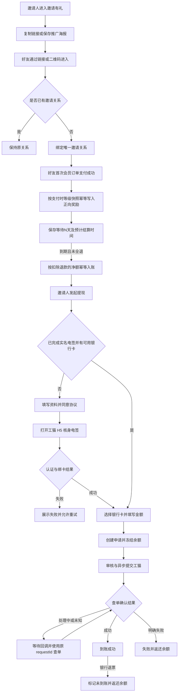
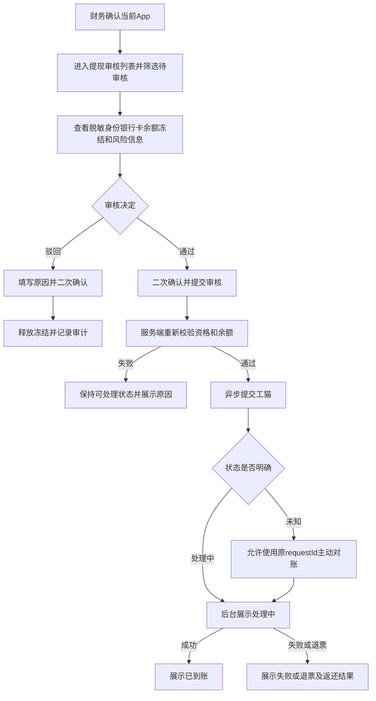

# 邀请好友与银行卡提现需求清单

> 版本：v1.0.3
> 日期：2026-08-26
> 状态：`done`（用户已通过“生成技术方案”指令确认当前需求基线）
> 适用 App：启用本能力的多个 App（喵喵带货为当前设计与首个落地参考）
> 唯一范围：多 App 共用的邀请好友、佣金收益、提现认证、银行卡提现及其后台管理

## 1. 项目概述

本需求定义一套由多个 App 共用的独立资金能力。任一启用该能力的 App 中，用户通过专属邀请链接或推广海报邀请好友，好友首次成功购买会员后，邀请人获得直接邀请佣金；佣金可通过本人银行卡提现，首次提现或新增银行卡时需提交实名资料、同意协议，并通过工猫完成核身、电签和银行卡校验。运营与财务人员通过共享 Flutter Web 后台 `/Users/soul/code/lxwx/lxwx_admin`，在明确的当前 App 上下文中完成查询、审核、主动对账和规则配置。

本文不描述各 App 自身的 AI 视频、作品、积分、登录、会员购买页、“我的”页或其他产品能力。后续技术方案只能将会员支付/退款等视为带 App Code 的外部业务事件，不得把任一 App 的其他需求重新并入本功能范围。喵喵带货 Figma 仅用于当前移动端视觉与交互参考，不得据此把共享后台或后端写成 Catseller 专属逻辑。

## 2. 目标用户

- 邀请人：分享素材、查看邀请转化、佣金与提现结果。
- 受邀好友：通过链接或海报二维码进入 App，并建立唯一邀请关系。
- 运营人员：查询邀请关系、佣金来源、提现状态和用户咨询所需的脱敏信息。
- 财务审核人员：审核提现、查看资金明细、处理异常并发起主动对账。
- 后台配置管理员：维护最低提现额、邀请落地页等本功能配置。
- 审计/管理员：查看高风险操作记录和权限使用情况，不直接修改资金账本。
- 平台管理员：按 App Code 启用能力和权限，统一维护所有启用 App 共用的工猫商户连接、渠道、合同与密钥；不跨 App 查看或操作业务资金。

## 3. 业务目标

- 为邀请人提供可理解、可追溯的邀请奖励与等级成长机制。
- 让佣金从产生、按订单结算时间入账、冻结、提现到退回形成闭环；等待期及系统处理重试期间显示“待结算”。
- 通过本人实名、工猫核身电签和银行卡校验降低冒领和错误打款风险。
- 让支付、退款、回调、查单和银行退票在重复或乱序情况下保持资金一致。
- 让后台审核、对账和配置操作具备明确权限、二次确认、结果反馈和完整审计。
- 让同一套后台、后端能力和平台工猫连接被多个 App 复用，同时保证业务配置、数据、回调归属、任务和权限按 App Code 隔离。

## 4. 当前版本范围

### 4.1 邀请与推广

- 邀请有礼首页：可提现、待结算、累计收益、当前等级、人数统计和快捷入口。
- 邀请有礼入口必须明确：活动规则→活动规则 Web 页，立即邀请 赚钱佣金→邀请好友（推广素材），立即提现→提现，邀请记录→邀请记录，佣金明细→佣金明细，提现记录→提现记录。
- 邀请好友（推广素材）：复制专属链接、保存带二维码的推广海报；“邀请好友”和“推广素材”是同一个页面、同一个路由。
- 好友通过有效链接或海报二维码首次绑定邀请关系；同一 App 内同一好友只能绑定一个邀请人，禁止覆盖、自邀或循环邀请，不与其他 App 的邀请关系合并。
- 邀请记录：全部、已开通、未开通三个筛选，手机号或账号必须脱敏。

### 4.2 等级与奖励

- 基础比例为 10%；邀请人在当前 App 内的有效开通会员人数达到 10 人后为 20%，达到 20 人后为 30%；不同 App 的人数和等级独立计算。
- 页面按照 `1～9 人 10%`、`10～19 人 20%`、`20 人及以上 30%` 展示；0 人状态仍显示基础比例 10%。
- 10%→20% 和 20%→30% 之间的颜色按有效人数逐人推进：第一段为 `min(有效人数, 10) / 10`，第二段为 `min(max(有效人数 - 10, 0), 10) / 10`；10 人到达 20% 节点、20 人到达 30% 节点，不允许按等级整段跳满。
- 升级只影响升级完成后的后续会员订单，同一笔订单不会因触发升级而按新比例追溯重算。
- 每名受邀好友在当前 App 内仅首笔成功会员订单产生一笔直接邀请奖励；不发放二级、团队或间接佣金，不与其他 App 的订单合并计数。
- 奖励金额以该会员订单实际支付金额和当时比例快照计算，金额由服务端计算并以分存储。

### 4.3 佣金结算与退款

- 首笔会员订单支付成功后，按当时等级比例生成待结算佣金；按付款时等待天数 N 的快照到期入账，后台按 App 配置 N，默认 0。配置不追溯历史订单。
- “待结算”表示等待 N 天到期或正在处理/重试；期间不可提现，退款扣减待结算净额，全额退款取消待结算。
- 会员订单后续退款、撤销或被认定无效时，幂等写入关联原奖励的负向冲正流水；若支付与退款事件并发或乱序，同一订单最终净奖励必须为 0。
- 冲正后余额允许为负，后续新奖励优先抵扣；负余额时可提现为 0，禁止创建提现申请。
- 重复支付或退款通知不能重复增加或扣减佣金。

### 4.4 提现认证与银行卡

- 本期只支持银行卡，支付宝和微信不在当前版本。
- 首次提现需填写真实姓名、身份证号、本人银行卡号和手机号。
- 用户必须同意《灵活用工协议》和《实名认证服务协议》，再通过工猫 H5 完成刷脸核身和电签。
- 实名成功后身份主体不可由用户自行修改；只能绑定实名主体本人的银行卡。
- 新增银行卡复用同一认证链路；成功后进入“绑定成功”，首次认证成功进入“认证成功”。
- Figma 新稿不包含银行卡短信验证码，本版本不新增短信验证步骤。

### 4.5 银行卡提现

- 提现页展示可提现金额、当前银行卡、输入金额、全部提现、预计到账和提交按钮。
- 最低提现金额后台按 App 动态配置，默认 1 元，保存后用于新提交申请；后端创建时按最新门槛校验，已创建申请和幂等重试保留原单规则。金额用正整数分配置，提现金额不能超过服务端返回的可提现余额。
- 每个 App 内每名用户在一个北京时间自然日最多成功创建一笔提现申请；参数校验失败不占次数，申请创建后即使驳回、失败或退票仍占当前 App 当日次数，其他 App 独立计数。
- 创建申请时冻结对应余额；内部人工审核和工猫提交状态统一映射为用户可见的“处理中”。
- 审核通过后异步提交工猫 BANK 渠道；审核驳回释放冻结余额。
- 用户只看到“预计 1～3 个工作日到账”，不承诺内部审核完成时间。
- 工猫明确失败或银行退票后自动返还可提现余额；已到账后会员订单退款只形成负余额，不追回银行卡到账资金。

### 4.6 提现记录与结果

- 提现记录支持全部、处理中、已到账、失败四个筛选。
- 提交成功页展示申请已提交、银行处理中、到账成功三段时间线及金额明细。
- 尚未到账时不得使用“到账成功”语义；Figma 顶部“提现成功”以中央“申请已提交”和真实服务端状态为准。
- 失败/未到账页展示安全失败原因、银行卡、申请与处理时间，以及“金额已退回可提现余额”。
- 结果回调只触发对账，最终状态由原 requestId 主动查单确认。

### 4.7 现有后台管理

- 承载工程固定为 `/Users/soul/code/lxwx/lxwx_admin`，复用现有“交易与增长 > 邀请收益管理”入口及 `lib/pages/common/invite_page.dart`，不新建后台工程或重复入口。
- 现有能力包括 App 切换、“规则配置、用户代理配置、提现管理”三个页签，以及邀请规则保存、用户关系查询、提现审核和手工打款结果操作；本次按“已有复用、缺失新增、按能力模式展示”处理。
- 后台所有请求、筛选、列表、详情和操作必须绑定当前 App Code，并在页面上持续显示当前 App；切换 App 后清空旧筛选/详情并重新加载，禁止展示或操作上一个 App 的数据。
- 规则配置复用现有字段和布局；启用本共享模式的 App 均只读展示直接返佣比例 10%/20%/30% 与升级门槛 10/20 人，本版不允许自由修改。最低提现额和落地页地址按 App 独立配置并生成版本；增加按 App 配置的结算等待天数（默认 0，订单保留快照）。
- 现有注册积分、二级代理比例、手工代理等级和二级代理开关不属于本次直邀首单佣金；对所有启用本共享模式的 App 隐藏或只读，不得通过 App 名称硬编码判断。尚未启用的 App 不被隐式迁移，继续按其既有模式展示。
- 邀请与佣金查询复用现有用户关系查询，新增会员订单、比例快照、待结算/已入账/冲正流水的只读明细；不提供解绑、改比例快照或改金额。
- 提现管理复用现有列表、筛选、详情、审核通过和驳回，新增银行卡、认证状态、余额/冻结、费用、工猫 requestId/流水、查单、失败返还和退票信息。
- 任一 App 启用工猫 BANK 共享模式后，将旧 `APPROVED / PAID / PAY_FAILED` 展示升级为当前提现状态机，隐藏并禁止手工“打款成功/失败”；展示逻辑由当前 App 的能力模式决定，不按 Catseller 名称判断。
- 非终态异常单新增“主动对账”，只使用原 requestId 查单；后台操作不能绕过统一状态机或直接修改资金结果。
- 默认仅展示脱敏身份和银行卡。确需查看敏感信息时，必须具备独立权限、填写查看原因并写入审计；本期不提供敏感数据导出。
- 敏感查看需要点击当前详情“查看完整信息”，输入独立的平台查看密码并填写原因。验证通过后，仅当前 App、当前记录、所选姓名/身份证/手机号/银行卡字段可显示数据库解密值，最多 5 分钟；关闭、切换 App、退出或超时立即恢复脱敏，不提供复制、列表明文或导出。
- 查看密码与后台登录密码、工猫 appSecret 和数据加密密钥分离，只保存强哈希或由密钥系统校验；连续 5 次错误锁定当前管理员敏感查看能力 30 分钟。成功、失败和锁定均审计，但不得记录密码或敏感明文。
- 管理员权限必须同时校验“操作能力 + App 范围”；拥有某 App 的审核权限不代表可以审核其他 App，审计记录必须包含 App Code。

## 5. 页面与弹层范围

### 5.1 App 原生页面（8 个）

1. 邀请有礼。
2. 邀请好友（推广素材，同一页面）。
3. 邀请记录。
4. 佣金明细。
5. 提现。
6. 提现认证。
7. 提现记录。
8. 提现结果。

### 5.2 产品内弹层（3 个）

1. 重要通知：实名和合规提示。
2. 同意协议：未主动勾选协议时的二次确认。
3. 选择银行卡：选择已有银行卡或进入新增银行卡。

### 5.3 Web 页面（1 个）

1. 活动规则：由 `/Users/soul/code/lxwx/lxwx_admin/web/` 参考现有隐私协议静态页方式实现和发布，App 通过受控 Web 容器打开；Figma `43:3167` 作为内容与布局参考，不新增 Flutter 原生规则正文或 Flutter Admin CMS。

### 5.4 现有管理后台页面（1 个）

1. 邀请收益管理：复用现有页面、App 切换和入口，在原三个页签基础上按当前 App 的能力模式展示字段、状态和操作；现有功能直接复用，缺失的佣金流水、工猫详情和主动对账能力在同一页面内新增。

当前 Figma 只覆盖喵喵带货移动端页面，后台页面及其他 App 移动端暂无设计稿。共享后台布局以 PRD 页面级结构、现有 `InvitePage` 和 `/Users/soul/code/lxwx/lxwx_admin/.cursor/rules/04-后台管理UI规则.mdc` 为准；其他 App 前端需使用各自品牌素材，不直接照搬喵喵带货视觉。

### 5.5 外部页面

- 工猫 H5 刷脸核身与电签是外部服务页，不计 App 自有页面。
- App 需要受控 H5 容器、摄像头权限、返回/关闭处理、回跳拦截和认证状态查询。

## 6. 整体业务流程

### 6.1 用户端与资金主流程

### 6.2 后台审核与对账流程

## 7. 数据与同步要求

- 邀请关系、会员订单、比例快照、奖励流水、退款冲正和提现余额以服务端为准。
- 邀请、实名、电签、银行卡、提现、回调、查单、幂等事件和审计数据必须按 App Code 隔离；同一用户标识在不同 App 中不得串联资金或邀请关系。
- 用户端和 Admin 普通接口必须携带并校验 App Code；共享工猫商户的回调无法依赖请求头或商户号区分 App，必须通过 requestId、工猫流水、合同/员工标识与持久化映射解析 App Code，再进入目标 App 数据上下文。
- 同一环境所有启用 App 共用一套工猫商户号、BANK 渠道、合同模板、服务主体、appSecret、商户私钥、工猫公钥和回调域名；正式与测试环境整套隔离。App 只独立维护能力开关、最低提现额、落地页、活动规则地址、数据和权限。
- 姓名、身份证、手机号、银行卡号和合同资料以服务端可解密密文存储，并保留脱敏值/安全索引；客户端、普通接口、列表、日志和告警只显示脱敏值。
- 提现申请需要持久化唯一 requestId、工猫流水、手续费/税费、失败原因、查单和退票信息。
- 后台审核、驳回、主动对账、敏感信息查看和配置修改必须记录 App Code、操作人、时间、原因、对象/字段范围、变更前后值及结果；敏感查看审计不得包含密码和明文。
- 配置项必须版本化；奖励和提现记录保存所用版本或关键值快照，避免配置变更追溯影响历史资金。
- 定时查单、补偿和业务告警按 App 分区执行并携带 App Code；共享工猫商户余额不足、密钥或连接故障可统一门禁所有启用 App 的新提交并产生平台告警，但不能造成历史查询或 App 数据串用。
- 数据库改动：有，但本轮只定义概念需求，不生成迁移或代码。

## 8. 非功能要求

- 工猫表单 POST、MD5 大写签名、5 分钟有效期，以及姓名、身份证、手机号、银行卡发送工猫时的 RSA-2048 加密由后端完成；数据库静态保存使用可逆密文，具体算法在技术方案中评审。
- 网络超时不能直接认定提现失败；禁止更换 requestId 重发可能重复打款的请求。
- 余额结算、冻结、释放、返还和冲正必须原子化、幂等并具备审计记录。
- 监控提现提交成功率、处理中时长、查单次数、失败原因、退票和回调异常。
- 平台共用的工猫秘密、数据加密密钥和敏感查看密码只能通过工程私有配置、环境变量或密钥系统安全管理，不写入 App、仓库、PRD 示例或普通业务配置；三类秘密互相分离。
- 后台复用现有管理员登录态和 `/api/admin/**` 鉴权；401 清理后台会话，403 展示权限不足，不得混用 App 用户 token。
- 禁止在 Controller、Service、Admin 页面或配置键中以 `catseller` 字符串决定共享模式；必须使用标准 App 上下文和按 App 存储的能力配置。
- 高风险操作必须二次确认且防重复提交；列表、详情和操作完成后刷新服务端真实状态。
- 普通接口不得返回明文敏感字段；专用 Admin 敏感查看接口是受控例外，技术实现前必须完成后端安全规则例外评审。

## 9. 明确排除项

- 各 App 的 AI 视频、作品、积分、登录、会员购买页面、“我的”页面及其他非邀请提现业务需求。
- 支付宝提现、微信提现、银行卡短信验证码。
- 二级/团队佣金、用户自行修改实名、自动换卡重试、自建到账短信。
- 本轮技术方案、Flutter/Java/Admin 代码、数据库迁移和工时评估。
- 后台手工修改邀请关系、佣金比例、佣金金额、提现终态，以及敏感身份/银行卡批量导出。

## 10. 已确认决策

- Figma 新通道 `czmwv14c`、页面 `39:95` 的 22 个节点为当前设计真源。
- 首笔会员订单成功后生成待结算佣金，到期转入可提现余额；结算前退款扣减待结算净额，结算后退款按幂等负向流水冲正。
- 本期只支持银行卡；提现认证使用工猫核身电签。
- 每日最多成功创建一次提现申请，预计 1～3 个工作日到账。
- 提现内部状态可以细分，但用户端记录只使用处理中、已到账、失败三个结果类别。
- 当前主需求只服务邀请与提现；旧综合需求已归档且不得影响后续技术开发。
- 后台管理复用 `/Users/soul/code/lxwx/lxwx_admin` 已有“邀请收益管理”页面和三个页签；已有能力复用，缺失能力在原页面补充，不新增重复入口。
- 工猫模式不提供手工打款成功/失败；账本只读，主动对账固定使用原 requestId。
- 邀请返佣与银行卡提现是多 App 共用能力；喵喵带货是当前 Figma 和首个落地参考，不是后台或后端硬编码条件。
- 启用共享模式的 App 使用本需求统一资金规则和状态机；每个 App 独立启用、配置、授权和存储，尚未启用的 App 不被隐式迁移。
- 邀请等级进度线按有效人数逐人填充，10 人到达 20% 节点，20 人到达 30% 节点；P01 所有主入口均有明确目标页面。
- “邀请好友”和“推广素材”是同一页面；活动规则由 Admin/Web 工程参考隐私协议静态页实现，App 使用受控 Web 容器打开。
- 同一环境所有启用 App 共用一套工猫商户连接、服务配置和密钥；App 业务数据、余额、配置、权限和回调归属仍按 App Code 隔离。
- 数据库敏感字段允许由受控服务端解密；Admin 默认脱敏，输入独立平台查看密码、具备当前 App 权限并填写原因后，仅可在当前详情最多查看 5 分钟，且不提供复制、批量或导出。

## 11. 待确认项

- 重要通知中的法规、日期、税务和“实名后不支持修改”最终文案需要法务/财务上线前确认。
- 手续费、个税试算的展示名称、计算来源和四舍五入规则需要在技术方案前确认。
- 提现审核是否需要双人复核，以及不同金额是否采用分级审批，需要产品与财务确认；未确认前不在 PRD 中承诺自动通过或双人审批。
- 后台驳回原因字典、敏感信息查看角色名单、原因字典和审计留存期限需要运营、安全与合规确认；查看密码、5 次错误锁定 30 分钟和最多展示 5 分钟为当前基线。
- 首批启用 App 清单、各 App 管理员授权范围，以及平台共用的单套工猫商户、合同主体、BANK 渠道、回调域名和正式/测试配置需要在技术方案前确认。
- 活动规则 Web 页的各 App 路径、品牌/客服信息、发布审核人和首次规则版本需要上线前确认。
