# 邀请好友与银行卡提现产品需求文档（PRD）

> 版本：v1.0.5
> 最近修订：2026-09-02（实名认证双协议查看与 Figma 间距确认；原已确认基线保留）
> 状态：`done`（用户已通过“生成技术方案”指令确认当前需求基线）
> 适用 App：启用本能力的多个 App（喵喵带货为当前设计与首个落地参考）
> 唯一范围：多 App 共用的邀请好友、佣金收益、提现认证、银行卡提现及其现有后台管理
> Figma 真源：本次通道 `x5x4ir6u`，实名认证 `66:120`、绑卡 `66:198`；其余页面沿用已核对的 `43:*` 素材。
>
> 最新执行口径：用户已确认两步流程并授权开发。认证不创建银行卡；绑卡不重复电签。业务/工猫连接共享，实名、照片、银行卡、会话和资金按 App 隔离。下文历史人工/工猫模式约定以既有统一提现增量为准，本次不调整 Admin 或打款流程。实现与验收见 [拆分验证记录](../05-联调与测试/invite-identity-bank-split-verification.md)。

本 PRD 是一份由多个 App 共用的独立功能需求，不是喵喵带货或任一 App 的全量产品需求。后续技术方案、前后端计划、数据库设计和编码只能使用本文定义的邀请与提现范围；各 App 的 AI 视频、作品、积分、登录、会员购买页、“我的”等其他业务不得回填到本功能。管理端复用现有 Flutter Web 后台 `/Users/soul/code/lxwx/lxwx_admin` 的 App 切换和“交易与增长 > 邀请收益管理”，已有能力直接复用，缺失能力在原页面补充。喵喵带货仅是当前移动端 Figma 与首个落地参考，不得成为共享后台或后端的硬编码条件。

---

## 1. 产品概述

### 1.1 产品定位

“邀请好友与银行卡提现”用于把会员邀请转化为可追溯的现金奖励。邀请人分享专属链接或海报二维码，好友建立唯一邀请关系并首次成功购买会员后产生直接佣金。首笔会员订单支付成功后按当前 App 的结算等待天数 N 保存预计结算时间，到期后佣金才转为可提现；等待期间退款扣减待结算净额，已入账后退款通过负向流水冲正。邀请人完成本人实名、工猫核身电签和银行卡校验后，可以申请银行卡提现。

同一套领域能力服务多个 App。每个 App 通过标准 App Code 独立启用、配置、授权和存储；启用本共享模式的 App 使用本文统一业务规则，尚未启用的 App 不被隐式迁移。

### 1.2 产品目标

- 让邀请人清楚了解当前比例、升级进度、邀请转化和资金构成。
- 让每笔奖励都能关联会员订单、比例快照、结算与退款结果。
- 让提现申请具备实名、本人银行卡、审核、查单、失败返还和退票闭环。
- 避免重复支付、重复退款、重复回调或网络超时造成重复入账、重复扣减或重复打款。
- 让多个 App 复用一套后台、服务能力和平台级工猫连接，同时保证用户、资金、App 业务配置、回调归属、任务和权限互不串用。

### 1.3 角色

| 角色 | 核心诉求 | 权限边界 |
|------|----------|----------|
| 邀请人 | 分享、看转化、看佣金、申请提现 | 只能访问本人邀请、佣金、银行卡和提现数据 |
| 受邀好友 | 通过链接/二维码进入并购买会员 | 同一 App 内同一好友只能形成一个邀请关系；不同 App 独立 |
| 运营 | 查询邀请关系、佣金来源和提现状态 | 默认只读、只看脱敏信息，不能修改资金账本 |
| 财务审核 | 审核提现、处理异常、主动对账 | 使用独立权限；不能手工修改佣金或直接指定打款终态 |
| 配置管理员 | 维护邀请提现规则 | 高风险保存需确认并保留配置版本与审计 |
| 审计管理员 | 查看操作与敏感访问记录 | 不因审计权限自动获得资金操作权限 |
| 平台管理员 | 按 App 启用能力和权限，并维护全平台共用的工猫连接 | 只能操作授权 App 的业务数据；工猫商户、渠道、合同与密钥由平台统一维护 |
| 工猫 | 核身、电签、税费/手续费能力、银行卡打款和结果通知 | 外部服务；最终资金状态需主动查单确认 |

### 1.4 成功指标

所有指标必须按 App Code 分维度统计，并同时提供平台汇总；平台汇总不得替代单 App 资金对账。

| 指标 | 口径 |
|------|------|
| 有效邀请转化率 | 已绑定好友中首次成功开通会员的人数占比 |
| 奖励入账准确率 | 订单、比例快照、结算和退款冲正金额一致率 |
| 提现提交成功率 | 满足资格的提现创建请求成功比例 |
| 提现终态收敛率 | 提现申请在目标时限内收敛到已到账、失败或已退票的比例 |
| 重复资金事件数 | 重复入账、重复冲正、重复打款或重复返还次数，目标为 0 |
| 跨 App 串数据事件数 | 任意配置、用户、资金、回调、任务或权限串 App 次数，目标为 0 |

---

## 2. 当前版本范围

### 2.1 包含范围

1. 邀请有礼首页和 10%/20%/30% 等级。
2. 专属链接复制和推广海报保存。
3. 唯一邀请关系、邀请记录和会员开通状态。
4. 首笔会员订单直接佣金、按订单结算时间入账、可配置待结算期、退款冲正和负余额。
5. 实名政策通知、提现认证表单、协议勾选和工猫 H5 核身电签。
6. 本人多银行卡选择和新增银行卡。
7. 银行卡提现、最低金额、每日一次、冻结、审核、工猫提交和查单。
8. 提现记录、申请已提交、已到账、失败/未到账和自动返还。
9. 由 Admin/Web 工程承载的活动规则 Web 页面、合规提醒、敏感信息保护和资金审计。
10. 复用现有 App 切换和“邀请收益管理”后台，为所有启用本共享模式的 App 提供规则、邀请佣金查询、银行卡提现审核、工猫详情和主动对账。
11. 按 App Code 独立启用、数据路由、业务配置、权限控制、回调归属、定时任务和操作审计；所有启用 App 共用一套工猫连接配置。

### 2.2 不包含范围

- 各 App 的 AI 视频、商品素材、作品、积分、登录、会员购买页面、“我的”页面和其他非邀请提现产品功能。
- 支付宝提现、微信提现、银行卡短信验证码。
- 二级、团队或间接佣金。
- 用户自行修改实名主体、自动换卡重试和自建到账短信。
- 本轮技术方案、Flutter/Java/Admin 代码、数据库迁移、工时评估和发布实施。
- 新建后台工程、重复的邀请管理入口，以及本功能之外的后台模块改造。

### 2.3 设计交付范围

- 8 个 App 原生页面：P01～P08。
- 1 个活动规则 Web 页面：P09，由 `/Users/soul/code/lxwx/lxwx_admin/web/` 承载，App 打开受控 Web 容器。
- 1 个辅助协议 Web 页面：《实名认证服务协议》，由 Admin/Web 提供 Catseller 正式静态地址并通过 `StaticPageView` 打开。
- 1 个现有 Admin 页面：A01，在原页面内复用/升级三个页签。
- 3 个产品内弹层：D01～D03。
- 1 个外部服务页面：工猫 H5，不计 App 自有页面。
- 22 个喵喵带货移动端 Figma 页面状态均已导出并嵌入第 5 节；P09 图片作为 Web 页面内容与布局参考，其余图片只约束喵喵带货移动端，不作为其他 App 的品牌视觉真源。Admin 暂无 Figma，以现有实现和后台 UI 规则为参考。

### 2.4 关键口径变化

- 首笔会员订单支付成功后生成待结算佣金，按付款时快照的 N 天到期入账；后台按 App 动态配置，默认 0 天。已有订单保留原定结算时间；“待结算”包括等待期和到期处理/重试，不可提现。
- 用户端提现记录只展示“处理中、已到账、失败”；审核、提交中、查单中等内部状态映射为处理中。
- Figma 提交页顶部“提现成功”不能代表资金已经到账；业务状态以中央“申请已提交”和服务端状态为准。
- 共享能力的行为由当前 App 的能力配置决定，禁止以 `catseller`、显示名称或前端路由字符串作为后台/后端分支条件。

---

## 3. 整体流程

### 3.1 主流程

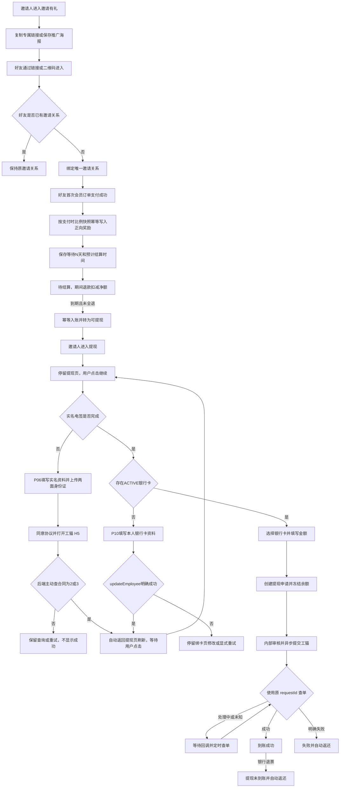

### 3.2 退款与负余额流程

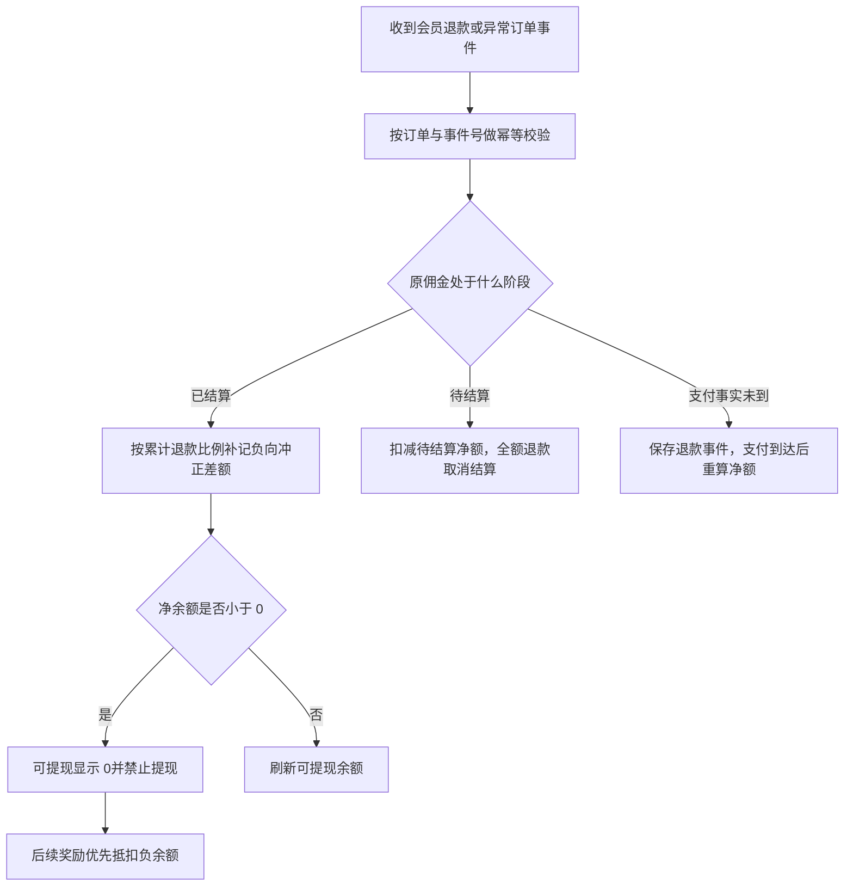

### 3.3 提现状态收敛流程

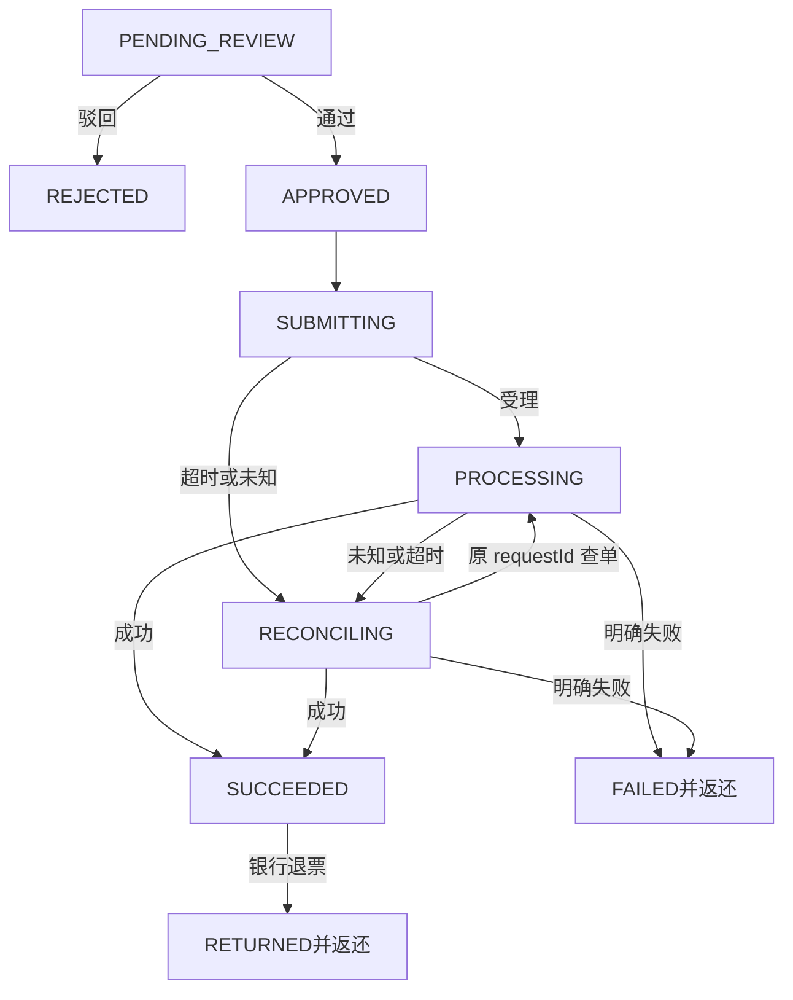

内部 `PENDING_REVIEW / APPROVED / SUBMITTING / PROCESSING / RECONCILING` 在用户端统一显示“处理中”。`REJECTED / FAILED / RETURNED` 显示失败或未到账，并明确余额是否已释放/返还。

### 3.4 现有后台审核与对账流程

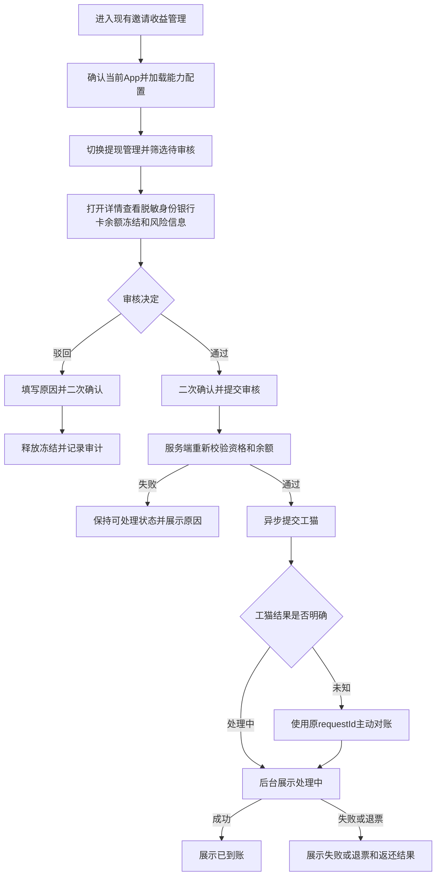

后台只发起审核与对账，不直接指定外部打款终态。任一 App 启用工猫 BANK 共享模式后，现有“打款成功 / 打款失败”人工按钮必须隐藏；尚未启用的 App 继续使用其既有能力模式，不被本需求隐式迁移。

---

## 4. 信息架构 / 页面结构

### 4.1 用户端页面清单

| ID | 页面 | 实现载体 | 入口 | 核心内容 |
|----|------|----------|------|----------|
| P01 | 邀请有礼 | App 原生 | App 现有邀请入口 | 收益、真实等级进度、邀请操作、记录入口 |
| P02 | 邀请好友（推广素材） | App 原生 | P01“立即邀请 赚钱佣金” | 专属链接、海报、二维码；“邀请好友”和“推广素材”是同一页面 |
| P03 | 邀请记录 | App 原生 | P01“邀请记录” | 全部/已开通/未开通好友 |
| P04 | 佣金明细 | App 原生 | P01“佣金明细” | 累计、待结算、已入账、奖励/冲正 |
| P05 | 提现 | App 原生 | P01“立即提现” | 资格、银行卡、金额、预计到账、提交 |
| P06 | 实名认证 | App 原生 | P05 未实名时点击卡片或底部按钮 | 实名资料、两面身份证照片、协议、H5、查询/重试 |
| P10 | 绑定银行卡 | App 原生 | P05 已实名无卡时去绑定 / D03 新增银行卡 | 重新填写本人资料、协议、独立绑卡、成功返回 |
| P07 | 提现记录 | App 原生 | P01“提现记录” | 全部/处理中/已到账/失败 |
| P08 | 提现结果 | App 原生 | P05 提交成功 / P07 记录 | 申请已提交、到账、失败/退票时间线 |
| P09 | 活动规则 Web 页 | Admin/Web 静态页面 + App 受控 Web 容器 | P01“活动规则” | 奖励、邀请、结算退款、提现、风控 |

### 4.2 弹层清单

| ID | 弹层 | 触发 | 操作 |
|----|------|------|------|
| D01 | 重要通知 | 未完成实名用户首次触发提现，或合规版本更新后再次提示 | 取消、立即实名 |
| D03 | 选择银行卡 | P05 点击“更换”或当前银行卡 | 选择已有卡、新增银行卡、关闭 |

### 4.3 Admin 页面清单

| ID | 页面 | 现有入口 | 本次处理 |
|----|------|----------|----------|
| A01 | 邀请收益管理 | `/Users/soul/code/lxwx/lxwx_admin` 的 App 切换与“交易与增长 > 邀请收益管理” | 复用现有页面和三个页签；按当前 App 的能力模式展示，已有能力复用，缺失能力新增 |

### 4.4 现有后台复用与差异

现有实现参考：`/Users/soul/code/lxwx/lxwx_admin/lib/pages/common/invite_page.dart`。

| 现有区域 | 已有能力 | 启用共享模式后的处理 | 尚未启用的 App |
|----------|----------|----------------------|------------------|
| App 上下文 | 后台已有 App 切换 | 完全复用；所有查询和操作绑定当前 App Code，切换后清空旧数据并重新加载 | 使用原 App 上下文 |
| 导航入口 | 交易与增长 > 邀请收益管理 | 完全复用，不新增重复入口 | 不变 |
| 规则配置 | 注册奖励、三级直接返佣、升级门槛、二级返佣、最低提现额、落地页 | 复用布局；比例和门槛按本版固定值只读，最低额/落地页按 App 配置；注册积分和二级返佣不参与 | 使用既有能力模式 |
| 用户代理配置 | 查询关系、人工等级、二级代理开关和备注 | 复用关系查询；按自动等级展示并新增佣金流水；隐藏/禁用人工等级和二级代理操作 | 使用既有能力模式 |
| 提现管理 | 用户/状态筛选、列表、详情、审核、人工标记打款结果 | 复用列表、详情、通过/驳回；升级为 BANK、工猫状态、费用、查单、退票和返还；移除人工打款终态 | 使用既有能力模式 |

### 4.5 外部页面

签署前可分别查看两份协议：《灵活用工协议》每次实时查询工猫唯一模板的一小时 `contractAddr`，只在 App 当前页面内存中打开；《实名认证服务协议》使用 Catseller 正式静态 Web 地址。阅读不改变勾选状态，也不创建实名认证会话。工猫 H5 继续用于最终刷脸核身和电签，不计 App 页面；App 仍需提供受控容器、摄像头权限说明、返回/关闭确认、回跳拦截、异常恢复和认证状态查询。

---

## 5. 页面级详细需求

### 5.1 P01 邀请有礼

#### 页面定位

邀请与提现功能总入口，展示当前收益、等级、有效邀请人数和所有子页面入口。

#### 参考素材

10% / 零收益状态，Figma `43:1638`：

20% 状态，Figma `43:1754`：

30% / 最高等级状态，Figma `43:1870`：

D01 重要通知，Figma `43:1989`：

#### 页面结构（从上到下）

1. 导航栏：返回、标题“邀请有礼”、活动规则。
2. 活动头图：最高 30% 奖励和现金奖励说明。
3. 收益卡：可提现、立即提现、待结算、累计收益。
4. 等级卡：当前人数/比例、三级进度、升级提示或最高等级。
5. 主按钮：立即邀请 赚钱佣金。
6. 数据卡：累计邀请、已开会员。
7. 功能菜单：邀请记录、佣金明细、提现记录。
8. D01：实名合规通知。

#### 区块说明

| 区块 | 内容 | 作用 | 交互 |
|------|------|------|------|
| 收益卡 | 可提现、待结算、累计收益 | 解释资金构成 | 点击立即提现进入 P05 |
| 等级卡 | 10%/20%/30%、有效人数和分段进度线 | 展示真实成长进度 | 比例和有效人数由服务端返回；客户端按固定门槛逐人渲染进度 |
| 邀请按钮 | 立即邀请 赚钱佣金 | 发起推广 | 进入 P02“邀请好友（推广素材）” |
| 数据卡 | 累计邀请、已开会员 | 展示转化 | 统计值由服务端返回 |
| 菜单 | 邀请记录、佣金明细、提现记录 | 子功能导航 | 依次进入 P03 邀请记录、P04 佣金明细、P07 提现记录 |

#### 主要功能

- 聚合展示邀请、奖励和提现摘要。
- 0 人时仍展示基础比例 10%；达到最高等级后显示“最高等级”。
- 等级连线必须反映真实有效邀请人数，不能按等级整段跳满：0～9 人处于 10%→20% 段，填充比例为 `有效人数 / 10`；10～19 人处于 20%→30% 段，第二段填充比例为 `(有效人数 - 10) / 10`；20 人及以上两段全满。示例：1 人第一段 10%、9 人 90%、10 人到达 20% 节点、19 人第二段 90%、20 人到达 30% 节点。
- 等级、比例和进度使用同一个服务端 `effectiveMemberCount` 口径。客户端只按固定门槛渲染视觉填充，不自行推断有效邀请或资金比例。
- 余额为负时可提现显示 0，并增加“退款冲正待抵扣”提示。
- 未实名用户触发提现时先展示 D01；法规正文上线前由法务/财务确认。

#### 交互流程图

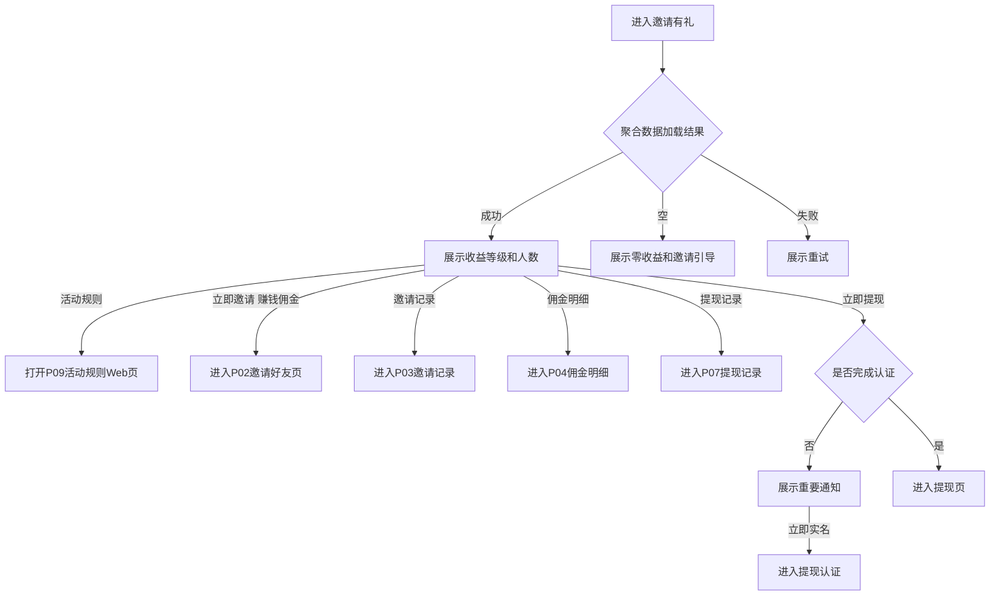

#### 详细交互说明

- 页面进入、从 P04/P05/P07 返回和 App 恢复前台时刷新聚合摘要。
- 等级升级只改变后续订单；历史佣金继续展示原比例快照。
- 点击导航栏“活动规则”打开 P09 Web 页；点击“立即邀请 赚钱佣金”进入 P02；三个功能菜单分别进入 P03、P04、P07，不共用一个模糊的记录页。
- D01 点击取消停留 P01；点击立即实名进入 P06。
- D01 的法规文案按服务端合规版本控制，版本未变化时不重复强制弹出。

#### 关键状态 / 异常情况

- 加载、零收益、10%/20%/30%、最高等级、负余额和局部网络失败。
- 可提现为 0 时按钮禁用，但佣金/提现记录仍可访问。
- 聚合数据必须来自同一版本响应，不能出现收益新、等级旧的混合状态。

#### 验收标准

- 四张设计状态可逐一对应，金额和人数不写死。
- 三级比例、逐人推进的真实分段进度、升级提示、最高等级和负余额规则准确；1/9/10/19/20 人等边界状态可验证。
- 活动规则、立即邀请、立即提现、邀请记录、佣金明细和提现记录均到达本文指定页面，返回后刷新且保持合理滚动位置。
- 未认证提现必经 D01，取消和立即实名行为正确。

### 5.2 P02 邀请好友（推广素材）

#### 页面定位

“邀请好友”和“推广素材”是同一个页面、同一个路由，不再拆成两个功能页。页面提供两种推广方式：复制专属链接、保存带二维码的推广海报。

#### 参考素材

Figma `43:2118`：

#### 页面结构（从上到下）

1. 导航栏：返回、标题“邀请好友”；推广素材是页面内容名称，不另建“推广素材”路由。
2. 方法一：专属链接卡片和复制链接按钮。
3. 方法二：推广海报预览和保存海报按钮。

#### 区块说明

| 区块 | 内容 | 作用 | 交互 |
|------|------|------|------|
| 分享链接 | 含邀请参数的短链接/落地页链接 | 绑定邀请关系 | 点击复制后提示成功 |
| 分享海报 | 品牌图、二维码、活动说明 | 图片渠道推广 | 点击保存到系统相册 |

#### 主要功能

- 服务端生成不可伪造的邀请标识和链接。
- 二维码内容与当前用户链接一致，不由客户端拼接 inviterId。
- 海报保存需要相册权限；拒绝权限后提供用途说明和去设置入口。

#### 交互流程图

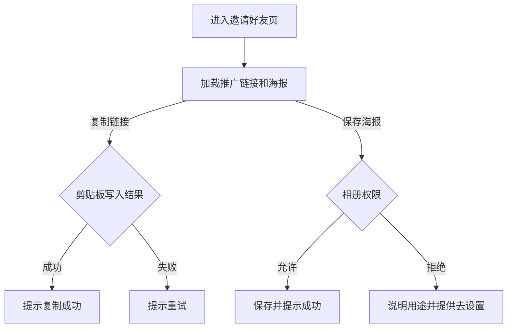

#### 详细交互说明

- 页面先展示骨架，链接和海报可分别失败、分别重试。
- P01“立即邀请 赚钱佣金”和佣金空状态“去邀请好友”都进入本页；任何旧“推广素材”入口也归一到同一路由，不能形成两份页面状态或统计口径。
- 链接过期时重新向服务端获取，不复用失效二维码。
- 保存海报只保存当前完整画布，不暴露内部邀请参数或调试信息。

#### 关键状态 / 异常情况

- 链接加载失败、海报加载失败、二维码生成失败、相册权限拒绝、存储空间不足。
- 示例域名和二维码仅为设计占位，不作为生产地址。

#### 验收标准

- 复制内容和二维码均能绑定当前邀请人且不可被客户端篡改。
- 保存图片清晰完整，权限拒绝和保存失败有可执行反馈。
- “邀请好友”与“推广素材”只有一个页面实例、一个路由和一套埋点；P01 主按钮可准确到达。
- 不出现邀请码输入、团队佣金或其他推广方式。

### 5.3 P03 邀请记录

#### 页面定位

展示当前邀请人的直接邀请好友及会员开通状态。

#### 参考素材

Figma `43:2222`：

#### 页面结构（从上到下）

1. 导航栏：返回、邀请记录。
2. 筛选：全部、已开通、未开通，显示数量。
3. 好友列表：头像占位、脱敏账号、开通时间、状态标签。
4. 分页加载和无更多记录。

#### 区块说明

| 区块 | 内容 | 作用 | 交互 |
|------|------|------|------|
| 筛选 | 全部/已开通/未开通 | 查看转化 | 切换后从第一页加载 |
| 好友行 | 脱敏账号、时间、状态 | 展示直接邀请结果 | 不进入好友个人资料 |

#### 主要功能

- 只展示本人直接邀请关系。
- 已开通表示曾完成首笔成功会员订单；退款不删除邀请历史。
- 未开通好友不展示奖励金额。

#### 交互流程图

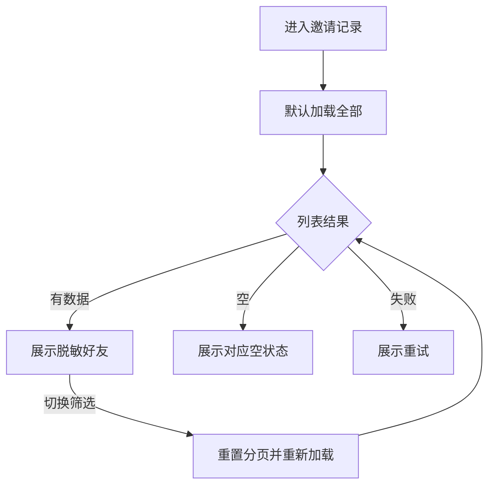

#### 详细交互说明

- 筛选数量和列表来自同一聚合口径。
- 切换筛选保留选中态；加载更多失败保留已加载记录。
- 开通时间为空时显示邀请时间，不伪造开通时间。

#### 关键状态 / 异常情况

- 首屏加载、各筛选空状态、加载更多失败、关系存在但会员状态同步延迟。
- 账号、手机号和头像均按隐私规则处理。

#### 验收标准

- 只能查看本人直接邀请记录，账号完整值不可见。
- 三个筛选、数量、状态和时间口径一致。
- 退款后仍保留邀请和历史开通事实。

### 5.4 P04 佣金明细

#### 页面定位

展示邀请佣金的资金事实，包括汇总、有数据列表、空状态、待结算状态和退款冲正。

#### 参考素材

有数据状态，Figma `43:2285`：

空状态，Figma `43:3403`：

#### 页面结构（从上到下）

1. 导航栏：返回、佣金明细。
2. 汇总卡：累计收益、待结算、已入账。
3. 筛选：全部、待结算、已入账。
4. 流水列表：订单类型、比例、脱敏好友、日期、金额和状态。
5. 空状态：暂无佣金记录、去邀请好友。

#### 区块说明

| 区块 | 内容 | 作用 | 交互 |
|------|------|------|------|
| 汇总 | 累计、待结算、已入账 | 对账 | 净额由服务端返回 |
| 筛选 | 全部/待结算/已入账 | 分类查看 | 冲正记录进入全部并带负金额 |
| 流水 | 来源、比例、金额、状态 | 解释每笔资金 | 可展开查看关联订单摘要 |
| 空状态 | 插图和去邀请好友 | 引导首笔奖励 | 跳转 P02 |

#### 主要功能

- 正向奖励记录购买时比例快照。
- 付款成功后等待 N 天，佣金才转为可提现余额；N 由后台按 App 配置、默认 0，订单保存当时的 N 与预计结算时间。页面展示待结算净额和预计结算时间，到期任务完成后刷新为已入账。
- 已入账订单退款时新增关联原奖励的负向冲正流水；支付与退款事件并发或乱序时，同一订单最终净奖励为 0。
- 汇总必须包含负向流水影响；余额为负时显示待抵扣说明。

#### 交互流程图

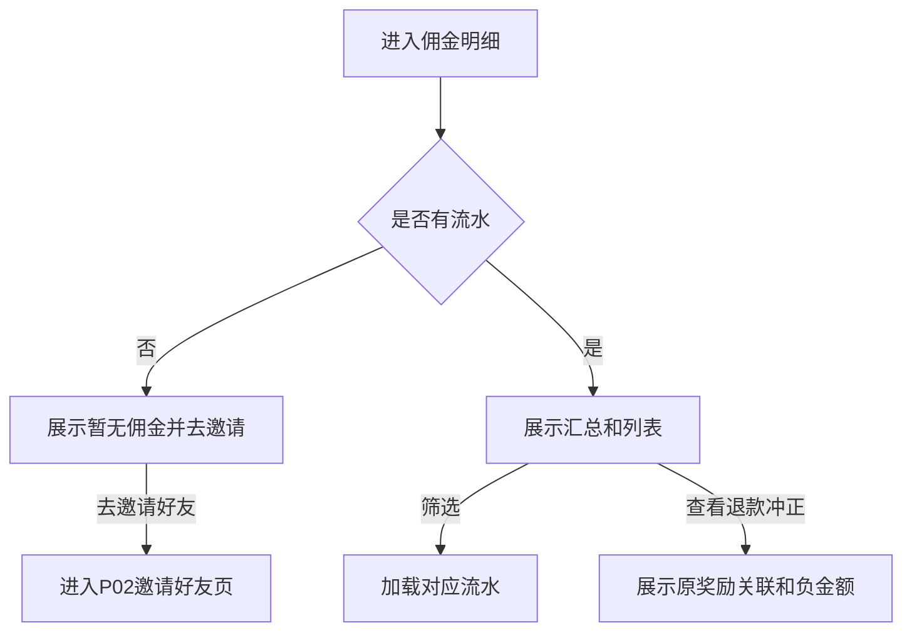

#### 详细交互说明

- 页面不在客户端通过列表累加汇总金额。
- 正向和负向流水使用明显类型、符号和状态，不能只依赖颜色。
- 空状态仍展示 0 汇总和筛选，点击“去邀请好友”进入 P02。

#### 关键状态 / 异常情况

- 加载、有数据、空、分页失败、入账处理中、已入账、退款冲正、负余额。
- Figma 未提供退款冲正图，由文字规则和后续视觉验收补齐。

#### 验收标准

- 两张设计图直接可见且对应有数据/空状态。
- 同一支付或退款事件重复通知不产生重复流水。
- 比例快照、正负金额、状态和汇总金额可以相互核对。

### 5.5 P05 提现

#### 页面定位

承接未绑卡、正常提现、超额校验和银行卡选择，是提现申请创建入口。

#### 参考素材

未绑定银行卡，Figma `43:2362`：

正常提现，Figma `43:2951`：

金额超过余额，Figma `43:3014`：

D03 选择银行卡，Figma `43:3079`：

#### 页面结构（从上到下）

1. 导航栏：返回、提现。
2. 可提现金额卡。
3. 提现到：未绑卡引导或当前银行卡和更换入口。
4. 金额卡：输入金额、全部提现、预计到账、每日限制和到账说明。
5. 校验错误区。
6. 主按钮：去绑定或确认提现。
7. 资金安全说明。
8. D03 银行卡选择底部弹层。

#### 区块说明

| 区块 | 内容 | 作用 | 交互 |
|------|------|------|------|
| 余额卡 | 可提现余额 | 输入上限 | 服务端返回，不用累计收益替代 |
| 认证/银行卡 | 去实名认证 / 去绑定 / 当前卡与更换 | 先判实名再判 ACTIVE 卡 | 未实名 P06；已实名无卡 P10；有卡 D03 |
| 金额 | 金额、全部提现、预计到账 | 创建申请 | 输入按元展示、按分提交 |
| 提交 | 确认提现 | 冻结余额 | 防重复点击并等待结果 |

#### 主要功能

- 资格查询、银行卡选择、金额校验、预计到账试算、每日次数和提交。
- 提现创建只提交 `bankAccountId`、`amountCents`、协议确认和试算标识，不上传完整卡号或姓名。
- 提交前重新查询余额、认证、银行卡、每日次数和有效试算。

#### 交互流程图

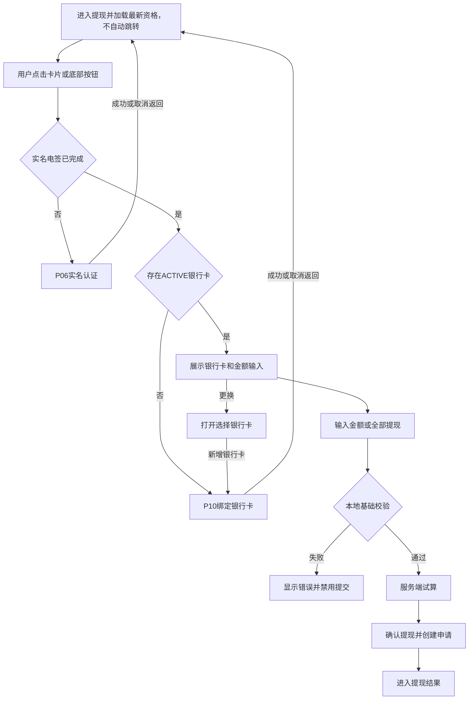

#### 详细交互说明

- 金额只允许最多两位小数；空、0、低于最低额、超过余额均不可提交。
- 全部提现填入服务端可提现余额，不使用页面旧值。
- 切换银行卡后重新试算；试算过期或余额变化时提交失败并刷新页面。
- 提交按钮进入 loading 后禁止重复点击；超时先查询是否已创建，不能直接再次创建。

#### 关键状态 / 异常情况

- 未绑卡、可提交、低于最低额、超过余额、负余额、当日已申请、试算过期、余额并发变化、提交超时。
- 删除/失效银行卡不能出现在 D03 可选列表。

#### 验收标准

- 四张设计状态均嵌入且页面逻辑一致。
- 超额时红框、错误文案和提交禁用同时出现。
- 每日一次、最低额、负余额和并发余额校验以服务端为准。
- 创建请求不包含完整银行卡和实名资料。

### 5.6 P06 实名认证

#### 页面定位

仅负责本人实名认证与工猫电签，不承担绑卡。P05 未实名时通过用户点击进入；服务端确认成功后自动返回 P05 并刷新，停留等待点击“去绑定”。路由沿用 `/invite/withdrawal-auth`。

#### 参考素材

Figma `66:120`（通道 `x5x4ir6u`）：

旧 `43:2504/2639/2716/2793/2872` 合并表单及独立成功/失败全屏图保留为历史参考，不再驱动当前页面；成功采用提示并返回，失败原页可行动。设计中的非大陆认证提示删除，不新增非大陆入口。

#### 页面结构（从上到下）

1. 返回、标题“实名认证”及认证用途提示。
2. 姓名、大陆身份证号、手机号三项输入，不显示银行卡输入。
3. 证件类型固定“大陆居民身份证”，提示18–65周岁。
4. 身份证人像面、国徽面两个私有照片槽位。
5. 认证后主体锁定提示、签署按钮与未默认勾选的协议确认。
6. 外部受控工猫 H5；中断或失败在原页保留状态查询、重新提交/上传入口。

#### 区块说明

| 区块 | 内容 | 交互/边界 |
|---|---|---|
| 本人资料 | 姓名、身份证、手机号 | 只存当前页面内存；身份证校验真实出生日期、校验码及18–65周岁 |
| 两面照片 | 人像面、国徽面 | 相机/相册、预览、替换、进度、失败重试；单张压缩后≤3 MiB |
| 协议 | `我已阅读并同意《灵活用工协议》和《实名认证服务协议》` | 默认不勾选；只接受页面复选框的主动确认。两份名称分别可点：前者实时获取工猫短期地址，后者打开自有静态页；阅读不自动勾选或提交 |
| H5与查询 | 核身、电签、确认 | 不信任 H5 回跳的成功声明；后端主动查合同2/3才成功 |

#### 主要功能

- 私有直传类型固定 `invite/id-card-images`，不走公共图片查重，不提交公共地址。两张均 complete=READY 后只提交各自 `resourceId`；替换立即清除旧ID，两面不能相同。
- 清理本流程压缩、拍摄临时副本，不删除相册原图，不进入长期媒体缓存；退出期间的异步上传结果不能回写已销毁页面。
- 后端认证阶段只写当前 App 实名档案、认证会话，不创建银行卡，`syncInfo` 不传卡号。
- 创建/确认响应使用 `identityReady`，移除 `ready/bankAccount`；只有主动查单确认合同2/3为真。已登记资料、姓名脱敏值、PENDING卡均不等于成功。

#### 交互流程图

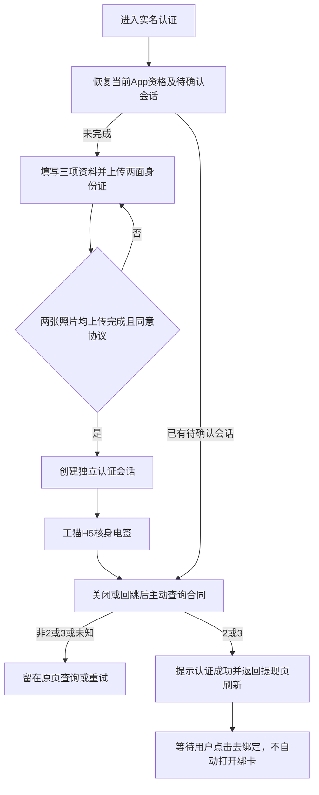

#### 详细交互说明

- 表单可滚动，底部按钮适配安全区与键盘；设计稿1179px为参考，不锁定整页高度。
- 底部严格按“主体锁定提示→签署按钮→`8.w` 间距→协议确认”排列。协议未勾选时点击签署只显示提示，不弹二次同意框、不创建认证会话；失败后保留当前页面内的勾选状态，退出页面不持久化。
- 点击《灵活用工协议》只调用 `GET /api/invite/agreements/flexible-employment`，实时取得一小时地址后在受控 WebView 打开；PDF 或主页面加载失败才提示并尝试系统浏览器。点击《实名认证服务协议》通过 `/webview?key=identity-verification-service-agreement` 打开正式固定地址。两者均不得切换复选框。
- 两照片完成前禁止提交；创建请求失败保留可修改输入，受理后清空文字输入；页面关闭清理剩余敏感状态。
- 工猫 H5 白名单开关、HTTPS/证书、摄像头权限、回跳匹配、禁文件访问沿用，不影响活动规则 Web。
- H5取消/超时/网络失败不显示成功；可主动查询，必要时同一实名主体重新发起。只有从未认证且历史同步均明确拒绝时允许更正主体，未知结果不解锁换人。
- 18–65是本平台年龄规则。工猫公开错误码仍可能拒绝超过60岁；61–65必须商户渠道验收，遇拒绝提示校验失败，不绕过。

#### 关键状态 / 异常情况

空表单、上传中、超限/压缩失败、上传失败可重试、替换照片、跨App/用户资源拒绝、协议未同意、H5权限拒绝/取消、待签署、查询失败、身份纠错受限、认证成功自动返回。后端配置未就绪沿用错误提示，不假造H5地址。

#### 验收标准

- 页面没有银行卡字段；两个私有 `resourceId` 必传，日志/路由/存储无完整身份输入或照片URL。
- 协议默认未勾选；未勾选不发送认证请求，页面不存在可替代勾选的 D02 二次确认弹窗。
- 未签署绝不成功；恢复查询不依赖银行卡，不自动激活旧PENDING卡。
- 成功返回P05仅刷新，用户再次点击才去P10；取消返回不改变认证状态。
- 18/66周岁边界、日期与校验码、两面上传/替换/超限/重试及小屏键盘均覆盖。

### 5.6.1 P10 绑定银行卡

#### 页面定位

独立页面 `/invite/bank-bind`，只允许当前App已实名用户操作。P05已实名无可用卡点击“去绑定”，或D03“添加银行卡”进入；不复用实名认证表单，不再次上传照片或打开H5。

#### 参考素材

Figma `66:198`（通道 `eeis7852`）：

#### 页面结构（从上到下）

返回/绑定银行卡标题、本人银行卡用途提示、真实姓名/身份证号/银行卡号/手机号四行、错误反馈、固定底部“确认绑定”和协议确认；表单可滚动。

#### 区块说明

| 区块 | 内容 | 交互/边界 |
|---|---|---|
| 本人资料 | 重新填写四项，不回填完整密文资料 | 姓名、身份证和手机号由后端与本App认证档案核对 |
| 协议 | 沿用既有版本和已签署协议 | 明确确认银行卡用途，不新增短信或伪造协议URL |
| 提交/结果 | loading、明确失败、未知、成功 | 仅返回ACTIVE卡才提示绑定成功并回到P05刷新 |

#### 主要功能

`POST /api/invite/bank-accounts` 接收四项资料、协议版本和确认。未实名或资料不一致直接拒绝，不调用工猫；通过后调用 `updateEmployee`，严格业务 `success=true` 才激活，HTTP200不算成功。不返回银行名时统一显示“银行卡”，不虚构校验流水。

#### 交互流程图

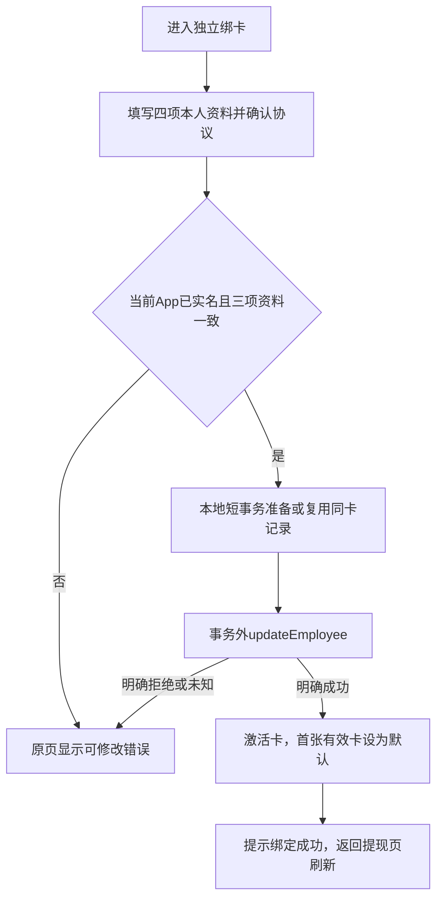

#### 详细交互说明

同用户/card HMAC去重并串行：有效同卡直接复用；失败或未知记录不激活，允许用户显式重试同卡，不自动重试。首张有效卡默认，后续新增卡不覆盖已有默认选择。失败保留可编辑输入；成功/退出清除页面内存，取消不改变已认证状态。新增卡不会影响佣金、试算或打款方式。

#### 关键状态 / 异常情况

未实名直达、资格加载失败、资料不匹配、协议未确认、提交中、明确拒绝、未知待重试、同卡重复请求、已有默认卡、成功/取消返回。仅PENDING卡不展示绑定成功或作为提现候选。

#### 验收标准

- 无照片、无H5、无短信；认证与绑卡接口职责独立。
- 不一致不请求工猫；重复同卡不产生重复有效记录；未明确成功不激活、不影响实名。
- 成功与取消均能返回提现页并刷新，下一步始终按最新服务端资格决定。
- JWT、X-App-Code、归属、安全输入和默认卡规则不回归。

### 5.7 P07 提现记录

#### 页面定位

集中展示用户全部提现申请及用户可见状态。

#### 参考素材

Figma `43:2425`：

#### 页面结构（从上到下）

1. 导航栏：返回、提现记录。
2. 累计提现金额卡。
3. 筛选：全部、处理中、已到账、失败。
4. 记录卡：金额、银行尾号、申请时间和状态。
5. 分页、空状态和错误重试。

#### 区块说明

| 区块 | 内容 | 作用 | 交互 |
|------|------|------|------|
| 汇总 | 累计提现 | 展示历史到账规模 | 只统计已到账，不含失败返还 |
| 筛选 | 四个用户状态 | 快速查找 | 切换后重置分页 |
| 记录卡 | 金额、银行卡、时间、状态 | 查看申请摘要 | 点击进入 P08 |

#### 主要功能

- 内部审核、提交、处理中和查单中统一映射为“处理中”。
- `SUCCEEDED` 映射已到账；`REJECTED / FAILED / RETURNED` 映射失败，并在详情区分原因。
- 银行卡只显示银行名称和尾号。

#### 交互流程图

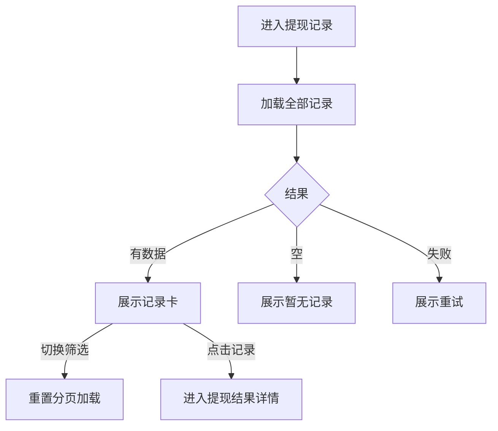

#### 详细交互说明

- 首次进入默认选中全部；从详情返回保留筛选和滚动位置。
- 状态轮询只更新可见卡片，不让列表整体闪烁。
- 同一申请收到重复/乱序通知时只能展示合法的最新状态。

#### 关键状态 / 异常情况

- 加载、空、分页失败、处理中、已到账、审核驳回、明确失败、退票未到账。
- 已到账后发生退票，卡片从已到账更新为失败/未到账并保留历史详情。

#### 验收标准

- 四个筛选和内部状态映射一致。
- 累计提现只统计真实到账金额。
- 卡片和详情的金额、卡尾号、时间、状态一致且脱敏。

### 5.8 P08 提现结果

#### 页面定位

展示单笔提现从申请提交到最终到账或失败返还的状态和金额明细。

#### 参考素材

申请已提交，Figma `43:3257`：

失败/未到账，Figma `43:3338`：

#### 页面结构（从上到下）

1. 导航栏：返回、提现结果/提现申请。
2. 结果主状态：申请已提交、已到账或提现未到账。
3. 金额。
4. 时间线：申请已提交、处理中、到账成功。
5. 失败原因和余额返还提示。
6. 明细：银行卡、金额、手续费/税费、申请时间、处理时间。
7. 完成按钮或返回记录。

#### 区块说明

| 区块 | 内容 | 作用 | 交互 |
|------|------|------|------|
| 主状态 | 提交/到账/未到账 | 传达真实结果 | 不把提交成功写成到账成功 |
| 时间线 | 关键处理节点 | 解释进度 | 服务端时间为准 |
| 失败说明 | 安全原因和返还 | 指导下一步 | 不暴露工猫原始报文 |
| 明细 | 卡、金额、费用、时间 | 对账 | 全部字段脱敏 |

#### 主要功能

- 首次进入和页面刷新查询最新状态。
- 处理中通过轮询刷新；进入后台后暂停，恢复前台立即查询。
- 明确失败、审核驳回或银行退票只返还一次，并展示返还结果。

#### 交互流程图

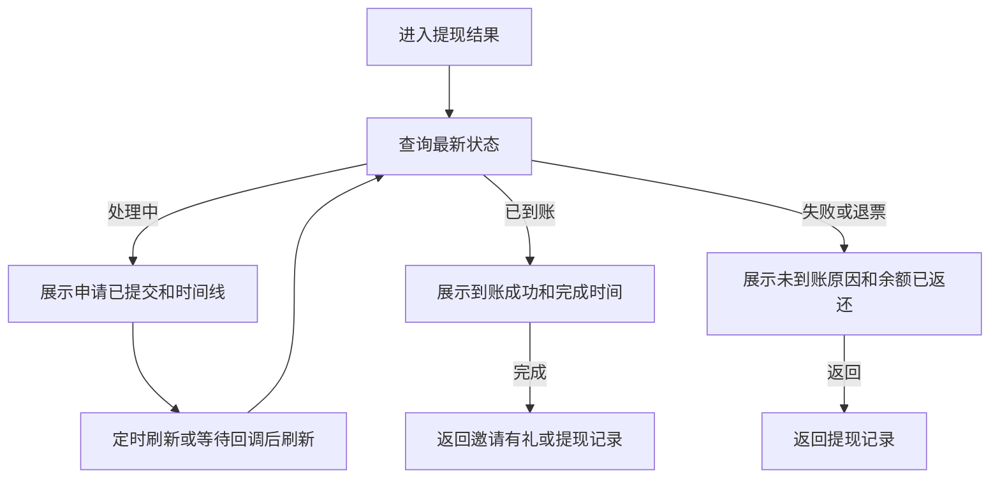

#### 详细交互说明

- 创建请求成功后跳转此页，主文案使用“申请已提交”；设计稿顶部“提现成功”需要在视觉实现时改为不误导的标题。
- 处理中不显示确定到账时间，只提示提交银行后预计 1～3 个工作日。
- 失败页仅在余额返还成功后展示“已退回”；返还异常显示“处理中，请稍后查看”并告警。

#### 关键状态 / 异常情况

- 申请已提交、审核中、提交中、银行处理中、查单中、已到账、审核驳回、明确失败、银行退票、返还处理中、详情加载失败。
- 网络超时不显示失败，不允许用户用新 requestId 重复提交同一申请。

#### 验收标准

- 两张设计图直接可见，提交态和失败态语义准确。
- 状态不倒退；已到账后仅允许因退票转为未到账/已返还。
- 重复回调、查单和退票通知不会重复返还余额。
- 失败原因安全、可行动，内部 requestId 和工猫报文不暴露给用户。

### 5.9 P09 活动规则 Web 页

#### 页面定位

由 Admin/Web 工程提供、App 直接通过现有 `StaticPageView(pageKey: 'invite-rules')` 打开的活动规则页面，集中说明奖励比例、有效邀请、佣金结算退款、提现和风控边界。按 2026-08-28 最新要求不再保留独立规则页面/Controller；不在 App 中硬编码规则正文。

#### 参考素材

Figma `43:3167`：

Figma 仅作为 Web 内容层级和视觉布局参考。实现方式参考现有隐私协议静态页面：

- `/Users/soul/code/lxwx/lxwx_admin/web/legal/catseller/privacy-policy/index.html`
- `/Users/soul/code/lxwx/lxwx_admin/web/legal/privacy-policy/index.html`
- `/Users/soul/code/lxwx/lxwx_admin/web/site.css`

以上现有文件只用于复用页面组织、静态发布和通用样式方式，本轮不修改其内容；活动规则应在 `lxwx_admin/web/` 下使用独立路径实现，不覆盖隐私协议文件。

#### 页面结构（从上到下）

1. App 受控 Web 容器：返回、标题“活动规则”、加载进度和错误重试。
2. Web 页标题区：适用 App 名称、规则版本、生效时间。
3. 奖励规则。
4. 有效邀请。
5. 结算与退款。
6. 提现说明。
7. 其他说明、风控与申诉/客服提示。

#### 区块说明

| 区块 | 内容 | 作用 | 交互 |
|------|------|------|------|
| 页面头部 | App 名称、规则版本、生效时间 | 明确当前有效内容 | Web 内容随发布版本更新 |
| 奖励规则 | 三级比例、真实人数进度和升级影响 | 解释金额 | 展示本版固定比例与规则版本 |
| 有效邀请 | 链接/二维码、唯一关系 | 防争议 | 不提供人工换绑 |
| 结算退款 | 按订单结算时间入账、等待期与处理重试、退款冲正 | 解释余额 | 纯文本说明，不承担原生资金操作 |
| 提现说明 | 实名、银行卡、每日一次、时效 | 说明资格 | 纯文本说明，不在 Web 页直接创建提现 |
| 风控说明 | 虚假、刷单、作弊 | 活动安全 | 处罚需有证据和申诉渠道 |

#### 主要功能

- Admin/Web 工程以静态 Web 页面形式维护和发布活动规则，参考现有隐私协议页面的目录与发布方式；本期不新增 Flutter Admin 富文本编辑器或规则 CMS。
- 喵喵带货 App 直接复用 `StaticPageView`，通过 `AppConstants.legalPageUrls['invite-rules']` 打开正式地址 `https://www.lxwanxiang.com/legal/invite-rules/index.html?appCode=catseller&embedded=1`，不从 overview/capability 获取 URL，也不随本地/测试 API 环境切换。`embedded=1` 在常量中维护以避免重复标题；规则正文及动态结算天数、最低额仍由 Web/后端维护。其他 App 既有地址来源不在本次改动范围，多 App 继续复用模板并按 `appCode` 隔离数据。
- 展示当前已发布规则版本和生效时间；未发布草稿不能被 App 用户访问。
- 规则更新不追溯改变历史订单比例或资金事实。
- 客服入口沿用 App 现有客服能力，但客服页面不属于本 PRD。

#### 交互流程图

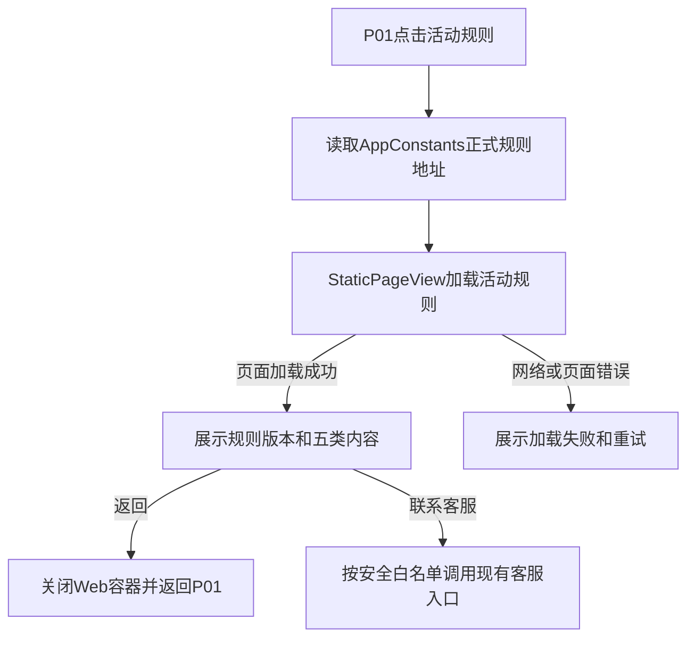

#### 详细交互说明

- 固定比例、逐人推进的真实进度和门槛必须与本版一致；最低提现额等可配置项展示当前生效值，或在发布前由受控流程生成对应 App 文案。须展示当前 App 结算等待天数并说明历史订单按原快照执行。
- 法规和税务表述上线前经过法务/财务复核，不以设计稿演示文字直接发布。
- P09 初始页面地址只能来自固定 `legalPageUrls` 键，不接收任意 URL 路由参数；加载、错误、重试及导航行为直接沿用 `StaticPageView`，不额外重写独立超时/外链白名单。关闭、返回和重试不改变 App 登录或资金状态；工猫核身、电签仍使用原专用安全容器。
- 规则修改必须经过代码/内容评审和发布，保留版本、生效时间和发布记录；多个 App 共用内容时一次发布需验证所有目标 App 的名称、链接与展示。
- 活动暂停后不允许新绑定/新奖励，但历史记录、结算、退款和提现仍可查询与处理。

#### 关键状态 / 异常情况

- 页面或公开动态规则接口未发布、加载失败、离线、超时、证书异常、未知域名跳转、活动暂停、规则版本更新、合规文案待确认、客服不可用；喵喵带货不再因 overview 中 URL 缺失而阻断打开页面。
- 历史奖励始终使用订单产生时快照，不因页面规则变化重算。

#### 验收标准

- 页面五类规则与当前 PRD 一致，不出现团队佣金、支付宝或微信提现。
- P01 打开的是 `StaticPageView` 中的正式活动规则 Web 页，App 不重复实现原生正文、独立页面或 Controller；共享组件的加载、重试和返回可用。
- 页面结构和发布方式可追溯到现有隐私协议静态页参考，但使用独立活动规则路径，不覆盖或修改隐私协议。
- 配置更新不改变历史资金事实。
- 法规、税务、处罚和解释权文案完成法务/财务确认后才能上线。

### 5.10 A01 现有邀请收益管理后台

#### 页面定位

复用现有 Flutter Web 后台 `/Users/soul/code/lxwx/lxwx_admin` 的 App 切换和“交易与增长 > 邀请收益管理”，为运营和财务提供多个 App 共用的邀请规则、关系与佣金查询、银行卡提现审核、工猫状态和主动对账能力。页面必须始终以当前 App Code 为数据与操作边界，不得新增重复菜单、另建后台系统或按 Catseller 名称写专属分支。

#### 参考素材

当前没有后台 Figma 设计稿，不使用 App 图片冒充。现有实现参考：

- 页面：`/Users/soul/code/lxwx/lxwx_admin/lib/pages/common/invite_page.dart`。
- 导航：`/Users/soul/code/lxwx/lxwx_admin/lib/pages/shell_page.dart` 中“交易与增长 > 邀请收益管理”。
- UI 规则：`/Users/soul/code/lxwx/lxwx_admin/.cursor/rules/04-后台管理UI规则.mdc`。

页面视觉沿用现有后台的筛选栏、表格、状态标签、右侧详情抽屉、确认弹框和操作反馈。

#### 页面结构（从上到下）

1. 后台 Shell：现有 App 切换、侧边导航、页面标题和管理员会话。
2. App 上下文条：当前 App 名称/App Code、共享模式启用状态、平台工猫 BANK 连接就绪状态和无权限/未启用提示。
3. 页签栏：规则配置、邀请与佣金查询、提现管理；复用现有三个页签结构。
4. 规则配置：只读三级直接奖励比例/升级人数，可编辑当前 App 的最低提现额、邀请落地页和保存操作；增加按 App 配置的结算等待天数。
5. 邀请与佣金查询：当前 App 内的用户查询条件、邀请关系摘要、自动等级、直接邀请列表、佣金流水表格。
6. 提现管理：当前 App 内的用户/提现号/时间/状态筛选、提现列表、分页和状态操作。
7. 提现详情抽屉：App Code、资格、脱敏身份、银行卡、余额冻结、费用、审核、工猫、回调/查单和返还时间线。
8. 高风险操作弹框：显示当前 App，支持审核通过、审核驳回、主动对账和配置保存。
9. 敏感信息查看弹框：显示当前 App、当前记录和待查看字段，要求输入独立“敏感信息查看密码”并填写查看原因；成功后在详情内短时显示数据库解密值。

#### 区块说明

| 区块 | 现有能力 | 本次复用/调整 | 交互与权限 |
|------|----------|---------------|------------|
| 导航与页面框架 | 已有 App 切换和统一邀请收益入口 | 完全复用；持续显示当前 App 与能力状态 | App 范围权限；切换后清空旧页面状态 |
| 规则配置 | 三级比例、门槛、最低额、落地页等 | 共享模式下比例/门槛只读，最低额/落地页按 App 配置；增加按 App 配置的结算等待天数；不使用注册积分、二级返佣 | 当前 App 配置权限；保存前校验并二次确认 |
| 用户代理配置 | 查询关系、人工等级、二级代理 | 共享模式下改为邀请与佣金只读查询；等级由有效人数自动计算 | 当前 App 查询权限；不得换绑或改资金 |
| 提现筛选/列表 | 用户、旧状态、列表 | 复用框架，增加提现号、时间、BANK 和完整新状态 | 查询权限；查询中防重复请求 |
| 提现详情抽屉 | 金额、渠道、账号、审核、打款时间 | 增加认证、银行卡、冻结、费用、requestId、工猫流水、查单、失败/退票/返还 | 默认脱敏；敏感查看需要独立权限、查看密码和原因 |
| 敏感信息查看 | 无 | 新增当前记录姓名、身份证、手机号、银行卡的受控解密查看 | 专用权限 + 独立查看密码 + 必填原因；成功后最多展示 5 分钟，不支持列表、复制或导出 |
| 审核操作 | 通过、驳回 | 复用并增加服务端复核、二次确认、提交中和结果反馈 | 财务审核权限；驳回原因必填 |
| 打款结果 | 现有人工打款成功/失败 | 当前 App 启用工猫 BANK 共享模式时隐藏并禁止 | 尚未启用的 App 使用既有能力模式 |
| 主动对账 | 无 | 非终态异常单新增，固定使用原 requestId 查单 | 对账权限；限制重复触发并记录审计 |

后台权限至少拆分为查询、提现审核、主动对账、规则配置、敏感信息临时查看和审计查看，并分别绑定可操作 App 范围；拥有某 App 的查询或审核权限不自动获得其他 App 权限。

#### 主要功能

- 复用现有页面、Repository、模型和后台 Shell 形态；本 PRD 只定义产品结果，不要求新建平行模块。
- 任一 App 启用本共享模式后只保留直接邀请首笔会员奖励；现有注册积分、二级代理收益和人工代理等级不能进入本功能计算或操作。
- 三级比例和升级门槛固定为 10%/20%/30% 与 10/20 人，所有启用 App 的后台只读展示；若将来允许自由配置，需另行评审历史快照和活动文案影响。
- 邀请关系和佣金流水只读，展示会员订单号、支付金额、比例快照、奖励金额、待结算/已入账/冲正状态和时间。
- 提现列表支持 `PENDING_REVIEW / REJECTED / APPROVED / SUBMITTING / PROCESSING / RECONCILING / SUCCEEDED / FAILED / RETURNED`，不得继续使用旧 `PAID / PAY_FAILED` 作为任何启用 App 的资金真源。
- 审核通过后只推进到异步提交，不代表打款成功；工猫结果由回调触发查单、定时查单或主动对账统一收敛。
- 主动对账只查询当前持久化 requestId，不生成新 requestId、不重发提现，不允许终态单重复操作。
- 配置保存生成新版本；已有佣金保留付款时比例、等待天数和预计结算时间，已有提现保留创建时最低额快照。最低额更新适用于新提交申请，结算天数更新适用于新付款订单。
- 姓名、身份证号、手机号和银行卡号在数据库中以可逆密文保存，后台默认只展示脱敏值。确因审核或客服需要查看时，管理员点击当前详情的“查看完整信息”，输入平台独立的敏感信息查看密码并填写原因；后端验证通过后只解密当前 App、当前记录、当前字段，最多展示 5 分钟。
- 敏感信息查看密码不是后台登录密码、工猫 appSecret 或加密密钥；多个 App 共用一套平台查看密码，但是否可查看仍受管理员 App 范围和专用权限约束。密码仅保存强哈希或由密钥系统校验，任何接口、日志、页面和数据库业务表均不得保存或返回明文密码。

#### 交互流程图

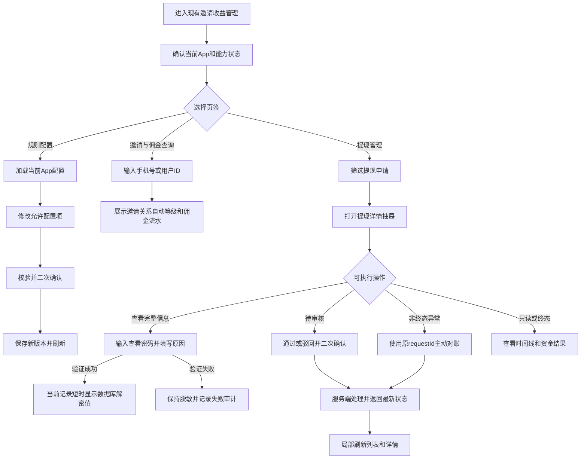

#### 详细交互说明

- 进入页面时继续使用现有 App Code 上下文；所有启用共享模式的 App 都看到本 PRD 定义的字段、状态和按钮，判断依据为当前 App 能力配置，不是 App 名称。尚未启用的 App 使用既有模式。
- 切换 App 时立即取消/忽略旧 App 未完成请求，关闭详情与高风险弹框，清空筛选、分页和选中行，再加载新 App 配置与权限；响应 App Code 与当前上下文不一致时丢弃并告警。
- 当前 App 未启用共享模式、平台工猫 BANK 连接未就绪或管理员无 App 权限时，展示明确门禁状态；不得提供资金操作。
- 规则页加载失败时保留重试入口，不展示默认值供误保存；保存按钮提交中禁用，成功后展示生效版本和时间。
- 邀请查询支持手机号或用户 ID；结果中的手机号、订单用户和邀请码按权限脱敏。不存在用户时展示空状态，不作为系统错误。
- 提现列表默认优先显示待审核，筛选条件包含提现号、用户、申请时间和状态；操作完成后保留筛选并刷新对应行。
- 审核通过前展示金额、银行卡尾号、认证状态、可提现/冻结、当日次数和风险提示；后端复核失败时不关闭详情，展示可行动原因。
- 审核驳回必须填写面向用户的安全原因和内部备注；确认后只释放一次冻结余额。
- 主动对账按钮仅在 `SUBMITTING / PROCESSING / RECONCILING` 且满足频率限制时可用；点击后展示“查询中”，结果未知时维持非终态。
- 姓名、身份证、手机号和完整银行卡默认不回显。点击“查看完整信息”后必须再次校验当前 App 范围、专用敏感查看权限、查看密码和必填原因；任一项失败都不解密。
- 验证成功只返回当前详情明确请求的字段，最多展示 5 分钟；关闭详情、切换 App、退出登录、页面进入后台或授权超时后立即恢复脱敏。禁止列表批量明文、复制按钮、下载和导出。
- 查看成功或失败均记录 App Code、管理员、对象、字段范围、原因、结果、时间、IP/设备摘要和 traceId；审计内容不得记录查看密码或敏感明文。
- 同一管理员连续 5 次密码错误时，锁定其敏感查看能力 30 分钟并告警，但不锁定普通后台查询；管理员不能通过刷新页面或切换 App 绕过。

#### 关键状态 / 异常情况

- 页面/页签首次加载、查询中、空数据、网络错误、权限不足、登录过期和操作提交中。
- 配置版本冲突、字段不合法、保存失败、保存成功但页面刷新失败。
- 用户不存在、邀请关系为空、佣金为空、历史正负向流水、退款冲正后负余额。
- 待审核、驳回、审核通过、提交中、处理中、待查单、已到账、明确失败、退票和返还异常。
- 重复审核、多人并发审核、审核时资格失效、余额变化、银行卡失效、合同未完成或 BANK 渠道不可用。
- 工猫超时、回调重复/乱序、主动查单频率限制、未知结果和终态后重复操作。
- 查看密码错误、连续失败锁定、敏感权限不足、查看授权过期、数据库解密失败、切换 App 自动恢复脱敏和审计写入失败。
- App 切换中、当前 App 未启用、App Code 缺失/不支持、工猫配置未就绪、跨 App 响应被拒绝和管理员无当前 App 权限。

#### 验收标准

- 继续使用现有“邀请收益管理”入口和页面，不新增重复菜单；三个页签结构可承载全部需求。
- 所有启用共享模式的 App 都不暴露二级代理收益、人工代理等级或人工“打款成功/失败”；尚未启用的 App 不被隐式迁移。
- 切换 App 后列表、详情、配置、权限和操作对象全部属于新 App；任何跨 App 响应或操作均被拒绝，页面不出现上一个 App 的残留数据。
- 邀请与佣金能够按用户追溯到会员订单、比例快照、待结算、入账和冲正，且不允许手工改账。
- 提现列表、详情、审核、工猫提交、主动对账、失败返还和退票状态完整，审核通过不误显示为已打款。
- 主动对账始终使用原 requestId，重复点击、超时、重复回调和多人并发不会重复打款、返还或迁移终态。
- 敏感数据默认脱敏，高风险操作二次确认；审核、对账、配置和敏感查看均有操作审计。
- 有当前 App 敏感查看权限的管理员输入正确独立查看密码并填写原因后，只能在当前详情短时查看姓名、身份证、手机号和银行卡数据库解密值；错误密码、越权、过期、切换 App、复制和批量导出均被阻止。
- 加载、空、错误、403、401、并发冲突和操作失败均有明确反馈，桌面端表格与窄屏滚动符合现有后台 UI 规则。

---

## 6. 数据与同步

### 6.1 产品可见数据

| 数据域 | 用户可见字段 | 同步规则 |
|--------|--------------|----------|
| 邀请摘要 | 可提现、待结算、累计收益、比例、人数 | 进入/返回页面刷新 |
| 邀请关系 | 脱敏好友、邀请时间、开通时间、状态 | 支付事件后同步更新 |
| 佣金流水 | 类型、比例、正负金额、状态、日期 | 支付/退款事件幂等写入 |
| 实名电签 | 脱敏身份、认证状态、完成时间 | H5 回跳和回调后主动查询 |
| 银行卡 | 银行名称、尾号、默认标识、有效状态 | 完整卡号永不回显 |
| 提现 | 金额、费用、银行卡、申请/处理时间、状态 | 回调触发查询，轮询/查单收敛 |

### 6.2 Admin 可见数据

| 数据域 | 后台默认字段 | 使用边界 |
|--------|--------------|----------|
| App 上下文 | App 名称、App Code、共享模式、平台 BANK 连接状态 | 页面持续可见；所有后续数据与操作受其约束 |
| 邀请关系 | 用户 ID、脱敏手机号、来源、绑定时间、自动等级、有效人数 | 只读，不换绑、不手工改等级 |
| 佣金流水 | 订单号、支付金额、比例快照、奖励金额、状态、正/负向关联 | 只读，不手工改账 |
| 提现审核 | 提现号、用户、金额、费用、余额/冻结、认证和银行卡状态 | 审核权限可通过/驳回 |
| 工猫对账 | requestId、工猫流水、提交/回调/查单摘要、失败/退票和返还 | 对账权限；原 ID 查询，不重发 |
| 规则版本 | 当前值、生效时间、版本、修改人、变更前后值 | 配置权限；历史记录保持快照 |
| 敏感详情 | 默认脱敏姓名、身份证、手机号、银行卡；授权后当前记录短时明文 | 专用权限、独立查看密码、原因、最多 5 分钟、不可复制/导出 |
| 操作审计 | 操作人、操作类型、对象、原因、结果、时间和网络摘要 | 审计权限；不可据此修改业务数据 |

### 6.3 状态模型

#### 佣金状态

- `PENDING_SETTLEMENT`：付款成功后等待订单快照的 N 天到期，或到期后入账处理/重试中；不可提现，展示待结算净额及预计结算时间。
- `SETTLED`：已入账，可进入可提现余额。
- `REVERSED`：已入账奖励发生负向冲正。
- `CANCELLED`：待结算期间已全额退款，不再转为可提现。
- `REQUIRES_REVIEW`：退款金额不明或异常，暂停自动结算等待核对；用户侧显示“结算核对中”，不得伪装为已到账或允许提现。

#### 工猫签约状态

- 0：未同步。
- 1：待签署。
- 2：合同文件生成中。
- 3：已完成。

状态 2/3 才满足当前提现资格；正式实现前应以工猫签约接口合同再次确认。

#### 提现内部状态

`PENDING_REVIEW`、`REJECTED`、`APPROVED`、`SUBMITTING`、`PROCESSING`、`RECONCILING`、`SUCCEEDED`、`FAILED`、`RETURNED`。

### 6.4 概念数据模型

数据库改动：有（后续实现，本轮只定义概念模型）。

| 模型 | 关键内容 | 约束 |
|------|----------|------|
| App 能力配置 | App Code、共享模式开关、结算等待天数、最低额、邀请落地页、活动规则 Web 地址、生效版本 | App Code 唯一；不保存工猫密钥或按 App Provider 引用 |
| 平台工猫连接配置 | 单一商户、BANK 渠道、合同模板、服务主体、回调域名、密钥引用和环境 | 同一环境所有启用 App 共用一套；正式/测试隔离；秘密只在私有配置或密钥系统中维护，不进入普通业务表 |
| 邀请关系 | App Code、邀请人、受邀人、来源、绑定时间 | App 内受邀人唯一、禁止自邀；跨 App 不关联 |
| 佣金账本 | App Code、会员订单、比例快照、正负金额、状态 | App + 支付/退款事件唯一 |
| 余额与冻结 | App Code、用户、可用、入账处理中、冻结、净余额 | App 内原子更新，允许净余额为负 |
| 实名电签档案 | 姓名、身份证、手机号的可逆密文，脱敏值/安全索引、合同 ID、工猫状态 | 数据库不存业务明文；用户/App 唯一；仅受控服务端可解密 |
| 银行卡档案 | 银行、尾号、卡号可逆密文、安全索引、有效状态 | 本人卡、多卡、列表脱敏；仅受控服务端可解密 |
| 提现单 | App Code、requestId、金额、费用、状态、工猫流水 | requestId 全局唯一且稳定，并持久化 App 归属 |
| 回调/幂等事件 | App Code、类型、外部事件号、摘要、处理结果 | 先解析 App，再幂等处理；App + 事件唯一 |
| 规则配置版本 | App Code、结算等待天数、最低额、落地页、生效时间；奖励另存固定比例/门槛快照 | 各 App 独立版本；历史奖励/提现保存产生时快照 |
| 敏感查看安全配置 | 查看密码强哈希/密钥系统引用、失败次数、锁定时间 | 平台级单套；与后台登录密码、工猫秘密和数据加密密钥分离，不存明文 |
| Admin 操作审计 | App Code、操作人、权限、对象、字段范围、原因、结果、网络/trace 摘要 | 审核、对账、配置、敏感查看成功/失败全覆盖；不记密码和敏感明文 |

---

## 7. 核心业务规则

### 7.1 邀请与等级

- 只支持专属链接和海报二维码；服务端解析并绑定邀请人。
- 同一 App 内同一好友只能绑定一次，已有关系不覆盖；禁止自邀和循环邀请，不与其他 App 的关系合并。
- 每个 App 独立统计有效开通会员人数：0～9 人使用基础 10% 展示，10～19 人为 20%，20 人及以上为 30%。
- 等级节点之间的颜色按有效人数逐人推进：0～10 人填充 10%→20% 段的 `人数/10`，10～20 人填充 20%→30% 段的 `(人数-10)/10`；10 人准确到达 20% 节点，20 人准确到达 30% 节点，不能按等级整段跳色。
- 升级完成后的新比例只影响后续会员订单；历史订单不追溯重算。

### 7.2 奖励与退款

- 每名好友在当前 App 内仅首笔成功会员订单产生一次直接奖励；不同 App 的订单和邀请人数独立计算。
- 首笔会员订单支付成功后幂等生成待结算佣金；后台按 App 配置付款后等待 N 天（默认 0），到期后才计入可提现余额。每单保存配置版本、等待天数及预计结算时间，修改配置只影响新订单。
- 2026-08-27 用户确认金额口径：返佣不足 1 分向下取整；部分退款按原奖励与累计退款比例计算累计应冲正额，本次只记与已冲正额的差值；全额退款补齐全部剩余冲正，不因逐次取整遗留尾差。
- 等待期内或到期处理/重试时均显示“待结算”，不可提现；期间部分退款扣减待结算净额，全额退款取消待结算；已结算后退款写入关联原奖励的负向冲正。
- 净余额可为负，后续奖励先抵扣；负余额禁止提现。

### 7.3 实名与银行卡

- 实名、银行卡和合同主体必须是同一自然人。
- 认证与绑卡独立：认证不建卡，绑卡必须与当前App已认证姓名/身份证/手机号一致；跨App不复用资料。
- 私有照片resourceId必传，按真实出生日期/身份证校验码校验18–65；工猫61–65渠道可用性另行验收。
- 用户必须明确同意两份协议并完成工猫核身电签。
- 实名成功后不提供用户自行修改；修正错误身份需走受控客服/人工流程并留审计。
- 本版不使用银行预留手机号短信验证码。

### 7.4 提现

- 本期仅 BANK；最低额默认 1 元，后台按 App 动态配置正整数分（最小 1 分），无需发版或重启。保存后用于新提交申请；资格查询展示最新值，创建提现时后端重新校验最新门槛，不信任客户端缓存或旧试算。未达门槛不创建单据、不冻结余额、不占用当天次数；已成功创建的申请保留原门槛快照，不因后续调高而被拒绝。相同幂等键重试返回原单，不作为新申请重判门槛。
- 每个 App 内每名用户在北京时间自然日最多成功创建一笔申请；不同 App 独立计数。
- 创建申请冻结余额；驳回、明确失败或退票只释放/返还一次。
- 稳定 requestId 使用服务端按 App 生成并持久化的“受控 App 短前缀 + ULID”，全局唯一且长度不超过 32；不得固定使用 Catseller 专属 `CS` 前缀。
- 超时/未知结果只使用原 requestId 查单，禁止换号重发。

### 7.5 回调与终态

- 合同、提现结果和退票回调先验签/解密并做事件幂等。
- 无可靠签名的回调只作为查单触发信号，不直接改变资金终态。
- 回调、主动查单和定时对账统一进入同一状态迁移服务。
- `SUCCEEDED` 后只允许因银行退票转 `RETURNED`，不允许其他倒退。

### 7.6 现有 Admin 复用规则

- 复用 `/Users/soul/code/lxwx/lxwx_admin` 已有 App 切换、“邀请收益管理”页面、导航入口和三个页签，不创建重复页面。
- 共享模式按当前 App 的能力配置启用，不允许以 `catseller` 名称、品牌文案或路由字符串判断。
- 任一启用 App 的当前等级都由该 App 内有效直邀会员人数自动计算；后台不得使用现有人工等级或二级代理开关改变结果。
- 任一启用 App 仅使用直接首单佣金；现有注册积分和间接佣金字段不参与本功能。尚未启用的 App 使用既有模式，不被隐式迁移。
- 规则保存必须按 App 生成配置版本；当前三级比例和升级门槛在所有启用 App 中只读展示为 10%/20%/30% 与 10/20 人。
- 邀请关系、历史比例快照和佣金账本只读；任何人工纠错必须另走受控补偿流程并单独立项。
- 提现审核通过只表示允许提交工猫，不能展示为已打款；审核驳回必须记录原因并释放一次冻结。
- 任一 App 启用工猫 BANK 共享模式后禁止人工设置提现成功/失败；主动对账只使用属于当前 App 的原 requestId，全部高风险操作携带 App Code 写审计。
- 姓名、身份证、手机号和银行卡在数据库中保存可逆密文，Admin 默认只显示脱敏值；专用敏感查看接口须同时验证当前 App 范围、独立权限、平台查看密码和查看原因，成功后仅在当前详情最多显示 5 分钟并全量审计。

---

## 8. 前后端交互说明

### 8.1 App 前端职责

- 喵喵带货移动端原生实现 P01～P08 和 D01～D03；P09 通过受控 Web 容器打开 Admin/Web 发布页。其他 App 复用相同业务合同与状态语义，但使用各自品牌设计和文案，不直接照搬喵喵带货图片。
- 通过各 App 现有网络基础设施传递标准 App Code，不允许用户选择或修改 App Code，也不在页面代码中写死共享后台/后端分支。
- 使用服务端有效邀请人数渲染等级分段真实进度；明确处理 P01 到 P02/P03/P04/P05/P07/P09 的入口跳转，P02“邀请好友”和“推广素材”只保留一个路由。
- 展示脱敏身份和银行卡，不在客户端持久化身份证、完整卡号或工猫密钥。
- P09 Web 容器处理 HTTPS 白名单、加载/错误/重试/返回和外链拦截，不在客户端内置活动规则正文。
- 完成邀请分享、列表筛选、提现资料提交、受控 H5、回跳确认、选卡、试算、提交和状态轮询。
- 所有金额、比例、余额、资格、每日次数和状态以接口为准，不自行计算资金结果。
- 处理加载、空、网络错误、H5 中断、试算过期、重复点击和页面恢复。

### 8.2 后端职责

- 建立多个 App 共用的邀请、账本、实名、电签、银行卡、提现和工猫适配能力；业务规则集中在共享领域服务，不为 Catseller 复制专属实现。
- 在读取业务数据前解析并校验 App Code，路由到目标 App 数据上下文；建立 App 内唯一邀请关系、首单奖励、按订单结算时间入账、等待期与处理重试和退款冲正账本。
- 建立实名电签、银行卡和提现状态机；所有实体、唯一约束、查询、缓存、事件和日志上下文均包含 App 归属，敏感信息加密、响应和日志脱敏。
- 接入工猫员工同步、H5 核身电签、确认签署、合同查询、费用试算、实时提现、查单、结果回调和退票回调。
- 审核通过前复核余额、认证、银行卡和 BANK 渠道；外部请求不占用数据库事务。
- 使用可靠异步任务提交工猫，回调/查单统一收敛终态。
- 全平台同一环境加载一套工猫商户、BANK 渠道、合同模板、服务主体、回调域名和密钥引用，供所有启用 App 共用；正式与测试环境严格隔离，不允许按某个 App 的默认密钥兜底。
- requestId 必须全局唯一，并持久化 `requestId → App Code → 业务单` 映射；合同/员工同步等外部标识同样保存 App 归属。回调不能依靠共享商户号判断 App，必须通过可信持久化映射路由后再处理。
- 姓名、身份证、手机号和银行卡以可逆密文落库，同时保留脱敏值和必要的安全索引；仅专用 Admin 敏感查看服务在权限、查看密码和原因全部验证通过后解密，普通接口继续禁止返回明文。

### 8.3 Admin 职责

- 复用现有 `/Users/soul/code/lxwx/lxwx_admin` 的 App 切换、“交易与增长 > 邀请收益管理”和三个页签，不新增重复入口。
- 始终展示当前 App 和共享模式状态；在当前 App 范围内查看脱敏用户、邀请关系、佣金来源、冻结、提现状态、审核历史、工猫请求号、流水、失败和退票。
- 复用现有规则保存、用户查询、提现列表/详情和审核通过/驳回；补充佣金流水、BANK 字段、工猫状态和主动对账。
- 对所有启用共享模式的 App 隐藏现有人工代理等级、二级代理和手工“打款成功/失败”等冲突操作；判断依据为 App 能力配置，不是 App 名称。尚未启用的 App 使用既有模式。
- 主动对账只能使用原 requestId 查单，不能生成新付款请求。
- 佣金账本不可由普通运营人员手工改金额。
- 配置、审核、对账和敏感信息临时查看必须按独立权限控制并记录操作审计。
- 敏感详情默认脱敏；点击查看时弹出独立查看密码和原因表单，仅调用专用接口。成功后只在当前详情最多展示 5 分钟，关闭/切换 App/退出/超时即清除；不提供明文复制、列表展示或导出。
- 活动规则 Web 页在 `/Users/soul/code/lxwx/lxwx_admin/web/` 中参考现有隐私协议静态页方式实现和发布；不修改隐私协议文件，不新增重复 Flutter Admin 页面。
- 切换 App 时清除旧列表、详情和操作状态；每个请求和响应都校验当前 App Code，跨 App 数据不得渲染或提交。

### 8.4 用户端能力合同

下表所有用户端能力均在服务端认证得到的当前 App 上下文中执行。普通请求使用标准 App Code 头/上下文；业务入参不允许客户端提交任意 App Code 覆盖当前上下文。

| 能力 | 输入 | 输出/行为 |
|------|------|-----------|
| 邀请首页查询 | 当前登录用户 | 收益、等级、人数、资格摘要 |
| 邀请好友素材查询 | 当前登录用户 | P02 单页所需的服务端链接和海报/二维码素材 |
| 邀请记录 | 筛选、分页 | 脱敏好友及开通状态 |
| 佣金明细 | 筛选、分页 | 汇总、正向入账/处理中/冲正流水 |
| 提现资格 | 当前登录用户 | 认证、银行卡、余额、每日限制 |
| 认证会话创建/确认 | 创建：姓名、身份证、手机号、两面照片resourceId、协议；确认：sessionId | H5会话、contractStatus、identityReady及H5策略；无ready/bankAccount |
| 独立绑定银行卡 | 姓名、身份证、手机号、银行卡号、协议版本/确认 | 当前App资料一致且工猫明确成功后返回脱敏ACTIVE卡；不重复认证 |
| 银行卡列表 | 当前登录用户 | 银行名、尾号、有效/默认状态 |
| 费用试算 | bankAccountId、amountCents | 预计到账、手续费/税费和有效期 |
| 创建提现 | bankAccountId、amountCents、agreementAccepted、quoteToken | 提现 ID 和用户可见状态 |
| 提现列表/详情 | 筛选、分页或提现 ID | 时间线、明细、失败/返还结果 |

### 8.5 Admin 与回调能力合同

| 能力 | 关键约束 |
|------|----------|
| App 能力状态 | 使用后台当前 App Code；返回共享模式、平台 BANK/合同连接状态、活动规则 Web 地址和当前管理员 App 范围权限 |
| 现有邀请规则查询/保存 | 复用现有能力；启用 App 的比例/门槛只读，仅保存当前 App 的最低额和落地页并产生配置版本；增加按 App 配置的结算等待天数 |
| 邀请关系与佣金查询 | 在当前 App 内按用户、订单和状态分页；关系与资金流水只读 |
| 提现列表/详情 | 在当前 App 内支持新状态、BANK、认证、冻结、费用、requestId、工猫和返还字段 |
| 审核通过 | 校验管理员当前 App 权限，并在同一 App 内重新校验余额、认证、银行卡和渠道，再进入异步提交 |
| 审核驳回 | 校验当前 App 后记录原因并释放一次冻结余额 |
| 主动对账 | 只查询属于当前 App 的原 requestId，不重发付款 |
| 敏感信息临时查看 | 当前 App/当前记录/字段范围 + 独立权限 + 查看密码 + 原因必填；成功返回数据库解密值并最多展示 5 分钟；失败限流/锁定；全量审计且不提供列表、复制或导出 |
| 操作审计查询 | 按 App、操作人、对象、类型和时间查询，不开放业务修改 |
| 合同完成回调 | 共享工猫商户下通过合同/员工持久化映射解析 App Code，幂等入目标 App 事件后主动查询合同状态 |
| 提现结果回调 | 共享工猫商户下通过 requestId 持久化映射解析 App Code，只触发目标 App 的统一对账，最终状态由查单确认 |
| 银行退票回调 | 共享工猫商户下通过 requestId/工猫流水映射解析 App Code，只允许目标 App 成功单转 RETURNED 并幂等返还 |

### 8.6 工猫接口依据

- [接口规范](https://opendoc.gongmall.com/merchant/overview/jie-kou-gui-fan.html)
- [敏感信息加密](https://opendoc.gongmall.com/merchant/overview/interface-encryption.html)
- [员工同步与发起签署](https://opendoc.gongmall.com/merchant/dian-qian-he-tong/yuan-gong-tong-bu-merchant.html)
- [实时提现](https://opendoc.gongmall.com/merchant/shi-shi-ti-xian/ti-xian-merchant.html)
- [单笔提现结果查询](https://opendoc.gongmall.com/merchant/shi-shi-ti-xian/cha-xun-ti-xian-jie-guo-merchant.html)
- [提现结果回调](https://opendoc.gongmall.com/merchant/shi-shi-ti-xian/ti-xian-jie-guo-hui-diao-merchant.html)
- [退票通知](https://opendoc.gongmall.com/merchant/shi-shi-ti-xian/ti-xian-refund-merchant.html)

---

## 9. 非功能要求

### 9.1 最高风险技术难点

1. 多 App 共用同一服务、后台和工猫商户连接时，任何 App Code 解析、requestId 映射、数据路由、缓存、任务或权限错误都可能造成跨 App 资金事故；必须在查库和资金操作前锁定 App 上下文。
2. 工猫网络超时不代表失败，重复提交可能重复打款；稳定 requestId 和查单优先是最高风险控制点。
3. 数据库事务不能覆盖外部网络请求，需要“本地状态提交—可靠异步派发—回调/查单收敛”。
4. 会员退款、奖励结算、提现创建和审核可能并发，需要 App 内原子余额、冻结和负向账本。
5. 回调签名能力存在接口差异；不可信回调不能直接改变资金终态，且必须先解析目标 App。
6. 姓名、身份证、手机号、银行卡和合同属于高敏数据，需要区分工猫 RSA-2048 传输加密与数据库可逆加密，并控制解密权限、查看密码、短时明文和访问审计。

### 9.2 工猫协议安全

- 请求使用表单 POST、UTF-8、MD5 大写签名和 5 分钟有效窗口。
- 姓名、身份证、手机号和银行卡等敏感字段在发送工猫时使用工猫公钥进行 RSA-2048 加密；RSA-2048 是第三方接口传输字段规则，不直接等同于数据库静态加密方案。
- 服务端保持时钟同步；密钥轮换、缺失或不匹配触发启动门禁和告警。
- 同一部署环境的所有启用 App 共用一套工猫商户、BANK 渠道、合同模板、服务主体、appSecret、商户私钥、工猫公钥和回调域名，不再按 App 分别保存或选择。
- 共享工猫秘密只通过工程私有配置、环境变量或密钥系统注入，不进入源码、PRD 示例、普通业务配置或数据库业务表；测试环境与正式环境必须使用不同的整套连接配置。
- 共享配置异常可能影响所有启用 App，必须提供平台级启动门禁、健康状态、余额/证书/密钥告警；业务数据、余额、权限和任务仍按 App Code 隔离。

### 9.3 隐私与权限

- 传输使用 HTTPS。工猫敏感字段按 RSA-2048 加密；数据库保存服务端可解密的可逆密文，并使用脱敏值、摘要或安全索引支持列表、搜索和去重，普通业务查询不得直接解密。
- App、Admin 列表、日志、埋点、异常栈和告警不出现完整敏感值。
- Admin 审核、主动对账和敏感详情访问全部记录审计。
- Admin 复用现有后台管理员会话和 `/api/admin/**` 鉴权；后台 token 与 App token 分离，401 与 403 分别处理。
- 查询、审核、对账、配置、敏感查看和审计查看权限相互独立；页面隐藏按钮不能替代后端权限校验。
- 敏感信息临时查看必须通过专用 Admin 接口验证当前 App 范围、独立权限、平台查看密码和必填原因；成功后只解密当前记录请求字段，最多展示 5 分钟，并默认禁止复制和导出。
- 查看密码与后台登录密码、工猫 appSecret、商户私钥和数据加密密钥完全分离；只保存强盐哈希或密钥系统校验引用。连续 5 次错误锁定当前管理员敏感查看能力 30 分钟并告警。
- 敏感查看成功、失败和锁定均写不可篡改审计；记录 App Code、管理员、对象、字段范围、原因、结果、时间和网络/trace 摘要，但绝不记录查看密码或解密明文。
- 普通 API 不返回完整敏感字段；专用 Admin 敏感查看接口是唯一受控例外。进入技术实现前必须同步评审后端 `08-鉴权与安全.mdc` 的“响应不得含明文敏感字段”规则，为该专用接口建立明确例外，其他接口继续遵守原规则。
- 数据、App 业务配置、回调归属、缓存、定时任务和审计按标准 App Code 隔离；工猫连接配置为平台级共享；管理员权限同时校验操作能力和 App 范围。
- 普通接口缺少、不支持或无权限访问 App Code 时明确拒绝；回调必须在首次业务查库前通过可信映射解析 App Code，解析失败只记录脱敏告警，不尝试遍历所有 App 处理。
- 禁止使用 App 显示名称、`catseller` 常量或前端传入的任意 App Code 绕过服务端认证上下文。

### 9.4 可用性与可观测性

- 业务指标和告警带 App Code 维度；监控各 App 的邀请绑定、奖励结算、认证 H5、合同查询、费用试算、提现提交、查单、回调、失败返还和退票。
- 同时提供平台级工猫连接健康、商户余额、密钥/证书有效性、签名失败和回调入口监控；共享连接故障须明确展示受影响的全部启用 App。
- 对长期处理中、查单次数异常、回调验签失败、重复退票和余额返还异常告警。
- 页面状态不能只使用颜色；关键按钮支持加载和防重复点击。
- 支持主流 iOS/Android 屏幕、字体放大、安全区和摄像头/相册权限异常。
- Admin 延续桌面端表格、筛选、分页和详情抽屉；查询/操作保留筛选条件并防重复提交，窄屏允许横向滚动。
- 后台按 App 监控审核积压、并发审核冲突、主动对账频率、配置保存失败、跨 App 响应拒绝和敏感信息访问异常。
- 单个 App 的业务数据异常、任务失败或权限问题不得污染其他 App；共享工猫商户余额不足、密钥失效或连接故障允许同时阻断所有启用 App 的新提交，但不能阻断历史数据查询、回调归属识别和恢复后的分 App 补偿。

### 9.5 上线门禁

- 每个计划启用的 App 均已登记唯一 App Code，并完成共享模式开关、最低提现额、活动规则 Web 地址和管理员权限检查。
- 平台已准备一套供所有启用 App 共用的正式工猫商户、BANK 渠道、余额、合同模板、服务主体、appSecret、商户私钥、工猫公钥和正式回调域名；测试环境使用另一套完整配置，测试请求不会进入正式资金账户。
- D01 法规/税务文案完成法务、财务确认。
- 最低提现额、费用名称和计算规则已经配置并验收；结算等待天数已按 App 配置，0 天和 N 天边界均已验收。
- 现有 InvitePage 已按当前 App 的共享模式配置展示：启用 App 不展示二级代理和人工打款终态，未启用 App 不被隐式迁移。
- Admin 查询、审核、对账、配置、敏感查看和审计权限已按“能力 + App 范围”最小化分配；平台查看密码已通过私有配置或密钥系统安全部署，并完成错误锁定与审计验证。
- 至少使用两个不同 App Code 完成数据、App 业务配置、权限、requestId 回调映射、任务和缓存隔离回归，并验证两者确实使用同一平台工猫连接且不存在 Catseller 硬编码或跨 App 串用。

### 9.6 专项验收矩阵

| 场景 | 验收结果 |
|------|----------|
| 重复支付通知 | 只生成一笔正向奖励并按订单结算时间入账一次 |
| 重复退款通知 | 只写入一次负向冲正 |
| 等级升级 | 新比例只影响后续订单，历史快照不变 |
| 入账处理中 | 等待 N 天及到期处理期间展示，完成后入账；后台可改 N，但已有订单不追溯 |
| 负余额 | 可提现为 0、禁止提交、后续奖励先抵扣 |
| 并发提现/退款/审核 | 不超额、不重复冻结、不覆盖冲正 |
| 每日次数 | 当日仅一笔创建成功；已创建后的失败仍占次数 |
| H5 中断 | 保持待签署，可恢复查询，不生成可用卡 |
| 协议未同意 | 必须在实名认证页面主动勾选；不弹二次确认框、不自动勾选、不创建认证会话 |
| 提交超时 | 不判失败、不换 requestId，先查询创建/打款结果 |
| 重复/乱序回调 | 只触发幂等对账，状态不倒退 |
| 成功后退票 | 只转 RETURNED 并返还一次 |
| 敏感信息默认展示 | App、Admin 列表、普通接口、日志、埋点和告警均不出现完整值 |
| 敏感信息受控查看 | 正确权限 + 正确查看密码 + 原因后，仅当前 App 当前详情最多 5 分钟显示数据库解密值；失败锁定和全量审计生效，不能复制/批量/导出 |
| 设计稿嵌入 | 9 个用户页面小节可直接看到对应 22 张 Figma PNG，其中 P09 明确为 Web 页面参考 |
| 现有后台复用 | 继续使用“邀请收益管理”入口和三个页签，不出现重复菜单 |
| 共享模式展示 | 任一启用 App 都隐藏二级代理、人工等级和人工打款终态；未启用 App 不被隐式迁移 |
| App 切换 | 切换后清空旧列表/详情/弹框，所有响应和操作只属于新 App |
| 跨 App 数据隔离 | 同一用户/订单标识在两个 App 中的邀请、余额、银行卡和提现互不影响 |
| 跨 App 业务配置隔离 | 修改 App A 的最低额、落地页、活动规则地址或权限不影响 App B；工猫连接按产品决策为平台共用 |
| 回调 App 路由 | 无 App 请求头时仍在查库前解析目标 App；未知映射不遍历、不入账、不推进状态 |
| 共享工猫故障 | 商户余额、密钥或连接故障同时门禁全部启用 App 的新提交并产生平台告警；各 App 历史查询和数据归属保持可用且不串用 |
| 后台并发审核 | 只有一次审核迁移和余额处理，另一操作收到明确冲突反馈 |
| 主动对账 | 原 requestId 查单，重复触发不会重新提交提现或改变终态 |
| 配置版本 | 结算天数只影响新付款订单；最低额只影响新提交申请，创建时按最新值校验；已有申请、原单幂等重试及历史佣金快照不变 |
| Admin 权限 | 查询、审核、对账、配置、敏感查看和审计权限独立，且后端同时校验 App 范围 |

---

## 10. 里程碑

本节只定义产品推进顺序，不提供未经工时评估的日期。

| 里程碑 | 目标 | 退出条件 |
|--------|------|----------|
| M1 需求基线 | 确认独立范围、页面、状态和资金规则 | PRD 检测通过，待确认项有结论 |
| M2 技术方案 | 完成多 App 领域复用、App 路由、账本、认证、银行卡、提现状态机和工猫适配设计 | 数据/配置/权限/回调/任务隔离及幂等、事务、安全、查单可评审 |
| M3 邀请佣金 Alpha | 打通邀请、首单按订单结算时间入账、异常重试和退款冲正 | 重复事件、等级、负余额验收通过 |
| M4 首批 App 认证提现与后台 Beta | 打通首批 App 的工猫认证、银行卡、现有 Admin 升级、审核、提现、查单和返还 | 无重复打款/返还，后台与各启用 App 全部状态可恢复 |
| M5 多 App 联调验收 | 至少两个 App 完成工猫联调、Admin App 切换、主动对账、故障与隔离回归 | 上线门禁和专项矩阵全部通过 |

---

## 11. 待确认项

### 11.1 上线前必须确认

1. D01 中法规、申报日期、税务类型和“实名后不支持修改”的最终法务文案。
2. 手续费、税费和预计到账的字段名称、计算来源及四舍五入规则。
3. 工猫合同状态 2 是否在正式环境允许发起提现，以正式接口合同为准。
4. 提现是否需要双人复核，以及不同金额是否采用分级审批。
5. 后台驳回原因字典、敏感信息查看角色名单、查看原因字典和审计留存期限；查看密码、5 次错误锁定 30 分钟和最多展示 5 分钟已作为当前产品基线确认。
6. 首批启用 App 清单、各 App 管理员授权范围，以及平台共用的单套工猫商户、合同主体、BANK 渠道、回调域名和正式/测试密钥环境。
7. 活动规则 Web 页各 App 的路径、品牌名称、客服信息、发布审核人和首次规则版本。
8. 除喵喵带货外其他 App 的移动端品牌设计、文案和接入排期；缺少设计稿不影响共享后端/Admin 方案，但不能直接照搬喵喵带货视觉上线。

### 11.2 已确认决策

1. 当前 PRD 只针对邀请好友与银行卡提现。
2. Figma 通道 `mj5kz8uv`、页面 `39:95` 的 22 个节点是喵喵带货移动端设计真源，不是其他 App 或共享 Admin 的视觉真源；本次核对与原通道 czmwv14c 素材一致。
3. 有设计稿时必须直接嵌入对应页面需求；本 PRD 已全部落地。
4. 本期只支持银行卡，不支持支付宝、微信和短信验证码。
5. 首笔会员订单支付成功后按订单结算时间入账；“待结算”包括配置等待期与到期处理/重试，后续退款通过负向流水冲正。
6. 每日最多成功创建一次提现申请，提交银行后预计 1～3 个工作日到账。
7. 旧综合需求只保留在 CHG-0063 归档中，不得作为后续技术开发输入。
8. 邀请返佣与银行卡提现是多 App 共用能力；每个 App 按标准 App Code 独立启用、配置、授权、存储和处理回调/任务，禁止 Catseller 硬编码。
9. 后台复用 `/Users/soul/code/lxwx/lxwx_admin` 现有 App 切换、“邀请收益管理”和三个页签；已有能力复用，缺失能力新增，展示与操作由当前 App 的能力模式决定。
10. 任一启用共享模式的 App 都只支持直接首单佣金和银行卡工猫提现，不使用二级代理或手工打款终态；尚未启用的 App 不被隐式迁移。
11. 邀请等级连线按有效人数逐人推进，10 人到达 20% 节点、20 人到达 30% 节点；P01 的邀请记录、佣金明细、提现记录和各主操作均使用明确页面跳转。
12. “邀请好友”和“推广素材”是同一个 P02 页面；活动规则 P09 是 `/Users/soul/code/lxwx/lxwx_admin/web/` 发布、App 受控容器打开的 Web 页面，参考现有隐私协议静态页实现。
13. 同一环境的所有启用 App 共用一套工猫商户连接、服务配置和密钥；App 业务数据、余额、权限、配置和回调归属仍按 App Code 隔离。
14. 数据库敏感字段为服务端可解密密文；后台默认脱敏，只有专用权限管理员输入独立平台查看密码并填写原因后，才可在当前详情最多查看 5 分钟，且不可复制、批量或导出并全量审计。

### 11.3 文档边界与下一步

- 当前需求真源：`01-需求/requirements.md`。
- 当前素材真源：`01-需求/references/README.md` 和其 22 张 PNG，仅覆盖喵喵带货移动端。
- Admin 现状参考：`/Users/soul/code/lxwx/lxwx_admin/lib/pages/common/invite_page.dart` 和 `lib/pages/shell_page.dart`；仅用于确认已有能力与复用边界，不代表本轮升级已经实现。
- 旧需求归档：`archive/CHG-0063-focused-invite-withdrawal-prd-20260826/01-需求/`，状态 `reference-only`。
- 下一步是“需求文档检测 / 用户复审”；用户确认前不生成技术方案或修改代码。
