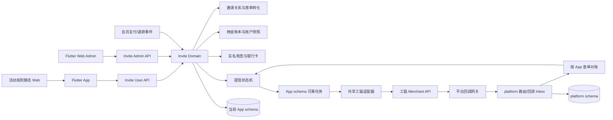
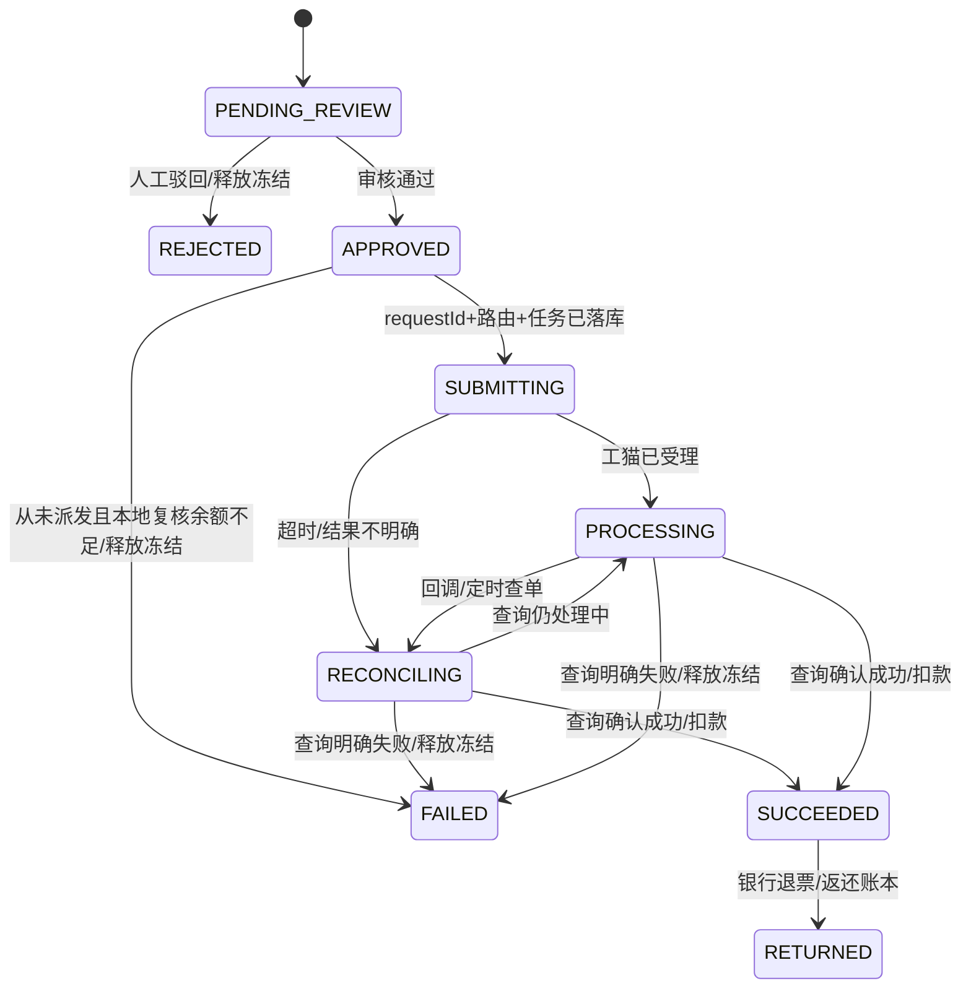
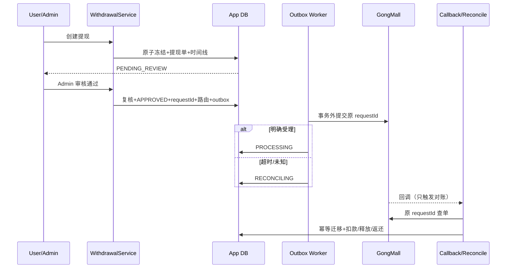
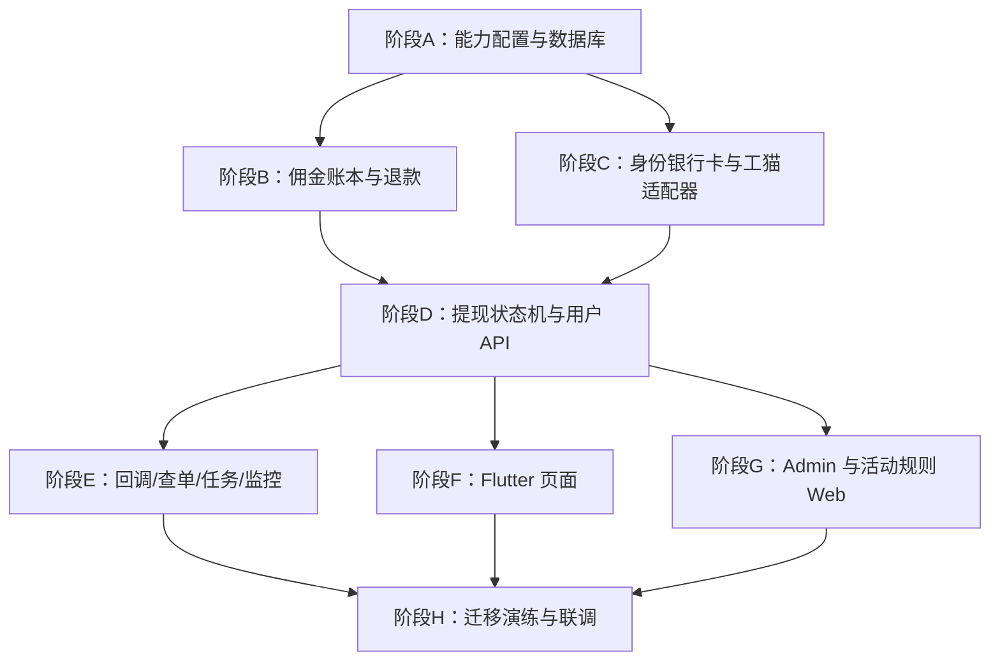

# 多 App 邀请好友与银行卡提现技术方案

> 方案版本：v1.0.0  
> 对应需求：v1.0.3  
> 日期：2026-08-26  
> 状态：`done`（用户已通过“下一步，评估工时”确认进入工时阶段）  
> 需求入口：[requirements.md](../01-需求/requirements.md)  
> 设计入口：[figma-design-plan.md](../01-需求/figma-design-plan.md)  
> 检测结论：[detection-feedback.md](../01-需求/detection-feedback.md)（PASS）

本文只设计“邀请好友 + 直接首单返佣 + 实名电签 + 银行卡提现 + 活动规则 Web + 现有 Admin 升级”。不把喵喵带货的作品、AI 视频、积分、登录、会员购买页面等其他需求带入实现；会员支付和退款仅作为携带 App 上下文的领域事件接入。

当前版本只实现银行卡，不实现支付宝、微信或银行卡短信验证码；不实现二级/团队佣金、人工打款成功/失败或活动规则 CMS；佣金结算等待 N 天按 App 动态配置。

本方案生成阶段未修改三端或数据库代码；用户随后已授权按模块实施，当前代码事实以 CHG-0068 落地说明及编码恢复点为准，不把方案目标视为已实现。

---

## 实施合同校准（CHG-0068 / 2026-08-27）

- 本节区分当前代码与完整目标：仅能力/迁移/规则权限已实现；佣金、工猫、提现及启用工具尚未实现，运行环境不得配置新模式。缺配置继续 LEGACY，异常/停用/未知模式拒绝。
- capability 响应字段为 `mode,tabs,availableActions,activityRulesUrl,allowedUrlHosts`；新模式当前只返回已实现且已授权的 INVITE_VIEW/INVITE_CONFIG_EDIT。其余动作随模块验收后开放。
- rules 响应保留原六字段，增加 `mode,version,digest,activityRulesUrl,agreementVersion,editableFields`；新模式请求只提交 `expectedVersion,minWithdrawCents,landingDownloadUrl,activityRulesUrl,agreementVersion`。固定档位字段即使值不变也拒绝。金额/版本为 JSON 安全整数，拒绝浮点、字符串和越界值，避免隐式截断。
- 保存采用当前配置行锁、expectedVersion、递增不可变快照及审计同一事务；通用配置写入口不能修改 `invite.shared_withdrawal`，专用规则接口不能改变 mode。
- 新增 `platform.invite_admin_app_permissions`：按签名 JWT 的 loginAppCode、管理员 ID/用户名、目标 App 和专用权限联合授权，无默认超级管理员或同 ID 兜底。旧 token 不含来源时可继续旧业务，但新模式需重新登录及显式授权。授权配置/管理流程待 T-B010 后续完成，不通过普通业务配置授予权限。
- URL host 来自 `app.invite.allowed-url-hosts` 及服务端 `app.web.public-base-url`，不取请求 Host；限 HTTPS/443，拒绝 userinfo/fragment。空链接可用于未启用配置，正式启用门禁必须要求有效非空链接。
- 错误码已落地：-7101 能力关闭、-7102 版本冲突（HTTP 409）、-7103 App 越权（HTTP 403）、-7104 模式不支持操作。其余错误码按后续模块实现。
- 迁移包含 12 张 App 新表、4 张 platform 新表及原提现表增量；H2 集成与 PostgreSQL 16 隔离 SQL 重放通过，不等于生产迁移或真实联调。详见 [编码恢复点](../implementation-progress.md)。

## 0. 技术结论与现状基线

### 0.1 总体结论

采用“单套代码、多 App schema 隔离、平台共享工猫连接、App 级能力开关、事件账本 + 账户快照、可靠任务派发、回调触发查单”的增量架构：

- 已有邀请路由、推广素材、邀请关系、佣金页和 Admin 邀请收益入口继续复用。
- 启用新模式的 App 使用直邀首单、10%/20%/30% 固定阶梯、BANK 提现和新状态机；未启用 App 保持旧模式。
- 工猫 `appKey/appSecret/商户私钥/工猫公钥/商户服务配置` 按环境全平台共用，不为每个 App 保存一套密钥。
- App 业务表、账户、账本、提现、配置、权限、任务和审计仍按 App Code 隔离；共享工猫不等于共享用户资金。
- 外部网络请求不占用数据库事务。审核通过后先提交本地状态和可靠任务，再异步调用工猫。
- 工猫回调只作为对账触发器；最终资金状态必须使用原 `requestId` 主动查单收敛。
- 姓名、身份证、手机号和银行卡在数据库中使用可逆加密；普通响应只返回脱敏值，Admin 明文查看走独立授权和审计链路。

### 0.2 现有实现基线与增量边界

| 工程 | 可复用基线 | 必须调整/新增 |
|------|------------|---------------|
| Flutter `/Users/soul/code/lxwx/catseller` | `/invite`、`/invite/materials`、记录、佣金、提现、提现记录路由；二维码、分享、保存图片；`webview_flutter` 等现有依赖 | 移除共享模式下原始账号提现入参；新增资格、实名会话、银行卡、试算、详情和结果轮询；活动规则改受控 Web；按新 Figma 重构页面状态 |
| Java `/Users/soul/code/lxwx/lxwx_service/lxwxservice` | `app/growth/invite` 模块、`InviteController`、`InviteService`、App schema 路由、`app_configs`、定时任务按 App 遍历、支付回调接入点 | 拆分服务职责；新增有符号账本/账户快照、退款事件、身份/银行卡、状态机、可靠任务、工猫适配器、平台回调路由、Admin 权限和审计 |
| Admin `/Users/soul/code/lxwx/lxwx_admin` | App 切换、“交易与增长 > 邀请收益管理”、`InvitePage` 三个页签、规则保存、关系查询、提现审核 | 由能力模式控制字段/操作；新增佣金明细、工猫状态、主动对账、敏感查看；启用新模式后隐藏二级代理、人工等级、手工打款终态 |
| Web `/Users/soul/code/lxwx/lxwx_admin/web` | 隐私协议目录和 `site.css` 的静态部署方式 | 新增 App 级活动规则静态页面，不增加 CMS |
| PostgreSQL/Flyway | 每 App 独立 schema、common migration、platform schema | 只追加迁移；不得修改已发布迁移；新表/字段与旧模式兼容，启用前执行余额校验和切换门禁 |

### 0.3 关键不变量

1. 同一 App 中一名受邀人只能绑定一个邀请人；不同 App 不合并关系。
2. 同一 App 中每名受邀人只允许一个“首笔成功会员订单佣金事实”。退款后也不能让后续订单再次产生首单奖励。
3. 每个业务事件最多生成一笔账本；账本不可原地改金额，只能追加冲正或返还。
4. `settledBalance` 可以为负，`frozenAmount` 不得为负，`withdrawable=max(0, settledBalance-frozenAmount)`。
5. 提现单在任一时刻只有一个合法状态；状态迁移必须带期望状态或版本号条件更新。
6. 一个 App 内同一用户、同一北京时间自然日最多存在一个成功创建的提现单。
7. 工猫提交超时是“结果未知”，不是失败；不得更换 `requestId` 重发。
8. 非当前 App 的管理员、任务或回调不得读取或改变当前 App 业务数据。

---

## 1. 系统架构设计

### 1.1 逻辑架构



### 1.2 多 App 隔离与共享边界

| 内容 | 作用域 | 实现 |
|------|--------|------|
| 工猫商户连接、密钥、BANK 渠道、服务主体 | 环境级共享 | 私密环境变量或密钥系统注入，单例 `GongmallProperties`；禁止写入 `app_configs` |
| 功能开关、结算等待天数、最低提现额、活动规则 URL、协议版本 | App 级 | 当前 App schema 的 `app_configs`，配置 key `invite.shared_withdrawal`，带业务版本 |
| 邀请、佣金、身份、银行卡、提现、任务 | App 级 | 只访问当前 `AppContext` 对应 schema；表中可保留 `app_code` 作为防御性审计字段 |
| 工猫 requestId/回调与 App 的路由 | 平台级 | `platform.gongmall_route_bindings`，先解析 App 再设置 `AppContext`，禁止逐 schema 扫描 |
| 回调原始事件与处理记录 | 平台级入口 + App 级业务事件 | 平台 Inbox 保存摘要/密文与路由结果；App schema 事件保证业务幂等 |
| Admin 权限 | 平台管理员 + App 范围 | 操作权限和可访问 App Code 同时校验；前端隐藏不能替代后端鉴权 |

首批启用不写死 `catseller`。服务端由能力配置判断 `LEGACY` 或 `DIRECT_BANK_GONGMALL`；所有代码、任务和 Admin 展示均只判断能力，不判断产品名称。

### 1.3 Java 模块建议

在现有 `app/growth/invite` 内增量演进，不另建重复业务模块：

```text
app/growth/invite/
├── controller/                    # 用户端接口
├── admin/                         # Admin Controller/DTO/权限门禁
├── application/
│   ├── InviteOverviewService
│   ├── InviteCommissionService
│   ├── InviteIdentityService
│   ├── InviteWithdrawalService
│   ├── InviteWithdrawalReconcileService
│   └── InviteAdminService
├── domain/
│   ├── relation/
│   ├── commission/
│   ├── identity/
│   └── withdrawal/
├── infra/
│   ├── persistence/
│   ├── crypto/
│   └── gongmall/
│       ├── GongmallProperties
│       ├── GongmallSigner
│       ├── GongmallRsaCodec
│       ├── GongmallHttpClient
│       └── GongmallAdapter
└── job/
    ├── InviteOutboxDispatchJob
    └── InviteReconcileJob

platform/gongmall/
├── GongmallCallbackController
├── GongmallCallbackInboxService
└── GongmallRouteBindingService
```

现有 1200 行级 `InviteService` 不继续堆叠身份、资金和外部渠道逻辑。实现时按上述应用服务拆分，但保留原 Controller 可兼容的方法入口，避免一次性重写所有旧 App 路径。

### 1.4 工猫适配层

- 请求统一使用 HTTPS、UTF-8、表单 POST。
- 员工同步/发起签署调用 `/api/merchant/employee/syncInfo`，实时提现调用 `/api/merchant/doSinglePayment`，单笔查单调用 `/api/merchant/transQuery`；最终以上线时工猫正式环境合同为准。
- 公共参数使用 `appKey/nonce/timestamp/sign`；非空参数按键排序后拼接 `appSecret`，MD5 后转大写。
- 请求有效期按工猫 5 分钟约束；服务器启用 NTP，客户端发送前检查本机时钟偏差并记录非敏感指标。
- 姓名、身份证、手机号、银行卡等工猫敏感字段使用工猫公钥 RSA-2048 加密，并设置 `Authorization: RSA2048`；响应按协议使用商户私钥解密。
- 签名、RSA、表单编码与业务 DTO 分离，提供固定官方样例的单元测试，避免字段排序和空值差异。
- 客户端只接受受控业务异常；HTTP 5xx、连接重置、超时统一映射为 `UNKNOWN`，不自动生成新业务号。
- 共享配置支持密钥版本切换：新版本用于发送，旧版本在限定窗口用于解密/验签；日志只记录版本号和摘要。

官方依据：[接口规范](https://opendoc.gongmall.com/merchant/overview/jie-kou-gui-fan.html)、[敏感信息加密](https://opendoc.gongmall.com/merchant/overview/interface-encryption.html)、[员工同步与发起签署](https://opendoc.gongmall.com/merchant/dian-qian-he-tong/yuan-gong-tong-bu-merchant.html)、[实时提现](https://opendoc.gongmall.com/merchant/shi-shi-ti-xian/ti-xian-merchant.html)、[单笔提现结果查询](https://opendoc.gongmall.com/merchant/shi-shi-ti-xian/cha-xun-ti-xian-jie-guo-merchant.html)、[结果回调](https://opendoc.gongmall.com/merchant/shi-shi-ti-xian/ti-xian-jie-guo-hui-diao-merchant.html)、[退票通知](https://opendoc.gongmall.com/merchant/shi-shi-ti-xian/ti-xian-refund-merchant.html)。

---

## 2. 数据库设计

### 2.1 迁移策略

- 所有数据库变更使用新的 Flyway 迁移，禁止编辑 `V1.1__common_schema.sql` 等已发布文件。
- 当前 common 与 Catseller migration 最高已出现 `V4.4`；实现时先重新确认仓库最新版本，当前建议 common 使用 `V4.5__invite_direct_bank_withdrawal.sql`。
- platform schema 当前建议追加 `V4.1__gongmall_callback_routing.sql`；实现时同样以当时未占用的下一版本为准。
- DDL 只新增表、索引、字段和约束；旧字段暂不删除。非启用 App 保持原查询和写入路径。
- 新模式切换采用 `precheck -> dry-run -> balance checksum -> freeze legacy writes -> enable capability`，禁止启动时自动迁移资金。

### 2.2 App schema 概念表

#### `invite_accounts`

| 字段 | 类型/约束 | 说明 |
|------|-----------|------|
| `id` | BIGSERIAL PK | 主键 |
| `app_code` | VARCHAR(32) NOT NULL | 防御性归属，必须等于当前上下文 |
| `user_id` | BIGINT NOT NULL UNIQUE | 用户账户 |
| `settled_balance_cents` | BIGINT NOT NULL | 已结算净余额，可为负 |
| `frozen_cents` | BIGINT NOT NULL CHECK >= 0 | 提现冻结金额 |
| `ledger_sequence` | BIGINT NOT NULL | 最近应用账本序号 |
| `version` | BIGINT NOT NULL | 乐观锁 |
| `created_at/updated_at` | TIMESTAMP | 审计时间 |

`withdrawableCents=max(0, settled_balance_cents-frozen_cents)` 仅在服务端计算。前端不得自行用累计收益减提现记录推导余额。

#### `invite_config_versions`

当前有效配置继续写入 `app_configs(invite.shared_withdrawal)`；每次 Admin 保存时，同一事务追加 `invite_config_versions(version,config_json,digest,operator_id,operator_app_code,trace_id,effective_at,created_at)`。版本在当前 App 内单调递增且唯一，账本、quote 和提现单保存命中的版本号，保证 `app_configs` 被覆盖后仍可复原当时规则。配置快照不得包含工猫密钥或数据加密密钥。

#### `invite_member_conversions`

| 字段 | 约束/说明 |
|------|-----------|
| `invitee_user_id` | 同一 App 唯一，锁定“每名受邀人仅一次首单资格” |
| `inviter_user_id` | 邀请人 |
| `membership_order_no` | 唯一首单号 |
| `payment_event_id/refund_event_id` | 支付、退款幂等键 |
| `paid_amount_cents` | 实际支付金额快照 |
| `effective_invitee_count/rate_basis_points` | 购买时人数与比例快照，1000/2000/3000 |
| `reward_cents` | 向下/四舍五入规则由产品税务确认后固定；数据库保存最终分值 |
| `state` | `PAID/REFUNDED`；乱序退款可先记录事实再等待支付闭环 |
| `reward_ledger_id/reversal_ledger_id` | 正向与冲正账本 |

该表是首单资格和事件乱序的事实表。退款后保留记录，后续会员订单不能重新获奖。

#### `invite_wallet_ledgers`

旧 `invite_earning_ledgers` 保留给 legacy 模式只读追溯；新模式新建统一钱包账本，避免复用旧表的正数金额、直接/间接类型和既有唯一约束造成资金语义混乱。字段包括：

- `business_mode`：`LEGACY` / `DIRECT_BANK_GONGMALL`。
- `ledger_no`、`sequence_no`：账户内有序唯一号。
- `event_type`：`OPENING_BALANCE`、`DIRECT_REWARD`、`REFUND_REVERSAL`、`WITHDRAWAL_DEBIT`、`WITHDRAWAL_RETURN`、`MANUAL_CORRECTION`；其中 `MANUAL_CORRECTION` 仅受控运维使用，当前 Admin 不开放。
- `signed_amount_cents`：有符号金额；新模式不依赖旧正数 `amount` 语义。
- `business_event_id`：全局/渠道事件幂等键。
- `membership_order_no`、`withdrawal_no`、`original_ledger_id`。
- `rate_basis_points`、`effective_invitee_count`、`config_version`。
- `balance_after_cents`、`created_at`。

唯一约束建议：`(business_mode, business_event_id, event_type)`、`ledger_no`、账户内 `sequence_no`。退款冲正必须关联正向账本；退票返还必须关联提现扣款账本。

#### 身份与银行卡

`invite_identity_profiles`：

- `user_id` 唯一、实名状态、工猫员工/合同标识、合同状态、协议版本与同意时间。
- `name_cipher/id_no_cipher/mobile_cipher`、对应 mask、HMAC blind index、密钥版本。
- `identity_locked_at`：认证后用户不可自行改实名主体。
- 工猫流程状态按 `0 未同步/1 待签署/2 合同生成中/3 已完成` 保存原值并映射本地枚举。依据当前需求状态 2 或 3 可通过提现资格门禁，但“正式环境状态 2 是否允许提现”是上线前接口合同确认项；若正式合同不允许，则只放行 3，不由客户端决定。

`invite_identity_sessions`：

- `session_no`、`user_id`、用途（首次认证/新增卡）、状态、工猫流程标识、平台回调 state、H5 URL 摘要、过期时间、确认时间。
- 回调 state 使用 128 位以上随机值，只保存哈希或受保护值，不把 App Code 当安全凭证。

`invite_bank_accounts`：

- `bank_account_no_cipher`、`card_mask`、`card_hmac`、`bank_code/name`、工猫校验标识、状态、默认卡标记、密钥版本。
- 账户只允许属于同一 `identity_profile_id`；删除采用停用，不物理删除被提现引用的银行卡。
- 唯一约束 `(user_id, card_hmac, status-active)`，避免同卡重复绑定。

#### 提现与试算

`invite_withdrawal_quotes`：保存 `quote_no`、用户、银行卡、申请金额、税费/服务费/预计到账、工猫试算摘要、协议/配置版本、过期时间和使用时间。前端只提交 `quoteToken`，不能修改服务端试算结果。

`invite_withdrawals` 增量/重建字段：

- `withdrawal_no`、`user_id`、`bank_account_id`、`business_date`（Asia/Shanghai）。
- `amount_cents`、`tax_cents`、`service_fee_cents`、`net_amount_cents`、`quote_id`。
- `status`、`version`、`request_id`、工猫流水号、渠道状态/安全失败码。
- 审核人/时间/原因，提交/查单/成功/失败/退票时间。
- `frozen_released`、`debit_ledger_id`、`return_ledger_id`，防止重复释放或返还。
- 唯一约束 `withdrawal_no`、非空 `request_id`；唯一约束 `(user_id,business_date)` 实现当前 App 每日一次，切换模式也不能绕过。

`invite_withdrawal_events`：提现状态迁移的 append-only 时间线，保存 from/to、触发源、事件键、操作者和脱敏摘要，不保存敏感明文。

#### 可靠任务与业务事件

`invite_outbox_tasks`：`task_no/type/aggregate_no/payload_json/status/next_run_at/attempts/lease_until/last_error_code`。payload 只保存 ID 和非敏感参数，敏感数据在发送时按 ID 解密。

`invite_provider_events`：App 内保存工猫事件幂等键、来源、requestId、摘要、处理结果。重复回调、查单和退票统一进入相同状态迁移服务。

`invite_admin_operation_logs`：记录配置、审核、驳回、对账、明文查看成功/失败/锁定，包含 App Code、管理员、记录 ID、原因、IP/UA 摘要和结果；不得保存密码或敏感值。

### 2.3 platform schema 表

`platform.gongmall_route_bindings`：

- `route_type`（`CONTRACT_STATE/WITHDRAWAL_REQUEST/REFUND`）、`external_key`、`app_code`、`business_no`、状态、创建/过期时间。
- `(route_type,external_key)` 唯一。员工在多个 App 可能对应同一自然人，因此合同回调优先使用每次会话的随机 state 或合同流程标识，不以身份证/员工 ID 单独路由。

`platform.gongmall_callback_inbox`：

- 保存 `event_key`、类型、requestId/route key、收到时间、路由 App、校验结果、处理状态、次数、报文摘要和可选加密原文。
- 原文如确需留存必须使用平台事件密钥加密并设置短保留期；默认只留字段白名单和 SHA-256 摘要。
- 未找到路由进入隔离队列并告警，不允许扫描所有 App schema 猜归属。

### 2.4 资金账本规则

| 事件 | 账本 | 账户变化 | 冻结变化 |
|------|------|----------|----------|
| 首单支付成功 | `DIRECT_REWARD +R` | `settled += R` | 0 |
| 会员退款 | `REFUND_REVERSAL -R` | `settled -= R`，可为负 | 0 |
| 提现申请创建 | 无账本 | 0 | `frozen += W` |
| 审核驳回/提交前明确失败 | 无账本 | 0 | `frozen -= W` |
| 银行成功 | `WITHDRAWAL_DEBIT -W` | `settled -= W` | `frozen -= W` |
| 成功后退票 | `WITHDRAWAL_RETURN +W` | `settled += W` | 0 |

示例：余额 100 元已提现成功后，会员退款冲正 30 元，账户变为 -30 元；不追回已到账资金，后续奖励先抵扣至非负。若退款发生在冻结后、工猫提交前，审核/派发前复核不足则驳回并释放；若已经银行处理中且最终成功，扣款后允许形成负余额。

### 2.5 并发和事务边界

- 支付/退款：在本地业务事务内锁定或条件更新 `invite_member_conversions` 和账户，写事实、账本、账户快照一次完成。
- 提现创建：校验 quote、身份、银行卡和当日限制后，对账户执行带 `version` 且 `settled-frozen>=amount` 的条件冻结；同事务插入提现、时间线。唯一约束兜底重复提交。
- 审核通过：复核账户、签约、银行卡、BANK 能力；条件迁移 `PENDING_REVIEW -> APPROVED`，生成并持久化唯一 `requestId`、平台路由和 outbox。提交后由 Worker 单独复核并占位为 `SUBMITTING`；事务内不调用工猫。
- 当前 `platform` 与 App schema 位于同一 PostgreSQL 实例时，路由表可作为同一事务的限定 schema 写入；若部署拓扑改为跨库，则改用 `ROUTE_PENDING` 两阶段可靠任务，只有平台路由确认后才允许派发工猫，不能用分布式事务假设强行提交。
- 外部提交：worker 先领取任务，事务外调用工猫，再开启短事务更新状态；超时进入 `RECONCILING` 并使用原 ID 查单。
- 回调/查单/退票：均调用同一个 `applyProviderResult(expectedVersion,eventKey)`，重复事件返回幂等成功。
- MyBatis Plus 普通 CRUD 继续复用；账户原子冻结、序号分配和条件状态迁移允许使用少量明确 Mapper SQL，不在 Service 拼接 SQL。

---

## 3. 接口设计

所有用户和 Admin 接口继续通过现有认证体系取得用户/管理员身份与 App 上下文。业务端不得相信客户端上传的 `appCode`、收款人姓名、完整银行卡或返佣比例。

### 3.1 用户端接口

| 方法与路径 | 用途 | 关键入参 | 关键出参/约束 |
|------------|------|----------|---------------|
| `GET /api/invite/overview` | 邀请首页 | 无 | 收益、有效人数、当前比例、两段进度、能力和入口 URL；升级现有响应 |
| `GET /api/invite/materials` | 邀请链接/海报 | 无 | 专属链接、二维码/海报资源；复用现有能力 |
| `GET /api/invite/records` | 邀请记录 | `memberStatus,page,pageSize` | 脱敏用户、绑定时间、会员状态 |
| `GET /api/invite/earnings/summary` | 佣金汇总 | 无 | 累计、待结算、已入账、可提现、冻结、负余额提示 |
| `GET /api/invite/earnings/ledgers` | 佣金明细 | `status,page,pageSize` | 只展示直接奖励和退款冲正；提现扣款/返还由提现记录与详情展示 |
| `GET /api/invite/withdrawal-eligibility` | 提现资格 | 无 | 余额、最低额、今日次数、实名/合同/银行卡状态、阻断原因 |
| `POST /api/invite/identity-sessions` | 创建认证会话 | 姓名、身份证、手机号、银行卡、协议版本/同意 | 校验后同步员工，返回 `sessionId/h5Url/expiresAt`；敏感字段只在该接口出现 |
| `POST /api/invite/identity-sessions/{sessionId}/confirm` | H5 回跳确认 | 无 | 主动查询合同状态，返回未完成/生成中/完成及银行卡结果 |
| `GET /api/invite/bank-accounts` | 银行卡列表 | 无 | ID、银行、脱敏卡号、默认卡；不返回完整卡号 |
| `PUT /api/invite/bank-accounts/{id}/default` | 设置默认卡 | 无 | 幂等设置 |
| `DELETE /api/invite/bank-accounts/{id}` | 删除银行卡 | 无 | 软停用；被非终态提现引用时拒绝 |
| `POST /api/invite/withdrawal-quotes` | 税费试算 | `bankAccountId,amountCents` | 税费、服务费、预计到账、`quoteToken/expiresAt`；服务端/工猫真值 |
| `POST /api/invite/withdrawals` | 创建提现 | `bankAccountId,amountCents,quoteToken,agreementConfirmed` | 请求头 `Idempotency-Key`；返回提现 ID/状态；不上传姓名和完整卡号 |
| `GET /api/invite/withdrawals` | 提现记录 | `status,page,pageSize` | 用户状态分组和脱敏银行卡 |
| `GET /api/invite/withdrawals/{id}` | 提现详情 | ID | 时间线、金额、费用、安全失败原因、返还结果 |

金额字段统一使用分的整数，响应可额外提供格式化字符串但不能用浮点数参与计算。创建接口的 `Idempotency-Key` 与用户/App/业务日期绑定；相同 key 相同参数返回原结果，相同 key 不同参数返回冲突。

费用试算通过 `WithdrawalQuoteProvider` 抽象接入工猫正式商户可用的试算能力，税费和舍入不在 Flutter 或 Java 常量中自行推导。若正式商户合同没有可用试算接口或明确计算规则，则生产能力保持关闭，待工猫/财务确认后再启用，不能用展示占位金额提交真实提现。

### 3.2 Admin 接口

| 方法与路径 | 权限 | 说明 |
|------------|------|------|
| `GET /api/admin/invite/capabilities` | 邀请查看 | 返回当前 App 模式、可见页签和允许操作，Admin 不按 App 名称判断 |
| `GET/PUT /api/admin/invite/rules` | 配置查看/编辑 | 复用现有接口；新模式固定比例/门槛只读，只可改结算等待天数、最低额、落地页、活动规则 URL 等允许项并生成版本 |
| `GET /api/admin/invite/users` | 邀请查看 | 复用关系查询语义，返回首单转化、等级和脱敏信息 |
| `GET /api/admin/invite/commissions` | 佣金查看 | 新增订单、比例快照、直接奖励与退款冲正只读流水；提现资金事件在提现详情展示 |
| `GET /api/admin/invite/withdrawals` | 提现查看 | 升级现有列表，支持新状态筛选 |
| `GET /api/admin/invite/withdrawals/{id}` | 提现查看 | 余额、冻结、认证、脱敏银行卡、工猫/查单时间线 |
| `POST /api/admin/invite/withdrawals/{id}/approve` | 当前 App 提现审核 | 二次确认；只允许 `PENDING_REVIEW`，复核后异步提交 |
| `POST /api/admin/invite/withdrawals/{id}/reject` | 当前 App 提现审核 | 必填安全原因；原子释放冻结 |
| `POST /api/admin/invite/withdrawals/{id}/reconcile` | 当前 App 提现对账 | 非终态异常单；只使用原 requestId，操作审计 |
| `POST /api/admin/invite/withdrawals/{id}/sensitive-view-grants` | 敏感查看 | `password,reason,fields`；验证独立权限/App 范围，返回当前记录短期 grant 和所选明文 |
| `GET /api/admin/invite/audit-events` | 审计查看 | 查询当前 App 的审核、对账、配置、敏感查看事件，不含明文 |

旧 `mark-paid/mark-failed` 和人工代理等级更新接口保留给 `LEGACY` App。当前 App 为 `DIRECT_BANK_GONGMALL` 时，后端即使收到直接请求也必须拒绝，不能只依靠前端隐藏按钮。

建议注册稳定权限码：`INVITE_VIEW`、`INVITE_CONFIG_EDIT`、`INVITE_WITHDRAW_REVIEW`、`INVITE_WITHDRAW_RECONCILE`、`INVITE_SENSITIVE_VIEW`、`INVITE_AUDIT_VIEW`；每个权限再与管理员可访问 App Code 集合求交。现有角色服务若不能表达 App 范围，需要在 T-B010 中补充管理员与 App 的授权映射，不能把 `CurrentAdmin` 只有账号身份当作已完成资金权限控制。

### 3.3 工猫回调入口

| 路径 | 行为 |
|------|------|
| `POST /api/callbacks/gongmall/contracts` | 通过 state/合同流程映射定位 App，写 Inbox 并触发合同主动查询 |
| `POST /api/callbacks/gongmall/withdrawals` | 通过 requestId 定位 App，写 Inbox 并触发原 ID 查单 |
| `POST /api/callbacks/gongmall/refunds` | 通过 requestId/工猫流水定位 App，写 Inbox 并触发退票确认 |

回调入口不依赖登录、不接受客户端 `X-App-Code`。必须限制内容类型、body 大小、来源速率，解析成功后快速 ACK。若工猫当前回调协议无法可靠验签，回调内容不能直接把提现置为成功、失败或退票。

### 3.4 提现状态机



`APPROVED` 是必须审计的可短暂停留状态。用户端统一映射：`PENDING_REVIEW/APPROVED/SUBMITTING/PROCESSING/RECONCILING -> 处理中`，`SUCCEEDED -> 已到账`，`REJECTED/FAILED/RETURNED -> 失败或已退回`，详情中展示更准确的安全文案。

Worker 的最后一次余额/冻结复核与 `APPROVED -> SUBMITTING` 在同一本地事务内完成，再于事务外发起工猫请求。只有仍处于 `APPROVED` 且能证明从未派发的单据可因复核不足直接 `FAILED`；一旦进入 `SUBMITTING`（含 Worker 崩溃后是否发出不明），退款或超时都不能直接解冻，必须保留原 requestId 查单至明确结果。

工猫查询状态映射：查询 `10 -> PROCESSING`、`20 -> SUCCEEDED`、`30 -> FAILED`；未知值保持 `RECONCILING` 并告警，禁止默认成功。

### 3.5 主要业务错误码

| 错误码 | 场景 |
|--------|------|
| `INVITE_CAPABILITY_DISABLED` | 当前 App 未启用新能力 |
| `INVITE_RELATION_CONFLICT` | 已绑定、自邀或循环邀请 |
| `INVITE_IDENTITY_REQUIRED` | 实名/合同未完成 |
| `INVITE_BANK_INVALID` | 银行卡不可用于当前实名主体 |
| `INVITE_NEGATIVE_BALANCE` | 净余额为负，禁止提现 |
| `INVITE_MIN_AMOUNT_NOT_MET` | 低于当前 App 最低金额 |
| `INVITE_DAILY_LIMIT_REACHED` | 当日已成功创建一笔 |
| `INVITE_QUOTE_EXPIRED` | 试算过期或参数不一致 |
| `INVITE_BALANCE_CHANGED` | 提交时余额/冻结发生变化 |
| `INVITE_WITHDRAWAL_STATE_CONFLICT` | 重复审核、终态对账等非法迁移 |
| `WITHDRAWAL_IDEMPOTENCY_CONFLICT` | 同一创建幂等键携带不同业务参数 |
| `GONGMALL_RESULT_UNKNOWN` | 外部超时，已进入查单而非失败 |
| `ADMIN_APP_FORBIDDEN` | 管理员不具备当前 App 范围 |
| `SENSITIVE_VIEW_PASSWORD_INVALID` | 查看密码错误，不泄露剩余细节 |
| `SENSITIVE_VIEW_LOCKED` | 连续 5 次失败，锁定 30 分钟 |

---

## 4. Flutter 端技术设计

### 4.1 页面与目录

| 页面 | 实现策略 |
|------|----------|
| P01 `/invite` | 复用路由，重构首页数据模型和真实进度组件；六类入口固定跳转 |
| P02 `/invite/materials` | 复用推广素材能力，页面名称统一“邀请好友” |
| P03 `/invite/records` | 复用列表，替换会员状态筛选和脱敏模型 |
| P04 `/invite/ledgers` | 支持直接奖励、退款冲正、待结算、负余额与空状态；不混入提现记录 |
| P05 `/invite/withdrawal` | 只提交 bankAccountId/金额/quoteToken；增加资格、试算、全部提现和选卡 |
| P06 `/invite/withdrawal-auth` | 新增认证表单、D01/D02、工猫 H5、回跳确认、成功失败状态 |
| P07 `/invite/withdrawals` | 复用并升级状态筛选、分页和刷新 |
| P08 `/invite/withdrawals/:id` | 新增结果详情和时间线，处理中轮询 |
| P09 `/invite/rules` | 保留路由兼容但改为受控 Web 容器，URL 取服务端配置 |

建议按现有工程结构在 `lib/pages/invite/` 下拆分 `withdrawal_auth`、`withdrawal_result` 子目录；通用银行卡卡片、金额输入和时间线放邀请模块组件目录，不上升为无关全局组件。

### 4.2 状态和数据流

- API/data 层新增明确 DTO，不继续复用含二级佣金、积分奖励和手工打款状态的旧共享模型。
- Controller 首次加载资格；选择卡或修改金额后使用 300～500ms debounce 请求服务端试算，提交前再次校验 quote。
- 提交按钮使用本地互斥和服务端 `Idempotency-Key` 双重防重。key 在当前提交生命周期内稳定，失败重试复用；用户修改金额/银行卡后生成新 key。
- P06 的姓名、身份证、手机号和完整卡号只保存在页面内存；进入 H5 前后不写 SharedPreferences、日志、埋点或图片缓存。
- H5 容器只允许工猫域名和配置的回跳地址；摄像头权限按需申请。导航到未知域名时阻止并提示，合法外链由系统浏览器处理。
- 回跳参数只识别 `sessionId/state`，然后调用 confirm；不相信 `success=true`。
- P07/P08 在页面可见时按服务端建议间隔轮询；App 退后台停止，恢复前台立即刷新；终态停止。支持下拉刷新和手动重试。
- 银行卡、身份证和手机号均只渲染服务端脱敏值。错误上报必须经过字段过滤。

### 4.3 设计对稿重点

- P01 两段进度使用人数比例逐像素填充，重点测试 0/1/9/10/11/19/20 人。
- “立即邀请 赚钱佣金”进入 P02；邀请记录、佣金明细、提现记录各进独立页。
- P02 AppBar 和语义统一“邀请好友”；现有分享海报能力可复用。
- P05 金额超限、低于最低额、负余额、今日已提现和未认证分别显示服务端原因。
- P08 顶部不能用示例“提现成功”覆盖真实状态；处理中显示“申请已提交”。
- P09 使用 Web 页面，不把 Figma 规则文本硬编码进 Flutter。

### 4.4 Flutter 测试

- API contract：新状态、金额分值、缺省/未知状态容错、敏感字段不出现在模型打印中。
- Controller：资格、quote 过期、重复提交、H5 中断/恢复、轮询生命周期、App resume。
- Widget：P01 边界进度、六入口、P04 空/冲正/负余额、P05 未绑/超限/每日限制、P08 各终态。
- WebView：白名单、非法跳转、回跳只查询、不直接成功。
- 保留推广素材复制、二维码、分享和保存图片既有回归。

---

## 5. Java、Admin 与 Web 实现设计

### 5.1 Java 领域流程

#### 首单返佣

1. 会员支付模块在确认支付业务落库时调用/发布 `MembershipPaymentSettledEvent(appCode,eventId,orderNo,userId,paidAmount,paidAt)`。
2. Invite 模块校验新模式、邀请关系和受邀人唯一转换事实。
3. 读取并锁定邀请人的有效会员人数，先按“购买前已生效等级”计算比例，再把当前受邀人计入后续等级；同一订单不会因达到门槛使用升级后比例。
4. 插入 conversion 与预计结算时间；到期前不更新现金账户，到期按净额入账；重复 event/order/invitee 返回原结果。
5. 付款时保存 settlementDelayDays（默认 0）、paidAt 和 expectedSettleAt；等待期及处理重试均为待结算，到期任务复核后一次入账，配置变更不追溯旧订单。

#### 退款冲正

仅已验证的会员资金退款终态进入佣金退款入口；订阅到期、共享权限 REVOKE 或无金额依据的人工无效标记不能冒充退款。以精确支付交易号/订单匹配 conversion，不用原始订阅链推断被退首单：

- 累计目标为 `floor(原奖励分 × 累计退款分 / 原实付分)`，本次只补记与已冲正分的差额，全额退款补齐原奖励剩余部分；旧累计快照不回退。
- 未结算只调整待结算净额，全额则取消；已结算追加负向流水，可形成负余额。退款先到保存 Inbox，后到的精确支付事实重放处理。
- 重复退款按来源+退款事件键幂等；参数不一致拒绝。未知/超额退款保留待核对事实，待结算订单暂停自动发放，不猜测全额。
- 当前实现接入 Apple 已验证 REFUND 的精确交易及退款比例，其他真实支付渠道终态、异常金额受控核对流程仍是启用门禁，详见编码恢复点。

#### 提现



### 5.2 requestId 与路由

- `withdrawalNo` 在创建提现时生成；`requestId` 在审核通过事务中首次生成并永久保存。
- 推荐格式：`W + 4位受控App别名 + 26位Crockford ULID`，总长 31，满足不超过 32。App 别名来自注册表并有唯一约束，不直接截断用户输入。
- `requestId` 同时写入 App 提现单、platform 路由表和 outbox。任何重试、查单、回调对账都使用原值。
- 若路由表无法持久化，审核通过事务失败，不允许先调用工猫再补映射。

### 5.3 任务和重试

- 调度器复用现有按 `SchemaRoutingProperties.appCodes()` 遍历并设置 `AppContext` 的方式，只处理显式启用 App。
- 任务领取使用租约/条件更新，支持多实例；单 App 单批限额，避免一个 App 堵塞其他 App。
- 提交任务：仅 `SUBMITTING`；明确业务失败可以迁移 FAILED 并释放，网络未知转 RECONCILING。
- 查单任务：指数退避 + 抖动，处理中按较长间隔；超过阈值不自动失败，保持 RECONCILING 并告警人工。
- 退票事件：只有 `SUCCEEDED` 可转 `RETURNED`；重复退票不重复返还。
- 死信任务必须有 Admin 主动对账入口，禁止后台直接改资金终态。

### 5.4 Admin 升级

继续维护现有 `InvitePage` 入口和三页签框架：

- 页面加载先请求 capability；`LEGACY` 保留现有布局和操作，`DIRECT_BANK_GONGMALL` 切换到固定直邀规则、新列表字段和状态机。
- 规则配置：比例和门槛只读；结算等待天数、最低金额、落地页、活动规则 URL、协议显示信息可编辑并显示版本。
- 用户/佣金：复用现有用户关系查询，隐藏二级代理/人工等级；新增只读订单、比例快照、奖励/冲正明细。
- 提现：保留审核通过/驳回；移除新模式的手工打款成功/失败，新增 requestId、工猫流水、查单次数、最后错误、退票、账户与冻结。
- 主动对账按钮只在 `SUBMITTING/PROCESSING/RECONCILING` 等允许状态显示；后端再次校验。
- 切换 App 时取消旧请求、清空筛选/选中详情/敏感 grant，再加载新 App。

### 5.5 Admin 敏感查看

1. 默认详情只返回姓名/证件/手机号/银行卡 mask。
2. 管理员点击“查看完整信息”，弹窗要求平台查看密码、查看原因和字段选择。
3. 后端先校验登录、专用权限和 App 范围，再通过独立强哈希验证查看密码；Redis 记录管理员失败次数。
4. 连续 5 次错误锁定 30 分钟；成功清零当前失败计数。成功、失败、锁定均先写审计。
5. 验证成功后签发绑定 `adminId/appCode/recordId/fields` 的随机 grant，服务端 Redis TTL 最多 5 分钟；只返回本次详情选中字段。
6. Admin 仅在内存显示，添加 `Cache-Control: no-store`，关闭详情、切换 App、登出、页面隐藏或超时立即清除；UI 不提供复制、列表明文、批量查看或导出。
7. 后端每次使用 grant 都复核范围；审计落库失败时拒绝解密。浏览器开发者工具无法被绝对禁止，因此安全承诺是“产品不提供复制/导出、响应不缓存、访问受权限和审计控制”，不能宣称客户端具备不可绕过的防截屏能力。

### 5.6 活动规则 Web

- 在 `lxwx_admin/web/legal/{appCode}/invite-rules/index.html`（最终发布路径由现有静态部署约定确认）新增独立页面，参考 privacy policy 的目录、响应式 meta 和 `site.css`。
- 每个 App 使用独立公开 URL，由 `invite.shared_withdrawal.activityRulesUrl` 配置；页面不能读取后台登录态或业务数据库。
- 文案发布走代码评审/法务确认；当前版本不建设 CMS。
- 设置严格 CSP，不加载不必要第三方脚本；资源使用 HTTPS 和固定域名。
- Flutter 受控 Web 容器只打开后端返回的白名单 URL。

### 5.7 配置设计

App 业务配置示例（存当前 App schema `app_configs`，不含秘密）：

```json
{
  "mode": "DIRECT_BANK_GONGMALL",
  "enabled": true,
  "configVersion": 3,
  "minimumWithdrawalCents": 100,
  "activityRulesUrl": "https://example.com/legal/app/invite-rules/",
  "inviteLandingUrl": "https://example.com/invite",
  "agreementVersions": {
    "flexibleEmployment": "2026-08",
    "realNameService": "2026-08"
  }
}
```

平台私密配置示例键名（只列名称，不写值）：

```text
GONGMALL_APP_KEY
GONGMALL_APP_SECRET
GONGMALL_MERCHANT_PRIVATE_KEY
GONGMALL_PUBLIC_KEY
GONGMALL_SERVICE_ID
GONGMALL_CONTRACT_TEMPLATE_ID
GONGMALL_BANK_CHANNEL
GONGMALL_CALLBACK_BASE_URL
INVITE_DATA_ACTIVE_KEY_VERSION
INVITE_DATA_ENCRYPTION_KEY_V1
INVITE_DATA_INDEX_KEY
INVITE_SENSITIVE_VIEW_PASSWORD_HASH
```

---

## 6. 开发任务拆解

任务 ID 是后续工时评估、开发计划和提交追踪的稳定标识，不在后续文档随意改号。本节不提前填写小时数。

### 6.1 Flutter 任务

| ID | 任务 | 依赖 | 主要产物 | 工作量 |
|----|------|------|----------|--------|
| T-F001 | 新用户接口、DTO、错误码和状态映射 | T-B007 | Invite API/data/controller 契约 | 待阶段 06 评估 |
| T-F002 | P01 邀请首页与真实人数进度 | T-F001 | 首页、六入口、边界进度测试 | 待评估 |
| T-F003 | P02 邀请好友页面复用升级 | T-F001 | 链接、二维码、分享、保存 | 待评估 |
| T-F004 | P03/P04 邀请与佣金明细 | T-F001 | 筛选、冲正、负余额、空态 | 待评估 |
| T-F005 | P05 提现、D03 选卡与试算 | T-F001 | 资格、金额、quote、防重提交 | 待评估 |
| T-F006 | P06/D01/D02 实名电签与受控 H5 | T-B005、T-B006、T-B007 | 认证、权限、回跳确认、结果状态 | 待评估 |
| T-F007 | P07/P08 提现记录、详情与轮询 | T-B007、T-B008 | 列表、时间线、生命周期轮询 | 待评估 |
| T-F008 | P09 活动规则受控 Web | T-A006、T-B001 | 白名单 Web 容器与路由兼容 | 待评估 |
| T-F009 | Flutter 综合自动化与对稿回归 | T-F002～T-F008 | 单测、Widget、WebView、回归清单 | 待评估 |

### 6.2 Admin/Web 任务

| ID | 任务 | 依赖 | 主要产物 | 工作量 |
|----|------|------|----------|--------|
| T-A001 | capability 与 App 切换状态重构 | T-B001、T-B010 | 新旧模式按能力显示 | 待阶段 06 评估 |
| T-A002 | 规则配置页升级 | T-A001 | 固定比例/门槛、App 配置版本 | 待评估 |
| T-A003 | 邀请与佣金查询升级 | T-A001、T-B010 | 转化与账本只读明细 | 待评估 |
| T-A004 | 提现审核、详情、时间线与主动对账 | T-A001、T-B010 | 新状态机 UI，隐藏手工终态 | 待评估 |
| T-A005 | 敏感查看与审计 UI | T-B010 | 密码/原因、5 分钟内存展示、清理 | 待评估 |
| T-A006 | App 级活动规则静态 Web | 法务文案 | 独立 URL、响应式/CSP | 待评估 |
| T-A007 | Admin/Web 自动化与模式回归 | T-A002～T-A006 | Widget/API contract/Web 检查 | 待评估 |

### 6.3 Java/数据库任务

| ID | 任务 | 依赖 | 主要产物 | 工作量 |
|----|------|------|----------|--------|
| T-B001 | App 能力配置、版本与非启用兼容 | 无 | `LEGACY/DIRECT_BANK_GONGMALL` 门禁 | 待阶段 06 评估 |
| T-B002 | common/platform Flyway 增量迁移 | T-B001 | 账户、账本、身份、银行卡、提现、任务、路由表 | 待评估 |
| T-B003 | 首单转化、阶梯比例与正向账本 | T-B002 | conversion、账户快照、支付幂等 | 待评估 |
| T-B004 | 退款冲正、乱序事件与余额并发 | T-B003 | 负向账本、退款接入、冻结一致性 | 待评估 |
| T-B005 | 可逆数据加密、身份、合同和银行卡 | T-B002 | AES-GCM/HMAC、会话、档案、脱敏 | 待评估 |
| T-B006 | 共享工猫适配器与协议安全 | T-B005 | 表单/MD5/RSA、员工同步、提现/查单客户端 | 待评估 |
| T-B007 | 用户端资格、认证、银行卡、试算、提现 API | T-B003～T-B006 | OpenAPI/DTO/业务错误 | 待评估 |
| T-B008 | 提现状态机、冻结、requestId、outbox 派发 | T-B002、T-B006、T-B007 | 审核后异步提交和统一迁移 | 待评估 |
| T-B009 | platform 回调路由、Inbox、查单与退票 | T-B006、T-B008 | 不扫 schema 的回调收敛 | 待评估 |
| T-B010 | Admin 权限/API/敏感查看/审计 | T-B001～T-B009 | App 范围、5 分钟 grant、失败锁定 | 待评估 |
| T-B011 | 定时任务、指标、告警和死信处置 | T-B008、T-B009 | 多 App 公平调度、可观测性 | 待评估 |
| T-B012 | 旧模式兼容、数据预检和启用迁移工具 | T-B001～T-B011 | dry-run、余额 checksum、切换/回退门禁 | 待评估 |
| T-B013 | Java 全量测试、OpenAPI 和运维说明 | T-B001～T-B012 | 单元/集成/并发/回调/安全测试 | 待评估 |

---

## 7. 实施阶段与依赖关系



1. 阶段 A：先完成能力模式和只追加 DDL，确保旧 App 无行为变化。
2. 阶段 B：接入支付/退款事件并用并发测试证明账本净额一致；未通过前不开放提现。
3. 阶段 C：完成加密、工猫测试环境、员工同步和 H5 合同状态查询。
4. 阶段 D：完成 quote、原子冻结、人工审核、requestId 和状态机。
5. 阶段 E：完成 outbox、平台回调路由、原 ID 查单、退票及告警。
6. 阶段 F/G：Flutter 与 Admin 可以在稳定 OpenAPI 后并行开发；活动规则 Web 可提前准备但需法务文案确认。
7. 阶段 H：先测试 App schema，后首批 App 灰度；通过账本 checksum、工猫联调和回滚演练后再启用生产能力开关。

禁止通过启用开关来掩盖未完成的数据迁移或权限校验。开关开启前必须确认旧非终态提现为 0，或有明确的 legacy 处理方案。

---

## 8. 风险、难点与应对

| 风险/难点 | 等级 | 影响 | 方案 |
|-----------|------|------|------|
| 工猫超时后重复打款 | P0 | 资金损失 | requestId 审核时持久化；未知只查单，禁止换 ID 重发 |
| 支付、退款、冻结、打款并发 | P0 | 超额提现/余额错误 | conversion 唯一事实、有符号账本、账户条件更新、审核/派发前复核 |
| 回调无可靠签名或乱序重复 | P0 | 非法终态/重复返还 | 回调只入 Inbox 和触发查单；统一状态迁移与事件唯一键 |
| 多 App 回调归属 | P0 | 跨 App 数据污染 | platform 显式路由表；requestId/随机 state 定位；禁止 schema 扫描 |
| 可逆敏感数据泄漏 | P0 | 合规与用户风险 | AES-256-GCM、HMAC 索引、密钥版本、脱敏、独立权限/密码/原因/审计/短期 grant |
| 旧模式被隐式改变 | P1 | 其他 App 业务回归 | capability 分支、服务器端操作门禁、双模式自动化、按 App 灰度 |
| 历史余额迁移错误 | P0 | 用户资金错误 | 不自动迁移；dry-run、逐 App checksum、人工确认、旧非终态清零后启用 |
| 工猫余额/渠道/合同配置不足 | P0 | 无法提现 | 上线门禁检查 BANK 渠道、商户余额、模板、主体、密钥和回调域名 |
| Admin 查看密码暴力尝试 | P1 | 数据泄漏 | 强哈希、5 次/30 分钟锁定、Redis 限流、成功失败审计、告警 |
| 静态活动规则文案过期 | P2 | 合规/客服差异 | URL 和版本按 App 配置，代码审查/法务确认，页面显示生效日期 |

---

## 9. 安全、隐私与非功能要求

### 9.1 数据加密

- 数据库静态加密采用 AES-256-GCM envelope：每字段随机 96-bit nonce，AAD 绑定 `appCode/table/row/purpose`，密文保存密钥版本。
- 相等检索/去重使用独立 HMAC-SHA-256 blind index key；不使用未加盐身份证或银行卡哈希。
- 工猫传输的 RSA-2048 与数据库加密是两层不同用途：发送时只在内存解密数据库密文，再用工猫公钥加密。
- 密钥不写入代码、文档具体值、普通 YAML、`app_configs`、客户端或日志；轮换必须支持新写旧读、批次重加密和可验证回退。
- 备份恢复演练同时验证密钥可用性；无密钥时应明确失败，禁止返回密文或空值冒充成功。

### 9.2 权限与日志

- Admin 每个接口显式声明权限，至少区分查看、配置、审核、对账、敏感查看、审计查看。
- App 范围由后端可信管理员权限映射获取，不相信前端下拉框。
- MDC/访问日志过滤 `name/idNo/mobile/cardNo/appSecret/privateKey/sign/rawCallback`；业务日志只记录内部 ID、状态、耗时、错误码和末四位 mask。
- 回调、Admin 敏感查看、审核、对账均限流；敏感查看审计建议至少保留 2 年，最终期限由合规确认。

### 9.3 可观测性

指标必须至少包含：

- 支付事件处理成功/重复/失败、退款冲正成功/重复/乱序。
- 每 App 的账户净额与账本 checksum 异常数、冻结超时数。
- 提现创建、审核通过/驳回、提交成功率、UNKNOWN 数、各状态停留时长。
- 工猫接口耗时/错误码/签名或解密失败、查单次数、回调路由失败、Inbox 积压、退票数。
- Admin 敏感查看成功/失败/锁定和越权拦截。

告警按 App Code、环境、渠道和错误码聚合，不在告警正文放用户敏感信息。P0 告警包括账本不平、重复扣返、路由找不到 App、提现长时间 RECONCILING、工猫余额/渠道不可用。

### 9.4 性能与容量

- 列表全部分页并使用覆盖 `user_id/status/created_at/order_no/request_id` 的必要索引，禁止应用层全表加载账本计算余额。
- 余额查询 O(1) 读取账户快照；账本用于审计和重算。
- outbox 按 App 限批并使用租约，单 App 故障不能耗尽全部 worker。
- 用户接口目标 P95 500ms（不含工猫 H5）；创建提现只执行本地事务，不能同步等待打款。

---

## 10. 测试与验收方案

### 10.1 自动化矩阵

| 层级 | 必测内容 |
|------|----------|
| 单元 | 阶梯边界、金额分值、MD5 参数排序/RSA 样例、状态迁移、脱敏、加解密与 key version |
| Repository | 唯一约束、乐观锁/条件冻结、每日一次、账本 sequence、platform 路由 |
| Service | 重复支付/退款、退款先到、并发提现、审核与退款竞态、失败释放、成功扣款、退票返还 |
| 外部适配 | 工猫 2xx/业务失败/5xx/超时/乱码/未知状态；原 ID 查单；日志无敏感字段 |
| Controller/OpenAPI | 用户/Admin/回调契约、金额整数、权限/App 范围、未知状态、错误码 |
| Flutter | 22 张 Figma 状态、真实进度、H5 中断、轮询、活动规则白名单、分享保存回归 |
| Admin | LEGACY/新模式切换、App 切换清理、操作显隐+后端拒绝、敏感 grant 过期/锁定/审计 |
| 端到端 | 支付→奖励→提现→审核→工猫→成功；支付→奖励→退款；成功→退款负余额；成功→退票返还 |

### 10.2 资金并发用例

1. 同一支付事件 100 次并发，只产生一笔奖励。
2. 支付和退款乱序/并发，最终 conversion 为退款、奖励净额 0。
3. 同一用户两设备同时提现，只允许一个成功冻结；同日后续请求命中每日限制。
4. 冻结后审核前发生退款，审核复核失败并释放；若已处理中且成功，允许最终负余额。
5. 工猫提交超时后 worker 重启，只使用原 requestId 查单，不出现第二次提交业务号。
6. 成功回调、主动查单和重复回调并发，只产生一笔提现扣款。
7. 两次退票通知并发，只产生一笔返还。
8. platform 路由不存在或 App 未启用时，事件隔离告警，不进入任何业务 schema。

### 10.3 安全用例

- 普通用户、普通 Admin、无 App 范围 Admin 均无法取得密文或明文。
- 密码连续 5 次错误锁定 30 分钟，切换浏览器不能绕过服务端锁定。
- grant 不能跨管理员、App、记录、字段使用，过期立即失效。
- 日志、Tracing、Sentry/异常响应、数据库普通查询列表无完整敏感字段。
- WebView 拒绝非白名单域名、`javascript:`/`file:` 等危险 scheme；回跳伪造 success 不改变合同状态。

---

## 11. 发布、迁移与回滚

### 11.1 发布顺序

1. 追加 DDL，保持 capability 默认 `LEGACY/disabled`。
2. 发布 Java 双模式代码、任务和观测，验证未启用 App 零行为变化。
3. 配置工猫测试环境与共享密钥，完成员工同步/H5/提现/查单/回调/退票联调。
4. 发布 Admin 和活动规则 Web；新模式未启用时不出现新操作。
5. 发布 Flutter；接口 capability 未启用时保持入口受控，不允许走半成品提现。
6. 对首批 App 执行数据预检、历史余额 dry-run、旧非终态提现清理与 checksum 签字。
7. 先内部白名单、再单 App 小流量、再逐 App 开启；持续观察至少一个完整银行工作日周期。

### 11.2 历史数据处理

- 旧注册积分、二级佣金、人工等级不转为新直邀余额。
- 历史直接佣金和已支付提现是否形成新模式期初余额，必须由迁移工具输出逐用户明细和总额，经产品/财务确认后导入 `OPENING_BALANCE` 受控事件；不得在应用启动时猜测。
- 旧 `PENDING/APPROVED` 提现先在 legacy 流程完成或人工关闭，新模式不接管同一笔外部打款。
- 原始旧表保留只读追溯，不在首版物理删除。

### 11.3 回滚

- DDL 向前兼容，不回滚删除表/列。
- 尚未产生新模式资金单的 App 可以关闭 capability 回到 legacy。
- 已产生新模式提现后不得简单切回旧手工打款；应停止新申请，保留 worker/查单直到所有非终态收敛，再执行经审计的处置方案。
- 工猫故障时只关闭新认证/新申请，不停止处理已提交单的查单和退票。
- 密钥轮换失败回退到仍在有效窗口的旧发送版本；已经使用新版本加密的数据仍需双读能力。

---

## 12. 上线前待确认项

以下不阻塞技术方案评审，但阻塞生产启用：

1. 首批启用 App 清单与受控 App 别名。
2. 各 App 最低提现金额、邀请落地页、活动规则 URL、协议名称/版本和正式法务文案。
3. 工猫税费试算接口/商户权限及用户展示口径。返佣口径已于 2026-08-27 获用户确认：`floor(实付分 × 比例基点 / 10000)`；累计应冲正额为 `floor(原奖励分 × 累计退款分 / 原实付分)`，每次只记差额，全额退款补齐剩余原奖励；整数运算禁止浮点参与。
4. Admin 审核角色、App 范围、敏感查看角色和审计保留期。
5. 平台共享工猫 BANK 渠道、商户余额、服务主体、合同模板、回调域名、生产密钥和密钥轮换负责人。
6. 历史直接佣金是否迁移为期初余额及财务核对规则。

---

## 13. 方案验收门禁

技术方案评审通过需同时满足：

- 产品确认资金账本、首单资格、退款、冻结、成功扣款和退票返还语义。
- 后端确认双模式兼容、App schema/platform 路由、事务边界和 Flyway 追加策略可落地。
- Flutter 确认现有路由/素材复用和受控 H5 能覆盖 22 张 Figma 及文字状态。
- Admin 确认复用现有 InvitePage、App 切换、权限和敏感查看方案，不新建重复后台。
- 安全/运维确认共享工猫密钥、AES-GCM/HMAC、查看密码、日志过滤、告警和恢复策略。
- 在用户确认本方案前，不生成前后端详细开发计划，不修改业务代码或数据库。

本方案已由用户通过“下一步，评估工时”确认，状态为 `done`。当前 AI 工时与排期见 [effort-estimate.md](./effort-estimate.md)，业务代码仍未修改。
