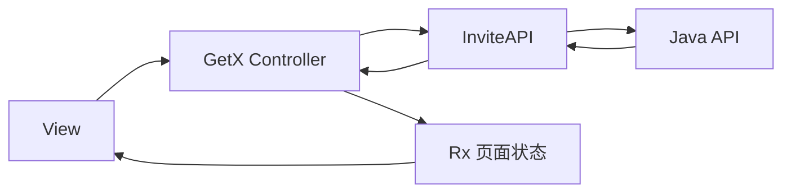

# 多 App 邀请好友与银行卡提现 Flutter 技术文档

## 2026-09-03 最新增量：灵活用工固定 HTML 协议

- 本节覆盖下方所有短期签名 PDF 查看描述。`AppConstants.legalPageTitles/legalPageUrls` 新增 `flexible-employment-agreement`，local/test 指向 `https://test.lxwanxiang.com/sites/catseller/legal/flexible-employment-agreement/index.html`，production 指向同路径的 `https://www.lxwanxiang.com`。
- 保留 `RouteName.inviteFlexibleAgreement` 和 `/invite/agreements/flexible-employment` 路径，路由直接创建固定 pageKey 的 `StaticPageView`。P06 点击只 push 路由，不再调用后端协议接口或传递 URL `extra`。
- 删除 `RemoteAgreementArgs/RemoteAgreementPage`、独立 PDF 下载、外部浏览器兜底和对应 model/API/test platform，移除 `pdfrx`、`pdfrx_engine`、`pdfium_flutter`、`pdfium_dart`。当前方案只使用已有 `webview_flutter`，不新增原生插件。
- Admin/Web 页面为纯 HTML/CSS，CSP 禁止脚本和远程资源；正文仅对原模板的我们主体、合作企业和服务类型三个占位值做指定替换，不增加模板外信息。`StaticPageController` 继续提供加载进度、主框架错误和重试。
- 阅读边界不变：不改 `agreed`，不创建/确认实名会话，不替代最终工猫 H5 核身电签。旧后端接口留存但当前 App 无调用方。

## 2026-09-03 最新增量：工猫签名 PDF 完整下载后渲染

- 本节覆盖下方 `PdfDocumentRefUri` 直连描述。工猫样本已证明是合法 2 页 PDF，PDFium 也已在 iOS Simulator 实际渲染；为隔离 `pdfrx 2.4.7` 的 URI 下载/落盘缓存兼容面，移动端改用独立 `HttpClient` 将 PDF 完整下载到内存，再通过 `PdfDocumentRefData + PdfViewer` 阅读。
- 下载链路不经过业务 Dio，不携带 JWT、`X-App-Code` 等业务头；统一 30 秒总超时、20 MiB 上限，最多跟随 3 次仍满足现有 HTTPS 安全规则的跳转，并在渲染前校验 PDF 文件头。URL、PDF 字节和响应正文均不进入日志或持久化。
- 原始签名 URL 校验通过后按原字符串保存在路由 `extra`，防止签名 query 被二次序列化；有效期由 OSS 响应判断，不依赖移动端时钟。可识别 401/403、网络/超时、非 PDF、过大文件和不安全跳转，UI 只显示脱敏文案与重试、系统浏览器兜底、返回动作。
- `PdfDocumentRefKey` 继续使用固定脱敏名称、URL SHA-256 摘要和重试次数。HTML WebView、协议只读边界和实名认证状态机不变。
- 验证：邀请专项 57 项、`flutter analyze`、Android Debug 和 iOS Simulator Debug 构建通过；iOS Simulator 已真实渲染工猫样本。全量 340 项通过、7 项既有无关 Golden 失败；新鲜签名 URL 的双平台真机网络与弱网验证仍为 `waiting_review`。

## 2026-09-02 最新增量：灵活用工 PDF 内置查看

- 本节覆盖下方“协议不提供独立点击地址”以及 PDF 仅用系统浏览器的旧描述。P06 点击《灵活用工协议》仍实时请求 `GET /api/invite/agreements/flexible-employment`，短期 HTTPS 地址只放在路由 `extra` 内存对象中；安全域名、签名 query、443、无 userinfo/fragment 校验保持不变。
- HTML 地址继续使用现有 `WebViewWidget`；`.pdf` 地址使用 `pdfrx 2.4.7` 的 `PdfDocumentRefUri + PdfViewer`，提供加载进度、滚动和缩放。PDF 网络请求使用插件独立客户端、空附加请求头和 30 秒超时，不经过业务 Dio，不携带 JWT 或 `X-App-Code`。
- `PdfDocumentRefKey.sourceName` 固定为脱敏名称，key 的唯一部分使用 URL SHA-256 摘要和重试次数，避免插件调试日志打印完整签名 URL。页面只展示固定错误文案，不展示原异常或地址；加载失败提供重试、系统浏览器兜底和返回，默认不显示外部打开动作。
- 查看协议不改变 `agreed`，不触发身份会话创建、状态查询或 confirm。第一版不提供下载、分享、批注或保存；后端、Admin、数据库和认证状态流不变。
- 本地门禁：邀请专项 56 项与 `flutter analyze --no-pub` 通过；Android Debug 和 iOS Simulator Debug 无签名构建通过。全量 339 项通过、7 项无关 Golden 失败；真实双平台工猫 PDF 和弱网仍为 `waiting_review`。

## 2026-09-02 最新增量：用户端仅展示一级佣金

- 本节覆盖上一版自动等级、人工保底和等级模式合同。`InviteOverview` 只解析当前生效的一级佣金等级 `agentLevel`、`directCommissionRate`、`directCommissionRates` 与真实 `effectiveInviteeCount`；不再接收或保存保底/模式字段，也不接收后台二级资格和比例。
- P01 的动态最高比例、三档比例和当前比例来自当前 App 接口；缺少三档配置时兼容 10%/20%/30%。页面不参与付款佣金计算，不展示团长、二级代理、二级佣金、人工、自动或保底来源。
- 两段进度始终按真实人数和固定 10/20 人门槛推进。若后台活动直接调整了该用户一级佣金等级，页面只显示最终生效比例；下一档提示根据当前等级和人数计算下一次真实可升级条件，不伪造邀请人数。
- P04 对二级关系收益只显示“推广奖励”和金额，不显示关系层级、后台佣金等级或二级比例。公开规则 Web 只消费一级三档、人数门槛、结算和提现展示字段。
- 规则、等级与开关只影响新付款；历史、待结算、退款、已结算快照和提现链路不变。移动端不提供任何等级或活动身份修改入口。

## 2026-09-02 最新增量：实名认证协议区严格确认

- P06 以 Figma 通道 `x5x4ir6u` 的 `66:120` 为真源，底部固定为“主体锁定提示→签署按钮→协议确认”，文案为“我已阅读并同意《灵活用工协议》和《实名认证服务协议》”。
- 协议默认未勾选，只接受页面复选框的主动确认；未勾选点击签署只显示错误，不弹旧 D02 二次确认框、不自动勾选、不调用认证接口。失败保留页面内勾选状态，离页不持久化。
- 两份协议名称本期不提供独立点击地址，完整合同仍在工猫 H5 阅读签署；不新增 StaticPageView、后端字段或数据库改动。

## 2026-09-01 最新增量：合法回跳才提交电签

- P06 初始资格中的 `pendingSessionId` 只调用 `GET .../status`；“查询已有核验结果”同样只查状态。移除页面 `resumed` 自动 confirm，相机、相册、系统前后台切换不会产生签约请求。
- `InviteControlledWeb` 先严格匹配服务端 `returnUrl` 的 HTTPS scheme/host/port/path，再要求恰好一个 `[A-Za-z0-9_-]{43}` state；Navigator 只返回该 state。只有实名页收到该返回值才调用 `POST .../confirm` 并发送 `{state}`。
- 手动返回、关闭 H5、回跳缺失/重复/非法 state 或 h5Url 为空时不 confirm，只保留可重试提示。页面布局、协议确认、照片、实名、绑卡及提现门禁不变。
- 与后端新契约同步升级，不兼容旧空 body confirm；未部署、未做真实 WebView/工猫/双平台真机验收，数据库改动为无。

## 2026-08-31 最新增量：实名认证与银行卡绑定拆分

用户已确认本次计划并授权开发，本地实现状态 `waiting_review`。本节优先于下方历史合并认证说明，其他CHG及已确认基线状态不变。

- Figma通道 `eeis7852`：P06 `66:120`，P10 `66:198`。P05打开不跳页；用户点击后按最新资格：未实名→P06、已实名无ACTIVE卡→P10、有卡→原提现。
- P06只填写姓名、大陆身份证、手机号及两面私有照片，类型 `invite/id-card-images`，≤3MiB，complete=READY后只提交resourceId。支持相机/相册、预览/替换、进度/重试；只清理本流程临时副本，不删相册、不长期缓存。
- 校验真实出生日期、身份证校验码、18–65周岁；61–65仍需工猫商户渠道验收，不绕过渠道拒绝。
- 认证只维护实名和会话，不建银行卡；syncInfo不传卡号。创建/确认返回 `identityReady` 替代 `ready`，删除 `bankAccount`；主动查合同2/3才成功，旧PENDING卡不自动激活。
- 认证成功自动返回提现页并刷新，等待用户点击“去绑定”。P10 `/invite/bank-bind` 重填四项资料、同意当前协议；不重复照片、H5或短信。
- POST bank-accounts先核对当前App的姓名、身份证和手机号；不一致不调用工猫。用户级Redis锁+同卡HMAC去重，短事务准备→事务外updateEmployee→严格success=true后短事务激活；有效同卡直接返回，未知PENDING可显式重试同卡，不自动重试；首张有效卡默认，新增不覆盖默认。
- 绑卡只接受ACTIVE为成功，提示后返回P05刷新；失败保留可编辑表单，成功/离页清除敏感输入。未签署、仅登记或PENDING绝不显示成功。
- H5权限、白名单开关、回跳查询和银行卡ID解析修复保留；不变更Admin、其他App页面、佣金/退款/打款。
- 业务与工猫配置共享，所有实名/照片/银行卡/会话/资金按App隔离。数据库：有持久化行为调整，但无新增表、字段、索引或SQL/Flyway；bank_account_id已可空。不处理历史数据、不调整余额、不部署或真实签约/提现。


验证、截图与真实渠道边界见 [拆分验证](../05-联调与测试/invite-identity-bank-split-verification.md)。


> 2026-08-28 已确认增量：工猫认证 session 的创建/确认响应新增布尔 `h5AllowedHostsEnabled`；仅 JSON 布尔 false 关闭域名列表匹配，缺失/异常默认开启。初始加载、导航和权限来源共用此开关，HTTPS/合法域名/443/禁止用户信息/证书/回跳/相机授权/禁文件不变。关闭期间仅在调试日志去重输出域名，不自动信任域名。开关快照仅作用于本次 H5 页面，后端重启后需退出重进；静态规则页及其他 WebView 不受影响。数据库改动：无。

> 2026-08-28 最新用户澄清：规则正文默认可见，接口只异步补充有效参数；任何活动/通道状态及请求失败均不得阻断正文，保留非阻断重试和通用参数说明。App 规则入口及 Web 脚本增加显示版本以区分旧缓存，其他业务门禁不变。该条覆盖此前依赖接口成功才展示的约束；验证见 workflow.md「规则正文先显示、动态参数异步补充」。

> 2026-08-28 用户已授权的最新增量约束：P09 仍使用 StaticPageView，但活动规则初始 URL 改为跟随当前 API 环境（HTTP/HTTPS），仅规则页变化；其他协议仍固定正式站。原固定正式规则 URL 的要求由本条取代。保留 appCode、embedded=1，不接受路由 URL 覆盖。 实施与验收记录见工作区 `workflow.md`「邀请业务与提现通道解耦」；主流程保持 waiting_review。

> 2026-08-27 实现回写：三端核心代码、共享工猫私有配置、Admin 增量与 App 22图对稿已完成本地检查，当前 waiting_review。最新真实进度以 [编码恢复点](/Users/soul/work/MakeCodePlanWord/projects/喵喵带货/implementation-progress.md) 和 [验证报告](/Users/soul/work/MakeCodePlanWord/projects/喵喵带货/05-联调与测试/invite-withdrawal-local-verification.md) 为准；未自动启用/部署，真实 H5/银行及未勾选任务待验收。下文为已确认技术/任务基线，不用历史“待实现”描述覆盖最新记录。


> 版本：`v1.0.0`
> 日期：2026-08-27
> 状态：`done`
> 移动端工程：`/Users/soul/code/lxwx/catseller`
> 需求基线：[requirements.md](../01-需求/requirements.md) v1.0.3
> 设计基线：[figma-design-plan.md](../01-需求/figma-design-plan.md) v1.0.3
> 技术基线：[tech-plan.md](../02-技术方案/tech-plan.md) v1.0.0
> 范围：只覆盖邀请好友、直接首单返佣、实名电签、银行卡提现和活动规则 Web；不覆盖其他喵喵带货业务。

---

## 0. 结论与边界

2026-08-27 CHG-0068 首批落地：新增 `invite_contract_types.dart` 与 `invite_money.dart`，覆盖三模式、九态、合同/账本未知值安全映射、确定性整数分和负余额展示；旧提现状态文案保持兼容。新增 6 项测试与 analyze 通过。API/params/新 data Model/P06/P08 路由和页面尚未实现，继续以本方案后续合同为目标；准确进度见 [编码恢复点](../implementation-progress.md)。最新 Figma 通道为 `mj5kz8uv`，22 张图与原本地素材字节一致。

- 在现有 `lib/pages/invite/`、`lib/apis/invite.dart` 和既有 8 个邀请路由上增量升级，不新建平行邀请模块。
- P01～P08 为 Flutter 原生页面；P09 活动规则由 Admin 工程 `web/` 提供，App 只使用受控 WebView 打开。
- 本轮仅实施喵喵带货移动端视觉；共享 Java/Admin 能力不得在 Flutter 请求中硬编码 `catseller` 业务分支，App 归属继续由统一请求头确定。
- 只支持银行卡。删除当前提现表单中的支付宝渠道、收款账号和收款姓名输入；提交只传银行卡档案 ID、金额、试算令牌和协议确认。
- 工猫刷脸、电签是外部 H5。App 不实现银行卡短信验证码，不保存身份证号、完整卡号、平台密码或工猫密钥。
- 提现和佣金结果全部以服务端为真值。客户端不计算返佣比例、可提现额、税费或最终状态。
- 本文档阶段不修改 Flutter、Java、Admin、Web 或数据库代码。

### 0.1 数据库改动

Flutter：无数据库改动。不得将敏感资料写入 GetStorage、Hive、日志、埋点、剪贴板或截图缓存。

### 0.2 不在本期

- 支付宝、微信、银行卡短信验证码。
- 二级或团队佣金、后台人工调等级、移动端多层代理页面。
- 客户端自建到账短信、自算税费、自行重试打款。
- 其他 App 的品牌页面、活动规则 CMS、重新设计现有全局导航。

## 1. 当前工程基线与技术选型

| 能力 | 当前工程 | 本功能策略 |
|------|----------|------------|
| Dart / Flutter | Dart SDK `^3.11.4`、Flutter stable | 保持现状 |
| 状态管理 | GetX | 页面 Controller 使用 `Rx`，不引入新框架 |
| 路由 | go_router | 复用 `lib/routes/name.dart`、`router.dart` |
| 网络 | Dio | 复用鉴权、App Code、刷新 Token、统一错误 |
| 屏幕适配 | flutter_screenutil | 继续按现有 375×812 规范适配 |
| WebView | `webview_flutter`、`flutter_inappwebview` 已存在 | 选用工程当前稳定封装，不新增依赖 |
| 分享/保存 | `share_plus`、`image_gallery_saver_plus`、`qr_flutter` | 复用邀请素材页现有能力 |
| 安全存储 | `flutter_secure_storage` 已存在 | 本功能不持久化身份证和银行卡；仅延用全局 Token 机制 |

新增依赖：无。编码时若现有 WebView 无法满足相机权限或回跳拦截，先扩展现有封装，不并行引入第三套 WebView。

## 2. 现有实现复用与替换

### 2.1 直接复用

- `lib/apis/invite.dart` 的邀请 API 入口、Dio 封装和统一分页结构。
- `lib/pages/invite/index.dart` 的模块组织方式，以及 `controller.dart`、`view.dart` 的 `part` 结构。
- `materials` 的复制、二维码/海报、分享和保存能力；页面名称统一为“邀请好友”。
- `records`、`ledgers`、`withdrawals` 的列表骨架、分页、刷新、空态和失败重试。
- `lib/routes/name.dart`、`router.dart` 中 `/invite`、`/invite/materials`、`/invite/records`、`/invite/ledgers`、`/invite/withdrawal`、`/invite/withdrawals`、`/invite/rules`。
- 全局登录门禁、Dio Header、统一 Toast/Dialog、生命周期观察和主题组件。

### 2.2 必须替换

| 当前行为 | 新模式行为 |
|----------|------------|
| `CreateWithdrawalRequest` 上传 `channel/accountNo/accountName` | 只上传 `bankAccountId/amountCents/quoteToken/agreementConfirmed` |
| 提现 Controller 固定 `ALIPAY` 并用 `double` 解析金额 | 固定 BANK 业务语义；金额转分使用十进制字符串校验，不以浮点数计算 |
| 佣金模型含间接收益 | 新页面只消费直接会员首单奖励和退款冲正 |
| 提现状态只有审核、已打款、失败 | 使用九态服务端状态和用户展示映射 |
| 规则页使用通用静态页且 JS/导航较宽松 | 使用 HTTPS 域名白名单、导航拦截和外链策略 |
| 邀请记录本地筛选 | `ALL/OPENED/NOT_OPENED` 由服务端分页筛选 |

旧 App 模式的响应兼容由服务端能力合同负责；喵喵带货页面只在服务端返回 `DIRECT_BANK_GONGMALL` 能力时展示新流程，禁止用 App 名称判断模式。

## 3. 目录与文件改动方案

```text
lib/
├── apis/
│   └── invite.dart                         # 升级邀请/认证/银行卡/试算/提现接口
├── models/data/                            # 复用现有平铺目录，不新建平行 invite/ 目录
│   ├── invite_overview.dart                # 升级：等级、真实进度、资金概览、入口能力
│   ├── invite_record.dart                  # 升级：OPENED/NOT_OPENED
│   ├── invite_earning_summary.dart         # 升级：累计、可提现、冻结、负余额
│   ├── invite_earning_ledger.dart          # 升级：奖励/退款冲正
│   ├── invite_withdrawal_eligibility.dart  # 新增
│   ├── invite_identity_session.dart        # 新增
│   ├── invite_bank_account.dart            # 新增
│   ├── invite_withdrawal_quote.dart        # 新增
│   ├── invite_withdrawal.dart              # 升级：九态和脱敏银行卡
│   └── invite_withdrawal_detail.dart        # 新增：时间线
├── models/params/
│   ├── create_identity_session_params.dart
│   ├── create_withdrawal_quote_params.dart
│   └── create_withdrawal_params.dart
├── pages/invite/
│   ├── index.dart                          # P01 邀请有礼模块入口
│   ├── controller.dart                     # P01 现有 part 文件
│   ├── view.dart                           # P01 现有 part 文件
│   ├── materials/                          # P02 邀请好友
│   ├── records/                            # P03 邀请记录
│   ├── ledgers/                            # P04 佣金明细
│   ├── withdrawal/                         # P05 提现
│   ├── withdrawal_auth/                    # P06 实名、两面私有照片、H5
│   ├── bank_bind/                          # P10 独立绑卡
│   ├── withdrawals/                        # P07 提现记录
│   ├── withdrawal_result/                  # P08 新增：详情/结果
│   └── widgets/
│       ├── invite_level_progress.dart
│       ├── masked_bank_card.dart
│       ├── money_amount_field.dart
│       └── withdrawal_timeline.dart
├── pages/webview/                          # P09 复用 StaticPageView，无专用规则页面
└── routes/
    ├── name.dart
    └── router.dart
```

测试对应放入 `test/apis/`、`test/models/`、`test/pages/invite/`，保持生产目录镜像。只在邀请模块复用的组件不提升到全局 `widgets/`。

## 4. Model 与金额规则

### 4.1 核心类型

建议使用不可变 Model、显式 `fromJson` 和枚举解析兜底：

```dart
enum InviteCapabilityMode { legacy, directBankGongmall, disabled }

enum InviteMemberStatus { opened, notOpened }

enum InviteLedgerKind { directReward, membershipRefundReversal }

enum InviteWithdrawalStatus {
  pendingReview,
  rejected,
  approved,
  submitting,
  processing,
  reconciling,
  succeeded,
  failed,
  returned,
}

enum InviteContractStatus {
  notSynced,
  pendingSignature,
  generating,
  completed,
}
```

- 未识别服务端状态不得映射为成功；列表显示“状态更新中”，详情允许刷新。
- 佣金 JSON 类型统一使用 `DIRECT_REWARD/REFUND_REVERSAL`，分别映射 Dart `directReward/membershipRefundReversal`；不额外发明 `MEMBERSHIP_REFUND_REVERSAL` 服务端类型。
- 所有金额字段使用整数分 `int`；显示统一走现有金额格式化器。
- 用户输入先用正则校验最多两位小数，再确定性转为分；禁止 `double * 100`。
- 时间统一解析服务端 ISO-8601；展示使用本地时区，业务日限制完全由服务端判断。

### 4.2 首页进度

服务端返回 `effectiveInviteCount`、`currentRatePercent` 和两段进度数据；前端只负责绘制。若接口只返回人数，兼容计算也只能用于视觉：

- 第一段 10%→20%：`clamp(count, 0, 10) / 10`。
- 第二段 20%→30%：`clamp(count - 10, 0, 10) / 10`。
- 0、1、9、10、11、19、20 人必须逐人推进；不得把 1～9、10～19 整段直接填满。
- 佣金比例和结算仍由服务端订单快照决定，进度条计算不参与资金逻辑。

## 5. API 合同

所有接口沿用统一 `ApiResponse`、JWT 和 `X-App-Code`。分页统一使用现有 InviteController 的 `page/pageSize`，编码时以 OpenAPI 验证，不新建 `size` 平行合同。

| API | Flutter 调用点 | 关键处理 |
|-----|----------------|----------|
| `GET /api/invite/overview` | P01 | 能力、人数、进度、比例、余额和入口 URL |
| `GET /api/invite/materials` | P02 | 链接、邀请码、海报；不由客户端拼邀请人 ID |
| `GET /api/invite/records` | P03 | `memberStatus,page,pageSize` 服务端筛选 |
| `GET /api/invite/earnings/summary` | P04/P05 | 累计、可提现、冻结、负余额 |
| `GET /api/invite/earnings/ledgers` | P04 | `status,page,pageSize`；奖励与退款冲正；可空 `sourcePhoneMasked` 和当前 App 会员订单商品名称快照 `productName` |
| `GET /api/invite/withdrawal-eligibility` | P05/P06 | 阻断原因、最低额、今日限制、身份/合同/银行卡 |
| `POST /api/invite/identity-sessions` | P06 | name/identity/mobile、identityFrontResourceId/identityBackResourceId、agreementVersion/agreementConfirmed；返回identityReady/H5策略，不含银行卡 |
| `GET /api/invite/identity-sessions/{sessionId}/status` | P06 | 页面加载/手动恢复只查合同，不提交签约 |
| `POST /api/invite/identity-sessions/{sessionId}/confirm` | P06 | 仅合法H5回跳；body为43位state，不以 H5 文案判定完成 |
| `GET /api/invite/bank-accounts` | P05/D03 | 只返回脱敏卡号 |
| `POST /api/invite/bank-accounts` | P10 | name/identity/mobile/bankAccountNo、agreementVersion/agreementConfirmed；只接受ACTIVE脱敏卡 |
| `PUT /api/invite/bank-accounts/{id}/default` | D03 | 幂等设置默认卡 |
| `DELETE /api/invite/bank-accounts/{id}` | 银行卡管理 | 软删除，错误显示服务端安全文案 |
| `POST /api/invite/withdrawal-quotes` | P05 | 传卡 ID 和金额分，返回费用、到账额、token、过期时间 |
| `POST /api/invite/withdrawals` | P05 | 带 `Idempotency-Key`；只传安全字段 |
| `GET /api/invite/withdrawals` | P07 | 状态筛选、分页和刷新 |
| `GET /api/invite/withdrawals/{id}` | P08 | 时间线、金额、费用、失败/返还结果 |

### 5.1 幂等键

- 用户首次进入 P05 或一次提交成功/明确失败后生成新的 UUID/ULID 作为 UI 尝试 ID。
- 同一次按钮重复点击、网络超时后的用户主动重试必须复用原 `Idempotency-Key`，直到服务端返回已有提现单或明确业务校验失败。
- Idempotency-Key 不是工猫 `requestId`；客户端不得生成、展示或替换工猫请求号。

### 5.2 错误映射

优先根据后端稳定错误码处理：负余额、今日已申请、认证未完成、银行卡不可用、quote 过期、余额变化、重复申请、状态冲突。未知错误显示统一可重试提示，不透出工猫原始报文、身份证或卡号。

## 6. 状态管理与数据流



每个页面状态至少区分：`initial/loading/content/empty/error/refreshing/submitting`。分页列表另维护 `hasMore`、`nextPage`，刷新时重置游标，失败不清空已有列表。

- P01 Controller 并行加载 overview；素材页按需加载，不在首页预下载大海报。
- P05 首次加载资格与银行卡；选卡/改金额后 300～500ms debounce 试算，并用递增请求序号丢弃旧响应。
- P06 只在内存保留姓名、身份证、手机号和卡号；提交成功后立即清空 Controller 与输入框。
- P08 在 `APPROVED/SUBMITTING/PROCESSING/RECONCILING` 轮询；离开页面、App 后台或终态后停止。
- App resume 时，P06 只恢复遮罩，不自动请求合同或提交签约；P08 仍按原逻辑主动刷新提现详情。

## 7. 路由与导航

| 页面 | 路由 | 处理 |
|------|------|------|
| P01 邀请有礼 | `/invite` | 复用并重构 |
| P02 邀请好友 | `/invite/materials` | 复用；首页 CTA“立即邀请 赚钱佣金”跳此页 |
| P03 邀请记录 | `/invite/records` | 复用并升级筛选 |
| P04 佣金明细 | `/invite/ledgers` | 复用并去除间接佣金 |
| P05 提现 | `/invite/withdrawal` | 复用路由、替换表单 |
| P06 提现认证 | `/invite/withdrawal-auth` | 新增 |
| P07 提现记录 | `/invite/withdrawals` | 复用并升级九态 |
| P08 提现结果 | `/invite/withdrawals/:id` | 新增详情路由 |
| P09 活动规则 | `/invite/rules` | 直接返回 `StaticPageView(pageKey: 'invite-rules')` |

P01 明确提供六类跳转：立即邀请、邀请记录、佣金明细、提现、提现记录、活动规则。P05用户点击时未实名进入P06；已实名无卡或“添加银行卡”进入P10；P07 点击记录进入 P08；提现创建成功直接 replace 到 P08，避免返回后重复提交。

路由参数只携带提现 ID、来源页等非敏感标识。姓名、身份证、完整卡号、quoteToken 不放 query/path/extra 的可序列化持久化对象中。

## 8. 页面实现与 Figma 映射

图片真源：[references/images/invite-withdrawal](../01-需求/references/images/invite-withdrawal/)。视觉细节以 Figma 通道 `czmwv14c`、页面 `39:95` 为准，未覆盖的资金状态以 PRD 为准。

### 8.1 P01 邀请有礼

- 参考节点：`43:1638`、`43:1754`、`43:1870`。
- 重构现有首页，不新增平行路由。
- 显示累计收益、可提现金额、当前有效邀请人数、当前比例、下一档提示和真实进度。
- 收益为负时保留负数和“后续奖励优先抵扣”，提现按钮禁用但记录与明细仍可进入。
- 首页加载失败保留页面骨架和重试；入口 URL 缺失时只禁用对应入口。

### 8.2 P02 邀请好友

- 参考节点：`43:2118`。
- 页面标题固定“邀请好友”；它就是原“推广素材”页面。
- 链接、二维码、海报均来自服务端；保存、分享、复制分别反馈成功/失败。
- 保存前走现有相册权限流程；拒绝权限不影响复制链接和系统分享。

### 8.3 P03 邀请记录

- 参考节点：`43:2222`。
- Tab：全部、已开通、未开通，对应 `ALL/OPENED/NOT_OPENED`。
- 展示脱敏用户、绑定时间、会员状态；不展示订单金额和身份证等信息。
- 每次切换筛选重新请求第一页，禁止在已分页数据上本地过滤。

### 8.4 P04 佣金明细

- 参考节点：`43:2285`、`43:3403`。
- 直接奖励使用加号，并按可空 `productName` 显示“好友开通月卡/季卡/年卡”或兜底“好友开通会员”；不按金额推断卡种。退款冲正继续使用负数和“会员退款冲正”。
- 不展示二级、团队、提现扣款伪装成佣金流水。
- 覆盖加载、空态、分页失败、冲正、待结算和余额为负。

### 8.5 P05 提现与 D03 银行卡选择

- 参考节点：`43:2362`、`43:2951`、`43:3014`、`43:3079`。
- 顶部展示可提现、冻结、最低额和今日限制；负余额或今日已申请时明确阻断。
- P05不自动跳页；点击时未实名去P06，已实名无ACTIVE卡去P10，有卡显示默认卡并可打开D03。
- D03 复用银行卡列表完成选择、设为默认和删除确认；被非终态提现引用时展示服务端拒绝原因，不在本地强删。
- 金额支持合法范围内“全部提现”；每次金额/选卡变化触发试算。
- 提交按钮仅在资格通过、卡有效、quote 未过期、协议已确认且未提交时启用。
- quote 过期或余额变化时自动重算并要求用户再次核对预计到账。

### 8.6 P06 实名认证与工猫H5

- Figma66:120，三项资料+两个私有照片resourceId，无卡号；以本文件顶部最新增量为准。
- 协议区使用 Figma 原文且默认未勾选；提交入口只调用 Controller 校验，禁止二次弹窗代替主动勾选。表单、照片、配置和协议任一无效均不创建session。
- 实现：withdrawal_auth/controller.dart、view.dart、identity_photos.dart，复用AnalysisImageCompressionSession、资源prepare/PUT/complete，无公共exists或URL。
- 创建失败留输入，受理后清空文字；待会话恢复只调status，H5合法回跳才带state调confirm；H5取消/resume不提交签约。仅identityReady且合同2/3成功，自动回P05等待。
- Photos close只清理自有副本，并保护异步上传关闭后的迟到结果；表单隐私守卫与H5策略保留。

### 8.6.1 P10 独立绑定银行卡

- Figma66:198，/invite/bank-bind，bank_bind/index.dart/controller.dart/view.dart。
- 重新填写姓名/身份证/银行卡/手机号，沿用既有协议版本与已签协议；不新增短信、照片或H5。
- 资格失败禁用提交，ACTIVE响应才成功返回P05刷新；未知保留输入可显式重试。
- 共用identity_fields.dart/identity_validation.dart；使用独立页面Controller、滚动表单、安全区与键盘适配。

### 8.7 P07 提现记录

- 参考节点：`43:2425`。
- 支持全部、审核中、处理中、成功、失败/退票等产品分组；实际筛选值由服务端合同定义。
- 下拉刷新、分页加载、空态、错误重试均复用列表规范。
- 行内只显示提现号尾段、金额、脱敏银行卡、申请时间和用户态；点击进入 P08。

### 8.8 P08 提现结果

- 参考节点：`43:3257`、`43:3338`。
- 展示申请金额、税费、服务费、预计/实际到账、脱敏银行卡和时间线。
- “申请已提交”不等于到账成功；审核通过并提交银行后才提示预计 1～3 个工作日。
- `FAILED` 展示安全失败原因和余额已返还；`RETURNED` 明确“银行退票、余额已返还”。
- `RECONCILING` 显示“结果确认中”，不可诱导用户重复申请。

### 8.9 P09 活动规则 Web

- 参考节点：`43:3167`。
- 2026-08-28 用户最新调整：路由直接返回 `StaticPageView(pageKey: 'invite-rules')`，删除专用 `InviteRulesPage/Controller`。从 `AppConstants.legalPageUrls['invite-rules']` 读取正式 URL（`https://www.lxwanxiang.com/legal/invite-rules/index.html?appCode=catseller&embedded=1`）；嵌入标记直接写入常量，不再需要规则 Controller 拼接。不调用 overview/capability 获取地址，不随 API 环境切换；Flutter 不内置正文。
- Web 继续按 `appCode` 调用 `/api/config/invite-rules` 读取结算天数、最低额和版本；固定页面地址不等于固定业务参数。其他 App/共享 Java/Admin 合同不在本次修改范围。
- 标题、进度、页面错误、重试和返回均复用 `StaticPageView/StaticPageController`，不修改共享组件；不传入 JWT/用户资料。本次只复核路由与地址，不把原生 WebView 或线上规则数据验收视为完成。

## 9. 工猫 H5 与活动规则 Web 安全

两类 Web 页面保持独立：P06 使用工猫专用容器，P09 按用户要求复用现有通用静态页，不给规则页额外增加独立状态机或安全策略分支。

| 类型 | 允许来源 | JS | 回跳 |
|------|----------|----|------|
| 工猫认证 H5 | 后端返回 URL 且 host 命中工猫配置白名单 | 按工猫页面需要启用 | 只拦截约定 HTTPS/custom-scheme 回跳；随后调后端 confirm |
| 活动规则 | `legalPageUrls['invite-rules']` 固定 HTTPS 初始地址 | 沿用 `StaticPageView` 的 JS 设置 | 无业务回调；沿用现有静态页导航行为，不宣称具备工猫容器的独立白名单/超时策略 |

- 工猫专用容器拒绝 `http`、`file`、`data`、未知 scheme；两类页面均不实现证书错误绕过。
- 不向 WebView 注入 JWT、完整用户资料或任意 JavaScript bridge。
- 日志只记录 sessionId/页面类型/host/结果码，不记录完整 H5 URL 查询串。
- 工猫专用 WebView 的遮罩、日志和调试限制保持原实现；静态规则页沿用通用组件，不把专用容器的能力当作已复用能力。

## 10. 用户状态映射

| 服务端状态 | 用户文案 | 可操作 |
|------------|----------|--------|
| `PENDING_REVIEW` | 待审核 | 查看详情 |
| `REJECTED` | 审核未通过 | 查看原因；次日且资格满足可重新申请 |
| `APPROVED` | 审核通过 | 等待提交，不重复申请 |
| `SUBMITTING` | 提交中 | 自动刷新 |
| `PROCESSING` | 银行处理中 | 自动刷新，提示预计时效 |
| `RECONCILING` | 结果确认中 | 自动刷新，不显示失败 |
| `SUCCEEDED` | 已到账 | 终态 |
| `FAILED` | 提现失败，余额已返还 | 终态、安全原因 |
| `RETURNED` | 银行退票，余额已返还 | 终态 |

服务端可通过 `displayStatus/displayMessage/availableActions` 提供最终产品文案；Flutter 枚举映射是离线兜底，不允许把未知态当作 `FAILED` 或 `SUCCEEDED`。

## 11. 生命周期、并发和可恢复性

- 提交时禁用按钮并显示进度；页面重建后先查列表/详情确认是否已创建，不能直接换幂等键再次提交。
- P05 收到余额不足、quote 失效、当日已申请时刷新资格，不保留过期到账金额。
- P06 H5 中断保留非敏感 sessionId 到页面生命周期；若业务需要跨进程恢复，只允许持久化后端签发的 opaque sessionId 与过期时间，并由安全评审确认。
- P08 前台轮询建议 3～5 秒起步并退避，最长不超过页面可见周期；后台停止，resume 立即刷新。
- 列表与详情状态冲突时以详情最新 `updatedAt/version` 为准；不由本地时间倒推状态。

## 12. 编码任务与顺序

1. 升级 Invite API、Model、状态枚举和契约测试。
2. 重构 P01 真实进度与六个入口，升级 P02/P03/P04。
3. 新增资格、银行卡和 quote 数据流，替换 P05 表单及 D03。
4. 新增 P06、D01、页面协议确认区、受控工猫 H5 和回跳确认。
5. 升级 P07，新增 P08 和九态时间线。
6. 将 P09 收口为受控活动规则 Web 页面。
7. 补齐生命周期、幂等、错误、负余额、空态和无障碍测试。

编码时可以沿用技术方案任务引用 `T-F001`～`T-F009`，但代码、提交说明和评审以页面/业务名称为主。

## 13. 项目专属开发规则

### 13.1 继承

- 继承工作区 Flutter 初始化、目录、编码、路由、多语言、依赖、UI、测试和工作流规则。
- 实际编码前重新读取 Flutter 编码索引及涉及页面的最小必要规则，不以本文替代编码规范。

### 13.2 裁剪

- 不迁移旧综合 Flutter 技术文档中的视频、作品、积分、登录、任务中心等开发内容。
- 不创建支付宝/微信、二级佣金、代理等级维护或规则 CMS 页面。
- 不因 P09 使用 WebView 而扩展全局法律协议 URL 白名单。

### 13.3 特化

1. 资金 UI 只显示服务端真值；金额全部用分，禁止浮点结算。
2. 能力差异看 `capabilityMode/availableActions`，禁止 `if (appCode == 'catseller')`。
3. 身份证和完整卡号仅存在于 P06 输入到单次请求的内存窗口；提交后清理。
4. 所有资金状态必须同时覆盖加载、空、错误、重复、超时和恢复路径。
5. Figma 只决定布局视觉，不覆盖 PRD 的负余额、人工审核、查单、退票等状态。
6. 页面使用业务名称；P02 统一叫“邀请好友”，不得再显示“推广素材”标题。
7. 新文案优先进入现有本地化资源；服务端安全原因不得直接作为可国际化业务键。

## 14. 测试与验收

### 14.1 自动化

- Model/API：九态、未知状态、空字段、负金额、脱敏卡号、分页、错误码。
- Controller：debounce 丢弃旧 quote、quote 过期、重复提交复用幂等键、生命周期停止轮询。
- Widget：P01 进度边界 0/1/9/10/11/19/20；负余额禁用提现；P04 冲正；P07 空态。
- WebView：仅 HTTPS 白名单、未知 scheme 拒绝、回跳只触发 confirm、不泄露 URL 参数。
- 导航：P01 六入口、P05→P06、P05/P07→P08、P09 受控 Web。

### 14.2 手工/视觉

- 对照 22 张导出图检查字号、间距、色值、按钮、底部安全区和弹层。
- 重点检查小屏、系统字体放大、键盘遮挡、弱网、App 前后台、H5 相机拒绝和系统返回。
- 视觉检查只辅助发现差异，不替代 Widget/API 自动化。

### 14.3 完成门禁

- `dart format --set-exit-if-changed .`
- `flutter analyze`
- 邀请提现定向测试与全量 `flutter test`
- Android/iOS Debug 构建至少各一次；工猫真实 H5 需真机验证摄像头和回跳。
- `git diff --check`

## 15. 进入开发前待确认

- 首批启用 App 清单不阻塞共享代码设计，但决定哪些移动端展示新模式。
- 工猫测试 H5 host、回跳 URL/自定义 scheme、相机权限说明和协议正式版本。
- 活动规则 URL 已于 2026-08-28 固定到 `AppConstants.legalPageUrls['invite-rules']`，允许 host 为 `www.lxwanxiang.com`；仍需完成正式公开动态规则接口和原生 WebView 联调，不依赖后台地址字段。
- 后端 OpenAPI 必须验证 `page/pageSize`、技术方案稳定错误码和 `displayStatus/availableActions` 字段。

本文档已由用户确认，状态为 `done`；当前总体计划也已确认，流程进入“11 Flutter 模块开发文档”评审，仍未修改 Flutter 业务代码。
