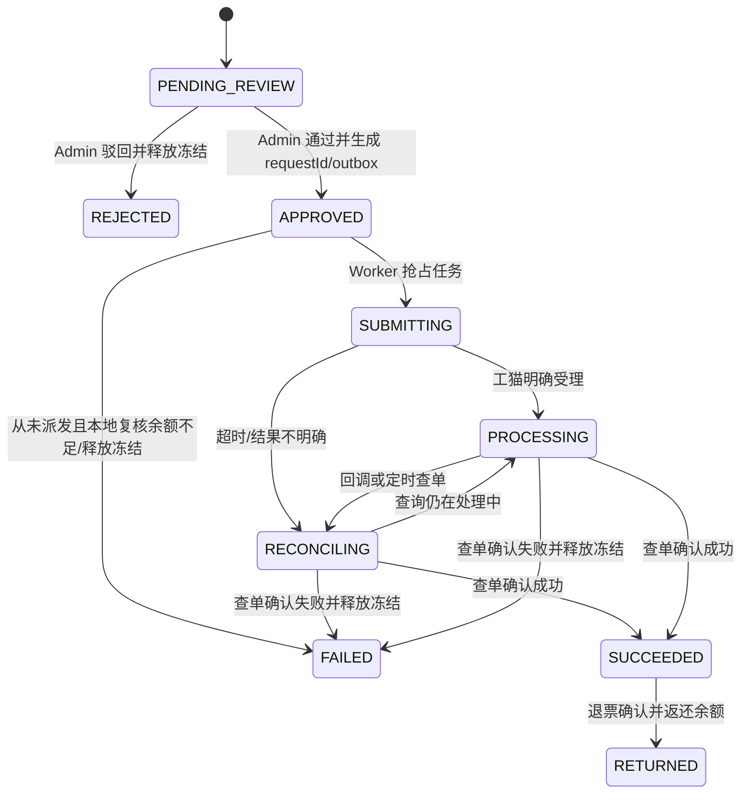

# 多 App 邀请好友、银行卡提现与 Admin Java 技术文档

## 2026-09-02 最新增量：六档佣金与团长推广

- 关系层级与佣金等级分离：A→B 是一级关系，A→B→C 是二级关系；`invite_agent_profiles.agent_level` 作为一级佣金等级，新增 `indirect_commission_level` 作为二级佣金等级，均为 1/2/3。不存在保底、固定等级或等级模式。
- `invite.rules` 增加 `directCommissionRates` 与 `indirectCommissionRates` 两组三档百分比。每组都严格要求完整 `level1/level2/level3`、0～100 整数且非递减；无配置默认 10/20/30，旧二级单比例仅做兼容读取。
- 一级佣金等级在新有效直邀首单出现时按 10/20 人只升不降；后台直接写低值立即生效，下一笔有效邀请仍按原人数规则自动升级。二级佣金等级不做任何人数自动升级。
- `/api/admin/invite/agents` 只管理逐用户二级关系佣金资格；`/api/admin/invite/leader-promotions` 独立管理软状态团长名册和该用户两项佣金等级。团长身份不进入付款判断、不自动打开二级资格，停用按约定恢复两项等级但保持资格开关。
- 新付款在邀请串行锁内读取当前 App 六档配置和用户等级，一级转化与二级待结算账本分别保存 `relation_level`、`commission_level`、比例、金额与配置版本。退款、重复回调、延迟结算继续使用原付款快照。
- 用户概览和公开规则只返回一级佣金展示数据；二级配置只在授权 Admin 接口出现。所有业务表、配置、人员查询和审计按 `X-App-Code` 隔离。
- 数据库只调整明确未发布的 common V4.5，新增字段、约束和团长活动表；无业务 DML、回填、字段删除、线上执行、repair 或历史订单重算。

## 2026-09-01 最新增量：状态查询与签约提交拆分

- 新增只读 `GET /api/invite/identity-sessions/{sessionId}/status`，只调用合同状态查询并同步本地结果；创建后复核、合同完成通知和定时恢复全部复用该路径，不调用 `signContract`，不写 `confirmed_at`。
- `POST .../{sessionId}/confirm` 必须接收 `{state}`；格式为43位URL-safe令牌，SHA-256摘要常量时间匹配会话 `state_hash` 后才进入提交。平台 `H5_RETURN` Inbox 已按同一摘要路由校验，可进入相同提交边界；普通合同回调不可提交。
- App+session Redis锁与提交前持久化的 `confirmed_at` 保证重复回跳、App请求和Inbox并发最多调用一次签约；后续请求只查状态。无合同号、state不匹配、过期或不可确认返回409，格式400，工猫故障503，未签完成200 + identityReady=false。
- 资格仅暴露 `PENDING + provider_flow_id非空`；保留 `RETRY`，同主体重新提交时由既有逻辑置 `SUPERSEDED`。无表/字段/索引/Flyway或存量数据改动，不部署、不调用真实工猫。

## 2026-08-31 最新增量：实名认证与银行卡绑定拆分

用户已确认本次计划并授权开发，本地实现状态 `waiting_review`。本节优先于下方历史合并认证说明，其他CHG及已确认基线状态不变。

- Figma通道 `eeis7852`：P06 `66:120`，P10 `66:198`。P05打开不跳页；用户点击后按最新资格：未实名→P06、已实名无ACTIVE卡→P10、有卡→原提现。
- P06只填写姓名、大陆身份证、手机号及两面私有照片，类型 `invite/id-card-images`，≤3MiB，complete=READY后只提交resourceId。支持相机/相册、预览/替换、进度/重试；只清理本流程临时副本，不删相册、不长期缓存。
- 校验真实出生日期、身份证校验码、18–65周岁；61–65仍需工猫商户渠道验收，不绕过渠道拒绝。
- 认证只维护实名和会话，不建银行卡；syncInfo不传卡号。创建/确认返回 `identityReady` 替代 `ready`，删除 `bankAccount`；主动查合同2/3才成功，旧PENDING卡不自动激活。
- 认证成功自动返回提现页并刷新，等待用户点击“去绑定”。P10 `/invite/bank-bind` 重填四项资料、同意当前协议；不重复照片、H5或短信。
- POST bank-accounts先核对当前App的姓名、身份证和手机号；不一致不调用工猫。用户级Redis锁+同卡HMAC去重，短事务准备→事务外updateEmployee→严格success=true后短事务激活；有效同卡直接返回，未知PENDING可显式重试同卡，不自动重试；首张有效卡默认，新增不覆盖默认。
- 绑卡只接受ACTIVE为成功，提示后返回P05刷新；失败保留可编辑表单，成功/离页清除敏感输入。未签署、仅登记或PENDING绝不显示成功。
- H5权限、白名单开关、回跳查询和银行卡ID解析修复保留；不变更Admin、其他App页面、佣金/退款/打款。
- 业务与工猫配置共享，所有实名/照片/银行卡/会话/资金按App隔离。数据库：有持久化行为调整，但无新增表、字段、索引或SQL/Flyway；bank_account_id已可空。不处理历史数据、不调整余额、不部署或真实签约/提现。


验证、截图与真实渠道边界见 [拆分验证](../05-联调与测试/invite-identity-bank-split-verification.md)。


> 2026-08-28 已确认增量：共享 `app.gongmall.h5-allowed-hosts-enabled` 默认 true，环境变量 `GONGMALL_H5_ALLOWED_HOSTS_ENABLED`；TEST/PRODUCTION 均可显式 false。关闭仅跳过列表有效性/域名匹配，不跳过凭据、BANK、业务资格及基础 URL 校验。认证创建/确认、连接状态响应增加布尔 `h5AllowedHostsEnabled`。关闭启动警告、认证 URL 域名日志均不包含完整链接/令牌/个人资料；不自动保存域名，不新增接口。数据库改动：无，不改变认证持久化和资金状态机。

> 2026-08-28 规则展示最新修复：规则接口现在复用后台原有/新版规则数据来源，向 Web 返回用户指定的八项积分、比例、升级人数和最低额；正文默认可见，活动或工猫开关、参数更新失败均不阻断阅读。App HTML 与 Web 脚本使用 v=20260828-display 避开旧缓存；登录及提现安全校验不变。Java 全量 1320 通过 / 3 跳过，Web 12 项、App 专项 50 项、Admin 167 项通过；App 全量 286 通过 / 5 项既有失败。未部署，仍 waiting_review，详见本地验证报告最新增量。

> 2026-08-28 用户已授权的最新增量约束：显式启用直邀业务不再要求工猫就绪或外部 BANK 查询，权限、余额预检/checksum、日期、幂等、审计保持。工猫门禁仅作用于提现相关动作。公开规则追加 withdrawalEnabled，既有 enabled 语义不变；不自动切换 App 模式。 实施与验收记录见工作区 `workflow.md`「邀请业务与提现通道解耦」；主流程保持 waiting_review。

> 2026-08-27 实现回写：三端核心代码、共享工猫私有配置、Admin 增量与 App 22图对稿已完成本地检查，当前 waiting_review。最新真实进度以 [编码恢复点](/Users/soul/work/MakeCodePlanWord/projects/喵喵带货/implementation-progress.md) 和 [验证报告](/Users/soul/work/MakeCodePlanWord/projects/喵喵带货/05-联调与测试/invite-withdrawal-local-verification.md) 为准；未自动启用/部署，真实 H5/银行及未勾选任务待验收。下文为已确认技术/任务基线，不用历史“待实现”描述覆盖最新记录。


> 版本：`v1.0.0`
> 日期：2026-08-27
> 状态：`done`
> Java 工程：`/Users/soul/code/lxwx/lxwx_service/lxwxservice`
> Admin/Web 工程：`/Users/soul/code/lxwx/lxwx_admin`
> 需求基线：[requirements.md](../01-需求/requirements.md) v1.0.3
> 技术基线：[tech-plan.md](../02-技术方案/tech-plan.md) v1.0.0
> 范围：只覆盖多 App 共享的邀请、直接首单返佣、实名电签、银行卡提现、活动规则 Web 和既有 Admin 增量。

---

## 实施合同校准（CHG-0068 / 2026-08-27）

- 本节区分当前代码与完整目标：仅能力/迁移/规则权限已实现；佣金、工猫、提现及启用工具尚未实现，运行环境不得配置新模式。缺配置继续 LEGACY，异常/停用/未知模式拒绝。
- capability 响应字段为 `mode,tabs,availableActions,activityRulesUrl,allowedUrlHosts`；新模式当前只返回已实现且已授权的 INVITE_VIEW/INVITE_CONFIG_EDIT。其余动作随模块验收后开放。
- rules 响应保留原六字段，增加 `mode,version,digest,activityRulesUrl,agreementVersion,editableFields`；新模式请求只提交 `expectedVersion,minWithdrawCents,landingDownloadUrl,activityRulesUrl,agreementVersion`。固定档位字段即使值不变也拒绝。金额/版本为 JSON 安全整数，拒绝浮点、字符串和越界值，避免隐式截断。
- 保存采用当前配置行锁、expectedVersion、递增不可变快照及审计同一事务；通用配置写入口不能修改 `invite.shared_withdrawal`，专用规则接口不能改变 mode。
- 新增 `platform.invite_admin_app_permissions`：按签名 JWT 的 loginAppCode、管理员 ID/用户名、目标 App 和专用权限联合授权，无默认超级管理员或同 ID 兜底。旧 token 不含来源时可继续旧业务，但新模式需重新登录及显式授权。授权配置/管理流程待 T-B010 后续完成，不通过普通业务配置授予权限。
- URL host 来自 `app.invite.allowed-url-hosts` 及服务端 `app.web.public-base-url`，不取请求 Host；限 HTTPS/443，拒绝 userinfo/fragment。空链接可用于未启用配置，正式启用门禁必须要求有效非空链接。
- 错误码已落地：-7101 能力关闭、-7102 版本冲突（HTTP 409）、-7103 App 越权（HTTP 403）、-7104 模式不支持操作。其余错误码按后续模块实现。
- 迁移包含 12 张 App 新表、4 张 platform 新表及原提现表增量；H2 集成与 PostgreSQL 16 隔离 SQL 重放通过，不等于生产迁移或真实联调。详见 [编码恢复点](../implementation-progress.md)。

## 0. 结论、范围与现状

- 不新建微服务，在现有 Spring Boot 3.3.0 / Java 21 服务内升级 `app/growth/invite`，复用多 App schema、JWT、AppContext、App 配置、支付回调和 Admin 鉴权。
- 不重建 Admin。复用 `/Users/soul/code/lxwx/lxwx_admin/lib/pages/common/invite_page.dart` 的入口、App 切换和三页签，按服务端 capability 增量改造。
- 工猫连接为平台共享：所有启用 App 共用一套商户号、`appSecret`、私钥、工猫公钥和服务主体配置；业务账户、账本、合同映射、银行卡和提现单仍按 App schema 隔离。
- 启用新模式的 App 只发直接邀请人的首笔成功会员订单奖励；删除二级/团队佣金、人工代理等级和人工“打款成功/失败”终态。
- 支付成功保存 N 天结算快照，默认 0 天；N 大于 0 到期前不入可提现余额。待结算期间退款扣减待结算净额，已结算后写负向冲正；余额允许为负，负余额禁止提现，后续奖励优先抵扣。
- 提现使用本地事务冻结、人工审核、可靠异步提交、回调触发原 requestId 查单、定时对账收敛。网络超时永远不能直接判失败或换 ID 重发。
- 敏感字段可逆加密落库，普通接口/日志只脱敏；授权 Admin 输入独立平台查看密码和原因后可短时查看当前记录明文。
- 本文档阶段不修改 Java、Admin、Web、Flutter 或数据库代码。

### 0.1 数据库改动

有。编码阶段新增/升级邀请账户、账本、身份、电签、银行卡、quote、提现、事件、可靠任务、回调路由和敏感查看审计结构；本阶段只定义方案，不执行迁移。

### 0.2 不在本期

- 支付宝、微信、银行卡短信验证码。
- 二级/团队佣金、人工调等级、活动规则 CMS、双人复核。
- 主动追回已经到账的佣金；退款只形成负余额。
- 用回调报文直接修改最终资金状态；无论是否签名，最终结果均经查单确认。

## 1. 当前代码事实与差距

### 1.1 当前可复用

| 位置 | 现有能力 | 复用方式 |
|------|----------|----------|
| `app/growth/invite/controller/InviteController` | overview、bind、records、materials、earnings、withdrawals | 原路径兼容升级并补接口 |
| `app/growth/invite/service/InviteService` | 邀请绑定、首单返佣、提现创建、后台审核 | 拆分职责，保留外部合同兼容层 |
| `admin/invite/controller/AdminInviteController` | 规则、代理、提现列表和审核 | 增加 capability/查询/详情/对账/敏感查看；旧模式保持原操作 |
| `core/order/service/PaymentOrderCallbackService` | 首笔会员支付后调用返佣 | 保留事件入口，迁移到幂等结算服务 |
| `AppContext`、schema 路由 | 多 App 请求数据隔离 | 所有查库前必须已有明确 App Code |
| App 配置版本能力 | App 业务配置 | 保存新模式、结算等待天数、最低额、URL、协议版本 |
| Spring Scheduler / 事务 | 定时任务、行锁、事务 | 实现 outbox 派发与查单 |
| Admin App 切换 | 当前 App 上下文 | capability 驱动页面和操作 |

### 1.2 当前冲突

- `InviteService.settleFirstMembershipCommission` 仍会检查/发放间接佣金，并依赖可手工维护的代理等级。
- 当前提现请求直接接收和保存 `channel/accountNo/accountName` 明文，无银行卡档案、quote、冻结账户和每日唯一约束。
- 当前收益汇总扫描全量账本和提现记录并 `Math.max(0, ...)`，无法表达负余额，也不适合并发资金操作。
- 提现状态只有 `PENDING_REVIEW/APPROVED/REJECTED/PAID/PAY_FAILED`，Admin 可以人工标记已打款/失败。
- 当前支付成功入口已存在，但未发现会员退款到邀请佣金的冲正调用链；实现时必须接入确定的退款终态事件。
- 现有 Admin 第二页签是“用户代理配置”，会修改等级与二级资格；新模式需变为只读邀请与佣金查询。

## 2. 架构与包结构

保持 Controller 薄、应用服务编排、领域服务做状态和资金规则、基础设施适配外部系统：

```text
com.lxwx.narrateservice/
├── app/growth/invite/
│   ├── controller/                       # 用户接口兼容入口
│   ├── dto/                              # 请求合同
│   ├── vo/                               # 脱敏响应
│   ├── application/
│   │   ├── InviteQueryService.java
│   │   ├── InviteCommissionService.java
│   │   ├── InviteIdentityApplicationService.java
│   │   ├── InviteWithdrawalApplicationService.java
│   │   └── InviteWithdrawalReconcileService.java
│   ├── domain/
│   │   ├── account/                      # 资金账户、冻结、版本
│   │   ├── commission/                   # 正向奖励/退款冲正
│   │   ├── identity/                     # 实名、合同、银行卡
│   │   └── withdrawal/                   # 状态机、事件、规则
│   ├── entity/
│   └── repository/
├── admin/invite/
│   ├── controller/
│   ├── dto/
│   └── service/                          # Admin 查询/操作编排
├── integration/gongmall/
│   ├── GongmallClient.java
│   ├── GongmallSignatureService.java
│   ├── GongmallEncryptionService.java
│   ├── GongmallIdentityGateway.java
│   └── GongmallWithdrawalGateway.java
└── callback/gongmall/                    # 平台回调 Inbox 入口
```

具体包名编码前按现有 `thirdparty`/`integration` 目录规范校准；核心要求是共享工猫适配层不进入 `app/catseller`，业务数据服务不依赖平台默认 App。

## 3. capability 与多 App 双模式

### 3.1 模式

```text
DISABLED                未启用邀请提现
LEGACY                  保持当前代理/人工打款行为
DIRECT_BANK_GONGMALL    本文定义的新模式
```

- 当前 App 配置 key：`invite.shared_withdrawal`，含 `mode`、`settlementDelayDays`、最低提现额、邀请落地页、活动规则 URL、展示协议版本、启用时间等。
- 固定 10%/20%/30% 和 1/10/20 人门槛是产品合同；新模式 Admin 只读，不允许改成其他值。
- 其他 App 保持当前模式，不因喵喵带货上线被隐式切换。
- Controller、Service、Admin 均查询 capability，不写 `if (appCode.equals("catseller"))`。
- 所有 App 业务表仍位于各自 schema；同一个 `user_id` 在不同 App 的关系、余额、身份、银行卡和提现完全独立。

### 3.2 平台共享工猫连接

- 商户号、`appSecret`、商户私钥、工猫公钥、服务主体、合同模板等作为平台级 secret/config 注入一次，多 App 共用，不写入 App schema 的普通配置或文档。
- 每个工猫合同 session、提现 `requestId` 在 platform 路由表持久化到明确 App Code 和 App 内业务 ID。
- 回调入口先在 platform schema 解路由，再显式设置 AppContext 访问业务 schema，`finally` 清理上下文。
- 禁止以某个 App 的默认密钥或 schema 作为回调兜底；“共享连接”不等于“共享资金账本”。

## 4. 数据库设计

### 4.1 迁移策略

- 2026-08-27 编码前核对：common + Catseller 组合已有最高 `V4.4`（位于 Catseller），platform 已有 `V4.0`；本批新增 common `V4.5__invite_direct_bank_withdrawal.sql`、platform `V4.1__gongmall_callback_routing.sql`。版本无冲突，未改旧迁移或生产库。
- 编码前必须重新 `rg --files src/main/resources/db/migration`，使用当时未占用的下一版本；不得修改已执行迁移。
- common 迁移会在每个 App schema 执行，表/列/索引/状态字段需有完整数据库注释并兼容 H2 测试。
- 旧 `invite_withdrawals`、账本等优先可回滚增量升级；若需重建，通过新表迁移数据和双读切换，不能直接破坏旧模式。

### 4.2 核心表

| 表 | 关键字段/约束 | 用途 |
|----|---------------|------|
| `invite_accounts` | `user_id` 唯一、`settled_balance_cents`、`frozen_cents`、`version` | O(1) 余额与原子冻结；允许 settled 为负 |
| `invite_config_versions` | `version` App 内唯一、digest、operator、effective_at | 可追溯配置快照，不含 secret |
| `invite_member_conversions` | `invitee_user_id` 唯一、首单号、邀请人、比例/等级快照 | 首笔会员转化真值 |
| `invite_wallet_ledgers` | 有符号金额、事件类型/幂等键、订单/提现号、原流水、配置版本 | 新模式 append-only 钱包账本；旧 `invite_earning_ledgers` 保留给 LEGACY |
| `invite_identity_profiles` | 用户唯一、姓名/证件/手机号密文、hash、状态、锁定时间 | 实名主体；认证后不可自行换人 |
| `invite_identity_sessions` | session、provider state、H5、合同状态、过期时间 | 同步/签署/确认过程 |
| `invite_bank_accounts` | profile、银行、卡号密文/hash/尾号、默认、active | 多银行卡档案，普通查询只脱敏 |
| `invite_withdrawal_quotes` | quote、卡、金额、税/费/到账、token hash、过期/使用 | 服务端试算快照，一次性消费 |
| `invite_withdrawals` | withdrawal_no、业务日、卡、金额/税费/到账、quote、状态、requestId | 提现主单与工猫映射 |
| `invite_withdrawal_events` | from/to、event_key、source、actor、safe_summary | append-only 时间线与幂等迁移 |
| `invite_outbox_tasks` | type、aggregate_id、attempt、next_at、lease、payload 摘要 | 异步提交/查单可靠任务 |
| `invite_provider_events` | provider、event_key 唯一、requestId、digest、处理结果 | App 内回调/查单幂等 |
| `invite_admin_operation_logs` | admin、动作、对象、原因、结果、trace、时间 | 审核、对账、配置、敏感查看审计 |

platform schema：

| 表 | 关键字段/约束 | 用途 |
|----|---------------|------|
| `gongmall_route_bindings` | `(route_type,external_key)` 唯一、`app_code`、`business_no` | session/requestId/流水映射 App |
| `gongmall_callback_inbox` | `event_key` 唯一、类型、digest、路由结果、状态 | 回调先落地，再按 App 分派 |
| `gongmall_sensitive_view_failures` | admin/来源、失败时间、锁定至 | 平台密码失败计数与锁定 |

### 4.3 唯一约束与索引

- 新钱包账本统一唯一键：`(business_mode,business_event_id,event_type)`；支付、退款、扣款和退票使用各自稳定业务事件 ID，不以每次通知随机 ID 作为幂等键。
- 正向佣金以首单号规范化支付业务事件 ID；退款以订单号和退款业务事件号规范化 ID，`event_type` 分别为 `DIRECT_REWARD/REFUND_REVERSAL`，同一业务事件只入账一次。
- 首单转化：当前 App 内 `invitee_user_id` 唯一；升级比例只影响后续订单快照。
- 提现：`withdrawal_no` 唯一；`request_id` 在审核通过前允许为空，审核通过及后续状态必须非空，并通过“非空值唯一”约束保证稳定；`(user_id,business_date)` 唯一实现 Asia/Shanghai 每日一次成功创建。
- 银行卡：同 profile 的 `card_hash` 活跃唯一；默认卡通过事务清旧设新。
- 回调/事件：provider event key、withdrawal event key、outbox task key 唯一。
- 常用索引覆盖用户时间线、状态+next_at、requestId、合同 state、Admin 状态+创建时间。

### 4.4 加密字段

- 姓名、身份证、手机号、银行卡等敏感数据使用应用层信封加密/`AES-256-GCM` 可逆密文落库，每条记录保存 key version、nonce、ciphertext、tag。
- 与工猫交互的敏感参数按其协议使用 RSA-2048；RSA 用于传输，不替代数据库静态加密。
- 证件号、手机号、卡号另存带服务端 pepper 的 HMAC 用于精确去重/查找；禁止用裸 SHA。
- 数据库管理员或具有专用应用授权的后台流程可以解密查看；普通 SQL 列表、备份、日志和响应不得出现明文。

## 5. 佣金与账户模型

### 5.1 首单正向结算

`PaymentOrderCallbackService` 当前已在首次会员激活后调用邀请结算。升级后：

1. 以订单的 `appCode` 显式进入正确 schema。
2. 判断商品是会员且支付已达最终成功；取得不可变订单号和实付分。
3. 保存当前模式所有会员支付事实（含无绑定/停用期/续费），历史成功付费订单也占用首单资格；赠送/兑换权益不冒充付费。无直接邀请关系不奖励，但不能在后续绑定后补领奖励。
4. 通过 `invite_member_conversions` 唯一约束抢占首单转化。
5. 用本笔转化前邀请人的有效直邀人数确定 10%/20%/30%，升级只影响下一笔订单；2026-08-27 用户确认奖励为 `floor(实付分 × 比例基点 / 10000)`，不足 1 分向下取整，使用整数乘除防溢出。
6. 保存人数/比例/配置及 settlementDelayDays/paidAt/expectedSettleAt 快照；默认 0 天同事务入账，N 天先保存待结算，定时任务到期后同事务记账和更新 settled_balance_cents。
7. 唯一冲突视为幂等成功，不再预查询后插入作为唯一保护。

不再查父级邀请关系，不再写 `INDIRECT_MEMBER`，不再依赖手工 `agentLevel`。

### 5.2 退款冲正

- 在会员退款达到业务最终态时调用 `reverseMembershipCommission(appCode,orderNo,refundEventNo,refundAmountCents)`。
- 用户已确认部分退款：累计目标为 `floor(原奖励分 × 累计退款分 / 原实付分)`，本次仅记 `累计目标 - 已冲正分`；全额退款目标固定为原奖励，补齐尾差。退款事件键及金额不可变，重复事件不累计，累计金额不得超过原实付；零差额也保存已处理事实。
- 待结算期间只调整净额，全额退款取消结算；已结算后插入负数账本并原子减少 `settled_balance_cents`，余额可以为负，不修改已成功提现单。
- 原正向账本尚未出现时，记录待重试/事件 Inbox；不能静默丢弃退款，也不能先造无来源负账本。
- 重复退款通知由事件唯一键幂等；乱序通知由订单/退款真值重查后收敛。
- 只接收已验证资金退款，不将到期或共享权限 REVOKE 当成退款。Apple 使用精确 transactionId 与已验证累计退款比例（100000=100%）；缺金额进入 WAITING_AMOUNT，超额进入 INVALID_AMOUNT，待结算订单置 REQUIRES_REVIEW。当前仅 Apple 终态已接线，其他渠道和异常金额核对流程仍需后续模块完成。

### 5.3 账户不变量

```text
settled_balance_cents 允许 < 0
frozen_cents >= 0
净可用余额 = settled_balance_cents - frozen_cents
可申请金额 = max(0, 净可用余额)
仅当 净可用余额 >= amount_cents 且 settled_balance_cents > 0 时可冻结
```

- 账户更新采用条件 SQL/CAS：`version` 匹配且 `settled_balance_cents - frozen_cents >= amount` 才增加冻结。
- 禁止通过应用层先算余额、随后无条件插入提现。
- 提现成功：同时减少 `settled_balance_cents` 与 `frozen_cents`，写 `WITHDRAWAL_DEBIT` 账本。
- 审核驳回、明确失败：只减少 `frozen_cents`，释放原冻结；不重复新增奖励。
- 成功后退票：此时冻结已为 0，增加 `settled_balance_cents` 并写 `WITHDRAWAL_RETURN` 账本，禁止再次释放冻结或重复返还。
- 退款可与提现并发：Worker 最后一次本地复核与 `APPROVED -> SUBMITTING` 必须在同一账户/提现事务内完成。仍为 `APPROVED` 且可证明从未派发时，复核余额不足转 `FAILED` 并释放冻结；一旦进入 `SUBMITTING`，退款不得据此判失败或解冻，只能原 ID 查单至终态，成功扣款后可形成负余额。新提现始终受余额门禁约束。

## 6. 提现状态机与事务边界



### 6.1 创建提现

同一数据库事务：

1. 锁定/条件更新账户，校验负余额、最低额、可用余额。
2. 校验 identity 已完成、工猫合同状态为 2/3、银行卡 active 且属于当前用户。
3. 校验 quote 未过期、未使用、金额/卡/协议/配置版本匹配。
4. 使用 Asia/Shanghai 计算 `business_date`，插入每日唯一提现。
5. 原子增加冻结、消费 quote、插入 `PENDING_REVIEW` 事件。
6. 幂等键重复时返回原提现单；业务参数不同则返回冲突。

### 6.2 审核通过

同一数据库事务重新校验余额账户、冻结、身份、合同、银行卡、当前 App capability 和 BANK 渠道门禁；将状态迁移到 `APPROVED`，服务端生成并持久化唯一 `CS + ULID` requestId（不超过 32 位），同时写 outbox。

工猫网络请求不在该事务内。事务提交后 Worker 才能派发。

### 6.3 外部提交与查单

- Worker 用租约/CAS 抢占任务，迁移 `SUBMITTING` 后调用工猫。
- 明确受理进入 `PROCESSING`；提交响应中的业务拒绝进入原 ID 对账，由查询确认最终失败后释放冻结，不能仅凭回调或无法核实的错误报文解冻。
- 网络异常、超时、5xx、无法解析、未知状态全部进入 `RECONCILING`，只用原 requestId 查单。
- 禁止生成新 requestId 重发提现；人工“主动对账”也只能创建原 ID 查单任务。
- 终态迁移服务统一处理主动查单、结果回调触发和退票触发，使用状态 CAS + 事件唯一键。

## 7. 用户接口合同

所有用户接口需要 JWT、明确 App Code、OpenAPI 注释、参数校验和脱敏响应。

| 方法与路径 | 请求 | 响应重点 |
|------------|------|----------|
| `GET /api/invite/overview` | 无 | 能力、有效人数、比例、两段真实进度、余额、入口 URL |
| `GET /api/invite/materials` | 无 | 服务端生成的专属链接、二维码/海报资源 |
| `GET /api/invite/records` | `memberStatus,page,pageSize` | 脱敏用户、绑定时间、会员状态 |
| `GET /api/invite/earnings/summary` | 无 | 累计、可提现、冻结、负余额提示 |
| `GET /api/invite/earnings/ledgers` | `status,page,pageSize` | 直接奖励与退款冲正 |
| `GET /api/invite/withdrawal-eligibility` | 无 | 最低额、今日限制、身份/合同/卡、阻断码 |
| `POST /api/invite/identity-sessions` | 姓名/身份证/手机号、两个照片resourceId、协议版本/确认 | session/H5/contractStatus/identityReady及H5策略；无bankAccount |
| `GET /api/invite/identity-sessions/{sessionId}/status` | 无 | 只查合同并返回identityReady，绝不提交签约 |
| `POST /api/invite/identity-sessions/{sessionId}/confirm` | `{state: 43位回跳令牌}` | 摘要匹配后最多提交一次签约，再查合同；无银行卡依赖 |
| `GET /api/invite/bank-accounts` | 无 | 银行、尾号、脱敏卡号、默认标记 |
| `POST /api/invite/bank-accounts` | 姓名/身份证/手机号/银行卡、协议版本/确认 | 本App资料匹配→updateEmployee明确成功→ACTIVE脱敏卡 |
| `PUT /api/invite/bank-accounts/{id}/default` | 无 | 幂等设置结果 |
| `DELETE /api/invite/bank-accounts/{id}` | 无 | 软停用；非终态引用时拒绝 |
| `POST /api/invite/withdrawal-quotes` | `bankAccountId,amountCents` | 税费、服务费、预计到账、token、过期 |
| `POST /api/invite/withdrawals` | Header 幂等键；安全字段四项 | 提现 ID/编号/状态 |
| `GET /api/invite/withdrawals` | `status,page,pageSize` | 用户态、脱敏卡和金额 |
| `GET /api/invite/withdrawals/{id}` | path ID | 金额、费用、时间线、安全原因、返还结果 |

### 7.1 稳定错误码

至少定义并在 OpenAPI 公开：

```text
INVITE_CAPABILITY_DISABLED
INVITE_RELATION_CONFLICT
INVITE_IDENTITY_REQUIRED
INVITE_BANK_INVALID
INVITE_NEGATIVE_BALANCE
INVITE_MIN_AMOUNT_NOT_MET
INVITE_DAILY_LIMIT_REACHED
INVITE_QUOTE_EXPIRED
INVITE_BALANCE_CHANGED
WITHDRAWAL_IDEMPOTENCY_CONFLICT
INVITE_WITHDRAWAL_STATE_CONFLICT
GONGMALL_RESULT_UNKNOWN
ADMIN_APP_FORBIDDEN
SENSITIVE_VIEW_PASSWORD_INVALID
SENSITIVE_VIEW_LOCKED
```

错误响应不得包含工猫原始报文、签名串、密钥、完整姓名/证件/手机号/卡号。用户可见原因由安全映射表生成。

## 8. Admin 接口与页面方案

### 8.1 接口

| 接口 | 权限/行为 |
|------|-----------|
| `GET /api/admin/invite/capabilities` | 返回当前 App 模式、页签和动作，页面禁止按 App 名称判断 |
| `GET/PUT /api/admin/invite/rules` | 复用；新模式固定比例/门槛只读，只保存结算等待天数、最低额、落地页、活动规则 URL、协议展示版本 |
| `GET /api/admin/invite/users` | 邀请关系、有效人数、首单转化、当前比例、脱敏用户 |
| `GET /api/admin/invite/commissions` | 订单号、比例/人数快照、正向和退款冲正流水，只读 |
| `GET /api/admin/invite/withdrawals` | 九态、用户、时间、异常筛选 |
| `GET /api/admin/invite/withdrawals/{id}` | 冻结、认证、脱敏卡、quote、工猫/查单时间线 |
| `POST .../{id}/approve` | 仅 `PENDING_REVIEW`；二次确认，复核后异步提交 |
| `POST .../{id}/reject` | 必填安全原因，原子释放冻结 |
| `POST .../{id}/reconcile` | 非终态异常单；原 requestId 查单，操作审计 |
| `POST .../{id}/sensitive-view-grants` | 专用权限 + 平台密码 + reason + fields，返回当前记录短时明文 |
| `GET /api/admin/invite/audit-events` | 当前 App 审核/配置/对账/敏感查看审计，不含明文 |

现有 `mark-paid`、`mark-failed` 仅 LEGACY 模式保留；新模式 capability 不返回这些 action，服务端即使被直接调用也必须拒绝。

### 8.2 Admin 前端复用

复用现有：

- `lib/pages/common/invite_page.dart`
- `lib/data/admin_repository.dart`
- `lib/core/api_client.dart`
- `lib/models/admin_models.dart`
- `shell_page.dart` 中“邀请收益管理”入口和 App 切换。

按 capability 改造现有三页签：

| 现有页签 | 新模式 | 旧模式 |
|----------|--------|--------|
| 规则配置 | 固定档位只读；编辑结算等待天数、最低额、落地页、活动规则 URL、协议版本 | 保持原行为 |
| 用户代理配置 | 显示“邀请与佣金查询”，不允许调等级或二级资格 | 保持原代理维护 |
| 提现管理 | 九态、详情、审核、对账、敏感查看；隐藏人工打款终态 | 保持现有操作 |

可以为可维护性将 785 行页面拆到 `pages/common/invite/` 子组件，但入口类和导航保持 `InvitePage`，避免重建菜单或破坏其他 App。

### 8.3 活动规则 Web

- 在 `/Users/soul/code/lxwx/lxwx_admin/web/` 参考现有隐私协议静态页面实现，不接后台登录态和业务数据库。
- 每个 App 配置自己的公开 HTTPS URL，可复用同一静态模板部署不同品牌内容。
- Admin 保存 URL 时校验 HTTPS、允许 host 和长度；移动端只打开当前 App 配置 URL。
- 正式规则文案、版本和生效时间由法务/运营确认；本期不建 CMS。

## 9. 工猫适配协议

### 9.1 请求规范

- 使用 `application/x-www-form-urlencoded` 表单 POST；参数按工猫规范排序/拼接后加入共享 `appSecret`，生成大写 MD5 签名。
- 请求有效期 5 分钟；服务器使用 NTP，同步监控时钟偏移，时间异常时禁止盲目提交资金请求。
- 姓名、身份证、手机号、银行卡等按工猫协议使用 RSA-2048 和当前工猫公钥加密。
- 商户私钥签名、工猫公钥验签/加密职责分开；配置包含 key version，支持先加载新旧 key、验证后切换、可回滚。
- 日志只记录接口名、requestId、耗时、HTTP/业务码和脱敏摘要，不记录待签名原串、secret、私钥或敏感参数。

### 9.2 Gateway 能力

```java
interface GongmallIdentityGateway {
    EmployeeSyncResult syncEmployee(EmployeeSyncCommand command);
    ContractSessionResult createContractSession(ContractSessionCommand command);
    ContractStatusResult confirmAndQueryContract(String providerSessionId);
}

interface GongmallWithdrawalGateway {
    WithdrawalQuoteResult quote(WithdrawalQuoteCommand command);
    WithdrawalSubmitResult submit(WithdrawalSubmitCommand command);
    WithdrawalQueryResult queryByOriginalRequestId(String requestId);
}
```

工猫 DTO 只存在适配层；业务层不传播其原始状态码。所有状态先映射为 `ACCEPTED/PROCESSING/SUCCEEDED/DEFINITIVE_FAILED/UNKNOWN/RETURNED` 再进入领域迁移。

### 9.3 合同状态

内部状态：未同步、待签署、合同生成中、已完成。只有工猫合同状态 2 或 3 才允许提现；映射表集中在 Gateway，Controller/Admin 不散落判断数字。

## 10. 回调、Inbox、Outbox 与调度

### 10.1 回调入口

| 路径 | 处理 |
|------|------|
| `POST /api/callbacks/gongmall/contracts` | 根据 state/session 路由 App，写 Inbox，触发合同主动查询 |
| `POST /api/callbacks/gongmall/withdrawals` | 根据 requestId 路由 App，写 Inbox，触发原 ID 查单 |
| `POST /api/callbacks/gongmall/refunds` | 根据 requestId/流水路由 App，写 Inbox，触发退票确认 |

- 原始 body 仅在确有合规必要时加密短期保存；通常保存 digest、关键路由字段、接收时间和处理结果。
- 先按官方可用字段验签/校验时间/IP 等；由于接口签名能力可能不一致，任何回调都只作查单触发器。
- 无法解析 App 的回调进入待人工处理 Inbox 并告警，禁止路由到默认 App。
- HTTP 快速应答；实际查单由任务执行，重复 callback key 幂等返回。

### 10.2 Worker

- 提现提交 Worker：处理 `APPROVED` outbox，使用租约、尝试次数、指数退避和死信告警。
- 查单 Worker：处理回调触发、超时和主动对账任务，始终读取提现单原 requestId。
- 定时扫描：`SUBMITTING/PROCESSING/RECONCILING` 超时单；按 App Code 列表逐个设置/清理 AppContext。
- 状态迁移事务与外部 HTTP 分离；Worker 崩溃后任务可再次抢占，但 submit 是否可重调由“先查单”规则限制。

## 11. 安全与 Admin 明文查看

### 11.1 常规门禁

- 用户接口只能访问本人、当前 App 数据；Admin 权限必须同时校验功能权限与当前 App 范围。
- 身份证/卡号不得出现在 URL、异常、MDC、SQL 参数日志、审计正文、导出和批量列表。
- 普通 DTO 只返回 `maskedName/maskedIdNo/maskedPhone/bankName/maskedCardNo/cardLast4`。
- 工猫 secret 和数据库 KEK 只从环境变量或密钥系统注入；平台共享一套，不复制到 App 配置。
- OpenAPI 示例只用虚构脱敏值；回调、查单和敏感查看接口限流并审计。

### 11.2 敏感查看流程

1. Admin 具有专用 `INVITE_SENSITIVE_VIEW` 权限且当前 App 在授权范围。
2. 在某一身份/银行卡/提现详情输入独立平台查看密码、查看原因和所需字段。
3. 服务端验证密码哈希、失败次数和锁定；连续 5 次失败锁定 30 分钟。
4. 验证成功后服务端只解密当前记录和所选字段，返回最长 5 分钟 grant/结果。
5. 页面显示剩余时间并禁止复制、批量、导出；超时、切 App、离开详情、退出登录立即清除。
6. 全程审计谁、何时、在哪个 App、查看哪个对象/字段、原因、成功/失败；审计不含明文和密码。

前端“禁止复制”只是降低误操作，服务端最小字段、最小记录、短时授权与审计才是安全边界。

## 12. 事务、并发与幂等矩阵

| 场景 | 幂等键/锁 | 正确结果 |
|------|-----------|----------|
| 重复支付回调 | 首单转化/正向账本唯一键 | 只奖励一次 |
| 支付与退款乱序 | 订单/退款事件 Inbox + 重试 | 最终正负账本一致 |
| 重复退款通知 | refund event 唯一键 | 只冲正一次 |
| 两次并发提现 | 账户 CAS + 每日唯一 + HTTP 幂等键 | 最多成功创建一单，不超冻 |
| 审核时发生退款 | 锁/CAS 重新复核账户与冻结 | 工猫提交前不足则停止派发；已银行处理的单继续查单，余额可负 |
| 重复审核 | 状态 CAS + Admin action key | 只产生一次 outbox |
| 工猫提交超时 | 稳定 requestId | 进入 RECONCILING，原 ID 查单 |
| 重复结果回调 | callback/event 唯一键 | 只触发/迁移一次 |
| 查单与回调并发 | 提现状态 CAS + 统一迁移服务 | 只执行一次资金终态动作 |
| 成功后退票 | refund event 唯一键 | `SUCCEEDED→RETURNED`，返还一次 |

禁止把外部 HTTP 放进本地数据库事务；禁止用“先 count 再 insert”代替数据库唯一约束；禁止在异常 catch 中直接假定未打款。

## 13. 可观测性与告警

### 13.1 指标

- 按 App Code：支付结算成功/幂等/失败、退款冲正成功/乱序/失败。
- 提现：创建、审核通过/拒绝、提交成功率、未知结果率、各状态停留时长、查单次数、终态耗时。
- 工猫：各接口延迟、签名/解密失败、HTTP/业务码、时钟偏移、渠道/余额/合同门禁。
- 回调：接收、验签/解析、未知路由、重复、Inbox 堆积、处理延迟。
- 退票与余额：退票数/金额、负余额用户数/金额、冻结异常。
- 安全：敏感查看成功/失败/锁定、越权拒绝、密钥版本使用。

### 13.2 告警

- `SUBMITTING` 超过短阈值、`PROCESSING/RECONCILING` 超过业务阈值。
- 同一 requestId 状态冲突、回调无法路由、查单长期未知、outbox 死信。
- 账户不变量破坏、冻结为负、同日多单唯一冲突异常升高。
- 工猫余额不足、BANK 渠道不可用、合同模板/主体失效、时钟偏移超限。

日志与指标标签不得使用完整 userId 以外的敏感值；requestId 可用于内部关联但 Admin 普通列表只展示尾段或受限字段。

## 14. 代码改动清单与顺序

### 14.1 Java

1. capability、配置版本、数据库迁移、Entity/Repository 与数据回填。
2. 账户快照、有符号账本、首单正向和退款冲正。
3. 身份档案、会话、银行卡、quote 和用户接口。
4. 提现创建冻结、九态状态机、审核与 requestId/outbox。
5. 工猫签名/RSA/Gateway、提交 Worker、查单和回调 Inbox。
6. Admin capability、查询、详情、审核、主动对账、敏感查看和审计。
7. OpenAPI、指标告警、迁移/兼容/安全/并发测试。

### 14.2 Admin/Web

1. `ApiClient`、Repository、Model 升级并先请求 capability。
2. 规则页新旧模式分支；固定档位只读，新增允许配置。
3. 第二页签按 capability 切换代理维护或邀请/佣金查询。
4. 提现列表/详情九态、审核、对账和短时敏感查看。
5. `web/` 新增活动规则静态页和部署配置。
6. App 切换、权限、错误、脱敏、锁定和回归测试。

技术方案中的 `T-B001`～`T-B013`、`T-A001`～`T-A007` 可作为追踪引用；开发文档和提交以可读业务任务为主。

## 15. 测试方案

### 15.1 Java 自动化

- 佣金：1/9/10/19/20 人比例，升级只影响后续订单，重复支付，一人首单，禁止二级奖励。
- 退款：全额/部分、重复、乱序、成功提现后退款、负余额和后续奖励抵扣。
- 账户/提现：原子冻结、并发双提交、每日一次、quote 过期、余额变化、审核并发、驳回释放。
- 工猫：签名参数顺序、大写 MD5、5 分钟、RSA key version、超时未知、原 ID 查单、重复回调、退票。
- 状态机：所有合法边和非法迁移；查单/回调并发只结算一次。
- 多 App：同 userId/请求号业务隔离、共享 Provider 路由、未知回调不兜底、旧模式不受影响。
- 安全：普通响应脱敏、明文日志扫描、Admin 权限/App 范围、密码 5 次锁定、5 分钟过期、审计无明文。
- OpenAPI：新增接口、DTO 注释、稳定错误码、回调接口公开边界。

### 15.2 Admin/Web 自动化

- capability 驱动三页签，不用 App 名称分支。
- 新模式固定规则只读、旧模式原操作保持。
- 新模式隐藏 `mark-paid/mark-failed`，审核/对账动作按状态启用。
- 敏感查看失败、锁定、超时、切 App 和离开页面清除。
- 活动规则页面移动端宽度、HTTPS 链接、无后台会话依赖。

### 15.3 完成门禁

- Java/配置/测试修改后 `./gradlew test`，并执行邀请提现定向测试。
- 数据库迁移在 H2 与 PostgreSQL 验证，检查表/字段注释、唯一约束和回滚说明。
- 接口契约检查 `/v3/api-docs`。
- Admin `dart format`、`flutter analyze`、定向及全量测试、Web 构建。
- 所有工程 `git diff --check`；不得覆盖用户未提交改动。

## 16. 发布、迁移与回滚

### 16.1 上线顺序

1. 部署可兼容旧模式的数据库与 Java，capability 默认不启用。
2. 配置平台共享工猫密钥、主体、模板、BANK 渠道、回调域名，执行门禁自检。
3. 部署 Admin/Web，再部署喵喵带货 Flutter。
4. 在测试 App/沙箱启用新模式，验证支付、退款、核身、电签、提现、查单、退票。
5. 按 App 逐个启用；其他 App 默认保持旧模式。

### 16.2 历史数据

- 现有邀请关系可复用，但需校验唯一性和 App 隔离。
- 旧正向账本/已打款记录先形成可审计迁移快照，再初始化账户；禁止重复计入可提现。
- 含二级佣金的旧流水只保留历史展示/审计，不参与新模式后续结算；切换日和口径写入配置版本。
- 旧明文提现账号迁移前先确认保留合法性；必要时加密迁移，不能批量暴露或写日志。

### 16.3 回滚

- capability 可停止新申请和新审核派发；已提交工猫的单据仍必须查单到终态，不能通过关开关放弃对账。
- 代码回滚必须保留新表和兼容读取，不删除资金事件。
- 密钥轮换回滚使用 key version；旧密钥在历史密文完成重加密前保持受控可用。

## 17. 编码前门禁与待确认

- 返佣向下取整及累计退款差额冲正已于 2026-08-27 确认；历史余额切换日仍为生产启用门禁。
- 确认工猫正式字段、签名串、RSA 分段/编码、合同状态、提现/查单/回调/退票状态映射。
- 确认平台测试商户 BANK 渠道、余额、合同主体/模板、回调域名和允许 IP。
- 确认首批启用 App、Admin 权限编码、平台敏感查看密码托管与轮换方式。
- 确认活动规则和协议正式文案/版本。
- 编码前重新读取后端逻辑调整、新接口、安全、数据库规则，并检查三个工程工作树，保护用户已有改动。

本文档已由用户确认，状态为 `done`；当前总体计划也已确认，流程进入“12 Java/Admin/Web 模块开发文档”评审。本次仅按已确认技术方案统一表名、账户字段、错误码与提交前退款复核口径，仍未修改业务代码或数据库。

## 实际增量合同补记

工猫基础设施位于 `app/growth/invite/infra/gongmall`；平台共享配置 `app.gongmall`，安全诊断 `/api/admin/invite/gongmall-status`。用户详情增加 `displayStatus/displayMessage/availableActions/timeline`；提现列表支持 IN_PROGRESS/UNSUCCESSFUL 分组。显式切换由 `/api/admin/invite/migration/precheck`、`/activate`、`/disable` 承担，必须 Admin JWT + X-App-Code + INVITE_CONFIG_EDIT。实际费用字段追加 common V4.7。`InviteMonitoringService` 采集九态/查单/任务/回调积压，部署告警渠道需另配。运行参数、切换与回退见 [运行手册](/Users/soul/code/lxwx/lxwx_service/lxwxservice/docs/invite-gongmall-operations.md)。
## 2026-09-02 佣金来源好友脱敏手机号增量

`GET /api/invite/earnings/ledgers` 的共享 `InviteEarningLedgerItem` 增加可空字符串 `sourcePhoneMasked`。`InviteDirectReadService` 对当前页 `sourceUserId` 做一次当前 App schema 内的批量用户查询，并通过 `UserService` 统一生成脱敏值；不存在 App 白名单、Catseller 分支、跨 schema 查询或数据库结构变更。来源用户缺失、未绑定手机号、格式异常和期初余额返回 `null`，不阻断佣金列表。

Catseller 当前消费该字段；其他 App 客户端是否展示由各端自行决定。接口和 OpenAPI 由 Catseller/Catsinger 两个请求上下文验证数据隔离及完整手机号不泄漏。

## 2026-09-02 佣金会员商品名称快照增量

`GET /api/invite/earnings/ledgers` 的共享 `InviteEarningLedgerItem` 增加可空字符串 `productName`。`InviteDirectReadService` 收集当前页订单号，通过核心订单模块 `PaymentOrderService` 一次批量读取当前 App schema 中 `payment_orders.product_name`，仅接受 `product_type=MEMBERSHIP`；查询不附加 `deleted_at` 过滤，因此用户已软删除的历史订单仍可展示。无订单的期初余额、缺失订单或非会员订单返回 `null`。

本增量只补充读模型展示数据，不修改首单佣金资格、比例、延迟结算、退款冲正、提现或支付订单写入；不按金额猜卡种，不跨 App 查询。数据库改动：无，不新增 Flyway、字段、回填或配置。OpenAPI 将该字段描述为会员订单商品名称快照，Catseller/Catsinger 隔离用例使用相同订单号验证各自名称。

## 2026-09-02 邀请记录好友脱敏手机号增量

`GET /api/invite/records` 的共享 `InviteRecordItem` 增加可空字符串 `inviteePhoneMasked`。`InviteDirectReadService` 在数据库分页后按当前页 `inviteeUserId` 做一次当前 App schema 内的批量用户查询，并通过 `UserService` 统一生成脱敏值；保留 `inviteeName` 作为用户缺失、未绑定手机号或格式异常时的向后兼容展示兜底。不存在 App 白名单、Catseller 分支、跨 schema 查询或数据库结构变更，也不返回完整手机号。

Catseller 当前优先消费新字段；其他 App 客户端行为保持不变。接口和 OpenAPI 由 Catseller/Catsinger 两个请求上下文验证隔离及原文不泄漏，空手机号和用户缺失返回 `null` 且不阻断整页。
