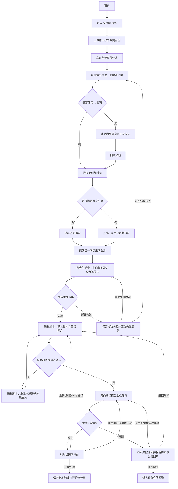

# 喵喵带货需求清单

> 版本：`v0.1.7`  
> 日期：2026-07-23  
> 状态：v0.1.7 视频生成计费规则已更新，等待同步技术实现  
> 产品形态：仅移动端 App（iOS / Android）  
> 参考素材：`01-需求/references/README.md`
> 业务流程：`01-需求/视频带货整体业务流程.md`

## 1. 项目概述

“喵喵带货”是一款面向商家、达人与内容创作者的 AI 带货内容生成 App。产品由“首页、作品、我的”三个一级页面组成。用户上传第一张有效商品图后，系统立即创建一条草稿作品；用户继续补充描述、比例、时长、清晰度和可选形象。提交后，作品进入一个统一的“内容生成中”阶段，系统在该阶段内生成脚本及对应分镜图片。生成完成后进入“编辑脚本”界面，用户确认或修改脚本和分镜图片，再提交视频模型生成最终视频。本版不设置独立配音/TTS 任务。

当前版本的核心价值是缩短商品素材到可发布短视频的制作时间，同时把用户从首张商品图开始的每次创作沉淀为可持续恢复的作品。作品页是统一业务入口，点击作品后按当前状态进入对应界面：草稿进入填写信息，内容生成中进入生成状态，编辑脚本进入确认脚本界面，视频生成中进入视频状态，视频已完成进入成片界面。失败和隐藏作为异常/生命周期状态处理。

核心主张：

> 上传商品，快速生成可发布的带货视频。

## 2. 目标用户

- 缺少拍摄、出镜与剪辑资源，希望快速制作短视频的中小商家。
- 需要批量产出商品种草/带货内容的短视频运营人员。
- 希望复用固定达人形象与口播风格的个人创作者或 MCN 团队。
- 需要先用样片验证商品卖点、视频时长与表达方式的电商从业者。

## 3. 当前版本范围

### 3.1 本期核心范围

- 三个一级页面与底部导航：首页、作品、我的。
- 游客可浏览三个一级页面；进入创作、案例列表、作品详情和账户/资产类二级业务前必须登录。P16 静态内容、P17 意见反馈和 P18 更多设置的访问边界复用“喵喵写歌”当前产品逻辑。
- 首页品牌区、AI 带货视频主入口、能力入口和案例推荐。
- “更多案例”进入独立案例列表页，按后台配置顺序浏览案例并打开视频预览。
- 作品页：展示全部作品、任务阶段、状态、进度和对应提示。
- 我的页：以“喵喵写歌”当前 Flutter `AccountPage` 代码为结构和门禁依据，采用用户头部、会员卡、“积分福利/积分充值”双入口及服务菜单；按用户要求增加兑换码菜单，不展示作品/资产统计。
- 上传 1～3 张商品图，填写最长 300 字商品描述。
- AI 帮写商品描述并回填。
- 选择竖屏 9:16 / 横屏 16:9，选择 10s / 15s / 20s / 30s，并选择 720p / 1080p 清晰度。
- 不指定形象、复用已有形象、上传新形象。
- 定制可在有效期内复用的带货达人。
- 第一张有效商品图上传并保存成功后立即创建草稿作品；后续填写内容持续保存到该作品。
- 提交内容生成任务后，在同一个用户可见状态内完成脚本与对应分镜图片生成；内部可以先生成脚本再逐镜生成图片，但不拆成两个作品业务阶段。
- 作品页按作品状态进入对应业务界面；P06 共享状态页承接内容生成、编辑脚本、视频生成、视频完成与失败，草稿直接进入 P02 填写信息。
- 在“编辑脚本”阶段修改脚本、重新生成全部脚本、编辑单镜头、重新生成或上传替换分镜图片。
- 只有全部镜头脚本和分镜图片均有效且用户确认后，才允许提交视频模型任务。
- 按用户当前确认的脚本与分镜图片由视频模型生成最终视频，不设置独立配音/TTS 或配音任务；任一生成任务开始后不可取消、不可删除。
- 任一阶段失败时保留已完成产物，支持按失败阶段重试、返回修改和联系客服。
- 视频完成界面支持重新编辑脚本与分镜、按当前确认内容重新生成视频、下载和系统分享；该完成界面当前暂无专属 UI 素材。
- 视频生成按“视频时长 × 每秒积分单价 × 清晰度倍率”计费。当前默认每秒 10 积分，720p 倍率为 1.0，1080p 倍率为 1.5；配置后续可调整。视频生成失败时全额退回本次扣除积分，失败后重试或成功后主动重新生成都作为新任务再次计费。
- 商品图、人像、脚本、分镜图片和视频复用现有阿里内容审核能力；所有 AI 生成的图片、形象和视频均展示 AI 生成标识。
- 作品及生成资产在生成完成或最后一次使用后保留 7 天，期满从默认列表隐藏；保留至 30 天后删除。

### 3.2 本期入口保留、统一显示“敬请期待”

- 视频复刻。
- 探店视频。
- AI 商品图。
- 种草笔记。

以上能力首版不展开完整业务；“生成同款”的模板复用能力放到下一版本。

### 3.3 当前不展开

- 专业级多轨视频剪辑、时间线、关键帧与精细转场。
- 自动发布到第三方平台及第三方账号授权。
- 订单、商品库、佣金、投流或电商平台交易闭环。
- 多人协作、团队审批和复杂素材资产管理。
- 会员套餐深度、复杂积分活动和商用版权合同细则。
- 通知中心及任务完成/失败的站内或系统通知。

### 3.4 UI 设计清册基线

- 一级需求共 4 个：首页、带货任务生成、作品、我的；“一级需求”是业务分组，不等同于三个底部一级页面。
- 二级需求共 23 个，唯一页面共 20 个，产品内弹层/弹框共 25 个。
- 20 个页面名称：首页、AI 带货视频—填写信息、AI 帮写描述、定制带货模特、作品、作品预览、我的、登录、账号与安全、积分详情、积分充值、VIP会员、任务中心、支付订单、兑换码、静态内容页、意见反馈、更多设置、推广素材、案例列表。
- P06 的内容生成中、编辑脚本、视频生成中、视频已完成和失败仍按同一个共享状态页计数；草稿复用 P02 填写信息页。任务开始后不存在取消状态或取消确认弹框。系统相册、相机、运营商原生一键登录授权页、系统原生权限框、分享面板和跳转后的操作系统设置页不计入产品 UI 数量。
- 参考工程已注册但当前无生产调用的 `/privacy-consent`、`/privacy-browse` 不计页面；活跃授权链路计为“用户协议与隐私政策”底部弹层。`/payment/web-pay` 仅承接共享支付状态弹框，也不另计页面。P08～P19 仅登记复用范围，不在本项目重复编写详细页需求。
- 页面与 25 个弹层/弹框的 ID、名称、归属、路径、参考图和计数边界以 PRD `requirements.md` 第 3.9 节为唯一真源；App 自绘的版本更新、权限用途说明和权限去设置提示必须计入。

## 4. 核心功能

### 4.1 一级页面与底部导航

- 一级页面固定为：首页、作品、我的。
- 三个页面通过底部导航切换，并保留各自滚动位置；作品页不提供状态筛选。
- 创建、预览和编辑等二级流程不增加一级 Tab；返回时回到进入前的一级页面。
- 游客可以浏览一级页面的公开内容；点击创作、更多案例、作品详情、会员、积分、任务、订单、兑换码或推广素材等二级业务时，先进入登录。
- 登录页、静态内容、意见反馈和更多设置页面框架按“喵喵写歌”当前逻辑允许游客访问；更多设置中的账号与安全、退出登录只在登录后显示。

### 4.2 首页与案例

- 展示品牌和用户头像；首版不提供通知中心。
- 通过上传商品图或“立即生成”进入 AI 带货视频流程。
- 展示视频复刻、探店视频、AI 商品图、种草笔记入口。
- 四个扩展能力统一显示“敬请期待”，不进入空白页面。
- 展示按“全部/美妆/食品/家居/探店”筛选的 AI 生成案例。
- 点击“更多案例”时，游客先登录；登录后进入案例列表页，按后台配置顺序展示更多案例。
- 案例支持视频预览；“生成同款”入口提示下一版本开放。
- 可展示最近作品，点击后同样按作品当前状态进入对应业务界面。

### 4.3 作品页

- 展示当前用户的全部带货作品，而不是只展示成功视频。
- 卡片至少包含封面、名称、更新时间、视频参数、作品状态、当前阶段和进度。
- 不提供状态筛选；按最近更新时间统一展示当前可见作品。
- 点击作品后按当前状态恢复对应业务：草稿进入填写信息；内容生成中进入生成状态；编辑脚本进入确认脚本界面；视频生成中进入视频状态；视频已完成进入成片界面；失败进入相应失败恢复界面。
- 空状态提供“开始创作”入口；加载失败可重试。
- 生成任务运行中不提供删除、取消或重命名；用户可离开页面，任务继续运行。
- 视频已完成界面支持下载、系统分享、重新编辑脚本与分镜、重新生成视频和删除；重新编辑时创建新的可编辑内容版本，重新生成会再次消耗积分。
- 完成或最后使用满 7 天的内容自动从作品列表隐藏；若用户仍停留在页面或通过未失效的历史入口访问，则作品状态页只展示已隐藏说明。满 30 天后删除并不可恢复。

### 4.4 我的页

- 业务依据为当前 Flutter 代码 `/Users/soul/code/lxwx/catsinger/lib/pages/account/view.dart`、`controller.dart` 和路由代码，不以旧 PRD 的“四快捷 + 六菜单”为准。
- 页面从上到下为：用户头部、会员卡、两个快捷入口、菜单列表、底部导航。
- 用户头部展示右上积分胶囊、设置按钮、头像和脱敏账号/“立即登录”；游客积分胶囊显示 `0`，登录后显示真实余额；不展示作品总数、待确认、已完成、今日剩余或下载数等资产统计。
- 两个快捷入口为“积分福利”和“积分充值”；积分详情通过右上积分胶囊进入。会员卡是唯一会员入口，按未开通/已开通展示开通或续费。
- 菜单按“订单列表、兑换码、意见反馈、联系客服、更多设置”排列；兑换码是用户明确要求的喵喵带货新增菜单，参考代码已有页面和路由但当前 AccountPage 尚未展示入口。
- 任务中心按参考代码定义为总积分、连续签到和每日任务（当前代码首版为邀请好友）；点击“去邀请”进入推广素材页，可复制链接或保存二维码海报。该流程不是视频生成任务中心，也不属于作品业务。
- 游客可进入本页查看公共页面框架；头像登录、积分、会员、积分福利、充值、订单、兑换码和推广素材等账户/资产业务需先确认用户协议与隐私政策并登录。静态内容、意见反馈和更多设置按“喵喵写歌”当前逻辑可直接进入；更多设置中的账号安全与退出登录仅登录后出现。
- 登录页先检测运营商一键登录环境；可用时拉起系统原生授权页，不可用、取消或失败时回退短信验证码登录。积分充值的支付过程由产品内阻塞弹框承接，结果使用 Toast/返回，不新增成功或失败页。
- 更多设置包含用户协议、隐私政策、算法备案、当前版本、检查更新、清理缓存、缓存上限；登录后显示账号与安全和退出登录，不虚构“关于”入口。
- 结构和门禁参考代码，但视觉继续使用“喵喵带货”的暖白、橙红品牌风格和三个底部 Tab，不复制深色主题、音乐文案或固定价格。

### 4.5 商品信息填写

- 上传 1～3 张商品图，至少 1 张。
- 输入 1～300 字商品描述；支持清空、粘贴与 AI 帮写。
- 选择视频比例、视频时长与视频清晰度。
- 选择不指定形象或上传/复用人物形象。
- 第一张有效商品图上传并保存成功后立即创建草稿作品；后续描述、参数和形象选择持续保存到该草稿。
- 必填项满足后，从现有草稿提交统一“内容生成”任务，不再创建第二条作品。
- 游客点击进入填写页时先登录；登录成功后再开始填写。

### 4.6 AI 帮写描述

- 从已上传商品图和当前描述带入上下文。
- 编辑商品名称、目标人群、核心卖点、使用场景和语言风格。
- 核心卖点支持多选与新增。
- 生成描述后支持重新生成和回填原页面。

### 4.7 带货形象

- 不指定形象时由系统随机匹配可用形象。
- 上传人物正脸照并保存为可复用个人资产。
- 在 D05“选择带货形象”弹层内展示已有形象，支持选择、重命名与删除；不在“我的”页新增形象入口或独立形象页。
- 识别失败时明确提示并允许重新上传。
- 支持定制达人，配置性别、年龄段、风格、体型、外貌细节和口播气质。

### 4.8 作品状态页面与脚本编辑

- 上传首张有效商品图后作品即以草稿状态存在；作品页点击草稿返回 P02 并恢复已保存内容。
- 用户提交后进入“内容生成中”。该状态同时代表脚本与分镜图片的整体生成过程；系统内部先产出脚本，再自动按镜头生成图片，用户不需要在两者之间确认或提交。
- 内容全部生成后进入“编辑脚本”，对应现有 UI 素材中的“确认脚本”界面。该界面展示完整脚本、镜头和分镜图片。
- 编辑脚本时支持修改画面/口播、重新生成单镜头脚本、重新生成或上传替换分镜图片、整稿重生成。
- 每个镜头必须同时具备有效脚本与可用分镜图片；存在生成中、失败或未确认项时不能提交视频模型。

### 4.9 视频模型生成

- 用户在“编辑脚本”界面确认全部脚本和分镜图片后提交视频生成任务。
- 视频模型以已确认的分镜图片为主要画面输入生成最终成片；不设置独立配音/TTS 任务或用户流程。
- 提交前展示视频时长、每秒积分单价、清晰度倍率和预计总消耗；当前默认每秒 10 积分，720p 为 1.0 倍，1080p 为 1.5 倍。
- 视频生成状态界面展示进度；支持离开页面后继续生成，但任务开始后不可取消、不可删除。
- 成功后进入“视频已完成”界面。该界面当前暂无专属 UI 素材，需展示播放器、作品信息和 AI 标识。
- 视频已完成界面支持重新编辑脚本与分镜、按当前确认内容重新生成视频、下载、系统分享和删除。重新编辑创建新内容版本，旧成片保留到新视频成功或按规则删除。
- 失败后保留商品、参数、脚本、分镜图片和已有成功视频，自动全额退回本次视频任务扣除的积分；支持重试、返回编辑脚本或联系客服，重新生成按新任务再次计费。

## 5. 关键流程

作品页恢复规则：作品从上传第一张有效商品图开始存在。点击卡片后根据状态进入对应业务界面，而不是统一显示一张泛化预览页：草稿进入填写信息，内容生成中进入生成状态，编辑脚本进入确认脚本界面，视频生成中进入视频状态，视频已完成进入成片界面。失败进入发生阶段对应的恢复界面，已隐藏只展示到期说明。

## 6. 内容与保存规则

### 6.1 用户可见内容

| 内容 | 产品说明 |
|------|----------|
| 商品素材 | 商品图片、描述和用于生成的商品信息 |
| 带货形象 | 用户上传或 AI 定制的形象，可在后续创作中复用 |
| 脚本与分镜 | 生成的脚本、镜头描述、口播和每个镜头的分镜图片 |
| 作品 | 聚合展示商品、视频参数、当前状态、脚本、分镜图片和最终视频 |
| 案例 | 由后台配置的案例分类、封面、视频和标签 |

### 6.2 状态与恢复

- 主流程用户状态固定为：草稿、内容生成中、编辑脚本、视频生成中、视频已完成。
- 失败和已隐藏不属于五个主流程阶段，分别作为异常状态与生命周期状态展示。
- 任务开始后不可取消、不可删除；用户可以离开页面，任务继续生成。
- 失败时保留已完成的脚本和分镜图片，用户可重试、修改后重生成或联系客服。
- App 退出、切后台或重新打开后，用户可从作品页进入当前状态对应的业务界面。

### 6.3 隐藏与删除

- 作品、脚本历史版本、分镜图片、失败记录、视频和个人形象统一执行“7 天隐藏、30 天删除”。
- 7 天从生成完成或最后一次使用起计算；到期后从作品列表隐藏，不提供“已隐藏”筛选。若用户仍停留在详情或通过未失效的历史入口访问，只展示已隐藏说明和删除日期。
- 30 天到期后删除对应内容，不再提供恢复；运行中任务及其当前输入不进入清理。
- 页面应展示剩余有效期或到期说明，但不发送站内消息或系统通知。

## 7. 产品体验与合规要求

- 产品仅提供 iOS / Android App，不建设 Web 或 H5 业务端。
- 上传、内容生成（脚本与分镜图片）和视频生成都要有清晰的加载、进度、失败与重试反馈。
- 用户上传的人像与商品素材属于隐私/商业素材，上传前需要授权提示。
- 商品、人像、脚本、分镜图片和视频内容复用现有阿里审核能力。
- AI 生成的分镜图片、达人形象和视频成片均需要清晰的 AI 生成标识或水印。
- 首页“30 秒生成”仅是营销表达，不作为完成时限承诺。
- 不发送任务完成或失败通知；用户通过作品页查看状态。

## 8. 已确认产品决策

- 仅做移动 App；游客可浏览一级页面，进入创作、案例、作品和账户/资产类二级业务前登录；P16/P17/P18 按喵喵写歌当前访问逻辑执行。
- 横屏 16:9 首版开放；单镜头口播不是必填，允许纯画面镜头。
- 分镜图片支持重新生成、上传替换和历史版本选择；整稿历史版本支持查看与恢复。
- 作品页不提供筛选，按最近更新时间展示当前可见作品；运行中卡片只展示状态，不提供删除或取消。
- P08～P19 复用喵喵写歌现有产品逻辑，本项目只登记页面名称、入口和复用来源，不重复编写详细页需求；积分消耗规则使用喵喵带货规则。
- 第一张有效商品图上传后立即创建草稿；作品五个主状态为草稿、内容生成中、编辑脚本、视频生成中、视频已完成。
- 视频已完成界面支持重新编辑脚本与分镜、重新生成视频、下载、系统分享和删除；重新生成消耗积分，完成态当前暂无专属 UI 素材。
- 客服复用喵喵写歌现有承接方式，不自动创建包含作品诊断信息的工单。
- 案例由后台配置；“更多案例”进入独立案例列表页；“生成同款”放到下一版本；首版不做通知中心。

## 9. 产品文档边界

本清单和 PRD 只描述用户场景、页面、产品规则、内容状态、异常反馈和验收口径。接口字段、内部任务状态码、扣费事务、审核调用、存储清理、实时同步和防重复提交等实现方式，统一在后续技术方案中说明。
## CHG-0044：作品详情编辑补充

- 作品详情以 Figma `31:96`（横屏）、`31:148`（竖屏）为视觉真源，标题编辑弹框以 `32:268` 为视觉真源。
- 标题和商品脚本均可修改；商品脚本指当前脚本版本内各镜头的画面描述与口播，不是填写页商品卖点。
- 标题通过带预填值、取消和确定操作的底部弹框修改，最长 24 字；无变化不发请求。
- 商品脚本按“镜头、画面、口播”直接编辑，不支持新增、删除、排序或修改时长；失焦或键盘完成时保存当前变化分镜。
- 详情编辑只允许已完成且没有活动任务的作品，且不得改变作品状态、任务进度、失败信息、当前脚本指针、当前/历史发布视频或最近使用时间。
- 保存失败保留本地输入并允许重试；保存成功停留当前页面并刷新详情。无分镜时显示“暂无商品脚本”且不可编辑。
