# 喵喵带货产品需求文档（PRD）

> 版本：`v0.1.7`  
> 创建日期：2026-07-20  
> 最近修订：2026-07-23  
> 状态：v0.1.7 视频生成计费规则已更新，等待同步技术实现  
> 产品形态：仅移动端 App（iOS / Android）  
> 当前范围：AI 带货视频核心链路  
> 需求输入：
> - `01-需求/requirements-list.md`
> - `01-需求/视频带货整体业务流程.md`
> - `01-需求/references/README.md`
> - `01-需求/references/images/`

---

## 1. 产品概述

### 1.1 产品名称

喵喵带货。

### 1.2 产品定位

喵喵带货是一款面向商家、达人和内容运营人员的 AI 带货内容生成 App。产品由“首页、作品、我的”三个一级页面组成。用户上传第一张有效商品图后，系统立即创建草稿作品；用户继续补充商品描述、视频参数和可选形象。提交后，作品在一个统一的“内容生成中”阶段完成脚本和对应分镜图片，再进入“编辑脚本”界面供用户检查和修改。确认无误后提交视频模型，最终在“视频已完成”界面播放、下载、分享或继续重新编辑与生成。

本版不设置独立配音/TTS 任务，也不把配音、字幕或画面处理拆成用户可操作的独立业务阶段；若视频模型原生输出音频或字幕，均视为最终视频结果的一部分。

产品不以专业剪辑能力为核心，而是用五个清晰、可恢复的作品主阶段降低带货视频制作门槛：

> 草稿（填写带货信息）→ 内容生成中（脚本与分镜图片）→ 编辑脚本 → 视频生成中 → 视频已完成

### 1.3 用户价值

- 少拍摄：没有真人出镜条件时，可随机匹配、上传或定制带货形象。
- 少写稿：根据商品图和结构化卖点自动生成口播文案。
- 少剪辑：由视频模型根据已确认的脚本和分镜图片生成最终视频。
- 可控制：视频生成前可检查全部脚本与分镜图片，也可逐镜头修改、重新生成或替换图片。
- 可恢复：首张商品图上传后即形成草稿作品，作品页按状态恢复对应业务，失败后保留已有内容。

### 1.4 目标用户

- 需要低成本制作商品短视频的中小商家。
- 需要高频产出带货素材的电商运营人员。
- 希望固定达人形象和表达风格的个人创作者或 MCN 团队。
- 需要快速验证商品卖点和内容方向的市场、选品与广告人员。

### 1.5 产品目标

- 让首次使用者无需学习专业剪辑即可完成一条带货视频。
- 提升从商品素材到首版脚本、从脚本到视频的交付效率。
- 通过脚本/分镜图片可编辑、形象可复用和失败可恢复，提高生成结果可用率。
- 用作品聚合任务、版本和产物，让用户始终从作品页进入当前状态对应的业务界面并继续操作。
- 为后续视频复刻、探店视频、AI 商品图和种草笔记等能力建立统一首页与资产基础。

### 1.6 建议衡量指标

| 指标 | 定义 | 初版关注点 |
|------|------|------------|
| 信息填写完成率 | 进入填写页后成功提交内容生成任务的用户占比 | 判断输入门槛是否过高 |
| 编辑脚本确认率 | 脚本与分镜图片生成成功后提交视频模型的作品占比 | 判断中间产物质量与编辑成本 |
| 视频模型生成成功率 | 发起视频生成后成功产出视频的任务占比 | 核心稳定性指标 |
| 首次成功耗时 | 从进入填写页到首条视频成功的中位时长 | 验证效率价值 |
| 单镜头修改率 | 被编辑或重生成的镜头占比 | 识别脚本薄弱环节 |
| 分镜图修改率 | 被重新生成或上传替换的分镜图片占比 | 识别图像生成薄弱环节 |
| 形象复用率 | 生成任务中使用已有形象的比例 | 判断个人资产价值 |
| 失败重试成功率 | 首次失败后重试并成功的比例 | 判断恢复链路质量 |

---

## 2. 当前版本范围

### 2.1 MVP 必做范围

1. 首页、作品、我的三个一级页面与底部导航。
2. 游客可浏览三个一级页面；进入创作、案例列表、作品详情和账户/资产类二级业务前必须登录。P16 静态内容、P17 意见反馈和 P18 更多设置按“喵喵写歌”当前访问逻辑处理。
3. 首页 AI 带货视频入口、案例、更多案例列表和最近作品入口。
4. 作品页展示全部作品、状态、阶段和进度；点击作品后按当前状态进入填写、内容生成、编辑脚本、视频生成或视频完成界面。
5. 我的页采用用户头部、会员卡、积分福利/积分充值双入口及服务菜单；增加兑换码菜单，不展示作品/资产统计。
6. 上传 1～3 张商品图片；第一张有效商品图上传并保存成功后立即创建草稿作品，再继续填写或 AI 帮写商品描述。
7. 竖屏 9:16 与横屏 16:9 首版均开放；视频时长支持 10s / 15s / 20s / 30s；视频清晰度支持 720p / 1080p。
8. 选择不指定形象、上传新形象、复用已有形象或定制达人。
9. 提交后进入一个用户可见的“内容生成中”阶段；该阶段内部先生成脚本分镜，再自动按镜头生成对应分镜图片，不拆成两个业务状态。
10. 内容完成后进入“编辑脚本”界面确认或修改脚本与分镜图片；口播不是必填，允许纯画面镜头。
11. 分镜图片支持重新生成、上传替换和历史版本选择；整稿历史版本支持查看与恢复。
12. 只有全部镜头内容和图片可用且已确认，才允许提交视频生成。
13. 视频模型以已确认的分镜图片为主要画面输入生成最终视频，不设置独立配音/TTS 流程。
14. 提交视频生成前展示视频时长、每秒积分单价、清晰度倍率和预计积分。当前默认每秒 10 积分，720p 为 1.0 倍，1080p 为 1.5 倍；视频生成失败全额退回本次积分，每次重新生成都作为新任务再次消耗积分。
15. 任一生成任务开始后不可取消、不可删除；用户离开页面后任务继续运行，失败后可重试。
16. 视频已完成界面支持重新编辑脚本与分镜、按当前确认内容重新生成视频、下载、系统分享和删除；完成态当前暂无专属 UI 素材。
17. 作品及相关内容 7 天后从默认列表隐藏，30 天后删除。
18. 所有 AI 生成的分镜图片、达人形象和视频成片展示 AI 生成标识。
19. P08～P19 复用“喵喵写歌”现有产品逻辑，本项目保留页面名称、入口和复用关系，不重复编写详细页需求。

### 2.2 首页保留入口，但不纳入本期完整实现定义

- 视频复刻。
- 探店视频。
- AI 商品图。
- 种草笔记。
- “生成同款”复用模板参数的完整能力（下一版本实现）。

前四项入口首版统一显示“敬请期待”，不得进入无内容页面；“生成同款”统一提示下一版本开放。

### 2.3 本期不做

- 专业级多轨剪辑、时间线、关键帧、转场曲线和音轨混剪。
- 自动发布抖音、小红书、视频号等第三方平台。
- 电商订单、商品库存、佣金、投流与交易结算。
- 多人协作、团队审批、企业级素材权限。
- 批量导入商品与批量生成视频。
- 面向用户承诺固定 30 秒内完成端到端视频生成。
- Web / H5 业务端。
- 通知中心，以及任务完成/失败的站内消息或系统通知。

### 2.4 设计素材口径

- 10 张页面图作为本版页面层级、文案语义、状态和交互关系的主要参考。
- 图中的商品、人物、案例数据和互动数字均为示例，不作为固定数据。
- “30 秒生成”暂按营销文案处理；真实完成时长由任务预计时间和服务能力决定。
- 作品状态页的“视频已完成”界面未提供素材，本版只定义必要行为，不虚构完整视觉布局。
- 原始素材中的“生成配音”“字幕配音”“合成视频”等文字属于旧方案，只参考布局、信息层级和状态表达，不作为本版业务或文案依据。

---

## 3. 整体流程

### 3.1 一级页面流

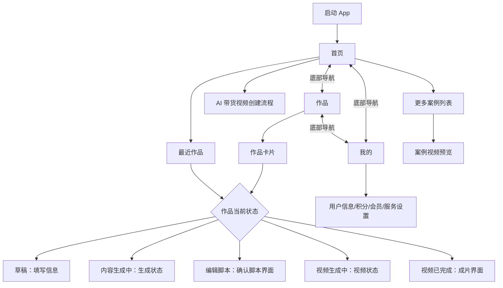

- App 仅设置“首页、作品、我的”三个一级页面；这与“喵喵写歌”的四 Tab 不同，是本项目的明确产品决定。
- AI 带货视频创建属于首页发起的二级业务，不单独占用一级 Tab。
- 游客进入创作、更多案例、作品详情和账户/资产类二级业务时先登录；静态内容、意见反馈和更多设置按“喵喵写歌”当前逻辑处理。
- 首页最近作品和作品页列表都是作品业务入口；点击后根据服务端最新状态进入对应业务界面。本版不提供任务通知入口。

### 3.2 核心创作流程

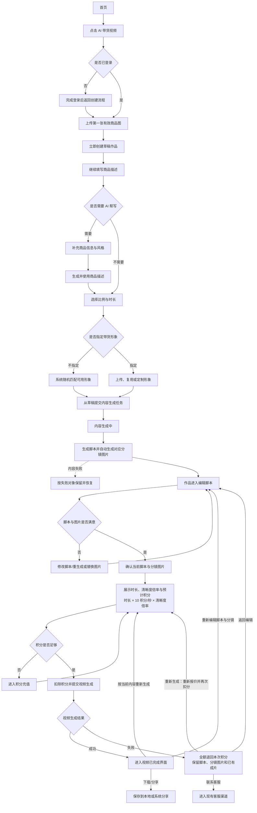

### 3.3 作品页按状态恢复业务

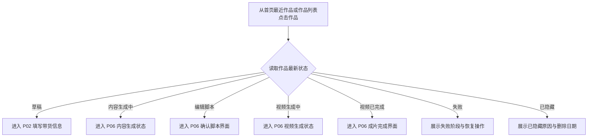

作品卡片只有一个点击入口，但入口会先读取作品最新状态，再恢复相应业务。产品语义上不再把所有状态统称为“作品预览”：草稿是填写业务，内容生成中是生成业务，编辑脚本是确认/修改业务，视频生成中是视频任务业务，视频已完成是成片业务。技术上 P06 可以共享路由和页面壳，但每个状态必须展示对应界面。作品页不提供筛选；内容隐藏后自动移出列表，已打开页面或未失效历史入口只显示已隐藏说明。

### 3.4 作品生命周期

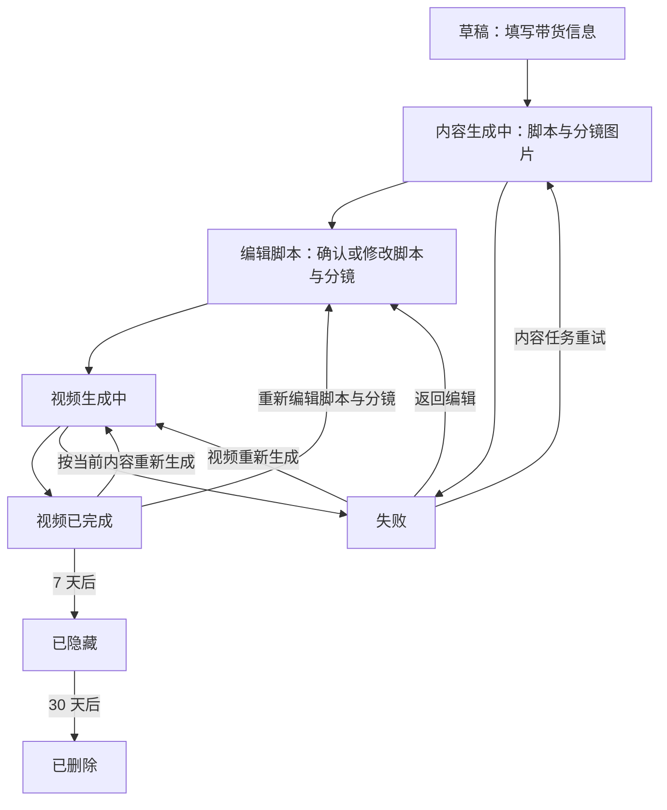

五个主阶段只表达用户需要理解和继续处理的业务。内容生成中内部仍可依次执行“文本脚本 → 逐镜分镜图片”，但作品页只展示一个内容生成状态。失败和已隐藏不计入五个主阶段。任一生成任务开始后，用户不可取消任务或删除运行中的作品；用户可以离开页面，之后从作品页进入最新状态对应界面。

### 3.5 状态与业务映射

| 作品状态 | 作品页卡片 | 点击后进入的业务界面 | 允许操作 |
|----------|------------|----------------------|----------|
| 草稿 | 草稿 | P02 填写带货信息，恢复已上传图片和其余输入 | 继续填写、删除草稿 |
| 内容生成中 | 内容生成中 + 总进度 | P06 内容生成状态，统一展示脚本与分镜图片整体进度 | 返回作品页；不可取消、删除或修改 |
| 编辑脚本 | 编辑脚本 | P06 确认脚本界面，展示全部镜头、脚本和分镜图片 | 编辑脚本、重生成/替换图片、查看历史版本、确认并生成视频 |
| 视频生成中 | 视频生成中 + 进度 | P06 视频生成状态，展示已确认内容、积分和视频进度 | 返回作品页；不可取消、删除或修改 |
| 视频已完成 | 已完成 | P06 成片完成界面（当前暂无专属 UI 素材） | 播放、重新编辑脚本与分镜、重新生成、下载、系统分享、删除 |
| 失败 | 失败 + 失败阶段 | 进入失败发生阶段对应的恢复界面 | 视频失败时全额退回本次积分；重试需重新报价并再次扣分，也可返回填写/编辑、联系客服或删除 |
| 已隐藏 | 不展示 | 隐藏说明和 30 天删除时间（仅已打开页或未失效历史入口） | 返回作品页、主动删除；不可播放、下载、分享或恢复 |

### 3.6 失败恢复规则

| 失败阶段 | 必须保留 | 页面展示 | 用户下一步 |
|----------|----------|----------|------------|
| 内容生成—脚本失败 | 草稿输入、商品、参数和形象 | 内容生成失败，说明失败对象为脚本 | 原输入重试，或返回填写页修改后重新提交 |
| 内容生成—分镜图片失败 | 已完成脚本、成功图片和失败镜头 | 仍属于内容生成失败，逐镜标记成功/失败 | 只重试失败镜头；全部可用后进入编辑脚本 |
| 视频生成失败 | 商品、形象、脚本、已确认分镜图片和此前成功视频 | 视频失败原因、本次积分全额退回结果和客服入口 | 重新生成时作为新任务重新报价并再次扣分，或返回编辑脚本 |

### 3.7 离开与恢复流程

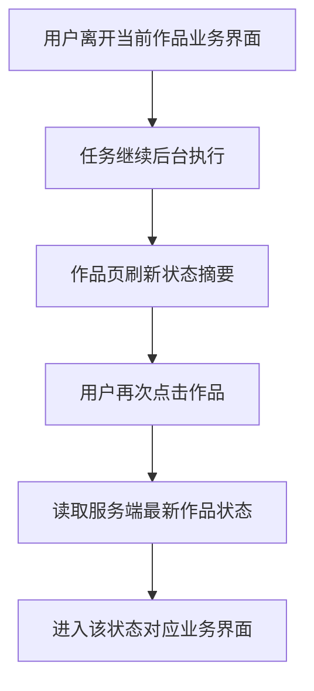

### 3.8 关键流程规则

- 上传并成功保存第一张有效商品图时立即创建草稿作品；图片上传失败或审核不通过时不创建。
- 商品图和商品描述是内容生成的必填输入；比例、时长有默认选项但必须保存明确值。
- AI 帮写描述是可选辅助流程，生成结果只有在用户点击“使用这段描述”后才覆盖填写页内容。
- 带货形象可选；不指定时由系统选择具备授权且适配当前任务的可用形象。
- 游客可浏览一级页面；进入创作、案例列表、作品详情和账户/资产类二级业务前必须登录，P16/P17/P18 的访问边界复用“喵喵写歌”当前逻辑。
- 提交内容生成任务时复用已存在的草稿作品，不得创建第二条作品；脚本、分镜图片和视频生成均归属于该作品。
- 用户只看到一个“内容生成中”状态；该状态内部文本脚本成功后自动生成分镜图片，不能绕过分镜图片直接进入编辑脚本或生成最终视频。
- 用户修改画面描述后，对应分镜图片需重新生成、替换或重新确认。
- 每个镜头的内容和分镜图片均有效后，才允许提交视频生成。
- 提交视频前展示“视频时长 × 每秒积分单价 × 清晰度倍率 = 预计积分”。当前默认每秒 10 积分，720p 为 1.0 倍，1080p 为 1.5 倍；单价和倍率均可由后台调整，积分不足时先充值。
- 用户确认提交视频生成后扣除本次积分；生成失败时自动全额退回本次扣除积分。失败后重试、成功后直接重新生成、修改脚本或分镜后重新生成，都作为新的生成任务重新报价并再次扣分。
- 生成任务开始后不可取消、不可删除；任一阶段失败时保留已完成内容并提供最小范围重试。
- 视频已完成后可从完成界面重新编辑脚本与分镜，或直接按当前确认内容重新生成视频；两种操作都保留已有成功视频，直到新视频成功替换当前结果或内容到期删除。
- 作品与生成内容 7 天后隐藏、30 天后删除；不发送任务完成或失败通知。
- 所有生成内容复用阿里审核能力，并展示 AI 生成标识。

### 3.9 UI 需求清单（设计交付范围）

本节是 UI 设计的界面总清单，放在信息架构之前作为排期、出图和验收索引。“一级需求”表示业务需求分组，不等同于底部一级页面；底部一级页面仍只有“首页、作品、我的”3 个。

#### 3.9.1 数量汇总

| 类型 | 数量 | 口径 |
|------|------|------|
| 一级需求 | **4 个** | 首页、带货任务生成、作品、我的 |
| 二级需求 | **23 个** | 按下表可独立评审的业务能力计数 |
| 唯一页面 | **20 个** | 按当前可达业务的唯一视觉页面计数；同一路由的加载、空、失败和任务状态不重复计页 |
| 产品内弹层/弹框 | **25 个** | 全屏层、底部弹层、顶部覆盖层、操作菜单和确认框均计入；复用组件只计一次 |

#### 3.9.2 一级需求 → 二级需求

| 一级需求 | 二级需求 | 主要页面 | 主要弹层/弹框 | 业务说明 |
|----------|----------|----------|---------------|----------|
| 首页 | 1. 首页主页面与导航 | P01 首页 | D24、D25 | 品牌、上传商品图主入口、案例、三个底部 Tab；选择媒体使用统一权限覆盖层 |
| 首页 | 2. 案例浏览与生成同款 | P01 首页、P20 案例列表 | D01 案例视频预览 | 首页展示推荐案例，“更多案例”进入列表；生成同款下一版本开放 |
| 首页 | 3. 预留能力反馈 | P01 首页 | D02 功能未开放提示 | 视频复刻、探店视频、AI 商品图、种草笔记等未实现入口统一显示“敬请期待” |
| 带货任务生成 | 1. 填写商品与视频参数 | P02 AI 带货视频—填写信息 | D03、D04、D24、D25 | 登录后上传商品图、填写描述、选择比例和时长；媒体权限使用统一覆盖层 |
| 带货任务生成 | 2. AI 帮写商品描述 | P03 AI 帮写描述 | — | 结构化补充信息、生成、重生成并明确回填 |
| 带货任务生成 | 3. 选择与管理带货形象 | P02 AI 带货视频—填写信息 | D05～D08、D24、D25 | 不指定、上传、复用、重命名和删除形象；首版在选择弹层内完成管理，不新增独立形象页；上传人物素材使用统一权限覆盖层 |
| 带货任务生成 | 4. 定制带货模特 | P04 定制带货模特 | D09、D24、D25 | 配置并生成可复用达人形象；上传人物素材前确认肖像授权和媒体权限 |
| 带货任务生成 | 5. 草稿与内容生成任务 | P02 AI 带货视频—填写信息、P06 作品状态页 | — | 首张有效商品图上传后创建草稿；必填完成后提交统一内容生成任务 |
| 作品 | 1. 作品列表 | P05 作品 | D10 作品操作菜单、D11 删除作品确认 | 无筛选展示当前可见作品、状态、进度和恢复入口 |
| 作品 | 2. 按状态恢复作品业务 | P02 填写信息、P06 作品状态页 | D03 图片预览 | 草稿进入填写；其余主状态进入对应的生成、编辑、视频或完成界面 |
| 作品 | 3. 编辑脚本与分镜图片 | P06 作品状态页 | D12 整稿重新生成确认 | 对应“确认脚本”UI，逐镜检查脚本和图片，问题未解决前禁止生成视频 |
| 作品 | 4. 单镜头编辑 | P06 作品状态页 | D13、D14、D24、D25 | 修改画面/口播、重生成或上传替换分镜图片；上传替换图使用统一权限覆盖层 |
| 作品 | 5. 视频模型生成与结果 | P06 作品状态页 | — | 展示积分预估、生成进度和完成结果；完成态支持重新编辑、重生成、下载和分享 |
| 作品 | 6. 作品管理 | P02 填写信息、P05 作品、P06 作品状态页 | D10、D11 | 首图创建草稿；非运行中作品可删除，运行中不可删除；作品重命名不纳入本版基线 |
| 我的 | 1. 用户身份与登录 | P07 我的、P08 登录 | D15 用户协议与隐私政策 | 游客可浏览一级页；账户/资产业务先确认协议并登录，P16/P17/P18 按复用逻辑访问 |
| 我的 | 2. 积分详情 | P10 积分详情 | — | 右上积分胶囊展示余额并作为入口；详情页展示收入/支出流水，不重复展示余额卡 |
| 我的 | 3. VIP 会员 | P12 VIP会员 | D17 支付处理中 | 会员卡是唯一会员入口，按登录/会员状态展示开通或续费 |
| 我的 | 4. 积分福利 / 任务中心 | P13 任务中心、P19 推广素材 | D16、D24、D25 | 总积分、连续签到和每日任务；首版“邀请好友”进入推广素材页，保存海报使用统一权限覆盖层 |
| 我的 | 5. 积分充值 | P11 积分充值 | D17 支付处理中 | 展示积分套餐、支付方式和协议；支付过程由 D17 承接，结果使用 Toast/返回，不新增结果页 |
| 我的 | 6. 支付订单 | P14 支付订单 | D18 取消订单确认、D19 删除订单确认 | 仅平台会员/积分消费订单，不表示电商商品订单 |
| 我的 | 7. 兑换码 | P15 兑换码 | — | 页面/路由在参考代码中已存在；按用户要求新增到喵喵带货“我的”菜单，成功显示页内结果卡，失败 Toast |
| 我的 | 8. 客服与反馈 | P16 静态内容页、P17 意见反馈 | — | 客服、协议和备案复用静态内容页壳；反馈页填写内容和可选联系方式，不提供类型选择 |
| 我的 | 9. 更多设置与账号安全 | P18 更多设置、P09 账号与安全 | D20～D23 | 协议、版本、更新、缓存；登录后显示账号安全、退出和注销能力 |

#### 3.9.3 唯一页面清单（20 个）

| ID | 页面名称 | 所属一级需求 | 主要入口 | UI 交付范围 | 参考图 |
|----|----------|--------------|----------|---------------|--------|
| P01 | 首页 | 首页 | App 启动 / 首页 Tab | 完整页面与全状态 | [01-首页](references/images/01-首页.png) |
| P02 | AI 带货视频—填写信息 | 带货任务生成 | 首页主创作入口 | 完整页面与表单状态 | [02-填写信息](references/images/02-AI带货视频-填写信息.png) |
| P03 | AI 帮写描述 | 带货任务生成 | 填写页“AI 帮写” | 完整页面与生成状态 | [03-AI帮写](references/images/03-AI帮写描述.png) |
| P04 | 定制带货模特 | 带货任务生成 | 选择形象弹层“定制达人” | 完整页面与生成状态 | [05-定制模特](references/images/05-定制带货模特.png) |
| P05 | 作品 | 作品 | 作品 Tab | 无筛选作品列表、空/错/加载状态；仅展示未隐藏作品 | [喵喵写歌—作品列表（仅结构参考）](../../喵喵写歌/01-需求/references/images/v1.0/作品/作品-作品.png) |
| P06 | 作品状态页 | 作品（亦承接任务提交） | 作品卡片 / 提交任务后进入 | **共享页面壳的状态界面**：内容生成中、编辑脚本、视频生成中、视频已完成、失败、已隐藏；草稿进入 P02。完成态暂无专属 UI 素材 | [06](references/images/06-生成脚本.png)、[07](references/images/07-确认脚本.png)、[09](references/images/09-合成视频-生成中.png)、[10](references/images/10-合成视频-失败.png) |
| P07 | 我的 | 我的 | 我的 Tab | 完整页面；以当前 Flutter `AccountPage` 为结构依据，不含资产统计 | [AccountPage 当前代码](/Users/soul/code/lxwx/catsinger/lib/pages/account/view.dart)；与代码一致的运行截图待补 |
| P08 | 登录 | 我的 | 任一受保护二级业务 | 复用“喵喵写歌”登录页及现有业务逻辑 | [AuthPage 当前代码](/Users/soul/code/lxwx/catsinger/lib/pages/auth/view.dart) |
| P09 | 账号与安全 | 我的 | 更多设置 | 复用“喵喵写歌”账号与安全页及现有业务逻辑 | [AccountSecurityPage 当前代码](/Users/soul/code/lxwx/catsinger/lib/pages/settings/account_security/view.dart) |
| P10 | 积分详情 | 我的 | 我的页积分胶囊 | 复用“喵喵写歌”积分详情页及现有业务逻辑 | [PointsLedgerPage 当前代码](/Users/soul/code/lxwx/catsinger/lib/pages/points/ledger/view.dart) |
| P11 | 积分充值 | 我的 | 我的页“积分充值” | 复用“喵喵写歌”积分充值页；积分消耗/充值配置以喵喵带货规则为准 | [PointsRechargePage 当前代码](/Users/soul/code/lxwx/catsinger/lib/pages/payment/points_recharge/view.dart) |
| P12 | VIP会员 | 我的 | 我的页会员卡 | 复用“喵喵写歌”VIP 会员页及现有业务逻辑 | [MembershipPage 当前代码](/Users/soul/code/lxwx/catsinger/lib/pages/payment/membership/view.dart) |
| P13 | 任务中心 | 我的 | 我的页“积分福利” | 复用“喵喵写歌”任务中心及现有业务逻辑 | [TaskCenterPage 当前代码](/Users/soul/code/lxwx/catsinger/lib/pages/account/task_center/view.dart) |
| P14 | 支付订单 | 我的 | 我的页“订单列表” | 复用“喵喵写歌”支付订单页及现有业务逻辑 | [PaymentOrdersPage 当前代码](/Users/soul/code/lxwx/catsinger/lib/pages/payment/orders/view.dart) |
| P15 | 兑换码 | 我的 | 我的页“兑换码” | 复用“喵喵写歌”兑换码页及现有业务逻辑 | [RedeemCodePage 当前代码](/Users/soul/code/lxwx/catsinger/lib/pages/account/redeem_code/view.dart) |
| P16 | 静态内容页 | 我的 | 客服 / 协议 / 备案入口 | 复用“喵喵写歌”静态内容页及现有业务逻辑 | [StaticPageView 当前代码](/Users/soul/code/lxwx/catsinger/lib/pages/webview/view.dart) |
| P17 | 意见反馈 | 我的 | 我的页“意见反馈” | 复用“喵喵写歌”意见反馈页及现有业务逻辑 | [FeedbackPage 当前代码](/Users/soul/code/lxwx/catsinger/lib/pages/settings/feedback/view.dart) |
| P18 | 更多设置 | 我的 | 我的页“更多设置” | 复用“喵喵写歌”更多设置页及现有业务逻辑 | [SettingsPage 当前代码](/Users/soul/code/lxwx/catsinger/lib/pages/settings/view.dart) |
| P19 | 推广素材 | 我的 | 任务中心“去邀请” | 复用“喵喵写歌”推广素材页及现有业务逻辑 | [InviteMaterialsPage 当前代码](/Users/soul/code/lxwx/catsinger/lib/pages/invite/materials/view.dart) |
| P20 | 案例列表 | 首页 | 首页“更多案例” | 登录后按后台配置顺序展示案例；不提供筛选；点击案例进入 D01 预览，“生成同款”提示下一版本开放 | [01-首页案例区](references/images/01-首页.png)、[作品列表结构参考](../../喵喵写歌/01-需求/references/images/v1.0/作品/作品-作品.png) |

#### 3.9.4 产品内弹层 / 弹框清单（25 个）

| ID | 名称 | 类型 | 触发位置 | 关键内容 / 操作 |
|----|------|------|----------|-----------------|
| D01 | 案例视频预览 | 全屏层 | P01/P20 案例卡片 | 播放案例、关闭；生成同款显示下一版本开放 |
| D02 | 功能未开放提示 | 提示弹框 | P01 预留能力入口 | 统一显示“敬请期待”、关闭；不得进入空白页 |
| D03 | 图片预览 | 全屏层 | P02/P06/D05 图片 | 商品图、形象图、分镜图共享预览组件；关闭及适用操作 |
| D04 | 清空商品描述确认 | 确认框 | P02 “清空” | 取消、确认清空；本版固定采用二次确认 |
| D05 | 选择带货形象 | 底部弹层 | P02 形象区域 | 不指定、上传新形象、选择已有形象、确认使用 |
| D06 | 形象操作菜单 | 操作菜单 | D05 形象更多 | 重命名、删除、取消 |
| D07 | 重命名形象 | 输入弹框 | D06 | 名称输入、字数/重复校验、保存、取消 |
| D08 | 删除形象确认 | 确认框 | D06 | 删除影响、被草稿引用提示、取消、确认删除 |
| D09 | 未保存达人确认 | 确认框 | P04 返回/关闭 | 继续编辑、放弃修改 |
| D10 | 作品操作菜单 | 操作菜单 | P05 非运行中作品更多 | 删除、取消；运行中不显示删除，重命名不纳入本版基线 |
| D11 | 删除作品确认 | 确认框 | D10 | 删除影响、取消、确认删除；运行中不触发 |
| D12 | 整稿重新生成确认 | 确认框 | P06 编辑脚本态 | 新建脚本/分镜版本影响、取消、确认重生成 |
| D13 | 编辑镜头 | 底部弹层 | P06 镜头编辑 | 图片、画面描述、口播、局部生成、保存 |
| D14 | 放弃镜头修改确认 | 确认框 | D13 关闭/取消 | 继续编辑、放弃未保存修改 |
| D15 | 用户协议与隐私政策 | 不可拖拽底部弹层 | 首次触发登录、创作、上传、支付等受保护操作 | 协议正文、查看《用户协议》/《隐私政策》、“不同意”、“同意”；不可点遮罩关闭、不可下拉关闭 |
| D16 | 签到规则 | 说明弹框 | P13 任务中心 | 连续签到与断签规则、关闭 |
| D17 | 支付处理中 | 阻塞弹框 / 支付承接层 | P11/P12 发起支付、P14 继续支付 | 展示创建订单、拉起支付与支付确认进度；处理中不可手动关闭 |
| D18 | 取消订单确认 | 确认框 | P14 待支付订单 | 取消影响、返回、确认取消 |
| D19 | 删除订单确认 | 危险确认框 | P14 已结束订单 | 删除影响、返回、确认删除 |
| D20 | 缓存上限选择 | 底部弹层 | P18 更多设置 | 缓存档位与当前选择；点击档位后立即返回并应用，无独立取消/确认按钮 |
| D21 | 退出登录确认 | 确认框 | P18 更多设置 | 取消、确认退出 |
| D22 | 注销账号确认 | 不可拖拽底部弹层 | P09 账号与安全 | 后果说明、短信验证码、获取验证码、确认注销 |
| D23 | 版本更新提示 | 模态弹框 | P18 “检查更新”或启动检查 | 标题、目标版本、更新说明；非强更显示“稍后再说”和主操作，下载 APK 时主操作为“立即下载”，其他更新动作显示“立即升级”；强更仅保留主操作 |
| D24 | 权限用途说明 | 顶部覆盖层 | P01/P02/P04/P06、D05/D13 选择媒体，P19 保存海报 | App 自绘的权限用途文案、取消、继续；继续后才触发系统原生授权框 |
| D25 | 权限去设置提示 | 确认框 | 权限永久拒绝或系统授权失败后 | 拒绝原因、取消、去系统设置；跳转后的系统设置页不计为产品页面 |

#### 3.9.5 计数与设计规则

- P06“作品状态页”只计 **1 个页面**；内容生成中、编辑脚本、视频生成中、视频已完成、失败和已隐藏是共享页面壳的状态界面，不重复计页。草稿复用 P02 填写信息页。
- 带货形象的选择与管理在 D05～D08 内完成，首版不另计“我的形象”页面；P09 按当前代码用于“账号与安全”。
- 参考工程保留但当前未接入业务的隐私页面不纳入 20 个页面；当前授权链路使用 D15。
- 支付承接页只展示共享支付状态弹层，按 D17 计 1 个弹层，不另计页面。
- 系统相册、相机、运营商原生一键登录授权页、系统原生权限框、系统分享面板和跳转后的操作系统设置页不属于产品自有 UI，不计入 20 个页面或 25 个弹层/弹框；App 自绘的 D24、D25 必须计入。
- 人物形象的肖像权确认作为 P04/D05 上传表单内的必选声明处理，不复用仅承载用户协议与隐私政策的 D15，也不额外新增弹层。
- 通知中心、支付订单详情和未确认的会员/积分商业深度不在本版页面数量中；四个预留能力入口统一由 D02 显示“敬请期待”。
- P08～P19 为“喵喵写歌”复用页：本 PRD 只保留页面名称、入口、访问边界和复用来源，不重复编写页面级详细需求。UI 直接沿用现有产品逻辑与必要状态，只做喵喵带货品牌视觉适配；不得凭空写死套餐价格、积分规则、订单字段或兑换权益。
- 页面清单是唯一计数真源；后续新增、合并或删除页面/弹框时必须先更新本节数量，再同步信息架构、技术方案和实现清单。本项目已按用户要求跳过 Figma 设计计划。

---

## 4. 信息架构 / 页面结构

| 导航层级 | 页面 / 界面 | 游客访问 | 下级 / 承接业务 |
|----------|-------------|----------|-----------------|
| 一级 Tab | P01 首页 | 可访问 | 发起 P02，承接案例与“敬请期待”能力 |
| 一级 Tab | P05 作品 | 可访问页面框架 | 登录后查看作品；按状态进入 P02 或 P06 对应业务 |
| 一级 Tab | P07 我的 | 可访问页面框架 | 登录后进入积分、会员、任务、订单、兑换码和服务页面 |
| 创作二级 | P02 填写信息 | 需登录 | 首图创建草稿；进入 AI 帮写、形象选择/定制，提交后进入 P06 内容生成中 |
| 案例二级 | P20 案例列表 | 需登录 | 按后台配置展示案例，点击进入 D01 预览 |
| 作品二级 | P06 作品状态页 | 需登录 | 承接内容生成中、编辑脚本、视频生成中、视频已完成、失败和已隐藏 |
| 形象二级 | D05 选择形象 / P04 定制模特 | 需登录 | 上传、复用、重命名和删除形象 |
| 账户/资产二级 | P09～P15、P19 | 需登录 | 账号安全、积分、会员、任务、订单、兑换码和推广素材 |
| 复用公开服务 | P16 静态内容、P17 意见反馈、P18 更多设置 | 按喵喵写歌当前逻辑可访问 | P18 仅登录后显示账号安全与退出登录 |
| 必要入口 | P08 登录 | 可访问 | 完成登录 |
| 页面内覆盖层 | D01～D25 | 随所属业务 | 具体触发和操作见 3.9.4 |

### 4.1 导航原则

- “首页”“作品”“我的”是仅有的三个一级页面，通过底部导航切换。
- 创建、作品状态、镜头编辑和形象定制均是二级业务，不出现在底部导航。
- 创作流程使用顶部返回和阶段提示；P06 可共享路由和页面壳，但必须按作品状态展示对应业务界面。
- 创作页底部保留单一主操作，主操作上方展示门禁原因或辅助说明。
- 长任务页离开时不得丢失任务；返回作品列表后刷新卡片状态，再次点击恢复最新状态对应业务。
- 底部弹层用于形象选择和单镜头编辑；内容过长时弹层内部滚动，主按钮固定在安全区上方。
- 返回可能丢失未保存修改时，需要二次确认。

### 4.2 作品状态入口规则

- 第一张有效商品图上传并保存成功后创建草稿；提交内容生成任务时不重复创建作品。
- 首页最近作品和作品列表点击后先读取作品最新状态，再进入对应业务界面。
- 草稿进入 P02；内容生成中、编辑脚本、视频生成中、视频已完成、失败和已隐藏由 P06 对应状态界面承接。
- 已删除、已到期或无权访问的作品显示明确说明，并提供返回作品页的操作。

### 4.3 返回与 Tab 状态

- 从首页提交后进入内容生成状态，返回优先回首页；从作品页进入状态业务则返回作品页。
- 切换底部 Tab 时保留作品页的滚动位置和最近刷新时间；作品页没有筛选状态。
- 从二级页面切换 Tab 的具体交互由设计阶段确认；原则上先关闭二级流程或显式保存，不静默丢弃修改。

---

## 5. 页面级详细需求

### 5.1 首页

#### 页面定位

首页是产品启动后的主入口，用于建立品牌认知、快速进入 AI 带货视频、访问其他创作能力并通过案例帮助用户理解生成效果。

#### 参考素材

#### 页面结构（从上到下）

1. 顶部品牌区：Logo、产品名、用户头像；首版不显示通知入口。
2. 核心价值区：主标题“上传商品，30秒生成可发布带货视频”和辅助说明。
3. 一键生成卡片：上传商品图、三步简述、立即生成按钮与示例视频。
4. 能力快捷入口：视频复刻、探店视频、AI 商品图、种草笔记。
5. AI 生成案例区：标题、更多案例、分类筛选、案例瀑布流/双列卡片。
6. 底部免责声明：案例由 AI 生成，仅供参考。
7. 底部导航：首页、作品、我的，首页高亮。

#### 区块说明

| 区块 | 内容 | 作用 | 交互 |
|------|------|------|------|
| 顶部品牌区 | Logo、头像 | 品牌和用户入口 | 点击头像切换到“我的”页；首版无消息红点和通知入口 |
| 核心价值区 | 标题与副标题 | 解释产品价值 | 无强交互 |
| 一键生成卡片 | 上传区、流程、主按钮、样片 | 主转化入口 | 点击上传区或主按钮进入填写页 |
| 快捷能力 | 4 个能力图标 | 展示后续能力方向 | 首版统一显示“敬请期待” |
| 案例标题栏 | “AI 生成案例”、更多案例 | 进入完整案例内容 | 游客先登录；登录后进入 P20 案例列表 |
| 案例分类 | 全部、美妆、食品、家居、探店 | 降低首页推荐案例浏览成本 | 切换后刷新首页对应案例 |
| 案例卡片 | 封面、标签、时长、生成同款 | 预览效果与提示下一版本能力 | 点击封面预览；点击生成同款显示“下一版本开放” |
| 底部导航 | 首页、作品、我的 | 稳定一级入口 | 点击后切换一级页面并保留各页状态 |

#### 主要功能

- 进入 AI 带货视频填写页。
- 上传商品图并将选中图片带入新草稿。
- 按分类浏览案例。
- 通过“更多案例”进入 P20 案例列表。
- 预览案例视频。
- “生成同款”首版只显示下一版本开放，不创建草稿。
- 点击头像或“我的”Tab 进入我的页。
- 点击“作品”Tab 查看全部作品；若首页后续增加最近作品，点击同样按最新状态进入对应业务界面。

#### 交互流程图

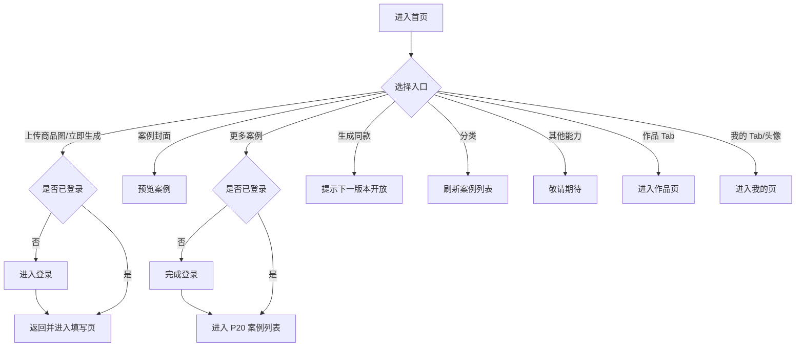

#### 详细交互说明

1. 首页首次加载先展示骨架屏，再展示核心卡片和案例首屏。
2. 游客点击上传区或“立即生成”时先登录；登录后返回创建流程。
3. 登录用户点击上传区选择商品图并进入填写页；点击“立即生成”则进入空白填写页。
4. 点击“更多案例”时，游客先登录；登录后进入 P20 案例列表。登录用户直接进入该页。
5. 点击案例封面打开视频预览；“生成同款”首版提示下一版本开放，不复制模板或商品数据。
6. 分类切换保持当前选择态；列表请求失败时保留分类栏并显示重试。
7. 首版不展示通知入口或消息红点。
8. 案例分类、封面、视频、标签、排序和上下线状态由后台配置。
9. 切换到作品或我的后，再切回首页应恢复首页滚动位置和案例分类选择。

#### 关键状态 / 异常情况

- 首页加载中、加载失败、空案例、有案例。
- 图片选择权限被拒绝：说明原因并引导到系统设置。
- 图片格式/大小不支持：在进入填写页前明确提示。
- 未登录用户点击创作、更多案例、作品详情或账户/资产类二级业务：进入登录；登录成功后返回发起位置。
- “更多案例”加载失败：停留首页并允许重试，不进入空白页。
- “生成同款”：首版固定提示下一版本开放。

#### 验收标准

- 首屏可明确看到 AI 带货视频主入口。
- 上传区和立即生成按钮均能正确进入填写页。
- 分类切换、案例预览和生成同款的点击区域互不冲突；生成同款不进入未实现页面。
- “更多案例”登录后进入 P20 案例列表，返回后保留首页原滚动位置。
- 未实现的快捷入口有统一反馈，不出现空白页或崩溃。
- 案例标注“AI 生成，仅供参考”。
- 底部导航只有首页、作品、我的三个一级入口，首页不额外设置“创作”Tab。

### 5.2 作品页

#### 页面定位

作品页是三个一级页面之一，用于集中展示用户当前可见的带货作品及其阶段。它不是单纯的成片列表：草稿、内容生成中、编辑脚本、视频生成中、视频已完成和失败状态都进入作品体系。游客可进入页面框架，但登录后才能查看个人作品。页面不提供状态筛选；到期隐藏的作品自动移出列表。

#### 参考素材

暂无“喵喵带货”独立作品页素材。以下图片仅参考“生成中 + 已完成”的作品聚合、卡片和进度表达；颜色、音乐分类、四个 Tab 和播放按钮均不照搬。

状态恢复方式另对照参考工程当前 v1.1 `06-cover-progress-result.md` 与 `07-works-integration.md`。参考工程只提供模式，不作为本项目执行真源；本项目以“作品卡片读取最新状态后进入对应业务界面”为准。

#### 页面结构（从上到下）

1. 顶部标题区：“作品”。
2. 作品列表：按最近更新时间倒序展示当前可见作品卡片。
3. 空状态/错误状态区。
4. 可选悬浮或顶部“开始创作”入口。
5. 底部导航：首页、作品、我的，作品高亮。

#### 区块说明

| 区块 | 内容 | 作用 | 交互 |
|------|------|------|------|
| 作品卡片 | 封面、标题、商品、比例/时长、状态、阶段、进度、更新时间 | 展示作品摘要 | 点击卡片后按最新状态进入对应业务界面 |
| 进度摘要 | 百分比、当前步骤、失败提示 | 告知后台任务状态 | 列表只展示，不承载完整任务操作 |
| 管理操作 | 删除 | 轻量管理 | 仅草稿、失败或已完成作品显示；运行中不显示删除 |
| 开始创作 | 新建作品 | 处理空状态和快速创建 | 进入填写信息页 |
| 底部导航 | 首页、作品、我的 | 切换一级页面 | 保留滚动位置 |

#### 主要功能

- 加载并分页展示当前可见作品，不提供任何状态筛选。
- 进入页面和下拉刷新时更新运行中作品的状态与进度，不在 PRD 规定技术刷新频率。
- 点击作品后按状态进入对应业务界面，且每次都以服务端最新状态为准。
- 支持新建和删除非运行中作品；运行中不可删除、不可取消。
- 从其他一级页面返回时恢复滚动位置和最近加载内容。

#### 交互流程图

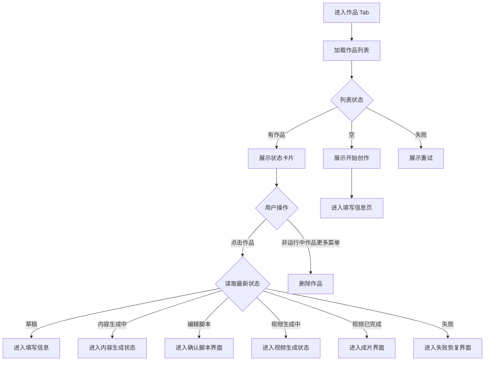

#### 详细交互说明

1. 游客进入时展示登录引导；登录后加载作品列表，按最近更新时间倒序。
2. 运行中作品卡片使用“内容生成中”或“视频生成中”作为主状态；可在副文案中说明正在生成脚本、正在生成第 N 张分镜图等内部进度。
3. 点击卡片后读取最新状态并恢复对应业务。列表中的旧状态仅用于摘要，不能直接决定目标界面。
4. 从对应业务界面返回时刷新该作品卡片；从底部 Tab 返回时优先使用缓存并后台刷新。
5. 运行中卡片不展示删除、取消或重命名入口；草稿、失败和已完成作品可删除并需二次确认。
6. 已完成作品从生成完成或最后一次使用起满 7 天后自动移出作品列表；页面不提供“已隐藏”筛选。
7. 作品无封面时：草稿用商品主图；分镜图可用后用首镜头图；成片完成后可使用视频封面。

#### 关键状态 / 异常情况

- 加载中：展示首屏骨架。
- 刷新中：保留列表并刷新状态。
- 空状态：无作品，展示开始创作。
- 刷新失败：保留已有内容并提示稍后重试。
- 首次加载失败：展示错误说明和重试。
- 作品已删除/无权限：点击后提示并返回刷新列表。
- 运行中任务状态长时间未更新：卡片显示“状态同步中”，不擅自判失败。

#### 验收标准

- 底部导航只有首页、作品、我的，作品页高亮正确。
- 列表包含草稿、内容生成中、编辑脚本、视频生成中、视频已完成和失败作品，不只展示成片；已隐藏作品不在列表出现。
- 卡片展示状态、当前阶段和必要进度。
- 各状态作品都能进入对应业务界面，且不会因列表缓存状态过期进入错误阶段。
- 分页、刷新、空态和错误重试可用；页面不存在筛选入口。
- 返回作品页后被操作作品的状态能及时刷新。
- 运行中作品不可删除或取消；已完成内容在 7 天后移出作品列表，30 天后不可恢复。

### 5.3 我的页

#### 页面定位

我的页是三个一级页面之一，用于展示当前用户并聚合积分、会员和账户服务入口。结构、入口顺序和登录门禁以“喵喵写歌”当前 Flutter `AccountPage` 代码为参考真源，而不是旧 PRD：用户头部 → SVIP 会员卡 → “积分福利 / 积分充值”双入口 → 服务菜单。页面不承担作品或形象资产统计。

#### 参考素材

业务与交互依据（代码审阅日期：2026-07-20）：

- [AccountPage 当前页面代码](/Users/soul/code/lxwx/catsinger/lib/pages/account/view.dart)
- [AccountController 当前状态代码](/Users/soul/code/lxwx/catsinger/lib/pages/account/controller.dart)
- [当前路由与登录门禁](/Users/soul/code/lxwx/catsinger/lib/routes/router.dart)

暂无与当前代码完全一致的运行截图，旧“我的”页需求稿和含资产统计的历史截图不再作为本节业务依据；UI 阶段应从当前 App 补截页面图。以下为从代码提取的页面结构图：

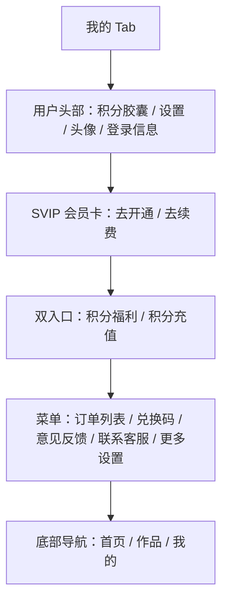

视觉只适配“喵喵带货”的暖白、橙红和猫品牌；不复制参考工程的深色主题、SVIP 名称、音乐权益或固定价格。

#### 页面结构（从上到下）

1. 用户头部：品牌氛围背景；右上积分余额胶囊与设置按钮；居中头像和脱敏账号，游客显示“立即登录”。不单独设置标题卡。
2. 会员推广卡：未开通显示开通引导，已开通显示会员权益摘要、有效期和续费动作。
3. 双快捷入口：“积分福利”进入任务中心，“积分充值”进入积分充值页。
4. 菜单列表：订单列表、兑换码、意见反馈、联系客服、更多设置。其中“兑换码”是按用户明确要求增加的喵喵带货菜单；参考工程当前页面仅有其路由和页面，尚未放入菜单。
5. 底部导航：首页、作品、我的，我的高亮；底部内容避让安全区。

#### 区块说明

| 区块 | 内容 | 作用 | 交互 |
|------|------|------|------|
| 用户头部 | 积分胶囊、设置、头像、脱敏账号/立即登录 | 展示身份并承接高频入口 | 积分和头像账户操作需登录；设置按喵喵写歌当前逻辑可直接进入；不展示任何作品统计 |
| 会员卡 | 开通/续费状态、服务端权益摘要、有效期 | 唯一会员入口 | 先确认用户协议与隐私政策；游客登录，已登录进入 VIP会员页；价格权益不得写死 |
| 双快捷入口 | 积分福利、积分充值 | 承接积分任务和充值 | 均需先确认用户协议与隐私政策并登录；积分福利进入任务中心 |
| 菜单列表 | 订单列表、兑换码、意见反馈、联系客服、更多设置 | 聚合账户服务 | 订单与兑换码需登录；反馈、客服静态内容和更多设置按喵喵写歌当前逻辑可直接进入 |
| 底部导航 | 首页、作品、我的 | 一级页面切换 | 我的高亮；返回页面时保留滚动位置 |

#### 主要功能

- 用户头部展示游客或已登录用户的头像、脱敏账号/登录提示和积分胶囊；游客胶囊显示 `0`，已登录后显示真实积分余额。不展示会员状态、作品数、今日剩余、下载数等；会员状态只在下方会员卡体现。
- 点击积分胶囊进入“积分详情”；点击会员卡进入会员开通/续费；点击“积分福利”进入积分任务中心；点击“积分充值”进入充值页。
- 菜单进入支付订单、兑换码、意见反馈、客服静态内容和更多设置；任务中心可按复用逻辑进入 P19 推广素材。
- P08～P19 的页面结构、状态与业务操作直接复用“喵喵写歌”，本 PRD 不在“我的”页章节重复展开。
- 支持下拉刷新用户资料。按当前代码，刷新期间保留现有页面内容；刷新失败不渲染专门错误卡或重试按钮。

#### 交互流程图

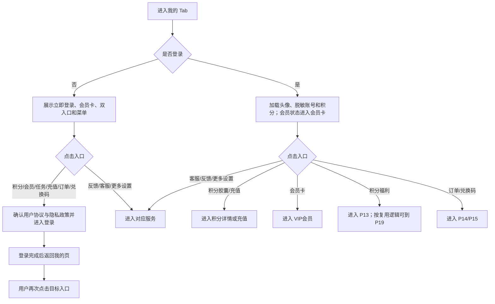

#### 详细交互说明

1. “我的”Tab 允许游客进入。游客显示默认头像、登录提示和数值为 `0` 的积分胶囊；会员卡可展示通用开通引导，但不加载个人积分流水、订单或任务数据。
2. 游客点击头像、积分、会员、积分福利、充值、订单或兑换码时，先通过 D15 同意用户协议与隐私政策，再进入登录。登录完成后返回“我的”页，用户再次点击目标入口。意见反馈、客服静态内容和更多设置按“喵喵写歌”当前逻辑直接进入，不强制登录。
3. 已登录用户头部展示服务端返回的头像、脱敏账号和积分余额，会员状态只在会员卡体现。积分为真实 `0` 时显示 `0`；资料刷新失败时保留已有内容，不显示模拟余额，也不新增当前代码没有的错误卡。
4. 用户头部不展示作品总数、待确认、已完成、今日剩余、已下载等统计项。参考 `AccountController` 中未被页面引用的占位 getter 不构成 UI 需求。
5. 积分胶囊、会员卡、双快捷入口和菜单分别进入清册 P10、P12、P13、P11、P14～P18；任务中心按复用逻辑可进入 P19。P08～P19 不在本项目重复定义页面内部流程。
6. 菜单按“订单列表、兑换码、意见反馈、联系客服、更多设置”排序。“兑换码”为喵喵带货产品专属新增入口，其页面业务仍复用现有 P15。
7. 联系客服、意见反馈和更多设置的访问边界与“喵喵写歌”当前产品一致；更多设置页面框架允许游客进入，账号与安全、退出登录只在登录后显示。
8. 下拉刷新更新用户资料、会员和积分信息；刷新期间保留页面内容，失败时继续保留现有内容。页面底部 padding 必须避让安全区与三个主 Tab。

#### 关键状态 / 异常情况

- 游客：默认头像、登录引导和功能入口；账户/资产业务先登录，反馈、客服静态内容和更多设置可按复用逻辑直接进入。
- 已登录非会员：展示真实头像、脱敏账号、积分余额与会员开通入口。
- 已登录会员：用户头部结构不变；会员卡展示有效期、权益摘要与续费入口。
- 刷新中：保留当前内容并刷新用户资料。
- 刷新失败：保留当前内容和所有菜单。
- 登录取消/失败：保留“我的”页当前位置，不进入目标业务。

#### 验收标准

- 页面按“用户头部、会员卡、两个快捷入口、四个代码现有菜单 + 一个兑换码扩展菜单、底部导航”稳定排序；不得把兑换码误写成当前 `AccountPage` 已有菜单。
- 用户头部不出现会员状态、作品数、待确认、已完成或其他资产统计；头像、脱敏账号和积分余额来自真实数据，会员状态只在会员卡体现。
- 两个快捷入口完整：积分福利、积分充值；积分详情通过右上积分胶囊进入。
- 菜单完整：订单列表、兑换码、意见反馈、联系客服、更多设置；会员只通过会员卡进入。
- 游客点击账户/资产业务入口需先完成用户协议与隐私政策确认和登录；静态内容、意见反馈和更多设置按喵喵写歌当前访问逻辑执行。
- P08～P19 均在清册中被提及并能从对应入口到达；详细业务和状态不在本项目重复设计。
- 会员、积分和兑换码入口不写死价格、余额、次数或权益。
- 视觉继续使用“喵喵带货”暖白与橙红品牌，不照搬深色主题、音乐术语或四 Tab。
- 页面返回后保持滚动位置，最后一项不被底部导航或安全区遮挡。

### 5.4 AI 带货视频—填写信息

#### 页面定位

该页是核心创作链路第 1 步，收集脚本和视频生成所需的商品素材、描述、视频参数与带货形象。

#### 参考素材

#### 页面结构（从上到下）

1. 顶部导航：返回、标题、副标题。
2. 五阶段进度提示：草稿/填写信息、内容生成、编辑脚本、视频生成、视频完成；当前高亮“草稿/填写信息”。
3. 带货图片卡片：3 个上传位及“最多上传 3 张”说明。
4. 商品描述卡片：多行输入、字数、AI 帮写、清空、粘贴。
5. 参数设置卡片：视频比例、视频时长与视频清晰度。
6. 带货形象卡片：不指定形象、上传人物形象。
7. 底部操作区：“生成内容”按钮与门禁提示。

#### 区块说明

| 区块 | 内容 | 作用 | 交互 |
|------|------|------|------|
| 进度条 | 草稿/填写信息、内容生成、编辑脚本、视频生成、视频完成 | 明确作品五个主阶段 | 当前阶段高亮；后续未完成步骤不可直接跳转 |
| 商品图 | 1～3 个图片位 | 提供画面和识别素材 | 添加、预览、替换、删除、排序 |
| 商品描述 | 最多 300 字 | 提供卖点和场景 | 输入、粘贴、清空、进入 AI 帮写 |
| 比例 | 9:16、16:9 | 控制视频画布 | 单选，默认 9:16 |
| 时长 | 10s、15s、20s、30s | 控制脚本与镜头规模 | 单选，素材示例默认 20s |
| 带货形象 | 不指定/指定 | 控制出镜主体 | 打开形象选择弹层 |
| 底部主按钮 | 生成内容 | 提交脚本与初始分镜图片生成任务 | 未满足门禁禁用并解释原因 |

#### 主要功能

- 上传、替换、删除和排序最多 3 张商品图。
- 输入商品描述并实时显示字数。
- 读取剪贴板文本；无权限或无文本时给出反馈。
- 清空描述需避免误触；有内容时二次确认或提供撤销。
- 进入 AI 帮写描述并接收回填结果。
- 设置视频比例、时长、清晰度和带货形象。
- 第一张有效商品图上传成功后创建草稿作品，并自动保存后续输入。
- 校验通过后从该草稿提交统一内容生成任务。

#### 交互流程图

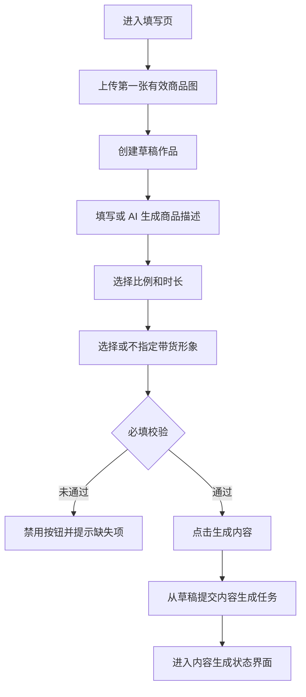

#### 详细交互说明

1. 首次进入页面时尚未创建作品；默认选择竖屏 9:16、20s 和“不指定形象”。“生成同款”下一版本开放，本版不带入案例参数。
2. 图片至少 1 张、最多 3 张；第一张图片上传、审核并保存成功后立即创建草稿作品，该图默认为主图，可通过排序更换主图。
3. 图片上传期间对应图片位显示进度；单张失败不影响其他已成功图片。
4. 商品描述输入超过 300 字时阻止继续输入或明确提示并禁止提交，不能静默截断。
5. 点击 AI 帮写进入辅助页；返回使用结果时覆盖描述框，并保留撤销到原描述的能力。
6. 点击“上传人物形象”打开选择形象弹层，不直接调用系统相册。
7. 提交前完成必填、格式、内容审核和形象可用性检查。
8. 其余输入持续保存到同一草稿；点击“生成内容”后创建包含脚本与初始分镜图片的内容生成任务，不再新建作品。提交成功进入内容生成状态界面，按钮立即进入等待状态，避免重复任务。

#### 关键状态 / 异常情况

- 未创建、草稿创建中、部分填写、完整可提交、保存中、保存失败。
- 图片上传中、失败、格式不支持、过大、内容审核不通过。
- 描述为空、超长、包含不支持内容。
- 形象已选但随后被删除或授权失效：提交前要求重选。
- 草稿创建结果暂时不明确：显示“正在保存作品”，确认前不重复创建；内容任务提交结果不明确时显示“正在确认”，不允许重复提交。
- 网络断开：保留本地编辑内容，恢复后同步。

#### 验收标准

- 图片数量严格限制为 1～3 张，且可预览、替换、删除和排序。
- 商品描述上限为 300 字，字数展示准确。
- 比例和时长只能各选一个，刷新/返回后保留。
- 必填未满足时按钮禁用并显示具体缺失项。
- 连续点击或网络重试不会创建多个内容生成任务。
- 离开再返回时已填写内容能够恢复。
- 首张有效商品图上传成功后，草稿立即可在作品页看到；点击草稿恢复 P02。
- 内容提交成功后作品状态变为“内容生成中”，从作品页点击可进入对应生成状态界面。

### 5.5 AI 帮写描述

#### 页面定位

该页帮助不擅长撰写商品卖点的用户，通过少量结构化信息生成更适合带货表达的商品描述，并回填到填写页。

#### 参考素材

#### 页面结构（从上到下）

1. 顶部导航：返回、标题、副标题和品牌猫插画。
2. 来源摘要卡：商品缩略图与“来自：商品描述”。
3. 信息编辑卡：商品名称、目标人群、核心卖点、使用场景、语言风格。
4. 生成结果卡：AI 标签、描述文本、重新生成、局部“使用这段描述”。
5. 底部固定主按钮：使用这段描述。

#### 区块说明

| 区块 | 内容 | 作用 | 交互 |
|------|------|------|------|
| 来源摘要 | 主商品图、来源 | 建立上下文 | 只读 |
| 商品名称 | 单行文本 | 明确商品主体 | 可编辑，建议必填 |
| 目标人群 | 单行/标签 | 限定受众 | 可编辑 |
| 核心卖点 | 多选标签、新建卖点 | 控制生成重点 | 可多选、取消和新增 |
| 使用场景 | 单行/多行 | 增加具体语境 | 可编辑 |
| 语言风格 | 专业、幽默、痛点刺激、温馨故事、产品测评 | 控制表达语气 | 单选 |
| 生成结果 | 描述文案 | 预览输出 | 重新生成或确认使用 |

#### 主要功能

- 从商品图/已有描述中预填结构化信息。
- 编辑商品信息与语言风格。
- 新增、选择或取消核心卖点。
- 生成商品描述并展示版本。
- 重新生成但保留用户填写项。
- 将选定结果回填到填写页。

#### 交互流程图

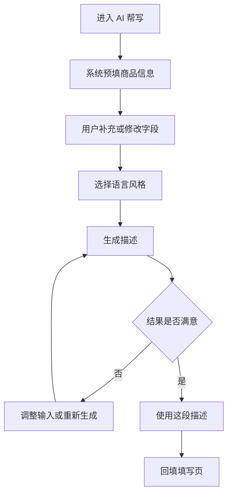

#### 详细交互说明

1. 进入页面时，系统可以基于主商品图和已有描述提取商品名称、受众、卖点和场景；识别失败不阻塞用户手动填写。
2. 核心卖点允许多选；新增卖点的长度和数量上限由后台配置，达到上限时给出明确提示。
3. 语言风格单选，默认“专业”。
4. 生成结果不得自动覆盖原商品描述。
5. 点击“重新生成”产生新版本，用户输入字段保持不变；可选是否保留上一版供回退。
6. 点击任一“使用这段描述”后回到填写页，并将结果写入描述框；若结果超过 300 字，服务端/客户端应在生成时控制长度。
7. 返回但未使用结果时，原填写页描述保持不变。

#### 关键状态 / 异常情况

- 商品识别中、识别成功、识别失败但可手填。
- 首次未生成、生成中、生成成功、生成失败。
- 输入不足：提示至少补充商品名称或有效卖点。
- 生成结果违反平台/商品合规：提示修改信息，不展示不可用文案。
- 重复点击生成：只保留一个前台有效任务。

#### 验收标准

- 结构化字段可编辑，卖点可多选和新增，风格只能单选。
- 重新生成不会清空用户补充的信息。
- 未点击使用时不覆盖原描述。
- 使用结果后准确回填且不超过 300 字。
- 生成失败可重试，不影响填写页原内容。

### 5.6 选择带货形象

#### 页面定位

该弹层用于在创作过程中选择不指定形象、上传新形象或复用个人形象资产，并提供轻量管理能力。

#### 参考素材

#### 页面结构（从上到下）

1. 半透明遮罩与底部弹层，顶部拖拽柄。
2. 标题、说明和关闭按钮。
3. 快捷选项：不指定形象、上传新形象。
4. 我的形象：双列卡片，含缩略图、选择态、更多菜单和名称。
5. 异常卡片：识别失败说明与重新上传。
6. 底部固定按钮：确认使用。

#### 区块说明

| 区块 | 内容 | 作用 | 交互 |
|------|------|------|------|
| 不指定形象 | 随机匹配说明 | 快速跳过指定 | 单选 |
| 上传新形象 | 人像照片上传 | 创建个人形象资产 | 调用相册/相机，进入识别 |
| 我的形象 | 形象卡片列表 | 复用已有资产 | 选择单个形象 |
| 更多菜单 | 重命名、删除 | 资产管理 | 删除需二次确认 |
| 失败卡片 | 失败原因、重传 | 修复不可用资产 | 重新上传替换 |
| 确认使用 | 当前选择 | 写回草稿 | 保存并关闭弹层 |

#### 主要功能

- 单选不指定形象或一个有效形象。
- 上传人物正脸照片并识别。
- 展示识别中、可用和失败形象。
- 重命名、删除和重新上传。
- 确认后将选择写回当前草稿。

#### 交互流程图

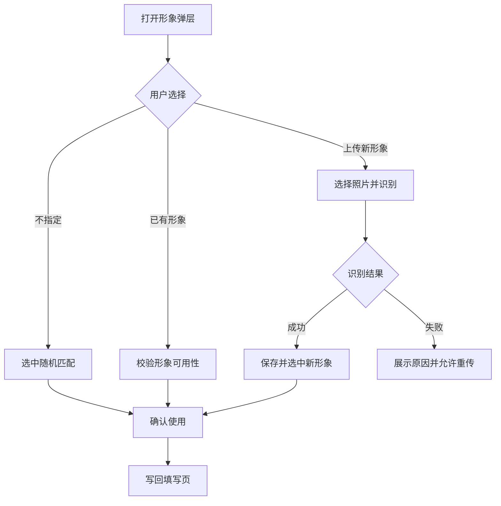

#### 详细交互说明

1. 打开弹层时默认选中草稿当前形象；首次进入默认“不指定形象”。
2. 点击已有形象立即切换选中态，但只有点击“确认使用”才写回草稿。
3. 点击上传新形象前展示人像授权、清晰正脸、单人照片等要求。
4. 上传后立即创建“识别中”卡片；识别成功后可选择，识别失败显示原因和“重新上传”。
5. 更多菜单包含重命名和删除。删除被其他草稿使用的形象时，应提示影响；已完成视频不受影响。
6. 删除当前选中形象后，选择自动回到“不指定形象”，并要求再次确认。
7. 点击关闭或遮罩退出时，不保存本次未确认选择。

#### 关键状态 / 异常情况

- 无形象、加载中、列表加载失败、有可用形象。
- 上传中、识别中、识别失败、内容审核失败、授权失效。
- 相册/相机权限拒绝。
- 重命名重复、为空或超长。
- 删除失败：保留卡片并提示重试。
- 弹层打开期间资产在其他端被删除：确认时重新校验。

#### 验收标准

- 不指定和具体形象保持严格单选。
- 未确认退出不修改草稿。
- 识别失败形象不可用于生成，并有明确重传入口。
- 重命名和删除结果刷新正确。
- 删除正在使用的形象前有影响提示。
- 上传的人像授权说明可被用户查看和确认。

### 5.7 定制带货模特

#### 页面定位

该页根据结构化外貌和表达偏好生成一个可在有效期内复用的专属带货达人，并保存到个人形象资产。

#### 参考素材

#### 页面结构（从上到下）

1. 顶部导航：返回、标题、副标题、品牌标识。
2. 页签：我的达人、定制达人。
3. 左侧/主表单区：基础信息、外貌特征、外貌细节、口播气质。
4. 预览区：生成前占位，生成后展示结果。
5. 底部主按钮：生成我的达人。
6. 说明：生成后可在视频复刻和 AI 带货视频中复用。

#### 区块说明

| 区块 | 字段 | 规则 |
|------|------|------|
| 基础信息 | 性别、年龄段 | 下拉单选，均需明确值 |
| 外貌特征 | 风格、体型 | 下拉单选 |
| 外貌细节 | 自由描述，最多 100 字 | 可选，不得与结构化字段明显冲突 |
| 口播气质 | 自然亲和、专业测评、活力种草、温柔推荐 | 单选 |
| 预览效果 | 占位/生成结果 | 结果生成后可确认、重生成或返回调整 |

#### 主要功能

- 设置达人外貌与口播气质。
- 校验输入并提交达人生成任务。
- 展示生成进度与结果预览。
- 保存达人到个人资产。
- 进入“我的达人”查看和选择已保存达人。

#### 交互流程图

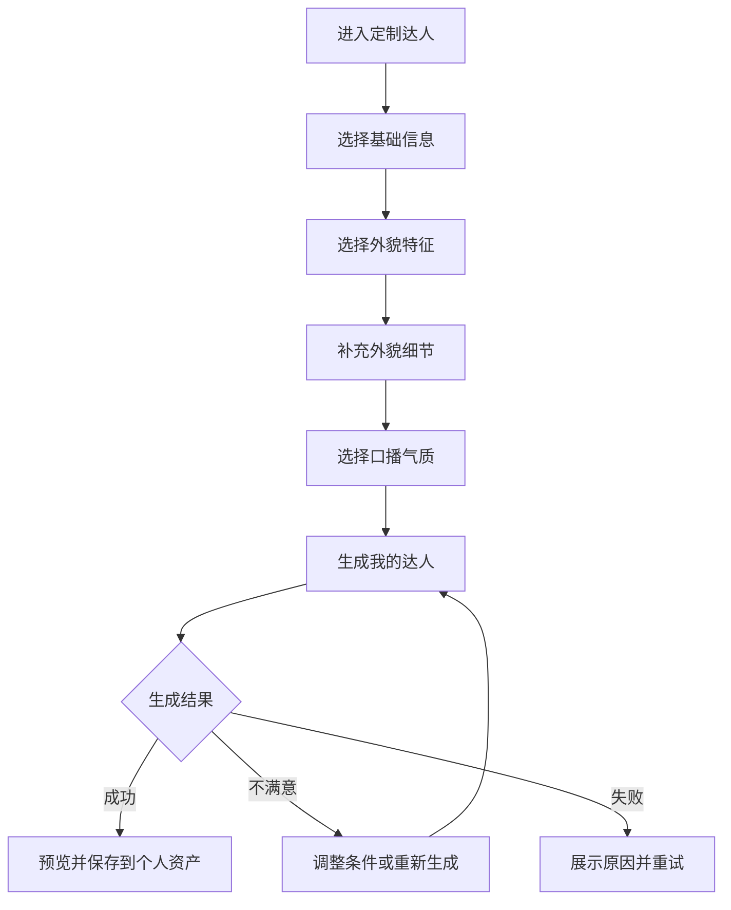

#### 详细交互说明

1. 页面按照素材提供默认值，但用户必须能修改；默认值不代表业务强制。
2. 外貌细节最多 100 字，输入示例仅作提示。
3. 口播气质单选，用于影响后续脚本表达风格；不单独产生配音或声音资产。
4. 点击生成后禁用重复提交，预览区展示任务状态。
5. 生成成功不应自动覆盖已有达人；结果展示 AI 生成标识，保存为新资产并提供默认名称。
6. 返回前如生成成功但未保存，提示是否保存或放弃。
7. 保存成功后可以回到形象选择弹层并自动选中新达人；该形象按 7 天隐藏、30 天删除规则管理。

#### 关键状态 / 异常情况

- 初始占位、表单可提交、生成中、成功、失败。
- 输入内容审核不通过或互相冲突。
- 生成结果不符合人像质量要求。
- 用户资产数量达到上限。
- 网络中断后恢复任务状态。

#### 验收标准

- 必填选项未完成时不能提交，并指出具体字段。
- 外貌细节限制为 100 字。
- 口播气质保持单选。
- 生成任务可恢复，重复点击不创建多个任务。
- 成功结果只有保存后才进入个人资产。
- 新达人可返回 AI 带货视频流程并被选择。
- AI 生成达人展示 AI 生成标识，并显示有效期说明。

### 5.8 作品状态页（内容生成中）

#### 页面定位

用户从填写页提交内容生成任务后进入本状态界面；作品页点击“内容生成中”的作品也进入这里。用户只理解一个“内容生成中”阶段，该阶段包含脚本及对应分镜图片的完整生成过程。系统内部可先生成脚本再按镜头生成图片，但不把两者拆成两个作品状态或要求用户中途确认。

#### 参考素材

#### 页面结构（从上到下）

1. 页面头：返回、作品名称和“内容生成中”状态标签。
2. 五阶段进度提示：草稿已完成，内容生成中高亮，后续为编辑脚本、视频生成和视频完成。
3. 生成状态主卡：整体进度、当前内部步骤、预计时间和后台生成说明。
4. 脚本子步骤：分析商品图片、提炼卖点、拆分镜头、生成口播。
5. 分镜图片区：脚本成功后出现镜头列表，每个镜头展示脚本摘要、图片占位、生成状态和单镜进度。
6. 商品摘要卡：商品图、名称、比例、时长、形象。
7. 底部操作：后台生成/返回作品；失败时展示按阶段重试和返回修改。

#### 区块说明

| 区块 | 内容 | 作用 |
|------|------|------|
| 页面头 | 作品名称、内容生成中、返回 | 明确当前作品和主阶段 |
| 总进度 | 内容生成整体百分比、当前内部步骤 | 主状态始终为内容生成中，副文案可说明脚本或第 N 张图片 |
| 脚本子步骤 | 完成/进行中/等待/失败 | 解释文本大模型生成过程 |
| 分镜图片区 | 每个镜头的脚本摘要、占位图、图片状态 | 展示脚本到图片的第二阶段进度 |
| 商品摘要 | 本次已提交的商品和参数 | 让用户确认当前生成对象 |
| 后台生成 | 返回作品页但任务继续 | 降低等待成本 |
| 剩余时间 | 动态估算 | 降低等待焦虑，不做固定承诺 |

#### 主要功能

- 展示“内容生成中”的整体进度与预计等待时间。
- 脚本成功后自动保存当前版本，并开始生成对应分镜图片。
- 按镜头展示分镜图片生成状态，已完成图片可逐步展示。
- 全部镜头图片可用后，作品进入“编辑脚本”，页面切换为确认脚本界面。
- 支持离开后后台生成、再次从作品页进入并恢复。
- 任一阶段失败时说明失败阶段，并提供对应重试或返回修改。

#### 交互流程图

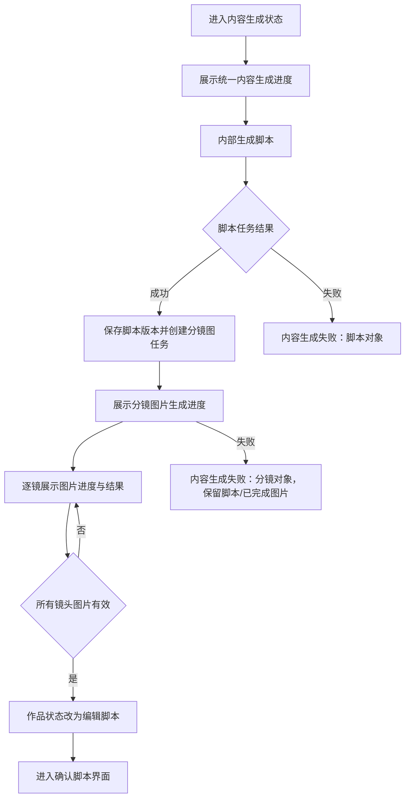

#### 详细交互说明

1. 每次进入都加载作品最新状态，不沿用已经失效的页面状态。
2. 作品主状态始终显示“内容生成中”；页面可用副标题和子步骤展示真实的脚本/分镜内部进度，不能把内部步骤显示为两个独立作品状态，也不能用固定动画伪装结果。
3. 脚本生成成功后无需用户再次提交，系统按当前脚本版本自动发起初始分镜图片生成。
4. 分镜图片区按镜头顺序稳定展示；单镜头成功后立即显示图片，失败镜头显示明确错误，但不丢失其他已成功图片。
5. 有可靠预计时长时展示“预计还需 X 秒”；无法估算时展示“正在处理，请稍候”。
6. 点击“返回作品”后任务继续，作品卡片显示最新状态；再次进入恢复最新进度。
7. 运行中的内容任务不可返回修改、取消或删除；只有任务失败后才能返回草稿输入修订并重新提交。

#### 关键状态 / 异常情况

- 内容等待、内容生成中、脚本内部步骤、分镜图片内部步骤、部分图片成功、失败、连接中。
- 状态暂时无法更新：保留最近状态并显示重新连接，不直接判定失败。
- 任务成功但脚本详情获取失败：提供重试加载，不重新生成。
- 分镜图片部分失败：保留脚本和成功图片，允许只重试失败镜头。
- 作品被删除或无权限：退出流程并给出明确说明。

#### 验收标准

- 作品早在上传首图时已以草稿出现；提交后原作品变为“内容生成中”，不创建新作品。
- 作品列表只使用一个“内容生成中”主状态；页面内部脚本和分镜图片的百分比与当前步骤真实一致。
- 脚本成功会自动衔接分镜图片生成，不要求用户手工再次提交。
- 全部分镜图片有效后，作品进入“编辑脚本”并展示确认脚本界面。
- 切后台或重启 App 后可从作品页恢复任务和已生成内容。
- 部分图片失败时可精确重试失败镜头；失败状态提供可执行恢复入口。

### 5.9 作品状态页（编辑脚本）

#### 页面定位

该状态对应参考 UI 中的“确认脚本”界面，是五阶段流程中的“编辑脚本”。脚本和初始分镜图片生成完成后，用户在这里逐镜头检查画面描述、可选口播和对应图片；任何问题都应在提交视频模型前完成修改。内容缺失或修改后图片待处理时仍属于“编辑脚本”，通过问题标记表达，不再另设“待确认/待完善”主状态。

#### 参考素材

素材图主要展示脚本时间线结构；每个镜头卡还需同步展示分镜图片及图片状态。截图中的“含字幕配音”“合成视频”等旧文字均已废弃，UI 必须改用本版“视频生成”口径。

#### 页面结构（从上到下）

1. 页面头：返回、作品名称和“编辑脚本”状态标签。
2. 五阶段进度提示：草稿、内容生成已完成，编辑脚本高亮。
3. 商品摘要卡：商品图、名称、比例、时长、形象和当前版本状态。
4. 当前镜头大图/预览区：显示选中镜头的分镜图片与版本状态。
5. 镜头时间线：每个镜头包含图片、序号、画面描述、口播文案、图片状态和操作入口。
6. 整体提示区：缺失、生成中、过期或未确认的镜头汇总。
7. 积分摘要：视频时长、每秒积分单价、清晰度倍率、预计总消耗和当前积分余额。
8. 底部固定操作：整稿重新生成、确认并生成视频；内容不完整或积分不足时禁用并说明原因。

#### 区块说明

| 区块 | 内容 | 作用 | 交互 |
|------|------|------|------|
| 商品摘要 | 商品、比例、目标时长 | 确认输入 | 只读，可返回修改 |
| 当前镜头预览 | 分镜图片、版本、状态 | 检查画面结果 | 放大预览、切换镜头/历史版本 |
| 镜头卡 | 图片、序号、画面、口播、图片状态 | 同时检查脚本和画面 | 编辑脚本、重生成图片、上传替换、确认图片 |
| 时间线 | 1～N 镜头 | 表达先后顺序 | 初版按生成顺序展示 |
| 问题汇总 | 缺失/失败/过期镜头 | 解释视频生成门禁 | 点击定位到问题镜头 |
| 积分摘要 | 视频时长、每秒积分单价、清晰度倍率、预计积分和余额 | 提交前明确本次消耗 | 积分不足时进入积分充值 |
| 重新生成 | 整稿脚本和分镜图片 | 快速换方向 | 二次确认后生成新版本，仍回到编辑脚本 |
| 确认并生成视频 | 确认当前内容和预计积分 | 提交视频模型任务 | 内容和积分检查通过后可用 |

#### 主要功能

- 展示当前脚本版本、全部镜头及每个镜头选中的分镜图片版本。
- 放大预览分镜图片，并显示其生成/上传来源、状态和是否需要重新确认。
- 打开单镜头编辑，修改画面描述和口播文案。
- 针对单镜头重新生成图片或上传合规图片替换。
- 重新生成全部脚本；新脚本必须重新生成对应分镜图片。
- 校验脚本、分镜图片、形象、总时长和所有子任务状态。
- 展示视频时长、每秒积分单价、清晰度倍率和预计总消耗，确认当前脚本与分镜图片后提交视频模型生成。
- 返回填写页修改输入并创建新作品版本。

#### 交互流程图

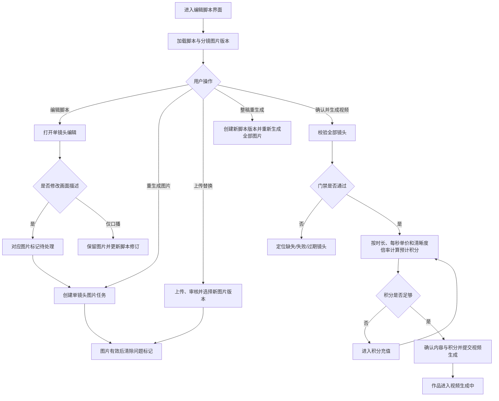

#### 详细交互说明

1. 页面加载当前使用的整稿版本，以及每个镜头当前选中的脚本和分镜图片。
2. 镜头数量由时长和生成结果决定，不固定为素材中的 4 个；顶部显示实际镜头总数和问题数。
3. 点击镜头图片可放大；用户可重新生成、上传替换或在可用历史版本中选择，不能只展示不可操作的图片。
4. 修改画面描述后，原分镜图片标记为“需重新确认”。用户必须生成/选择新图，或明确确认继续使用旧图；仅修改口播文案不影响图片状态。
5. 单镜头图片任务不会阻塞查看其他镜头，但任何镜头处于上传中、生成中、失败、缺失或过期状态时，“确认并生成视频”按钮禁用。
6. 整稿重生成会形成一个新版本，并为新版本生成对应分镜图片；旧版本仍可查看和恢复，但不会自动替换当前版本。
7. 点击“确认并生成视频”时再次检查脚本、图片、形象和内容审核结果，并展示“视频时长 × 每秒积分单价 × 清晰度倍率 = 预计积分”。
8. 积分不足时不允许提交并引导充值；积分足够且用户确认后，以当前脚本和分镜图片作为本次视频生成依据。
9. 视频生成任务提交成功后，作品进入“视频生成中”并显示对应状态界面；任务开始后不可取消、删除或修改。

#### 关键状态 / 异常情况

- 编辑页加载中、无镜头、图片生成中、图片缺失、图片审核失败、图片过期、有待处理项、可生成视频。
- 当前内容已在其他操作中更新：提示刷新或重新选择版本，不直接覆盖。
- 形象被删除、商品图失效：阻止视频生成并引导返回修复。
- 视频生成提交结果不明确：按钮进入等待确认状态，确认未创建成功前不允许重复提交或重复扣费。
- 文案或画面描述触发合规规则：标明具体镜头并要求修改。
- 用户上传替换图尺寸、比例、格式或审核不通过：保留原图并给出修复说明。

#### 验收标准

- 镜头数量、顺序、脚本和图片均与当前使用版本一致。
- 每个镜头都有可用的画面描述和一张已选分镜图片；口播文案可为空。
- 用户能修改脚本，并能重新生成、上传替换或选择分镜图片版本。
- 画面描述变更后对应图片状态会变为待处理，未处理前禁止生成视频。
- 单镜头修改不会意外覆盖其他镜头；整稿重生成不会误用旧脚本/旧图片。
- 视频模型只使用用户本次确认的脚本与分镜图片。
- 门禁未通过时按钮明确禁用并可定位原因；重复点击不会创建多个视频生成任务。
- 提交前展示视频时长、每秒积分单价、清晰度倍率和预计总消耗；积分不足时不能提交。

### 5.10 编辑镜头

#### 页面定位

该底部弹层用于局部修改单个镜头的脚本与分镜图片，降低整稿返工成本。弹层属于 P06 编辑脚本界面，不计为独立页面。

#### 参考素材

#### 页面结构（从上到下）

1. 遮罩、拖拽柄、标题“编辑镜头 N”、说明和关闭按钮。
2. 分镜图片预览：当前图片、状态、版本来源。
3. 图片操作：重新生成、上传替换、可选查看历史版本。
4. 画面输入框，显示字数（素材示例上限 80）。
5. 口播文案输入框，显示字数（素材示例上限 80）。
6. 风格优化：更专业、更口语、更有转化力。
7. 单镜头脚本重新生成说明与操作。
8. 底部按钮：取消、保存修改。

#### 区块说明

| 区块 | 内容 | 规则 |
|------|------|------|
| 分镜图片 | 当前图片、状态、活动版本 | 可放大查看；失败/过期状态必须可见 |
| 图片操作 | 重生成、上传替换、选择可用版本 | 只改变当前镜头的活动图片版本 |
| 画面 | 当前镜头画面描述 | 建议 1～80 字，不能为空 |
| 口播文案 | 当前镜头对白/旁白 | 可不填；填写时最多 80 字 |
| 风格优化 | 专业、口语、转化力 | 对目标字段生成建议或直接改写，行为需可预期 |
| 重新生成本镜头脚本 | 新画面描述和口播 | 只影响当前镜头，并使图片进入待处理 |
| 保存修改 | 保存当前调整 | 内容已被更新时提示刷新，不能直接覆盖 |

#### 主要功能

- 预览、重新生成、上传替换或选择当前镜头的分镜图片。
- 编辑画面描述和口播文本。
- 使用快捷风格优化。
- 重新生成当前镜头脚本。
- 保存修改或取消。
- 防止未保存内容丢失。

#### 交互流程图

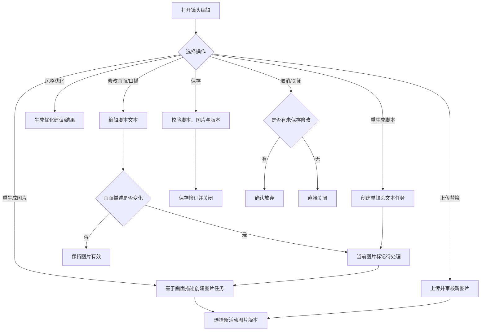

#### 详细交互说明

1. 弹层打开时加载镜头当前脚本修订和活动图片版本，输入框显示实时字数。
2. 达到上限后阻止继续输入，不静默截断已有内容。
3. 风格优化操作应说明作用对象：默认优化口播；若同时改画面，必须在结果应用前展示差异。
4. 修改画面描述或重新生成镜头脚本后，当前图片标记为待处理；用户可重新生成、上传替换，或明确确认保留旧图。
5. 图片重生成只使用当前镜头最新画面描述；图片任务生成中禁止重复提交，但旧图持续可见。
6. 上传替换图片先校验格式、比例、尺寸和内容审核；失败不覆盖当前图片。
7. 保存时以页面当前展示的脚本和图片版本为准；若内容已被更新，提示刷新或选择版本，不自动覆盖。
8. 成功后关闭弹层，在编辑脚本界面刷新脚本、图片和镜头状态。

#### 关键状态 / 异常情况

- 无修改、已修改未保存、保存中、保存成功、保存失败。
- 脚本生成中/失败、图片生成中/失败、图片上传中/审核失败、图片过期。
- 文本为空、超长或包含不可支持内容。
- 当前内容已更新，需要刷新或重新选择版本。
- 网络断开时保留本地输入。

#### 验收标准

- 字数统计与上限校验准确。
- 取消或关闭不会误保存；有修改时提示放弃。
- 单镜头脚本或图片重生成不改变其他镜头。
- 用户可以重新生成或上传替换分镜图片，失败时保留原图。
- 画面描述改变后图片状态正确联动，未恢复有效前“确认并生成视频”按钮禁用。
- 保存成功后编辑脚本界面立即反映新脚本、图片和状态。
- 冲突时不静默覆盖服务端新版本。

### 5.11 作品状态页（视频生成中 / 视频已完成 / 失败）

#### 页面定位

用户从“编辑脚本”确认内容并提交视频任务后，作品进入“视频生成中”；成功后进入“视频已完成”。从首页最近作品或作品列表点击时，按最新状态进入对应界面。失败作为视频阶段的异常界面承接恢复操作。

#### 参考素材

使用边界：两张图只参考进度主卡、失败卡、参数摘要和页面层级。图中的“生成配音”“添加字幕”“合成画面”“取消生成”等旧文案与按钮全部废弃。“视频已完成”当前没有专属 UI 素材，本 PRD 只定义业务结构和操作，不虚构最终视觉稿。

#### 页面结构（从上到下）

生成中状态：

1. 页面头：作品名称、视频生成中状态和创作进度。
2. 生成状态主卡：品牌插画、当前说明、总体进度或预计等待提示。
3. 阶段说明：准备内容、等待视频模型、生成视频、保存结果。
4. 视频预览占位区；完成前不展示可播放按钮，避免误认为成片已生成。
5. 内容摘要：商品图、比例、目标时长、视频清晰度、带货形象、分镜图片数量和本次消耗积分。
6. 底部操作：返回作品页。离开后任务继续运行，不提供取消或删除入口。

失败状态：

1. 顶部失败状态和失败主卡。
2. 失败原因与建议操作，文案应让普通用户可以理解。
3. 已保留内容：商品、参数、形象、脚本和分镜图片。
4. 操作：重新生成、返回修改、联系客服；展示本次积分全额退回结果，重新生成前按当前时长和清晰度重新报价并确认积分消耗。

视频已完成状态（暂无专属 UI 素材）：

1. 页面头和“视频已完成”状态，主体为视频播放器，成片展示 AI 生成水印或标识。
2. 视频信息：封面、比例、时长、生成时间和内容到期说明。
3. 内容摘要：本次成片使用的脚本版本、镜头和分镜图片，可展开查看。
4. 操作：重新编辑脚本与分镜、按当前内容重新生成视频、下载、系统分享、删除或返回作品页。
5. “重新编辑脚本与分镜”创建新的可编辑内容版本并进入编辑脚本界面；“重新生成视频”沿用当前确认内容，重新确认积分后提交。
6. 已有成功视频不会因进入编辑或新任务失败而立即丢失；新视频成功后才更新当前成片。

#### 区块说明

| 区块 | 内容 | 作用 |
|------|------|------|
| 状态主卡 | 当前阶段、进度、等待提示 | 让用户理解任务仍在处理 |
| 阶段说明 | 准备内容、等待模型、生成视频、保存结果 | 解释当前处理位置，不拆分配音或字幕任务 |
| 视频区 | 生成中占位或完成后播放器 | 完成前不伪装为可播放成片；完成后承接播放 |
| 内容与积分摘要 | 商品、比例、时长、清晰度、形象、每秒积分单价、清晰度倍率和实际消耗 | 确认本次生成依据与计费结果 |
| 失败原因 | 用户可理解的原因与建议操作 | 帮助用户选择重试、修改或联系客服 |
| 已保留内容 | 商品、参数、脚本和分镜图片 | 明确失败后无需重新填写 |
| 到期说明 | 隐藏和删除时间 | 提醒用户及时下载，或在隐藏前重新编辑与生成 |

#### 主要功能

- 展示视频生成的等待、生成、保存、成功和失败状态。
- 支持用户离开页面后继续处理，再次进入时恢复最新状态。
- 视频已完成后播放、下载和分享成片。
- 从完成界面重新编辑脚本与分镜，或按当前确认内容直接重新生成视频。
- 失败后保留本次使用的商品、脚本与分镜图片，支持重试、返回修改或联系客服。
- 所有视频重新生成均在提交前展示视频时长、每秒积分单价、清晰度倍率和预计总消耗。

#### 交互流程图

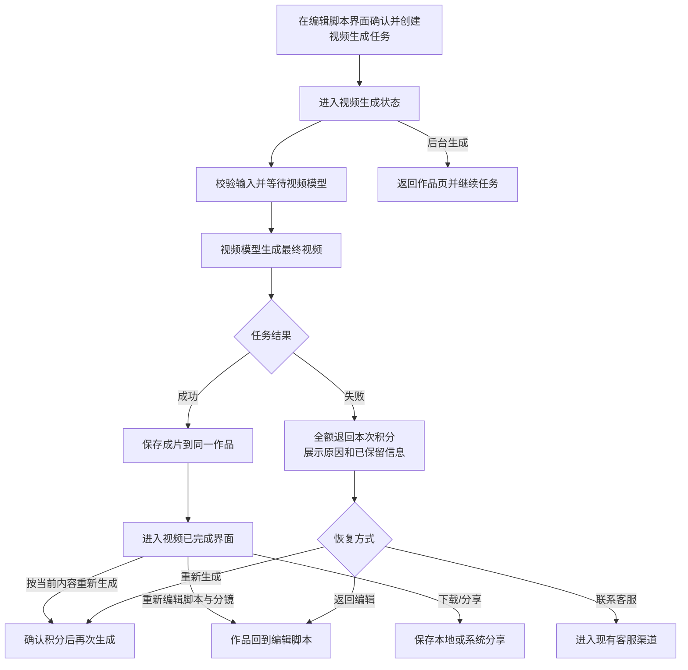

#### 详细交互说明

1. 页面始终以作品的最新状态为准；短暂加载失败时显示“正在重新连接”，不直接显示任务失败。
2. 用户可见阶段为准备内容、等待视频模型、视频生成中、结果保存；不展示独立配音、TTS、字幕或画面合成任务。
3. 用户返回作品页后任务继续运行，作品卡片展示最新状态。首版不发送站内消息或系统通知。
4. 任一生成任务开始后不提供取消、删除或修改入口，只能等待成功或失败。
5. 视频成功后作品进入“视频已完成”并展示播放器；若播放器暂时加载失败，提供重新加载，不把它误报为生成失败。
6. 失败时展示用户可理解的原因，并明确商品、参数、形象、脚本和分镜图片已经保留。
7. 点击“重新生成”先按当前视频时长、每秒积分单价和清晰度倍率重新计算积分，用户确认后按当前保留内容生成；每次重新生成都会再次消耗积分。
8. 点击“返回编辑”或完成页“重新编辑脚本与分镜”，创建新的可编辑内容版本并进入编辑脚本界面；已有成功视频继续保留。
9. 完成页点击“重新生成视频”时沿用当前确认脚本和分镜，重新计算并确认积分；新任务失败时保留旧成片。
10. 已完成作品从生成完成或最后一次使用开始计时，7 天后从默认列表隐藏，30 天后删除；页面展示相应到期说明。

#### 关键状态 / 异常情况

- 等待中、视频生成中、结果保存中、视频已完成、失败、连接中。
- 状态查询短暂失败：展示“连接中”，不直接判定视频生成失败。
- 用户再次点击作品时，应按最新状态进入视频生成或视频已完成界面，不依赖通知触达。
- 原形象在任务开始后被删除：不影响本次正在运行的任务；重新编辑并生成时需重新选择。
- 客服入口不可用：提示稍后再试，并保留失败原因供用户查看。

#### 验收标准

- 进度和阶段状态真实可恢复，前后台切换不丢任务。
- 页面不出现独立配音/TTS 业务、按钮或任务阶段。
- 成功视频绑定到同一作品并在完成界面播放，播放器加载失败不误报为视频生成失败。
- 任一生成任务开始后不展示取消、删除或修改入口。
- 失败后商品图、描述、参数、形象引用、脚本和分镜图片均保留。
- 重新生成前展示视频时长、每秒积分单价、清晰度倍率和预计积分；用户确认后再次消耗积分。
- 视频完成界面明确提供重新编辑脚本与分镜、重新生成视频、下载和系统分享。
- 重新编辑进入编辑脚本业务并保留旧成片；重新生成失败也不删除旧成片。
- 成片展示 AI 生成水印或标识，并提供 7 天隐藏、30 天删除的到期说明。
- 首版不发送任务成功或失败通知。

### 5.12 草稿恢复与已隐藏状态

#### 页面定位

本节补充两个非运行状态的恢复规则，不新增页面：草稿从作品页点击后直接进入 P02 填写信息并恢复已保存内容；已隐藏态由 P06 状态页承接，只用于用户仍停留在详情、从返回栈返回，或通过尚未失效的历史入口进入时说明内容状态。作品页不提供“已隐藏”筛选，也不主动展示隐藏作品。

#### 参考素材

草稿态参考填写页的商品摘要、参数卡片和主操作层级：

已隐藏态暂无直接原稿，状态提示层级参考失败页的大状态卡、原因说明和恢复操作，但不得沿用“重新生成”文案：

#### 草稿态页面结构

1. 使用 P02 的顶部导航、表单和五阶段进度提示，当前为“草稿/填写信息”。
2. 直接恢复已上传商品图、商品描述、比例、时长和形象选择，不再展示一层只读摘要页。
3. 未填写项在原表单位置提示；底部“生成内容”按门禁启用或禁用。
4. 删除草稿从 P05 作品操作菜单触发 D11，P02 不必重复放置删除按钮。

#### 已隐藏态页面结构

1. 顶部导航：返回、作品名称、已隐藏状态标签。
2. 状态主卡：说明“该作品已超过展示期限，已从作品列表隐藏”。
3. 时间说明：展示隐藏日期和预计删除日期；30 天到期后不再进入本页。
4. 内容摘要：仅保留作品名称、商品缩略图和基础参数用于识别，不展示可播放成片、完整脚本或可下载原图。
5. 页面操作：“返回作品”为主操作；在内容尚未删除时可提供“立即删除”，使用 D11 二次确认。

#### 主要功能

- 草稿态直接在 P02 展示当前已保存内容和缺失项，用户继续填写即可。
- 草稿删除后返回作品页并刷新列表；删除不可撤销。
- 已完成内容从生成完成或最后一次使用起满 7 天后自动移出作品列表。
- 若已打开页面在停留期间到达隐藏时间，页面刷新后切换为已隐藏态；不继续播放、下载、分享或创建新版本。
- 满 30 天后作品及其关联内容删除，历史入口统一展示“内容已删除或已过期”并返回作品页。

#### 交互流程图

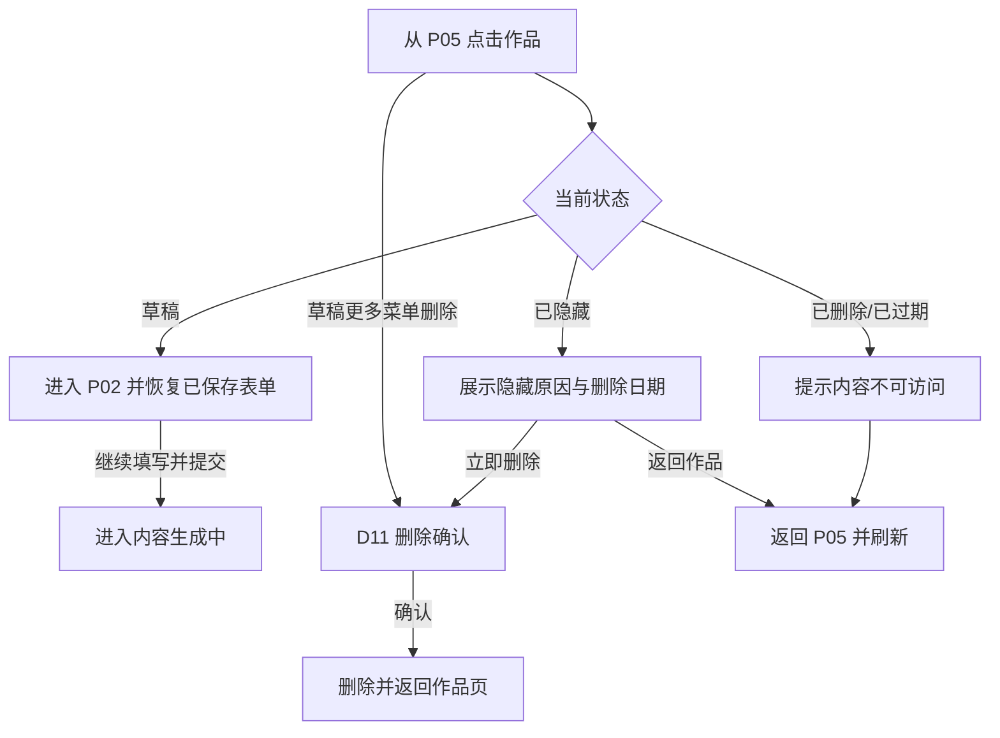

#### 关键状态 / 异常情况

- 草稿完整但尚未提交：进入 P02 后可直接发起内容生成。
- 草稿引用的形象已不可用：在缺失项中提示重新选择，不静默替换。
- 草稿加载失败：显示重试和返回作品，不误显示为生成失败。
- 已隐藏内容：不可播放、下载、分享、恢复或创建新版本，只能返回或立即删除。
- 已删除、无权限或历史入口失效：不展示内容摘要，统一提示后返回作品页。

#### 验收标准

- 草稿复用 P02，已隐藏复用 P06，不新增页面 ID。
- 草稿点击后直接恢复填写表单，不增加多余的草稿预览中间页。
- 已隐藏态明确展示隐藏原因与删除日期，不出现“已隐藏筛选”、播放、下载、分享或重生成入口。
- 7 天到期后作品自动从 P05 消失；30 天到期后历史入口不能恢复内容。
- 草稿/隐藏状态加载异常不会被误判为模型任务失败。

### 5.13 案例列表

#### 页面定位

P20 案例列表承接首页“更多案例”，用于集中浏览后台配置的 AI 带货案例。该页是需要登录的二级页面，视觉结构可参考作品列表的内容卡片密度，但不展示用户作品状态、生成进度或管理操作，也不提供筛选。

#### 参考素材

案例卡片的封面、标签、时长和 AI 标识参考首页案例区：

长列表、卡片间距和加载结构可参考“喵喵写歌”作品列表，仅参考信息密度，不沿用音乐分类、作品状态或四 Tab：

#### 页面结构（从上到下）

1. 顶部导航：返回、标题“案例列表”。
2. 案例说明：案例均由 AI 生成，仅供效果参考。
3. 案例列表：按后台配置顺序展示单列或双列案例卡片；页面不展示分类、状态或排序筛选。
4. 加载更多、空状态和错误重试区域。

#### 区块说明

| 区块 | 内容 | 作用 | 交互 |
|------|------|------|------|
| 顶部导航 | 返回、案例列表 | 明确二级页面层级 | 返回首页并恢复首页滚动位置 |
| 案例卡片 | 封面、标题、标签、时长、AI 标识 | 展示案例摘要 | 点击卡片打开 D01 案例视频预览 |
| 生成同款 | 下一版本能力提示 | 说明后续能力 | 点击后提示“下一版本开放”，不创建作品 |
| 列表反馈 | 加载更多、空状态、加载失败 | 保证长列表可用 | 继续加载或重试 |

#### 主要功能

- 登录后加载后台配置为已上线的案例，并按后台配置顺序展示。
- 点击案例卡片进入 D01 预览，关闭预览后返回原列表位置。
- “生成同款”首版只提示下一版本开放，不带入案例参数、不创建草稿。
- 页面不提供分类筛选、状态筛选、搜索、排序切换或案例管理。

#### 交互流程图

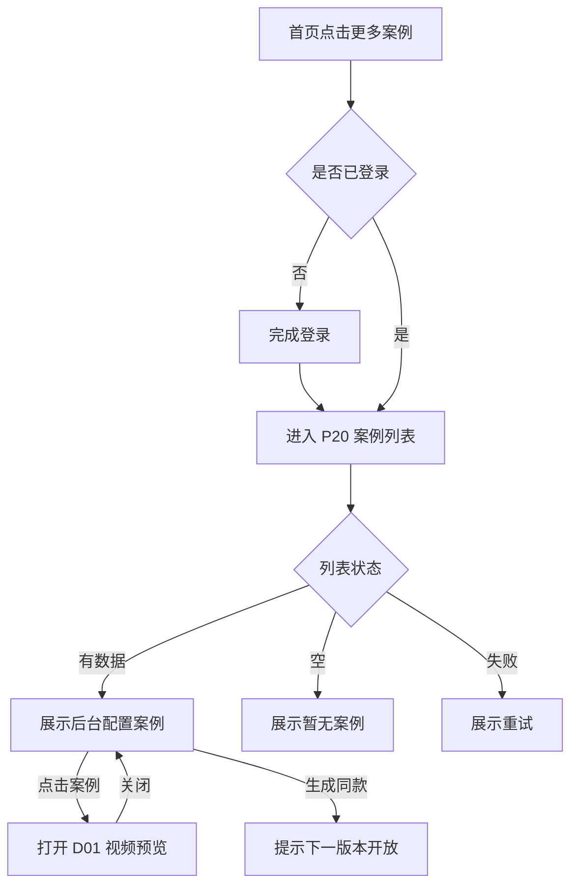

#### 关键状态 / 异常情况

- 首次加载中：展示与案例卡片比例一致的骨架占位。
- 暂无案例：说明“暂无更多案例”，提供返回首页。
- 加载失败：展示重试；已有列表加载更多失败时保留已加载内容。
- 案例下线：若打开前已下线，提示内容不可用并刷新列表。
- 登录取消或失败：停留首页，不进入空白案例页。

#### 验收标准

- 首页“更多案例”登录后能够进入 P20，P20 返回后首页位置保持不变。
- 列表按后台配置顺序展示案例，不出现任何筛选、搜索或排序控件。
- 案例卡片可打开 D01 预览，关闭后恢复原列表位置。
- “生成同款”只提示下一版本开放，不创建作品或消耗积分。
- 加载、空、错误和案例下线状态均有明确反馈。

---

## 6. 数据与同步（产品可见规则）

### 6.1 用户可见内容

| 内容 | 用户可查看的信息 | 主要操作 |
|------|------------------|----------|
| 商品素材 | 商品图片、描述和参数 | 首图创建草稿后持续保存；生成任务开始后只读 |
| 带货形象 | 形象图、名称、来源和可用状态 | 选择、重命名、删除或重新上传 |
| 脚本 | 整稿版本、镜头顺序、画面描述和可选口播 | 编辑、整稿重生成、查看或恢复历史版本 |
| 分镜图片 | 每个镜头当前图片、来源和历史图片 | 预览、重新生成、上传替换、选择历史版本 |
| 作品 | 封面、名称、状态、进度、更新时间和到期说明 | 从作品页按状态进入对应业务、继续处理或删除 |
| 视频成片 | 播放器、比例、时长、生成时间和 AI 标识 | 播放、下载、系统分享、重新编辑、重新生成或删除 |

### 6.2 状态与继续处理

作品的五个主业务状态为：草稿、内容生成中、编辑脚本、视频生成中、视频已完成。失败是异常状态，已隐藏是生命周期状态。

- 作品页展示状态摘要；点击后先获取最新状态，再进入 P02 填写或 P06 对应的生成、编辑、视频、完成/失败界面。
- 生成中作品不可修改、取消或删除；用户离开后任务继续运行。
- 编辑脚本状态允许修改脚本、处理分镜图片并恢复历史版本；缺失和待处理内容使用镜头问题标记，不新增主状态。
- 失败作品展示失败发生在哪个阶段、已保留内容和可执行的下一步。
- 已完成作品展示成片与到期时间；满 7 天后从作品列表隐藏。若用户仍停留在详情或通过未失效历史入口访问，P06 只展示已隐藏说明。

### 6.3 历史版本

- 整稿重新生成不会覆盖旧稿；用户可以查看并恢复历史脚本及其分镜图片。
- 单镜头修改、图片重新生成或上传替换只影响当前镜头，并保留旧图片供选择。
- 恢复历史整稿时，脚本和对应分镜图片一起恢复，避免脚本与图片错配。
- 提交视频生成后，本次已确认内容不可再修改；视频完成页“重新编辑脚本与分镜”会创建新的可编辑版本并保留已有成功视频。
- 历史版本数量上限由后台配置，页面在达到上限前给出提示。

### 6.4 隐藏与删除

- 作品、脚本历史版本、分镜图片、失败记录、视频和个人形象统一执行“7 天隐藏、30 天删除”。
- 7 天从内容生成完成或最后一次使用起计算；到期后从作品列表隐藏，不提供“已隐藏”筛选。
- 30 天到期后删除对应内容，不再提供恢复。
- 运行中的任务及其当前输入不进入隐藏或删除流程。
- 页面展示剩余有效期或到期说明，但不发送站内消息或系统通知。

---

## 7. 核心业务规则

### 7.1 登录与访问

- 游客可浏览首页、作品和我的三个一级页面的公共框架与内容。
- 点击创作、更多案例、作品详情、会员、积分、任务中心、订单、兑换码或推广素材等二级业务时，必须先登录。
- 登录页允许游客访问；P16 静态内容、P17 意见反馈和 P18 更多设置的访问边界复用“喵喵写歌”当前产品逻辑。P18 中的账号安全与退出登录只在登录后显示。
- 登录成功后回到原一级页面；用户再次点击目标入口进入对应业务。

### 7.2 商品图片

- 每个创建表单/作品至少 1 张、最多 3 张商品图片。
- 第一张图片上传、审核并保存成功后立即创建草稿作品；上传失败或审核不通过不创建草稿。
- 商品、探店和爆款复刻的分析素材图在上传前统一转为 JPEG；不缩放宽高，质量从 95、90、85、80、75、70、65 到 60 逐级尝试，采用使当前作品全部分析图片压缩后总量不超过 `10 * 1024 * 1024` 字节的最高质量。
- 恰好 10 MiB 允许添加；质量 60 仍超限时不覆盖原槽位，并提示“图片总大小不能超过10MB，图片无法添加”。总量检查使用压缩后大小，包含上传中、失败待重试、上传成功及草稿恢复图片。
- 恢复草稿图片缺少有效大小时仍可查看和提交，但禁止继续添加图片并提示稍后重试；替换图片计算总量时先排除被替换槽位旧大小。
- 删除、替换或离开填写页时清理 App 自建压缩缓存，不删除系统相册原图；模特照片和参考视频继续使用既有规则。
- 第一张为默认主图；用户可调整顺序。
- 上传失败图片不计入有效数量。
- 商品图片复用现有阿里内容审核；审核不通过时说明原因并允许替换。

### 7.3 商品描述

- 必填，最多 300 字。
- AI 帮写结果必须由用户主动确认后回填。
- 生成内容仅作为辅助，用户需对商品宣称真实性负责。
- 商品描述和脚本复用现有阿里内容审核与禁售/敏感类目规则。

### 7.4 视频参数

- 比例单选：竖屏 9:16、横屏 16:9。
- 时长单选：10s、15s、20s、30s。
- 默认值：9:16、20s。
- “30 秒生成”仅为营销表达，不代表任务必须在 30 秒内完成。
- 实际成片允许有轻微时长误差，但不能与用户选择明显不符。

### 7.5 带货形象

- 形象模式只有“不指定”或“指定一个形象”。
- 不指定时只能使用平台具备商用授权的形象池。
- 用户上传人像前必须确认拥有使用权和生成授权。
- 识别失败、审核失败、授权失效的形象不可提交任务。
- 定制达人保存成功后与上传形象一样进入个人资产。
- 用户形象数量上限由后台配置；达到上限时引导先删除或替换已有形象。
- AI 定制达人必须展示 AI 生成标识，并执行 7 天隐藏、30 天删除规则。

### 7.6 脚本、镜头与分镜图片

- 脚本镜头数量由目标时长与内容生成决定，不固定为 4 个。
- 每个镜头必须有画面描述；口播文案可不填，允许纯画面镜头。
- 画面描述和口播文案单字段最多 80 字；卖点数量与长度上限由后台配置。
- 文本大模型生成脚本成功后，系统自动按每个镜头的画面描述生成初始分镜图片。
- 每个镜头在提交视频前必须选择一张可用分镜图片；图片可以由 AI 生成或由用户上传替换。
- 整稿重生成形成新脚本与新分镜图片；旧版本可查看和恢复，不自动替换当前版本。
- 修改画面描述后，关联图片变为待确认；用户需重新生成、替换或明确保留旧图。仅修改口播不影响图片状态。
- 单镜头脚本/图片操作只产生局部修订，不得改变其他镜头。
- AI 生成的分镜图片必须展示 AI 生成水印或标识。

### 7.7 生成任务

- 内容生成、单镜头重生成、达人和视频生成均可能需要等待，页面应明确展示当前主状态；内容生成内部可展示脚本和分镜图片子步骤。
- 任一生成任务一旦开始，均不可取消、不可删除，也不可修改本次已提交内容。
- 用户可以返回一级页面，任务继续运行；再次进入作品时恢复最新状态。
- 短暂网络异常只显示重新连接，不直接把任务判定为失败。
- 任务最终只有成功或失败两种结果；失败后保留已有内容并提供对应恢复操作。
- 首版不发送任务完成或失败通知，用户通过作品页查看状态。

### 7.8 积分计费

- 当前版本仅在提交最终视频生成任务时计算积分，脚本和分镜图片生成不使用本节的视频积分规则。
- 预计消耗积分 = 视频时长（秒）× 每秒积分单价 × 清晰度倍率。
- 当前默认每秒积分单价为 10 积分；720p 清晰度倍率为 1.0，1080p 清晰度倍率为 1.5。
- 每秒积分单价和清晰度倍率均由后台配置；提交前必须展示视频时长、清晰度、单价、倍率和预计总消耗。
- 积分不足时不能提交视频生成，应引导用户进入积分充值。
- 每次重新生成视频，或重新编辑后再次生成视频，都重新计算并消耗积分。
- 用户确认提交视频生成后扣除积分；视频生成失败时自动全额退回本次扣除积分，并在积分余额和积分明细中可查。
- 视频生成成功但用户不满意不属于失败；主动重新生成时按照新任务再次扣除积分。
- 我的页的会员、积分、任务、充值和订单逻辑复用喵喵写歌现有产品规则，仅视频生成的积分消耗方式使用本节规则。

### 7.9 作品与失败恢复

- 上传第一张有效商品图后即形成一条草稿作品，脚本、分镜图片和最终视频都归属于该作品；提交内容生成时不重复建作品。
- 作品卡片是统一入口，但按最新状态进入对应业务界面：草稿填写、内容生成、编辑脚本、视频生成或视频完成。
- 分镜图片部分失败时只重试失败镜头，不推翻已经成功的镜头。
- 脚本失败可使用原输入重试，或返回填写页修改后重新提交。
- 视频失败时全额退回本次积分，可重新生成、返回编辑脚本或联系客服；重新生成作为新任务再次消耗积分。
- 视频已完成界面支持播放、下载、系统分享、重新编辑脚本与分镜、按当前内容重新生成和删除。
- 运行中作品不可删除；草稿、编辑脚本、失败、视频已完成和已隐藏作品可按页面规则删除。

### 7.10 AI 与内容合规

- 首页案例由后台配置，并标识 AI 生成或 AI 辅助。
- 不允许生成虚假功效、违规医疗/金融宣称或平台禁止内容。
- 商品图、人像、商品描述、脚本、分镜图片和视频复用现有阿里审核能力。
- 用户上传的人像、商标和商品图必须具备使用授权。
- AI 生成的分镜图片、达人形象和视频成片均需展示 AI 生成水印或标识。
- 发布前提示用户复核文案、画面和商品事实。

---

## 8. 前后端交互说明（产品交互口径）

### 8.1 交互原则

- 第一张有效商品图上传成功后立即形成草稿作品；后续输入、内容生成、编辑脚本、视频生成和完成结果都归属于该作品。
- 生成按钮提交后立即进入不可重复点击状态，避免产生重复作品或重复扣费。
- 任何入口打开作品时都先读取最新状态，再进入对应业务界面，不把用户带到已经失效的阶段。
- 错误提示应说明“发生了什么、已保留什么、下一步能做什么”，不能只显示“网络错误”。
- 首版不发送任务通知，作品页是用户查看进度和结果的唯一入口。

### 8.2 关键场景反馈

| 场景 | 页面反馈 | 用户可执行操作 |
|------|----------|----------------|
| 游客进入受保护二级业务 | 展示登录页和协议确认 | 完成登录或返回一级页面；P16/P17/P18 按复用逻辑例外处理 |
| 上传第一张商品图 | 单图进度；上传、审核、保存成功后创建草稿作品 | 继续填写；失败时替换、重试或查看原因 |
| AI 帮写描述 | 展示生成中、结果或失败原因 | 使用结果、重新生成或返回手工填写 |
| 提交内容生成 | 复用当前草稿并进入“内容生成中”，不重复创建作品 | 返回作品页；任务不可取消或删除 |
| 内容生成中 | 一个主状态下展示整体进度，并用子步骤说明脚本/分镜图片处理 | 查看已生成内容或返回作品页 |
| 分镜图片部分失败 | 标记失败镜头并保留成功镜头 | 只重试失败镜头、修改画面或上传替换 |
| 编辑脚本/图片 | 展示未保存、保存中、成功或内容更新提示 | 保存、放弃、刷新或选择历史版本 |
| 提交视频生成 | 展示视频时长、每秒积分单价、清晰度倍率和预计总消耗 | 确认提交、积分不足时去充值、返回修改 |
| 视频生成中 | 展示当前阶段、进度和已确认内容 | 返回作品页；不可取消、删除或修改 |
| 视频生成失败 | 展示原因、已保留内容、已有成功视频和积分说明 | 重新生成、返回编辑脚本或联系客服 |
| 视频生成成功 | 进入视频已完成界面，播放成片并显示 AI 标识和到期说明 | 重新编辑脚本与分镜、重新生成视频、下载、系统分享或删除 |
| 内容到期 | 7 天后从作品列表隐藏，30 天删除 | 到期前查看、下载或主动删除；隐藏后仅在未失效详情入口查看状态说明 |

### 8.3 失败文案分类

| 类型 | 文案重点 | 建议操作 |
|------|----------|----------|
| 输入不完整 | 指出缺少的商品图、描述、脚本或分镜图片 | 返回对应位置补充 |
| 权限未开启 | 说明需要相册或相机权限 | 重新授权或前往系统设置 |
| 内容审核不通过 | 说明违规对象和可修改方向 | 替换素材或修改文案 |
| 图片不符合要求 | 说明格式、大小、比例或清晰度问题 | 重新选择或上传 |
| 积分不足 | 展示预计积分和当前余额 | 前往积分充值 |
| 生成失败 | 说明失败阶段以及内容已保留 | 重试、返回修改或联系客服 |
| 连接异常 | 说明正在重新连接，不代表任务失败 | 稍后刷新或返回作品页查看 |

### 8.4 离开与恢复

- 用户离开生成页面后任务继续运行，运行中作品不能删除。
- 再次进入作品时，直接展示最新脚本、分镜图片、视频进度或成片结果。
- App 关闭或网络切换后，用户仍可通过作品页继续查看，不要求重新提交。
- 首版不提供通知中心，也不发送成功或失败的站内消息、短信或系统通知。

---

## 9. 非功能要求（产品质量）

### 9.1 性能与体验

- 首页优先展示主创作入口，案例图片加载不能阻塞主要操作。
- 作品列表滚动和状态更新应流畅，运行中卡片刷新时不整页闪烁。
- 图片上传展示清晰进度，上传失败可单图重试，不能阻塞其他表单编辑。
- 弱网时保留最近可见内容并显示“正在重新连接”，不能误报任务失败。
- 表单滚动、底部弹层和文本输入需适配键盘与安全区。

### 9.2 稳定性

- 重复点击、提交等待或页面重开不能创建重复作品或重复扣费。
- App 关闭、切后台或网络切换后，可从作品页恢复任务和已生成内容。
- 生成成功的视频必须保存在原作品中，不额外创建重复作品。
- 运行中的任务不因用户离开页面而中断，也不提供取消或删除入口。

### 9.3 安全与隐私

- 人像、商品图、脚本、分镜图片、作品和视频只能由内容所属用户访问。
- 用户可查看并删除个人形象和生成内容。
- 上传人像前展示授权说明，禁止未经同意使用他人肖像。
- 用户协议、隐私政策和账号注销规则复用喵喵写歌现有产品逻辑。

### 9.4 内容与版权

- 商品描述、脚本、分镜图片、视频画面和人像复用现有阿里内容审核能力。
- 平台形象、声音和案例素材应具备相应商用授权。
- AI 生成的分镜图片、达人形象和视频成片必须有 AI 生成水印或标识。
- 用户在下载或分享前确认内容真实、合法且不侵犯第三方权益。

### 9.5 可访问性与兼容性

- 关键文字与背景保持足够对比度；状态不能只用颜色表达。
- 主要触控区域符合移动端最小触控尺寸。
- 支持系统字体放大后的基本可用性，关键按钮和字数不被裁切。
- 适配主流 iOS/Android 屏幕、刘海/挖孔和底部安全区。
- 具体最低系统版本在后续技术方案中确定。

---

## 10. 里程碑

本节定义产品里程碑顺序，不提供未经工时评估的日期承诺。

| 里程碑 | 目标 | 主要产物 | 退出条件 |
|--------|------|----------|----------|
| M1 需求基线 | 确认范围和产品规则 | 本 PRD、检测反馈 | 需求检测通过，关键产品决策有结论 |
| M2 页面约束与技术方案 | 明确全状态页面、任务架构与合规方案 | PRD 页面清册、原始图片、技术方案、接口/数据设计 | 主流程和异常状态可评审 |
| M3 核心链路 Alpha | 打通首图建草稿→内容生成→编辑脚本→视频生成→视频完成 | 作品聚合、状态恢复与核心生成能力 | 内部测试可从作品页恢复五个阶段，并稳定生成首条视频 |
| M4 一级页面与恢复 Beta | 完成首页/作品/我的、形象资产、后台恢复和按阶段失败处理 | 完整 MVP | 任意状态作品可由同一入口恢复，P0/P1 缺陷关闭 |
| M5 发布候选 | 完成 QA、性能、安全、隐私与商店物料 | RC 包与发布清单 | 门禁全部通过，具备回滚方案 |

---

## 11. 待确认项与已确认产品决策

本轮 P0 / P1 / P2 产品问题均已得到结论，不存在阻塞 UI 设计的待确认项。积分失败返还、素材规格数值和会员套餐等可配置内容，在对应页面展示当时生效的规则，并由后续商业配置或技术方案承接。

### 11.1 产品范围与访问

1. 当前版本只做移动端 App，覆盖 iOS 和 Android，不提供 Web / H5 业务端。
2. 允许游客浏览首页、作品和我的三个一级页面；进入创作、案例、作品和账户/资产类二级页面前必须登录。P16/P17/P18 按喵喵写歌当前访问逻辑处理。
3. 首页的视频复刻、探店视频、AI 商品图和种草笔记首版统一展示“敬请期待”。
4. 横屏 16:9 与竖屏 9:16 均在首版开放。
5. “30 秒生成”仅作为营销表达，不承诺真实生成时限。

### 11.2 创作与作品

1. 上传第一张有效商品图后立即创建草稿作品；提交时复用该草稿，不重复创建作品。
2. 用户可见的五个主阶段为草稿、内容生成中、编辑脚本、视频生成中、视频已完成；失败/已隐藏分别作为异常和生命周期状态。
3. 内容生成中同时承接脚本与分镜图片生成；内部先生成脚本再按分镜生成图片，但用户只看到一个作品主状态。
4. 用户在编辑脚本界面确认脚本和图片后，由视频模型直接生成最终视频。
5. 口播文案不是必填，允许纯画面镜头；画面描述和口播文案单字段最多 80 字。
6. 分镜图片支持重新生成、上传替换和选择历史版本；整稿历史脚本与分镜图片支持查看和恢复。
7. 视频模型以图片作为主要输入，不建设独立配音/TTS 业务。
8. 任一生成任务开始后不可取消、不可删除，最终只进入成功或失败。
9. 作品页不提供筛选，按最近更新时间展示当前可见作品；点击后按最新状态进入对应业务界面，隐藏作品不在列表展示。
10. 运行中作品不显示删除、取消或重命名；草稿和非运行中作品按页面规则删除；作品重命名不纳入首版。
11. 视频已完成界面支持重新编辑脚本与分镜、重新生成视频、下载、系统分享和删除；旧成片在新版本/新任务失败时继续保留。重新生成或创建编辑版本再次消耗积分。

### 11.3 积分、我的与服务

1. 视频生成积分按“视频时长（秒）× 每秒积分单价 × 清晰度倍率”计算；当前每秒 10 积分，720p 为 1.0 倍，1080p 为 1.5 倍，单价与倍率均由后台配置。
2. 视频生成失败时自动全额退回本次扣除积分；失败后重试和成功后主动重新生成都作为新任务重新报价并再次扣分。
3. P08～P19 复用喵喵写歌现有产品逻辑，本项目只提及页面、入口和复用关系，不重复编写详细需求；不展示资产统计，喵喵带货视频积分消耗规则单独执行。
4. 客服使用喵喵写歌现有承接方式，不新增自动诊断工单。
5. 首版不提供通知中心，也不发送任务完成或失败通知。

### 11.4 运营、合规与后续版本

1. 首页与 P20 案例列表内容由后台配置；“更多案例”进入 P20，页面不提供筛选。
2. “生成同款”模板复用能力放到下一版本；本版不进入真实生成流程。
3. 商品、人像、描述、脚本、分镜图片和视频复用现有阿里内容审核能力。
4. 作品、脚本/图片历史版本、失败记录、视频和个人形象统一 7 天隐藏、30 天删除。
5. AI 生成的分镜图片、达人形象和视频成片均需展示 AI 生成水印或标识。
6. 品牌片尾、字幕样式、背景音乐和封面选择不因 AI 水印要求自动纳入本版。

### 11.5 后续文档承接

接口、数据结构、内部状态码、任务调度、模型调用、重复提交保护、文件存储、内容审核接口和计费流水等实现细节不在本 PRD 展开，由后续技术方案单独定义。

---

## 评审结论记录

| 日期 | 评审人 | 结论 | 备注 |
|------|--------|------|------|
| 2026-07-20 | 用户反馈 | `revised` | CHG-0001：改为首页/作品/我的三个一级页；统一作品预览；脚本后生成分镜图，确认后提交最终视频任务（生成机制由 CHG-0003 进一步校准） |
| 2026-07-20 | 用户反馈 | `revised` | CHG-0003：取消独立配音，确认脚本与分镜后直接由视频模型生成；新增 4 个一级需求、23 个二级需求、19 个页面和 26 个弹层/弹框的 UI 清册；“我的”页改以喵喵写歌当前 Flutter 代码为业务真源 |
| 2026-07-21 | 用户反馈 | `revised` | CHG-0004：固化 P0/P1/P2 决策；任务不可取消/删除；按分镜图计积分；7 天隐藏/30 天删除；无任务通知；UI 基线调整为 4/23/19/25，并将实现细节移交后续技术方案 |
| 2026-07-21 | 用户反馈 | `revised` | CHG-0005：P08～P19 只登记复用；补齐 P06 草稿/已隐藏态；作品页移除筛选；新增 P20 案例列表；UI 基线调整为 4/23/20/25 |
| 2026-07-21 | 用户复审 | `approved` | 确认继续推进；明确跳过 Figma 设计稿计划，直接进入技术方案 |
| 2026-07-21 | 用户反馈 | `revised` | CHG-0006：作品主流程调整为“草稿 → 内容生成中 → 编辑脚本 → 视频生成中 → 视频已完成”；首图建草稿；作品页按状态进入对应业务；完成态支持重新编辑、重新生成、下载和分享，且暂无专属 UI 素材 |
| 2026-07-21 | 用户复审 | `approved` | 确认 v0.1.6 作品五阶段需求调整，继续进入技术方案 v1.1 评审 |
| 2026-07-23 | 用户反馈 | `revised` | CHG-0020：视频积分改为“时长 × 每秒积分单价 × 清晰度倍率”；当前每秒 10 积分，720p 为 1.0 倍，1080p 为 1.5 倍；生成失败全额退回，任何重新生成都按新任务再次计费 |

## 路径恢复补充实现轨迹

2026-07-31 从错误工作区别名 `catseller` 恢复的工程独立化需求位于 `recovered-engineering-track-20260731/requirements.md`，使用 CHG-0021～CHG-0027。当前产品规则仍以 CHG-0020 和本文正文为准。
## CHG-0044：已完成作品的详情编辑

已完成作品详情支持两类状态无关编辑：修改作品标题，以及修改当前脚本版本中现有镜头的画面描述和口播。该能力用于修正文案，不代表返回填写页或重新进入生成流程。

- 视觉以 Figma `31:96`（横屏成片）、`31:148`（竖屏成片）和 `32:268`（修改标题底部弹框）为准，统一使用 375×812 基准视口。
- 标题铅笔打开底部弹框，预填当前完整标题，提供“取消/确定”；标题去除首尾空格后必须非空且不超过 24 字，无变化时不保存。
- 商品脚本按镜头顺序展示“镜头、画面、口播”，直接编辑现有文本分镜；不允许新增、删除、排序或修改镜头时长。
- 单个分镜在键盘完成或离开输入区域时保存，只提交变化镜头；请求失败时输入留在页面并提示重试。
- 仅本人、状态为已完成且没有活动任务的作品可编辑；保存后不跳转、不重新生成视频、不进入编辑脚本主阶段。
- 必须保持不变：作品状态、任务阶段/进度/失败信息、当前脚本指针、当前视频、已发布视频和 `lastUsedAt`。
- 无分镜时显示“暂无商品脚本”，不展示可编辑输入。
