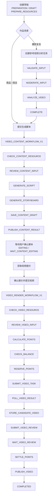

# 喵喵带货视频生成整体业务流程

> 文档版本：v1.2  
> 更新日期：2026-08-10  
> 适用范围：喵喵带货移动端 App  
> 文档定位：产品业务流程说明，作为产品、UI、Flutter、Java 后端和测试共同理解业务的依据

---

## 1. 流程目标

用户先准备图片、卖点、人物和视频参数，再由系统生成并发布脚本。用户确认脚本后获取报价并提交视频生成任务。视频生成失败时按统一补偿规则退回积分；视频生成成功后，如果用户不满意并选择重新生成，按照新任务再次计费。

商品视频、探店视频与爆款复刻共用同一作品生命周期。场景差异仅体现在 `workType`、输入素材与内容生成依据；作品状态、计费、审核、补偿、发布和 Worker 步骤完全一致。

爆款复刻先把参考视频解析为结构化叙事规则，再用当前商品图、卖点和可选人物生成新脚本、文本分镜与最终视频。参考视频只提供开场方式、内容顺序、时间比例、镜头节奏、景别、运镜、转场、口播方式和情绪曲线，不会作为最终视频 Provider 的直接输入。

移动端商品视频与探店视频均保持四个用户步骤：

1. 填写信息。
2. 生成脚本。
3. 确认脚本。
4. 合成视频。

`VIDEO_CONTENT_STORYBOARD_IMAGE_V1` 是可选的单分镜图片能力，不属于当前文本分镜直接生成视频的主链路，探店接入不改变这一点。

爆款复刻入口当前保持 `COMING_SOON`。本版本只提供后端作品契约、参考视频分析能力和缓存复用，不提供移动端爆款复刻页面及参考视频上传页面。

### 1.1 场景输入契约

```text
workType: PRODUCT_VIDEO | STORE_VIDEO | VIDEO_REMAKE
sellingPoints: String
imageGroups: [
  {
    role: PRODUCT_IMAGE | STORE_FRONT | STORE_INTERIOR | STORE_OFFERING,
    resourceIds: Long[]
  }
]
referenceVideoResourceId
videoTypeCode: String | null
aspectRatio
durationSeconds
resolution
personaId
```

- `workType` 创建后不可修改。
- `PRODUCT_VIDEO` 只允许 `PRODUCT_IMAGE`，1～3 张。
- `STORE_VIDEO` 的 `STORE_FRONT` 为 1～3 张且必填，`STORE_INTERIOR` 与 `STORE_OFFERING` 均为 0～4 张。
- `VIDEO_REMAKE` 使用 1～3 张 `PRODUCT_IMAGE`，并且必须绑定一个已经分析成功的 `referenceVideoResourceId`。
- 商品视频与探店视频必须选择有效的 `videoTypeCode`，禁止传入参考视频；爆款复刻的 `videoTypeCode` 必须为空。
- 同一资源不能跨分组重复；分组内顺序就是素材顺序，第一张商品图或门头图作为主图。
- 探店不新增店名、地址、营业时间和优惠等结构化输入，只使用图片与 `sellingPoints`。
- 比例、时长、清晰度和人物配置由三种场景共用；视频类型只适用于商品视频与探店视频。

---

## 2. 整体业务流程图



上述六个内容步骤与十二个视频步骤对三种 `workType` 完全相同；失败、审核拒绝、重试、积分冻结/结算/补偿和发布也使用同一实现。四步参考视频分析任务是爆款复刻在准备阶段的独立前置能力，不新增或改变作品内容工作流步骤。

---

## 3. 阶段说明

### 3.1 任务准备阶段

任务准备阶段对应作品的草稿状态。用户上传第一张有效商品图或门头图后，系统创建草稿作品，后续所有输入和生成内容都保存在这条作品下。

需要准备的内容：

| 准备内容 | 说明 | 是否必需 |
|----------|------|----------|
| 场景图片 | 商品视频与爆款复刻上传商品图；探店视频上传门头、环境、商品或服务图 | 是，按场景规则校验 |
| 图片分析 | 按图片内容 MD5、图片角色与分析版本识别和复用图片可见事实 | 是 |
| 参考视频与分析 | 爆款复刻绑定一个参考视频，并在提交脚本前完成结构化视频分析 | 仅爆款复刻必需 |
| 用户卖点 | 与图片事实共同用于生成脚本；三种场景使用同一个 `sellingPoints` 字段 | 是 |
| 带货人物 | 可以不指定，也可以选择已有形象、上传人物或生成新人物 | 否 |
| 视频比例 | 例如竖屏 9:16、横屏 16:9 | 是 |
| 视频时长 | 当前支持 10 秒、15 秒、20 秒和 30 秒 | 是 |
| 视频清晰度 | 当前支持 720p 和 1080p | 是 |

用户卖点可以由用户填写，也可以使用 AI 帮写。AI 帮写结果只有在用户主动点击使用后，才会覆盖填写页中的原内容。探店不采集店名、地址、营业时间或优惠等独立字段。

图片分析按角色路由，而不是按作品场景路由。同一张图片作为 `PRODUCT_IMAGE` 时，可在商品视频和爆款复刻之间共享分析；同一图片分别作为门头、环境、商品或服务图时，因为观察重点不同，需要按角色分别分析。

### 3.2 任务生成阶段一：脚本与文本分镜

用户提交内容生成任务后，作品进入“内容生成中”状态。系统根据作品场景检查输入图片、用户卖点、带货人物和视频参数，再生成脚本与文本分镜。

阶段一的处理顺序：

1. 检查生成资源是否完整、有效。
2. 根据 `workType`、带角色的图片、用户卖点、人物和视频参数生成脚本。商品与探店组合对应的视频类型规则；爆款复刻组合已经固化的视频分析结果。
3. 把脚本拆分为多个镜头，为每个镜头生成画面描述、台词提示和时长。
4. 保存内容草稿并发布内容结果，作品进入“编辑中”。
5. 用户在确认脚本页面预览或修改脚本和文本分镜。
6. 用户确认脚本后，才可以获取报价并进入视频生成阶段。

当前主链直接使用文本分镜生成视频，不要求先生成分镜图片。可选单分镜图片任务失败时只影响该可选能力，不改变主链内容工作流。

爆款复刻提交内容任务时必须已经存在当前参考视频的成功分析结果。系统把分析 ID、分析版本和结构化结果固化到内容任务快照；分析未完成或失败时明确拒绝提交，不在内容工作流中临时调用视频理解模型。

### 3.3 任务生成阶段二：最终视频

提交视频前，系统再次检查以下资源：

- 已确认的脚本。
- 有序文本分镜及其画面描述、口播和时长。
- 全部通过校验的有角色输入图片。
- 当前选择的带货人物。
- 爆款复刻已固化的参考视频分析规则。
- 视频比例、时长和清晰度。
- 用户当前积分余额。

资源检查通过后，系统根据视频时长和清晰度计算本次所需积分。用户确认后扣除积分并提交视频模型任务。任务开始后不允许取消，也不允许删除运行中的作品。

爆款复刻的最终视频 Provider 只接收当前脚本、文本分镜、商品图片、可选人物图片和结构化视频分析规则，不接收原始参考视频，避免模型直接复制原片中的品牌、人物、人脸、声音和具体文案。

### 3.4 素材查重与解析缓存

商品图片与参考视频上传时使用通用媒体类型（`IMAGE` 或 `VIDEO`）、文件 MD5 和大小查询公共资源。Core 不接收商品图片、爆款参考视频等业务目录；允许共享的目录由 Catseller 业务策略映射。命中同一 App 下可复用的有效资源时直接使用已有资源 ID；未命中时执行带 `Content-MD5` 的 OSS 签名 PUT 上传，完成阶段再次核对对象大小及 MD5。人物形象、歌曲素材和生成视频不参与跨用户查询。

解析缓存规则：

- 图片：`appCode + contentMd5 + assetRole + analysisVersion`；旧资源缺少 MD5 时按 `resourceId + assetRole + analysisVersion`。
- 视频：`appCode + contentMd5 + analysisVersion`；旧资源缺少 MD5 时按 `resourceId + analysisVersion`。
- 成功缓存直接返回，不再次调用 AI；有效租约正在执行时其他任务等待；失败或租约过期后只允许一个任务领取重试。
- 分析任务属于发起用户，其他用户不能查询任务详情；底层成功分析缓存允许在同一 App 内跨用户复用。

---

## 4. 视频生成积分规则

### 4.1 当前计费公式

```text
视频生成积分 = 视频时长（秒）× 每秒积分单价 × 清晰度倍率
```

当前默认配置：

| 配置项 | 当前值 |
|--------|--------|
| 每秒积分单价 | 10 积分/秒 |
| 720p 清晰度倍率 | 1.0 |
| 1080p 清晰度倍率 | 1.5 |

每秒积分单价和清晰度倍率均为后台可调整配置。后续调整配置时，只影响新的报价和新提交的任务，不追溯已经提交的任务。

### 4.2 当前时长计费示例

| 视频时长 | 720p 所需积分 | 1080p 所需积分 |
|----------|---------------|----------------|
| 10 秒 | 10 × 10 × 1.0 = **100 积分** | 10 × 10 × 1.5 = **150 积分** |
| 15 秒 | 15 × 10 × 1.0 = **150 积分** | 15 × 10 × 1.5 = **225 积分** |
| 20 秒 | 20 × 10 × 1.0 = **200 积分** | 20 × 10 × 1.5 = **300 积分** |
| 30 秒 | 30 × 10 × 1.0 = **300 积分** | 30 × 10 × 1.5 = **450 积分** |

### 4.3 扣除、退回和重新生成

| 场景 | 积分处理 |
|------|----------|
| 首次提交视频生成 | 用户确认后，按照当前报价扣除积分 |
| 视频生成成功 | 本次积分正常消费，不退回 |
| 视频生成失败 | 自动全额退回本次视频任务扣除的积分 |
| 失败后重新生成 | 作为新的生成任务重新报价并再次扣除积分 |
| 成功后不满意，直接重新生成 | 作为新的生成任务重新报价并再次扣除积分 |
| 成功后不满意，修改脚本或分镜后再生成 | 修改完成后重新报价并再次扣除积分 |

“不满意”不属于生成失败。只要系统已经成功生成可用视频，本次积分即正常消费；用户主动重新生成时，需要重新消耗积分。

### 4.4 报价变化规则

以下任一内容发生变化时，原报价失效，提交前必须重新计算：

- 输入图片、图片角色或顺序发生变化。
- 爆款复刻参考视频、视频分析 ID 或分析版本发生变化。
- 用户卖点、脚本或文本分镜发生变化。
- 视频时长发生变化。
- 视频清晰度发生变化。
- 后台调整每秒积分单价。
- 后台调整清晰度倍率。

用户从充值页面返回后，也需要重新获取积分余额和当前报价，不能直接使用充值前的旧数据提交任务。

---

## 5. 失败与重新生成流程

### 5.1 内容生成失败

- 保留用户已填写的图片、卖点、人物和视频参数。
- 重试继续使用相同的六步内容工作流，已成功步骤按工作流恢复规则跳过。
- 内容任务尚未提交视频生成，不进入视频积分冻结、结算或补偿流程。
- 可选单分镜图片能力独立失败时，只重试该图片任务，不重跑完整脚本。

### 5.2 视频生成失败

- 标记本次视频任务失败。
- 自动全额退回本次扣除的积分。
- 保留输入图片、脚本、文本分镜、带货人物和视频参数。
- 用户可以直接重新生成，也可以先返回编辑脚本与文本分镜。
- 重新生成属于新任务，需要重新报价并再次扣除积分。

### 5.3 视频生成成功但用户不满意

- 已成功的视频继续保留，用户可以继续播放、下载和分享。
- 用户可以直接按当前内容重新生成，也可以先修改脚本或文本分镜。
- 无论是否修改内容，重新生成都属于新的收费任务。
- 新视频生成失败时，只退回新任务扣除的积分，不影响旧视频和旧任务的积分消费。

---

## 6. 作品状态与进入页面

| 作品状态 | 从作品页进入的业务 |
|----------|--------------------|
| 草稿 | 进入填写信息页面，按场景继续准备图片、参考视频、卖点、人物和视频参数 |
| 内容生成中 | 进入脚本与文本分镜生成进度页面 |
| 编辑中 | 进入确认脚本页面，修改和确认脚本及文本分镜 |
| 视频生成中 | 进入视频生成进度页面，展示本次扣除积分和任务进度 |
| 已完成 | 进入视频完成页面，支持播放、下载、分享和重新生成 |
| 失败 | 进入对应失败阶段，展示积分退回结果和可恢复操作 |

---

## 7. 产品验收标准

1. 视频提交前能够展示时长、清晰度、清晰度倍率和预计扣除积分。
2. 720p 按 1.0 倍计费，1080p 按 1.5 倍计费。
3. 当前基础单价按 10 积分/秒计算，且单价和倍率可以由后台调整。
4. 积分不足时不能提交视频生成，并可以进入积分充值。
5. 用户确认提交后扣除本次视频生成积分。
6. 视频生成失败后，系统自动全额退回本次扣除的积分。
7. 退回结果能够在积分余额和积分明细中查询。
8. 失败后重新生成，需要重新报价并再次扣除积分。
9. 商品、探店与爆款复刻内容任务都创建完全相同的六个步骤，视频任务都创建完全相同的十二个步骤。
10. 商品视频只接受 1～3 张商品图；探店视频要求 1～3 张门头图，并允许最多 4 张环境图、4 张商品或服务图。
11. 探店生成内容不得虚构图片和用户卖点中不存在的店名、地址、价格、优惠、认证或服务。
12. 爆款复刻必须绑定一个分析成功的参考视频，且不能传入视频类型。
13. 爆款复刻的脚本、文本分镜和最终视频提示词使用同一份固化的视频分析结果，不把原始参考视频直接交给最终视频 Provider。
14. 同一图片在相同角色、相同分析版本下跨用户只调用一次图片模型；同一参考视频在相同分析版本下跨用户只调用一次视频模型。
15. 成功后用户主动重新生成，也需要重新报价并再次扣除积分。
16. 重新生成不会删除已有成功视频；新任务失败只退回新任务积分。
17. 视频任务开始后不能取消，运行中的作品不能删除。
18. 用户离开生成页面后任务继续运行，并可从作品页按最新状态恢复。
