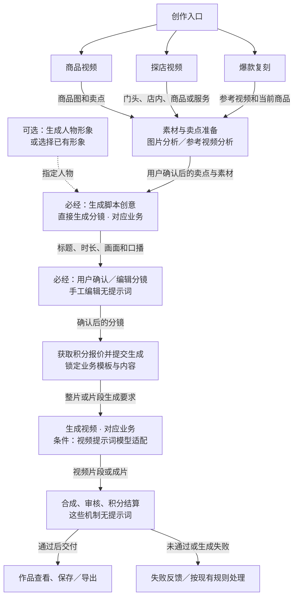
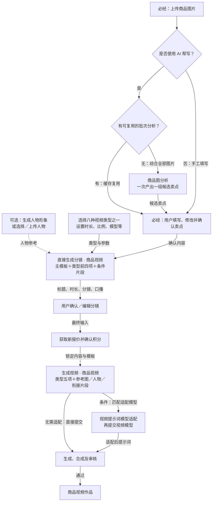
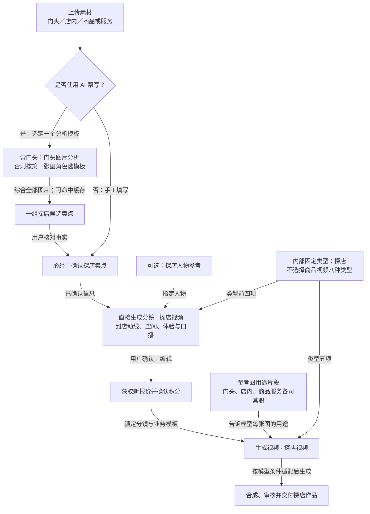
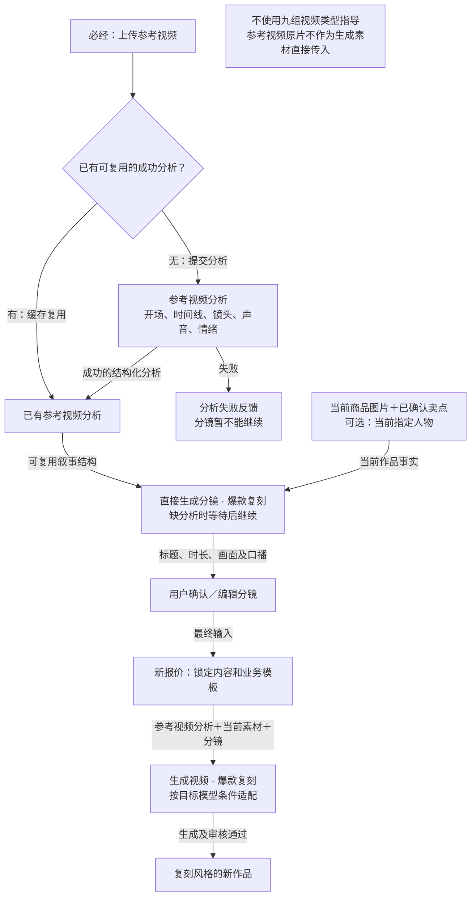
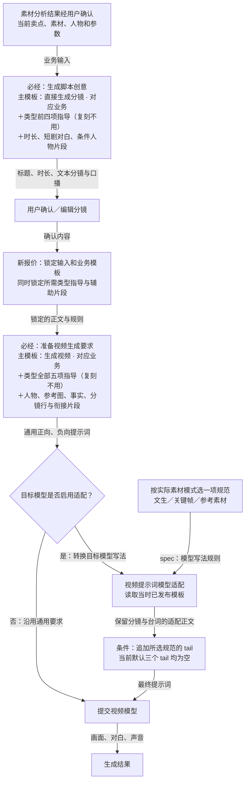
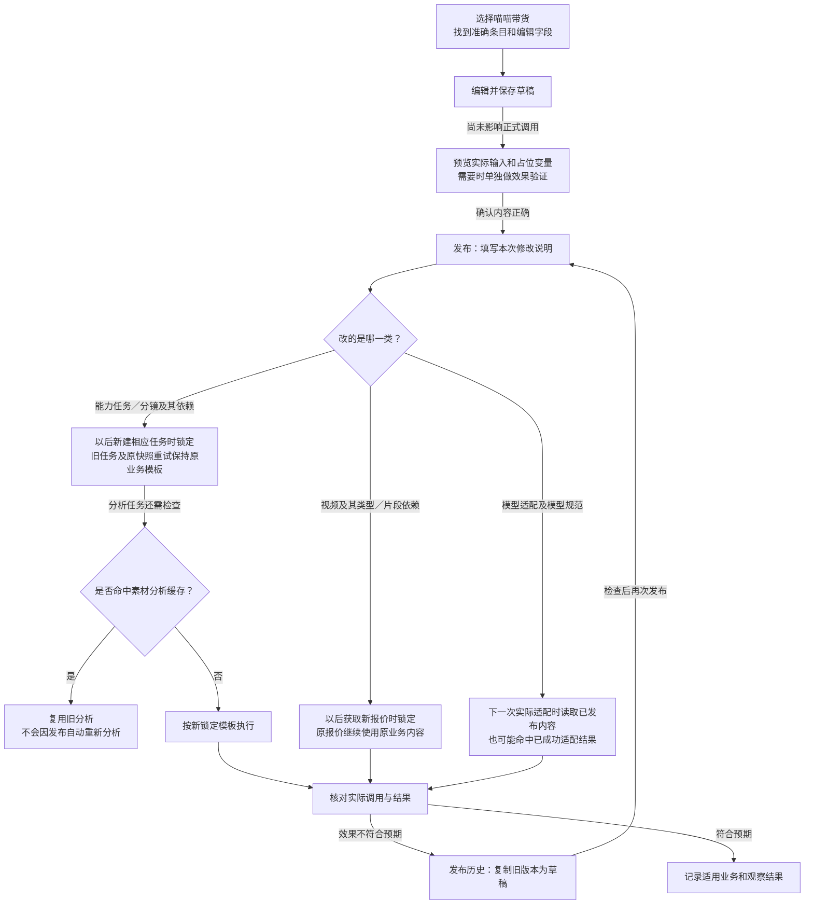

# 喵喵带货 · 提示词修改说明

> 面向运营：从“想调整什么效果”找到后台提示词，了解它处于哪一步、修改后会影响什么。
>
> 核对日期：2026-11-11（America/Los_Angeles）。依据当前本地 App、管理后台及后端实现和默认提示词目录编写；未登录线上后台核对已发布内容，也未进行真实模型效果测试。下文“当前要求”指本次核对的默认模板，线上已发布版本可能不同。

## 阅读导航

- [一、先看业务流程：六张流程图](#flows)
- [二、后台怎么找到、怎么修改](#admin)
- [三、主模板逐项说明：15 项](#main)
- [四、视频类型指导逐项说明：9 项](#types)
- [五、辅助片段逐项说明：44 项](#fragments)
- [六、模型适配逐项说明：4 项](#adapt)
- [七、想改变什么效果，应该改哪里](#quick)
- [八、发布、生效与排查](#release)
- [九、核对范围与文档维护](#verification)

### 先记住这几件事

1. **“生成脚本”目前一次生成标题、时长和完整文本分镜。** 不要按旧流程理解为“先写一篇脚本，再调用另一套提示词拆分镜”。
2. **AI 帮写卖点来自图片或参考视频理解。** 图片一次综合分析全部输入图，产出一组候选卖点，再交由用户确认；没有单独的“卖点创作文案”模板条目。
3. **商品视频可以选八种视频类型，探店固定使用内部探店类型，爆款复刻不使用这九组类型指导。** 九组指导各有五个字段：前四个用于分镜和成片，第五个“最终成片指导”用于视频生成。
4. **分镜图片不是当前 App 正式成片的必经步骤。** 后台保留三个“分镜图片（未使用）”条目及内部能力；改它们不会直接改变当前主流程的视频。
5. **保存草稿不等于发布，发布也不等于旧作品自动变化。** 业务模板在任务创建或报价时锁定；素材分析还可能命中缓存。模型适配模板另有读取时机，见第八节。
6. **同名规则要看使用条件。** `whole` 表示整片表达，`segment` 表示当前片段表达。当前新视频任务使用分段计划，即使只有一段也走片段模板；只改 `whole` 可能只看到整片预览变化。

本文逐项覆盖 **72 个条目、127 个编辑字段**。三个模型规范的 `tail` 当前为空，但仍逐项解释其用途。示例表示希望引导的方向，不是对模型效果的保证。

## 一、先看业务流程：六张流程图

读图约定：实线表示流程推进或实际资料传递；虚线表示可选输入、条件能力或辅助影响。方括号中的“必经／可选／条件／缓存”说明触发条件。标注“无提示词”的节点由产品、配置或程序处理，不能通过修改提示词改变其机制。

人物是否必选以当前业务配置为准；配置要求必选时，需要先选定人物。图中的 AI 生成人物是获取人物的一种方式，也可以选择已有形象或上传图片。

### 图 1：整体业务总览

> **主流程外的独立能力：** 三个“分镜图片（未使用）”条目仍保留，但不接入图中的正式成片链。

**本步做什么：** 三种创作入口最终都把已确认的素材、卖点和分镜交给视频生成。人物图片可来自已有资源、上传或 AI 生成；直接选已有图片不会调用“生成人物形象”。

**改哪里：** 素材理解问题找分析模板，故事和台词问题找分镜及类型指导，成片执行问题找视频生成及模型适配。审核是否开启、积分价格、实际可选时长和模型能力属于其他配置。

**影响后面哪些步骤：** 越早改变候选卖点或分镜，越可能传递到后续所有内容；已经完成的视频文件不会被反向重写。分镜图片单独保留，不作为正式成片前置步骤。

### 图 2：商品视频流程

**本步做什么：** 商品图分析处理整批图片，候选卖点经过用户确认后进入创作；用户选择的类型决定 UGC、短剧、演示、口播等不同表达方式。

**改哪里：** 想改变“看图提取了什么”改商品图分析；想改变“怎样讲”改对应视频类型指导；想改变“具体镜头和台词”改分镜规则；想改变“拍出来的质感”改最终成片指导或视频主模板。

**影响后面哪些步骤：** 分析模板修改只在重新发生分析且未复用缓存时改变结果，之后还要确认新卖点并重新创作。类型指导只影响选中该类型的作品；修改 UGC 不会顺带改变产品口播。

### 图 3：探店视频流程

**本步做什么：** 门头图负责入口和招牌，店内图负责空间与环境，商品／服务图负责可见体验内容。**不是三类图各调用一次分析**：只要本批含门头，就用“门头图片分析”综合全部图；没有门头，才按第一张图的角色选择店内、商品／服务或商品图分析模板。

**改哪里：** 修改整批理解重点先确认实际选中了哪个分析模板；生成时图片被用错，则查“参考图用途”片段。探店人物分镜规则当前写在探店主模板内，名为 `persona-storyboard.store_video` 的辅助条目当前没有被追加调用。

**影响后面哪些步骤：** 分析会影响候选卖点；空间动线和体验叙事影响分镜；参考图用途影响模型如何利用实际图片。修改文字不能新增未上传素材或改变素材上传数量要求。

### 图 4：爆款复刻流程

**本步做什么：** 提取参考片的抽象节奏、镜头组织、开场和情绪，结合当前商品重新创作。未完成参考分析时，提交脚本任务会触发／等待分析。

**改哪里：** “没抓住参考片节奏”先查参考视频分析；“新故事组织不合理”查复刻分镜；“成片没有执行已有节奏”查复刻视频主模板及适配。修改 UGC、短剧或内部探店类型指导对复刻不起作用。

**影响后面哪些步骤：** 分析改变后需要真正重新分析并重新生成分镜，才可能传递到成片。当前复刻链传递的是参考视频分析和当前图片，不是把原片作为视频模型素材直接复用；不能靠改提示词打开原片人物、声音或商标复制能力。

### 图 5：提示词如何组合、修改如何传递

> **主流程外的独立能力：** 分镜图片三项不进入上图组合。图中的“前四项”和“全部五项”来自同一组视频类型条目，只是读取时点和字段范围不同。

**本步做什么：** 主模板是一次 AI 调用的框架，类型指导决定表达方式，辅助片段把已确定事实和条件规则拼进框架。模型适配再把通用要求转换为目标模型的写法。

**改哪里：** 同一种风格先改类型指导；所有同业务作品的共同要求改主模板；人物、图用途或片段衔接等局部问题改对应片段；格式、素材引用或台词被改写等问题查适配层。

**影响后面哪些步骤：** 辅助片段被代入后，文字已经锁在任务／报价内容里。仅替换旧任务的主模板做预览，未必重新计算其中的类型或辅助片段文字；验证这类改动要用发布后的新任务或新报价。

### 图 6：修改发布与生效

**本步做什么：** 草稿用于编辑和预演，发布才更新正式模板。恢复历史版本或 JSON 默认值也只是得到草稿，仍需发布。

**改哪里：** 对一项修改核对条目、版本、实际调用输入及结果。不要把“发布成功”当作“旧任务已改用新内容”。

**影响后面哪些步骤：** 业务模板有任务／报价锁定边界；适配模板按真正执行时读取，发布可能影响尚未适配的旧任务或后续片段。已提交给视频模型的请求、已完成的片段和作品不会自动重做。

## 二、后台怎么找到、怎么修改

### 2.1 统一定位路径

选择 **喵喵带货 → AI 与计费 → 提示词管理**。在“搜索名称、编码或视频类型”中输入下文的条目名称或定位编码，选中后核对右侧编码，再选择编辑字段。

当前后台左侧按三段组织：**准备阶段、脚本与分镜、视频生成**。素材理解和人物归准备阶段，分镜主模板及分镜图片归脚本与分镜，视频主模板及类型指导归视频生成。辅助片段和模型适配目前也可能出现在准备阶段，**左侧分组不代表它真正的调用时机**，以本文的“对应步骤／生效规则”为准。右侧还会显示“素材理解、提示词规则片段、模型适配”等业务分组。

### 2.2 编辑字段的意思

| 后台字段 | 运营理解 | 修改时重点看什么 |
|---|---|---|
| System Prompt | 分析或创作的总要求 | 角色、事实边界、创作规则、返回结果要求 |
| User Prompt | 本次任务交给 AI 的实际内容 | 是否保留输入资料的位置，是否要求正确的结果内容 |
| Prompt | 图片／视频想要生成的内容；辅助片段也使用此字段 | 主体、画面、动作、声音、素材用途 |
| Negative Prompt | 想避免出现的内容 | 是否与正向要求矛盾，是否错误排除了必要人物或动作 |
| 剧情与叙事指导 | 怎么开场、推进、转折、收尾 | 叙事方式与视频类型是否一致 |
| 卖点表达指导 | 用什么方式证明购买理由 | 事实依据、主次卖点、展示和台词关系 |
| 人物表现指导 | 谁出镜、怎样行动和说话 | 指定人物、配角、表演与商品互动 |
| 分镜创作指导 | 怎样把内容组织成镜头 | 景别、切镜、镜头内动作、台词与时长 |
| 最终成片指导 | 实际视频怎样拍、怎样演、怎样发声 | 风格、光线、运镜、口型、连续性 |
| spec | 某种模型和素材模式的写法规范 | 正确模式、正文格式、素材对应和声音要求 |
| tail | 适配完成后直接追加到最终正文末尾的文字 | 当前默认为空；不经过同一次适配模型改写，勿把它当成普通补充聊天指令 |

`{{变量名}}` 是系统填入真实资料的位置，例如 `{{storyboardInputJson}}` 会放入当前作品资料。不要改花括号、改变量名、改成示例商品，也不要让 AI 把变量或格式说明读出来。文中“保留内容”既包含这些位置，也包含不能随意改动的结果结构。

### 2.3 生效规则速记

下文每项都标注适用规则，完整解释见第八节。

| 标记 | 生效范围 |
|---|---|
| A：新能力任务 | 分析、人物、内部单张分镜图在新任务创建时锁定业务模板。分析还受缓存影响。已有任务沿用原业务模板。 |
| B：新分镜任务 | 新建脚本／分镜任务时锁定主模板及依赖；复刻等待参考分析时也不改用后来发布的分镜模板。 |
| C：新视频报价 | 视频主模板、类型及辅助片段在新报价时锁定。已锁定报价和依赖它的视频任务不会自动换业务模板。 |
| D：实际模型适配 | 只有启用且匹配适配目标的模型使用。在实际适配时读取当时发布版本；成功结果可能按相同执行和请求复用。 |
| E：当前主流程不使用 | 条目保留，但当前正式成片链不调用该能力或该具体片段；修改不直接改变主流程成片。 |

同一个类型条目的前四个字段同时适用 **B、C**，第五个字段适用 **C**。改完后想同时看到分镜与成片变化，应重新创作分镜并取得新报价。

## 三、主模板逐项说明：15 项

主模板对应一次具体 AI 能力调用。先找业务入口，再核对商品、探店或复刻变体；不要用另一业务的同名模板代替。

### P01 · 参考视频分析

- **后台位置：** 提示词管理 → 准备阶段 → 参考视频分析。
- **定位编码：** `seller.reference-video.analyze`。
- **对应步骤：** 参考素材准备；复刻脚本任务缺少成功分析时也会自动触发并等待。
- **适用业务／条件：** 参考视频分析及依赖它的爆款复刻。相同素材和分析版本可能复用结果。
- **生效范围：** A；已缓存分析不因发布自动失效。

| 编辑字段 | 当前作用与直接影响 | 对后续业务的影响 | 修改示例方向 |
|---|---|---|---|
| System Prompt（`systemPrompt`） | 限定只分析能看见、听见的事实，要求返回结构化结果。 **改后：** 改变分析视角和事实取舍；放宽边界可能把推测当成素材事实。 | 分镜可能继承错误主体、情绪或卖点，成片继续受影响。 | 增加“先区分开场吸引点与后续证明内容”，观察分析是否更清楚。 |
| User Prompt（`userPrompt`） | 指定开场、时间线、逐段镜头与声音、可复用结构、情绪、可见品牌人物、不确定内容和候选卖点。 **改后：** 调整相应说明会改变分析细度和侧重点；删字段可能导致读取失败或信息缺失。 | 改变复刻的节奏、切镜、口播组织及可供确认的候选卖点。 | 强调每段说明“为何吸引观看”，同时保留原有字段和时间单位。 |

**应保留的内容：**

- System Prompt：事实边界、只输出约定结果、不推测人物真实身份等要求。
- User Prompt：全部结果字段、毫秒时间、先后顺序、五个候选卖点字符串字段及空值约定。 输入位置：`{{analysisVersion}}`。

**长段拆解（User Prompt）：**

| 段落内容 | 修改影响 |
|---|---|
| 概述、开场钩子 | 改变后续复刻优先借鉴的开场和主题。 |
| 时间轴文案、逐段镜头与声音 | 改变节奏、景别、运镜、转场及声音信息的提取；不能把毫秒改成秒。 |
| 可复用叙事结构、情绪曲线 | 改变参考片被理解为“怎样推进”和“怎样调动情绪”。 |
| 可见品牌、人物和不确定项 | 决定哪些事实只能记录、哪些内容不得被带入新商品。 |
| 一组五字段候选卖点 | 影响候选商品名、主次卖点、目标人群和场景；候选内容仍需用户确认。 |

### P02 · 商品图分析

- **后台位置：** 提示词管理 → 准备阶段 → 商品图分析。
- **定位编码：** `seller.product-image.analyze.product_image`。
- **对应步骤：** 商品图片的 AI 帮写，分析完成后整理候选卖点。
- **适用业务／条件：** 本批无门头且第一张角色为商品图时；通常用于商品视频，也可用于复刻当前商品资料。
- **生效范围：** A；相同有序图片批次可能命中分析缓存。

| 编辑字段 | 当前作用与直接影响 | 对后续业务的影响 | 修改示例方向 |
|---|---|---|---|
| System Prompt（`systemPrompt`） | 要求一次综合全部图片、只依据可见事实，返回一组候选卖点。 **改后：** 改变整批信息提取的严格程度，可能影响候选内容的可靠性。 | 被用户采用的候选卖点进入分镜和视频；未采用的结果不会自动覆盖作品。 | 增加“同类重复信息只概括一次”，观察候选是否更集中。 |
| User Prompt（`userPrompt`） | 传入图片数量和角色顺序，重点提取商品类型、外观、包装文字和可见使用信息。 **改后：** 改变分析重点、候选卖点具体程度及缺失内容的表达。 | 影响用户确认的商品／门店名称、主次卖点、人群及使用场景。 | 要求优先提取可见结构和操作特点，减少空泛形容。 |

**应保留的内容：**

- System Prompt：综合全部图片、一个结果对象、一组候选卖点、不能虚构事实的约束。
- User Prompt：结果字段及字段类型；五个候选卖点必须为字符串，不确定时留空；保持一次综合全部图片。 输入位置：`{{imageCount}}`、`{{imageRoleSequence}}`。

**长段拆解（User Prompt）：** 开头“图片数量／角色”让模型识别一批素材；中间的结果结构规定可见特征、可读文字、候选卖点、人群、场景和不确定内容；末尾强调只给一个综合结果。修改某个结果字段的说明会影响该类信息，删除字段或改成“每图一份结果”可能让业务无法正确读取。当前默认模板末尾再次强调图片数量与整批规则，调整时应保持前后一致。

### P03 · 门头图片分析

- **后台位置：** 提示词管理 → 准备阶段 → 门头图片分析。
- **定位编码：** `seller.product-image.analyze.store_front`。
- **对应步骤：** 探店图片的 AI 帮写，分析完成后整理候选卖点。
- **适用业务／条件：** 整批含门头图时优先选用，综合门头、店内、商品或服务全部输入图。
- **生效范围：** A；相同有序图片批次可能命中分析缓存。

| 编辑字段 | 当前作用与直接影响 | 对后续业务的影响 | 修改示例方向 |
|---|---|---|---|
| System Prompt（`systemPrompt`） | 要求一次综合全部图片、只依据可见事实，返回一组候选卖点。 **改后：** 改变整批信息提取的严格程度，可能影响候选内容的可靠性。 | 被用户采用的候选卖点进入分镜和视频；未采用的结果不会自动覆盖作品。 | 增加“同类重复信息只概括一次”，观察候选是否更集中。 |
| User Prompt（`userPrompt`） | 传入图片数量和角色顺序，重点提取门头、招牌、空间及店内商品或服务的综合事实。 **改后：** 改变分析重点、候选卖点具体程度及缺失内容的表达。 | 影响用户确认的商品／门店名称、主次卖点、人群及使用场景。 | 强调区分招牌上真实可读文字与看不清的信息。 |

**应保留的内容：**

- System Prompt：综合全部图片、一个结果对象、一组候选卖点、不能虚构事实的约束。
- User Prompt：结果字段及字段类型；五个候选卖点必须为字符串，不确定时留空；保持一次综合全部图片。 输入位置：`{{imageCount}}`、`{{imageRoleSequence}}`。

**长段拆解（User Prompt）：** 开头“图片数量／角色”让模型识别一批素材；中间的结果结构规定可见特征、可读文字、候选卖点、人群、场景和不确定内容；末尾强调只给一个综合结果。修改某个结果字段的说明会影响该类信息，删除字段或改成“每图一份结果”可能让业务无法正确读取。当前默认模板末尾再次强调图片数量与整批规则，调整时应保持前后一致。

### P04 · 店内图片分析

- **后台位置：** 提示词管理 → 准备阶段 → 店内图片分析。
- **定位编码：** `seller.product-image.analyze.store_interior`。
- **对应步骤：** 探店图片的 AI 帮写，分析完成后整理候选卖点。
- **适用业务／条件：** 本批不含门头，且第一张图角色为店内；不是“每有一张店内图就单独调用”。
- **生效范围：** A；相同有序图片批次可能命中分析缓存。

| 编辑字段 | 当前作用与直接影响 | 对后续业务的影响 | 修改示例方向 |
|---|---|---|---|
| System Prompt（`systemPrompt`） | 要求一次综合全部图片、只依据可见事实，返回一组候选卖点。 **改后：** 改变整批信息提取的严格程度，可能影响候选内容的可靠性。 | 被用户采用的候选卖点进入分镜和视频；未采用的结果不会自动覆盖作品。 | 增加“同类重复信息只概括一次”，观察候选是否更集中。 |
| User Prompt（`userPrompt`） | 传入图片数量和角色顺序，重点提取店内空间、装修、陈列、座位和可见环境。 **改后：** 改变分析重点、候选卖点具体程度及缺失内容的表达。 | 影响用户确认的商品／门店名称、主次卖点、人群及使用场景。 | 强调座位布局和动线，只描述画面确实提供的信息。 |

**应保留的内容：**

- System Prompt：综合全部图片、一个结果对象、一组候选卖点、不能虚构事实的约束。
- User Prompt：结果字段及字段类型；五个候选卖点必须为字符串，不确定时留空；保持一次综合全部图片。 输入位置：`{{imageCount}}`、`{{imageRoleSequence}}`。

**长段拆解（User Prompt）：** 开头“图片数量／角色”让模型识别一批素材；中间的结果结构规定可见特征、可读文字、候选卖点、人群、场景和不确定内容；末尾强调只给一个综合结果。修改某个结果字段的说明会影响该类信息，删除字段或改成“每图一份结果”可能让业务无法正确读取。当前默认模板末尾再次强调图片数量与整批规则，调整时应保持前后一致。

### P05 · 商品/服务图片分析

- **后台位置：** 提示词管理 → 准备阶段 → 商品/服务图片分析。
- **定位编码：** `seller.product-image.analyze.store_offering`。
- **对应步骤：** 探店图片的 AI 帮写，分析完成后整理候选卖点。
- **适用业务／条件：** 本批不含门头，且第一张图角色为商品／服务；综合整批图。
- **生效范围：** A；相同有序图片批次可能命中分析缓存。

| 编辑字段 | 当前作用与直接影响 | 对后续业务的影响 | 修改示例方向 |
|---|---|---|---|
| System Prompt（`systemPrompt`） | 要求一次综合全部图片、只依据可见事实，返回一组候选卖点。 **改后：** 改变整批信息提取的严格程度，可能影响候选内容的可靠性。 | 被用户采用的候选卖点进入分镜和视频；未采用的结果不会自动覆盖作品。 | 增加“同类重复信息只概括一次”，观察候选是否更集中。 |
| User Prompt（`userPrompt`） | 传入图片数量和角色顺序，重点提取商品或服务的可见外观和现场表现。 **改后：** 改变分析重点、候选卖点具体程度及缺失内容的表达。 | 影响用户确认的商品／门店名称、主次卖点、人群及使用场景。 | 强调可见制作或服务动作，避免补写套餐、价格或承诺。 |

**应保留的内容：**

- System Prompt：综合全部图片、一个结果对象、一组候选卖点、不能虚构事实的约束。
- User Prompt：结果字段及字段类型；五个候选卖点必须为字符串，不确定时留空；保持一次综合全部图片。 输入位置：`{{imageCount}}`、`{{imageRoleSequence}}`。

**长段拆解（User Prompt）：** 开头“图片数量／角色”让模型识别一批素材；中间的结果结构规定可见特征、可读文字、候选卖点、人群、场景和不确定内容；末尾强调只给一个综合结果。修改某个结果字段的说明会影响该类信息，删除字段或改成“每图一份结果”可能让业务无法正确读取。当前默认模板末尾再次强调图片数量与整批规则，调整时应保持前后一致。

### P06 · 生成人物形象

- **后台位置：** 提示词管理 → 准备阶段 → 生成人物形象。
- **定位编码：** `seller.persona-image.generate`。
- **对应步骤：** 用户定制人物形象；后台“个人形象管理”发起生成时也复用此能力。
- **适用业务／条件：** 新生成的人物图片。选择已有模特、上传图片不会因修改模板而重新生成。
- **生效范围：** A；新图片被用户选入作品后才继续影响分镜及视频。

| 编辑字段 | 当前作用与直接影响 | 对后续业务的影响 | 修改示例方向 |
|---|---|---|---|
| Prompt（`prompt`） | 按性别、年龄段、风格、体型、口播气质和补充外貌细节生成单人形象。 **改后：** 改变新模特的外观表现、姿态、画面干净程度和适合出镜的气质。 | 新模特作为参考图影响人物身份；不会直接指定最终视频台词、配音或口型。 | 增加“自然站姿、表情放松”，观察是否更适合作为后续参考图。 |
| Negative Prompt（`negativePrompt`） | 列出低清晰、畸形、多人、文字商标等应避免的图像问题。 **改后：** 调整模型对不需要特征的抑制方向，但不是生成后审核开关。 | 参考人物质量可能影响后续人脸、双手和身份一致性。 | 针对常见模糊问题强化清晰度限制，并用新人物任务观察。 |

**应保留的内容：**

- Prompt：结构化人物特征优先、单人主体、自然五官肢体，以及不添加文字商标水印的要求。 输入位置：`{{gender}}`、`{{ageRange}}`、`{{style}}`、`{{bodyType}}`、`{{speakingTemperament}}`、`{{appearanceDetails}}`。
- Negative Prompt：不要把需要的人物特征写进禁止项，也不要与 Prompt 的主体要求冲突。

### P07 · 直接生成分镜 · 商品视频

- **后台位置：** 提示词管理 → 脚本与分镜 → 直接生成分镜 · 商品视频。
- **定位编码：** `seller.storyboard-plan.generate.product_video`。
- **对应步骤：** 用户点击“生成脚本”，一次生成标题、最终时长、完整文本分镜和口播。
- **适用业务／条件：** 商品视频；依据已确认商品卖点和所选类型。
- **生效范围：** B；已生成分镜不因发布变化。复刻等待分析期间也沿用创建时锁定的分镜规则。

| 编辑字段 | 当前作用与直接影响 | 对后续业务的影响 | 修改示例方向 |
|---|---|---|---|
| System Prompt（`systemPrompt`） | 规定商品叙事、镜头连续性和当前类型规则，注入时长及条件规则，并约束语言和结果格式。 **改后：** 改变标题、镜头安排、动作、口播及自动时长选择。 | 视频执行这些已确认分镜；不合理拆镜或口播过长会传递到生成失败、节奏和声音问题。 | 增加“首镜尽快交代真实使用需求”，随后重新创作分镜比较。 |
| User Prompt（`userPrompt`） | 把当前作品准备好的资料整体交给 AI。 **改后：** 删除或替换输入位置会让模型看不到真实卖点、素材、人物或参考分析。 | 后续分镜和成片可能偏离本作品，不能用模板里固定商品替代用户输入。 | 保留作品资料，只在前面增加“请按本次确认内容组织”，不要填入固定商品。 |

**应保留的内容：**

- System Prompt：一次完整返回的约定结果、已确认事实、连续动作不拆碎、语言要求及时长／人物插槽。 输入位置：`{{videoTypeStoryboardGuidance}}`、`{{durationRules}}`、`{{shortDramaVoiceoverRules}}`、`{{personaStoryboardRule}}`。
- User Prompt：完整保留作品资料变量；示例不能写成所有用户的正式内容。 输入位置：`{{storyboardInputJson}}`。

**长段拆解（System Prompt）：**

| 语义段落 | 作用及修改影响 |
|---|---|
| 编导角色、资料来源、事实边界 | 决定这次是在做商品、探店还是复刻，影响故事依据和创作范围。 |
| 人物与视频类型规则 | 决定谁出镜、怎样讲；探店和复刻的人物要求直接写在主模板内，商品人物规则按条件追加。复刻的类型指导变量当前为空。 |
| 简体中文、普通话及专名保留 | 影响标题、描述和实际应说的语言；不会选择具体视频模型或音色服务。 |
| 连续拍摄、切镜和动作衔接 | 影响镜头数量与连续性；把每句口播都拆镜会增加跳切，不能只改成“镜头越多越好”。 |
| 时长与短剧对白规则 | 限制总时长、每镜时长及对白密度；当前短剧专用对白片段只用于商品视频的带货短剧。 |
| 结果格式 | 让系统能读出标题、总时长、画面、口播和镜头时长，改坏可能导致任务失败。 |

### P08 · 直接生成分镜 · 探店视频

- **后台位置：** 提示词管理 → 脚本与分镜 → 直接生成分镜 · 探店视频。
- **定位编码：** `seller.storyboard-plan.generate.store_video`。
- **对应步骤：** 用户点击“生成脚本”，一次生成标题、最终时长、完整文本分镜和口播。
- **适用业务／条件：** 探店视频；依据已确认探店卖点及门头、店内、商品／服务资料。
- **生效范围：** B；已生成分镜不因发布变化。复刻等待分析期间也沿用创建时锁定的分镜规则。

| 编辑字段 | 当前作用与直接影响 | 对后续业务的影响 | 修改示例方向 |
|---|---|---|---|
| System Prompt（`systemPrompt`） | 规定真实到店动线、空间连续性、指定人物和内部探店规则，注入时长及条件规则，并约束语言和结果格式。 **改后：** 改变标题、镜头安排、动作、口播及自动时长选择。 | 视频执行这些已确认分镜；不合理拆镜或口播过长会传递到生成失败、节奏和声音问题。 | 强调“先建立入口与空间关系，再进入体验”，随后重新创作分镜比较。 |
| User Prompt（`userPrompt`） | 把当前作品准备好的资料整体交给 AI。 **改后：** 删除或替换输入位置会让模型看不到真实卖点、素材、人物或参考分析。 | 后续分镜和成片可能偏离本作品，不能用模板里固定商品替代用户输入。 | 保留作品资料，只在前面增加“请按本次确认内容组织”，不要填入固定商品。 |

**应保留的内容：**

- System Prompt：一次完整返回的约定结果、已确认事实、连续动作不拆碎、语言要求及时长／人物插槽。 输入位置：`{{videoTypeStoryboardGuidance}}`、`{{durationRules}}`、`{{shortDramaVoiceoverRules}}`、`{{personaStoryboardRule}}`。
- User Prompt：完整保留作品资料变量；示例不能写成所有用户的正式内容。 输入位置：`{{storyboardInputJson}}`。

**长段拆解（System Prompt）：**

| 语义段落 | 作用及修改影响 |
|---|---|
| 编导角色、资料来源、事实边界 | 决定这次是在做商品、探店还是复刻，影响故事依据和创作范围。 |
| 人物与视频类型规则 | 决定谁出镜、怎样讲；探店和复刻的人物要求直接写在主模板内，商品人物规则按条件追加。复刻的类型指导变量当前为空。 |
| 简体中文、普通话及专名保留 | 影响标题、描述和实际应说的语言；不会选择具体视频模型或音色服务。 |
| 连续拍摄、切镜和动作衔接 | 影响镜头数量与连续性；把每句口播都拆镜会增加跳切，不能只改成“镜头越多越好”。 |
| 时长与短剧对白规则 | 限制总时长、每镜时长及对白密度；当前短剧专用对白片段只用于商品视频的带货短剧。 |
| 结果格式 | 让系统能读出标题、总时长、画面、口播和镜头时长，改坏可能导致任务失败。 |

### P09 · 直接生成分镜 · 爆款复刻

- **后台位置：** 提示词管理 → 脚本与分镜 → 直接生成分镜 · 爆款复刻。
- **定位编码：** `seller.storyboard-plan.generate.video_remake`。
- **对应步骤：** 用户点击“生成脚本”，一次生成标题、最终时长、完整文本分镜和口播。
- **适用业务／条件：** 爆款复刻；依据当前商品已确认卖点及参考视频结构化分析。
- **生效范围：** B；已生成分镜不因发布变化。复刻等待分析期间也沿用创建时锁定的分镜规则。

| 编辑字段 | 当前作用与直接影响 | 对后续业务的影响 | 修改示例方向 |
|---|---|---|---|
| System Prompt（`systemPrompt`） | 规定借鉴抽象叙事和节奏、当前人物、当前商品事实，注入时长及条件规则，并约束语言和结果格式。 **改后：** 改变标题、镜头安排、动作、口播及自动时长选择。 | 视频执行这些已确认分镜；不合理拆镜或口播过长会传递到生成失败、节奏和声音问题。 | 强调“保留参考片开场节奏，但用当前商品的真实处境重写”，随后重新创作分镜比较。 |
| User Prompt（`userPrompt`） | 把当前作品准备好的资料整体交给 AI。 **改后：** 删除或替换输入位置会让模型看不到真实卖点、素材、人物或参考分析。 | 后续分镜和成片可能偏离本作品，不能用模板里固定商品替代用户输入。 | 保留作品资料，只在前面增加“请按本次确认内容组织”，不要填入固定商品。 |

**应保留的内容：**

- System Prompt：一次完整返回的约定结果、已确认事实、连续动作不拆碎、语言要求及时长／人物插槽。 输入位置：`{{durationRules}}`、`{{shortDramaVoiceoverRules}}`、`{{videoTypeStoryboardGuidance}}`、`{{personaStoryboardRule}}`。
- User Prompt：完整保留作品资料变量；示例不能写成所有用户的正式内容。 输入位置：`{{storyboardInputJson}}`。

**长段拆解（System Prompt）：**

| 语义段落 | 作用及修改影响 |
|---|---|
| 编导角色、资料来源、事实边界 | 决定这次是在做商品、探店还是复刻，影响故事依据和创作范围。 |
| 人物与视频类型规则 | 决定谁出镜、怎样讲；探店和复刻的人物要求直接写在主模板内，商品人物规则按条件追加。复刻的类型指导变量当前为空。 |
| 简体中文、普通话及专名保留 | 影响标题、描述和实际应说的语言；不会选择具体视频模型或音色服务。 |
| 连续拍摄、切镜和动作衔接 | 影响镜头数量与连续性；把每句口播都拆镜会增加跳切，不能只改成“镜头越多越好”。 |
| 时长与短剧对白规则 | 限制总时长、每镜时长及对白密度；当前短剧专用对白片段只用于商品视频的带货短剧。 |
| 结果格式 | 让系统能读出标题、总时长、画面、口播和镜头时长，改坏可能导致任务失败。 |

### P10 · 分镜图片 · 商品视频（未使用）

- **后台位置：** 提示词管理 → 脚本与分镜 → 分镜图片 · 商品视频（未使用）。
- **定位编码：** `seller.storyboard-image.generate.product_video`。
- **对应步骤：** 内部单张分镜图片生成；当前 App 的确认脚本与成片主流程不调用此步骤。
- **适用业务／条件：** 商品视频的独立分镜图能力，目录标记“未使用”。
- **生效范围：** E；若单独调用保留的内部能力，按 A 使用新任务模板。

| 编辑字段 | 当前作用与直接影响 | 对后续业务的影响 | 修改示例方向 |
|---|---|---|---|
| Prompt（`prompt`） | 把单镜画面描述和比例交给图片生成；探店额外限定不虚构经营信息。 **改后：** 只改变实际调用该能力时生成的单张图片。 | 当前正式成片链不依赖该图片，不会因此改变用户的分镜文字或视频效果。 | 独立图片需求可补充“光线自然”，但当前主流程不会因此重画或改变成片。 |
| Negative Prompt（`negativePrompt`） | 限制单张分镜图中的文字、水印、畸变或第三方元素。 **改后：** 只影响该单图调用的负向要求。 | 不替代视频生成负向提示词，也不修改最终视频审核规则。 | 如果目标是减少成片水印，应改对应视频项；此处只处理独立图片。 |

**应保留的内容：**

- Prompt：分镜画面、比例变量；探店事实边界；不可当作正式视频主模板使用。 输入位置：`{{visualDescription}}`、`{{aspectRatio}}`。
- Negative Prompt：保留对应业务的主体和事实限制，避免禁止分镜必需内容。

### P11 · 分镜图片 · 探店视频（未使用）

- **后台位置：** 提示词管理 → 脚本与分镜 → 分镜图片 · 探店视频（未使用）。
- **定位编码：** `seller.storyboard-image.generate.store_video`。
- **对应步骤：** 内部单张分镜图片生成；当前 App 的确认脚本与成片主流程不调用此步骤。
- **适用业务／条件：** 探店视频的独立分镜图能力，目录标记“未使用”。
- **生效范围：** E；若单独调用保留的内部能力，按 A 使用新任务模板。

| 编辑字段 | 当前作用与直接影响 | 对后续业务的影响 | 修改示例方向 |
|---|---|---|---|
| Prompt（`prompt`） | 把单镜画面描述和比例交给图片生成；探店额外限定不虚构经营信息。 **改后：** 只改变实际调用该能力时生成的单张图片。 | 当前正式成片链不依赖该图片，不会因此改变用户的分镜文字或视频效果。 | 独立图片需求可补充“光线自然”，但当前主流程不会因此重画或改变成片。 |
| Negative Prompt（`negativePrompt`） | 限制单张分镜图中的文字、水印、畸变或第三方元素。 **改后：** 只影响该单图调用的负向要求。 | 不替代视频生成负向提示词，也不修改最终视频审核规则。 | 如果目标是减少成片水印，应改对应视频项；此处只处理独立图片。 |

**应保留的内容：**

- Prompt：分镜画面、比例变量；探店事实边界；不可当作正式视频主模板使用。 输入位置：`{{visualDescription}}`、`{{aspectRatio}}`。
- Negative Prompt：保留对应业务的主体和事实限制，避免禁止分镜必需内容。

### P12 · 分镜图片 · 爆款复刻（未使用）

- **后台位置：** 提示词管理 → 脚本与分镜 → 分镜图片 · 爆款复刻（未使用）。
- **定位编码：** `seller.storyboard-image.generate.video_remake`。
- **对应步骤：** 内部单张分镜图片生成；当前 App 的确认脚本与成片主流程不调用此步骤。
- **适用业务／条件：** 爆款复刻的独立分镜图能力，目录标记“未使用”。
- **生效范围：** E；若单独调用保留的内部能力，按 A 使用新任务模板。

| 编辑字段 | 当前作用与直接影响 | 对后续业务的影响 | 修改示例方向 |
|---|---|---|---|
| Prompt（`prompt`） | 把单镜画面描述和比例交给图片生成；探店额外限定不虚构经营信息。 **改后：** 只改变实际调用该能力时生成的单张图片。 | 当前正式成片链不依赖该图片，不会因此改变用户的分镜文字或视频效果。 | 独立图片需求可补充“光线自然”，但当前主流程不会因此重画或改变成片。 |
| Negative Prompt（`negativePrompt`） | 限制单张分镜图中的文字、水印、畸变或第三方元素。 **改后：** 只影响该单图调用的负向要求。 | 不替代视频生成负向提示词，也不修改最终视频审核规则。 | 如果目标是减少成片水印，应改对应视频项；此处只处理独立图片。 |

**应保留的内容：**

- Prompt：分镜画面、比例变量；探店事实边界；不可当作正式视频主模板使用。 输入位置：`{{visualDescription}}`、`{{aspectRatio}}`。
- Negative Prompt：保留对应业务的主体和事实限制，避免禁止分镜必需内容。

### P13 · 生成视频 · 商品视频

- **后台位置：** 提示词管理 → 视频生成 → 生成视频 · 商品视频。
- **定位编码：** `seller.video.generate.product_video`。
- **对应步骤：** 确认分镜、报价后，向视频模型提交整片或当前片段要求。
- **适用业务／条件：** 商品视频，同时受实际素材、分镜、所选模型及能力影响。
- **生效范围：** C；模型适配另按 D。当前新任务的正文主要来自 segment 片段事实。

| 编辑字段 | 当前作用与直接影响 | 对后续业务的影响 | 修改示例方向 |
|---|---|---|---|
| Prompt（`prompt`） | 组合参考图用途、人物约束、业务事实及适用类型规则；强调商品外观、人物身份、按镜头和口播推进。 **改后：** 改变视频模型如何执行已有画面、动作、表演、声音和连续性。 | 影响新生成视频；不自动重写确认页的分镜。只生成当前任务或片段，视频模型同时生成画面和声音。 | 增加“当前动作完成后停稳再切镜”，观察成片是否更连贯。 |
| Negative Prompt（`negativePrompt`） | 列出畸变、身份变化、错序等成片禁忌，并追加人物负向规则。 **改后：** 调整需要抑制的问题；太宽泛可能压制正常动作或必要配角。 | 影响生成画面；对适配到 H3 的调用，必要限制应整合进正文，独立负向字段不发送。 | 针对明显身份漂移强化“人物替换”，短剧同时检查不要禁止已定义配角。 |

**应保留的内容：**

- Prompt：参考图、人物及业务事实插槽，镜头顺序、台词含义、语言和实际时长要求；不能靠文字改变媒体传参。 输入位置：`{{referenceImageLines}}`、`{{personaConstraint}}`、`{{videoTypeVideoGuidance}}`、`{{videoFacts}}`。
- Negative Prompt：保留人物负向插槽；与正向剧情一致；复刻保留第三方人物、声音和商标限制。 输入位置：`{{personaNegativeConstraint}}`。

**长段拆解（Prompt）：**

| 段落内容 | 修改影响 |
|---|---|
| 参考图用途 | 决定图片用于商品、环境还是人物，不能把人物图当成商品图，也不能用文字增加实际图片。 |
| 指定人物约束 | 决定指定人物是否稳定，商品短剧另允许既有配角。 |
| 类型成片规则 | 商品／探店组合五项指导；复刻当前不注入类型指导。 |
| 当前生成范围、语言、动作与声音 | 决定执行当前片段还是整片、普通话怎样发声；不得让每段重新从全片开场开始。 |
| 事实边界与结构化业务内容 | 把真实卖点、有序分镜、当前片段和衔接资料交给模型；删除可能造成漏镜、重复或事实漂移。 |

### P14 · 生成视频 · 探店视频

- **后台位置：** 提示词管理 → 视频生成 → 生成视频 · 探店视频。
- **定位编码：** `seller.video.generate.store_video`。
- **对应步骤：** 确认分镜、报价后，向视频模型提交整片或当前片段要求。
- **适用业务／条件：** 探店视频，同时受实际素材、分镜、所选模型及能力影响。
- **生效范围：** C；模型适配另按 D。当前新任务的正文主要来自 segment 片段事实。

| 编辑字段 | 当前作用与直接影响 | 对后续业务的影响 | 修改示例方向 |
|---|---|---|---|
| Prompt（`prompt`） | 组合参考图用途、人物约束、业务事实及适用类型规则；强调门头、空间、陈列、可见商品服务和探店人物。 **改后：** 改变视频模型如何执行已有画面、动作、表演、声音和连续性。 | 影响新生成视频；不自动重写确认页的分镜。不虚构店名、地址、营业时间、优惠及服务。 | 增加“当前动作完成后停稳再切镜”，观察成片是否更连贯。 |
| Negative Prompt（`negativePrompt`） | 列出畸变、身份变化、错序等成片禁忌，并追加人物负向规则。 **改后：** 调整需要抑制的问题；太宽泛可能压制正常动作或必要配角。 | 影响生成画面；对适配到 H3 的调用，必要限制应整合进正文，独立负向字段不发送。 | 针对明显身份漂移强化“人物替换”，短剧同时检查不要禁止已定义配角。 |

**应保留的内容：**

- Prompt：参考图、人物及业务事实插槽，镜头顺序、台词含义、语言和实际时长要求；不能靠文字改变媒体传参。 输入位置：`{{referenceImageLines}}`、`{{personaConstraint}}`、`{{videoTypeVideoGuidance}}`、`{{videoFacts}}`。
- Negative Prompt：保留人物负向插槽；与正向剧情一致；复刻保留第三方人物、声音和商标限制。 输入位置：`{{personaNegativeConstraint}}`。

**长段拆解（Prompt）：**

| 段落内容 | 修改影响 |
|---|---|
| 参考图用途 | 决定图片用于商品、环境还是人物，不能把人物图当成商品图，也不能用文字增加实际图片。 |
| 指定人物约束 | 决定指定人物是否稳定，商品短剧另允许既有配角。 |
| 类型成片规则 | 商品／探店组合五项指导；复刻当前不注入类型指导。 |
| 当前生成范围、语言、动作与声音 | 决定执行当前片段还是整片、普通话怎样发声；不得让每段重新从全片开场开始。 |
| 事实边界与结构化业务内容 | 把真实卖点、有序分镜、当前片段和衔接资料交给模型；删除可能造成漏镜、重复或事实漂移。 |

### P15 · 生成视频 · 爆款复刻

- **后台位置：** 提示词管理 → 视频生成 → 生成视频 · 爆款复刻。
- **定位编码：** `seller.video.generate.video_remake`。
- **对应步骤：** 确认分镜、报价后，向视频模型提交整片或当前片段要求。
- **适用业务／条件：** 爆款复刻，同时受实际素材、分镜、所选模型及能力影响。
- **生效范围：** C；模型适配另按 D。当前新任务的正文主要来自 segment 片段事实。

| 编辑字段 | 当前作用与直接影响 | 对后续业务的影响 | 修改示例方向 |
|---|---|---|---|
| Prompt（`prompt`） | 组合参考图用途、人物约束、业务事实及适用类型规则；强调参考片抽象节奏与当前商品、人物、分镜。 **改后：** 改变视频模型如何执行已有画面、动作、表演、声音和连续性。 | 影响新生成视频；不自动重写确认页的分镜。参考视频分析提供组织方式，原片不是直接生成素材。 | 增加“当前动作完成后停稳再切镜”，观察成片是否更连贯。 |
| Negative Prompt（`negativePrompt`） | 列出畸变、身份变化、错序等成片禁忌，并追加人物负向规则。 **改后：** 调整需要抑制的问题；太宽泛可能压制正常动作或必要配角。 | 影响生成画面；对适配到 H3 的调用，必要限制应整合进正文，独立负向字段不发送。 | 针对明显身份漂移强化“人物替换”，短剧同时检查不要禁止已定义配角。 |

**应保留的内容：**

- Prompt：参考图、人物及业务事实插槽，镜头顺序、台词含义、语言和实际时长要求；不能靠文字改变媒体传参。 输入位置：`{{referenceImageLines}}`、`{{personaConstraint}}`、`{{videoFacts}}`、`{{videoTypeVideoGuidance}}`。
- Negative Prompt：保留人物负向插槽；与正向剧情一致；复刻保留第三方人物、声音和商标限制。 输入位置：`{{personaNegativeConstraint}}`。

**长段拆解（Prompt）：**

| 段落内容 | 修改影响 |
|---|---|
| 参考图用途 | 决定图片用于商品、环境还是人物，不能把人物图当成商品图，也不能用文字增加实际图片。 |
| 指定人物约束 | 决定指定人物是否稳定，商品短剧另允许既有配角。 |
| 类型成片规则 | 商品／探店组合五项指导；复刻当前不注入类型指导。 |
| 当前生成范围、语言、动作与声音 | 决定执行当前片段还是整片、普通话怎样发声；不得让每段重新从全片开场开始。 |
| 事实边界与结构化业务内容 | 把真实卖点、有序分镜、当前片段和衔接资料交给模型；删除可能造成漏镜、重复或事实漂移。 |

## 四、视频类型指导逐项说明：9 项

每组五个字段分别说明。前四项同时进入分镜与视频，第五项只进入视频；爆款复刻不使用。正文里的“禁止／必须”是引导模型的要求，不表示每条都由程序自动检查。

### P16 · UGC 种草 · 商品视频

- **后台位置：** 提示词管理 → 视频生成 → UGC 种草 · 商品视频。
- **定位编码：** `seller.video-type.ugc_seeding.product_video`。
- **对应步骤：** 分镜创作及视频生成中的类型指导。
- **适用业务／条件：** 只影响商品视频中选择“UGC 种草”的作品。爆款复刻不使用。
- **生效范围：** 前四字段：B＋C；最终成片指导：C。

| 编辑字段 | 当前作用与直接影响 | 对后续业务的影响 | 修改示例方向 |
|---|---|---|---|
| 剧情与叙事指导（`narrativeGuidance`） | 第一人称真实分享；前两秒用需求、动作或可见结果建立钩子，围绕一个购买理由。 **改后：** 改变开场吸引点和分享顺序。 | 分镜故事与视频表达一起变得更偏体验或更偏介绍。 | 将“需求开场”明确为“先看到正在解决的真实小麻烦”。 |
| 卖点表达指导（`sellingPointGuidance`） | 先展示或操作，再表达日常感受。 **改后：** 改变卖点如何被证明和口播措辞。 | 影响分镜台词及成片是否有可信证据。 | 强调每句感受对应当前一个可见细节。 |
| 人物表现指导（`characterGuidance`） | 普通使用者自然分享，也允许第一视角手部体验。 **改后：** 改变人物气质、视线、停顿及参与方式。 | 影响分镜人物动作和视频表演。 | 减少对镜推销手势，增加观察后再表达。 |
| 分镜创作指导（`storyboardGuidance`） | 生活钩子、自然出现商品、连续体验、证据细节和收束。 **改后：** 改变景别、手机视角与真实切镜点。 | 影响镜头顺序和成片衔接。 | 要求特写与正在使用的步骤相连。 |
| 最终成片指导（`videoGuidance`） | 写实手机记录质感、自然光、轻微可控手持与自然口播。 **改后：** 改变最终光线、运镜、肤质和声音风格。 | 用于成片，不单独重写已经生成的分镜。 | 强调轻微手持但主体稳定清楚。 |

**应保留的内容：**

- 剧情与叙事指导：真实使用语境、一个核心卖点、辅助最多一个，不把叙事阶段机械拆成镜头。
- 卖点表达指导：不虚构购买经历、长期效果、价格优惠或用户评价。
- 人物表现指导：稳定主要体验者，动作符合日常习惯，先体验再反应。
- 分镜创作指导：连续动作不拆碎，不安排与口播无关空镜。
- 最终成片指导：商品与人物一致、音乐不抢口播，不新增事实。

### P17 · 带货短剧 · 商品视频

- **后台位置：** 提示词管理 → 视频生成 → 带货短剧 · 商品视频。
- **定位编码：** `seller.video-type.short_drama.product_video`。
- **对应步骤：** 分镜创作及视频生成中的类型指导。
- **适用业务／条件：** 只影响商品视频中选择“带货短剧”的作品。爆款复刻不使用。
- **生效范围：** 前四字段：B＋C；最终成片指导：C。

| 编辑字段 | 当前作用与直接影响 | 对后续业务的影响 | 修改示例方向 |
|---|---|---|---|
| 剧情与叙事指导（`narrativeGuidance`） | 先有真实目标或阻碍，再由商品发挥关键作用形成转折；允许商品从开场就在场。 **改后：** 改变冲突来源、商品介入时机和剧情因果。 | 分镜与成片可能变成真实短剧，或因改坏而退化为演示。 | 强调便携来自人物必须出门的真实需求，不搬运笨重机器作陪衬。 |
| 卖点表达指导（`sellingPointGuidance`） | 一个核心购买理由通过动作和结果体现，最多一个辅助卖点。 **改后：** 改变卖点是被演出来还是被念出来。 | 影响画面设计、对白密度及可信度。 | 把已确认结构特点放进画面动作，减少广告式口号。 |
| 人物表现指导（`characterGuidance`） | 指定人物作主角，配角有明确关系与动机；首次建立固定配角外形锚点。 **改后：** 改变主配角关系、出镜和身份稳定性。 | 影响人物分镜与成片角色一致性。 | 把配角的关系、固定发型和服装表达得更明确。 |
| 分镜创作指导（`storyboardGuidance`） | 真实冲突、升级、商品关键作用、转折和兑现；15 秒最多两场景，三轮现场对白。 **改后：** 改变镜头、行动因果、场景数量和对白往来。 | 影响生成是否有合理互动、能否在时长内完成并发声。 | 减少不必要场景跳转，让第二句直接回应第一句。 |
| 最终成片指导（`videoGuidance`） | 短视频剧情广告质感；逐字现场对白、口型同步、人声优先，并检查剧情是否合理。 **改后：** 改变视频如何表演和发声，也加强约束执行。 | 主要影响视频生成；此字段里即使写“输出 JSON 前自检”，当前也不会因此回到分镜阶段重新生成。 | 强化“另一人倾听，当前说话人嘴部清晰”，不增加台词。 |

**应保留的内容：**

- 剧情与叙事指导：不虚构同类对比物、不故意误用商品、不让商品无理由先失败后成功。
- 卖点表达指导：不猜拆装换盖步骤，不虚构防漏等结果，不堆技术名词。
- 人物表现指导：PERSONA主角固定标签、配角身份锚点逐次一致；不猜指定人物外貌。
- 分镜创作指导：十五秒三轮对白、说话人明确、现实动作、禁止不卫生分享和商品无理由先败后成。
- 最终成片指导：原对白、说话人、主配角一致、因果和商品事实，不用背景声替代对白。

**长段拆解：**

| 字段内的段落 | 修改影响 |
|---|---|
| 剧情与叙事：真实目标及两类结构 | 决定“问题解决型”还是“商品全程在场的体验型”，商品出场时间不等于关键作用发生时间。 |
| 剧情与叙事：旧办法与便携反例 | 避免为了衬托商品虚构笨重机器、错用物件或不合常识的搬运动作。 |
| 剧情与叙事：商品介入、先失败后成功限制、前三秒钩子 | 控制动作因果与开场冲突，弱化可能出现广告式演示或无理由反转。 |
| 卖点表达：核心价值、真实用途、机械步骤与结果限制 | 决定卖点通过剧情体现，还是沦为拆装说明和未确认功效。 |
| 人物表现：主角、配角锚点、首镜互动 | 控制人物归属与配角稳定性；需要与人物片段同步理解。 |
| 分镜创作：剧情覆盖、两场景限制、三轮对白、对白合理性 | 控制短时长内能否把故事讲完，是否说人话、是否存在真实沟通需求。 |
| 分镜创作：卫生与关系边界、技术名词、说话人和收尾 | 避免不合理分享、参数台词和画面上说话人不清楚。 |
| 最终成片：动作、现场发声、人声优先、自检要求 | 约束最终演出。这里的自检文字是提示要求，不能当作程序已完成逐句和剧情自动验收的证明。 |

### P18 · 产品演示 · 商品视频

- **后台位置：** 提示词管理 → 视频生成 → 产品演示 · 商品视频。
- **定位编码：** `seller.video-type.product_demo.product_video`。
- **对应步骤：** 分镜创作及视频生成中的类型指导。
- **适用业务／条件：** 只影响商品视频中选择“产品演示”的作品。爆款复刻不使用。
- **生效范围：** 前四字段：B＋C；最终成片指导：C。

| 编辑字段 | 当前作用与直接影响 | 对后续业务的影响 | 修改示例方向 |
|---|---|---|---|
| 剧情与叙事指导（`narrativeGuidance`） | 前两秒展示主体或关键操作，以连续操作证明一个价值。 **改后：** 改变商品亮相、演示顺序和结果收束。 | 影响分镜组织及视频是否清楚易懂。 | 优先展示一个最能证明用途的核心动作。 |
| 卖点表达指导（`sellingPointGuidance`） | 卖点与同一时刻的细节、操作或表现对应，先动作再结论。 **改后：** 改变演示证据与价值表达。 | 影响台词和视频结果的可信度。 | 让每句价值说明都能对应画面里的一个动作。 |
| 人物表现指导（`characterGuidance`） | 人物是使用者或演示者，可仅出现双手，动作从清楚起点连续推进。 **改后：** 改变人物参与程度和操作复杂度。 | 影响分镜可拍性及手部生成稳定性。 | 一次只做一个核心操作，减少同时看镜头说话。 |
| 分镜创作指导（`storyboardGuidance`） | 主体、关键细节、连续操作、可见结果与收束。 **改后：** 改变景别、操作起止和切镜。 | 影响成片是否漏步骤、重置商品状态。 | 增加明确的开始状态和完成状态。 |
| 最终成片指导（`videoGuidance`） | 稳定机位、干净环境、柔和光线，中近景或微距和同步操作声。 **改后：** 改变演示质感、操作可见性和声音。 | 只影响最终执行，不重新编写分镜。 | 降低快速旋转，强化平稳的细节展示。 |

**应保留的内容：**

- 剧情与叙事指导：只用素材支持的操作和结果，不强制每个叙事阶段独立成镜。
- 卖点表达指导：不以特效、口号或未确认参数代替证据。
- 人物表现指导：真实握持、部件关系和物理逻辑。
- 分镜创作指导：不跳过必要步骤，不跨镜重置状态，不拆碎连续动作。
- 最终成片指导：商品部件、数量、双手与动作连续，不凭空增减配件。

### P19 · 产品口播 · 商品视频

- **后台位置：** 提示词管理 → 视频生成 → 产品口播 · 商品视频。
- **定位编码：** `seller.video-type.product_pitch.product_video`。
- **对应步骤：** 分镜创作及视频生成中的类型指导。
- **适用业务／条件：** 只影响商品视频中选择“产品口播”的作品。爆款复刻不使用。
- **生效范围：** 前四字段：B＋C；最终成片指导：C。

| 编辑字段 | 当前作用与直接影响 | 对后续业务的影响 | 修改示例方向 |
|---|---|---|---|
| 剧情与叙事指导（`narrativeGuidance`） | 一名主播以具体需求或选择理由开场，用证据支撑并自然推荐。 **改后：** 改变开场、信息推进和重复程度。 | 影响分镜及口播成片结构。 | 把开头聚焦具体选择理由，删去寒暄。 |
| 卖点表达指导（`sellingPointGuidance`） | 每句口播对应正在展示的外观、结构、简单操作或确认信息。 **改后：** 改变措辞具体程度和卖点举证方式。 | 影响脚本台词和成片画面是否对得上。 | 把空泛“很好用”改为已确认的具体选择理由。 |
| 人物表现指导（`characterGuidance`） | 一名稳定讲述者自然对镜，动作克制，同一服装和场景。 **改后：** 改变表演、动作、人物身份和试穿安排。 | 影响分镜人物设计与成片口型、双手及服装一致性。 | 先停稳再说话，避免复杂手部操作与讲话同时发生。 |
| 分镜创作指导（`storyboardGuidance`） | 人物口播与证据特写交替；10／15 秒最多两镜，同场景最多一次切镜，并按每镜时长分配台词。 **改后：** 改变切镜、说话方式和口播密度。 | 影响台词能否说完及视频是否重复口播。 | 压缩长句，给动作和停顿留时间。 |
| 最终成片指导（`videoGuidance`） | 清爽自然、柔和光线，每镜一个主要动作与运镜；人物口型同步、特写延续同一声音。 **改后：** 改变实际视频的稳定性、声音连续性和广告感。 | 直接影响成片，不回写脚本。 | 强化动作前后停稳，音乐轻于人声。 |

**应保留的内容：**

- 剧情与叙事指导：一个核心卖点，镜头提供新信息，不变成人际冲突短剧。
- 卖点表达指导：不把服饰、水杯、耳机示例当成每个商品事实；不虚构体验和价格。
- 人物表现指导：人物和参考服装一致；不通过换装或换人补足未提供事实。
- 分镜创作指导：10 秒总字数不超过54、15 秒不超过80的当前规则；逐镜时长、普通话实际发声，特写可延续同一主播声。
- 最终成片指导：同一声线、人物和商品，不用全片画外音替代人物口播。

**长段拆解：** 剧情字段控制具体需求开场和信息推进；卖点字段中的服饰／水杯／耳机只是举证示例；人物字段分自然表演、服装一致和同一讲述者；分镜字段分证据切镜、画面写法、画内／画外发声、镜头数量、逐镜字数和时长；成片字段分视觉质感、单一动作运镜、口型与声音、连续性。改字数或镜头限制时还要核对时长片段和业务校验，不能只改一处就认定限制已放开。

### P20 · TVC 广告 · 商品视频

- **后台位置：** 提示词管理 → 视频生成 → TVC 广告 · 商品视频。
- **定位编码：** `seller.video-type.tvc_ad.product_video`。
- **对应步骤：** 分镜创作及视频生成中的类型指导。
- **适用业务／条件：** 只影响商品视频中选择“TVC 广告”的作品。爆款复刻不使用。
- **生效范围：** 前四字段：B＋C；最终成片指导：C。

| 编辑字段 | 当前作用与直接影响 | 对后续业务的影响 | 修改示例方向 |
|---|---|---|---|
| 剧情与叙事指导（`narrativeGuidance`） | 用轮廓、材质、动作或可见结果开场，把一个购买理由视觉化。 **改后：** 改变视觉钩子与情绪收束。 | 影响分镜及成片的广告叙事。 | 让首镜聚焦素材已确认的材质细节。 |
| 卖点表达指导（`sellingPointGuidance`） | 通过构图、光影和真实使用情境表达，优先无口播。 **改后：** 改变画面与语言的比例。 | 影响分镜台词数量及成片是否克制。 | 减少解释性台词，只保留一句必要收束语。 |
| 人物表现指导（`characterGuidance`） | 人物按需要自然融入场景，商品可独立完成表达。 **改后：** 改变人物出镜量和表演强度。 | 影响分镜主体及最终表演。 | 以拿取或停留连接商品，减少对镜推销。 |
| 分镜创作指导（`storyboardGuidance`） | 英雄镜头、材质结构、可见动作和统一视觉母题。 **改后：** 改变构图、光线、镜头数量和停留时间。 | 影响成片高级感及连续性。 | 减少跳切，延长关键商品画面的有效停留。 |
| 最终成片指导（`videoGuidance`） | 写实商业广告质感、受控运镜、同步质感音效和克制音乐。 **改后：** 改变实际构图、色温、光比和声音。 | 直接影响新视频画面；不会自动重排旧分镜。 | 统一柔和侧光和缓慢推近，前提是与现有分镜相容。 |

**应保留的内容：**

- 剧情与叙事指导：不空泛铺环境，一个价值主线，不强制每节拍单独成镜。
- 卖点表达指导：不虚构品牌故事、奖项、Logo或承诺；不以文字卡堆参数。
- 人物表现指导：服从参考人物约束，不扮演未经确认身份。
- 分镜创作指导：统一调性，不插与价值无关的氛围空镜。
- 最终成片指导：商品形状颜色、包装和数量一致，不凭空创造品牌元素。

### P21 · 痛点解决 · 商品视频

- **后台位置：** 提示词管理 → 视频生成 → 痛点解决 · 商品视频。
- **定位编码：** `seller.video-type.pain_point_solution.product_video`。
- **对应步骤：** 分镜创作及视频生成中的类型指导。
- **适用业务／条件：** 只影响商品视频中选择“痛点解决”的作品。爆款复刻不使用。
- **生效范围：** 前四字段：B＋C；最终成片指导：C。

| 编辑字段 | 当前作用与直接影响 | 对后续业务的影响 | 修改示例方向 |
|---|---|---|---|
| 剧情与叙事指导（`narrativeGuidance`） | 真实可见问题、影响、商品介入、解决动作及证据收束。 **改后：** 改变问题如何呈现和解决顺序。 | 影响分镜和成片的解释性及因果。 | 让开场先看到一个真实低效动作。 |
| 卖点表达指导（`sellingPointGuidance`） | 围绕可证实的一项解决价值，画面说明因果。 **改后：** 改变效果表达和依据。 | 影响脚本及成片是否夸大改善。 | 无法证明效果时改成说明适用方式。 |
| 人物表现指导（`characterGuidance`） | 有具体需求的使用者从受阻到操作、观察和自然确认。 **改后：** 改变情绪和行动逻辑。 | 影响分镜人物可信度及成片表演。 | 用专注和轻微释然代替夸张惊喜。 |
| 分镜创作指导（`storyboardGuidance`） | 同一场景或清楚连续机位呈现问题和改善。 **改后：** 改变证据镜头与对照方式。 | 影响成片是否出现虚假前后对比。 | 尽量保留相近机位，明确关键操作。 |
| 最终成片指导（`videoGuidance`） | 生活纪实质感，用稳定画面和操作声说明问题与解决。 **改后：** 改变现场感、视听证据及节奏。 | 用于最终成片。 | 强化真实操作声，减少魔法式转场。 |

**应保留的内容：**

- 剧情与叙事指导：保持纪实解释，不编人际冲突或虚构反转。
- 卖点表达指导：不承诺未确认性能、功效、前后效果或用户反馈。
- 人物表现指导：不冒充专家诊断，不无原因焦虑。
- 分镜创作指导：不换环境制造效果，不跳过关键动作。
- 最终成片指导：光线、道具、问题状态一致，不用特效制造改善。

### P22 · 开箱种草 · 商品视频

- **后台位置：** 提示词管理 → 视频生成 → 开箱种草 · 商品视频。
- **定位编码：** `seller.video-type.unboxing_seeding.product_video`。
- **对应步骤：** 分镜创作及视频生成中的类型指导。
- **适用业务／条件：** 只影响商品视频中选择“开箱种草”的作品。爆款复刻不使用。
- **生效范围：** 前四字段：B＋C；最终成片指导：C。

| 编辑字段 | 当前作用与直接影响 | 对后续业务的影响 | 修改示例方向 |
|---|---|---|---|
| 剧情与叙事指导（`narrativeGuidance`） | 有真实包装才拆箱；无包装则做首次拿取、观察或使用。 **改后：** 改变开场和揭示顺序。 | 影响分镜及成片是否凭空出现盒子。 | 明确没有包装素材时采用商品首次上手。 |
| 卖点表达指导（`sellingPointGuidance`） | 从可见包装、外观、结构、材质或首次操作证明一个理由。 **改后：** 改变第一感受及证据表达。 | 影响脚本和视频是否夸大。 | 先触摸或揭示细节，再给简短感受。 |
| 人物表现指导（`characterGuidance`） | 普通首次接触者或第一视角双手，先观察再反应。 **改后：** 改变情绪、手部操作和物体状态。 | 影响分镜可信度与视频手部连续性。 | 将快速兴奋表演改为专注观察后的轻微认可。 |
| 分镜创作指导（`storyboardGuidance`） | 按有包装／无包装分别安排连续揭示、细节和首次操作。 **改后：** 改变镜头顺序及状态衔接。 | 影响成片是否重复拆封或跳过揭示。 | 明确每次切镜延续已经打开的状态。 |
| 最终成片指导（`videoGuidance`） | 自然桌面或上手质感，近景和真实取放摩擦声。 **改后：** 改变光线、景别、操作声及手部执行。 | 影响最终成片。 | 突出取放细节声，降低过强音乐。 |

**应保留的内容：**

- 剧情与叙事指导：不能虚构拆箱、封条、配件或收货经历。
- 卖点表达指导：不虚构赠品、颜色数量、长期效果和隐藏功能。
- 人物表现指导：保持包装层级、商品方向和已打开状态。
- 分镜创作指导：不凭空增加盒子和配件，不重复开箱。
- 最终成片指导：开始、动作、结束状态清楚，不穿模、不凭空增减物件。

### P23 · 反应展示 · 商品视频

- **后台位置：** 提示词管理 → 视频生成 → 反应展示 · 商品视频。
- **定位编码：** `seller.video-type.reaction_show.product_video`。
- **对应步骤：** 分镜创作及视频生成中的类型指导。
- **适用业务／条件：** 只影响商品视频中选择“反应展示”的作品。爆款复刻不使用。
- **生效范围：** 前四字段：B＋C；最终成片指导：C。

| 编辑字段 | 当前作用与直接影响 | 对后续业务的影响 | 修改示例方向 |
|---|---|---|---|
| 剧情与叙事指导（`narrativeGuidance`） | 先体验或观察、再看见证据、再反应和说明原因。 **改后：** 改变悬念及证据与反应的先后。 | 影响分镜与视频的因果可信度。 | 先交代人物在看什么，再出现认可表情。 |
| 卖点表达指导（`sellingPointGuidance`） | 购买理由是可见反应原因，先证据后一句解释。 **改后：** 改变口播和事实依据。 | 影响脚本与视频是否只剩惊叹词。 | 把“太惊艳”改为由确认事实支持的短句。 |
| 人物表现指导（`characterGuidance`） | 一名体验者从专注到轻微惊喜或认可，反应与证据匹配。 **改后：** 改变情绪幅度和人物行为。 | 影响分镜表演设计和成片自然度。 | 用眼神、停顿和微笑替代尖叫。 |
| 分镜创作指导（`storyboardGuidance`） | 证据镜头与即时反应相邻或同镜完成。 **改后：** 改变切镜关系与观众理解速度。 | 影响成片是否能看懂“为什么反应”。 | 将证据与面部反应紧邻安排。 |
| 最终成片指导（`videoGuidance`） | 自然光、证据近景、面部或眼神特写，音乐不盖过真实反应。 **改后：** 改变实际视听表现。 | 用于最终视频，不重写旧脚本。 | 保留自然操作声和短暂停顿。 |

**应保留的内容：**

- 剧情与叙事指导：一个购买理由，不先夸赞后体验。
- 卖点表达指导：不伪造效果、稀缺性、评价或功能。
- 人物表现指导：稳定人物、视线和商品位置，不新增围观人群。
- 分镜创作指导：不反复播放同一反应，不插无关空镜。
- 最终成片指导：声线、脸部、商品和场景连续，不以特效制造结果。

### P24 · 探店 · 内部固定类型

- **后台位置：** 提示词管理 → 视频生成 → 探店 · 内部固定类型。
- **定位编码：** `seller.video-type.store_visit.store_video`。
- **对应步骤：** 分镜创作及视频生成中的类型指导。
- **适用业务／条件：** 探店内部固定类型，覆盖探店作品。爆款复刻不使用。
- **生效范围：** 前四字段：B＋C；最终成片指导：C。

| 编辑字段 | 当前作用与直接影响 | 对后续业务的影响 | 修改示例方向 |
|---|---|---|---|
| 剧情与叙事指导（`narrativeGuidance`） | 到店动机、进入空间、发现特色、实际体验和自然总结。 **改后：** 改变探店路线和内容推进。 | 影响探店分镜及成片叙事。 | 让到店动机与当前可确认特色对应。 |
| 卖点表达指导（`sellingPointGuidance`） | 一个可确认的门店、环境、商品或服务体验卖点。 **改后：** 改变核心体验选择和表达。 | 影响脚本口播及最终体验证据。 | 围绕实际可见环境特点展开，最多一个辅助点。 |
| 人物表现指导（`characterGuidance`） | 真实到店消费者沿合理动线进入、观察、选择、体验。 **改后：** 改变探店者的行为与表演。 | 影响分镜人物动作与成片可信度。 | 增加观察后再体验的动作因果。 |
| 分镜创作指导（`storyboardGuidance`） | 门头入口、环境建立、重点区域、体验及反馈。 **改后：** 改变空间顺序、镜头组织和切镜。 | 影响成片是否跳空间、动作不连贯。 | 先建立所在区域，再给该区域细节。 |
| 最终成片指导（`videoGuidance`） | 自然可信探店质感，门头、环境、陈列和人物保持一致。 **改后：** 改变最终风格和素材还原程度。 | 只用于探店成片。 | 强化现有门头与店内风格一致。 |

**应保留的内容：**

- 剧情与叙事指导：只使用素材和已确认卖点，不虚构经营信息。
- 卖点表达指导：不补店名、地址、营业时间、价格优惠或顾客评价。
- 人物表现指导：指定人物一致，避免站桩讲解和夸张推荐。
- 分镜创作指导：空间和动作连续，只在真实剪辑点切镜。
- 最终成片指导：不生成素材中不存在的经营文字、商标、价格或事实。

## 五、辅助片段逐项说明：44 项

这些条目都编辑 Prompt 字段，通常不会单独调用 AI，而是在指定条件下拼入主模板。后台名称保留原始英文，中文用途写在“对应步骤”中。当前左侧可能显示在准备阶段，实际多数用于分镜或视频。

片段分为：时长与短剧对白 5 项、人物规则 8 项、图片用途 9 项、整片／片段事实 6 项、分镜行 4 项、空值 1 项、全片一致性 7 项、衔接锚点 4 项。

### P25 · duration.auto

- **后台位置：** 提示词管理 → 准备阶段 → duration.auto。
- **定位编码：** `seller.fragment.duration.auto`。
- **对应步骤：** 分镜创作；中文用途：自动时长规则。
- **适用业务／条件：** 三种业务选择自动时长时。
- **生效范围：** B

| 编辑字段 | 当前作用与直接影响 | 对后续业务的影响 | 修改示例方向 |
|---|---|---|---|
| Prompt（`prompt`） | 按内容在系统给定上下限内选择合适整数秒数，规定口播上限、镜头总时长和结果结构。 **改后：** 改变模型对“紧凑”和“完整”的取舍，会影响建议总时长及分镜分配。 | 实际分镜时长可能影响视频分段、生成时间和按时长计费的报价；不修改单价。 | 强调在完整表达前提下优先较短时长，比较是否减少无意义停留。 |

**应保留的内容：**

- Prompt：系统给定时长上下限、口播上限公式、镜头毫秒总和等于总秒数乘1000，以及结果字段。 输入位置：`{{minimumDurationSeconds}}`、`{{maximumDurationSeconds}}`、`{{charactersPerSecondLabel}}`。

**长段拆解：** “自主决定”控制选择倾向；“上下限和优先最短合适”控制范围与节奏；“时长总和／字数公式”控制能否容纳内容；末尾格式让系统读出标题、总时长、画面、口播和镜头时长。改提示文字不会放开产品实际可选时长或后端校验。

### P26 · duration.fixed

- **后台位置：** 提示词管理 → 准备阶段 → duration.fixed。
- **定位编码：** `seller.fragment.duration.fixed`。
- **对应步骤：** 分镜创作；中文用途：固定时长规则。
- **适用业务／条件：** 三种业务选择固定时长时。
- **生效范围：** B

| 编辑字段 | 当前作用与直接影响 | 对后续业务的影响 | 修改示例方向 |
|---|---|---|---|
| Prompt（`prompt`） | 按用户已选秒数生成，所有镜头时长总和必须一致，并限制口播字数。 **改后：** 改变时长和口播要求的表达，不能直接改变用户选定的真实秒数。 | 影响镜头能否说完、节奏是否合理；偏离业务约束可能导致分镜失败。 | 补充“为动作和停顿留时间”，避免把口播塞满整段。 |

**应保留的内容：**

- Prompt：总时长、毫秒换算、口播上限和结果结构，不将变量替换为固定15秒。 输入位置：`{{durationSeconds}}`、`{{maximumVoiceoverCharacters}}`、`{{durationMilliseconds}}`。

### P27 · short-drama-voiceover.auto

- **后台位置：** 提示词管理 → 准备阶段 → short-drama-voiceover.auto。
- **定位编码：** `seller.fragment.short-drama-voiceover.auto`。
- **对应步骤：** 分镜创作；中文用途：短剧对白密度与回合。
- **适用业务／条件：** 商品视频＋带货短剧＋自动时长。
- **生效范围：** B

| 编辑字段 | 当前作用与直接影响 | 对后续业务的影响 | 修改示例方向 |
|---|---|---|---|
| Prompt（`prompt`） | 对白目标为硬上限的75%～90%，3～4个有声镜头；第一镜有具体冲突对白，每镜一个明确说话人；最多一个不超过2秒的无台词镜头且不能首尾静音。 **改后：** 改变对白密度、有声镜头数量和开场／结尾节奏。 | 影响分镜内容、台词是否说完、成片互动和现场发声；要与短剧类型指导一致。 | 在现有字数限制内减少赘词，保持每句都回应现场问题。 |

**应保留的内容：**

- Prompt：明确说话人、第一镜发声、时长和字数硬上限；标点计字数；15秒规则不可与类型指导相互矛盾。

### P28 · short-drama-voiceover.fixed-15s

- **后台位置：** 提示词管理 → 准备阶段 → short-drama-voiceover.fixed-15s。
- **定位编码：** `seller.fragment.short-drama-voiceover.fixed-15s`。
- **对应步骤：** 分镜创作；中文用途：短剧对白密度与回合。
- **适用业务／条件：** 商品视频＋带货短剧＋固定15秒。
- **生效范围：** B

| 编辑字段 | 当前作用与直接影响 | 对后续业务的影响 | 修改示例方向 |
|---|---|---|---|
| Prompt（`prompt`） | 目标字数由系统给定，恰好三个有声镜头形成三轮现场发言；第一镜有具体冲突对白，每镜一个明确说话人；最多一个不超过2秒的无台词镜头且不能首尾静音。 **改后：** 改变对白密度、有声镜头数量和开场／结尾节奏。 | 影响分镜内容、台词是否说完、成片互动和现场发声；要与短剧类型指导一致。 | 在现有字数限制内减少赘词，保持每句都回应现场问题。 |

**应保留的内容：**

- Prompt：明确说话人、第一镜发声、时长和字数硬上限；标点计字数；15秒规则不可与类型指导相互矛盾。 输入位置：`{{minimumTargetCharacters}}`、`{{maximumTargetCharacters}}`、`{{maximumVoiceoverCharacters}}`。

### P29 · short-drama-voiceover.fixed

- **后台位置：** 提示词管理 → 准备阶段 → short-drama-voiceover.fixed。
- **定位编码：** `seller.fragment.short-drama-voiceover.fixed`。
- **对应步骤：** 分镜创作；中文用途：短剧对白密度与回合。
- **适用业务／条件：** 商品视频＋带货短剧＋固定时长且不是15秒。
- **生效范围：** B

| 编辑字段 | 当前作用与直接影响 | 对后续业务的影响 | 修改示例方向 |
|---|---|---|---|
| Prompt（`prompt`） | 目标字数由系统给定，3～4个有声镜头；第一镜有具体冲突对白，每镜一个明确说话人；最多一个不超过2秒的无台词镜头且不能首尾静音。 **改后：** 改变对白密度、有声镜头数量和开场／结尾节奏。 | 影响分镜内容、台词是否说完、成片互动和现场发声；要与短剧类型指导一致。 | 在现有字数限制内减少赘词，保持每句都回应现场问题。 |

**应保留的内容：**

- Prompt：明确说话人、第一镜发声、时长和字数硬上限；标点计字数；15秒规则不可与类型指导相互矛盾。 输入位置：`{{minimumTargetCharacters}}`、`{{maximumTargetCharacters}}`、`{{maximumVoiceoverCharacters}}`。

### P30 · persona-storyboard.short_drama

- **后台位置：** 提示词管理 → 准备阶段 → persona-storyboard.short_drama。
- **定位编码：** `seller.fragment.persona-storyboard.short_drama`。
- **对应步骤：** 分镜创作；中文用途：短剧分镜主配角规则。
- **适用业务／条件：** 商品视频＋带货短剧＋已选择人物。
- **生效范围：** B

| 编辑字段 | 当前作用与直接影响 | 对后续业务的影响 | 修改示例方向 |
|---|---|---|---|
| Prompt（`prompt`） | 指定 PERSONA 为实际推动剧情的主角，主要配角首镜建立固定姓名、关系与外形锚点。 **改后：** 改变分镜里谁出镜、怎样标注主角和配角身份。 | 影响视频模型是否认错主角、配角是否换脸换服装。 | 把配角锚点写法说明得更清楚，要求后续逐字重复同一锚点。 |

**应保留的内容：**

- Prompt：PERSONA主角固定标签、未知外貌不猜测、主角不被配角取代；与短剧人物指导一致。

**长段拆解：** 第一段确定主角职责；第二段允许有剧情作用的配角；第三段固定主角标签并禁止猜外貌；第四段固定首镜配角锚点及后续重复；末段允许纯商品／环境镜头无人。改变任一段会影响人物安排，但不能凭空生成新的人物参考图片。

### P31 · persona-storyboard.default

- **后台位置：** 提示词管理 → 准备阶段 → persona-storyboard.default。
- **定位编码：** `seller.fragment.persona-storyboard.default`。
- **对应步骤：** 分镜创作；中文用途：普通商品分镜人物规则。
- **适用业务／条件：** 商品视频＋非带货短剧＋已选择人物。
- **生效范围：** B

| 编辑字段 | 当前作用与直接影响 | 对后续业务的影响 | 修改示例方向 |
|---|---|---|---|
| Prompt（`prompt`） | 指定人物是唯一出镜人物；纯商品或环境镜头可以无人。 **改后：** 改变分镜对人脸、发型、服装、体态及身份的约束。 | 影响视频执行时人物是否稳定；不影响已存的人物图片。 | 强调有人物镜头必须明确写指定人物。 |

**应保留的内容：**

- Prompt：唯一指定人物与纯物镜头例外，不替换为随机人物。

### P32 · persona-storyboard.store_video

- **后台位置：** 提示词管理 → 准备阶段 → persona-storyboard.store_video。
- **定位编码：** `seller.fragment.persona-storyboard.store_video`。
- **对应步骤：** 分镜规则目录；中文用途：探店分镜人物规则（保留项）。
- **适用业务／条件：** 当前独立片段没有被追加：探店主模板内已写完整人物规则。
- **生效范围：** E

| 编辑字段 | 当前作用与直接影响 | 对后续业务的影响 | 修改示例方向 |
|---|---|---|---|
| Prompt（`prompt`） | 正文要求探店者使用指定人物并保持外形。 **改后：** 只改此条目，当前正式分镜不会因此改变。 | 要改变当前探店分镜人物表达，需查看“直接生成分镜 · 探店视频”的人物段。 | 在探店主模板核对人物段；不要用本条作为效果验证入口。 |

**应保留的内容：**

- Prompt：保持与探店主模板的人物含义一致，不把目录存在当成正在调用。

### P33 · persona-video.default

- **后台位置：** 提示词管理 → 准备阶段 → persona-video.default。
- **定位编码：** `seller.fragment.persona-video.default`。
- **对应步骤：** 视频提示词组装；中文用途：视频人物一致性。
- **适用业务／条件：** 商品视频非短剧或爆款复刻，且人物姓名非空。
- **生效范围：** C

| 编辑字段 | 当前作用与直接影响 | 对后续业务的影响 | 修改示例方向 |
|---|---|---|---|
| Prompt（`prompt`） | 指定人物唯一出镜，保持脸部、发型、服装、体态，不新增其他可识别人物。 **改后：** 改变视频模型对人物身份和出镜安排的执行要求。 | 直接影响成片人物连续性；不会替换作品已选人物资源。 | 强化“使用同一人物参考图”。 |

**应保留的内容：**

- Prompt：唯一指定人物及纯物镜头可无人的边界。

### P34 · persona-video.store_video

- **后台位置：** 提示词管理 → 准备阶段 → persona-video.store_video。
- **定位编码：** `seller.fragment.persona-video.store_video`。
- **对应步骤：** 视频提示词组装；中文用途：视频人物一致性。
- **适用业务／条件：** 探店视频，且人物姓名非空。
- **生效范围：** C

| 编辑字段 | 当前作用与直接影响 | 对后续业务的影响 | 修改示例方向 |
|---|---|---|---|
| Prompt（`prompt`） | 指定探店人物唯一出镜，保持外观，不用参考原片或随机人物代替。 **改后：** 改变视频模型对人物身份和出镜安排的执行要求。 | 直接影响成片人物连续性；不会替换作品已选人物资源。 | 强调从入店到体验保持同一服装和身份。 |

**应保留的内容：**

- Prompt：指定人物、真实素材与纯环境镜头例外。

### P35 · persona-video.short_drama

- **后台位置：** 提示词管理 → 准备阶段 → persona-video.short_drama。
- **定位编码：** `seller.fragment.persona-video.short_drama`。
- **对应步骤：** 视频提示词组装；中文用途：视频人物一致性。
- **适用业务／条件：** 商品视频带货短剧，且人物姓名非空。
- **生效范围：** C

| 编辑字段 | 当前作用与直接影响 | 对后续业务的影响 | 修改示例方向 |
|---|---|---|---|
| Prompt（`prompt`） | PERSONA 主角实际出镜，允许分镜已定义的配角与必要背景人物。 **改后：** 改变视频模型对人物身份和出镜安排的执行要求。 | 直接影响成片人物连续性；不会替换作品已选人物资源。 | 明确配角保持原有关系和服装，不抢主角作用。 |

**应保留的内容：**

- Prompt：主角不缺席，允许已定义配角，不新增无剧情作用人物。

### P36 · persona-video-negative.default

- **后台位置：** 提示词管理 → 准备阶段 → persona-video-negative.default。
- **定位编码：** `seller.fragment.persona-video-negative.default`。
- **对应步骤：** 视频提示词组装；中文用途：人物负向限制。
- **适用业务／条件：** 非商品短剧的三种业务，且有指定人物。
- **生效范围：** C

| 编辑字段 | 当前作用与直接影响 | 对后续业务的影响 | 修改示例方向 |
|---|---|---|---|
| Prompt（`prompt`） | 排除非指定人物、随机人物、参考片原人物、人物替换与身份漂移。 **改后：** 改变拼接到视频负向内容中的人物禁忌。 | 影响人物生成及适配后的限制表达；H3 不独立发送负向字段。 | 强化身份漂移相关表述，不误禁商品或正常手部。 |

**应保留的内容：**

- Prompt：开头用于衔接的逗号、主模板中的人物负向插槽，以及与正向人物规则的一致性。

### P37 · persona-video-negative.short_drama

- **后台位置：** 提示词管理 → 准备阶段 → persona-video-negative.short_drama。
- **定位编码：** `seller.fragment.persona-video-negative.short_drama`。
- **对应步骤：** 视频提示词组装；中文用途：人物负向限制。
- **适用业务／条件：** 商品视频带货短剧，且有指定人物。
- **生效范围：** C

| 编辑字段 | 当前作用与直接影响 | 对后续业务的影响 | 修改示例方向 |
|---|---|---|---|
| Prompt（`prompt`） | 排除主角缺失、替换、主配角身份漂移及无剧情作用的随机人物。 **改后：** 改变拼接到视频负向内容中的人物禁忌。 | 影响人物生成及适配后的限制表达；H3 不独立发送负向字段。 | 针对配角换脸强化配角身份漂移，而非禁止所有配角。 |

**应保留的内容：**

- Prompt：开头用于衔接的逗号、主模板中的人物负向插槽，以及与正向人物规则的一致性。

### P38 · image-purpose.default

- **后台位置：** 提示词管理 → 准备阶段 → image-purpose.default。
- **定位编码：** `seller.fragment.image-purpose.default`。
- **对应步骤：** 视频提示词与参考素材用途说明；中文用途：商品图用途。
- **适用业务／条件：** 商品视频或爆款复刻，有明确图片角色。
- **生效范围：** C

| 编辑字段 | 当前作用与直接影响 | 对后续业务的影响 | 修改示例方向 |
|---|---|---|---|
| Prompt（`prompt`） | 告诉模型该图提供当前商品外观、颜色、结构和细节。 **改后：** 改变模型理解该张图或该批素材的用途。 | 影响商品还原、人物身份或空间表现；不改变实际上传的文件、顺序或接口素材角色。 | 强调保持可见结构比例，避免把图当成任意风格参考。 |

**应保留的内容：**

- Prompt：图号／角色变量（如有）、冒号后的用途正文和真实绑定；不能靠改文字把参考图变成真实首帧。 输入位置：`{{imageNumber}}`、`{{imageRole}}`。

### P39 · image-purpose.store_video.store_front

- **后台位置：** 提示词管理 → 准备阶段 → image-purpose.store_video.store_front。
- **定位编码：** `seller.fragment.image-purpose.store_video.store_front`。
- **对应步骤：** 视频提示词与参考素材用途说明；中文用途：门头图用途。
- **适用业务／条件：** 探店，图片角色为门头。
- **生效范围：** C

| 编辑字段 | 当前作用与直接影响 | 对后续业务的影响 | 修改示例方向 |
|---|---|---|---|
| Prompt（`prompt`） | 告诉模型该图提供门头、外立面、入口与可见招牌。 **改后：** 改变模型理解该张图或该批素材的用途。 | 影响商品还原、人物身份或空间表现；不改变实际上传的文件、顺序或接口素材角色。 | 强调入口和外立面的连续性，不新增招牌文字。 |

**应保留的内容：**

- Prompt：图号／角色变量（如有）、冒号后的用途正文和真实绑定；不能靠改文字把参考图变成真实首帧。 输入位置：`{{imageNumber}}`、`{{imageRole}}`。

### P40 · image-purpose.store_video.store_interior

- **后台位置：** 提示词管理 → 准备阶段 → image-purpose.store_video.store_interior。
- **定位编码：** `seller.fragment.image-purpose.store_video.store_interior`。
- **对应步骤：** 视频提示词与参考素材用途说明；中文用途：店内图用途。
- **适用业务／条件：** 探店，图片角色为店内。
- **生效范围：** C

| 编辑字段 | 当前作用与直接影响 | 对后续业务的影响 | 修改示例方向 |
|---|---|---|---|
| Prompt（`prompt`） | 告诉模型该图提供空间、装修、陈列、座位和环境。 **改后：** 改变模型理解该张图或该批素材的用途。 | 影响商品还原、人物身份或空间表现；不改变实际上传的文件、顺序或接口素材角色。 | 强调店内布局连续，不拼成不同店铺。 |

**应保留的内容：**

- Prompt：图号／角色变量（如有）、冒号后的用途正文和真实绑定；不能靠改文字把参考图变成真实首帧。 输入位置：`{{imageNumber}}`、`{{imageRole}}`。

### P41 · image-purpose.store_video.store_offering

- **后台位置：** 提示词管理 → 准备阶段 → image-purpose.store_video.store_offering。
- **定位编码：** `seller.fragment.image-purpose.store_video.store_offering`。
- **对应步骤：** 视频提示词与参考素材用途说明；中文用途：商品／服务图用途。
- **适用业务／条件：** 探店，图片角色为商品或服务。
- **生效范围：** C

| 编辑字段 | 当前作用与直接影响 | 对后续业务的影响 | 修改示例方向 |
|---|---|---|---|
| Prompt（`prompt`） | 告诉模型该图提供可见商品、服务外观和现场表现。 **改后：** 改变模型理解该张图或该批素材的用途。 | 影响商品还原、人物身份或空间表现；不改变实际上传的文件、顺序或接口素材角色。 | 强调按可见服务动作引用，不补服务项目。 |

**应保留的内容：**

- Prompt：图号／角色变量（如有）、冒号后的用途正文和真实绑定；不能靠改文字把参考图变成真实首帧。 输入位置：`{{imageNumber}}`、`{{imageRole}}`。

### P42 · image-purpose.store_video.product_image

- **后台位置：** 提示词管理 → 准备阶段 → image-purpose.store_video.product_image。
- **定位编码：** `seller.fragment.image-purpose.store_video.product_image`。
- **对应步骤：** 视频提示词与参考素材用途说明；中文用途：探店普通素材图用途。
- **适用业务／条件：** 探店输入中明确存在普通商品图角色时。
- **生效范围：** C

| 编辑字段 | 当前作用与直接影响 | 对后续业务的影响 | 修改示例方向 |
|---|---|---|---|
| Prompt（`prompt`） | 提供素材外观和细节，不把它误认成门头或店内空间。 **改后：** 改变模型理解该张图或该批素材的用途。 | 影响商品还原、人物身份或空间表现；不改变实际上传的文件、顺序或接口素材角色。 | 强化只参考图中主体外观。 |

**应保留的内容：**

- Prompt：图号／角色变量（如有）、冒号后的用途正文和真实绑定；不能靠改文字把参考图变成真实首帧。 输入位置：`{{imageNumber}}`、`{{imageRole}}`。

### P43 · image-purpose.persona.default

- **后台位置：** 提示词管理 → 准备阶段 → image-purpose.persona.default。
- **定位编码：** `seller.fragment.image-purpose.persona.default`。
- **对应步骤：** 视频提示词与参考素材用途说明；中文用途：人物参考图用途。
- **适用业务／条件：** 商品视频或爆款复刻，存在指定人物。
- **生效范围：** C

| 编辑字段 | 当前作用与直接影响 | 对后续业务的影响 | 修改示例方向 |
|---|---|---|---|
| Prompt（`prompt`） | 人物图用于身份、外观和形象。 **改后：** 改变模型理解该张图或该批素材的用途。 | 影响商品还原、人物身份或空间表现；不改变实际上传的文件、顺序或接口素材角色。 | 强调人物图用于身份，不把图背景套成每个场景。 |

**应保留的内容：**

- Prompt：图号／角色变量（如有）、冒号后的用途正文和真实绑定；不能靠改文字把参考图变成真实首帧。 输入位置：`{{imageNumber}}`。

### P44 · image-purpose.persona.store_video

- **后台位置：** 提示词管理 → 准备阶段 → image-purpose.persona.store_video。
- **定位编码：** `seller.fragment.image-purpose.persona.store_video`。
- **对应步骤：** 视频提示词与参考素材用途说明；中文用途：探店人物图用途。
- **适用业务／条件：** 探店，存在指定人物。
- **生效范围：** C

| 编辑字段 | 当前作用与直接影响 | 对后续业务的影响 | 修改示例方向 |
|---|---|---|---|
| Prompt（`prompt`） | 人物图用于探店者身份、外观和形象。 **改后：** 改变模型理解该张图或该批素材的用途。 | 影响商品还原、人物身份或空间表现；不改变实际上传的文件、顺序或接口素材角色。 | 强调探店人物从入店到体验保持同一身份。 |

**应保留的内容：**

- Prompt：图号／角色变量（如有）、冒号后的用途正文和真实绑定；不能靠改文字把参考图变成真实首帧。 输入位置：`{{imageNumber}}`。

### P45 · image-purpose.legacy.default

- **后台位置：** 提示词管理 → 准备阶段 → image-purpose.legacy.default。
- **定位编码：** `seller.fragment.image-purpose.legacy.default`。
- **对应步骤：** 视频提示词与参考素材用途说明；中文用途：无角色信息时的商品图说明。
- **适用业务／条件：** 商品视频或复刻，当前内容没有可用图片角色列表。
- **生效范围：** C

| 编辑字段 | 当前作用与直接影响 | 对后续业务的影响 | 修改示例方向 |
|---|---|---|---|
| Prompt（`prompt`） | 以泛化素材说明表达当前商品外观、结构和细节。 **改后：** 改变模型理解该张图或该批素材的用途。 | 影响商品还原、人物身份或空间表现；不改变实际上传的文件、顺序或接口素材角色。 | 在此说明素材用途，正常带角色的新输入应改具体用途条目。 |

**应保留的内容：**

- Prompt：图号／角色变量（如有）、冒号后的用途正文和真实绑定；不能靠改文字把参考图变成真实首帧。

### P46 · image-purpose.legacy.store_video

- **后台位置：** 提示词管理 → 准备阶段 → image-purpose.legacy.store_video。
- **定位编码：** `seller.fragment.image-purpose.legacy.store_video`。
- **对应步骤：** 视频提示词与参考素材用途说明；中文用途：无角色信息时的探店图说明。
- **适用业务／条件：** 探店，当前内容没有可用图片角色列表。
- **生效范围：** C

| 编辑字段 | 当前作用与直接影响 | 对后续业务的影响 | 修改示例方向 |
|---|---|---|---|
| Prompt（`prompt`） | 以泛化素材说明表达门头、环境、陈列、商品或服务。 **改后：** 改变模型理解该张图或该批素材的用途。 | 影响商品还原、人物身份或空间表现；不改变实际上传的文件、顺序或接口素材角色。 | 强调只参考素材实际可见信息，不把所有图都当成商品图。 |

**应保留的内容：**

- Prompt：图号／角色变量（如有）、冒号后的用途正文和真实绑定；不能靠改文字把参考图变成真实首帧。

### P47 · video-facts.product_video.whole

- **后台位置：** 提示词管理 → 准备阶段 → video-facts.product_video.whole。
- **定位编码：** `seller.fragment.video-facts.product_video.whole`。
- **对应步骤：** 视频提示词组装；中文用途：整片业务事实。
- **适用业务／条件：** 商品视频的整片内容表达／整片预览及无分段计划的保留提交路径。当前新任务正式生成主要使用 segment。
- **生效范围：** C

| 编辑字段 | 当前作用与直接影响 | 对后续业务的影响 | 修改示例方向 |
|---|---|---|---|
| Prompt（`prompt`） | 把商品描述、名称、主次卖点、人群、场景、人物和视频类型及比例、时长、清晰度、有序分镜写入正文。 **改后：** 改变哪些真实事实被突出或遗漏；用固定文案替换变量会把所有作品写成同一内容。 | 影响整片表达；只改此项未必影响当前新任务的实际片段生成。 | 使整片事实标签更清楚，保持与片段对应标签一致。 |

**应保留的内容：**

- Prompt：全部现有事实插槽、顺序和时长单位；总时长与完整分镜。 输入位置：`{{productDescription}}`、`{{productName}}`、`{{primarySellingPoint}}`、`{{secondarySellingPoint}}`、`{{targetAudience}}`、`{{usageScenario}}`、`{{personaName}}`、`{{videoTypeCode}}`、`{{aspectRatio}}`、`{{durationSeconds}}`、`{{resolution}}`、`{{shotLines}}`。

**长段拆解：** 前段是主体和卖点，中段是人物、类型及实际参数，末段是有序分镜。整片版没有当前片段边界；不能把它当成片段版互换。

### P48 · video-facts.product_video.segment

- **后台位置：** 提示词管理 → 准备阶段 → video-facts.product_video.segment。
- **定位编码：** `seller.fragment.video-facts.product_video.segment`。
- **对应步骤：** 视频提示词组装；中文用途：片段业务事实。
- **适用业务／条件：** 商品视频的当前片段正式生成；新任务只有一段时也使用本项。
- **生效范围：** C

| 编辑字段 | 当前作用与直接影响 | 对后续业务的影响 | 修改示例方向 |
|---|---|---|---|
| Prompt（`prompt`） | 把商品描述、名称、主次卖点、人群、场景、人物和视频类型及比例、时长、清晰度、有序分镜写入正文，另写片段序号、段数、全片时长、一致性及前后衔接。 **改后：** 改变哪些真实事实被突出或遗漏；用固定文案替换变量会把所有作品写成同一内容。 | 影响当前片段的生成内容、边界和连续性。 | 强调“只执行当前片段分镜，不重演前段口播”。 |

**应保留的内容：**

- Prompt：全部现有事实插槽、顺序和时长单位；片段与全片时长区别、前后锚点。 输入位置：`{{productDescription}}`、`{{productName}}`、`{{primarySellingPoint}}`、`{{secondarySellingPoint}}`、`{{targetAudience}}`、`{{usageScenario}}`、`{{personaName}}`、`{{videoTypeCode}}`、`{{segmentNumber}}`、`{{segmentCount}}`、`{{durationSeconds}}`、`{{totalDurationSeconds}}`、`{{consistencyScript}}`、`{{previousAnchor}}`、`{{nextAnchor}}`、`{{aspectRatio}}`、`{{resolution}}`、`{{shotLines}}`。

**长段拆解：** 前段是主体和卖点，中段是人物、类型及实际参数，末段是有序分镜。片段版再增加“当前第几段／片段时长／全片时长／一致性／前后衔接”一组；删掉可能让每段重复全片故事。

### P49 · video-facts.store_video.whole

- **后台位置：** 提示词管理 → 准备阶段 → video-facts.store_video.whole。
- **定位编码：** `seller.fragment.video-facts.store_video.whole`。
- **对应步骤：** 视频提示词组装；中文用途：整片业务事实。
- **适用业务／条件：** 探店视频的整片内容表达／整片预览及无分段计划的保留提交路径。当前新任务正式生成主要使用 segment。
- **生效范围：** C

| 编辑字段 | 当前作用与直接影响 | 对后续业务的影响 | 修改示例方向 |
|---|---|---|---|
| Prompt（`prompt`） | 把探店场景、素材角色、用户卖点、可确认主体、人群、场景、人物和内部类型及比例、时长、清晰度、有序分镜写入正文。 **改后：** 改变哪些真实事实被突出或遗漏；用固定文案替换变量会把所有作品写成同一内容。 | 影响整片表达；只改此项未必影响当前新任务的实际片段生成。 | 使整片事实标签更清楚，保持与片段对应标签一致。 |

**应保留的内容：**

- Prompt：全部现有事实插槽、顺序和时长单位；总时长与完整分镜。 输入位置：`{{imageRoles}}`、`{{productDescription}}`、`{{productName}}`、`{{primarySellingPoint}}`、`{{secondarySellingPoint}}`、`{{targetAudience}}`、`{{usageScenario}}`、`{{personaName}}`、`{{videoTypeCode}}`、`{{aspectRatio}}`、`{{durationSeconds}}`、`{{resolution}}`、`{{shotLines}}`。

**长段拆解：** 前段是主体和卖点，中段是人物、类型及实际参数，末段是有序分镜。整片版没有当前片段边界；不能把它当成片段版互换。

### P50 · video-facts.store_video.segment

- **后台位置：** 提示词管理 → 准备阶段 → video-facts.store_video.segment。
- **定位编码：** `seller.fragment.video-facts.store_video.segment`。
- **对应步骤：** 视频提示词组装；中文用途：片段业务事实。
- **适用业务／条件：** 探店视频的当前片段正式生成；新任务只有一段时也使用本项。
- **生效范围：** C

| 编辑字段 | 当前作用与直接影响 | 对后续业务的影响 | 修改示例方向 |
|---|---|---|---|
| Prompt（`prompt`） | 把探店场景、素材角色、用户卖点、可确认主体、人群、场景、人物和内部类型及比例、时长、清晰度、有序分镜写入正文，另写片段序号、段数、全片时长、一致性及前后衔接。 **改后：** 改变哪些真实事实被突出或遗漏；用固定文案替换变量会把所有作品写成同一内容。 | 影响当前片段的生成内容、边界和连续性。 | 强调“只执行当前片段分镜，不重演前段口播”。 |

**应保留的内容：**

- Prompt：全部现有事实插槽、顺序和时长单位；片段与全片时长区别、前后锚点。 输入位置：`{{imageRoles}}`、`{{productDescription}}`、`{{productName}}`、`{{primarySellingPoint}}`、`{{secondarySellingPoint}}`、`{{targetAudience}}`、`{{usageScenario}}`、`{{personaName}}`、`{{videoTypeCode}}`、`{{segmentNumber}}`、`{{segmentCount}}`、`{{durationSeconds}}`、`{{totalDurationSeconds}}`、`{{consistencyScript}}`、`{{previousAnchor}}`、`{{nextAnchor}}`、`{{aspectRatio}}`、`{{resolution}}`、`{{shotLines}}`。

**长段拆解：** 前段是主体和卖点，中段是人物、类型及实际参数，末段是有序分镜。片段版再增加“当前第几段／片段时长／全片时长／一致性／前后衔接”一组；删掉可能让每段重复全片故事。

### P51 · video-facts.video_remake.whole

- **后台位置：** 提示词管理 → 准备阶段 → video-facts.video_remake.whole。
- **定位编码：** `seller.fragment.video-facts.video_remake.whole`。
- **对应步骤：** 视频提示词组装；中文用途：整片业务事实。
- **适用业务／条件：** 爆款复刻的整片内容表达／整片预览及无分段计划的保留提交路径。当前新任务正式生成主要使用 segment。
- **生效范围：** C

| 编辑字段 | 当前作用与直接影响 | 对后续业务的影响 | 修改示例方向 |
|---|---|---|---|
| Prompt（`prompt`） | 把当前商品、参考视频结构化分析、主次卖点、人群、场景和人物及比例、时长、清晰度、有序分镜写入正文。 **改后：** 改变哪些真实事实被突出或遗漏；用固定文案替换变量会把所有作品写成同一内容。 | 影响整片表达；只改此项未必影响当前新任务的实际片段生成。 | 使整片事实标签更清楚，保持与片段对应标签一致。 |

**应保留的内容：**

- Prompt：全部现有事实插槽、顺序和时长单位；总时长与完整分镜。 输入位置：`{{productDescription}}`、`{{productName}}`、`{{referenceVideoAnalysisJson}}`、`{{primarySellingPoint}}`、`{{secondarySellingPoint}}`、`{{targetAudience}}`、`{{usageScenario}}`、`{{personaName}}`、`{{aspectRatio}}`、`{{durationSeconds}}`、`{{resolution}}`、`{{shotLines}}`。

**长段拆解：** 前段是主体和卖点，中段是人物、类型及实际参数，末段是有序分镜。整片版没有当前片段边界；不能把它当成片段版互换。

### P52 · video-facts.video_remake.segment

- **后台位置：** 提示词管理 → 准备阶段 → video-facts.video_remake.segment。
- **定位编码：** `seller.fragment.video-facts.video_remake.segment`。
- **对应步骤：** 视频提示词组装；中文用途：片段业务事实。
- **适用业务／条件：** 爆款复刻的当前片段正式生成；新任务只有一段时也使用本项。
- **生效范围：** C

| 编辑字段 | 当前作用与直接影响 | 对后续业务的影响 | 修改示例方向 |
|---|---|---|---|
| Prompt（`prompt`） | 把当前商品、参考视频结构化分析、主次卖点、人群、场景和人物及比例、时长、清晰度、有序分镜写入正文，另写片段序号、段数、全片时长、一致性及前后衔接。 **改后：** 改变哪些真实事实被突出或遗漏；用固定文案替换变量会把所有作品写成同一内容。 | 影响当前片段的生成内容、边界和连续性。 | 强调“只执行当前片段分镜，不重演前段口播”。 |

**应保留的内容：**

- Prompt：全部现有事实插槽、顺序和时长单位；片段与全片时长区别、前后锚点。 输入位置：`{{productDescription}}`、`{{productName}}`、`{{referenceVideoAnalysisJson}}`、`{{primarySellingPoint}}`、`{{secondarySellingPoint}}`、`{{targetAudience}}`、`{{usageScenario}}`、`{{personaName}}`、`{{segmentNumber}}`、`{{segmentCount}}`、`{{durationSeconds}}`、`{{totalDurationSeconds}}`、`{{consistencyScript}}`、`{{previousAnchor}}`、`{{nextAnchor}}`、`{{aspectRatio}}`、`{{resolution}}`、`{{shotLines}}`。

**长段拆解：** 前段是主体和卖点，中段是人物、类型及实际参数，末段是有序分镜。片段版再增加“当前第几段／片段时长／全片时长／一致性／前后衔接”一组；删掉可能让每段重复全片故事。

### P53 · shot-line.whole.default

- **后台位置：** 提示词管理 → 准备阶段 → shot-line.whole.default。
- **定位编码：** `seller.fragment.shot-line.whole.default`。
- **对应步骤：** 把单个分镜放入视频正文；中文用途：整片普通分镜行。
- **适用业务／条件：** 商品视频非短剧、探店及爆款复刻。用于整片表达；当前新任务主要使用片段版。
- **生效范围：** C

| 编辑字段 | 当前作用与直接影响 | 对后续业务的影响 | 修改示例方向 |
|---|---|---|---|
| Prompt（`prompt`） | 用编号、画面、口播和毫秒时长表达一镜。 **改后：** 改变镜头内容被模型理解为画面、台词还是说明；“现场对白”与一般口播的含义不同。 | 影响画面按序执行、说话方式与台词是否被误读成旁白；不修改已保存分镜原文。 | 保持画面、口播、时长的标签清楚分离。 |

**应保留的内容：**

- Prompt：镜头编号、画面、台词、时长四个变量，毫秒单位及当前／整片范围。 输入位置：`{{orderNumber}}`、`{{visualDescription}}`、`{{voiceover}}`、`{{durationMs}}`。

### P54 · shot-line.whole.short_drama

- **后台位置：** 提示词管理 → 准备阶段 → shot-line.whole.short_drama。
- **定位编码：** `seller.fragment.shot-line.whole.short_drama`。
- **对应步骤：** 把单个分镜放入视频正文；中文用途：整片现场对白分镜行。
- **适用业务／条件：** 商品视频的带货短剧。用于整片表达；当前新任务主要使用片段版。
- **生效范围：** C

| 编辑字段 | 当前作用与直接影响 | 对后续业务的影响 | 修改示例方向 |
|---|---|---|---|
| Prompt（`prompt`） | 用编号、画面、人物现场对白和毫秒时长表达一镜。 **改后：** 改变镜头内容被模型理解为画面、台词还是说明；“现场对白”与一般口播的含义不同。 | 影响画面按序执行、说话方式与台词是否被误读成旁白；不修改已保存分镜原文。 | 保留“人物现场对白”，明确不能当作画外解说。 |

**应保留的内容：**

- Prompt：镜头编号、画面、台词、时长四个变量，毫秒单位及当前／整片范围。 输入位置：`{{orderNumber}}`、`{{visualDescription}}`、`{{voiceover}}`、`{{durationMs}}`。

### P55 · shot-line.segment.default

- **后台位置：** 提示词管理 → 准备阶段 → shot-line.segment.default。
- **定位编码：** `seller.fragment.shot-line.segment.default`。
- **对应步骤：** 把单个分镜放入视频正文；中文用途：当前片段普通分镜行。
- **适用业务／条件：** 商品视频非短剧、探店及爆款复刻。当前新任务正式生成使用片段版。
- **生效范围：** C

| 编辑字段 | 当前作用与直接影响 | 对后续业务的影响 | 修改示例方向 |
|---|---|---|---|
| Prompt（`prompt`） | 用编号、画面、口播和毫秒时长表达一镜。 **改后：** 改变镜头内容被模型理解为画面、台词还是说明；“现场对白”与一般口播的含义不同。 | 影响画面按序执行、说话方式与台词是否被误读成旁白；不修改已保存分镜原文。 | 保持画面、口播、时长的标签清楚分离。 |

**应保留的内容：**

- Prompt：镜头编号、画面、台词、时长四个变量，毫秒单位及当前／整片范围。 输入位置：`{{orderNumber}}`、`{{visualDescription}}`、`{{voiceover}}`、`{{durationMs}}`。

### P56 · shot-line.segment.short_drama

- **后台位置：** 提示词管理 → 准备阶段 → shot-line.segment.short_drama。
- **定位编码：** `seller.fragment.shot-line.segment.short_drama`。
- **对应步骤：** 把单个分镜放入视频正文；中文用途：当前片段现场对白分镜行。
- **适用业务／条件：** 商品视频的带货短剧。当前新任务正式生成使用片段版。
- **生效范围：** C

| 编辑字段 | 当前作用与直接影响 | 对后续业务的影响 | 修改示例方向 |
|---|---|---|---|
| Prompt（`prompt`） | 用编号、画面、人物现场对白和毫秒时长表达一镜。 **改后：** 改变镜头内容被模型理解为画面、台词还是说明；“现场对白”与一般口播的含义不同。 | 影响画面按序执行、说话方式与台词是否被误读成旁白；不修改已保存分镜原文。 | 保留“人物现场对白”，明确不能当作画外解说。 |

**应保留的内容：**

- Prompt：镜头编号、画面、台词、时长四个变量，毫秒单位及当前／整片范围。 输入位置：`{{orderNumber}}`、`{{visualDescription}}`、`{{voiceover}}`、`{{durationMs}}`。

### P57 · empty-value

- **后台位置：** 提示词管理 → 准备阶段 → empty-value。
- **定位编码：** `seller.fragment.empty-value`。
- **对应步骤：** 视频事实组装；中文用途：缺失值显示文字。
- **适用业务／条件：** 商品描述、人物名称、候选卖点或口播等文本为空时。
- **生效范围：** C

| 编辑字段 | 当前作用与直接影响 | 对后续业务的影响 | 修改示例方向 |
|---|---|---|---|
| Prompt（`prompt`） | 当前用“无”表示没有该信息。 **改后：** 改变模型如何理解缺失信息；填成宣传词会给所有缺失项注入错误内容。 | 可能影响无人物、无口播、无辅助卖点等多处含义，不能把它当成默认广告语。 | 若需更清楚可评估“未提供”，并逐一检查无口播和无人物的实际解释。 |

**应保留的内容：**

- Prompt：保留纯粹的缺失语义，不添加商品事实、默认台词或要求自动补全。

### P58 · video-consistency.header

- **后台位置：** 提示词管理 → 准备阶段 → video-consistency.header。
- **定位编码：** `seller.fragment.video-consistency.header`。
- **对应步骤：** 报价时构建分段计划；中文用途：全片一致性总要求。
- **适用业务／条件：** 三种业务的新视频分段计划；单段也可能携带。
- **生效范围：** C

| 编辑字段 | 当前作用与直接影响 | 对后续业务的影响 | 修改示例方向 |
|---|---|---|---|
| Prompt（`prompt`） | 声明同一连续视频及全片总时长，要求商品、包装、人物、服装、场景、光线、色调和声音一致。 **改后：** 改变所有片段共享的连续性要求。 | 影响跨片段是否换脸、换物、变色或声音断裂；单段中不一定能看出差异。 | 突出“同一服装与商品包装细节连续”，用多段样例检查。 |

**应保留的内容：**

- Prompt：全片总时长变量与同一作品身份，不把全片秒数误写成每段长度。 输入位置：`{{totalDurationSeconds}}`。

### P59 · video-consistency.work_type

- **后台位置：** 提示词管理 → 准备阶段 → video-consistency.work_type。
- **定位编码：** `seller.fragment.video-consistency.work_type`。
- **对应步骤：** 报价时组装一致性要求；中文用途：全片一致性中的作品类型。
- **适用业务／条件：** 作品类型值存在时。
- **生效范围：** C

| 编辑字段 | 当前作用与直接影响 | 对后续业务的影响 | 修改示例方向 |
|---|---|---|---|
| Prompt（`prompt`） | 明确这是商品、探店还是复刻。 **改后：** 改变该项事实的标签或表达，固定写死将使正文偏离真实参数。 | 影响片段理解的一致性；比例、分辨率、人物资源仍由真实任务参数决定。 | 保持“作品类型”标签，不能固定成商品视频。 |

**应保留的内容：**

- Prompt：{{value}} 原值以及标签的业务含义；不把提示文字当作实际参数设置。 输入位置：`{{value}}`。

### P60 · video-consistency.video_type

- **后台位置：** 提示词管理 → 准备阶段 → video-consistency.video_type。
- **定位编码：** `seller.fragment.video-consistency.video_type`。
- **对应步骤：** 报价时组装一致性要求；中文用途：全片一致性中的视频类型。
- **适用业务／条件：** 有视频类型值时；复刻通常不提供。
- **生效范围：** C

| 编辑字段 | 当前作用与直接影响 | 对后续业务的影响 | 修改示例方向 |
|---|---|---|---|
| Prompt（`prompt`） | 保持所选表达类型一致。 **改后：** 改变该项事实的标签或表达，固定写死将使正文偏离真实参数。 | 影响片段理解的一致性；比例、分辨率、人物资源仍由真实任务参数决定。 | 保留原值，不把全部作品固定成短剧。 |

**应保留的内容：**

- Prompt：{{value}} 原值以及标签的业务含义；不把提示文字当作实际参数设置。 输入位置：`{{value}}`。

### P61 · video-consistency.aspect_ratio

- **后台位置：** 提示词管理 → 准备阶段 → video-consistency.aspect_ratio。
- **定位编码：** `seller.fragment.video-consistency.aspect_ratio`。
- **对应步骤：** 报价时组装一致性要求；中文用途：全片一致性中的画面比例。
- **适用业务／条件：** 比例值存在时。
- **生效范围：** C

| 编辑字段 | 当前作用与直接影响 | 对后续业务的影响 | 修改示例方向 |
|---|---|---|---|
| Prompt（`prompt`） | 告诉各片段保持同一画幅。 **改后：** 改变该项事实的标签或表达，固定写死将使正文偏离真实参数。 | 影响片段理解的一致性；比例、分辨率、人物资源仍由真实任务参数决定。 | 保持比例标签清楚，不写成固定9比16。 |

**应保留的内容：**

- Prompt：{{value}} 原值以及标签的业务含义；不把提示文字当作实际参数设置。 输入位置：`{{value}}`。

### P62 · video-consistency.resolution

- **后台位置：** 提示词管理 → 准备阶段 → video-consistency.resolution。
- **定位编码：** `seller.fragment.video-consistency.resolution`。
- **对应步骤：** 报价时组装一致性要求；中文用途：全片一致性中的清晰度。
- **适用业务／条件：** 清晰度值存在时。
- **生效范围：** C

| 编辑字段 | 当前作用与直接影响 | 对后续业务的影响 | 修改示例方向 |
|---|---|---|---|
| Prompt（`prompt`） | 提供一致的清晰度文字参考。 **改后：** 改变该项事实的标签或表达，固定写死将使正文偏离真实参数。 | 影响片段理解的一致性；比例、分辨率、人物资源仍由真实任务参数决定。 | 只优化标签，不承诺修改文字就升为4K。 |

**应保留的内容：**

- Prompt：{{value}} 原值以及标签的业务含义；不把提示文字当作实际参数设置。 输入位置：`{{value}}`。

### P63 · video-consistency.selling_content

- **后台位置：** 提示词管理 → 准备阶段 → video-consistency.selling_content。
- **定位编码：** `seller.fragment.video-consistency.selling_content`。
- **对应步骤：** 报价时组装一致性要求；中文用途：全片一致性中的商品与卖点。
- **适用业务／条件：** 已有确认卖点内容时。
- **生效范围：** C

| 编辑字段 | 当前作用与直接影响 | 对后续业务的影响 | 修改示例方向 |
|---|---|---|---|
| Prompt（`prompt`） | 保持主体和卖点事实不跨段变化。 **改后：** 改变该项事实的标签或表达，固定写死将使正文偏离真实参数。 | 影响片段理解的一致性；比例、分辨率、人物资源仍由真实任务参数决定。 | 强调按原确认内容，不追加新的宣传事实。 |

**应保留的内容：**

- Prompt：{{value}} 原值以及标签的业务含义；不把提示文字当作实际参数设置。 输入位置：`{{value}}`。

### P64 · video-consistency.persona

- **后台位置：** 提示词管理 → 准备阶段 → video-consistency.persona。
- **定位编码：** `seller.fragment.video-consistency.persona`。
- **对应步骤：** 报价时组装一致性要求；中文用途：全片一致性中的人物。
- **适用业务／条件：** 指定人物名称存在时。
- **生效范围：** C

| 编辑字段 | 当前作用与直接影响 | 对后续业务的影响 | 修改示例方向 |
|---|---|---|---|
| Prompt（`prompt`） | 保持各片段的指定人物线索一致。 **改后：** 改变该项事实的标签或表达，固定写死将使正文偏离真实参数。 | 影响片段理解的一致性；比例、分辨率、人物资源仍由真实任务参数决定。 | 保留人物原值，不换成统一主播名。 |

**应保留的内容：**

- Prompt：{{value}} 原值以及标签的业务含义；不把提示文字当作实际参数设置。 输入位置：`{{value}}`。

### P65 · video-anchor.opening

- **后台位置：** 提示词管理 → 准备阶段 → video-anchor.opening。
- **定位编码：** `seller.fragment.video-anchor.opening`。
- **对应步骤：** 报价时构建片段前后衔接；中文用途：第一段开场锚点。
- **适用业务／条件：** 第一片段；单片段也会使用。
- **生效范围：** C

| 编辑字段 | 当前作用与直接影响 | 对后续业务的影响 | 修改示例方向 |
|---|---|---|---|
| Prompt（`prompt`） | 开场沿用原商品、人物和场景素材。 **改后：** 改变当前段开头或结尾的执行要求。 | 影响跨段是否重演、漏动作、抢台词或突然结束；不改变程序实际切段位置和尾帧传递能力。 | 强调开场立即延续既定主体与状态。 |

**应保留的内容：**

- Prompt：当前片段边界、原分镜及既有台词；文字不能代替实际传入的尾帧素材。

### P66 · video-anchor.continuation

- **后台位置：** 提示词管理 → 准备阶段 → video-anchor.continuation。
- **定位编码：** `seller.fragment.video-anchor.continuation`。
- **对应步骤：** 报价时构建片段前后衔接；中文用途：后续片段承接锚点。
- **适用业务／条件：** 第二段及以后。
- **生效范围：** C

| 编辑字段 | 当前作用与直接影响 | 对后续业务的影响 | 修改示例方向 |
|---|---|---|---|
| Prompt（`prompt`） | 从上一段尾帧继续，不重复已完成动作或口播。 **改后：** 改变当前段开头或结尾的执行要求。 | 影响跨段是否重演、漏动作、抢台词或突然结束；不改变程序实际切段位置和尾帧传递能力。 | 强调接续动作，不重新介绍商品。 |

**应保留的内容：**

- Prompt：当前片段边界、原分镜及既有台词；文字不能代替实际传入的尾帧素材。

### P67 · video-anchor.closing

- **后台位置：** 提示词管理 → 准备阶段 → video-anchor.closing。
- **定位编码：** `seller.fragment.video-anchor.closing`。
- **对应步骤：** 报价时构建片段前后衔接；中文用途：最后一段收束锚点。
- **适用业务／条件：** 最后片段；单片段也会使用。
- **生效范围：** C

| 编辑字段 | 当前作用与直接影响 | 对后续业务的影响 | 修改示例方向 |
|---|---|---|---|
| Prompt（`prompt`） | 完成叙事收束并保持商品、人物、场景和声音一致。 **改后：** 改变当前段开头或结尾的执行要求。 | 影响跨段是否重演、漏动作、抢台词或突然结束；不改变程序实际切段位置和尾帧传递能力。 | 让结束更自然，但不要增加未经分镜确认的促销台词。 |

**应保留的内容：**

- Prompt：当前片段边界、原分镜及既有台词；文字不能代替实际传入的尾帧素材。

### P68 · video-anchor.next_segment

- **后台位置：** 提示词管理 → 准备阶段 → video-anchor.next_segment。
- **定位编码：** `seller.fragment.video-anchor.next_segment`。
- **对应步骤：** 报价时构建片段前后衔接；中文用途：非末段结束锚点。
- **适用业务／条件：** 除最后一段以外的片段。
- **生效范围：** C

| 编辑字段 | 当前作用与直接影响 | 对后续业务的影响 | 修改示例方向 |
|---|---|---|---|
| Prompt（`prompt`） | 本段自然结束，不提前执行下一段动作或台词。 **改后：** 改变当前段开头或结尾的执行要求。 | 影响跨段是否重演、漏动作、抢台词或突然结束；不改变程序实际切段位置和尾帧传递能力。 | 强调保留下一段应发生的动作，不抢播下一段台词。 |

**应保留的内容：**

- Prompt：当前片段边界、原分镜及既有台词；文字不能代替实际传入的尾帧素材。

## 六、模型适配逐项说明：4 项

先确认当前所选模型确实启用此适配。三种 H3 子规范按实际媒体模式选择；商品视频、探店、爆款复刻不直接决定选哪份 spec。修改规范不能启用模型不支持的能力。

### P69 · 视频提示词模型适配

- **后台位置：** 提示词管理 → 准备阶段 → 视频提示词模型适配。
- **定位编码：** `aiprompt.model.adapt`。
- **对应步骤：** 通用视频提示词形成后、提交视频模型前。
- **适用业务／条件：** 仅适配功能启用且匹配目标模型、场景的调用；无适配目标的模型直接使用通用提示词。当前本 App 目录与其他 App 分别管理。
- **生效范围：** D；可能影响已创建但尚未进入适配的任务或后续片段。

| 编辑字段 | 当前作用与直接影响 | 对后续业务的影响 | 修改示例方向 |
|---|---|---|---|
| System Prompt（`systemPrompt`） | 要求把通用视频要求转换成目标模型写法，保留剧情、镜头、时间、素材对应、说话人与逐字台词。 **改后：** 改变适配过程中信息保留、格式组织和冲突处理方式。 | 影响最终提交给视频模型的全部内容；错误改写会造成漏台词、错说话人、素材错用或适配失败。 | 强调画面描述与实际台词分开，不能让角色读出摄影指令。 |
| User Prompt（`userPrompt`） | 传入目标模型、实际素材模式、输出格式、素材关系、时长、镜头、台词及通用正负要求。 **改后：** 改变适配器能看到哪些资料；删掉来源会导致错配或缺失。 | 影响最终画面、声音、参考素材和时间安排；文字更改不改变程序真正选用的模型或模式。 | 使资料标题更清楚，保留每个真实输入位置，不手写固定型号或台词。 |

**应保留的内容：**

- System Prompt：目标规范插槽、输入依据顺序、台词保真、失败空结果约定、仅输出 prompt 与 negativePrompt 两个字符串。 输入位置：`{{targetModelSpec}}`。
- User Prompt：所有真实输入变量；素材模式、输出格式、说话内容及通用要求互不替代。 输入位置：`{{targetProvider}}`、`{{targetModel}}`、`{{generationMode}}`、`{{promptFormat}}`、`{{mediaBindings}}`、`{{durationSeconds}}`、`{{shotPlan}}`、`{{dialogueLines}}`、`{{sourcePrompt}}`、`{{sourceNegativePrompt}}`。

**长段拆解（System Prompt）：**

| 段落 | 修改影响 |
|---|---|
| 一、规则与数据边界 | 控制模型将哪些内容视为规则、哪些视为待处理素材，避免把输入里的无关指令当作任务。 |
| 二、内容依据 | 分别确定台词、镜头、时长、通用正负要求、实际模式和素材绑定的职责；改坏会出现改词、移切点或引用错素材。 |
| 三、允许的转换 | 允许改句式与格式，不允许改人物、剧情和时间；目标不独立发送负向字段时，将必要限制写入正文。 |
| 四、台词保真与发声边界 | 保留每条原文、说话人、顺序和发声方式；不把声线、动作、说明变成旁白；跨镜台词不重复、不截断。 |
| 五、兼容性与失败 | 要求不能忠实转换时返回两个空字符串；系统会拦截空正文，不能改成返回一段错误解释供视频模型执行。 |
| 目标模型写法规范 | 插入三种素材模式中实际选中的 spec，删除会丢掉模型专用写法。 |
| 六、输出封装 | 固定两个字符串字段、正文内换行及引号转义；改成对象、额外说明或错误包装可能导致解析失败。 |

**User Prompt 各段：** “目标／模式／格式”说明本次已经选好的目标；“素材绑定”说明实际文件用途；“时长／镜头／台词”给出时间与发声依据；最后的“通用正向／负向”给出业务内容与限制。修改任何一段的描述都不等于改变真正传入的文件或模型配置。

**实际能力边界：** 模板要求模型自检不等于程序已逐句验证成功。当前实现会处理不可解析、空正文和长度等可用性问题；仍需人工核对说话人、逐句台词、分镜与生成结果。

### P70 · MiniMax H3 文生视频提示词规范

- **后台位置：** 提示词管理 → 准备阶段 → MiniMax H3 文生视频提示词规范。
- **定位编码：** `aiprompt.model.adapt.minimax-h3.t2va`。
- **对应步骤：** 视频模型适配中的纯文生写法。
- **适用业务／条件：** 实际选择 T2VA，且没有启用的参考媒体。不是按“商品／探店／复刻”选规范。
- **生效范围：** D；只有匹配本模式的调用受影响。

| 编辑字段 | 当前作用与直接影响 | 对后续业务的影响 | 修改示例方向 |
|---|---|---|---|
| spec（`spec`） | 纯文本组织已有场景和分镜，不假设有图片、视频或音频。 **改后：** 改变目标模型的正文组织、素材引用和发声写法。 | 影响最终视频的参考一致性、台词、时间和声音；改错模式可能导致适配失败。 | 更明确地说明无媒体时仍沿用已有角色文本，不补想象的参考图。 |
| tail（`tail`） | 当前默认空白；非空时在适配完成后直接追加到最终提示词尾部。 **改后：** 添加内容会成为视频模型最终看到的正文，不经同次适配模型重新整理。 | 可能造成规则冲突、描述被当成声音或总长度超限；已复用的成功适配结果可能继续保留原正文。 | 通常保持空白；若评估补充限制，应先确认正文没有同义要求，并用新任务查看最终完整文本。 |

**应保留的内容：**

- spec：不能写参考图对齐、不能虚构素材标签；结构化分支为三个段落。不能自行切换 NATURAL 与 H3_STRUCTURED，不修改既有剧情或台词。
- tail：不得补台词、引入新事实、改变素材模式或破坏正文结构；最终总长度包含尾段，当前上限6000字符。

**spec 的长段阅读顺序：** 先看“模式条件”，确定实际媒体是否适用；再看“本模式的 NATURAL／H3_STRUCTURED 结构”，确定正文怎么组织；最后看“H3 共用规则”的语言、说话人、台词、跨切和声音。三种规范的共用部分含义相同，但每次只使用被实际模式选中的那一份。详细段落影响见本节末的共用说明。

### P71 · MiniMax H3 关键帧视频提示词规范

- **后台位置：** 提示词管理 → 准备阶段 → MiniMax H3 关键帧视频提示词规范。
- **定位编码：** `aiprompt.model.adapt.minimax-h3.keyframe`。
- **对应步骤：** 视频模型适配中的关键帧写法。
- **适用业务／条件：** 实际选择首帧 I2VA、尾帧 L2VA 或首尾帧 FL2VA，且符合相应素材条件。不是按“商品／探店／复刻”选规范。
- **生效范围：** D；只有匹配本模式的调用受影响。

| 编辑字段 | 当前作用与直接影响 | 对后续业务的影响 | 修改示例方向 |
|---|---|---|---|
| spec（`spec`） | 把已有剧情与首帧、尾帧在正确时间对齐。 **改后：** 改变目标模型的正文组织、素材引用和发声写法。 | 影响最终视频的参考一致性、台词、时间和声音；改错模式可能导致适配失败。 | 强调尾帧在最后时点到达，避免误当开场。 |
| tail（`tail`） | 当前默认空白；非空时在适配完成后直接追加到最终提示词尾部。 **改后：** 添加内容会成为视频模型最终看到的正文，不经同次适配模型重新整理。 | 可能造成规则冲突、描述被当成声音或总长度超限；已复用的成功适配结果可能继续保留原正文。 | 通常保持空白；若评估补充限制，应先确认正文没有同义要求，并用新任务查看最终完整文本。 |

**应保留的内容：**

- spec：首帧只负责开头，尾帧只负责结尾；结构化分支有对应对齐头和三个段落，不能把人物设定图改叫首帧。不能自行切换 NATURAL 与 H3_STRUCTURED，不修改既有剧情或台词。
- tail：不得补台词、引入新事实、改变素材模式或破坏正文结构；最终总长度包含尾段，当前上限6000字符。

**spec 的长段阅读顺序：** 先看“模式条件”，确定实际媒体是否适用；再看“本模式的 NATURAL／H3_STRUCTURED 结构”，确定正文怎么组织；最后看“H3 共用规则”的语言、说话人、台词、跨切和声音。三种规范的共用部分含义相同，但每次只使用被实际模式选中的那一份。详细段落影响见本节末的共用说明。

**关键帧专属段落：** “素材角色”决定图片是首帧还是尾帧；“按具体模式组织时序”决定开始／结束状态；“结构化对齐头”描述对应时间点。改变文字不能交换实际上传文件，不能借尾帧自行补写没有提供的前史。

### P72 · MiniMax H3 参考素材视频提示词规范

- **后台位置：** 提示词管理 → 准备阶段 → MiniMax H3 参考素材视频提示词规范。
- **定位编码：** `aiprompt.model.adapt.minimax-h3.ref2va`。
- **对应步骤：** 视频模型适配中的参考素材写法。
- **适用业务／条件：** 实际选择 REF2VA，并启用参考图片、视频或音频中的至少一份。不是按“商品／探店／复刻”选规范。
- **生效范围：** D；只有匹配本模式的调用受影响。

| 编辑字段 | 当前作用与直接影响 | 对后续业务的影响 | 修改示例方向 |
|---|---|---|---|
| spec（`spec`） | 保留人物、场景、道具、动作、声音与真实素材的对应。 **改后：** 改变目标模型的正文组织、素材引用和发声写法。 | 影响最终视频的参考一致性、台词、时间和声音；改错模式可能导致适配失败。 | 明确同一人物的身份参考和场景参考各来自哪份已绑定素材。 |
| tail（`tail`） | 当前默认空白；非空时在适配完成后直接追加到最终提示词尾部。 **改后：** 添加内容会成为视频模型最终看到的正文，不经同次适配模型重新整理。 | 可能造成规则冲突、描述被当成声音或总长度超限；已复用的成功适配结果可能继续保留原正文。 | 通常保持空白；若评估补充限制，应先确认正文没有同义要求，并用新任务查看最终完整文本。 |

**应保留的内容：**

- spec：结构化分支为六段，自然语言分支不强制六段；引用标签与真实输入对应，不默认复制视频原音轨。不能自行切换 NATURAL 与 H3_STRUCTURED，不修改既有剧情或台词。
- tail：不得补台词、引入新事实、改变素材模式或破坏正文结构；最终总长度包含尾段，当前上限6000字符。

**spec 的长段阅读顺序：** 先看“模式条件”，确定实际媒体是否适用；再看“本模式的 NATURAL／H3_STRUCTURED 结构”，确定正文怎么组织；最后看“H3 共用规则”的语言、说话人、台词、跨切和声音。三种规范的共用部分含义相同，但每次只使用被实际模式选中的那一份。详细段落影响见本节末的共用说明。

**参考素材专属六段：**

| 段落 | 修改影响 |
|---|---|
| subject_definitions：引用内容定义 | 影响人物、场景、动作、音色分别指向哪份素材，不能凭出场顺序重新编文件号。 |
| summary：任务概述 | 影响对既定引用任务的简述，不得把普通运镜参考改成整段视频编辑。 |
| retention_analysis：引用保留说明 | 影响素材被当作完整保留、部分保留或属性参考；音色参考不等于整段音轨复制。 |
| detailed_description：逐镜正文 | 影响画面、动作、素材标签和真实台词，这是结构化分支唯一放逐镜语言正文的位置。 |
| overall_soundscape：整体声音范围 | 影响环境声、已启用音轨及局部静音，不额外补背景人声。 |
| non_diegetic_music：画外配乐 | 影响已有配乐要求及作用范围，没有要求时不自行添加。 |

### H3 三份 spec 的共用段落：改哪段会改变什么

下表适用于 P70、P71、P72 的 `spec` 字段。每次只读取实际模式选中的那份规范；修改文生规范，不会自动修改参考素材规范。

| 规范中的段落 | 当前作用 | 改动可能造成的业务变化 |
|---|---|---|
| 模式条件与内容／素材关系 | 明确哪些实际素材适用、各自是什么用途 | 改错可能让人物图被当成首帧、尾帧被当开头，或把不适用媒体误放入正文；实际接口能力不会因此改变。 |
| 本模式的 NATURAL 结构 | 用中文自然描述组织镜头、独立台词行和声音 | 改变目标正文的自然语言写法；不是把最终普通话台词改成别的语言。 |
| 本模式的 H3_STRUCTURED 结构 | 按模式使用三段或六段结构及必要素材引用 | 改变模型对画面、素材、声音的组织；不能将标题移成错误的外层结果字段。 |
| 共用规则 A1：语言与禁用机器标记 | 自然语言分支不混入另一种结构的标签 | 混用可能导致描述混乱、格式失败或模型误读。 |
| A2：镜头与实际切点 | 第二镜起注明已有时间点和真实素材名称 | 改错会改变时间关系；不能擅自增加切点或猜图片编号。 |
| A3：每条台词独立一行 | 把发声者、方式、表演和原文分开 | 改坏容易把声线、动作说明读出来，或改掉原台词。 |
| A4：无台词、跨镜及中断 | 无台词不补写，跨镜只沿用明确原文分段 | 改坏可能添加旁白、重复整句、截断原文或交换说话人。 |
| A5：声音范围与配乐 | 自然语言说明声音范围及已要求配乐 | 改坏可能把只有对白的片段误设全静音，或添加不需要的音乐。 |
| B1：标题、语言与顺序 | 结构化分支的英文描述，专名与台词保留原语言 | 改坏可能改变台词语言、标题结构或把格式说明当正文。 |
| B2：镜头编号与时间码 | 按真实镜头和切点组织内容 | 改坏会出现乱序、移切点，不能靠改时间码解决台词过长。 |
| B3：说话身份编号 | 按实际发声顺序建立稳定身份 | 改坏会让主配角互换声音或同一个人跨镜变声。 |
| B4：台词包裹规则 | 把逐字台词与姓名、声线、表情、动作分开 | 改坏会混入多余朗读内容、丢失原文或产生错误标记。 |
| B5：台词唯一放置位置 | 只在对应逐镜正文里出现一次实际台词 | 删除约束可能造成同一句在定义、概述和镜头正文中被重复发声。 |
| B6：画内／画外声音 | 区分现场对白、画外对白、旁白及内心独白 | 改坏会让画外声音强行对口型，或把现场对白改成旁白。 |
| B7：跨切与片尾中断 | 仅对来源已明确的跨切／中断使用相应表达 | 改坏可能重复半句或为压时长擅自截断台词。 |
| B8：整体声音 | 说明持续声音、局部静音与仅有台词时的边界 | 改坏可能漏对白、加背景人声或把整条视频静音。 |
| B9：画外配乐 | 只使用来源明确要求的配乐，不能盖过对白 | 改坏会新增音乐、歌词或干扰人声。 |
| 分支不明确时 | 不替应用猜测实际输出格式和模式 | 弱化后可能产出与当前请求不一致的正文；实际模式仍由系统决定。 |

这些是当前项目模板的写法，不表示所有模型通用支持相同格式。程序的可用性检查也不能代替最终画面、对白、素材使用的人工核对。

## 七、想改变什么效果，应该改哪里

先定位最早出现问题的结果，再向后检查。若确认页分镜已经错误，应先修正分镜相关规则；如果分镜正确、成片执行错误，再查视频及适配层。

| 想改变的效果／遇到的问题 | 首先查哪项 | 需要一起核对什么 |
|---|---|---|
| 看图提取的商品卖点太空泛 | [P02 商品图分析](#p02)的 User Prompt | 是否整批图已被分析缓存复用，候选卖点是否被用户采用。 |
| 探店分析没有抓到店内特色 | [P03 门头](#p03)、[P04 店内](#p04)、[P05 商品／服务](#p05)中实际选中的一项 | 有门头时优先用门头模板综合全部图；不要只按某张图的角色猜模板。 |
| 复刻没抓住开场或节奏 | [P01 参考视频分析](#p01)，再查 [P09 复刻分镜](#p09) | 参考分析缓存、是否重新生成分镜；不是改 UGC 类型指导。 |
| 希望新生成模特更自然 | [P06 生成人物形象](#p06) | 新形象是否被选入作品；旧模特图片不会自动变化。 |
| 商品故事开头不吸引人 | 对应类型的“剧情与叙事指导”，必要时 [P07 商品分镜](#p07) | 想改变的是某一风格，还是全部商品分镜。 |
| 短剧只有讲解，没有剧情 | [P17 带货短剧](#p17)的叙事、卖点和分镜指导 | 冲突是否真实、商品是否推动转折，是否错误加入对比机器。 |
| 短剧主角或配角换脸 | [P17 人物表现](#p17)、[P30 短剧人物分镜片段](#p30)、[P35 短剧视频人物片段](#p35) | 是否已选人物、主角标签和配角锚点是否稳定，模型实际收到的参考图。 |
| 探店人物分镜规则没生效 | [P08 探店分镜](#p08)中的人物段 | [P32 探店人物分镜片段](#p32)当前不被追加调用，改它无直接效果。 |
| 口播太长，说不完 | [P25 自动时长](#p25)或 [P26 固定时长](#p26)，再查当前类型 | 短剧另看 [P27–P29](#p27)；产品口播看 [P19](#p19)逐镜字数与时长，不能仅改一个数字。 |
| 镜头切得太碎、连续动作被拆开 | [P07–P09 分镜主模板](#p07)和当前类型的“分镜创作指导” | 叙事阶段不等于镜头数；只改成片运镜不会自动合并旧分镜。 |
| 想要手机随拍质感 | [P16 UGC 最终成片指导](#p16) | 只影响 UGC 类型；不要在通用主模板里给所有类型都强加手持风格。 |
| 想要电影广告质感 | [P20 TVC 最终成片指导](#p20) | 分镜本身是否适合商品停留、材质和光影表达。 |
| 产品口播口型错位 | [P19 产品口播](#p19)的分镜／成片指导，再查 [P69 适配](#p69) | 台词与逐镜时长是否匹配，人物镜头与商品特写的声音方式是否明确。 |
| 短剧没有对白，只有音乐 | [P17 最终成片指导](#p17)、[P56 短剧片段分镜行](#p56)、[P69 适配](#p69) | 分镜原文是否有对白与说话人，最终提示词有没有漏掉或改成旁白。 |
| 商品外观、门头或空间还原错误 | [P38–P46 图片用途片段](#p38)及 [P13–P15 视频主模板](#p13) | 素材本身是否正确，当前业务选择了哪个用途片段。 |
| 多段视频重复开场或重复台词 | [P66 后续承接](#p66)、[P68 非末段结束](#p68)及对应 `segment` 事实 | 实际尾帧是否传入、当前片段是否只收到该段分镜。 |
| 多段换场景、换光线、换服装 | [P58–P64 全片一致性](#p58) | 人物参考、原分镜及片段衔接是否相互一致。 |
| 改了整片事实但新视频没变化 | 对应 [P48 商品片段](#p48)、[P50 探店片段](#p50)、[P52 复刻片段](#p52) | 当前新任务即使仅一段也走 `segment`，不能只看 `whole`。 |
| 减少成片水印或畸变 | [P13–P15 视频主模板](#p13)的 Negative Prompt | H3 适配会把必要限制整合进正文；不是修改分镜图片负向字段。 |
| H3 素材引用或台词改写错误 | [P69 适配主模板](#p69)及实际选中的 [P70–P72 规范](#p70) | 实际素材模式、输入是否完整、最终文字是否正确；不是按商品／探店选择规范。 |
| 改了 tail 看不到变化 | 实际选中的 [P70–P72](#p70) tail | 三份默认都为空；确认是否真正重新适配、是否复用成功结果，并检查完整出站正文。 |
| 想修改价格、审核开关、实际模型或尺寸 | 后台“业务与视频计费配置”“模型配置”等实际配置入口 | 提示词可影响内容或自动建议时长，不直接改变积分单价、真实分辨率、审核机制和模型能力。 |

## 八、发布、生效与排查

### 8.1 一次修改的操作顺序

1. 先确认当前选中喵喵带货，再核对条目名称、定位编码和业务类型。把本次希望改变的一个现象写清楚。
2. 查看已发布内容和版本，编辑对应字段。保留真实资料插槽、结果结构、实际时长和人物事实；类型指导与条件片段不能互相矛盾。
3. 保存草稿。按页面支持的方式预览示例或真实任务，核对实际代入内容。预览是文字与输入检查，不能证明模型效果。
4. 对辅助片段、类型依赖或适配规范，不假设每项都有独立真实调试入口；应从使用它的业务主模板／新任务检查最终组合结果。旧任务预览可能沿用旧的依赖文字。
5. 需要效果验证时，在正式发布前使用可用的草稿调试能力；真实调试会调用模型并可能产生系统成本。对依赖片段不能完整预演的部分，发布后用明确的新验证任务检查。不要把旧缓存结果当作新效果。
6. 发布时填写明确修改说明，例如“商品口播：保持原台词，减少每镜复杂动作，便于口型和商品展示同步”。涉及多个条目时逐条核对发布状态，不能认为保存一项就发布了整组依赖。
7. 按下表准备新任务／新报价，核对实际调用中的最终提示词和结果。若效果不符合目标，从“发布历史”将旧版本复制为草稿，检查后再次发布。

本次文档编写没有执行以上配置修改、发布或真实调试操作。

### 8.2 不同动作何时生效

| 动作／对象 | 当前实际行为 | 运营应怎样理解 |
|---|---|---|
| 编辑器未保存 | 只是当前编辑内容，可被部分预览或调试使用 | 不是正式模板。 |
| 保存草稿 | 保存待发布版本 | 正式任务不会因为“保存”就使用草稿。 |
| 发布 | 产生该条目的新发布版本 | 只是以后读取模板时有新版本；不是重新生成所有作品。 |
| 恢复 JSON 默认值 | 默认文本复制成草稿 | 还要再次发布；默认值可能与当前运营版不同。 |
| 从发布历史恢复 | 历史内容复制成草稿，再发布形成新的发布记录 | 旧作品和已发出的模型请求不会被撤销或重做。 |
| 新图片／参考视频分析任务 | 创建时锁定分析模板，但执行可能命中旧分析 | 新任务编号不一定代表真正发生了新分析调用。 |
| 新人物生成任务 | 创建时锁定人物模板 | 只影响新生成图片，已有共享／个人形象不自动替换。 |
| 新脚本／分镜任务 | 创建时锁定主模板及所用类型、时长、人物片段 | 已确认的旧分镜不自动更新。复刻等待分析也保留原分镜规则。 |
| 视频新报价 | 锁定视频业务主模板、类型、片段及当前内容 | 如果发布前已取得报价，稍后点击生成仍可能使用报价中的旧业务规则。 |
| 已有任务继续或重试 | 业务模板与输入沿用原任务／报价 | 原样重试通常不能验证业务模板发布；已被模型受理的请求不会因发布被替换。 |
| 视频模型适配 | 在实际准备适配时读取当时发布的适配主模板和所选 spec／tail | 可能影响尚未适配的旧任务和后续片段，不能承诺“只影响发布后新建任务”。 |
| 成功适配结果复用 | 同一执行和匹配请求可能复用已成功的最终正文 | 不保证每次重试都会再调用文本模型；尤其不要只靠旧任务重试验证尾段修改。 |
| 已生成片段或完整作品 | 沿用已生成文件 | 新提示词不反向修改文件；需要实际发生新的生成流程。 |

**后台文案与实际时机的区别：** 当前发布确认框有“仅影响发布后新建的生成任务；已有任务和重试继续使用原快照”的统一提示。对带货业务模板，应进一步看任务创建和视频报价锁定时点；对模型适配四项，应按上表的实际适配时点判断，不能直接套用统一提示。

### 8.3 缓存为什么会让分析改动看起来没生效

图片 AI 帮写会按作品类型、有序图片及角色等资料识别可复用的整批结果；参考视频分析会按素材身份和分析版本寻找已有成功结果。**当前这些缓存条件没有直接使用提示词发布版本作为自动失效条件。** 因此，只发布新模板、重复提交同样素材，甚至重新上传内容完全相同的文件，都不保证重新分析。

验证时先查是否确实发生了新分析调用、用了哪份模板，再看结果。需要比较旧素材的新效果时，可使用实际支持的独立调试入口，或由维护人员确认重分析方案；不要把“删除用户素材／清空全部缓存”写成日常运营步骤。

图片与视频的分析结果还只是候选资料。用户已手工确认的卖点不会自动被新分析覆盖；后续分镜使用的应是当前确认内容。

### 8.4 修改后没有变化，按这个顺序查

| 顺序 | 检查问题 | 对应处理 |
|---|---|---|
| 1 | 当前 App 是否是喵喵带货？条目是否属于正确业务？ | 核对 App、定位编码及商品／探店／复刻变体。 |
| 2 | 是保存了草稿，还是确实发布了新版本？ | 查看发布状态、版本和修改说明。 |
| 3 | 条目是否在当前条件下被使用？ | 复刻不用类型指导；探店多图优先门头模板；人物片段要求有指定人物；部分条目当前保留未用。 |
| 4 | 改的是分镜、视频、图片，还是同名辅助片段？ | 从最早错误结果定位；改视频不会改旧分镜，改单图不会改当前成片主流程。 |
| 5 | 用的任务或报价是否在发布前创建？ | 业务模板验证使用新创建任务／新获取报价；不要复用同一次提交来证明生效。 |
| 6 | 图片或参考视频分析是否命中缓存？ | 核对实际模型调用；新任务编号本身不是重新分析证据。 |
| 7 | 修改的是 `whole`，实际使用的却是 `segment`？ | 当前新视频即使一段也检查片段事实和片段分镜行。 |
| 8 | 预览是否仍使用旧任务里已拼好的依赖文字？ | 检查实际变量和最终正文，不能只看当前编辑器文本。 |
| 9 | 模型是否启用适配？选中的是哪份 spec？ | 按真实素材模式判断；只有有图不代表关键帧，参考素材也不等于复刻原片。 |
| 10 | 适配是否复用了成功结果？tail 是否真的出现在最终正文？ | 查看适配前后完整内容和实际调用记录；用新验证任务排除旧结果复用。 |
| 11 | 主模板、类型指导、人物片段、时长要求是否冲突？ | 在最终组合文本里检查，不只检查某个单独编辑框。 |
| 12 | 最终提示词正确，但实际效果仍未改善？ | 核对素材、分镜可执行性、真实模型能力及生成结果；提示词方向不保证每次模型输出一致。 |

当前 App 确认脚本页的“重新生成”入口仍有“即将开放”提示，不要把它当作已经可用的验证步骤。需要新内容样例时，使用当前可用的重新创作／新作品路径，并以实际创建的新任务为准。

### 8.5 如何判断一次改动有效

- **分析类：** 有实际新分析调用；输出信息来自素材；一组候选卖点完整；用户能确认采用。
- **分镜类：** 标题、时长、镜头、动作和口播符合该业务及类型；人物正确；连续动作没有被不合理拆碎。
- **视频类：** 实际提交内容采用新业务规则；商品、人物、空间和声音符合分镜；多段不重复、不跳身份。
- **适配类：** 选对模式和子规范；最终正文没有改台词、换说话人、乱素材引用或移动切点；生成结果再人工核对。
- **恢复历史版本：** 历史内容已复制并重新发布，后续验证任务确认读取该内容；不能用原作品画面是否变化来判断恢复成功。

## 九、核对范围与文档维护

### 9.1 覆盖清单

| 类别 | 条目数 | 编辑字段数 | 本文位置 |
|---|---:|---:|---|
| 主模板：分析、人物、分镜、分镜图片、视频 | 15 | 30 | P01–P15 |
| 视频类型指导 | 9 | 45 | P16–P24 |
| 辅助片段 | 44 | 44 | P25–P68 |
| 模型适配主模板 | 1 | 2 | P69 |
| 模型模式规范 | 3 | 6 | P70–P72 |
| 合计 | **72** | **127** | 全部条目逐项列出 |

计数来自本次核对的本地目录，包含三个空白 `tail` 字段。模板后续新增、删除或调用条件改变时，应同步更新流程图、逐项说明及生效规则。

### 9.2 证据与边界

本次核对包括 App 的创作／确认脚本流程、后台提示词目录及保存发布行为、后端素材分析、分镜生成、任务／报价锁定、片段生成、缓存及模型适配调用关系。六张图描述这些实际关系，未将旧版脚本再拆分镜或独立分镜生图当成当前主流程。

当前默认目录和本地未提交实现不代表线上已部署版本。本文未读取线上数据库已发布提示词，未安装或打开 App／管理后台进行屏幕验收，也未调用模型生成真实视频；只完成文档内容核对和 Mermaid 渲染检查。提示词内的约束描述不等于模型逐条保证做到。

本次仅新增本文，代码、实际提示词配置及数据库均无改动。喵喵带货目前登记为旧工作区，路径守卫会拒绝写入；本次依据用户明确授权，将本文件作为一次写入例外，未修改登记表、守卫脚本或其他项目文档。路径检查／审计的拒绝不记为通过。

### 9.3 核对来源

以下仅用于后续复核来源，日常使用按前文的后台名称与业务流程查找即可。

- [当前默认提示词目录](/Users/soul/code/lxwx/lxwx_service/lxwxservice/src/main/resources/service-data/apps/catseller/ai-prompts.json)
- [App 创作页面](/Users/soul/code/lxwx/catseller/lib/pages/selling_video/view.dart)与[确认脚本交互](/Users/soul/code/lxwx/catseller/lib/pages/selling_video/confirm_script/controller.dart)
- [后台提示词管理页面](/Users/soul/code/lxwx/lxwx_admin/lib/pages/common/ai_prompts_page.dart)与[保存发布行为](/Users/soul/code/lxwx/lxwx_service/lxwxservice/src/main/java/com/lxwx/narrateservice/admin/aiprompt/service/AdminAiPromptService.java)
- [提示词片段选择及资料组合](/Users/soul/code/lxwx/lxwx_service/lxwxservice/src/main/java/com/lxwx/narrateservice/app/catseller/prompt/service/CatsellerPromptFacts.java)与[类型指导使用关系](/Users/soul/code/lxwx/lxwx_service/lxwxservice/src/main/java/com/lxwx/narrateservice/app/catseller/prompt/service/CatsellerVideoTypeGuidance.java)
- [素材分析与候选卖点](/Users/soul/code/lxwx/lxwx_service/lxwxservice/src/main/java/com/lxwx/narrateservice/app/catseller/capability/copywriting/executor/CatsellerDescriptionTaskExecutor.java)与[参考视频分析缓存](/Users/soul/code/lxwx/lxwx_service/lxwxservice/src/main/java/com/lxwx/narrateservice/app/catseller/capability/videoremake/service/CatsellerReferenceVideoAnalysisService.java)
- [任务模板锁定](/Users/soul/code/lxwx/lxwx_service/lxwxservice/src/main/java/com/lxwx/narrateservice/app/catseller/prompt/service/CatsellerPromptService.java)、[视频报价锁定](/Users/soul/code/lxwx/lxwx_service/lxwxservice/src/main/java/com/lxwx/narrateservice/app/catseller/video/service/CatsellerVideoQuoteSnapshotService.java)与[整片／片段提交选择](/Users/soul/code/lxwx/lxwx_service/lxwxservice/src/main/java/com/lxwx/narrateservice/app/catseller/workflow/step/video/SubmitVideoTaskStep.java)
- [模型适配读取时机及尾段处理](/Users/soul/code/lxwx/lxwx_service/lxwxservice/src/main/java/com/lxwx/narrateservice/core/ai/aiprompt/adapter/VideoPromptAdaptService.java)与[成功适配结果复用](/Users/soul/code/lxwx/lxwx_service/lxwxservice/src/main/java/com/lxwx/narrateservice/core/ai/aimodel/service/AiVideoPromptAdaptationService.java)
