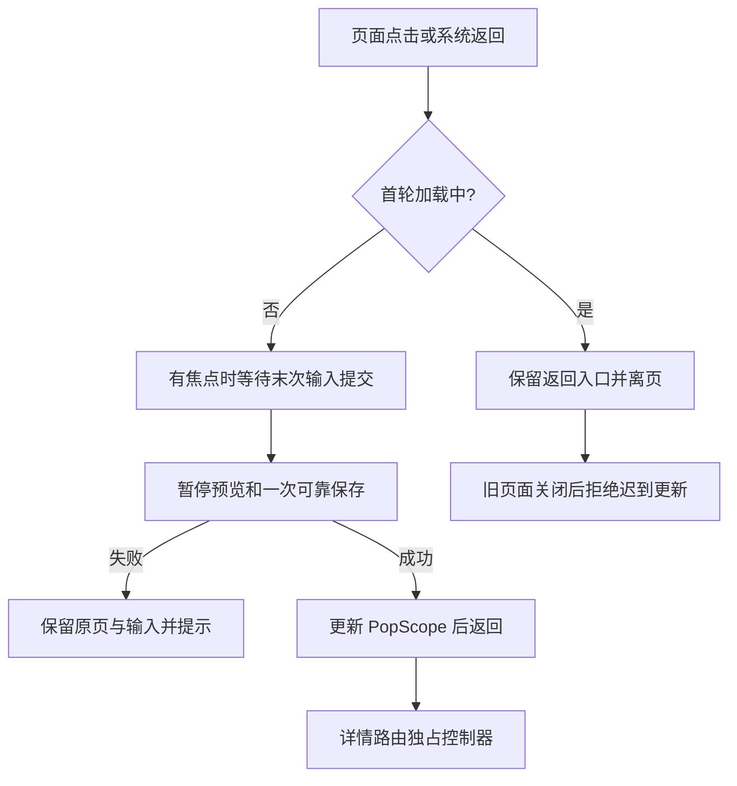
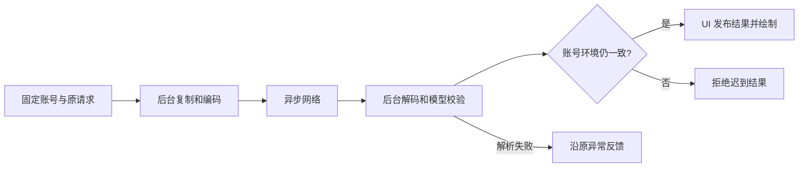

# PERF-02：P1/P2 代码修复

## 0. 执行前置条件

用户在 PERF-01 报告后明确授权“P1跟p2，能从代码层面修改的问题，先帮我修复一下”，优先视频编辑切换和返回。本切片沿报告已有证据执行，不增加产品功能。

Flutter 3.41.6 / Dart 3.11.4；App dev，基线 b31ad26。原有 projects/controller.dart 与 pubspec.yaml 修改保留。已有源码与报告相符。

不改后端、接口、支付/凭证/幂等协议、剪辑格式和数据；不安装手机、不清理现有数据；不处理证据不足的 Raster 和方向设置等待。大型 GetStorage 缓存迁移不混入本切片，仍待单独的旧数据迁移与故障恢复验证。

## 1. 需求与假设

修复可由已有证据直接落实的返回失效、重复索引复制/保存、重复页面构建。沿现有页面组件和布局，加载提示放入原页面，保留返回。真实业务输入仍需可靠写盘后离开。

## 2. 主流程图



## 3. 批次总览

| 批次 | 目标 | 文件 | 验证 |
|---|---|---|---|
| 1 | 返回可用与保存/构建热点修复 | 下列 8 个生产文件和 3 个测试文件 | analyze、专项回归、profile 构建；手机性能另验 |

## 4. 数据结构 / 接口

不改变持久化字段、版本和外部接口。MediaCacheScope 内部 `_readLedger({bool copy = true})` 保留事务可变副本；读取单条记录仅复制所需嵌套数据，不能暴露 Hive 内部对象。页面实例编号仅用于 GetBuilder 注册，不持久化。

## 5. 批次 1 详细计划与实现

| 文件（App 仓库相对路径） | 修改 / 目的 |
|---|---|
| lib/pages/projects/detail/view.dart | Stateful 路由实例编号 + projectId 作为 tag；对象切换用 key 更新，旧释放不能删除新实例 |
| lib/pages/projects/shot_detail/controller.dart | 移除首轮全屏 loading 的创建/关闭；加载中返回沿普通退页；取消 navigate 已完成后的重复 flush |
| lib/pages/projects/shot_detail/view.dart | 原页 loading 和返回共存；镜头条按需构建，单元局部 Obx，每单元只求一次生成状态 |
| lib/pages/projects/shots/page_state.dart | 只在有输入焦点时等待失焦帧；可靠 beforeNavigation 保持 |
| lib/pages/projects/editor/logic/media_cache.dart | 去掉 ledger JSON 编解码深拷贝；事务递归复制，单条查询只复制对应记录；读出的嵌套数据和失败事务不影响存储 |
| lib/pages/projects/editor/logic/project_store.dart | 相同选择/位置不重复保存；先检查 scope、未保存状态与作品租约 |
| lib/pages/main/view.dart | Tab 改变不重新创建所有子页；登录状态失效仍重建；账号可见性刷新保留 |
| lib/pages/assets/view.dart | 每轮 Obx 构建只求一次 visibleItems/canCreate，网格单元使用当前快照 |
| test/projects/project_detail_test.dart | 增加同作品两路由重叠/旧释放不关闭新实例；实际页面加载时推进夹具时钟 |
| test/shots/shot_detail_test.dart | 加载中页面返回/系统返回与迟到响应；原保存失败、连续切换回归 |
| test/editor/local_store_test.dart | 嵌套读取隔离、失败事务隔离、相同选择不写盘而变化仍执行保存 |

核心逻辑：

```dart
// 事务仍串行、成功 put + flush 后才能返回。
Future<T> update<T>(T Function(Map<String, dynamic>) change);
// 所有调用仍先检查账号/环境/后端作用域。
Object? _record(String name, String id);
// 相同选择仅在未保存检查和作品租约检查均通过后跳过。
Future<void> saveSelection(LocalEditorSession session, EditorSelection selection);
```

前置检查已完成：文件存在、原有行为与报告一致。新增测试先验证已确认的失败路径；修复自身引入的问题在本切片内解决，不改变既有测试预期来掩盖错误。

## 6. 批次推进规则

本切片单批交付。测试/静态检查失败先修复；有基线问题逐项说明。保持 App 原有未提交改动，不整体暂存。

## 7. 总体验收

App `a468883` 已本地提交，未推送。代码完成，待设备验收：

- `flutter analyze --no-pub` 无问题；格式与 diff 检查通过。
- 11 个相关测试文件共 312 项通过（详情/剪辑索引/媒体准备/分镜保存与导航/历史/进度/首页/资产/存储隔离）。其中新增 5 项：双路由控制器隔离、页面返回/系统返回各 1 项、索引变更隔离、选择未变免写。
- 诊断开关 ON 的计时模块与路由结构 18 项通过。
- `flutter build apk --profile --no-pub --dart-define=CATDRAMA_ENV=1` 成功，诊断默认关闭。
- 未安装、未重装、未清理手机数据；未做真机点击耗时复测或真实界面视觉验收。历史 PERF-01 数字保留为优化前基线，不能作为修复后的数值。
- 本轮没有重跑全量测试；此前报告里的 2 个编辑器旧时间文本断言不在本轮测试范围，不能宣称这些旧失败已修复。

[本地测试/构建证据](../05-测试/evidence/PERF-02/result.json)。局部测试与构建不能证明 vivo 延迟已降到 16ms，也不代替真实视觉与业务验收。

## 8. 失败处理约定

持久化失败仍停留原页，保留用户输入/工程候选；不删除 await 或可靠写盘屏障。控制器关闭后的回调不能修改新页面。大型默认 KV 拆分和启动依赖调整继续单独跟踪，不标已修复。

## 2026-11-03 视频编辑请求解析移出主 isolate

用户明确要求 JSON 复制、数据转模型不在 UI 线程执行。本增量为单批性能修复，沿现有界面与协议；Flutter 的响应式状态发布和 Widget 绘制仍在主 isolate。

范围：`lib/services/{http.dart,http_json.dart,index.dart}` 实现请求快照、JSON 编解码和带会话校验的后台解析；`lib/apis/{drama_shots,drama_projects,drama_jobs,drama_config,drama_assets,generation_quotes}.dart` 将视频页使用的作品、镜头、历史、任务、配置、素材列表和报价解析及集合校验交给纯函数。测试限定 HTTP 会话/编解码、对应 API/页面已有回归及转圈动画后台计算测试。保留工作树已有生成与页面改动，不改布局、后端、数据格式、收费和任务恢复规则。



核心签名：`Future<R> parseResponse<Q, R>(Q input, R Function(Q) parser)`；仅传纯数据与静态函数，不传 Dio、GetX 控制器或平台句柄。后台异常继续抛出，结果返回前再次检查账号/环境。

验收：`dart format`、`flutter analyze --no-pub`；HTTP 原输入/401重放/会话切换，镜头历史严格校验、生成与延迟返回回归；真实 isolate 工作期间转圈组件仍推进。既有组件测试改为同时推进真实 IO 与模拟帧并等待业务状态，保持原断言，不在测试中关闭 isolate。

状态：代码与范围内开发检查完成，待设备验收。App `58f477b`，未推送；profile 构建完成，未安装到手机。范围回归最终 467 项通过，1 项原有媒体时长校验失败已在改动前源码副本复现；[证据与边界](../05-测试/evidence/PERF-02/network-isolate/README.md)。
