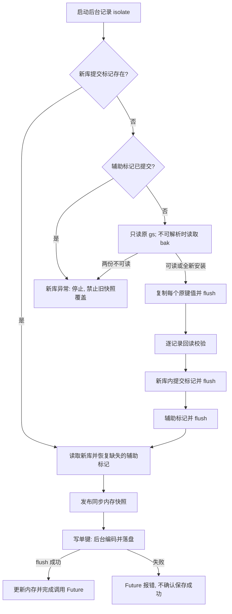

# PERF-03：大缓存存储与保留数据迁移

## 0. 执行前置条件

用户最初授权：继续修复剩余 P1/P2，优先大缓存，保留现有数据，尽量不重装。后续明确“不用管原来的数据”，因此不再追加旧数据兼容工作；已完成的迁移保护保留，不主动清数据或重装。Flutter 3.41.6 / Dart 3.11.4；App dev，从 PERF-02 a468883 继续。已有 projects/controller.dart、pubspec.yaml 改动保持。

已核对生产入口 Global、StorageService、隐私服务的直接 GetStorage 使用及资产工作区读写。采用工程现有 Hive/crypto，不增加依赖。不改后端、账户、支付协议、幂等键、媒体文件或剪辑工程格式。不安装手机、不删除原备份。

## 1. 需求与假设

消除默认约 2.05 MB GetStorage 盒每次保存和备份的整盒 UI JSON 编码，保留全部原始键、值、账号/环境/后端命名空间、未知旧键和未决动作。默认盒原文件是一次迁移的来源；迁移提交后新库为唯一写入来源，不回读过时旧值。

## 2. 主流程图



## 3. 批次总览

| 批次 | 交付 | 文件范围 | 验收 |
|---|---|---|---|
| 1 | 后台按键持久化、一次迁移、存储接入与资产读热点 | 下表生产文件与测试 | 真文件迁移、故障边界、业务回归、analyze/profile 构建 |

## 4. 数据结构 / 接口

- `RecordStorage.open/read/write/remove/close`；UI 侧同步读取已确认快照，写入消息在 SendPort 发送时捕获输入；worker 串行执行，每个写入仍等待 Hive flush。
- 新目录为 App documents 下 `catdrama-records-v1/`；`records.hive` 中业务键采用完整键的 SHA-256，值为 JSON `{key, value}`。保留完整原键并验证身份，避免 Hive 255 字节键长度限制。null 与删除不同。
- 原始 `GetStorage.gs`、`GetStorage.bak` 不删除、不覆盖，不做双写；备份是迁移前恢复材料，不代表支持旧 App 无损降级读取新写入。
- `records` 内 `migration-v1 = "1"` 是主提交标记；独立 `metadata` 的同名整数 1 检测记录库缺失。复制阶段无标记可重试；主标记存在而辅助标记缺失时补标记，不重新导入旧数据；辅助标记存在而主标记缺失时拒绝启动该存储。
- 凭证继续 FlutterSecureStorage；退出禁止恢复标记仍使用独立小 GetStorage 盒。隐私同意使用原始全局键，不改成环境/账号键。
- 生产装配显式注入 RecordStorage；既有未注入的测试适配保留原 GetStorage 行为，不能把旧适配测试当成新引擎故障验证。

## 5. 批次 1 实施

| 文件（App 相对路径） | 目的 |
|---|---|
| lib/services/record_storage.dart | 后台 JSON/Hive、迁移校验与标记、按键写入、异常返回、关闭处理 |
| lib/services/storage.dart | 注入记录后端，原账号检查和可靠写盘契约保持；生产不打开默认旧盒、不执行旧数据清理 |
| lib/services/index.dart、lib/global.dart | 导出及两个生产装配入口切换 |
| lib/services/privacy_consent.dart | 通过 StorageService 读写原全局键，避免再次打开/写入旧大盒 |
| lib/pages/assets/logic/drama_assets.dart | 查询不再整份 JSON 深拷贝，事务递归复制；对外表单/资产读取独立记录副本 |
| .cursor/rules/90-project.mdc | 更新公共持久化入口与边界 |
| test/services/record_storage_test.dart | 真实文件迁移、双阶段中断、损坏备份、长键、缺库拒绝、编码失败、输入捕获/顺序、单键增量、原数据副本哈希 |
| test/services/storage_isolation_test.dart | 使用新记录引擎验证账号/环境/凭证隔离、公共 clear 和隐私原键 |
| test/assets/asset_test.dart | 表单嵌套值读取不污染存储；原事务、错误与界面回归 |

核心约束：

```dart
Future<void> open(); // 后台迁移/打开完整快照后才允许服务装配完成
Future<void> write(String key, Object? value); // worker JSON → put → flush → ack
Future<void> writeForUserDurably(UserStorageScope scope, String key, Object? value);
// 写前和写后验证 scope；失败不能放行后续远端业务提交。
```

不合并需要可靠恢复的中间业务状态，不删除 await。普通缓存本次通过按键增量与后台编码减负，没有引入延时丢弃写入的策略。

## 6. 批次推进规则

本批一次交付；异常先在本范围修复并补用例。遗留原问题与设备验证单列，不改原业务测试预期掩盖失败。仅提交本任务文件。

## 7. 总体验收

App `9105080` 已本地提交、未推送。已完成代码及本机验证，待真机验证：

- 444 项专项回归全部通过，覆盖后台记录引擎、账号/环境/凭证隔离、支付恢复、首页/账号、资产/上传/图片工作台、作品详情及分镜返回。
- 新存储引擎使用真实临时 Hive 文件和 isolate。业务用例部分沿原 GetStorage 夹具；不以这些旧适配用例代替新引擎故障验证。
- 迁移前后和重开逐条哈希比较通过，输入来自已保存的 2,050,033 字节真机备份副本；源文件哈希未变。没有读取/写入当前手机的数据来完成测试。
- 长键、非法 UTF-8、损坏主/备文件、复制后中断、主提交标记后中断、辅助标记缺失、已提交记录库缺失、JSON 编码失败、排队顺序和嵌套数据隔离均有测试。
- 小记录变更测试：含 600,000 字符无关记录时，修改一个设置的 Hive 文件增量低于 1 KiB。这证明按记录追加的写入范围，不是手机耗时指标。
- `flutter analyze --no-pub` 无问题；格式与 diff 检查通过。
- `flutter build apk --profile --no-pub --dart-define=CATDRAMA_ENV=1` 成功；未安装、未部署、未清理手机数据。
- 没有重跑整个工程全量测试；没有宣称原有其他失败均已修复。

[本地证据](../05-测试/evidence/PERF-03/result.json)。

## 8. 失败处理与剩余边界

原文件不可读、目标记录不完整、后台进程退出或存储异常均返回失败，不静默创建空成功库。数据库、原备份、手机媒体不清理。标记前中断可重试；标记后不能用原快照覆盖新记录。

未做真机新包安装、实际磁盘写满/断电或 UI 耗时复测。Isolate 通信仍有快照传输开销；大单条记录仍需复制/编码，但在后台执行编码，不保证全部点击或启动已低于 16ms。启动方向等待与 Raster 原因仍待真机追踪，不据旧日志猜改。
