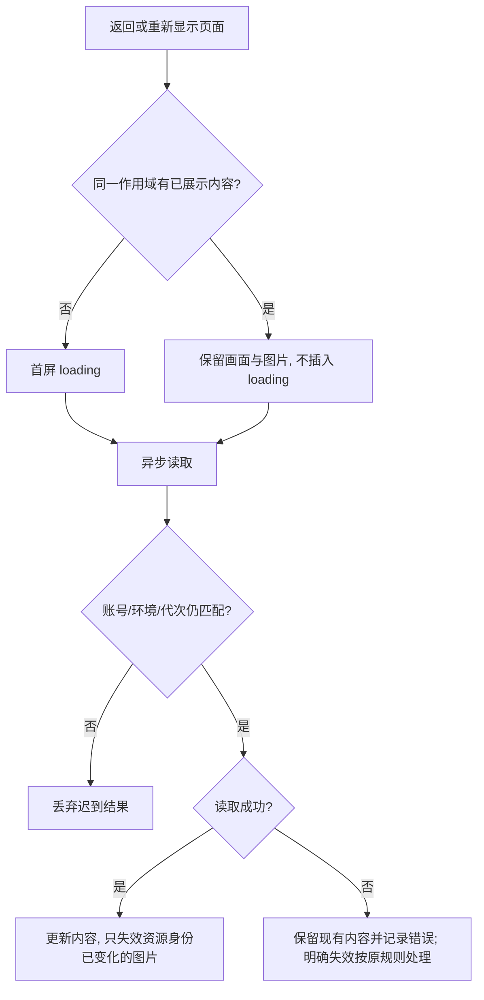

# PERF-04：返回页面时后台刷新

## 0. 执行前置条件

用户 2026-11-02 指示：返回某页可以重新加载数据，但不要影响 UI。本轮直接修复返回刷新呈现，不新增界面、文案或图标；沿现有状态组件。Flutter 3.41.6 / Dart 3.11.4，App dev，前序提交 9105080。

开始前已读取规则和当前任务，核对下表源码。原有 projects/controller.dart 和 pubspec.yaml 改动保留；同文件只提交本任务新增语义。不改后端、接口、支付/生成/保存业务规则，不安装手机。

## 1. 需求与假设

已有有效内容时保持原页面，后台请求成功后更新数据，保留未变的封面、缩略图、滚动组件和光标。没有内容的首次加载仍使用原 loading；账号、环境、对象切换以及明确删除/到期继续失效原数据。用户主动下拉刷新保留原 RefreshIndicator。

“后台刷新”指保持画面请求数据，不代表把页面所有网络回调放进 isolate，也不保证所有帧都已低于 16ms。

## 2. 主流程图



## 3. 批次总览

| 批次 | 交付 | 范围 | 验证 |
|---|---|---|---|
| 1 | 返回刷新稳定呈现、同资源图片保留、读取状态独立 | 下表文件 | 延迟响应/返回/失败/账号切换/保存与生成回归、analyze、profile 构建 |

## 4. 数据结构 / 接口

原 `load` 接口、路由和数据协议不变。`loading` 用于初次呈现；已有私有请求锁继续防重，`refreshing` 只读状态表示请求是否完成。列表另记“已展示过结果”，空结果刷新也不闪回 loading。代次/账号/环境校验保留。

## 5. 批次 1 详细范围与步骤

| App 相对路径 | 实施内容与验证 |
|---|---|
| lib/pages/projects/controller.dart | 初次/空列表与后台读取分开，独立请求锁；保留原列表和封面，自动重显不弹 Toast。仅新增本任务差异 |
| lib/pages/projects/detail/controller.dart | 新路由先用有效账号快照；刷新保持内容和可用操作；按资源 ID 保留作品/分集封面；返回核实不弹 Toast |
| lib/pages/projects/shots/page_state.dart | 已有分镜时不重新置 loading/offline，保留页面与导航；返回后的核实静默 |
| lib/pages/projects/materials/controller.dart | 已有本集素材时后台核实，返回不置 offline/插入首屏加载 |
| lib/pages/projects/material_workbench/controller.dart | 已有素材工作台内容时保持原画面和选择，独立请求锁不变 |
| lib/pages/projects/episode_script/controller.dart | 请求防重与可视 loading 分开；相同文本不重设 TextEditingController，保留光标；原保存/分析流程保留 |
| lib/pages/assets/controller.dart | 保留列表和有效同资源缩略图，一次替换结果；筛选/账号变化继续清理；空结果也可静默刷新 |
| lib/pages/assets/detail/controller.dart | 保留同资源大图，不反复插入图片 loading；资源变化/不可用才清除；作用域变化继续失效 |
| lib/pages/account/controller.dart、view.dart | 已有积分数据时不插入 loading；返回/恢复刷新不弹 Toast；请求代次及旧余额保护保持 |
| lib/pages/account/task_center/view.dart | 已有成长任务时不插入刷新进度条；签到/领取可靠状态守卫不变 |
| test/projects/project_detail_test.dart | 慢响应保留内容/操作/封面、重新建详情先展示有效快照 |
| test/assets/asset_test.dart | 列表、空结果和详情在慢响应期间保留画面/文件；旧等待断言改为独立请求状态 |
| test/shots/shot_detail_test.dart | 慢刷新期间原分镜、在线状态和导航保持 |
| test/pages/home_test.dart | 已有账户的恢复请求不显示 spinner/Toast，旧回复不能盖新余额或错误 |
| test/shots/video_generation_test.dart | 生成读取完成断言等待独立请求状态；原批次/未知回执/付费守卫回归 |
| test/projects/analysis_diff_test.dart | 区分请求完成与 UI loading；相同内容刷新保留光标；原分析保存流程回归 |

执行前逐文件确认存在。使用 Completable gate 延迟真实控制器请求，核对等待期间状态与画面内容；放行后验证新数据/原错误守卫，不通过修改业务断言掩盖失败。

核心逻辑：

```dart
loading.value = available == null; // 初次呈现
// 列表使用已展示标记，合法空结果也保留空状态。
// 私有读取标记负责防重，不能用 loading 判定后台请求是否结束。
if (previousResourceId != nextResourceId) imageFile.value = null;
if (text.text != incomingText) text.text = incomingText;
```

## 6. 批次推进规则

单批交付。仅提交本任务变更，保留开始时并行改动。状态语义变化后，测试等待真实请求完成，而不是依赖可视 loading；业务结果与安全检查不放宽。

## 7. 总体验收

App `de0844d` 已本地提交，未推送。代码与开发验证完成，待设备验收：

- `flutter analyze --no-pub` 无问题，格式及 diff 检查通过。作品列表原有未格式化改动保持，仅格式化可独立提交的本轮版本。
- 487 项回归全部通过：作品详情、剧本与分析、资产列表/详情/素材工作台、本集素材、整个分镜测试目录、账号/首页及成长签到。没有宣称全工程其他历史测试失败已消除。
- 新增 7 项验证：封面请求延迟、新详情快照、非空列表/空列表/资产大图慢刷新、分镜慢刷新及剧本光标保持。
- 账户恢复与生成批次测试继续核对旧回执/旧余额不得覆盖新状态；UI loading 不再作为后台请求完成的替代条件。
- Android profile 构建成功，诊断默认关闭；未安装手机、未修改服务器或手机数据。没有做实际设备上的截图/滚动/帧耗时复测。
- 同文件并行改动已按本轮前快照逐字核对保持，提交只包含本任务差异。

[本地证据](../05-测试/evidence/PERF-04/result.json)。测试夹具与构建不能代替手机真实显示、滚动和帧耗时验收。

## 8. 失败处理约定

网络失败保留原内容，自动核实记录错误；首次读取、手动操作和明确失效沿原提示/清理规则。支付、生成历史核实、可靠保存、账号隔离继续执行。未安装新包，不宣称当前手机已经体现本轮修复。
