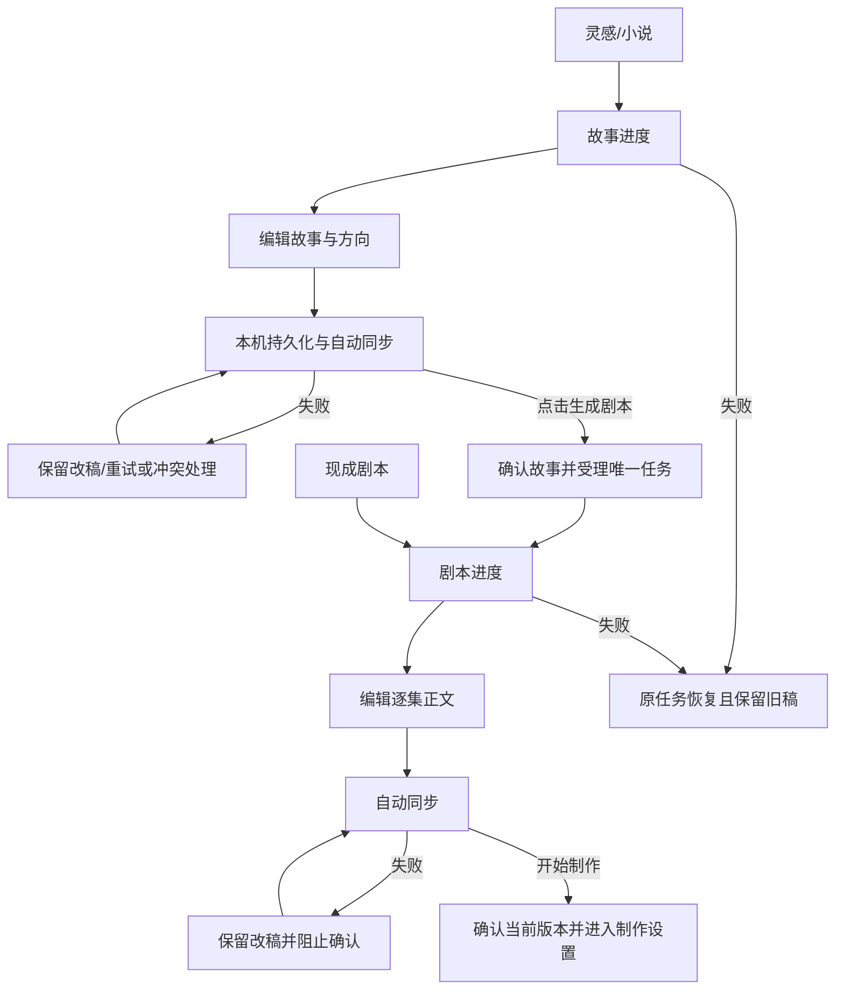

# M03 故事大纲与分集页面拆分、编辑和自动保存

状态：开发完成，待用户验收。两批 App 提交 71f890d、906dcaf；复用 dev。完整门禁有已复现基线问题，不能记为全量通过，详见 ../../05-测试/evidence/M03/README.md。

## 0. 执行前置条件

Flutter 3.41.6 / Dart 3.11.4，依赖沿用 pubspec.lock。两个确认页 Controller 独立继承 GetxController；WorkInputSyncService 已有本机持久化、500ms 防抖和串行保存。

| 条件 | 复核结果 |
|---|---|
| 产品 | 本会话批准计划，R-06、R-07、AC-09-01 |
| 设计 | 通道 4f6qy6d4 已实际读取下列八个节点；无设计缺失 |
| 技术契约 | 复用当前 projects 的 apply、story/episodes 保存、story/screenplays confirm |
| 外部 | 开发使用受控响应；真实服务/Provider 不由夹具结果代替 |
| 前置 | 复用已实现作品状态能力；不改变 M01 正式验收状态 |
| 工具 | Flutter、Figma 可用；设备构建和 UI 验证结果另写 evidence/M03 |

范围：App 两确认模块、新增 progress 三件套与 flow_scope、路由/作品入口、进度组件/文案、候选编辑模型、现有同步服务及测试；新增页面同步 90-project 页面索引。保留 iOS 工程与发布脚本并行改动。

## 1. 需求与假设

两组进度与确认页各自分开；梗概/方向/逐集标题/完整正文可编辑且自动保存。集数/顺序不变，标题20字符、每段正文10000字符；无效编辑保留本机，超限不上传，不完整不能确认。复用 R-06 AC-06-01～04、R-07 AC-07-01～04、AC-09-01，原文见 requirements-list.md。若任一假设不成立停止报告。

| 界面/状态 | Figma 节点 |
|---|---|
| StoryProgressPage | 5:4293 |
| StoryPage | 5:4585 |
| ScreenplayProgressPage | 5:4527 |
| ScreenplayPage | 5:4648 |
| loading / empty / error / 确认弹框 | 43:2417 / 43:2376 / 43:2380 / 43:2390 |

源稿导出与截图在 ../../05-测试/evidence/M03/figma/。等待页遵守 02-设计/生成等待页查询入口修正.md：自动查询原任务，无额外查询按钮。失败重试、补存、冲突反馈沿用现有样式。

## 2. 主流程图（Mermaid flowchart，含失败路径）



## 3. 批次总览（关键！先给全局拆批）

| 批次 | 交付 | 文件组 | 依赖 | 验收 |
|---|---|---|---|---|
| 1 | 独立四页、路由与 Figma | 两模块三件套/flow_scope/progress、routes、work_router、creation_progress、文案、页面测试、90-project | 无 | analyze、页面与路由测试、实际 App 截图 |
| 2 | 候选编辑、自动保存、确认最新稿 | 两模块编辑逻辑、work_input_sync、本机模型、保存与流程测试、工作区记录 | 1 | 改稿持久、同键恢复、无重复任务、总体验证 |

## 4. 数据结构 / 接口（写死：字段、类型、可空、默认值、错误码）

服务端契约唯一依据 api.md。POST projects/{id}/content-results/{jobId}/apply；PUT projects/{id}/story、episodes；POST projects/{id}/story/confirm、screenplays/confirm。无接口新增。

本机可空 candidateEdit 默认 null：target STORY/SCREENPLAYS、jobId、sourceRevision、targetBaseRevision 非空；upstreamRevision 故事 null/分集整数；content 为对应完整可编辑内容；editVersion 正整数；pendingApply 为可空 PendingContentAction（原键与不可变请求）；overwriteApproval 可空且绑定任务与版本。写入现有账号/后台/作品隔离草稿，不另建库。旧缓存兼容，旧未完成动作先恢复。实施补充可空 appliedRevision 为已收到应用回执后的本机恢复检查点，避免应用成功/正文保存失败后重复应用；不增加API字段。

错误 -560001 冲突、-560002 校验、-560017 覆盖确认；结果未知保留原请求键/体。

## 5. 分批详细计划（按批次分小节，每批内部结构固定）

### 批次1：独立页面、路由与 Figma

状态：完成；结果见 ../../05-测试/evidence/M03/README.md，App 71f890d。

范围：story、screenplays 三件套与新增 flow_scope.dart；各自 progress/index.dart/controller.dart/view.dart；routes/name.dart/router.dart、projects/work_router.dart、components/creation_progress.dart、l10n/zh_CN.dart、90-project.mdc；story/screenplay/progress/input/work_router/creation_journey 测试。

核心骨架：
```dart
void reconcileRoute() {
 // 1 未加载/账号失效/离开流程不导航。
 // 2 结果未知恢复原动作，不再生成。
 // 3 由服务端 step 选择 progress 或 review，相同路由不跳。
 // 4 成功移除进度页显示同一确认页，未知阶段保留错误。
}
```

| 步骤 | 目标/改动 | 前置 | 完成验证 |
|---|---|---|---|
| T01 | 两模块 progress 各自独立三件套；确认页移除进度布局 | Controller 独立 | 两页面类型独立可构建 |
| T02 | 流程作用域托管单一父 Controller、子 Controller 构造注入；接相对 progress 路由与登录保护 | 原订阅释放点核对 | 直达、成功、失败、返回、重开且订阅不重复 |
| T03 | 四页对齐稿，修正剧本生成标题，键盘适配 | 源节点可读 | 同视口截图与差异说明 |

- [x] lib/test analyze 0问题；完整 analyze 的2处既有集成测试错误单列阻塞
- [x] 页面/路由测试通过（第一批74项）
- [x] 实际 App 四页目视核对完成；动态数据与安全区差异已说明，全状态像素验收未执行
- [x] 本批 diff 范围正确，原并行文件未纳入提交

### 批次2：候选编辑、自动保存与确认衔接

状态：开发完成；范围内130项测试、范围analyze及双端构建通过，App 906dcaf。全量门禁与原生边界的未通过项见结果。

范围：两模块 controller/view；services/work_input_sync.dart；models/data 的候选编辑模型与聚合入口；draft/story/screenplay/creation_journey 测试及受控响应夹具。

核心骨架：
```dart
Future<bool> syncEditedContent() async {
 // 本机先落盘；校验版本/权限；恢复原 apply 或持久化新 apply。
 // 应用后使用最新 revision 保存，持续追上 editVersion。
 // 最新稿确认成功才清除 overlay；任何失败保留本机文本。
}
Future<bool> confirmCurrentContent() async {
 // 冻结输入，等待改稿保存；未编辑候选直接确认。
 // 持久化确认原动作，明确成功才导航，结果未知原键恢复。
 // Story 仅一次 story/confirm 受理剧本任务，分集确认进入制作设置。
}
```

| 步骤 | 目标/改动 | 前置 | 完成验证 |
|---|---|---|---|
| T04 | 候选改稿持久化，Screenplays 可编辑，Story 移除仅内存分支 | 候选版本对应当前稿 | 双页编辑重开恢复，保存前无截断 |
| T05 | 500ms 自动应用/保存、串行追赶最新输入、错误/授权恢复 | 本机落盘成功、合法保存内容与 actions | 仅一次应用；中断/丢包/冲突不丢稿 |
| T06 | 下一步保存最新稿后确认，无重复任务，补完整路径验证 | 无冲突/未知动作且内容完整 | 唯一作品/任务，后续正文逐字一致 |

- [x] 范围 analyze 和保存/流程130项测试通过；全量16失败/2静态错误与修改前基线一致
- [x] 自动测试覆盖本机/云端失败与冲突；原生受控正文PUT失败/重试通过
- [x] 自动测试覆盖连续输入/离页/无效稿重启；原生已保存两集正文进程重启逐字恢复
- [x] 自动测试验证未编辑候选浏览不应用；重新生成取消/失败保留旧稿
- [x] 本批 diff 范围正确，原并行文件未纳入提交

## 6. 批次推进规则

严格先1后2，逐批验收并回报；用户本轮明确授权连续执行完整计划，批次全绿后继续。文档写前 check catdrama，写后 audit catdrama；每批 scoped commit，保留并行修改。开发检查、真实服务、设备和用户验收分别记录。

## 7. 总体验收（全部批次完成后做一次）

flutter analyze；计划列出的9个 creation/projects 专项测试；flutter test；flutter build apk --debug --no-pub；flutter build ios --simulator --debug --no-codesign --no-pub；git diff --check。预期均退出0，实际数量与限制写 evidence/M03。

桌面 ADB/Appium 按可读步骤跑三来源路径与两页改稿，逐步截图；覆盖20/21、10000/10001、空白、emoji、连续输入、切号/切后台地址、落盘/应用/保存/确认中断。同视口375×812对照，最终正文逐字保留。未执行真实服务/设备条件不得勾通过。

## 8. 失败处理约定

计划外文件/契约/设计缺失或验证失败时停止受影响步骤并报告，只撤回本步骤自身改动。不清用户缓存、不重置数据库、不弱化断言。

## 9. 执行结果与未完成验收

两批开发交付和范围验证完成，最终130项专项测试通过，lib/test静态0问题，Android debug与iOS simulator debug构建成功。普通App受控同一作品验证大纲改稿自动保存→唯一剧本任务→分集候选改稿→保存失败重试→进程重启恢复→同一作品制作设置；计数与最终正文逐字核对见 evidence/M03。

完整flutter analyze退出1（2处旧getter错误）；完整测试1688通过、1跳过、16失败，修改前隔离快照逐项复现相同16项，不降低断言。全量门禁未通过，用户验收未完成。原生10001输入WDA超时，停止该步骤并记blocked；原生全边界/全中断/完整三来源、实体双端和真实服务/Provider/素材分析验证仍未执行，不替换正式验收或M01状态。文档路径guard及最终audit结果随证据保存。
