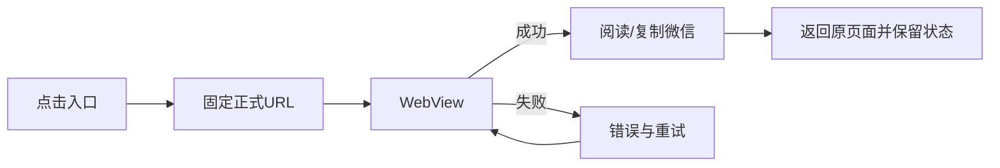

# M05 客服与协议页面

状态：代码与开发检查完成，正式静态发布阻塞、待验收。用户于2026-10-28明确要求实施本会话完整修复计划；依照已批准范围连续完成各批次并报告。数据库改动：无。

## 0. 执行前置条件

- Flutter 3.41.6 / Dart 3.11.4；Web静态HTML/CSS/JavaScript；不新增依赖。
- App仓库：`/Users/soul/code/lxwx/catdrama`；Web仓库：`/Users/soul/code/lxwx/lxwx_admin`。
- 开工前已检查两个仓库状态；充值、订单与后台管理存在并行修改，按本任务差异保存、验证、提交。
- 不修改Java接口、数据库、业务API环境选择、支付规则、其他App页面或旧官网资源。

## 1. 需求与假设

- 五个入口使用固定正式域名`https://www.lxwanxiang.com`，不依赖当前API环境和后台正文。
- 微信`catai01`；联系邮箱`lijian@lxwanxiang.com`。用户最新回复明确与写歌一致。
- 用户协议、隐私政策、充值协议及客服页以写歌源码为版式参考；业务内容适配漫剧。
- 算法备案以带货现有页面为依据：ICP`粤ICP备2026076709号-1`；Doubao-Seed-2.0-lite `网信算备110108823483901230065号`；Doubao-Seedance-2.0-mini `网信算备110108823483901240157号`。不展示大龙虾及其他视频模型。
- 原有“查看充值协议失败不阻断勾选和支付资格”继续适用；阅读不等于同意，返回保留套餐/渠道/勾选。

## 2. 主流程图（Mermaid flowchart，含失败路径）

## 3. 批次总览

| 批次 | 交付 | 文件范围 | 验收 | 状态 |
|---|---|---|---|---|
| 1 | 五个Web页 | Web的`web/sites/catdrama/{assets,info,legal}/`、邀请注册HTML、`test/catdrama_public_pages_test.mjs` | 资源/链接、复制成功与失败、移动端阅读 | 开发检查完成 |
| 2 | App固定地址入口 | App常量、`pages/webview/`、充值页、Android号码认证协议URL；设置/充值及设备验证测试 | 五入口无正文API、环境独立、返回保留状态 | 开发检查完成 |
| 3 | 回归与交付 | 开发计划/证据、最小必要的测试入口与发布材料 | 分清自动化、双端模拟器与正式发布结果 | 本地完成；正式发布阻塞 |

## 4. 数据结构 / 接口

| key | URL路径 |
|---|---|
| customer-service | /sites/catdrama/info/customer-service/ |
| privacy-policy | /sites/catdrama/legal/privacy-policy/ |
| user-agreement | /sites/catdrama/legal/user-agreement/ |
| algorithm-filing | /sites/catdrama/info/algorithm-filing/ |
| payment-policy | /sites/catdrama/legal/recharge-agreement/ |

公开HTML无登录和App请求头依赖；每页提供index.html。不新增JSON接口，现有其他说明页保留。

## 5. 分批详细计划

### 批次1：公开页面

在上述新目录创建五页及自有资源；协议所有站内链接指向漫剧，第三方政策链接保留真实来源。客服仅点击后复制，Clipboard API失败时使用用户手势内的备用复制，仍失败提示长按。备案表格每项独立tr。

核心函数：`async copyText(text)`依次尝试Clipboard API和临时textarea；临时节点用finally移除；点击调用方展示成功或手动复制提示。

前置检查：参考源码与Web目录规范已读取。验证：`node --test test/catdrama_public_pages_test.mjs test/catdrama_invite_web_test.mjs`；检查5页资源/链接可达和手机尺寸阅读。无错误、无其他App内容残留、无旧目录改动才进入批次2。

### 批次2：App入口

`StaticPageController.loadPage()`先查固定URL；存在则创建WebView并loadRequest，不发送账号凭证；没有固定URL的说明页沿原逻辑。客服开启JavaScript，外链交系统打开；主页面网络/HTTP失败保留重试。固定官网页不订阅API环境变化。

充值页用既有命名路由打开payment-policy，删除专用协议正文加载/弹层；协议按钮不以后台正文可用性为条件。Android SDK与邀请注册页同步新URL。

前置检查：重新确认充值文件及测试的并行差异；已有路由可公开访问。验证：`flutter analyze --no-pub`、设置/充值/登录定向测试、`flutter build apk --debug --no-pub`及双端真实WebView检查。错误与重试、未同意时阅读、返回保留状态均满足后进入批次3。

### 批次3：回归和交付

用桌面控制专用模拟器实际操作、截图，覆盖五页及返回；检查Android授权页两个协议入口。正式页面检查标题和正文，避免HTTP200公司首页误判。正式静态发布仅包含本次文件；页面失败暂停App发布。所有结果及未验证项放`05-测试/evidence/M05/`。

## 6. 批次推进规则

按顺序执行，每批完成检查并报告；批准计划已包含连续实施授权。失败先分析，范围外冲突停止对应写操作并报告。

## 7. 总体验收

- 静态检查、定向自动化和Android Debug构建通过。
- 5页无后台正文请求，API环境变化不改变官网地址。
- 首页隐私、登录、设置、客服、充值、原生授权和邀请页链接一致。
- 原生WebView阅读、复制、失败重试与返回正确；支付资格规则保持。
- 正式URL正确内容、未发布状态如实记录；不以模拟器/夹具代替正式验收。
- `git diff --check`通过，只包含本任务差异。

## 8. 失败处理约定

仅回退本任务当前步骤，不撤销并行工作。发布失败时回退本次静态文件并暂停App发布；未验证的状态不登记通过。

执行结果与验证边界：[M05证据](../../05-测试/evidence/M05/README.md)。
