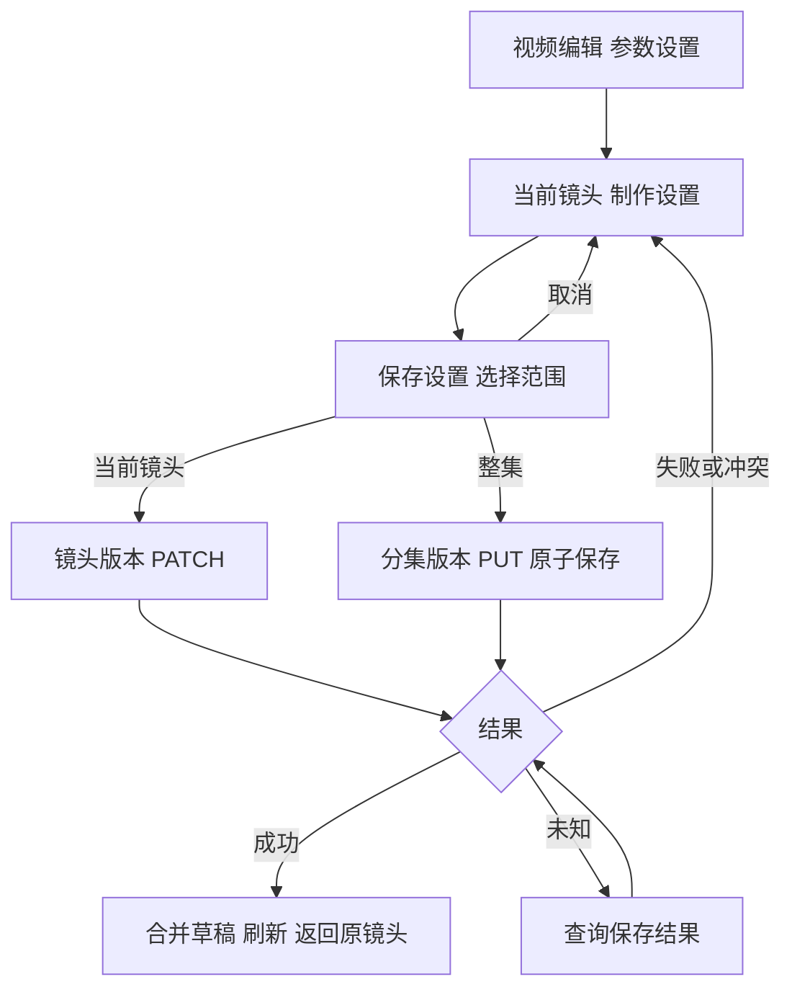

# M06 视频编辑参数保存范围

状态：功能和本次开发验证完成，待用户验收；用户已批准并要求实施。关联 R-08/R-13，AC-VPS-01～05。原分析回归两条既有失败单列，不作为本次通过。

## 前置与边界

复用 Flutter/GetX/go_router 和 Java/Spring/MyBatis-Plus/PostgreSQL 现有依赖，App/后端现有 dev，保留其他工作。产品、接口和数据模型先同步；设计按用户明确授权沿现有视频编辑、制作设置和 ProductionChoiceDialog，来源见设计说明本次增量。数据库只写已有参数字段及版本，无结构/迁移/回填；不改 Figma、其他 App、生成快照，不重启或部署共享环境。

## 主流程



## 批次与核心逻辑

| 批次 | 交付 | 验证 |
|---|---|---|
| 1 | 文档契约、整集原子接口、镜头参数验证复用 | 隔离 PG CatdramaShotTests/ProductionSettingsTests |
| 2 | 入口、镜头设置模式、范围弹层、草稿保护与恢复 | analyze、Flutter 定向测试、电脑操作模拟器 |

按用户连续实施授权逐批完成。每批完成验证后进入下一批，范围内失败修复重验，范围外问题报告。

```text
saveEpisodeSettings(user, episode, expectedRevision, settings):
  既有父作品事务锁下验证归属、状态及分集版本
  逐一验证全部有效镜头的模型适用条件
  统一更新覆盖；仅变化镜头递增版本、清除描述核对
  一次推进分集聚合版本并返回；任意异常回滚
saveScopedSettings(scope):
  先持久化目标、版本、参数；禁止重复提交
  当前镜头 PATCH / 整集 PUT；未知先查，冲突重新确认
  合并参数草稿，保留描述与素材，成功返回原镜头
```

## 文件与复用

- App `/Users/soul/code/lxwx/catdrama`：shot_detail/controller/view，creation/production/index/controller/view/选择弹层及新增 scoped part，routes/router，apis/drama_shots，services/drama_shots，models/data/production_action，l10n/zh_CN；制作范围/镜头草稿测试。复用 ProductionChoiceDialog、DramaShotService、StorageService、UserActionFeedback。
- 后端 `/Users/soul/code/lxwx/lxwx_service/lxwxservice`：app/catdrama/shot 的 Controller/DTO/DramaShotService，CatdramaShotTests，README 接口列表；复用 withAnalysisTarget、assetBindingChanged、DramaShotResponse。
- 工作区：本次产品四文档、设计说明、api/data-model、总计划/本模块与测试证据。
- 桌面验证：test_driver/production_scope_desktop.dart、test/support/drama_production_scope_fixture.dart，以及证据目录内 ADB 脚本；只读状态接口核对真实页面点击结果。

## 验收与命令

- 当前镜头仅改自己；整集覆盖全部独立参数；未改表单可统一；其他集/作品默认不变。
- 取消零写入；失败全部回滚；超时先核实；描述/素材草稿与真实冲突保留；原视频/任务不变。
- flutter analyze；flutter test test/creation test/shots。隔离 PG 配置后运行 ./gradlew test --tests '*CatdramaShotTests' --tests '*CatdramaProductionSettingsTests' 并确认未跳过。
- 电脑操作普通 App 模拟器验证入口、范围、两种保存和取消，逐步截图，受控数据不代验真实供应商/真机/部署。
- git diff --check；仅提交本任务改动，未验证项明确记录。

## 结果

入口、范围保存、整集事务、草稿合并和异常恢复已实现。Flutter analyze 0 问题，209 项定向测试通过；隔离 PostgreSQL 镜头保存 29 项通过。原制作设置/分析回归 16 项中 14 项通过、2 项失败，移除本次三份后端源码修改的独立基线复测同样失败；未扩大修复范围。

电脑操作专用 Android 模拟器 4 条用例通过，18 组截图/XML/状态留证；已查看入口、表单、范围勾选、费用刷新与保存返回截图。单镜头 12→24 积分显示刷新，未改表单可统一整集，未保存描述保留。真实供应商、真实扣费、真机及部署未验收；详见[验证记录](../../05-测试/evidence/M06-shot-settings/README.md)。
