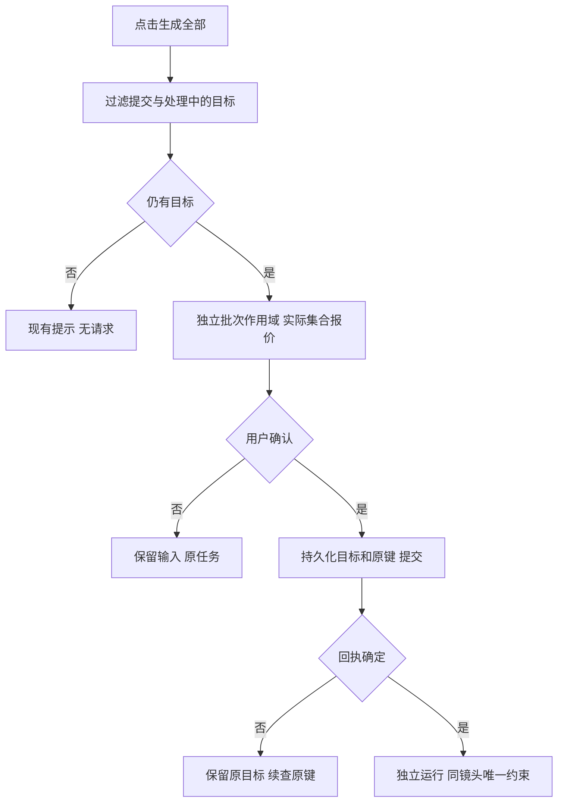

# M08 视频批量跳过处理中镜头

状态：实现与本地开发检查完成，待用户验收。2026-11-03 用户明确批准本次实现。关联 T-26、AC-VBS-01～04。App `30db2ce`、后端 `0f3a5a85`，未推送/部署。结果见 [本轮报告](../../05-测试/evidence/T-26/skip-busy-20261103/README.md)。

## 0. 执行前置条件

App dev，Flutter/Dart 以锁定工具链为准；后端 dev，Java 21、Spring Boot、PostgreSQL。现有入口、代码和测试已核对；保留并行改动。界面沿用户本聊天视频编辑截图和既有积分确认弹框，只更新动态数量金额。
已读：App 00/02/03/14/20/21/22/90；后端 00/03/05/10/15/18；工作台 00/04/05。业务归属、原键持久化、账户隔离、账务幂等、固定池控机为验收底线。

## 1. 需求与假设

跳过提交和处理中的镜头，其他未完成镜头按实际集合确认积分。批次互不重叠可并行；单镜头依旧唯一；其他内容错误继续反馈。

## 2. 主流程图

## 3. 批次总览

| 批次 | 目标 | 验收 |
|---|---|---|
| 1 | 过滤、报价、多批次恢复与唯一约束完整交付 | Dart 定向/静态、隔离 PG 并发幂等、固定池 Android 桌面控机 |

## 4. 数据结构 / 接口

HTTP 不变，BATCH targets 仅含实际目标。客户端按排序后的目标集合分 context，所属视频业务保存索引和 targetIds，兼容原根 context。
数据库改动：修改现有 catdrama/V4.19__catdrama_episode_cover.sql 的 uq_catdrama_job_active_object，排除 BATCH_VIDEO，VIDEO/BATCH_IMAGE 不变。最新记录正式包 e69c75b5 无 Catdrama SQL，V4.19 首次提交晚于该包；不新增迁移。无回填、账务改动；仅新隔离测试库执行，不操作运行库或 repair。

## 5. 分批详细计划

### 批次 1

- App 文件：lib/pages/projects/shot_detail/controller.dart、lib/pages/projects/shots/generation.dart、lib/pages/projects/shots/page_state.dart、lib/pages/projects/shots/logic/videos/generation.dart、test/shots/video_generation_test.dart。page_state 保存各原批次子项快照。
- 后端：上述 SQL，src/test/java/com/lxwx/narrateservice/CatdramaQuotePerformanceTests.java。
- 核心：`remainingGenerationTargets` 过滤同镜头忙态；`batchContext(scope, ids)` 保存独立定位；`pendingTargets(context)` 保护原目标；`_readVideoGeneration` 恢复各批次。报价取消保留原报告。
- 不改模型、价格表、公共账务、其他 App、布局、真实业务数据、部署。
- 验证：dart format；flutter analyze --no-pub；flutter test --no-pub test/shots test/generation；隔离 PG 下 ./gradlew test --tests '*CatdramaQuotePerformanceTests*' 的定向方法。
- 检查：1 忙 + 2 空闲只报价 2；未知提交跳过原目标；旧批次部分失败可重试空闲项；全忙无请求；取消无提交；双击和重叠请求不重复；重进恢复原键。

## 6. 批次推进规则

用户已授权完整批次，验证完成后回报，不新增确认门禁。

## 7. 总体验收

固定池 Android 桌面 ADB：原任务运行→全部→确认实际价格→并行状态→再次点击无重复→重进恢复，逐步截图。真实 Provider、实际积分冻结、物理设备和部署单列。

- [x] 工作区 format/analyze 与 306 项定向回归；提交独立快照 304 个不同用例（302 初测 + 2 修复等待后的复测），analyze 无问题。
- [x] 隔离 PostgreSQL 并发/单镜头唯一/原键重放测试通过，旧图片批次约束保留。
- [x] 固定池 Android VBS-01～05 桌面控机通过并检查截图；设备关闭与租约归还，测试数据库停止。
- [x] 本次变更单独提交，其他并行变更保留；未部署运行库与用户真机，真实渠道及用户验收待办。

## 8. 失败处理约定

修复范围内失败。业务规则扩大或破坏性操作先报告，保留其他任务。结果写 evidence/T-26/skip-busy-20261103/README.md。
