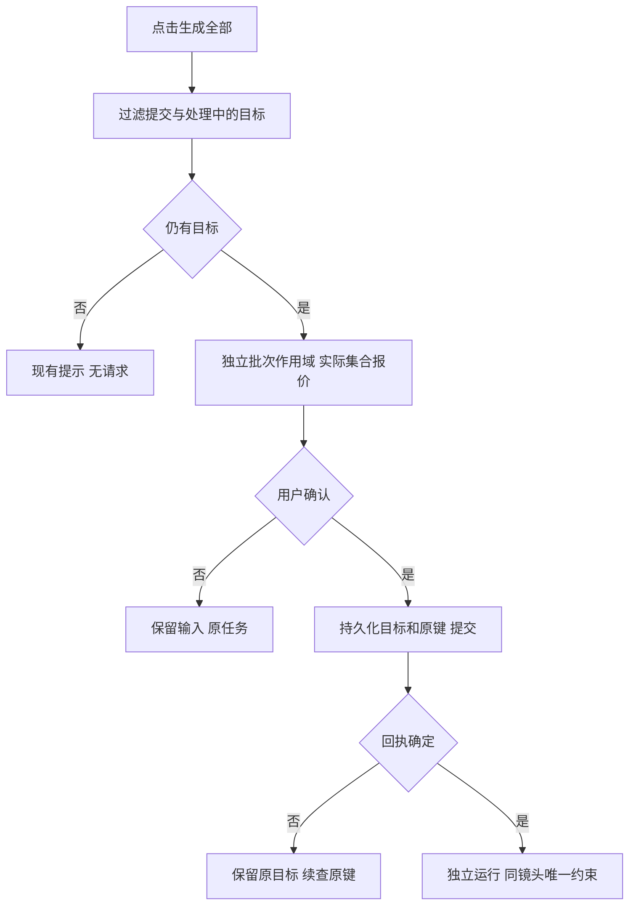
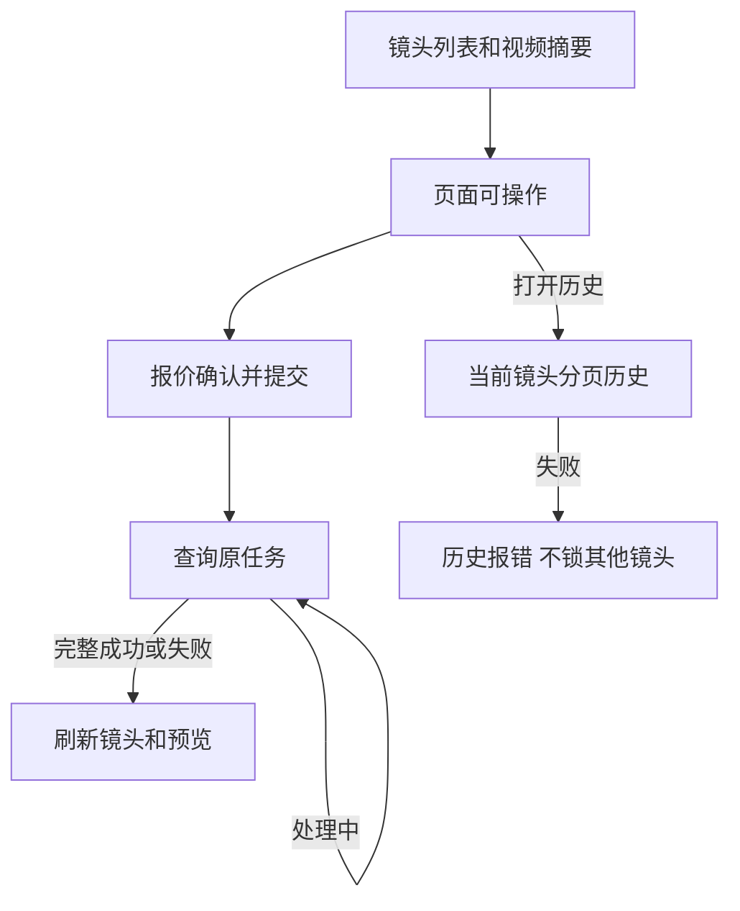
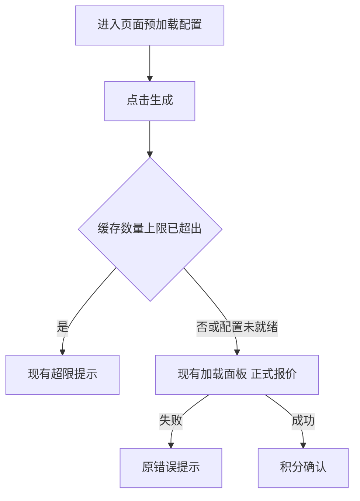

# M08 视频批量跳过处理中镜头

状态：实现与本地开发检查完成，待用户验收。2026-11-03 用户明确批准本次实现。关联 T-26、AC-VBS-01～04。App `30db2ce`、后端 `0f3a5a85`，未推送/部署。结果见 [本轮报告](../../05-测试/evidence/T-26/skip-busy-20261103/README.md)。

## 0. 执行前置条件

App dev，Flutter/Dart 以锁定工具链为准；后端 dev，Java 21、Spring Boot、PostgreSQL。现有入口、代码和测试已核对；保留并行改动。界面沿用户本聊天视频编辑截图和既有积分确认弹框，只更新动态数量金额。
已读：App 00/02/03/14/20/21/22/90；后端 00/03/05/10/15/18；工作台 00/04/05。业务归属、原键持久化、账户隔离、账务幂等、固定池控机为验收底线。

## 1. 需求与假设

跳过提交和处理中的镜头，其他未完成镜头按实际集合确认积分。批次互不重叠可并行；单镜头依旧唯一；其他内容错误继续反馈。

## 2. 主流程图

## 3. 批次总览

| 批次 | 目标 | 验收 |
|---|---|---|
| 1 | 过滤、报价、多批次恢复与唯一约束完整交付 | Dart 定向/静态、隔离 PG 并发幂等、固定池 Android 桌面控机 |

## 4. 数据结构 / 接口

HTTP 不变，BATCH targets 仅含实际目标。客户端按排序后的目标集合分 context，所属视频业务保存索引和 targetIds，兼容原根 context。
数据库改动：修改现有 catdrama/V4.19__catdrama_episode_cover.sql 的 uq_catdrama_job_active_object，排除 BATCH_VIDEO，VIDEO/BATCH_IMAGE 不变。最新记录正式包 e69c75b5 无 Catdrama SQL，V4.19 首次提交晚于该包；不新增迁移。无回填、账务改动；仅新隔离测试库执行，不操作运行库或 repair。

## 5. 分批详细计划

### 批次 1

- App 文件：lib/pages/projects/shot_detail/controller.dart、lib/pages/projects/shots/generation.dart、lib/pages/projects/shots/page_state.dart、lib/pages/projects/shots/logic/videos/generation.dart、test/shots/video_generation_test.dart。page_state 保存各原批次子项快照。
- 后端：上述 SQL，src/test/java/com/lxwx/narrateservice/CatdramaQuotePerformanceTests.java。
- 核心：`remainingGenerationTargets` 过滤同镜头忙态；`batchContext(scope, ids)` 保存独立定位；`pendingTargets(context)` 保护原目标；`_readVideoGeneration` 恢复各批次。报价取消保留原报告。
- 不改模型、价格表、公共账务、其他 App、布局、真实业务数据、部署。
- 验证：dart format；flutter analyze --no-pub；flutter test --no-pub test/shots test/generation；隔离 PG 下 ./gradlew test --tests '*CatdramaQuotePerformanceTests*' 的定向方法。
- 检查：1 忙 + 2 空闲只报价 2；未知提交跳过原目标；旧批次部分失败可重试空闲项；全忙无请求；取消无提交；双击和重叠请求不重复；重进恢复原键。

## 6. 批次推进规则

用户已授权完整批次，验证完成后回报，不新增确认门禁。

## 7. 总体验收

固定池 Android 桌面 ADB：原任务运行→全部→确认实际价格→并行状态→再次点击无重复→重进恢复，逐步截图。真实 Provider、实际积分冻结、物理设备和部署单列。

- [x] 工作区 format/analyze 与 306 项定向回归；提交独立快照 304 个不同用例（302 初测 + 2 修复等待后的复测），analyze 无问题。
- [x] 隔离 PostgreSQL 并发/单镜头唯一/原键重放测试通过，旧图片批次约束保留。
- [x] 固定池 Android VBS-01～05 桌面控机通过并检查截图；设备关闭与租约归还，测试数据库停止。
- [x] 本次变更单独提交，其他并行变更保留；未部署运行库与用户真机，真实渠道及用户验收待办。

## 8. 失败处理约定

修复范围内失败。业务规则扩大或破坏性操作先报告，保留其他任务。结果写 evidence/T-26/skip-busy-20261103/README.md。

## 2026-11-04 T-26 镜头列表状态与按需历史

状态：实现与本地开发检查完成，待用户验收。用户已批准直接使用镜头列表、历史仅打开时读取；提交后查原任务，成功后更新镜头。

### 0. 执行前置条件
复用当前 dev、Flutter/GetX、Java/Spring/MyBatis-Plus 和现有界面。保留未提交修改。数据库改动：无；无迁移、历史回填、模型调用或部署。

### 1. 需求与假设
列表直接初始化状态、应用和候选。历史只在打开历史入口后分页读取。原任务完整终态刷新镜头，进度不重读列表。失败保旧、未知只保护原目标，其他草稿问题不属本次。

### 2. 主流程图

### 3. 批次总览
| 批次 | 范围 | 验收 |
|---|---|---|
| 1 | 后端 Shot 摘要、前端加载/轮询、协议夹具和验证 | 零历史预取、进度零列表刷新、终态刷新、候选/原请求保护 |

### 4. 数据结构 / 接口
Shot 追加 latestVideo、candidateVideo（可空 VideoVersion）、candidateVideoCount（整数，无候选0）；复用权限和期限规则。路径、请求和错误码不增加。

### 5. 分批详细计划
文件：后端 DramaShotService、DramaShotResponse、CatdramaShotTests、README；前端 drama_shot、shots/generation/page_state/logic/videos/{generation,status}、shot_detail/controller、视频/协议测试、受控夹具及桌面用例。
核心：syncShots(items) 同步状态、候选后放行，再恢复原任务；onJob(job) 仅完整终态刷新镜头；loadHistory() 仅历史入口触发。失效结果忽略，失败记录且不新建原请求。
验证：dart format；flutter analyze --no-pub；flutter test --no-pub test/shots test/generation；隔离 PG ./gradlew test --tests '*CatdramaShotTests*'；固定池 Android 桌面验证历史、生成进度、成功预览及失败保旧。

### 6. 批次推进规则
用户已授权连续实施，范围内失败修复复验，不追加确认门禁。

### 7. 总体验收
- [x] 摘要保留候选计数、预览和原任务完整终态判断。
- [x] 进入/刷新/生成零历史请求，历史异常不拦生成。
- [x] 进度只更新任务，终态刷新镜头，未知目标隔离。
- [x] 定向检查和桌面证据完整，未验边界明确。

### 8. 失败处理约定
保留并行工作，真实渠道和部署另验；结果写 evidence/T-26/shot-list-state-20261104/README.md。

结果：App `04601a7`、后端 `ba035ea4`，均未推送。工作区 306 项回归通过；移除原有未提交修改后的本次提交独立快照 304 项及 analyze 通过。后端 29 项隔离 PG 通过，0 跳过。固定池 Android SS-01～10 由桌面 ADB 操作通过，已检查历史失败、成功预览、按需历史及失败保旧截图。设备已关闭归还，隔离 PG 已停止；无真实 Provider、OSS、扣费、iOS 或物理设备验收。详见 evidence/T-26/shot-list-state-20261104/README.md。

## 2026-11-04 T-26 生成按钮复用预加载配置

状态：实现与本地开发检查完成，待用户验收。用户已确认提前加载，取消点击后的重复配置请求。

### 0. 执行前置条件
复用锁定的 Flutter/GetX、现有视频页与加载面板。已核对 ShotDetailController.onInit → _loadConfig、ConfigStore.currentDramaConfig 的环境隔离及服务端报价数量校验。仅改 shots/index.dart、shots/generation.dart、video_generation_test.dart；无依赖、后端、数据库、布局或价格规则改动。

### 1. 需求与假设
进入视频页预加载配置；点击全部/剩余生成直接用当前环境缓存预检数量，不请求 /api/drama/config。配置未就绪时直接进入报价，由服务端按最新配置校验；沿用当前错误和加载反馈。

### 2. 主流程图（Mermaid flowchart，含失败路径）

### 3. 批次总览（关键！先给全局拆批）
批次1：复用当前环境配置、验证预加载未返回不挡住报价、保持超限/取消/重复提交保护。

### 4. 数据结构 / 接口（写死：字段、类型、可空、默认值、错误码）
复用 ConfigStore.currentDramaConfig: DramaRuntimeConfig? 和 limits['batchTargets']: int；为空时不做客户端数量预检，正式报价现有 BAD_REQUEST 校验作为准入。接口、字段和错误码不新增。

### 5. 分批详细计划（按批次分小节，每批内部结构固定）
核心骨架：`final limit = Get.find<ConfigStore>().currentDramaConfig?.limits['batchTargets']; if (limit != null && selected.length > limit) { 原提示; return; }`；后续批次定位、报价、幂等不变。
修改上述3文件。验证：dart format；flutter analyze --no-pub；flutter test --no-pub test/shots/video_generation_test.dart；固定池 Android 桌面点击全部/剩余，延迟报价并观测加载面板与配置请求数，关闭确认后无提交。

### 6. 批次推进规则
用户授权本切片连续实施，范围内失败修复后复验，不新增确认门禁。

### 7. 总体验收（全部批次完成后做一次）
- [x] format/analyze 和视频生成回归通过。
- [x] 进页预加载，点击零配置请求；缓存/加载中/失败与超限路径核对。
- [x] 慢报价下原加载面板可见，取消无任务，固定池设备已释放。

### 8. 失败处理约定
保留并行修改；原始证据仅本地。结果写 evidence/T-26/config-prefetch-20261104/README.md；真实手机与运行服务另验。

结果：本切片已提交，静态、视频回归和固定池Android桌面操作通过；细节见 [验证记录](../../05-测试/evidence/T-26/config-prefetch-20261104/README.md)。
