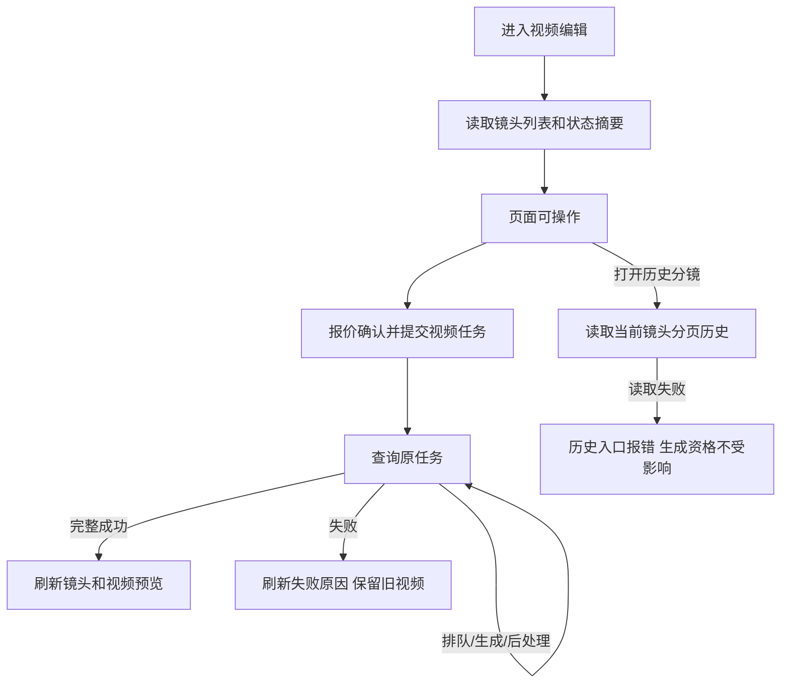

# T-26 / M08 镜头列表状态与按需历史

状态：实现与本地开发检查完成，待用户验收。2026-11-04（America/Los_Angeles）。

用户确认：直接使用镜头列表状态；历史只在打开“历史分镜”时读取，不能因整集历史读取挡住生成；提交视频任务后查询原任务，成功后更新镜头数据。

## 实现

- App dev `04601a7`：列表摘要初始化状态、候选和预览；原提交确认不再扫描历史。受理后只恢复原任务查询，进度和模型成功/后处理中不重读镜头，完整终态刷新镜头。失败保留旧视频，未知只保护原目标，原幂等及批量跳过忙碌镜头保持。
- 后端 dev `ba035ea4`：Shot 返回最近版本、候选预览及候选数；候选按创建时间及 ID 排序，排除当前应用、较旧及过期版本。损坏展示元数据降级为空，不使整集列表不可读；复用原权限、媒体与快照规则。
- 数据库改动：无 DDL、迁移、存量回填或运行库操作；仅本任务隔离测试 schema 写入和清理。
- 原有 App 失败状态修改、`.gitignore`、后端 app-configs.json 及工作区其他改动保留，不混入本次代码提交。

## 验证

| 检查 | 结果 |
|---|---|
| Dart format / 全项目 analyze | 通过，无问题 |
| 最终工作区 `flutter test --no-pub test/shots test/generation` | 306 项通过 |
| 本次提交独立源码快照（排除原有未提交修改） | 相同范围 304 项通过，analyze 无问题 |
| Java 编译 / CatdramaShotTests | 29 项通过，0 跳过；真实 Spring/JWT/隔离 PostgreSQL |
| Android profile 构建 | 通过，生产页面和控制器，HTTP/素材为受控夹具 |
| 固定池 Android 桌面 ADB SS-01～10 | 通过，逐步操作、请求计数和截图留证 |
| 视觉检查 | 已查看历史失败、成功预览、按需历史、失败保旧截图；布局未改，未宣称 Figma 像素或 iOS 验收 |

首次回归中旧测试仍断言“历史失败全页禁止生成”，已改为验证新业务及历史错误局部处理。取消历史预取后，一个提交用例需要等待原任务恢复完成再验证二次点击提示；补充等待后定向及完整回归均通过。完整日志保留，未隐藏失败。首次 PG 初始化误用 libpq 的 initdb 未创建数据库，改用已安装 PostgreSQL 18 执行成功。

## 桌面步骤与观测

| 步骤 | 验证 |
|---|---|
| SS-01 | 进入页：镜头列表 1 次，历史 0 次，可生成，旧预览 1801 |
| SS-02 | 打开历史返回受控错误：历史 1 次，可生成仍为 true |
| SS-03 | 关闭历史后点击重新生成，显示正式报价 |
| SS-04 | 双击确认只提交 1 次；轮询原任务 901，列表仍 1 次、历史仍 1 次 |
| SS-05 | 任务进度变为 70%，列表和历史请求数不增加 |
| SS-06 | 模型成功但处理为 PROCESSING，继续查询原任务并保留旧预览 |
| SS-07 | 完整成功后列表增至 2 次，预览切换为 8801，历史不增加 |
| SS-08 | 再次打开历史才增至 2 次，展示 8801 和 1801 |
| SS-09 | 再次生成受理，提交累计 2 次 |
| SS-10 | 原任务失败后列表增至 3 次，旧成功预览 8801 保留，历史仍 2 次 |

截图：[历史读取失败](03-history-error.png)、[成功后预览](09-success.png)、[显式打开历史](12-history-success.png)、[失败保留旧视频](16-failed-preserved.png)。完整桌面操作和请求记录在 device-events.json，生产页面未增加测试按钮。

设备：固定池 Solfeggio_Store_Phone_20261019，Pixel 5、API 37、1080×2340。租约 owner 为本聊天 ID，ADB 序列号经 AVD 名核对。测试后停止本任务 App、移除转发、关闭设备并释放原 token。首次释放恰逢 ADB 设备退出导致池工具列表错误；设备完全退出后按原 token 重试成功，未改池工具或抢占租约。隔离 PostgreSQL 端口 50349 已停止，数据目录保留。

## 本地复核与边界

- App 用例入口：`/Users/soul/code/lxwx/catdrama/.test/shot-list-state-20261104/desktop_app.dart`、`run_phone.py`；独立源码快照在 commit-check/。
- 后端：`/Users/soul/code/lxwx/lxwx_service/lxwxservice/.test/shot-list-state-20261104/`，隔离 PG 在 `.test/catdrama-tests/pg-shot-list-state-20261104`。命令使用独立构建目录和项目缓存，未启动或重启共享服务。
- 仅 Markdown 说明纳入 Git；截图、样片、日志、XML、接口响应、APK 和基线快照仅本地。
- 未推送、未部署、未升级用户手机包。新列表摘要需要 App 与后端同步升级。真实 Provider、OSS、实际积分和物理设备、iOS 均未验，不提高整版正式验收计数。
