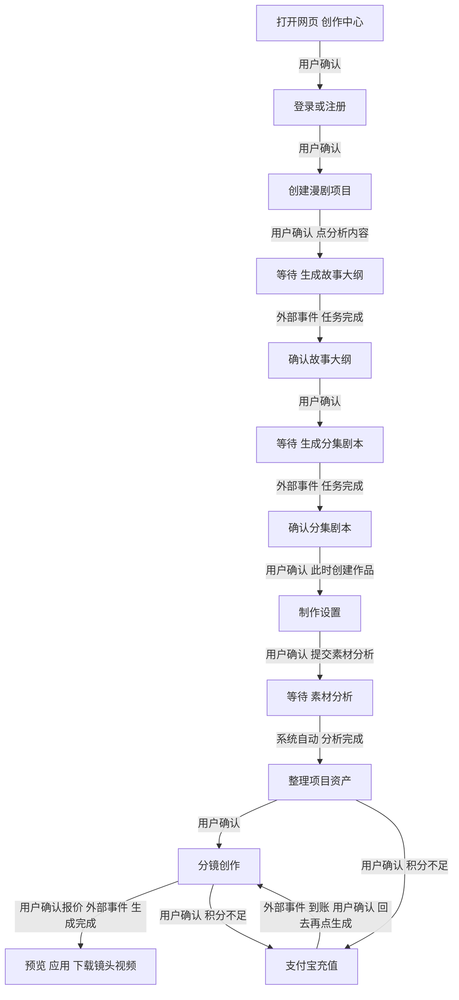

# v1.0.0 产品评审版

> 给你核对用，5～10 分钟读完主干。开发用的正文是 [requirements.md](requirements.md)，验收条件在 [requirements-list.md](requirements-list.md)。
> 全量基线：无（新项目首版）。状态：**已批准（2026-11-15）** · 更新：2026-11-15
> 独立检测：[detection-feedback.md](detection-feedback.md)（第 2 轮通过）。检测通过和你的批准分开记录。
> 标 ⚠️ 的是我推导出来的，你没有明确说过，需要你确认。

## 1. 一句话版本

在电脑浏览器里用喵喵漫剧：同一个手机号登录，看到和手机 App 同一份作品、资产和积分；能从创建漫剧一路做到生成镜头视频并下载，能用支付宝充值。剪辑、字幕、合成本版不做。

## 2. 本期范围

| 做 | 不做 |
|---|---|
| 20 个页面：创作中心、登录、充值、创建项目、故事大纲、分集剧本、制作设置、整理资产、分镜创作、我的作品、资产库、创建素材、素材详情、邀请有礼、积分流水、支付订单、签到 / 任务、设置、意见反馈、协议 | 剪辑、字幕、合成导出；导出剪映（按钮在，点了弹“此功能待开放”） |
| 验证码登录；手机号 + 验证码 + 密码注册；密码登录；短信重置密码 | 游客、一键登录、苹果恢复购买 |
| 支付宝充值，套餐从后端取 | 微信支付；“已完成”筛选；取消分析 / 取消生成；上传音频做音色 |
| 网页端注册风控：每个 IP 每月最多新建 100 个账号 | 对手机端注册做任何限制 |
| 后端改动另出后端开发计划；小说 TXT 本地导入；完整提现 | 案例详情页 ⚠️（稿里没有） |

## 3. 产品全景流程

现成剧本跳过“故事大纲”两步。只有“素材分析完成 → 整理项目资产”是自动进入，其余都要你点按钮。

## 4. 页面地图

页面 20 个，弹框 14 个。全部是首版新增。

| 页面 | 来这里做什么 | 核心操作 | 去向 | 设计稿 |
|---|---|---|---|---|
| W-01 创作中心 | 开始创作、继续最近作品、看案例 | 创建漫剧、点最近作品、切案例分类 | W-04、作品当前步骤、W-11、W-14 | 有 |
| W-02 登录（弹窗页） | 登录 / 注册 / 重置密码 | 验证码登录、密码登录、注册、忘记密码 | 回原位置 | 有（缺注册、重置两个状态） |
| W-03 积分充值（弹窗页） | 买积分 | 选套餐、扫码付款 | 回原位置 | 有 |
| W-04 创建漫剧项目 | 填内容 | 名称、拆分方式、类型、原文、分析内容 | W-05 / W-06 | 有 |
| W-05 确认故事大纲 | 核对梗概和每集方向 | 修改、下一步 | W-06 | 有 |
| W-06 确认分集剧本 | 核对逐集剧本 | 修改、设置画面（创建作品） | W-07 | 有 |
| W-07 制作设置 | 定比例、清晰度、时长、模型、风格 | 选择、确认 | W-08 | 有 |
| W-08 整理项目资产 | 给角色 / 场景 / 道具补图 | 新增、AI 生成、导入、上传、批量生成 | W-09 | 有 |
| W-09 分镜创作 | 生成镜头视频 | 改提示词、单个 / 批量生成、预览、应用、下载 | — | 有 |
| W-10 我的作品 | 找作品 | 筛选、进入、删除 | 作品当前步骤 | 有 |
| W-11 资产库 | 管理通用资产和作品资产 | 新增、导入、下载、编辑、删除 | W-12、W-13 | 有 |
| W-12 创建素材 | AI 生成一个素材 | 填名称特征、选风格、生成 | W-13 | 有 |
| W-13 素材详情 | 看和改一个素材 | 改名称 / 音色描述 / 提示词、重新生成、出现集数 | — | 有 |
| W-14 邀请有礼 | 邀请好友、看返现、提现 | 复制链接、海报、提现、看记录 | — | 有（缺提现流程） |
| W-15 积分明细 | 核对积分进出 | 查看 | — | **无** |
| W-16 支付订单 | 看订单 | 继续支付、取消 | W-03 | **无** |
| W-17 签到 / 任务中心 | 领积分 | 签到、领取成长奖励 | — | **无** |
| W-18 设置 | 账号操作 | 设置 / 改密码、退出、注销 | — | **无** |
| W-19 意见反馈 | 提问题 | 提交 | — | **无** |
| W-20 协议与说明 | 看协议 | 阅读 | — | **无** |

| 弹框 | 何时出现 | 按钮及结果 |
|---|---|---|
| D-01 此功能待开放 | 点首页第一个功能入口、点“导出剪映” | 取消 / 确定：都只关闭 |
| D-02 头像菜单 | 点头像 | 积分充值 → W-03；退出登录 → 回未登录首页 |
| D-03 选集抽屉 | 分镜创作点当前集 | 选一集 → 切换 |
| D-04 新增素材 | 整理资产 / 资产库点新增 | 添加素材 → 清单多一项 |
| D-05 新增方式选择 | 资产库点新增 | 本地导入 / AI 生成 |
| D-06 确认生成图片素材 | 单个 AI 生成 | 确认生成·N 积分 → 冻结并开始；关闭不扣 |
| D-07 批量生成素材确认 | 批量生成 | 同上，列出数量和总价 |
| D-08 确认生成镜头 | 单个生成视频 | 确认 → 冻结并开始；关闭不扣 |
| D-09 确认批量生成镜头 | 批量生成视频 | 确认 → 逐个生成；关闭不扣 |
| D-10 删除确认 | 删除作品 / 素材 | 确定 → 删除；取消不变 |
| D-11 出现集数 | 素材详情点“出现在第…集” | 保存 → 更新关联；取消不变 |
| D-12 邀请好友 | 邀请有礼点邀请 | 复制链接、保存海报 |
| D-13 返现活动规则 | 点活动规则 | 关闭 |
| D-14 字数 / 操作提示（轻提示） | 校验不通过、上传 / 下载结果 | 自动消失 |

## 5. 逐页面功能 Checklist

### W-01 创作中心
| 检查项 | 当前需求 |
|---|---|
| □ 创建入口 | 未登录先登录，登录后进 W-04 |
| □ 第一个功能入口 | 弹“此功能待开放” |
| □ 最近创作 | 点卡片进入该作品当前步骤；没有作品显示“暂无创作” |
| □ 精选案例 | 只展示，点了不进详情 ⚠️；加载失败可重试 |
| □ 头像菜单 | 手机号脱敏、积分充值、退出登录 |

### W-02 登录
| 检查项 | 当前需求 |
|---|---|
| □ 验证码登录 | 手机号 + 验证码直接登录；没账号自动建（无密码） |
| □ 注册 | 必须手机号 + 验证码，同时设密码 |
| □ 密码登录 | 只有设过密码的账号能用；错了统一提示“手机号或密码错误” |
| □ 忘记密码 | 手机号 + 验证码 + 新密码 |
| □ 超过注册上限 | 提示“当前网络注册过于频繁，请稍后再试或使用手机 App 注册”，不建号；登录不受影响 |

### W-03 积分充值
| 检查项 | 当前需求 |
|---|---|
| □ 套餐 | 全部来自后端，页面不写死 |
| □ 支付方式 | 只有支付宝 |
| □ 到账 | 以后端订单为准；到账后余额、流水、订单三者一致 |
| □ 没付就关 | 订单保持待支付，可在支付订单继续或取消 |
| □ 二维码过期 | 刷新二维码，沿用原订单 |

### W-04 创建漫剧项目
| 检查项 | 当前需求 |
|---|---|
| □ 作品名称 | 最多 20 字 |
| □ 拆分方式 | 智能拆分 / 自定义 1—10 集 |
| □ 内容类型 | 一句灵感 / 小说节选 / 现成剧本 |
| □ 剧本原文 | 最少 50 字；上限以后端为准 ⚠️（稿提示 1 万，计数器写 10 万） |
| □ 分析内容 | 建 1 份草稿并开始任务，重复点不会建两份；失败保留输入 |

### W-05 / W-06 故事大纲、分集剧本
| 检查项 | 当前需求 |
|---|---|
| □ 等待 | 显示进度；只有“返回等待”，没有取消；离开后任务继续 |
| □ 修改 | 梗概、方向、每集正文都能直接改，自动保存 |
| □ 失败 | 说明原因，可重新生成；不扣积分 |
| □ 设置画面 | 此时才创建正式作品，只创建 1 个 |

### W-07 制作设置
| 检查项 | 当前需求 |
|---|---|
| □ 选项 | 比例、清晰度、时长、模型、风格全部来自后端 |
| □ 确认 | 保存设置并提交素材分析（免费）；分析完成自动进入整理资产 |
| □ 分析失败 | 说明第几集什么错；改稿或重试；成功的集保留 |

### W-08 整理项目资产
| 检查项 | 当前需求 |
|---|---|
| □ 查看 | 按集、按角色 / 场景 / 道具；缺图有标记 |
| □ 加图的三种方式 | AI 生成（先报价确认）、资产库导入、本地上传 |
| □ 批量生成 | 只补缺图的；确认弹窗列数量和总价 |
| □ 失败 | 生成失败退回积分；上传失败显示“导入失败”，原图保留 |
| □ 素材归属 | 在作品里生成 / 上传的素材归这个作品（作品资产） |
| □ 一键匹配已有素材（R-34，2026-11-19；同日 D-55 扩到场景、道具） | 给当前集缺图的角色、场景、道具找同类型的已有图（场景道具名称规则更严）：名称优先、相似项目加权；加载弹框 → 匹配列表弹框，每项右上角可删除；确认后只换图、不扣积分 |
| □ 重新分析（R-36，2026-11-20） | 整理项目资产页选中某一集时，“一键匹配已有素材”左边；AI 重新识别当前集的素材，只补不删；片段、视频、阶段不变；不扣积分 |
| □ 确认分集剧本页重新生成（R-37，2026-11-21） | “设置画面”左边；重新生成全部剧集，覆盖当前剧本（包括手改的）；每次先确认；不扣积分；失败沿用现有失败页 |

### W-09 分镜创作
| 检查项 | 当前需求 |
|---|---|
| □ 单个生成 | 报价确认 → 冻结 → 成功结算 / 失败退回 |
| □ 批量生成 | 只补没有已应用视频的镜头 |
| □ 历史记录 | 预览不等于应用，应用要明确点 |
| □ 下载 | 可把镜头视频下载到电脑 |
| □ 导出剪映 | 按钮由“进入剪辑”改名；点了弹“此功能待开放” |

### W-10 我的作品
| 检查项 | 当前需求 |
|---|---|
| □ 筛选 | 全部 / 编辑中 / 生成中 |
| □ 删除 | 二次确认；资产库里的图保留 |

### W-11～W-13 资产库、创建素材、素材详情
| 检查项 | 当前需求 |
|---|---|
| □ 两类资产 | 通用资产（从资产库入口创建的）/ 作品资产（从作品里创建的，按作品归类） |
| □ 删除 | 被作品引用的不能删，并说明被谁引用 |
| □ 全部造型 | 就是这个素材所有已生成形象的历史列表 |
| □ 音色 | 只有文字描述 |
| □ 重新生成 | 先报价确认；新图不自动替换已应用的图 |
| □ 出现集数 | 多选保存 |

### W-14 邀请有礼
| 检查项 | 当前需求 |
|---|---|
| □ 文案 | “首次充值”，不出现“会员” |
| □ 数字 | 档位、比例、金额、门槛全部来自后端 |
| □ 邀请成功 | 邀请人得 10 积分（一次）；好友首次充值产生佣金 |

### W-15～W-20
| 检查项 | 当前需求 |
|---|---|
| □ 数据 | 与手机端同账号是同一份 |
| □ 签到 | 一天一次，手机和网页合计只算一次 |
| □ 任务中心 | 不显示“首次成功导出一集” |
| □ 设置 | 改密码、退出、注销、协议、版本；没有权限 / 缓存 / 更新 ⚠️ |

## 6. 核心业务规则

| 领域 | 规则 |
|---|---|
| 账号 | 账号 = 手机号，一个手机号一个账号，两端共用 |
| 账号 | 验证码登录的用户没有密码；注册必须过验证码并设密码 |
| 账号 | 已有无密码账号再去注册 = 给这个账号设密码，不新建 |
| 账号 | 密码 8～20 位；连续错 5 次锁 15 分钟 |
| 资产 | 素材归属看入口：作品里进来的归作品资产，资产库进来的归通用资产 |
| 风控 | 只管网页端；同一 IP 最近 30 天新建账号最多 100 个；自动建号和注册都算 |
| 钱 | 只支付宝；到账看后端订单；套餐不写死 |
| 钱 | 图片、视频生成：报价 → 确认 → 冻结 → 成功结算 / 失败退回；失败不自动重试 |
| 钱 | 文本类（大纲、剧本、分析、描述）免费 |
| 任务 | 离开页面不取消；回来能恢复 |
| 同步 | 手机和网页同时改同一处，后提交的提示“内容已在别处更新”，不静默覆盖 |
| 保留期 | 作品、图片 30 天等规则沿用后端 |

## 7. ⚠️ 必须人工确认的产品决策

| 决策 | 当前定义 | 为什么要确认 |
|---|---|---|
| 密码锁定期间 | 验证码登录仍可用 | 我的推导 |
| “存入空间”“自动入库”两个按钮 | 归属已按入口自动决定，这两个按钮可能多余，出图时给你看 | 稿上有按钮 |
| 精选案例点击 | 只展示，不进详情 | 稿里没有案例详情页 |
| 制作设置右上按钮文案 | 稿写“设置画面”，建议改“开始整理素材” | 和上一页按钮同名，容易混 |
| 网页端传的系统标识 | 统一传 `web`；`windows`、`mac` 留给以后的桌面版 | 你说要支持三个值，没说网页传哪个 |
| 手机浏览器打开 | 不专门适配 | 你说按 1440×900 来 |
| 六个无稿页面的入口 | 出图时给方案（头像菜单 / 左侧导航） | 你确认了我来出图，入口没说 |

## 8. 异常与边界行为

| 场景 | 当前行为 | 需要确认 |
|---|---|---|
| 断网、超时 | 提示可重试，已填内容保留 | 否 |
| 登录过期 | 自动续期；失败弹登录，回原处 | 否 |
| 积分不足 | 显示差额，可去充值；到账不自动生成 | 否（同手机端） |
| 生成失败 | 退回积分；再生成重新报价 | 否（同手机端） |
| 支付结果查不到 | 显示“支付确认中”，不报成功也不报失败 | 否 |
| 注册超上限 | 提示文案，不建号 | 否（已确认 2026-11-15） |
| 两端同时修改 | 后提交的提示已更新 | ⚠️ 是 |
| 未知错误 | 通用提示 + 错误编号，可反馈 | ⚠️ 是 |

## 9. 用真实场景反向 Review

| 场景 | 当前产品行为 | 请确认 |
|---|---|---|
| 一直用手机验证码登录的老用户，第一次在网页点“注册”并填了密码 | 验证码通过后，给他原来的账号加上密码，作品积分都在 | 对吗？ |
| 没设过密码的人在“密码登录”里输了手机号和随便一个密码 | 提示未设置密码，引导用验证码登录或去注册 | 文案是否可以直接告诉他“未设置密码”？ |
| 公司 200 人同一个出口 IP，第 101 个人第一次用网页验证码登录 | 被拒绝并提示用手机 App 注册 | 能接受吗？ |
| 充值扫码付了钱，但页面一直没变 | 显示“支付确认中”；到支付订单里能看到最终状态；到账只算一次 | — |
| 充值到一半关了弹窗 | 订单待支付，可继续或取消 | — |
| 批量生成 29 个镜头，其中 3 个失败 | 26 个成功保留并结算，3 个退回积分并标失败；要再生成需重新确认价格 | — |
| 网页上生成到一半关掉浏览器 | 任务继续；再打开作品回到进度 | — |
| 手机上删了一个作品，网页还开着它 | 网页下次操作时提示作品不存在并回到我的作品 ⚠️ | 对吗？ |
| 网页做完镜头视频想剪辑 | 点“导出剪映”弹待开放；可下载镜头视频，或到手机 App 同一作品里剪辑 ⚠️ | 弹框里要不要加一句“可到手机 App 剪辑”？ |
| 素材被两个作品引用，在资产库点删除 | 不让删，列出引用它的作品 | — |
| 同一天手机签到后又在网页点签到 | 显示已签到，不重复给积分 | — |

## 10. 状态变化速查

| 对象 | 正常路径 | 失败或恢复 |
|---|---|---|
| 作品 | 草稿 → 大纲 → 分集剧本 → 正式作品 → 设置 → 素材 → 镜头视频 | 任一步失败停在该步，可重试；30 天到期隐藏 |
| 文本任务 | 排队 → 进行中 → 成功 | 失败 → 说明原因 → 重新生成（免费） |
| 付费任务 | 报价 → 确认冻结 → 进行中 → 成功结算 | 失败 → 退回 → 重新报价 |
| 订单 | 待支付 → 已支付 | 取消 / 过期；待确认时不显示成功 |
| 账号 | 无密码 → 已设密码 | 忘记密码 → 短信重置 |

## 11. 已确认 / 待确认

### 已确认（均为 2026-11-15 对话答复）

| 决策 | 最终定义 |
|---|---|
| D-01～D-03 | 独立新项目；范围以 Figma 为准；只接支付宝 |
| D-05 | 剪辑 / 合成 / 字幕不做 |
| D-06、D-07 | 后端支持 web / windows / mac；支付宝适配另出后端计划 |
| D-08、D-09 | 1440×900；三套接口地址同手机端 |
| D-11～D-15 | 套餐后端取；去掉“已完成”；造型 = 历史列表、音色文字；去掉取消按钮；右上按钮弹待开放 |
| D-16 | 六个无稿页面要做，参考手机端 |
| D-17～D-19 | 首页第一个入口待开放；邀请文案改首次充值；旧草图忽略 |
| D-20～D-22 | 账号规则；风控只管网页、100 个；超限提示文案 |
| D-23～D-25 | 无密码账号注册 = 设密码；30 天滚动且自动建号计入；密码 8～20 位、错 5 次锁 15 分钟 |
| D-26～D-28 | 素材归属看入口；“进入剪辑”改“导出剪映”且本版不做；无稿页面由 Claude 出图 |
| D-29～D-31 | 网页端做完整提现；小说 TXT 在浏览器本地读入输入框、不传后端；**产品批准** |

### 待确认

| ID | 请直接回答 | 优先级 |
|---|---|---|
| — | 无阻断项 | — |
| 第 7 节其余各项 | 不同意的告诉我，没提的按当前定义走 | 普通 |
| Q-05 | 网页放在哪个地址 | 技术规划时定 |
