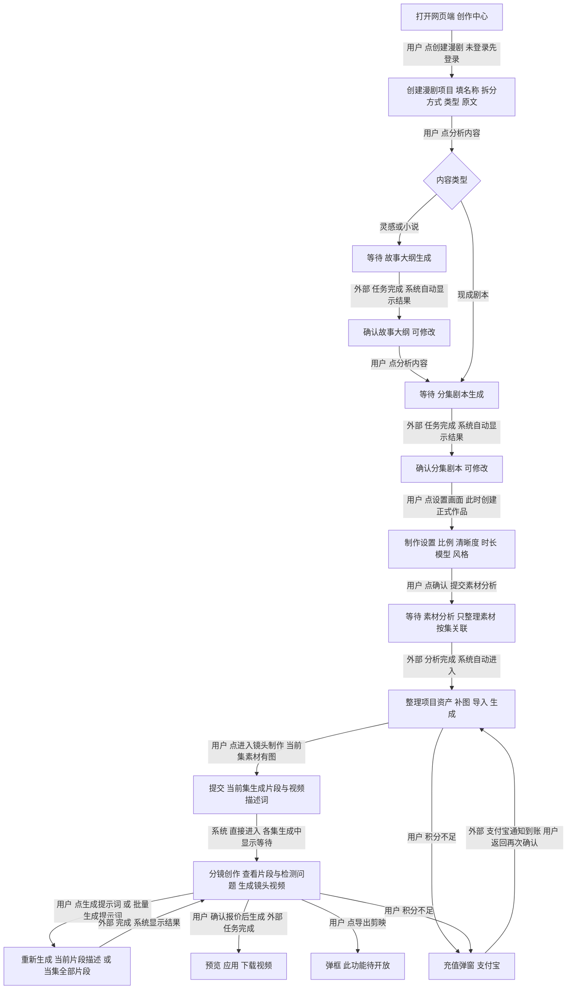
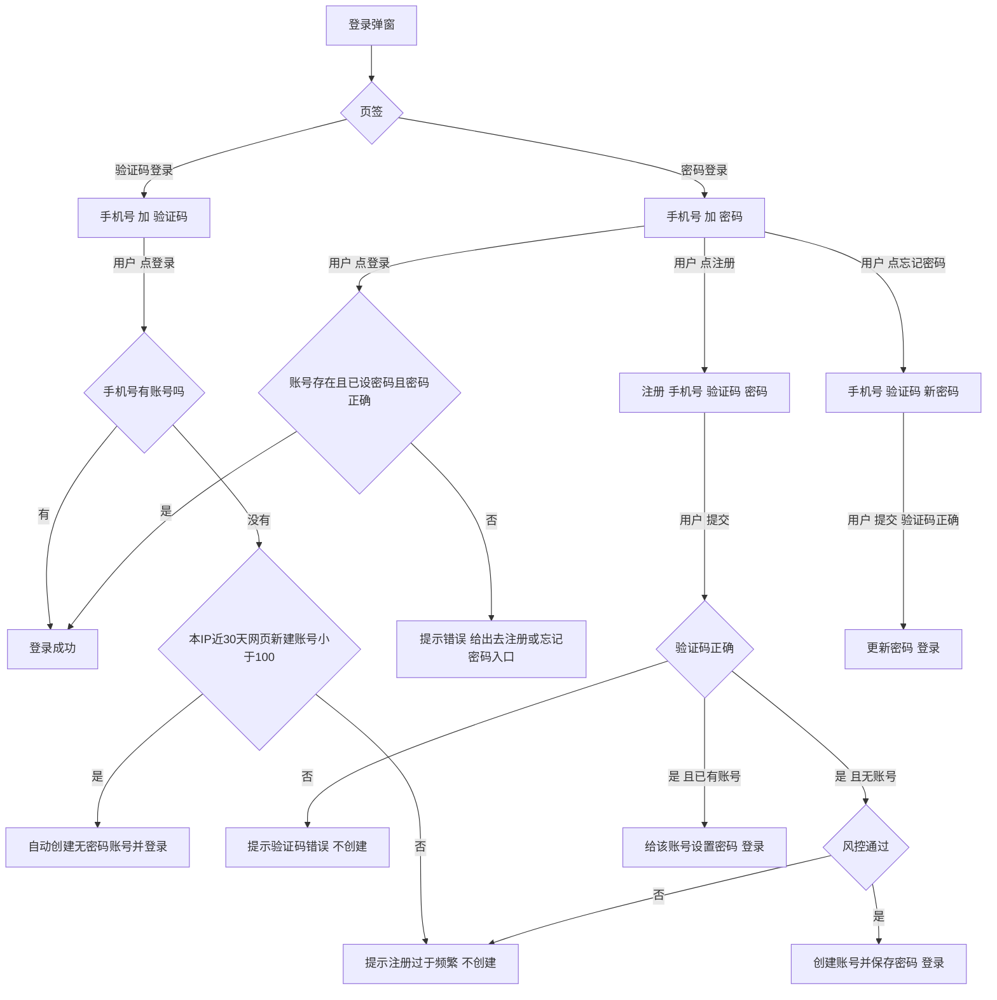

# v1.0.0 产品需求

> 本文件写网页端首版的完整定义，供设计、技术规划、开发和验收使用；不是用户评审版。
> 状态：**已批准（2026-11-15，D-31）**；2026-11-16 用户提出分镜逻辑调整（D-33～D-42，改 4.6～4.9、5.4，新增 R-31、R-32），待用户确认 · 更新：2026-11-16
> 全量基线：无（新项目首版，全部为新增）。参考：手机端工作区 `/Users/soul/work/MakeCodePlanWord/projects/喵喵漫剧/v1.0.0/01-产品/requirements.md`（手机端自身未归档，只作业务规则参考，不是线上事实）。
> 需求与验收：[requirements-list.md](requirements-list.md) · 用户评审：[requirements-review.md](requirements-review.md) · 检测：[detection-feedback.md](detection-feedback.md)
> 标 ⚠️ 的是推导，待确认；没标的来自用户确认或 Figma 稿。Figma 通道 `ayqnrtgz`，节点号见 requirements-list.md 第 4.1 节。

## 1. 目标与范围

在电脑浏览器里使用喵喵漫剧：登录后可以创建漫剧、确认剧本、整理素材、生成镜头视频并下载，管理作品和资产，充值积分，邀请好友。网页端与手机 App 共用后端 App `catdrama`，同一手机号是同一个账号，数据互通。

| 做 | 不做 |
|---|---|
| W-01～W-14（有 Figma 稿）和 W-15～W-20（无稿，参考手机端） | 视频剪辑、字幕、合成导出、保存相册 |
| 短信验证码登录、手机号 + 密码注册 / 登录、短信重置密码 | 游客模式、运营商一键登录、苹果恢复购买 |
| 支付宝充值，套餐从后端取 | 微信支付、苹果内购 |
| 网页端注册风控（100 个 / IP / 月） | 手机端注册的任何限制 |
| 按 1440×900 设计稿制作；小说 TXT 本地导入 | 手机浏览器专门适配 ⚠️ |
| | “已完成”筛选、取消分析 / 取消生成、上传音频做音色、首页第一个功能入口的实际功能、导出剪映 |

## 2. 改动总览

首版无基线，下表列每条需求对应的页面。

| R | 本版目标 | 页面 / 弹框 | 正文 |
|---|---|---|---|
| R-01、R-06 | 网页端可访问，三套环境，后端识别 web / windows / mac | 全部 | 5.1 |
| R-03 | 页面范围 = requirements-list.md 第 4.1 节 W-01～W-20 | 全部 | 第 4 节 |
| R-05 | 后端改动只限 requirements-list.md 第 9 节标“要改”的项，另出后端开发计划 | — | requirements-list.md 第 9 节 |
| R-02、R-11、R-24 | 登录、注册、重置密码、风控 | W-02 | 4.2、5.2 |
| R-04、R-12、R-26 | 支付宝充值与订单 | W-03、W-16 | 4.3、5.3 |
| R-10 | 创作中心 | W-01 | 4.1 |
| R-13～R-18、R-31 | 创作主流程（含进入分镜前生成片段 + 视频描述词） | W-04～W-09 | 4.4～4.9 |
| R-19 | 我的作品 | W-10 | 4.10 |
| R-20～R-22 | 资产库、创建素材、素材详情 | W-11～W-13 | 4.11～4.13 |
| R-23 | 邀请有礼 | W-14 | 4.14 |
| R-25、R-27、R-28、R-29、R-30 | 积分流水、签到 / 任务、设置、反馈、协议 | W-15、W-17～W-20 | 4.15 |
| R-34 | 整理项目资产页“一键匹配已有素材”（原“一键匹配已有角色”，D-55 扩到场景、道具） | W-08 及其加载弹框、匹配列表弹框 | 4.17 |
| R-36 | 整理项目资产页“重新分析”：重新识别当前集的角色、场景、道具，只补不删 | W-08 | 4.19 |
| R-37 | 确认分集剧本页“重新生成”：按已确认的故事大纲重新生成全部剧集，覆盖当前剧本 | W-06 | 4.20 |

## 3. 本版完整用户链路

每一步标明由谁推进：【用户】= 用户点了按钮才进入下一步；【系统】= 上一步完成后自动进入；【外部】= 等后台任务或第三方完成。没有标的一律按【用户】处理。

只有“素材分析完成后进入整理项目资产”、“提交片段生成后直接进入分镜创作”和各等待“任务完成后显示结果”是自动的，其余都由用户点击推进。

## 4. 页面与功能

公共框架（所有带左侧导航的页面，稿 `1:43`）：左上品牌；“创建漫剧”按钮；导航 创作中心 / 我的作品 / 资产库；“可用创作积分”卡和“充值”；底部“推广”（→ 邀请有礼）、“联系小助手”（显示客服二维码或说明 ⚠️）；右上积分胶囊、用户名、头像。流程页（W-04～W-09、W-12～W-14）没有左侧导航，左上是返回按钮。

### 4.1 W-01 创作中心（R-10）

- 定位：进入创作、继续最近作品、看案例。稿：`1:43`、`1:960`、`1:1168`、`1:259`、`1:146`。
- 结构：标题与副标题；“创建我的漫剧”大入口；三个功能入口卡；最近创作（3 张卡 +“查看全部”）；精选案例（分类标签 + 瀑布流卡片）。
- 交互：
  - 创建入口 / 左侧“创建漫剧”→ W-04（未登录先弹 W-02）。
  - 第一个功能入口（稿名“拉片与改编”/“智能剧本”，以 `1:43` 为准 ⚠️）→ 弹“此功能待开放”（取消 / 确定都只关闭）。
  - “创作资产”→ W-11；“邀请有礼”→ W-14。
  - 最近创作卡：角标“继续编辑”/“生成中”；点击进入该作品当前步骤；“···”菜单提供删除 ⚠️；“查看全部”→ W-10。
  - 精选案例：切换分类重新加载；点击案例 ⚠️ 本版只展示，不进详情（稿无案例详情页）。
  - 头像菜单：脱敏手机号、积分充值（→ W-03）、退出登录；W-15～W-20 的入口位置随出图给方案（D-28）。
- 状态与异常：未登录时最近创作显示空态和登录引导 ⚠️；无作品显示“暂无创作”；案例加载失败显示“网络错误，请重试”（临时故障，可重试）。
- 验收：AC-10-1～4。

### 4.2 W-02 登录弹窗（R-02、R-11、R-24）

- 定位：登录、注册、重置密码。稿：`1:714`（验证码登录）、`1:840`（密码登录）。**注册和重置密码两个状态稿里没有，需设计阶段补。**
- 结构：品牌；页签 验证码登录 / 密码登录；手机号（+86）；验证码 +“获取验证码”或密码；主按钮；协议说明（使用条款、隐私政策可点击 → W-20）。

- 规则见 5.2。验收：AC-02-3、AC-02-4、AC-11-1～7、AC-24-1～4。

### 4.3 W-03 积分充值弹窗（R-04、R-12）

- 定位：买积分。稿：`1:378`、`1:546`。
- 结构：“我的积分”（头像、脱敏手机号、当前积分、说明）；“积分充值”套餐卡；付款区（二维码、金额、“请扫码完成支付”、温馨提示、“查看积分规则”“联系客服”、付费服务协议链接）。
- 交互：
  - 打开时【系统】读取后端套餐；默认选中一档 ⚠️。
  - 【用户】选套餐 →【系统】创建订单并取支付宝付款二维码（展示形式技术规划定 ⚠️）；只显示支付宝图标。
  - 【外部】支付宝通知后端 → 页面查询订单为已支付 → 显示成功、刷新余额。
  - 订单满 15 分钟过期 → “二维码已失效”+“刷新二维码”；刷新 = 同一套餐新下一单，旧单已关闭（2026-11-16 修改）。同一次弹窗里同一个套餐只下一单；打开时有该套餐没过期的待支付订单就接着用。
  - 关闭弹窗 → 订单保持待支付，可在 W-16 继续或取消。
- 异常：套餐读取失败（临时故障）→ 显示重试，不显示任何写死金额；下单失败 → 提示原因可重试；支付结果暂时查不到 → 显示“支付确认中”，不显示成功也不显示失败，可稍后在 W-16 查看。
- 验收：AC-04-1～6。

### 4.4 W-04 创建漫剧项目（R-13）

- 稿：`1:1272`、`1:4368`、`1:4300`。
- 结构：作品名称（≤20 字）；拆分方式（智能拆分 / 自定义集数，后者出现“计划拆成 1—10 集”）；内容类型（一句灵感 / 小说节选 / 现成剧本）；剧本原文（一键粘贴、一键清空、字数计数）；右上“分析内容”。
- 交互：【用户】点“分析内容”→ 校验通过 → 后端建草稿、起任务 → 灵感 / 小说进 W-05 等待，现成剧本进 W-06 等待。输入过程中自动保存草稿 ⚠️（手机端有此规则）。
- 异常：少于 50 字、超上限、未填名称 → 提交时提示第一个错误（用户能改的）；提交失败 → 保留全部输入，可重试（临时故障）。
- 小说 TXT 导入（D-30）：内容类型选“小说节选”时提供“导入 TXT”；浏览器本地读取，文字直接填入剧本原文输入框，不上传后端。按钮位置稿里没有，设计阶段补。
- 验收：AC-13-1～5。

### 4.5 W-05 确认故事大纲（R-14）

- 稿：`1:4427`、`1:4462`。
- 等待态：标题、当前进度文字和进度条、说明“可离开页面，重新打开后恢复任务状态”、“返回等待”（回 W-10，任务继续）。**没有“取消分析”。**
- 结果态：故事梗概（可编辑）、分集方向（每集一块，可编辑）；右上“分析内容”→ 生成逐集剧本。
- 重新生成 ⚠️：稿里没有独立按钮；手机端允许重新生成并在有手改时先确认覆盖。本版是否提供待设计阶段确认。
- 失败：模型 / 服务失败（临时故障）→ 显示原因 +“重新生成”，沿用原任务规则；格式不合格（用户能改的）→ 提示修改原文后重试。文本生成不扣积分。
- 验收：AC-14-1～4。

### 4.6 W-06 确认分集剧本（R-15）

- 稿：`1:2029`。结构：左“剧集目录”（集标题 + 摘要），右当前集正文（可编辑）；右上“设置画面”。
- 分集时同时确定每集有哪些素材（角色、场景、道具），随分集一起保存，本页不显示（D-33、D-42）。
- 【用户】点“设置画面”→ 后端原子创建正式作品（防重复）→ W-07。之后从 W-10 进入该作品恢复到当前步骤。
- 失败：创建失败保留全部剧本，可重试；回执丢失时先查询是否已创建，不重复创建。
- 重新生成（R-37，2026-11-21 新增）：“设置画面”左边，重新生成全部剧集，详见 4.20。
- 验收：AC-15-1～2；重新生成见 AC-37。

### 4.7 W-07 制作设置（R-16）

- 稿：`1:2070`。结构：已确认分集数；画面比例（横屏 16:9 / 竖屏 9:16）；视频清晰度；单镜头时长；右侧模型下拉、风格列表（可看全部）。
- 所有选项和可用组合来自后端配置（稿里的 480P～4K、5～30 秒、一般 / 中级 / 高级模型只是示意）。
- 【用户】点右上按钮（稿文案“设置画面”，建议改为“开始整理素材”⚠️）→ 保存设置 + 提交素材分析 → 等待页（沿用 `1:4462`）→【系统】分析完成自动进入 W-08。
- 素材分析只做一件事（D-33）：按分集时定好的每集素材清单，整理全剧的角色、场景、道具（外观、声音描述）并建立每集的素材关联；分集后手改过的剧本，按最新正文补上漏掉的素材（只补不删）。**这一步不生成片段和视频描述词。**
- 失败：素材分析失败显示原因，可重试；需改稿的回到剧本修改后重试。
- 验收：AC-16-1～3。

### 4.8 W-08 整理项目资产（R-17）

- 稿：`1:2183`、`1:2993`、`1:2817`、`1:2390`、`1:2592`、`1:6816`、`1:6928`。
- 结构：左侧“总览”和选集列表；顶部汇总条（资产总数、缺描述数、缺图片数、“批量生成本集描述”、模型下拉）；类型页签 角色 / 场景 / 道具；素材卡（图或状态、名称、“导入角色”“存入空间”“···”）；“新增角色”卡；右上“进入镜头制作”。
- 素材卡状态：尚未添加图（缺图标记）、图片生成中、图片导入中、导入失败、已有图。
- 交互：
  - 卡片来源菜单：AI 生成（→ 确认生成弹窗或 `1:6816` 页）、资产库导入（→ `1:6928`，选中后“确认导入”）、本地导入（选文件上传）。
  - “···”：删除（归档）、下载。
  - 新增：弹窗填名称（≤20）、描述（≤200）→“添加素材”。
  - 批量生成：只补缺图项 → 确认弹窗（数量、总价、余额）→ 确认后各卡显示“图片生成中”。
  - “批量生成本集描述”：为缺描述的素材生成描述（免费，手机端为免费 AI 帮写）⚠️。
  - 素材归属（D-26）：在本页生成、上传、导入的素材属于当前作品，出现在资产库“作品资产”的该作品下。“存入空间”按钮与此规则重复，设计阶段确认是否保留 ⚠️。
  - 【用户】选中某一集点“进入镜头制作”→ 只检查这一集（与手机端一致，2026-11-16 修改）：这一集缺图或没有素材 → 不能进入，提示缺哪些，其他集不管；都有图 → 确认这一集，【系统】自动开始生成这一集的片段 + 视频描述词（免费，D-34、D-43），进入这一集的 W-09，生成中显示等待（`1:4489`）。这一集已过素材阶段 → 直接进入。重复点击只生成一次。
  - 一键匹配已有素材（R-34，2026-11-19 新增；同日 D-55 从只匹配角色扩到角色、场景、道具）：汇总条“批量生成本集图片”左边，详见 4.17。
  - 重新分析（R-36，2026-11-20 新增）：选中某一集时，汇总条“一键匹配已有素材”左边；让 AI 重新识别当前集的素材，只补不删，详见 4.19。
- 确认生成图片弹窗（`1:2592`）：预计消耗、当前余额、素材名、图片描述词、生成模型 / 清晰度 / 数量、“确认生成·N 积分”。
- 验收：AC-17-1～8；一键匹配见 AC-34。

### 4.9 W-09 分镜创作（R-18）

- 稿：`1:3178`、`1:3374`、`1:4215`、`1:4489`、`1:3543`、`1:3821`、`1:4022`。
- 结构：左：当前集（点开“选集”抽屉）、片段列表（缩略图 / 生成中 / 失败、原文摘要、编辑和删除）、“批量生成视频”“批量生成提示词”；中：参考素材条、提示词编辑区（字数上限、可 @ 引用素材）、“生成提示词”（“片段拆分”本版不显示，D-39）、模型 / 清晰度 / 时长 / 比例下拉、“生成视频”；右：视频预览（播放、音量、全屏、下载）、历史记录；右上“导出剪映”。
- 片段和视频描述词的来源（D-33、D-34）：在 W-08 对某一集点“进入镜头制作”时生成这一集的；首次生成完成自动应用到该集。在 W-09 切换集数：目标集还在素材阶段 → 回到 W-08 并选中那一集；已过素材阶段 → 显示那一集（2026-11-16 修改，与手机端一致）。
- 交互：
  - 单个生成：【用户】点“生成视频”→ 确认弹窗（预计消耗、余额、镜头描述词、参数）→【用户】确认 → 冻结积分、建任务 →【外部】完成 → 预览区显示，进历史。
  - 批量生成：弹窗列出待生成镜头、每个时长、总价；说明“只补齐没有已应用视频的镜头，已有视频和历史版本保持不变”。
  - 历史记录：点击预览；应用为明确操作；视频带对白 / 旁白声音，可试听。
  - 右上按钮改名“导出剪映”（稿为“进入剪辑”）→ 弹“此功能待开放”。导出到剪映是以后的功能，本版不做。
  - 空白态（`1:4215`）：无提示词、无参考、无视频时的占位。
  - “生成提示词”（D-39）：只把**当前片段**的视频描述词重新生成。先弹确认框；该片段描述手改过时提示“会替换你手改的内容”。免费。完成后替换该片段描述，检测问题按下条显示。
  - “批量生成提示词”（D-39）：把**当前集**的全部片段 + 视频描述词重新生成。先弹确认框，免费。已有片段时，完成后弹“核对本集分析差异”（新增 / 保留 / 移出），确认才应用；旧片段和视频保留在历史。
  - “片段拆分”按钮本版不显示（D-39）；片段拆分（超长自动拆分、整集按时长重新组合）（2026-11-23 移到 v1.1.0，本版不做）。
  - 检测结果（D-36、D-37）：生成结果的检测问题不判失败。片段照常显示，问题标在对应片段上，顶部提示“第 N 集有 M 个片段需要处理，可重新生成”；一个片段都拆不出来的集显示“生成失败”、原因、模型原始返回文字（只读）和“重新生成”。有问题也能进入本页、切换各集；描述执行不了的片段不能生成视频（后端现有规则）。
- 失败：生成失败（临时故障）→ 该片段显示“生成失败”和原因，积分退回；再次生成需重新报价确认，不自动重试。
- 验收：AC-18-1～8。

### 4.9.1 手机端适配（R-32，仓库 `/Users/soul/code/lxwx/catdrama`）

- 范围（D-41）：只做让手机端跟上新流程的最小改动，其余手机端页面不动。
- 素材页“进入镜头制作”→ 照旧确认当前集素材（缺图提示不变）→ 确认后自动生成本集片段 → 新加载页“正在生成片段与视频描述词”（离开后继续）→ 完成后进入镜头制作页。
- “视频编辑”页：新增“重新生成提示词”（当前片段）、“重新生成本集片段”（当集全部片段；已有片段时进现有“核对本集分析差异”页）。原有“重新生成当前镜头”（重新生成视频，收费）不变。
- 新阶段、检测问题、生成失败的集都能正常显示；旧的片段分析失败改稿入口只在素材分析失败时出现。
- 验收：AC-32-1～4。

### 4.10 W-10 我的作品（R-19）

- 稿：`1:5380`。筛选：全部 / 编辑中 / 生成中（去掉“已完成”）。卡片：封面、角标、名称、集数·风格·更新时间、删除。
- 点击卡片进入当前步骤；删除二次确认。到期（30 天未有新视频成功）的作品不显示（沿用后端规则）。
- 验收：AC-19-1～3。

### 4.11 W-11 资产库（R-20）

- 稿：`1:5300`、`1:5478`、`1:5583`、`1:5697`、`1:5819`、`1:5934`、`1:6062`、`1:4516`、`1:6995`。
- 两个页签：通用资产（个人素材，按 全部 / 角色 / 场景 / 道具）；作品资产（按作品卡显示 → 点进作品看该作品的素材 `1:4516`，或按集 `1:6995` ⚠️ 两张稿的层级关系设计阶段确认）。作品资产页签下不显示“已完成”筛选。
- 卡片“···”：删除、下载、编辑（→ W-13）。“新增角色”→ 选择弹窗：本地导入（填名称、描述 → 上传）/ AI 生成（→ W-12）。
- 状态：图片导入中、导入失败、尚未添加图、下载成功 / 失败提示、删除确认“您确定要删除该文件吗？”。
- 验收：AC-20-1～5。

### 4.12 W-12 创建素材（R-21）

- 稿：`1:1327`、`1:1439`。结构：名称、特征（长文本）、上传参考图、模型下拉、风格列表、历史记录、右上“生成素材”。
- 特征里可以写音色描述（用户确认：生成角色时会加音色描述）。
- 归属（D-26）：从资产库进入创建 → 通用资产；从作品的整理项目资产进入 → 该作品的作品资产。
- 验收：AC-21-1～2。

### 4.13 W-13 素材详情（R-22）

- 稿：`1:1551`、`1:1624`、`1:1707`、`1:1821`、`1:1922`、`1:7769`。
- 结构：大图；“出现在第…集”（点开出现集数弹窗）；“历史图”“自动入库”；形象概括；历史记录；右侧：名称、全部造型（= 历史形象列表，“+”= 再生成一个）、音色（**只保留文字描述**，不做“上传音频”）、参考图（本地上传 / 资产库选择，≤3）、提示词、模型；右上“生成”/“重新生成”。
- 素材归属（D-26）：从作品流程进入本页 → 属于该作品的作品资产；从资产库进入 → 属于通用资产。稿上的“自动入库”按钮与此规则重复，设计阶段确认是否保留 ⚠️。
- 出现集数弹窗：显示全部集号，可多选、全选、清空；保存 / 取消。
- 验收：AC-22-1～5。

### 4.14 W-14 邀请有礼（R-23）

- 稿：`1:7064`、`1:7265`、`1:7516`、`1:7965`。
- 结构：主视觉与“立即邀请好友”；可提现余额、待结算、累计收益、累计到账、“立即提现”；档位进度（10% / 20% / 30%）；专属邀请码、复制邀请链接、二维码与分享海报；三步说明；邀请记录 / 佣金明细 / 提现记录；活动规则弹窗。
- 文案：所有“开通会员”改为“首次充值”。数字全部来自后端。稿里“本地原型链接”“收益和提现均为本地模拟”等提示是原型说明，正式版不出现。
- 提现（D-29）：本版做完整提现。流程与手机 App 相同（D-32）：【用户】点“立即提现”→ 未实名：实名认证（姓名、手机号、身份证号、身份证人像面 / 国徽面、同意《灵活用工协议》《实名认证服务协议》）→【外部】核身与电子签约（电脑上的完成方式见 Q-23）→ 未绑卡：绑定银行卡（姓名、身份证号、银行卡号、手机号）→ 确认提现（金额、【系统】试算税费 / 个人服务费 / 预计到账、勾选提现规则）→【用户】提交 →【外部】银行处理 → 提现进度 / 提现记录更新。失败或退回时金额回到可提现余额并显示原因。界面由设计阶段出图。
- 验收：AC-23-1～5。

### 4.15 W-15～W-20（R-25～R-30，无 Figma 稿）

业务规则与手机端相同，数据是同一账号的同一份；电脑端布局和入口由 Claude 按网页稿样式出图、用户确认（D-28）。

| 页面 | 内容 | 与手机端的差别 |
|---|---|---|
| W-15 积分明细 | 时间倒序的流水（标题、时间、带符号积分），分页 | 无 |
| W-16 支付订单 | 订单号、套餐、金额、时间、状态；待支付可继续支付 / 取消 | 继续支付用支付宝二维码 |
| W-17 签到 / 任务中心 | 七日签到、邀请入口、成长任务与领取 | “首次成功导出一集”任务不显示（网页不能导出） |
| W-18 设置 | 账号信息、设置 / 修改密码、退出登录、注销、协议入口、版本 | 不含权限、缓存、应用更新 ⚠️ |
| W-19 意见反馈 | 正文 ≤500 字、可选联系方式、提交 | 无 |
| W-20 协议与说明 | 使用条款、隐私政策、付费服务协议、积分规则 | 正文与手机端同源 |

验收：AC-25-1、AC-26-1～2、AC-27-1～2、AC-28-1～2、AC-29-1、AC-30-1。

### 4.16 深色 / 浅色主题（R-33，只做网页端）

- 两套颜色：深色（现在的样子，不变）和浅色。默认用哪套由代码里的常量 `Global.defaultThemeMode` 决定。
- 【用户】点网站右上角的主题按钮（在积分左边；首页外壳和创作流程各页的顶栏都有）→【系统】整个网站立刻换成另一套颜色，不刷新、不丢已填内容。
- 选择保存在当前浏览器里，下次打开沿用；不存到账号，换浏览器不跟着走。
- 浅色的样子（D-45）：底色很浅的中性灰白 `#F8F9FA`，卡片和输入框白色，文字近黑，主按钮紫蓝色 `#5252FF` 白字，选中状态浅紫蓝底紫蓝字；不出现大块黑色和黑色按钮。用色参考火山引擎剧创：紫蓝色只用在主按钮和选中状态，其余是黑白灰。布局和深色一致，只换颜色。设计依据：`design-assets/v1.0.0/W-主题-*-r6.png`。
- 不随主题变的：压在图片 / 视频上的渐变、文字和角标，视频画面，分享海报，支付二维码白框，logo 等彩色图片。
- 不做：跟随系统；手机端；后端。
- 验收：AC-33-1～8。

### 4.17 一键匹配已有素材（R-34，2026-11-19 新增，只做网页端；同日改为角色、场景、道具都匹配，D-55）

- 要解决的问题：同一个角色、场景、道具常常在别处已经有满意的图（本项目其他集、资产库、以前做过的项目）。尤其同一个剧本一个项目做不完、拆成几个项目来做时，角色是同一批人、场景道具也大多相同，不应该重复出图。一键匹配替用户把当前集缺图的素材和已有素材对上，用户删掉不对的，确认后直接用上已有的图；不生成，不扣积分。
- 入口：整理项目资产页（W-08）选中某一集时，本集汇总条“批量生成本集图片”的左边，按钮“一键匹配已有素材”，和“批量生成本集图片”同一种描边按钮；“总览”里不显示；不管停在哪个类型页签都在，一次匹配本集所有类型（角色、场景、道具）。本集至少有 1 个缺图且不在生成中的素材时可点，否则置灰，鼠标移上去提示“本集素材都已有图”。
- 流程：【用户】点按钮 →【系统】显示加载弹框“正在匹配已有素材”，匹配完自动换成匹配列表弹框（没有结果则换成“没有找到可匹配的已有素材”）→【用户】删掉不对的项，点“确认匹配（N）”→【系统】逐个用上匹配到的图，完成后关闭弹框，素材卡显示新图、缺图数减少。确认之前取消或关闭任何弹框，页面数据不变。
- 匹配谁：当前集所有缺图的素材（角色、场景、道具，D-55）；已有图的不动、不替换；正在生成图片的不参与。
- 从哪里找：只用资产库里有可用图片的素材（图片已到期的不算）——作品资产（本项目和其他项目的素材，同一个剧本拆成的几个项目就在这里）；通用资产。**只在同类型之间匹配**：角色只配角色，场景只配场景，道具只配道具（换图接口也要求同类型）。本项目里生成过图的素材会自动出现在作品资产里，所以也能匹配到；**本地上传到本项目的图不进资产库，匹配不到**（2026-11-19 技术核对：换图只能用资产库里的图）。
- 怎么算匹配上（模糊匹配，比文字像不像，不用大模型；D-49）：
  - 门槛：候选素材和本集素材名称相近或描述相近，至少一样，才算候选；只是项目名字像不算。
  - 名称相近：角色——一个名字包含另一个（如“洛萨”和“洛萨·安度因”），或两个名字的字大部分相同；但“关系称呼”不算（“小白”和“小白妈妈”、“张三”和“张三的父亲”是两个人，D-54）。场景、道具更严——只看两个名字的字是否大部分相同，**一个名字包含另一个不算**（如“客厅”和“江敏家客厅”是两个地方；“江敏家客厅”和“江敏家的客厅”算相近，D-55）。
  - 排序：名称是第一优先级——先分档：名称相同 → 名称相近 → 名称不像、只是描述相近，前一档一定在后一档前面。同一档里按加权比：项目加权（权重大）本项目最多 → 名称相似的项目（如“魔兽 第一部”和“魔兽 第二部”）次之 → 不相似的项目再少 → 通用资产不加；描述加权（权重小）描述越像加得越多。合起来高的在前。
  - 例：通用资产里的“洛萨”（名称相同）排在“魔兽 第一部”里的“洛萨·安度因”（名称相近）前面；两个都叫“洛萨”时，“魔兽 第一部”里的优先于通用资产里的。
  - 每个本集素材最多 1 个结果；同一个已有素材本次只给 1 个本集素材（给最像的那个）；不够像的不列出来，宁严勿宽（D-53）。
- 加载弹框：标题“正在匹配已有素材”，说明“正在从本项目和资产库中查找可用的素材图片…”，转圈；右上角可关闭，关闭即放弃，不产生改动。匹配失败：内容换成“匹配失败，请重试”，按钮“重试”“关闭”。
- 匹配列表弹框：
  - 标题“匹配到 N 个已有素材”；说明“确认后，这些素材会直接使用匹配到的图片。匹配得不对的，点右上角删除即可。”
  - 每一项：左边“本集角色 / 本集场景 / 本集道具”（按类型）、本集素材名 +“缺图”标签 → 右边匹配到的素材缩略图（点开可看大图）、名称、来源（“本项目” / “项目《项目名》” / “通用资产”）、匹配依据标签（可多个：相似项目 / 名称相同 / 名称相近 / 描述相近）。
  - 每一项右上角有删除图标：点了立刻从列表移除，表示“这个不用匹配”，不弹确认；只对这一次有效，下次匹配仍可能出现。
  - 排序按上面的规则，最可靠的在前（不按类型分组）；底部灰字（有才显示）“以下素材没有找到可匹配的图片：…”。
  - 底部按钮“取消”“确认匹配（N）”；N 为剩下的项数，为 0 时置灰，列表显示“已全部移除”。
- 确认之后：按钮变“匹配中…”，不能再删。每个匹配项只换图（效果同卡片上“导入角色 / 场景 / 道具”从资产库选这张图）；本集素材的名称、描述、音色不变；来源素材不受影响；用上的图沿用原图的到期时间；不扣积分。全部成功提示“已为 N 个素材使用已有图片”；部分失败提示成功和失败个数及失败原因，失败的素材保持缺图；确认时某个素材已经有图，跳过不覆盖。
- 没有结果：弹框“没有找到可匹配的已有素材”，说明“可以本地上传、从资产库导入，或批量生成本集图片”，按钮“知道了”。
- 不做：替换已有图的素材；跨类型匹配；改本集素材的名称 / 描述 / 音色；列表里换候选（只能删）；记住用户删掉的匹配；手机端。
- 设计依据：`design-assets/v1.0.0/W-08-一键匹配-*-r1.png`（4 张，2026-11-19 出图并通过；见设计计划第 9 节）。图里是“角色”的文字，D-55 后版式不变、只改文字（以本节和 M14 计划 F-01 的文案为准），入口图标沿用。开发计划：M14。
- 验收：AC-34-1～10。

### 4.19 重新分析本集素材（R-36，2026-11-20 新增；网页端 + 后端，手机端不加）

- 要解决的问题：素材分析（AI 识别角色、场景、道具）会漏；改了剧本、想让 AI 再找一遍也没有入口——素材分析只在进入“整理项目资产”之前跑一次，之后后端会拒绝重复分析。
- 入口：整理项目资产页**选中某一集时**，汇总条“一键匹配已有素材”左边，样式和它一样（描边按钮 + 图标）；总览里不显示（D-63，只分析当前集）。
- 流程：【用户】点“重新分析”→ 确认框“重新分析第 N 集的素材？已有的素材不会改动，只补充漏掉的角色、场景、道具，不消耗积分。”（取消 / 确定）→【系统】按钮变“分析中…”并置灰，AI 重新识别（读全剧剧本，保证同一个人物在各集认成同一个素材，所以要等一会儿，可能一两分钟；离开页面再回来仍显示“分析中…”）→ 完成后本集素材列表自动刷新，提示结果。
- 规则（D-64，只补不删）：
  - 已有的素材：名称、描述、图片都不动；你从本集删掉的素材不会被加回来。
  - 漏掉的素材：项目里别的集已经有的同一个素材 → 直接加到本集（图片一起带过来）；项目里没有的 → 新建（带 AI 写的描述，没有图片）再加到本集。
  - 只动当前集：别的集的素材不变；本集的片段、视频不动，本集所处阶段（素材 / 片段 / 视频）也不变。
  - 新补进来的素材没有图片时：和现在的规则一样，要先生成或匹配图片，本集才能“进入镜头制作”或“批量生成提示词”。
  - 不扣积分。
- 结果提示：补了素材 →“已补充 N 个素材：A、B、C”（超过 5 个只列前 5 个，后面写“等”）；没有新的 →“没有发现漏掉的素材”；失败 →“重新分析失败：原因”，素材不变，可以再点。
- 不做：删除、改名、改描述已有素材；一次分析全剧或多集；手机端入口（D-65）。
- 设计依据：`design-assets/v1.0.0/W-08-重新分析-r1.png`（2026-11-20 出图并通过；见设计计划第 11 节）。
- 验收：AC-36-1～6。

### 4.20 确认分集剧本页重新生成（R-37，2026-11-21 新增；只改网页端）

- 要解决的问题：对生成的分集剧本不满意时，网页端没有办法让 AI 重写，只能自己逐集改。
- 入口：W-06 确认分集剧本页显示剧本时，右上“设置画面”左边，按钮“重新生成”（描边次按钮，和“设置画面”同宽同高，D-67）。生成中的等待页、失败页不显示（失败页本来就有“重新生成”）。
- 范围：重新生成**全部剧集**（D-66）：原创、小说类作品按已确认的故事大纲重写；“已有剧本”类作品把原剧本重新拆成分集（后端现有规则）。不支持只重新生成某一集。文本生成，不扣积分。
- 流程：【用户】点“重新生成”→ 确认框“重新生成全部 N 集剧本？现在的剧本（包括你修改过的内容）会被新生成的覆盖，不消耗积分。”（每次都弹，D-68）→“取消”什么都不变；“确定”→【系统】先保存还没保存的修改，再提交生成（按“已确认覆盖”提交）→ 页面换成现有的“分集剧本生成中”等待页（可以离开，回来接着显示）→ 完成后自动显示新剧本，默认选中第 1 集。
- 提交中：“重新生成”和“设置画面”都不可点；重复点击只建一个任务。
- 失败：沿用现有失败页（显示原因 +“重新生成”“返回修改”）。原来的剧本数据不删，但这时页面不显示原剧本，只能重新生成或返回修改输入（和第一次生成失败时一样）。
- 已有任务在跑、作品已在别处确认（版本变了）等：提示后端原因，刷新页面。
- 不做：只重新生成某一集；重新生成前对比新旧剧本；手机端入口（手机端打开同一作品照常看到生成中 / 新剧本）。
- 设计依据：`design-assets/v1.0.0/W-06-重新生成-r1.png`（2026-11-21 出图并通过）。开发计划：M17。
- 验收：AC-37-1～6。

## 5. 业务规则与状态

### 5.1 环境与标识
- 接口地址与手机端相同，本地 / 测试 / 正式三套；`X-App-Code: catdrama`；`X-OS-Type` 传 `web`（`windows`、`mac` 留给以后的桌面客户端 ⚠️，后端三个值都支持）。

### 5.2 账号
- 账号 = 手机号，一个手机号只有一个账号，手机端和网页端共用。
- 验证码登录：手机号 + 验证码直接登录；没有账号则自动创建，该账号没有密码。
- 注册：必须手机号 + 验证码，同时设置密码。已有无密码账号的手机号注册 = 给该账号设置密码（D-23）。
- 密码登录：仅对已设置密码的账号有效。
- 忘记密码：手机号 + 验证码 + 新密码。
- 密码 8～20 位；同一账号连续输错 5 次锁定 15 分钟（D-25）；锁定期间验证码登录仍可用 ⚠️。
- 风控：网页端（`X-OS-Type` 非 ios / android）新建账号，同一 IP 最近 30 天最多 100 个，验证码自动建号和注册都计入（D-21、D-24）；超出提示“当前网络注册过于频繁，请稍后再试或使用手机 App 注册”；不影响登录；不管手机端。
- 登录状态保存在当前浏览器；退出登录只清本浏览器。

### 5.3 积分与支付
- 套餐、金额、积分数来自后端；页面不写死。
- 支付只走支付宝；到账以后端订单状态为准，页面不自行判断成功。
- 付费生成（图片、视频）：先报价 → 用户确认 → 冻结 → 成功结算 / 失败退回；失败后再生成要重新报价，不自动重试。文本生成（大纲、剧本、分析、描述）免费。
- 充值到账后不自动提交之前的生成。

### 5.4 作品与任务
- 作品从创建起不拆开；草稿在“分析内容”时创建，确认分集剧本时转正式作品。
- 制作顺序（D-33～D-35）：分集剧本（定好每集素材）→ 制作设置 → 素材分析（只整理素材）→ 整理资产（一集一集来：这一集素材出图）→ 生成这一集的片段 + 视频描述词 → 这一集分镜生成视频。
- 片段生成的检测问题只提示、不判失败（D-36）；素材分析、图片、视频的失败规则不变。
- 任务在后端运行，关闭或离开页面不取消；重新进入作品时恢复到对应等待页或结果页；只查询当前打开作品的任务。
- 同一账号在手机和网页同时改同一内容，以后端版本校验为准，后提交的一方提示“内容已在别处更新”，可读取最新再改，不静默覆盖。
- 作品 30 天保留、图片版本 30 天、引用中的图禁止删除，均沿用后端。

### 5.5 状态角标
| 角标 | 条件 |
|---|---|
| 生成中 | 该作品有进行中的任务 |
| 继续编辑 | 其他情况 |

## 6. 异常与边界

| 场景 | 类别 | 用户看到 | 用户能做 |
|---|---|---|---|
| 断网 / 接口超时 | 临时故障 | “网络错误，请重试” | 重试；已填内容保留 |
| 登录过期且续期失败 | 用户能处理 | 登录弹窗 | 重新登录后回到原处 |
| 验证码错误 / 过期 | 用户能改 | “验证码错误或已过期” | 重新获取 |
| 注册超 IP 上限 | 用户能处理 | D-22 文案 | 稍后再试或用手机 App |
| 积分不足 | 用户能处理 | 本次所需、余额、差额 | 充值后回来再次确认 |
| 文本生成失败（故事、剧本、素材分析） | 临时故障 / 用户能改 | 第几集、什么原因 | 重试或改稿后重试 |
| 片段生成有检测问题 | 用户能处理 | 问题标在片段上；拆不出片段时显示原因和模型原始返回 | 改描述，或重新生成当前片段 / 当集 |
| 图片 / 视频生成失败 | 临时故障 | 失败标记和原因，积分已退回 | 重新报价后再生成 |
| 上传图片格式或大小不符 | 用户能改 | 支持的格式和大小 | 换文件 |
| 支付结果查不到 | 临时故障 | “支付确认中” | 稍后在支付订单查看 |
| 另一端已修改 | 用户能处理 | “内容已在别处更新” | 读取最新后再改 |
| 后端返回未知错误 | 程序问题 | “出了点问题，请稍后再试”+ 可复制的错误编号 ⚠️ | 重试或意见反馈 / 联系小助手 |
| 重复点击提交 | — | 按钮进入处理中状态 | 只产生一次结果 |

## 7. 验收与待确认

| 项 | 对应正文 | 未决 |
|---|---|---|
| 全部 AC | requirements-list.md 第 5 节 | — |
| Q-05 页面部署域名 | 5.1 | 技术规划定 |
| 无稿页面（D-28） | 4.1、4.15 | Claude 按网页稿样式出图，用户确认 |
| 一键匹配已有素材（R-34） | 4.17 | 已出图、已核对接口（B-11）；D-55 后只改文字，不重新出图 |
| 重新分析本集素材（R-36） | 4.19 | 已出图并通过；接口见 api.md §6.10（K-13、K-14），开发计划 M16 |
| 确认分集剧本页重新生成（R-37） | 4.20 | 设计图已通过；只用现有接口（剧本生成 `POST /api/drama/projects/{id}/screenplay-tasks`）；开发计划 M17 |
| 提现界面与字段 | 4.14 | 已定要做（D-29）；设计出图、技术规划核对接口 |
| 正文内所有 ⚠️ | 各节 | 评审版第 7 节汇总 |
