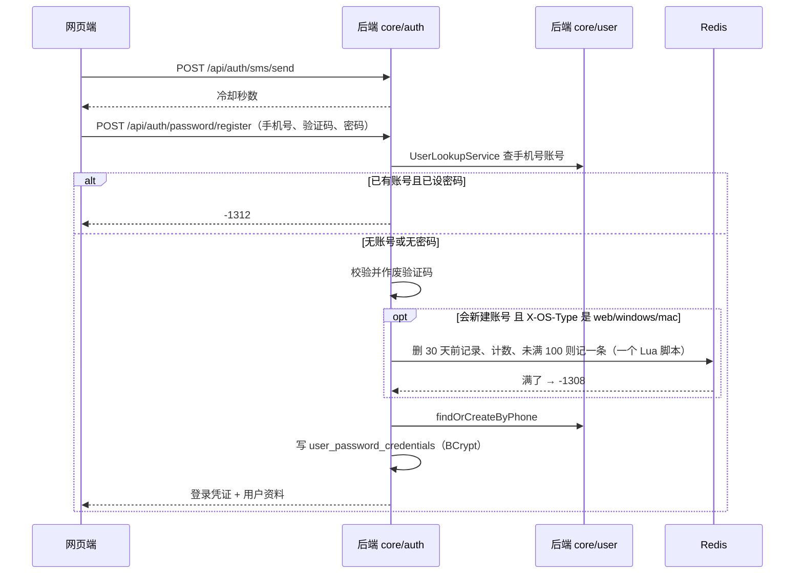
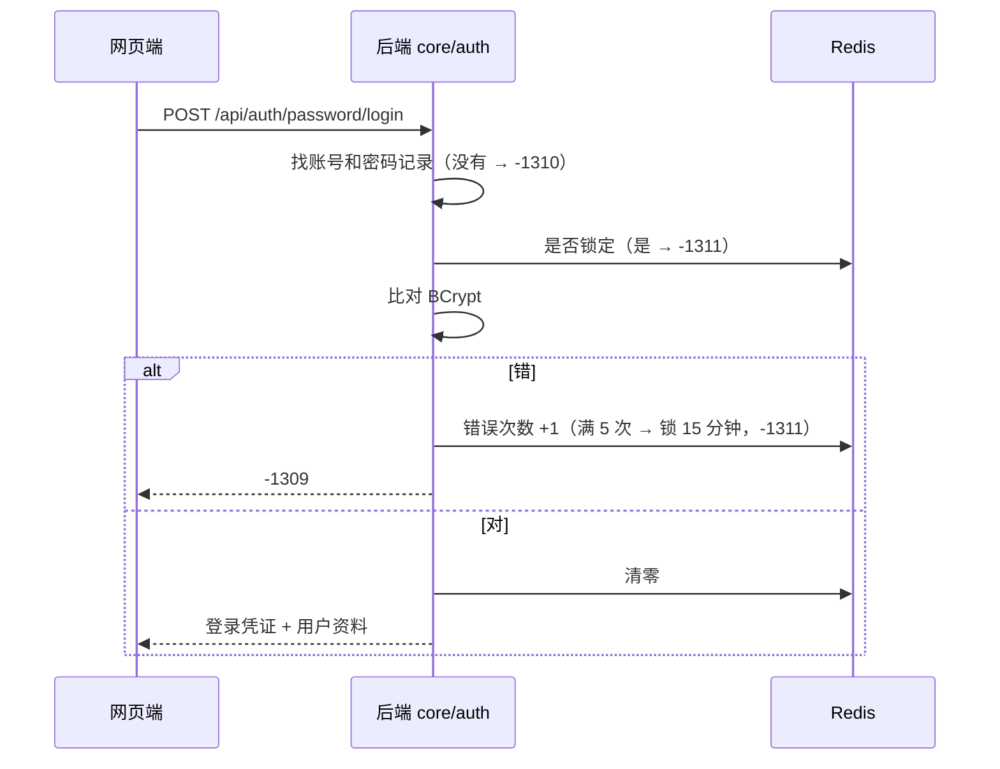
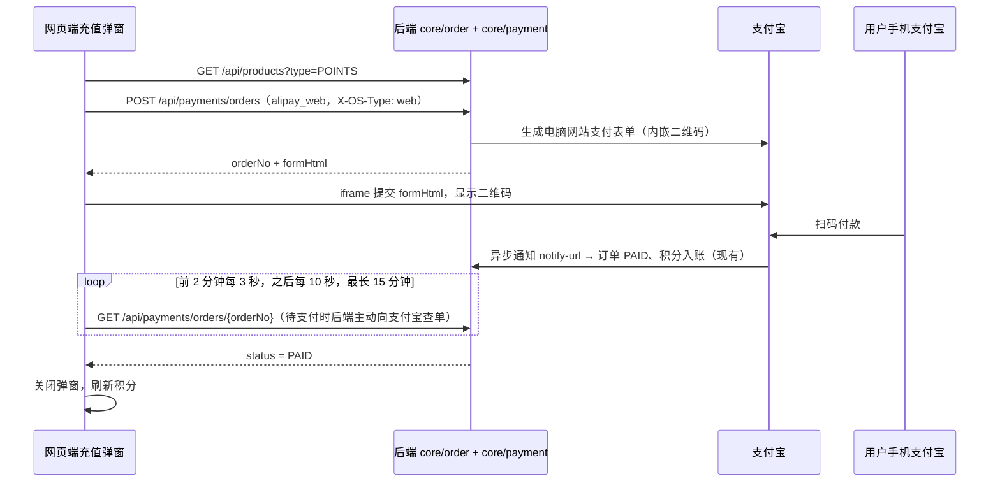
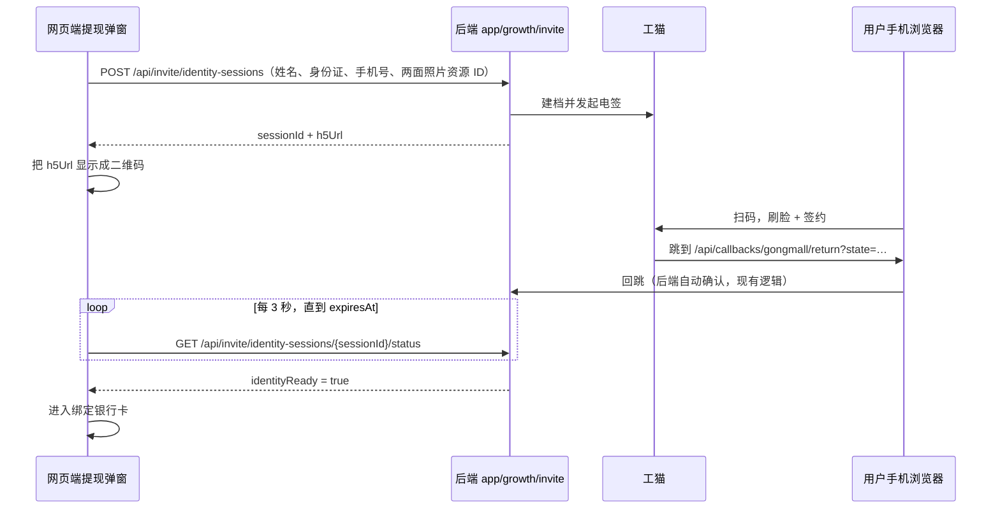

# 技术架构

> v1.0.0 做完后的**完整**技术架构。有架构变化时直接改，改过的小节下面加 `> 本版改动：R-xx`。
>
> 网页端技术栈 Flutter Web（技术方案 T-01，2026-11-15 确认）。

## 1. 技术栈

| 端 | 技术 | 版本 |
|---|---|---|
| 网页端 | Flutter Web（Dart），状态与路由 GetX，HTTP 用 dio | 与手机端相同：Dart `^3.11.4`、`get ^4.7.3`、`dio ^5.9.2` |
| 网页端常用包 | `shared_preferences`（localStorage）、`file_picker`、`qr_flutter`、`video_player`、`url_launcher` | 与手机端同版本 |
| 网页端字体 | 思源黑体（Noto Sans SC，SIL OFL），按常用字裁剪，常规 + 粗体 | 随网站发布 |
| 后端 | Java / Spring Boot（共用 `lxwxservice`） | Java 21、Spring Boot 3.x |
| 数据库 | PostgreSQL，每个 App 一个 schema | 15 |
| 缓存 | Redis | 7 |
| 迁移 | Flyway（`common` + `{appCode}` 目录） | — |

> 本版改动：R-01（新增网页端）

## 2. 仓库

| 仓库 | 路径 | 说明 |
|---|---|---|
| 网页端 | `/Users/soul/code/lxwx/catdrama-studio` | 本版新建 |
| 后端 | `/Users/soul/code/lxwx/lxwx_service/lxwxservice` | 多 App 共用；网页端与手机端都用 App Code `catdrama`，同一个 schema、同一份用户和作品数据。规则见该仓库 `AGENTS.md`、`.cursor/rules/` |
| 手机端（参考，不改） | `/Users/soul/code/lxwx/catdrama` | 网页端从这里复制接口调用、数据模型、文案后改造 |

## 3. 分层与目录

网页端（建议目录，开发计划定稿）：

```text
catdrama-studio/
  lib/
    main.dart              入口：读环境、注册路由、初始化 AuthStore / ConfigStore
    config/                三套环境地址、请求头开关（是否发送 X-OS-Type）
    apis/                  按后端模块分文件，从手机端 lib/apis 复制改造
    models/                数据模型，从手机端 lib/models/data 复制改造
    services/              http（凭证续期、错误码转换）、storage（localStorage）、download、file_reader（TXT 解码）
    store/                 AuthStore、ConfigStore（全局状态）
    routes/                路由表（技术方案 §6）
    layout/                左侧导航 + 顶栏 + 内容区的外壳
    pages/                 home、auth、create、story、screenplay、settings_production、assets_workbench、shots、works、assets、asset_detail、invite、points、orders、tasks、settings、feedback、docs
    widgets/               弹窗、按钮、卡片、空态、报价确认、待开放弹窗、二维码、iframe
    l10n/                  简体中文文案
  web/                     index.html、favicon、字体
```

后端：本版只在 `core/auth`（新增密码、网页注册限制）、`core/user`（新增 `UserLookupService`）、`core/payment`（电脑支付宝）、`framework/context`（`X-OS-Type`）四处改动；分层按后端 `.cursor/rules/02-项目结构目录.mdc`。

## 4. 关键流程

> 本版改动：R-04、R-11、R-23、R-24

### 4.1 注册 / 新手机号首次登录（网页端）



短信验证码登录（`/api/auth/sms/login`）在“会新建账号”时走同一个 IP 计数步骤。

### 4.2 密码登录与锁定



### 4.3 电脑扫码充值



掉单由后端对账任务 `PaymentOrderReconcileTask` 补（现有）。

### 4.4 电脑端实名核身电签（手机扫码）



### 4.5 登录凭证续期（与手机端相同）

接口返回 HTTP 401 → 用 `refreshToken` 调 `/api/auth/refresh` → 成功则用新凭证重放原请求；同一时间多个请求 401 只刷新一次；刷新失败 → 清除本地凭证、弹登录，当前页已填内容保留。

## 5. 环境与配置

| 环境 | 后端地址 | 网页地址（T-02 建议方案） | 说明 |
|---|---|---|---|
| 本地 | `http://10.12.1.75:8080` | `http://localhost:{端口}` | 后端默认跨域配置已放行 `localhost` |
| 测试 | `https://test.lxwanxiang.com` | `https://test.lxwanxiang.com/studio/` | 本机开发连测试环境：测试环境跨域配置需包含 `http://localhost:*` |
| 正式 | `https://www.lxwanxiang.com` | `https://www.lxwanxiang.com/studio/` | |

关键配置（详见技术方案 §5）：
- 网页端：与手机端相同，`Global.currentServerAddressType`（1=本机/2=测试/3=正式）选 `Constants` 里的地址，请求头开关 `SEND_OS_TYPE`（后端改动上线前为 false）。
- 后端：`app.admin.cors-allowed-origin-patterns`、`app.auth.sms-risk-trust-proxy-headers`、`app.auth.web-register-*`、`app.auth.password-*`、`alipay.web.*`。
- 阿里云 OSS：bucket 跨域规则放行网页域名。

> 本版改动：R-01、R-04、R-11、R-24

## 6. 三方服务

| 服务 | 用途 | 接入位置 | 备注（隐私声明、密钥位置） |
|---|---|---|---|
| 支付宝 电脑网站支付 | 网页积分充值（本版新用） | 后端 `core/payment`（`AliPayUtil`、`AlipayWebProvider`） | 密钥在服务器环境变量 `ALIPAY_WEB_*`；网页端不接触密钥 |
| 支付宝 手机网站 / App 支付 | 手机端充值（不变） | 同上 | |
| 阿里云短信 | 验证码登录、注册、重置密码 | 后端 `core/auth`（`SmsCodeService`、`AliyunSmsVerifyService`） | 现有 |
| 工猫 | 实名电签、提现代发 | 后端 `app/growth/invite` | 现有；电脑端由手机扫码完成刷脸 |
| 阿里云 OSS | 图片 / 视频存储、浏览器直传、签名访问 | 后端 `core/resource`；网页端直传和下载 | 需配置 bucket 跨域规则 |
| 思源黑体 | 网页中文字体 | 网页端 `web/` | SIL OFL 1.1，可商用、可随网站分发 |
