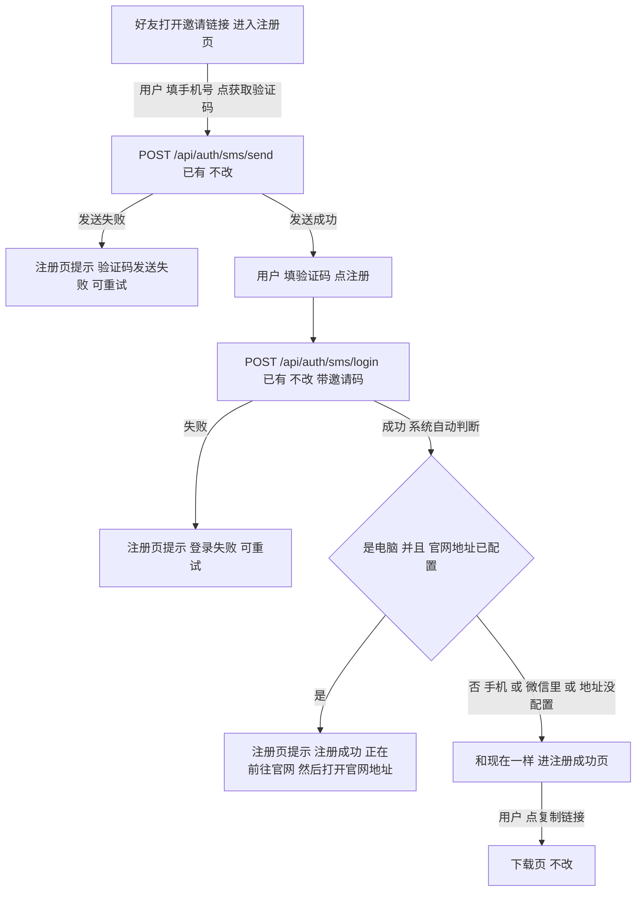

# M12 邀请注册页：电脑上注册成功后直接去官网（跨端：改后台工程 lxwx_admin）

> 给执行者：**这是跨端模块：只改后台工程 `/Users/soul/code/lxwx/lxwx_admin`，并且只改“跨端改动清单”里列出的 3 个文件；清单以外的后台文件（包括 `lib/` 下的 Flutter 后台代码、其他 App 的公开页面）、后端、网页端、手机端都不改。需要多改文件时先停下报告。** 本模块没有新界面，不改任何页面样式。遇到计划没写到的情况、外部条件缺失时，停下来报告，不要自行扩展或猜测。同一个问题最多修 3 次，仍未解决就记进总计划的问题清单。只读本文件，不读其他模块计划。按后台工程 `.cursor/rules/06-开发计划.mdc` 第六节，工作台的模块计划直接执行，不再套后台自己的计划模板；`00-编码工作流程.mdc` 仍然适用。 **做完后填写 §11“交付报告”，没填不算完成。**

## 接口改动总览

| # | 接口 | 改动 | 改之前 | 改之后 |
|---|---|---|---|---|
| 1 | 公开页面 `/sites/catdrama/flows/invite/register/`（好友打开邀请链接看到的注册页） | 行为变化（访问地址、参数不变） | 注册成功后一律进“注册成功”页，引导复制链接去下载 App | 手机上（含微信里）不变；**电脑上且官网地址已配置** → 注册成功后直接打开官网；官网地址没配置 → 和现在一样 |
| 2 | 公共脚本 `invite-api.js` 对外提供的方法（`window.CatdramaInvite`） | 新增 2 个 | `readContext`、`request`、`pageUrl`、`showInvite`、`isWeChat` | 多 `isDesktop()`（当前是不是电脑）、`desktopSiteUrl()`（官网地址，没配置或不合法返回空） |
| 3 | 后端接口 `POST /api/auth/sms/send`、`POST /api/auth/sms/login`、`GET /api/config/version-update` | 无改动 | — | 调用方式、参数都不变 |
| 4 | 后台管理端的页面、菜单、权限、Repository / ApiClient | 无改动 | — | — |
| 5 | 流程由谁推进 | 无改动 | — | 发验证码、注册由【用户】点；注册成功后去哪个页面由【系统】自动决定 |

### 跨端改动清单（只能改这 3 个文件）

| 文件（后台工程内） | 改什么 |
|---|---|
| `web/sites/catdrama/flows/invite/invite-api.js` | 加官网地址常量、`isDesktop()`、`desktopSiteUrl()`，并加进对外的 `window.CatdramaInvite` |
| `web/sites/catdrama/flows/invite/register/register.js` | 注册成功后：电脑且有官网地址 → 去官网；否则保持现在的跳转 |
| `test/catdrama_invite_web_test.mjs` | 新增用例 |

## 0. 基本信息

| 项 | 值 |
|---|---|
| 状态 | 已审核 |
| 后端 / 前端 / 联调 | 后端：—；后台公开页面：完成；联调：未开始（放到 M99） |
| 对应需求 | R-23；AC-23-9 |
| 依赖模块 | 无（不依赖网页端、后端的任何改动，可以单独做） |
| 审核日期 | 2026-11-16（用户确认） |
| 涉及仓库 | 后台 `/Users/soul/code/lxwx/lxwx_admin`（改）；后端、网页端、手机端（不改） |
| 工作分支 | 后台工程开工时由用户指定 |
| 执行者 | Codex |

## 1. 开工条件

| 条件 | 结果 | 依据 / 缺什么、需要谁提供 |
|---|---|---|
| 产品 | 满足 | 用户 2026-11-16：“原来的逻辑是进入注册页面，注册成功后会跳 app 下载页面，但是 web 端不需要调整 app 下载，直接跳转到官网就好了”；“是后台的注册页 `/Users/soul/code/lxwx/lxwx_admin`，不是想法，你需要进行到开发计划里面” |
| 设计 | 满足 | 没有新界面；只是注册成功后去的页面不同，注册页上的提示沿用现有提示文字的样式 |
| 技术契约 | 满足 | 后端接口不变；本文件“接口改动总览”第 1、2 行 |
| 外部条件 · 官网地址 | **待用户提供（不阻塞开工）** | 用户 2026-11-16：“现在没有，后续补上”。没有地址也可以把代码做完：常量留空，电脑上的行为和现在完全一样；用户给出地址后只改常量这一处（见 A-01 第 5 步） |
| 前置模块 | 满足 | 无 |
| 工具 | 待开工核对 | 本机有 Node（能运行 `node --test`）；改工作台里本文件的“结果”前，按后台工程 `AGENTS.md` 的路径门禁先运行 `/Users/soul/work/MakeCodePlanWord/scripts/workspace-path-guard.sh check 喵喵漫剧网页端 <本文件绝对路径>` |

## 2. 本次已读规范

| 仓库 | 规范文件 | 和本模块相关的关键条款 |
|---|---|---|
| 后台 | `AGENTS.md` | 流程工作区路径门禁；验证：`git diff --check`；静态页面的测试是 `.mjs` 文件 |
| 后台 | `.cursor/rules/00-编码工作流程.mdc` | 只改任务范围内的文件；跨端修改必须先说；交付时列出改动 |
| 后台 | `.cursor/rules/02-项目结构目录.mdc` | `web/sites/{App}/` 是公开访问的静态页面，不是 Flutter 后台页面，不用后台的 Repository 和登录态 |
| 后台 | `.cursor/rules/06-开发计划.mdc` 第六节 | 工作台模块计划里属于 Web 后台的任务，直接按模块计划执行 |
| 后台 | `docs/功能定位.md`“漫剧公开邀请页面” | 页面、脚本、样式在 `web/sites/catdrama/flows/invite/`；测试 `test/catdrama_invite_web_test.mjs`（Node 标准测试运行器） |

## 3. 现状摘要（2026-11-16 已读代码核对）

- `web/sites/catdrama/flows/invite/invite-api.js`：对外 `window.CatdramaInvite = {readContext, request, pageUrl, showInvite, isWeChat}`；`isWeChat()` 用 `navigator.userAgent` 判断 `MicroMessenger`；`pageUrl(page, context)` 生成本 App 的 `…/flows/invite/{page}/` 地址。
- `register/register.js`：表单提交 → `POST /api/auth/sms/login`（带 `inviteCode`，邀请关系在这一步绑定）→ 校验返回 → 提示“登录成功，正在前往成功页”→ `location.assign(成功页地址)`（微信里多带 `source=wechat`）。页面不保存登录凭据。
- `success/success.js`：成功页，提供“复制链接去浏览器下载”；从微信换到普通浏览器打开时自动跳下载页。`download/download.js`：读版本信息，提供 iOS / 安卓下载。**这两个文件本模块不改。**
- `test/catdrama_invite_web_test.mjs`：用 `vm` 加载页面脚本；辅助函数 `page(kind, {query, request, userAgent, …})` 返回的对象里 `assigned` 记录 `location.assign` 的地址；已有用例“公共短信登录携带邀请码并跳转本App成功页，不保存凭据”“微信登录成功附来源标记，普通浏览器不附加”。
- 同目录还有 `web/sites/catoutfit/flows/invite/`（另一个 App 的邀请页）和 `web/invite/*.html`：不属于喵喵漫剧，不改。

## 4. 流程图

- 后端接口两个，都是**已有、不改**。
- 判断由系统自动做，用户不需要选择。
- 失败的走向和现在完全一样（本模块不改失败处理）。

## 5. 界面与状态

| # | 界面 / 状态 | 依据 | 说明 |
|---|---|---|---|
| 1 | 注册页 · 电脑上注册成功 | 沿用注册页现有的成功提示样式（`message(text, 'success')`） | 提示文字“注册成功，正在前往官网”，随后打开官网 |
| 2 | 其余所有状态 | 不变 | 不改页面结构、样式、文字 |

## 6. 任务列表

### 6.1 后台公开页面任务（只改 `/Users/soul/code/lxwx/lxwx_admin`）

#### A-01 电脑上注册成功后去官网
- 状态：完成
- 关联需求：R-23
  - AC-23-9：好友在**电脑**上打开邀请链接并注册成功 → 不进“注册成功、引导下载 App”的页面，直接打开我们的官网；在**手机**上（含微信里）注册成功后的流程不变。官网地址还没有配置时，电脑上也按现在的流程走（用户 2026-11-16 提出；改的是后台工程 `lxwx_admin` 里的邀请注册页，M12）。
- 对应接口改动：总览第 1、2 行
- 文件：修改 `web/sites/catdrama/flows/invite/invite-api.js`、`web/sites/catdrama/flows/invite/register/register.js`；修改 `test/catdrama_invite_web_test.mjs`
- 具体做法：
  1. `invite-api.js` 顶部加一个常量 `const desktopSite = '';`，上面写一行注释“官网地址；空 = 还没有官网，电脑上也走原来的流程”。**现在就留空。**
  2. `invite-api.js` 加 `isDesktop()`：用 `navigator.userAgent` 判断，下面任一条成立就**不是**电脑，都不成立才是电脑——① `isWeChat()` 为真（微信里一律按现在的流程）；② 含 `Android`、`iPhone`、`iPad`、`iPod`、`HarmonyOS`、`Mobile` 之一（不分大小写）；③ 含 `Macintosh` 且 `navigator.maxTouchPoints > 1`（新款 iPad 会自称 Mac）。
  3. `invite-api.js` 加 `desktopSiteUrl()`：`desktopSite` 去掉首尾空格后为空 → 返回空字符串；否则用 `new URL(...)` 解析，只接受 `https:` 开头、不带用户名密码的地址，返回它的 `href`；解析失败或不符合 → 返回空字符串。把 `isDesktop`、`desktopSiteUrl` 加进 `window.CatdramaInvite`。
  4. `register.js`：在现有“登录结果完整性校验”通过之后、原来 `message('登录成功，正在前往成功页', 'success')` 之前，加：`const site = api.isDesktop() ? api.desktopSiteUrl() : '';`，`site` 非空 → `message('注册成功，正在前往官网', 'success'); location.assign(site); return;`。`site` 为空 → 走原来的代码，一个字不改。**官网地址后面不拼任何东西**：不带手机号、邀请码、登录凭据（邀请关系在登录接口里已经绑定；这个页面本来就不保存登录凭据）。
  5. 用户提供官网地址以后：只把第 1 步的 `desktopSite` 改成那个地址，其他不动，重新跑测试；后台静态页面的发布由用户做，执行者不部署。
  6. 测试（加在 `test/catdrama_invite_web_test.mjs`，沿用文件里现有的 `page(...)` 辅助函数和 `assigned`）：需要“官网地址已配置”的用例，在测试里用字符串替换把 `const desktopSite = '';` 换成测试地址后再加载脚本，**不为了测试在正式代码里加开关或读取外部变量**。用例：① 电脑浏览器（如 Windows Chrome 的 UA）+ 地址已配置 → `assigned` 只有官网地址，且地址里没有邀请码、手机号、`token`；② 电脑 + 地址为空 → 进原来的成功页（和现有用例结果相同）；③ 安卓、iPhone 的 UA + 地址已配置 → 进原来的成功页；④ 微信 UA（含电脑版微信）+ 地址已配置 → 进原来的成功页并带 `source=wechat`；⑤ 自称 Mac 且 `maxTouchPoints = 5` + 地址已配置 → 进原来的成功页；⑥ 地址配置成 `http://…` 或乱写的字符串 → 当作没配置；⑦ 现有全部用例不改、仍然通过。
- 不要做：不改 `success/`、`download/`、任何 `.html`、`.css`；不改 `catoutfit` 等其他 App 的邀请页；不改 `lib/` 下的后台代码；不改后端；不把登录凭据、手机号、邀请码带到官网地址上；不自己猜一个官网地址填进去
- 验证：`node --test test/catdrama_invite_web_test.mjs` 全部通过；`git diff --check`；`git status --short` 只有清单里的 3 个文件。这个页面要和后端同域名才能发请求，本机不方便真实打开，真实浏览器里的核对放到 M99（官网地址配置并发布以后）
- 完成标准：7 类用例都有并通过；改动只在 3 个文件内；常量为空时，电脑、手机上的行为和改之前逐项相同
- 结果：完成。后台工程提交 `f099022`（当前分支 `main`；计划写“开工时由用户指定”，没问到，用了当前分支，见总计划 §5）。`invite-api.js`：顶部常量 `desktopSite = ''`（留空，没猜地址）、`isDesktop()`（微信里、UA 含 Android/iPhone/iPad/iPod/HarmonyOS/Mobile、Macintosh 且 `maxTouchPoints > 1` 都不算电脑）、`desktopSiteUrl()`（只接受不带用户名密码的 `https:` 地址，否则空字符串），加进 `window.CatdramaInvite`。`register.js`：登录结果校验通过后，`site` 非空 → 提示“注册成功，正在前往官网”并 `location.assign(site)`（不拼任何参数），否则原代码一字不改。测试新增 6 个用例覆盖计划 ①～⑥（⑦ 原有 24 个用例不改），测试里用字符串替换常量；`node --test test/catdrama_invite_web_test.mjs` 30/30 通过；`git diff --check` 通过；提交只含 3 个文件（工作区里原有的其他改动，包括已暂存的，没动、没提交）。（Codex 2026-11-16 检验：本机Node测试30/30通过、限定diff检查通过、后台Git状态前后一致；官网URL仍未提供，真实跳转留M99；详见已执行/检验-M02至M12-全部代码.md。）

### 6.2 联调

本模块不单独联调（没有接口变化，本机也没法真实打开这个页面）。真实核对在 M99：官网地址配置并发布后台静态页面以后，按 §8 走一遍。

## 7. 不改动范围

- 后台工程：除“跨端改动清单”3 个文件以外的全部文件。
- 后端、网页端仓库、手机端仓库：全部不改。
- 其他 App（`catoutfit` 等）的邀请页：不改。

## 8. 模块验收路径（官网地址配置并发布后，在 M99 走）

| 步骤 | 推进 | 操作 | 预期 | 覆盖 AC |
|---|---|---|---|---|
| 1 | 用户 | 电脑浏览器打开一条邀请链接，用新手机号注册 | 提示“注册成功，正在前往官网”，然后打开官网；邀请人的邀请记录 +1 | AC-23-9、AC-23-2 |
| 2 | 用户 | 手机浏览器打开同一条链接，用另一个新手机号注册 | 和以前一样进“注册成功”页，可以复制链接去下载 | AC-23-9 |
| 3 | 用户 | 微信里打开链接注册 | 和以前一样（成功页 + 微信引导） | AC-23-9 |
| 4 | 用户 | 官网地址还没配置时，电脑上注册 | 和以前一样进“注册成功”页 | AC-23-9 |

## 9. 风险与回滚

- 官网地址还没有：常量留空，上线后行为和现在完全一样，不会有半成品。
- 用浏览器自报的信息判断是不是电脑，不是百分之百准确：判断错的结果只是“电脑上看到了下载引导”或“平板上被带去官网”，不影响注册和邀请关系。
- 注册页不保存登录凭据，到官网以后好友需要自己再登录一次。
- 回滚：把常量改回空，或回退这 3 个文件。

## 10. 调整记录

| 日期 | 改了什么 | 原因 |
|---|---|---|
| 2026-11-16 | 建立 | 用户要求：电脑上通过邀请链接注册成功后直接去官网，不去 App 下载页；改的是后台工程 `lxwx_admin` 的邀请注册页，要进开发计划 |
| 2026-11-16 | 自查后调整：§11 改成适合本模块的内容（没有后端、没有假数据、没有截图，改为看测试输出和改动文件） | 用户：“都帮我审核了吧” |

## 11. 交付报告与手动检测

> 用户 2026-11-16 要求：前端做完要告诉我完成了哪些页面与功能，后端做完要告诉我新增了哪些接口，接入大模型的要有调试程序。**执行者：后端任务全部做完填 11.1，前端任务全部做完填 11.2，有大模型调用填 11.3；没填完不算“完成”。** 没有该端任务的小节写“无”。先保证每一端单独没问题：后端已有的接口前端直接连本机后端调通，只有后端还没做出来的新接口用假数据（§6.2“联调方式”）；整体联调由用户后面做。

### 11.1 后端交付：新增 / 修改了哪些接口

无（本模块不改后端）。

### 11.2 后台公开页面交付：改了哪些页面与行为

按 §5 每行一行；§5 以外改了的行为也要列出并说明原因。

| §5 # | 页面 / 功能 | 怎么进入（路由，或从哪里点进去） | 状态（完成 / 部分 / 没做） | 数据来源（本机后端真接口 / 假数据） | 怎么看到各个状态（真实数据怎么造，或假数据输入什么） | 截图位置 |
|---|---|---|---|---|---|---|
| 1 | 注册页 · 电脑上注册成功 | 电脑浏览器打开 `/sites/catdrama/flows/invite/register/?appCode=catdrama&inviteCode=…` 注册 | 完成（官网地址为空时不生效） | 本机测试（`vm` 加载页面脚本，假的接口回执） | 测试里把常量替换成 `https://www.example-official.test/` | 用例“电脑浏览器注册成功且已配置官网：直接去官网，不带邀请码、手机号和凭据” |
| 2 | 其余所有状态 | 同上 | 不变 | 同上 | 电脑未配置、安卓 / iPhone、微信（含电脑版）、触屏 Mac、非法地址都进原成功页 | 用例“电脑浏览器未配置官网地址…”“手机浏览器即使已配置官网…”“微信里（含电脑版微信）…”“自称 Mac 的触屏平板…”“官网地址不是 https…” |

- 测试命令和结果：`node --test test/catdrama_invite_web_test.mjs` → `# tests 30 / # pass 30 / # fail 0`（2026-11-16 洛杉矶时间晚上运行）。
- 改动文件（提交 `f099022`）：`test/catdrama_invite_web_test.mjs | 84 +++-`、`web/sites/catdrama/flows/invite/invite-api.js | 25 ++-`、`web/sites/catdrama/flows/invite/register/register.js | 7 +`，和任务“文件”一栏一致。测试辅助函数 `page()` 加了两个可选参数 `commonSource`、`maxTouchPoints`（默认值和原来一样，原用例不受影响）。

### 11.3 大模型调试

本模块没有大模型调用，不需要调试程序。

### 11.4 用户手动检测（每一端做完就可以查，不用等联调）

| # | 什么时候 | 做什么 | 怎么算过 | 结果 | 问题 |
|---|---|---|---|---|---|
| 1 | 本模块做完 | 查有没有偷改：在后台工程运行 `git status --short` | 只有 3 个文件：`invite-api.js`、`register/register.js`、`test/catdrama_invite_web_test.mjs`；后端、网页端、手机端仓库没有变化 | | |
| 2 | 本模块做完 | 在后台工程运行 `node --test test/catdrama_invite_web_test.mjs` | 全部通过，新加的 7 类用例都在 | | |
| 3 | 本模块做完 | 打开 `invite-api.js` 看常量 | `desktopSite` 是空的（没有被填上猜的地址） | | |
| 4 | 有官网地址并发布以后（M99 第 15 步） | 电脑、手机、微信各打开一条邀请链接注册 | 和 §8 一致 | | |

有不过的：写进总计划第 5 节“问题清单”，注明属于后端、前端还是接口文档，继续下一个模块。
